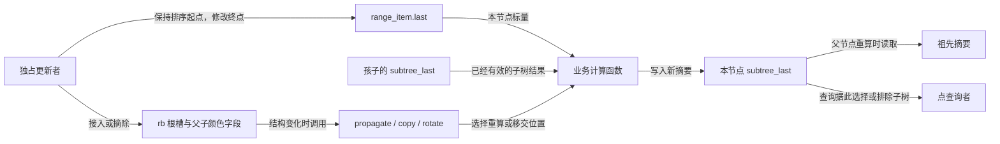
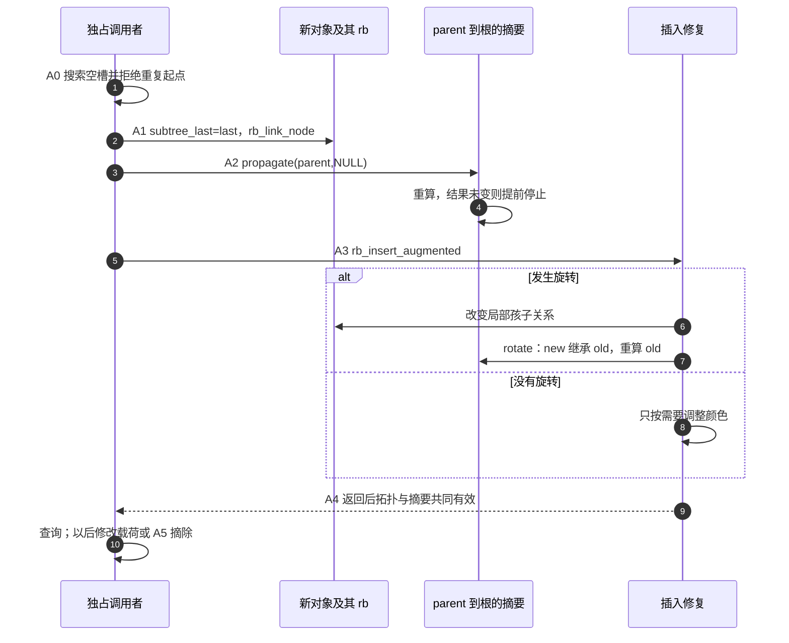

# 第44章\_区间查询与子树摘要

最左缓存只回答全树的第一个对象在哪里。如果任务改成“哪个区间覆盖这个点”，按起点排序还不能跳过所有无关节点。本章由这一缺口推出每个子树的摘要，并沿同一轮插入、旋转和删除维护它。

## 44.1\_augmented\_rbtree\_增强红黑树

缓存一个最左地址之后，再看另一种附加状态：每个节点为整棵子树保存一份摘要。本节沿区间查询建立摘要的含义，再追踪它在接入、旋转和摘除时如何保持有效。

## 44.2\_什么是\_augmented\_rbtree

最左缓存回答了“当前第一个对象在哪”，却不能替我们回答另一类问题：一批有效地址范围按起点排好了，地址 72 落在哪个范围里？设每个对象保存闭区间 `[first,last]`，两个端点都包含在范围内。只看起点，`[30,80]` 能覆盖 72，`[35,40]` 却不能。按起点比较一次后，不能像查找一个确定键那样简单地丢弃另一半区间。

最直接的方法是按序检查每个范围。这种方法容易验证，数据很少、查询不频繁时也完全值得保留。缺口出现在范围多而点查询频繁时：大量范围早已在 72 之前结束，查询却仍须逐个读取对象才能知道这一点。我们想为整棵子树留一份摘要，提前回答“这里有没有结束位置足够大的区间”。

给每个业务对象增加 `subtree_last`，表示 **以自己的 rb 成员为根的整棵子树中最大的 last**。于是节点的摘要满足：

```text
subtree_last = max(自己的 last,
                   左子树的 subtree_last（如果有左孩子）,
                   右子树的 subtree_last（如果有右孩子）)
```

如果某棵子树的摘要小于 72，其中每个区间都已在 72 之前结束，可以整体跳过。这就是增强红黑树的起点：普通树继续负责排序与平衡，业务对象多存一份可沿树形组合的子树信息。子树计数、最小值、最大值和区间上界都可能承担这样的职责；具体摘要应由查询问题推出，不能因为宏现成就随手塞一个统计字段。

这里同时维护三组状态：父子关系与颜色、业务载荷 `first/last`、摘要 `subtree_last`。本例只用 first 排序，last 是范围终点；改变 first 需要摘除后重新接入，改变 last 则可在保护下保留树形并更新摘要。树依旧平衡并不证明摘要正确。一个新增区间改变了祖先覆盖的对象集合，旋转改变了局部根所覆盖的对象集合，删除又从集合中拿走一个对象；普通修复代码不知道我们的 last 存在哪，因而需要业务回调在这些事件上同步摘要。



图中的通信是同一更新调用内对对象字段的读写，没有自动的跨 CPU 通知协议。示例使用私有对象；若放到共享树，保护范围必须同时覆盖拓扑、载荷和摘要。只锁旋转或者只把摘要改成原子变量，不能让查询看到同一时刻的一组状态。

## 44.3\_struct\_rb\_augment\_callbacks\_的三个回调

先从[固定版本阅读索引](../../../../research/source_reading/rbtree/navigation/P01_Linux_6.12_rbtree源码阅读索引.md#1.1_固定提交与阅读边界)进入源码，再看[增强模块的 A0～A5](../../../../research/source_reading/rbtree/navigation/P09_子树摘要与增强回调导读.md#9.2_沿A0到A5维护同一份摘要)。本节使用 NXP 官方固定 Linux 6.12.20 的接口；宏和字段的唯一实现放在[回调结构](../../../../research/source_reading/rbtree/source_explanations/include/linux/rbtree_augmented.h.md#1.7_三个回调的结构契约)，正文先建立它们为什么分成三类。

| 变化 | 回调 | 它交付什么 |
| --- | --- | --- |
| 一条祖先路径覆盖的对象集合改变 | `propagate(node, stop)` | 从 node 向父方向重算，stop 不包含在重算范围内；模板发现结果未变可提前结束 |
| 删除中后继接替旧节点的位置 | `copy(old, new)` | 把旧局部根的摘要交给新局部根，作为接替过程的起点；不是复制整个业务对象 |
| 旋转改变两个局部根的子树范围 | `rotate(old, new)` | 让提升后的 new 接住旧整体摘要，再重算覆盖范围缩小的 old |

这里的 old/new 指特定结构动作的两个节点，不是“申请新对象再释放旧对象”。copy 后也不意味着删除完成：旧摘要可能仍把将被删除的范围计算在内，之后必须重新传播。判断完成要看整次更新的稳定观察点，不能把某个回调返回当作全部不变量已恢复。

## 44.4\_增强信息为什么需要随旋转更新

保留此前的左旋模型，把没画出的外侧子树记成 L 和 R：

```text
        old                         new
       /   \                       /   \
      L    new        -->        old    R
          /   \                 /   \
         T     R               L     T
```

旋转前后的中序顺序始终是 `L, old, T, new, R`。提升后的 new 覆盖的对象集合，与旋转前 old 覆盖的集合完全相同。因此，对“集合内所有 last 的最大值”来说，new 可以直接继承 old 原有的摘要。随后 old 只覆盖 L、自己和 T，必须根据自己的新孩子重算；若仍沿用旧摘要，它可能继续宣称自己包含 R 中最大的端点。

这解释了模板 rotate 的顺序：先把 old 的旧摘要写给 new，再强制重算 old。先重算 old 再复制，会把较小的新集合摘要错交给 new。把 new 的当前孩子简单合并也不一定安全，因为其中 old 的摘要正在等待修正。

这套移交有两个前提。第一，旋转前 old 的摘要已经正确；所以不能靠旋转顺便修复所有此前漏掉的传播。第二，摘要只取决于这批对象的聚合内容，不取决于当前树形。最大值、正确类型与运算约束下的计数或求和可以满足这种旋转不变性；子树高度和依赖树形的哈希通常不能直接套用这个复制模板。后者需要另行设计回调，并证明每个修复事件上的更新顺序。

## 44.5\_RB\_DECLARE\_CALLBACKS()\_与\_RB\_DECLARE\_CALLBACKS\_MAX()

现在再看生成器就不只是记参数名了。`RB_DECLARE_CALLBACKS` 接受可见性、回调组名称、业务结构体、嵌入 rb 成员、摘要字段，以及重算函数。它生成同组的 propagate、copy、rotate 和回调表。重算函数接收业务节点与 `exit` 布尔参数：`exit=true` 时若结果未变，返回 true 允许传播停止；否则写入结果并返回 false。旋转回调传 false，要求 old 真正完成一次重算，不允许把提前退出作为省略更新的理由。

提前结束不是碰运气。假设节点的两个孩子摘要已经正确，本节点由旧值重算得到相同值，而祖先只通过这个摘要感知这棵子树，那么祖先输入没有变化，自然无须继续。若祖先还读取其他未纳入摘要的变化量，或者孩子摘要已经过时，这条推理便不成立。

`RB_DECLARE_CALLBACKS_MAX` 在通用模板外再生成一层最大值计算：调用者只需提供返回 **单个节点原始标量** 的函数，生成器读取存在的孩子摘要、取最大值、比较旧值，再交给通用回调。示例的 `item_last()` 返回 last，不是返回 subtree_last。把缓存值再次当成原始值会使删除最大值后无法降下来。

具体参数与宏体分别在[通用回调模板](../../../../research/source_reading/rbtree/source_explanations/include/linux/rbtree_augmented.h.md#1.8_通用模板的停止与移交)和[最大值生成器](../../../../research/source_reading/rbtree/source_explanations/include/linux/rbtree_augmented.h.md#1.9_从本节点标量生成最大值)。宏只减少重复代码，不能替调用者证明摘要的数学含义，也不会替新叶子初始化业务字段。

在下面的范围对象中，各参数具体对应这些类型或字段；两种生成器的最后一项有不同的函数契约：

| 参数 | 通用模板 | MAX 模板在本例中的取值与职责 |
| --- | --- | --- |
| `RBSTATIC` | 回调表的可见性，可写 static 或留空 | `static`，只在当前编译单元使用 |
| `RBNAME` | 生成的回调表及函数名称前缀 | `range_callbacks` |
| `RBSTRUCT` | 业务结构体类型 | `struct range_item` |
| `RBFIELD` | 业务对象中嵌入的树节点成员 | `rb` |
| `RBTYPE` | 通用模板没有此参数 | `unsigned long`，端点与最大值的类型 |
| `RBAUGMENTED` | 保存子树聚合值的成员 | `subtree_last` |
| `RBCOMPUTE` | 接收业务节点和 exit，重算摘要并返回能否停止 | `item_last`，只返回本节点原始 last；模板负责合并孩子 |

## 44.6\_rb\_insert\_augmented()\_的插入流程

选择一个容易验证的插入顺序：先完成查重，再初始化新叶子的摘要为自己的 last，接入空槽，从 parent 向上传播，最后调用增强插入修复。查重阶段没有修改祖先，所以重复起点失败不会留下“树没插入、摘要却变大”的半次操作。本例故意拒绝重复起点；它是示例的业务政策，不是红黑树接口的普遍要求。



这个先接入再向上传播的顺序，与固定版本的 [rb_add_augmented_cached](../../../../research/source_reading/rbtree/source_explanations/include/linux/rbtree_augmented.h.md#1.11_缓存增强插入的挂接与传播)一致。该辅助函数还维护最左缓存，但不会替使用者初始化叶子摘要或拒绝重复业务键。它从 parent 开始传播，若叶子缓存没初始化，错误会由孩子传到祖先。

另一种设计可在搜索下降时更新路径上的最大值，避免之后重走父链；但它必须保证不会在后续查重、分配或其他失败中留下未发生的插入。应先解决失败语义，再讨论少走一次路径的收益。固定辅助函数的 `suboptimal` 注释不等于正确性缺陷，也不证明任意改成边搜边写都会更合适。

尤其要区分“增强插入接口”与“完整业务插入”。[rb_insert_augmented](../../../../research/source_reading/rbtree/source_explanations/include/linux/rbtree_augmented.h.md#1.10_增强插入只接入旋转回调)把 rotate 交给平衡修复，**并不自动从新节点执行 propagate**。若本次无旋转，缺少 A2 的错误更容易藏住：键序、颜色和父链全对，祖先摘要仍是旧值。

## 44.7\_rb\_erase\_augmented()\_的删除流程

插入时最大值常常只增不减，删除却必须处理最大值消失。设一棵子树同时包含 `[30,80]` 和 `[35,40]`，删去前者后，摘要应降到剩余对象的最大终点，不能保留 80。保留偏大的值不总是“只是多查几步”：查询怎样使用摘要决定了错误后果，本节后面的单路径查找就会据此选错方向。

增强删除仍沿已有[对象摘除与缺黑修复 D0～D4](../../../../research/source_reading/rbtree/navigation/P04_对象摘除与缺黑修复导读.md#4.2_从对象到缺黑父槽)前进。新的职责是给这些结构事件配上摘要操作：

| 结构事件 | 摘要的变化与接下来的读者 |
| --- | --- |
| 直接移走零/单孩子节点 | 从结构变化所在的祖先开始传播，让上层读到剩余子树的摘要 |
| 右孩子直接作为后继 | copy 将旧位置摘要暂交后继；后继完成接管后，再从它向上重算 |
| 后继来自右子树深处 | copy 之后先从后继的旧 parent 传播到 successor 之前，修复移走后继留下的旧路径 |
| 后继接管左右子树并换入旧位置 | 从已接管的 successor 向根传播，扣除真正被删对象的贡献 |
| 还需颜色修复并发生旋转 | rotate 更新旋转的局部摘要；颜色变化本身不改变最大值 |

深层后继需要两段传播，是因为它既离开一个位置，又接管另一个位置。第一段的 stop 是 successor，**不重算 stop 本身**；此时它尚处在接替过程之中。最后一次传播才使用接管完成后的左右孩子重算。copy 提供旧位置的比较基准，不是断言新位置最终仍等于旧值。只保留 copy 而删掉末次传播，会把被删最大值继续算进结果。

唯一结构代码仍在[结构摘除与缺黑父槽](../../../../research/source_reading/rbtree/source_explanations/include/linux/rbtree_augmented.h.md#1.3_结构摘除与缺黑父槽)，公共收尾见[增强删除与旋转回调](../../../../research/source_reading/rbtree/source_explanations/include/linux/rbtree_augmented.h.md#1.12_增强删除的两段收尾)。不要把 copy 回调当成 `rb_replace_node` 的通用增强包装；换入业务对象时，其载荷和祖先摘要也必须符合自己的业务协议。

还有一种不改变树形的更新：保持 first 不动，将 `[30,80]` 的 last 改为 33。此时应先改原始 last，再从这个节点调用 propagate，保留旧 subtree_last 供计算器比较。若先把 subtree_last 改成 33，再从自己传播，模板可能发现“算出的 33 与当前 33 一样”而立即停下，祖先仍保留 80。排序键 first 改变则不同，应按受保护的摘除与重新插入处理，不能仅传播摘要。

## 44.8\_增强树为什么容易让代码体积膨胀

固定版本的 `Documentation/core-api/rbtree.rst` 提醒：增强删除的传播与复制回调可能被内联进删除骨架，使编译结果较大；每个增强树使用者宜集中一个增强删除调用点。原文讨论的是 **编译器可能内联造成的代码体积**，不是“每个编译单元只能拥有一棵增强树”的接口限制。

将删除集中在一个业务封装里，可以同时集中成员关系、同步和对象退出的约束，避免多处展开相同组合。最终机器码是否重复、重复多少，还受编译器、优化和链接影响；没有反汇编或体积对照时，不能把宏数量直接换算成性能或字节数。本例没有进行这种测量。

## 44.9\_用完整区间周期检查摘要

现在将上述分散的更新事件放进同一个范围集合：先插入，再查覆盖点，缩短最大端点，最后逐个删除。独立重算只读取原始端点和结构，避免让待检查的摘要替自己作证。

### 44.9.1\_运行完整区间摘要实验

下面的完整模块把六个闭区间插入私有树，查找点 72，再缩短其中唯一覆盖 72 的区间，最后逐个删除。材料是 [note_rbtree_augmented.c](../../../../labs/kernel/tree_basics/materials/note_rbtree_augmented.c)，构建入口仍是前节使用的 [Makefile](../../../../labs/kernel/tree_basics/materials/Makefile)。这里没有向其他任务发布任何节点，自动对象一直活到初始化返回；模块退出函数无待回收对象。

`inspect_summary()` 递归读取原始 last 独立计算期望值，逐个核对缓存，而不是拿缓存验证缓存。空子树返回 0 只因本例端点为非负无符号数，不能原封不动推广到允许负数的最大值问题。

`insert_range()` 的 `-EEXIST` 表示相同起点已存在，`-EINVAL` 表示无效范围或实验检查失败。返回失败时没有发布新对象，也没有改动已有摘要；它不提供在树节点上重复插入同一成员的通用防护，调用者仍须保证每个待插成员尚未挂接。

```c
// SPDX-License-Identifier: GPL-2.0
/* 闭区间摘要：私有自动对象，不发布并发入口。 */
#include <linux/init.h>
#include <linux/module.h>
#include <linux/rbtree_augmented.h>
#include <linux/errno.h>

struct range_item {
    unsigned long first;
    unsigned long last;
    unsigned long subtree_last;
    struct rb_node rb;
};

static unsigned long item_last(struct range_item *item)
{
    return item->last;
}

RB_DECLARE_CALLBACKS_MAX(static, range_callbacks, struct range_item, rb,
                        unsigned long, subtree_last, item_last)

static int insert_range(struct rb_root *root, struct range_item *item)
{
    struct rb_node **link = &root->rb_node;
    struct rb_node *parent = NULL;
    if (item->first > item->last)
        return -EINVAL;
    while (*link) {
        struct range_item *entry = rb_entry(*link, struct range_item, rb);
        parent = *link;
        if (item->first < entry->first)
            link = &parent->rb_left;
        else if (item->first > entry->first)
            link = &parent->rb_right;
        else
            return -EEXIST; /* 重复起点失败时尚未改任何祖先摘要。 */
    }
    item->subtree_last = item->last;
    rb_link_node(&item->rb, parent, link);
    range_callbacks.propagate(parent, NULL);
    rb_insert_augmented(&item->rb, root, &range_callbacks);
    return 0;
}

/* 独立递归读取原始 last，不拿缓存字段计算期望最大值。 */
static unsigned long inspect_summary(struct rb_node *node, bool *valid)
{
    struct range_item *item;
    unsigned long result, child;
    if (!node)
        return 0;
    item = rb_entry(node, struct range_item, rb);
    result = item->last;
    child = inspect_summary(node->rb_left, valid);
    if (child > result)
        result = child;
    child = inspect_summary(node->rb_right, valid);
    if (child > result)
        result = child;
    if (item->subtree_last != result)
        *valid = false;
    return result;
}

/* 返回任意覆盖 point 的闭区间；只能在本例独占且摘要正确时使用。 */
static struct range_item *find_point(struct rb_root *root, unsigned long point)
{
    struct rb_node *node = root->rb_node;
    while (node) {
        struct range_item *item = rb_entry(node, struct range_item, rb);
        if (node->rb_left) {
            struct range_item *left = rb_entry(node->rb_left, struct range_item, rb);
            if (left->subtree_last >= point) {
                node = node->rb_left;
                continue;
            }
        }
        if (item->first > point)
            return NULL;
        if (item->last >= point)
            return item;
        node = node->rb_right;
    }
    return NULL;
}

static int __init note_augmented_init(void)
{
    struct range_item items[] = {
        {.first=20,.last=21}, {.first=10,.last=12}, {.first=30,.last=80},
        {.first=25,.last=29}, {.first=35,.last=40}, {.first=5,.last=6}
    };
    struct rb_root root = RB_ROOT;
    struct range_item *found;
    bool valid = true;
    unsigned int i;
    for (i = 0; i < ARRAY_SIZE(items); ++i) {
        if (insert_range(&root, &items[i]))
            return -EINVAL;
        inspect_summary(root.rb_node, &valid);
        if (!valid)
            return -EINVAL;
    }
    found = find_point(&root, 72);
    if (found != &items[2])
        return -EINVAL;
    pr_info("note_augmented: max=80, point72 finds [30,80]\n");

    /* 排序起点不变，只改载荷；从该节点重算，不预先覆盖旧摘要。 */
    items[2].last = 33;
    range_callbacks.propagate(&items[2].rb, NULL);
    if (inspect_summary(root.rb_node, &valid) != 40 || !valid ||
        find_point(&root, 72))
        return -EINVAL;
    pr_info("note_augmented: payload shrinks, max=40, point72 absent\n");

    for (i = 0; i < ARRAY_SIZE(items); ++i) {
        rb_erase_augmented(&items[i].rb, &root, &range_callbacks);
        inspect_summary(root.rb_node, &valid);
        if (!valid)
            return -EINVAL;
    }
    if (root.rb_node)
        return -EINVAL;
    pr_info("note_augmented: all removals preserve summaries\n");
    return 0;
}

static void __exit note_augmented_exit(void)
{
    /* 自动存储对象已在初始化返回前结束，未向外部发布地址。 */
}
module_init(note_augmented_init);
module_exit(note_augmented_exit);
MODULE_LICENSE("GPL");
MODULE_DESCRIPTION("Private augmented rbtree interval summary exercise");
```

程序中的 `find_point()` 每层只选一条路，返回任意一个覆盖区间，不枚举所有重叠项。为什么左摘要足够大时可以直接向左？若当前起点大于查询点，当前与右子树都不能命中，只需继续在左边找；即使左边最后也没有答案，也没有丢失右边的候选。若当前起点不大于查询点，左子树所有起点都更小；左摘要至少等于查询点，便保证左侧确实存在一个足够长的区间。沿这套选择向下走，遇到当前起点已大于点即可退出；在排除左边且自己未覆盖后，才进入右边。这依赖起点有序与摘要精确共同成立，单独平衡没有用。

每步下降一层，所以树有效时这次点查找走 O(log n) 高度；程序中的递归审查仍是 O(n)，用于教学检查而非热点查询。先预测再在与目标内核匹配、已配置并准备的构建树上运行：

```bash
# 在仓库根目录；KDIR 指向已配置、准备好且匹配目标内核的构建树。
: "${KDIR:?先设置匹配目标内核的构建目录}"
: "${CROSS_COMPILE:?先设置 ARM 交叉工具链前缀}"
make -C "$KDIR" ARCH=arm CROSS_COMPILE="$CROSS_COMPILE" M="$PWD/labs/kernel/tree_basics/materials" modules
```

这里按本专题 ARM32 目标构建；`M` 指定外部模块目录，现有 Makefile 会构建该目录登记的多个模块。KDIR、配置和工具链必须匹配实际目标，其他架构应按各自环境调整，不能直接装入宿主内核。

把生成的 note_rbtree_augmented.ko 放到匹配目标系统后，在模块所在目录执行：

```bash
sudo insmod ./note_rbtree_augmented.ko
```

加载时运行初始化实验；失败先检查命令返回及内核日志。查看本次输出：

```bash
sudo dmesg | tail -n 20
```

确认加载成功并完成观察后卸载：

```bash
sudo rmmod note_rbtree_augmented
```

三个业务日志的预期内容为：

```text
note_augmented: max=80, point72 finds [30,80]
note_augmented: payload shrinks, max=40, point72 absent
note_augmented: all removals preserve summaries
```

既有检查见[增强摘要验证记录](../../../../research/source_reading/linux/SOURCE_BASELINE.md#1.31_rbtree增强摘要与回调边界)：宿主检查过 720 种插入次序各配 12 种移除次序、120960 个稳定状态和 11007360 次逐点对照，另有 ARMv7 前端检查。它们是历史有限样本证据，未包含目标 Kbuild、MODPOST、装卸或真实并发；不能把预期日志当成目标实测。

### 44.9.2\_改变摘要之前先预测查询

1. 用根 `[20,21]`、左孩子 `[10,80]`、右孩子 `[30,40]` 手算摘要。将左摘要错误改成 12，查询 72 会走哪里？随后恢复，确认正确答案位于左侧。
2. 把左区间改为 `[10,12]` 并正确传播，再把左摘要错误写成 100，查询 35。它会被引向左树并返回空，错过右边 `[30,40]`。因此对这个不回溯算法，摘要偏大同样可能漏查；只有具体查询算法允许回溯等额外保证时，才可能把偏大限定为效率问题。
3. 保持树形，用前文“先改 last，再提前覆盖本节点摘要”的错误顺序，解释根为什么停留在 80。使用独立递归检查定位错误，恢复正确摘要后再继续下一项；不要在生产树注入这些错误。
4. 给区间增加相同起点，决定是拒绝、合并，还是添加稳定 id 作为第二排序键。修改比较与线性对照后重新检验；不能只删除 EEXIST 就默认所有查询契约没有变化。

回看三种回调，它们维护的是路径重算、位置接替和局部旋转三个不同事件。选择增强树的收益是让查询从精确子树信息中排除工作，代价是每个对象的存储、每次变更的维护和更强的同步不变量。数据小或更新远多于查询时，应保留直接扫描这一简单基线。现在我们能说明独占更新后哪些字段共同有效，尚未说明并发读者怎样获得这样的观察点；下一节继续讨论外部同步。

[下一单元：完整操作与返回对象的并发保护](P45_完整操作与返回对象的并发保护.md)。
