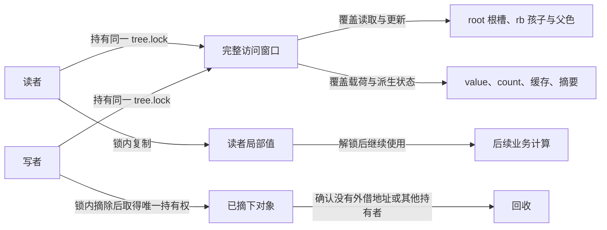
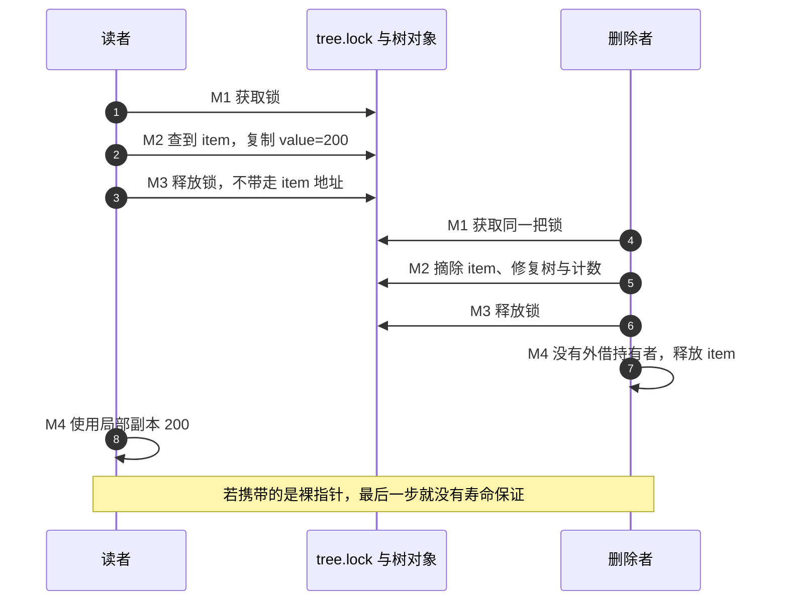

# 第45章\_完整操作与返回对象的并发保护

缓存和摘要都要求观察相互一致的多个字段。树一旦交给多个执行者，单个赋值正确还不够：必须说明查重、挂接、复制结果与对象回收之间哪些步骤不能被打断。本章先建立共同锁的基线，再比较有限无读锁查找的保证。

## 45.1\_rbtree\_与并发控制

上一节把拓扑、载荷和摘要放在同一更新周期里，现在要让另一个执行者来读它。关键问题随之改变：不再只是“操作返回后字段是否正确”，还要问“谁可能在操作尚未结束时看见哪些字段，以及操作结束后谁仍持有对象”。

## 45.2\_为什么\_rbtree\_核心不内置锁

从一个普通任务索引开始：写者插入或取消任务，读者按编号取任务值。只在单线程初始化期间访问时，无须为了不存在的竞争增加锁。一旦两个执行者同时进入，就可能都从根走到同一个空槽，各自准备把自己的节点挂进去；后写入者覆盖前者的入口，前者已经返回“成功”的对象却不可达。平衡算法并没有机会替我们补救这次竞争。

在所有调用外面加同一把锁，可以先获得一个简单而有力的模型：持锁者完成整个搜索、挂接、修复与附加状态维护，另一个执行者随后才观察结果。但具体应使用可睡眠的 mutex，还是适合相应原子上下文的自旋锁，取决于调用现场。若对象已经处在更大范围的锁下，再在树里藏一把锁还会改变锁顺序与粒度，却依旧不知道返回指针会被用多久。

因此 Linux rbtree 保留结构操作，把同步和寿命协议交给调用者。进程、软中断、硬中断等入口是否共享这棵树，会决定同锁访问是否还需要处理本地中断或其他上下文重入；不能把一个演示用 `spin_lock()` 包装无条件用于所有上下文。本节只建立访问协议，锁本身的实现和选择继续由[同步专题](../../synchronization_and_asynchrony/大纲.md)中的对应机制承担。

树的维护者应先回答四个不同问题：写者如何串行化，读者能否观察中间树形，返回值需要有多强的存在性保证，对象何时才没人继续访问。这四个答案组合成容器协议，不能由一个“无锁”标签代替。

## 45.3\_使用者需要保护哪些操作

假设两个 CPU 都要插入唯一键 20。若“查找 20”加锁后解锁，“接入 20”再重新加锁，那么两者仍可先后查到空，然后各自插入。锁确实存在，却保护错了事务边界。查重、保存空槽、挂接与修复必须处在同一次受保护操作内；中途释放保护后保存的槽地址，也可能因其他删除而失效。

相同道理适用于两个插入、插入与删除、两个删除、遍历与删除、替换与读者访问。缓存根和增强树再增加两份状态：rb_leftmost 与业务摘要也必须在同一个观察边界内完成维护。对节点字段逐个加锁并不能组成一次完整的树更新。



这里存在 **结构状态、观察结果和寿命状态** 三个独立维度。用 M0～M4 走一轮完整操作：

| 阶段 | 读者路径 | 删除者路径 | 可见状态 |
| --- | --- | --- | --- |
| M0 准备 | 准备接收值的局部变量 | 准备要删除的键 | 还没取得树的访问权 |
| M1 进入 | 取得 tree.lock | 取得同一 tree.lock | 互相排除，前一轮修改已交付 |
| M2 操作 | 搜索并把 value 复制到局部变量 | 搜索、摘除、修复、维护 count 与附加状态 | 中间态只归当前持锁者使用 |
| M3 离开 | 释放锁，仅带走副本 | 释放锁，带走本例唯一拥有的摘下对象 | 后续读者可看见新树 |
| M4 后续 | 使用自己的普通值 | 确认无其他使用者后释放对象 | 值副本与对象地址不再互相依赖 |

这正是[P37 完整调用者框架](P37_构建rbtree调用者接口.md#37.16_运行完整的私有调用者框架)中 read_value 和 remove_item 的配对关系。若 read_value 改为解锁后返回裸指针，删除者可能立即执行 M4，前一个读者再取 value 就是释放后访问。锁覆盖了查询过程，却没有覆盖指针离开后的使用。



复制不适合所有业务。若必须保留对象身份，应在原保护仍有效时取得合法的长期持有权；若采用 RCU 读侧寿命，则要在匹配的读侧范围里完成受保护访问。引用归零与 RCU 旧读者结束可能同时成为回收条件，不能把它们写成随意替换的三选一。具体所有权推导已在[P09 双索引寿命](P09_Linux_6.12_内核_rbtree_嵌入式节点与使用者接口.md#%281%29_两个入口关闭之后谁还在使用对象)建立。

### 45.3.1\_用两个线程观察复制值与删除

先把复杂树缩成一个入口槽，只保留这次要验证的“查找命中—带走什么—删除回收”关系。下面是完整的用户态 C 程序，使用 POSIX 线程的互斥锁与条件变量；它没有实现红黑树，也没有模拟自旋锁。结构体里的 slot 是共享对象入口，phase 是实验调度状态，两者都由 lock 保护。条件变量负责唤醒等待者，但条件的真实内容保存在 phase 中，因此等待总在 while 里复查。

程序安排两次试验。读取先发生时，读者复制 200，删除者释放原对象，读者最后使用副本。删除先发生时，读者看到空入口，输出变量保持 -1。双方用 phase 明确排列这两种次序，避免用休眠时长猜测谁先运行。

```c
// SPDX-License-Identifier: MIT
/* 用户态双线程寿命实验：只有一个入口槽，不实现树或内核自旋锁。 */
#include <pthread.h>
#include <stdio.h>
#include <stdlib.h>

struct item { int value; };
struct registry {
    pthread_mutex_t lock;
    pthread_cond_t changed;
    struct item *slot;
    unsigned int phase;
    int read_first;
};

static void require_ok(int code)
{
    if (code != 0) {
        fprintf(stderr, "pthread error: %d\n", code);
        exit(EXIT_FAILURE);
    }
}

/* 调用时持锁；等待会放锁，返回前重新持锁，醒来必须复查条件。 */
static void wait_phase(struct registry *registry, unsigned int expected)
{
    while (registry->phase < expected)
        require_ok(pthread_cond_wait(&registry->changed, &registry->lock));
}

static void *reader(void *argument)
{
    struct registry *registry = argument;
    int found = 0, copied = -1;
    require_ok(pthread_mutex_lock(&registry->lock));
    wait_phase(registry, registry->read_first ? 0 : 1);
    if (registry->slot) {
        copied = registry->slot->value; /* 对象仍受锁保护时只复制普通值。 */
        found = 1;
    }
    ++registry->phase;
    require_ok(pthread_cond_broadcast(&registry->changed));
    require_ok(pthread_mutex_unlock(&registry->lock));

    /* 等删除者实际 free 完毕，再使用副本；没有保留对象地址。 */
    require_ok(pthread_mutex_lock(&registry->lock));
    wait_phase(registry, 2);
    require_ok(pthread_mutex_unlock(&registry->lock));
    if (found)
        printf("read-first: copy=%d remains after free\n", copied);
    else
        printf("erase-first: absent, output=%d\n", copied);
    return NULL;
}

static void *eraser(void *argument)
{
    struct registry *registry = argument;
    struct item *removed;
    require_ok(pthread_mutex_lock(&registry->lock));
    wait_phase(registry, registry->read_first ? 1 : 0);
    removed = registry->slot;
    registry->slot = NULL; /* 关闭唯一入口，后来的读者只能看到空。 */
    require_ok(pthread_mutex_unlock(&registry->lock));
    free(removed);         /* 读者从不带走指针，此时没有剩余使用者。 */

    require_ok(pthread_mutex_lock(&registry->lock));
    ++registry->phase;     /* 在释放完成之后通知实验调度条件。 */
    require_ok(pthread_cond_broadcast(&registry->changed));
    require_ok(pthread_mutex_unlock(&registry->lock));
    return NULL;
}

int main(void)
{
    for (int read_first = 1; read_first >= 0; --read_first) {
        struct registry registry = {.phase=0, .read_first=read_first};
        pthread_t read_thread, erase_thread;
        registry.slot = malloc(sizeof *registry.slot);
        if (!registry.slot)
            return EXIT_FAILURE;
        registry.slot->value = 200;
        require_ok(pthread_mutex_init(&registry.lock, NULL));
        require_ok(pthread_cond_init(&registry.changed, NULL));
        require_ok(pthread_create(&read_thread, NULL, reader, &registry));
        require_ok(pthread_create(&erase_thread, NULL, eraser, &registry));
        require_ok(pthread_join(read_thread, NULL));
        require_ok(pthread_join(erase_thread, NULL));
        if (registry.slot || registry.phase != 2)
            return EXIT_FAILURE;
        require_ok(pthread_cond_destroy(&registry.changed));
        require_ok(pthread_mutex_destroy(&registry.lock));
    }
    return EXIT_SUCCESS;
}
```

材料为[copy_under_lock.c](../../../../labs/kernel/tree_basics/materials/copy_under_lock.c)。在具备 POSIX 线程支持的环境中，从仓库根目录编译运行：

```bash
cc -std=c11 -Wall -Wextra -Werror -pthread \
  labs/kernel/tree_basics/materials/copy_under_lock.c -o /tmp/copy_under_lock
/tmp/copy_under_lock
```

预期输出：

```text
read-first: copy=200 remains after free
erase-first: absent, output=-1
```

本轮在宿主的 MinGW pthread 支持下实际编译执行，并重复 512 次有序读/删实验，另注入两个分配失败点，核对输出和未回收对象数。它验证这里的互斥、交接和复制关系，不提供 Linux 内核自旋、IRQ、RCU 或 ARM 内存序结论。生产代码的线程创建失败如何撤销既有任务还需单独设计；本小程序遇 pthread 错误直接退出整个进程。

如果想观察裸指针的错误，不要把程序改成真的解引用已释放对象来追求“崩溃截图”。在纸上将 copied 换成地址，沿图中最后一步判断谁仍保有对象即可；释放后访问可能暂时打印旧值，这种偶然结果不构成正确性证据。

## 45.4\_WRITE\_ONCE()\_在\_rbtree\_实现中的意义

完整锁的代价是读者也要参与同一同步：竞争时等待，保护范围拉长时其他访问更晚进入。若业务的读取很多，便会考虑让读者不持写者那把锁。但这不是把锁行删掉即可得到的优化，因为一轮旋转有多个独立写入，读者可以夹在其中继续下降。

本节按[固定版本索引](../../../../research/source_reading/rbtree/navigation/P01_Linux_6.12_rbtree源码阅读索引.md#1.1_固定提交与阅读边界)阅读 lib/rbtree.c 开头的说明。它要求孩子边写入使用 WRITE_ONCE，并要求写入的程序顺序不制造临时环。WRITE_ONCE 约束指定的单次访问，不把两次改边合成事务，也不提供“树形已全部切换”的通知。

沿[P10 完整 C 路径实验](P10_Linux_6.12_内核_rbtree_查找与返回边界.md#10.2.10_用完整C程序观察相等节点和旧路径)再看一次：旧根 10 的右孩子是 20，中间子树为 15。左旋先把 `10.right` 改为 15，再把 `20.left` 改为 10，最后让根指向 20。旧根已被读者取走时，它仍能从 10 到 15，却不能向下走回 20。查 20 得到 NULL，真实的 20 仍在树里；对象从头到尾都可以存活，漏查并不需要发生内存回收。

若倒过来先写 `20.left=10`，而 `10.right` 还等于 20，中间的两条边就构成环。即使两个赋值都写了 WRITE_ONCE，查询某些中间键仍可能来回走。由此可见，“单次访问约束”和“不成环的写序”解决的是不同缺口，二者缺一不可。

固定注释讨论的是有限的 **向下查找**：满足发布、比较字段稳定、节点寿命及改边约束时，路径不会因这种临时环卡死，找到的对象满足比较条件。但旋转非原子，可能漏掉整棵子树；NULL 不证明键不存在。__rb_parent_color 的父边不在该注释的循环检查范围内，rb_next 或带父链的遍历不能借用这份保证。具体路径映射见[查询 L0～L3](../../../../research/source_reading/rbtree/navigation/P02_查找路径与返回边界导读.md#2.4_旋转期间沿什么路径继续)。

## 45.5\_RCU\_查找与普通修改路径的区别

RCU（Read-Copy Update，读—复制—更新）的读侧保护与发布/回收协议，可以为特定读者提供访问对象的时间边界，但不会把整棵树旋转变成原子快照。通用机制沿[RCU 权威专题](../../synchronization_and_asynchrony/synchronization/rcu/大纲.md#1.3_因果阅读地图)阅读，这里只核对树接口接入了哪一部分。

| 接口 | 固定实现承担的动作 | 调用者仍需完成的事 |
| --- | --- | --- |
| rb_link_node_rcu | 初始化节点结构，再以 rcu_assign_pointer 发布空入口 | 发布前准备业务载荷，满足读侧取得协议，串行化写者；后续平衡仍可能旋转 |
| rb_find_rcu | 用比较回调向下搜索，孩子读取使用 rcu_dereference_raw | 建立匹配读侧保护，证明入口读取、比较字段和寿命有效；函数不取引用、不重扫 |
| rb_replace_node_rcu | 准备新节点结构，更新孩子父边，最后以 RCU 方式发布父/根入口 | 同排序位置替换、载荷预先有效、旧对象延迟回收；不授予父链快照 |

固定版 rb_find_rcu 的第一次取根仍是普通 `tree->rb_node` 表达式，不能把带 RCU 后缀的名字当成“入口到出口都已经替我证明”。真实语句和限制见[查找唯一实现](../../../../research/source_reading/rbtree/source_explanations/include/linux/rbtree.h.md#1.4_rb_find_rcu的孩子读取与缺失边界)。这种具体读取边界必须与使用者协议一起审查，不应擅自把源码改写成想象中的更强接口。

替换时，孩子的 parent 在新父/根入口发布之前就改向 new，因此父子两个方向不是同时切换。cached 替换还先更新最左槽，不自动组成一个 cached RCU 协议。完整交接继续看[P28 同键替换](P28_Linux同键替换与旧对象退出.md#28.2.4_最后发布入口为何还不能立即释放旧对象)和[缓存包装](P28_Linux同键替换与旧对象退出.md#28.2.5_rb_replace_node_cached%28%29_如何维护最左缓存)，这里不再复制函数体。

写者的互斥同样没有消失。两个写者同时修改一个孩子槽、颜色或增强摘要，RCU 不替它们仲裁。摘除只关闭后来的发现入口，已经拿到旧地址的读者仍可能继续使用；在对应 RCU 回收方案中，旧对象须保留到相关旧读者结束，再满足其他引用等回收条件。call_rcu 只是排队安排回调，不在调用点同步等待；回调届时是否能直接释放，还由完整持有权协议决定。

先有“对象仍活着”，才有资格讨论“旧路径是否找到”；先有字段发布与稳定比较，命中才有含义。反过来，即使这些条件全部满足，旋转造成的漏查仍可存在。增加延迟回收并不会让旧根重新获得通往新根的边。

## 45.6\_lockless\_lookup\_能保证什么\_不能保证什么

现在可以用同一业务问题选择方案：按任务编号查询后，是只需尽力找到一个候选，还是必须据“没找到”创建唯一新任务？前者有时允许短暂假阴性，后者通常不能把一次无读锁 NULL 当作最终缺失。

| 业务要求 | 完整共同锁覆盖的查找 | 满足前述条件的无读锁向下查找 |
| --- | --- | --- |
| 看到稳定的受保护拓扑 | 在锁内成立，前提是所有相关写者都遵守同锁 | 不承诺，旋转可以插在两次读取间 |
| 命中后取得对象值 | 可在锁内复制，解锁后使用副本 | 在合法读侧范围读取；带出对象另需持有权 |
| 返回空说明这一受保护时刻确实缺失 | 完整搜索并遵守比较规则时成立 | 不成立，旧路径可能漏掉实际存在对象 |
| 随后按缺失创建唯一键 | 查重到接入持续持锁，或重新取得写保护后再查 | 进入写侧序列后必须按业务协议重新判定，不能沿旧结果直接挂接 |
| 整树遍历或精确缓存/增强查询 | 同一保护覆盖完整过程和全部相关字段 | 向下查找注释不提供父链、缓存或摘要的一致快照 |

因此选择条件不只是“读多写少”。如果必须严格缺失、全序遍历或同时读取多份关联字段，先保留完整保护这一基线。若考虑不持写锁的读路径，需要明确接受哪些漏查，如何处理后续动作，并分别证明发布、稳定比较、读侧寿命与写侧串行化。想用重试或版本号补强也必须设计完整协议：重试不能挽救已经访问释放内存的那一次读取，不能只在函数尾加一个计数比较。

## 45.7\_本节小结

用三组已有实验分别回答三个问题：本节双线程程序说明锁内复制怎样避免把寿命责任带到锁外；P10 路径程序说明所有对象都存活时仍会漏查或因错误写序成环；P28 替换模块说明新入口发布和旧对象退出是不同阶段。这些证据互补，不能把其中一组的成功外推成“内核树已经并发安全”。

1. 把查重和接入拆成两段锁，按两个写者各自看到空的顺序画出四步时间线。重新组合事务以后，第二个写者应返回什么？
2. 把本节复制结果改为“取得引用后返回对象”，指出引用应在哪个保护尚有效的步骤取得，以及删除者现在还缺什么才能 free。这里只修改协议图，不运行释放后访问。
3. 运行 P10 的 lookup_paths.c，解释旧根漏查为什么不是延迟回收能够修复的错误。再说明 rb_next 沿父边为何超出同一论证范围。
4. 回到增强区间树，假设读者读到新孩子和旧摘要。借助上一节错误摘要的反例，说明只保证每个字段单次读取为什么不够；为完整保护写出应覆盖的状态集合。

本节建立的是操作、观察与寿命三种边界。接下来审查完整示例时，应把锁放置、返回约定、失败回滚与资源退出一起读，不能只看 rb_insert_color 和 rb_erase 是否出现。

## 45.8\_Linux\_内核\_rbtree\_示例代码

现在回到[P37 的完整调用者模块](P37_构建rbtree调用者接口.md#37.16_运行完整的私有调用者框架)。此前它让我们把一次操作写完整；经过缓存、增强和并发单元，现在应能解释为什么接口边界要这样划分。本节沿同一份可运行程序复查比较、持有权与退出过程，遍历再接到 P27 的专门实验，不另外维护一套只有片段、没有初始化与失败清理的框架。

### 45.8.1\_示例目标与约束

实例仍按 int key 管理业务对象，拒绝重复 key，使用同一把锁保护完整操作。成功插入把对象交给树，失败仍由调用者负责；查询只复制 value，删除交还独占对象。程序所有入口在模块初始化期间私有使用，没有外借指针或 RCU 读者，这才使示例中的删除后释放成立。

完整材料是[note_rbtree_owner.c](../../../../labs/kernel/tree_basics/materials/note_rbtree_owner.c)。先预测四次输入 `20,10,30,20` 后的 count、key=20 的查询值、第四个对象归谁释放，再对照原完整程序与本节各步。目标构建和装卸命令保留在 P37，不能把宿主检查输出当作目标内核已经运行。

### 45.8.2\_定义业务结构体与树对象

demo_item 拥有 key、value 与嵌入的 rb；demo_tree 拥有 root、lock、count。rb_node 不知道 key 放在哪，也不会替容器计数或取锁。初始化将 root 设为 RB_ROOT、count 设为 0，并初始化业务锁；单个新对象还要按本例采用的成员协议建立游离标记。

这些定义的推导分别见[P37 业务对象](P37_构建rbtree调用者接口.md#37.2_定义业务结构体)与[根对象](P37_构建rbtree调用者接口.md#37.4_定义_struct_rb_root_树入口)。把 root 重新赋空只改变入口值，不会遍历并释放此前的业务对象；初始化和销毁不是互逆的一条赋值语句。

### 45.8.3\_实现统一比较函数

完整模块现在让搜索和插入共同调用 compare_key。它返回两个关系判断结果的差，结果只能是 -1、0、1；相减的是布尔判断结果，不是两个任意 int 键，因此不因 INT_MIN 与 INT_MAX 之差溢出。

搜索把查询键交给比较器，插入把新对象的 key 交给同一比较器。若业务需要对象对对象的接口，它应委托这一规则而不是维护第二份略有差别的次序。原三态比较的完整推导见[P37 同一套比较规则](P37_构建rbtree调用者接口.md#37.13_插入_查找_删除为什么必须使用同一套比较规则)；复合键还须在所有调用点保持相同字段顺序，不能只改插入。

### 45.8.4\_实现查找

search_locked 从根出发，根据同一比较器向左、向右或命中；名字中的 locked 是调用前置条件，函数名本身不会加锁。它是内部助手，其返回指针只在相应保护与寿命条件内使用。

对外的 read_value 在锁内找到对象并复制值，然后才解锁。查询失败返回 ENOENT 且保持输出变量原值；传入空输出地址返回 EINVAL。这样调用者通过返回码判定是否取得结果，而不是把某个业务值当作“没找到”的特殊标志。完整查找与危险裸指针反例见[P37 查找单元](P37_构建rbtree调用者接口.md#37.7_编写查找函数)，真实线程的值副本交接由上一节实验解释。

### 45.8.5\_实现插入

insert_item 先取得树锁，验证成员符合本例的游离约定，再从根查重并保存空槽。发现重复键时返回 EEXIST，不挂接、不修复、不增加 count；对象还归调用者。找到允许的空槽才依次 rb_link_node、rb_insert_color、count 加一，最后解锁。

这段先后关系保证其他遵守同锁协议的访问者不会观察到“计数已经增加却还不可查”的半次操作。成员自指标记只是调用者遵守的约定，不是全局树成员数据库；必须先初始化成员，而且不能通过随意 RB_CLEAR_NODE 把仍挂在别处的成员伪装成可插入。具体空槽与节点初始化见[P37 插入搜索](P37_构建rbtree调用者接口.md#37.8_编写插入搜索函数)。

再检查失败后的对象：程序在锁外分配新对象，插入成功由整树管理，失败则释放本次未移交的对象。不能因为发现了重复 key 就释放树中原有的那个对象。把分配放到允许睡眠的锁外，并不自动免除再次查重的责任；本例在接入锁内完成最终判定。

### 45.8.6\_实现删除

remove_item 先检查输出地址并把它置空，锁内搜索；缺失时返回 ENOENT，调用者不会收到上次留下的旧指针。命中后 rb_erase、按本例协议标为游离、递减 count，再通过输出参数交还对象。这些接口约定与[删除单元](P37_构建rbtree调用者接口.md#37.11_调用_rb_erase%28%29_删除节点)对应。

此模块没有外借对象地址，所以删除成功后可以在锁外 kfree。若换成引用计数设计，删除只撤销树的持有权，实际释放须等相应引用协议；若换成 RCU 读者，旧字段及对象须保留到相关读者退出；若两者同时存在，两个条件都要满足。**这些是不同的完整容器协议，不能只把最后一行 kfree 换成 put 或 call_rcu 就宣布改造完成。**

尤其在旧读者可能继续使用节点字段时，不能照搬本例立即 RB_CLEAR_NODE 的动作。标记写入、键修改、再次入树与内存释放各有前提，沿[P09 对象退出](P09_Linux_6.12_内核_rbtree_嵌入式节点与使用者接口.md#9.2.8_节点生命周期为什么由调用者管理)和 P28 替换周期继续判断。

### 45.8.7\_实现中序遍历

遍历仍是 rb_first 取得首节点，rb_next 沿孩子或父链推进，rb_entry 还原业务对象，再读取 key/value。若比较规则是唯一整数键，完整稳定遍历应按 key 严格递增；允许等价键时不能再套用这一唯一性断言。

此任务的完整可运行实验集中在[P27 遍历与销毁模块](P27_Linux有序遍历与整树销毁.md#27.2.9_运行完整遍历与销毁模块)。调用者须在整个遍历范围稳定所依赖的拓扑并保护对象；只让节点暂时不释放，不能稳定父链。若要把 key/value 带到锁外慢慢打印，应在受保护范围复制有限数据，再处理输出；不能把长期打印的成本和上下文要求隐藏在一个名叫 dump_locked 的助手里。

### 45.8.8\_实现整棵树清理

完整 owner 模块的 destroy_tree 每轮重新取 rb_first、摘除并递减 count，然后解锁释放；下一轮重新从根定位，不携带上一轮可能被旋转改变关系的遍历游标。这正是原反复取最小节点方案的有效部分，已由[P27 有序推进与销毁](P27_Linux有序遍历与整树销毁.md#27.2.8_为什么一个保存的地址仍会漏访)解释。

但“每轮正确”还不等于“整个清理原子完成”：如果另外的写者可以在两轮之间不停插入，循环可能迟迟无法结束，退出时刻的业务关闭承诺也没有建立。因此完整销毁需要先关闭或约束新入口，再保证没有外部使用者；私有初始化示例天然满足这个前提。

后序整树销毁是另一套更强的排他协议。postorder safe 只保存约定的下一对象，不能在循环体任意 rb_erase 重平衡后继续依赖旧关系。不要把“safe”解释成并发、任意修改或任意释放都安全。初始化失败同样要在返回前清理已接入对象，不能指望失败的模块以后再调用退出函数替我们收尾。

### 45.8.9\_示例代码的边界

通过这次回访，定义对象、嵌入节点、初始化根、统一比较、查询、插入、删除、遍历和清理已经各有完整程序与职责。普通框架不声称实现 RCU、引用计数、重复键容纳、cached 或 augmented；这些扩展需要前面分别建立的附加不变量，不能把片段机械拼接。

先做三项修改预测：把第二个 20 改成 40 后 count 应怎样变化；传空的移除输出参数时能否改变树；把一个 int 键换成极值时比较符号是否还正确。现有宿主夹具重新检查了插入/删除排列、重复与成员状态、输出约定、分配失败和极值比较；目标 Kbuild、MODPOST、模块装卸与实际内核日志仍未执行。

剩下的问题是“我怎样知道这一轮做对了”。只看到有序输出，无法排除父链、黑高或附加状态损坏。下一节把验证拆成彼此独立的证据，而不把一次模块成功加载当成所有正确性条件都已满足。

[下一单元：独立验证树形与派生状态](P46_独立验证树形与派生状态.md)。
