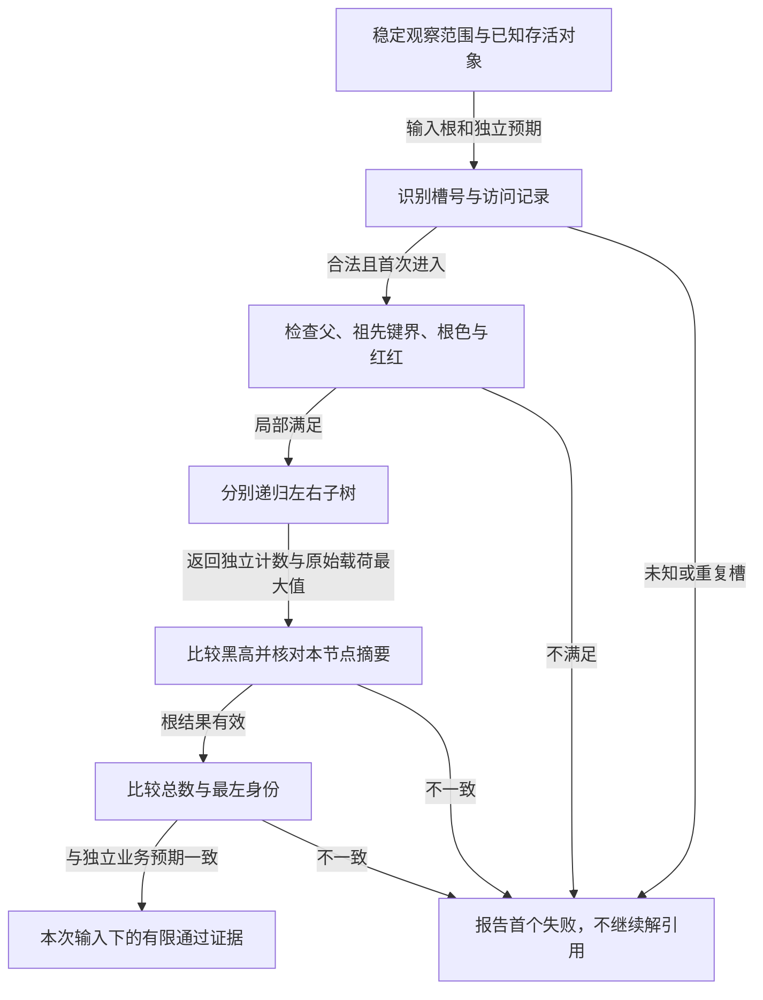

# 第46章\_独立验证树形与派生状态

完整操作的保护边界成立以后，仍不能仅凭“没有崩溃”判定实现正确。缓存和摘要都是从原始对象推导的状态，需要另一条独立计算路径检查；检查器自身还必须先保证访问的对象已知且观察稳定。

## 46.1\_Linux\_rbtree\_调试与验证

一组任务按 10、20、30 打印出来，只说明这次输出有序，不能说明父链、颜色、最左缓存和区间摘要都正确。P45 已经区分容器承担的多种状态，验证也应分别寻找它们的证据。本节最终组合一个完整 C 检查器，但先明确它能安全读取什么。

检查不能在任意损坏地址上盲目递归，也不能一边与写者竞争一边要求每个中间状态都满足最终不变量。应先取得业务规定的稳定观察范围和对象寿命，必要时形成一致的私有快照；再以已知对象池、访问记录和容量上限限制结构遍历。对未知指针，诊断器本身并没有凭空多出解引用权限。



## 46.2\_如何验证\_BST\_有序性

若完整稳定的中序序列满足相邻键严格递增，它符合唯一键的排序要求；允许等价键时改为非递减，并按业务契约检查等价组。如果使用的是 `(deadline,id)` 复合键，检查器必须调用同一顺序的比较规则，不能只看 deadline。

不要只比较每个节点与其直接孩子。根为 20，右孩子为 30，而 30 的左孩子是 15：15 小于自己的父，局部检查通过，却跑到了 20 的右子树。完整验证必须携带所有祖先累积的上下界，或真正检查整个中序序列。下面的 C 模型选择上下界，并用独立布尔标志表示界是否存在；不拿 INT_MIN/INT_MAX 冒充缺失边界，也不做 key±1，以免极值被错拒或溢出。

出现逆序时，检查插入比较、查找比较、替换位置和原地键修改，也要检查孩子边是否接错。红黑修复维护颜色与平衡，不读取业务 key 来替我们识别这些错误。

## 46.3\_如何验证父指针正确性

从一个已知父向左或向右进入孩子时，孩子保存的 parent 应指回这个父；进入根时预期父为空。空树仍有保存入口的 rb_root 对象，只是 root->rb_node 为 NULL、没有实际根节点；因此可以检查根槽值，却不能经由这个空值读取节点字段。共享根入口、孩子槽和孩子记录的父地址，是必须互相对应的不同存储位置。

检查器还要区分树与一般有向图。孩子边回到已经访问过的节点，可能形成环，也可能让两个父共享一个孩子。两种情况都应拒绝，否则普通递归可能无限进入或者把一个对象计算两次。本文用整数槽号和 seen 数组做已知对象识别，最多进入八个不同对象；它检查的是逻辑拓扑，不把索引数字转换成任意真实地址。

父链错误常来自手写旋转遗漏反向边、同键替换没完成交接、父色字被破坏、同一嵌入成员重复接入或在删除后继续当作在树节点使用。若父指针检查失败，不要继续用 rb_next 在错误父链上打印“更多证据”；先在有界已知对象内定位错误。

## 46.4\_如何验证红节点没有红孩子

从根下降时，把当前节点是否为红传给孩子；父红且当前红便形成冲突。NIL 位置视为黑，不解引用它。根黑应单独作为稳定红黑树的规范化条件检查，否则一棵仅含红根的树没有红红相邻，也可能绕过只看父子的断言。

检查失败后，应追问插入是否只挂接未修复、删除是否绕开了修复、是否有人直接改色；错误替换或拓扑破坏也可能同时影响多项性质。报告“red-red”只定位了一个现象，不能证明唯一根因一定是忘记 rb_insert_color。回调内部的某些中间态也不能套用操作返回后的完整树断言。

## 46.5\_如何验证所有路径黑高一致

对每个节点分别取得左右子树的黑计数，二者必须相等；相等以后再加上当前节点的黑贡献，向父返回。本文内部约定空位置返回 1，黑实体加 1，红实体加 0，所以返回值包含当前节点与终点 NIL。这是递归计算的局部计数，与前面某些章节用“排除当前根”定义的 bh(root) 差一个明确的根贡献，不能混用数字。

也可以选择 NIL 返回 0，只计黑实体。只要整次递归和预期值都使用同一约定，两侧相等性判断一致。选定规则以后再观察删除缺黑：忘记根收尾、Case 2 上推位置错误、Case 4 染色错误、旋转接错子树，都可能造成差异。不要通过给某一侧额外补 1 来“让测试绿了”，那相当于让检查器替被测算法掩盖缺口。

## 46.6\_如何验证\_cached\_rbtree\_的\_rb\_leftmost

稳定的缓存根应满足 `rb_first(&root->rb_root) == root->rb_leftmost`，比较的是节点身份而不只是最小 key 的数值。存在多个等价键时，不同对象可能拥有相同最小值，但只有当前中序首对象才是这个缓存的目标。

前提是向下结构已经可以安全遍历，否则用 rb_first 验缓存本身可能困在环里。完整模型从已经验证的左子树结果返回首槽号，再与独立存储的 first 比较；真实测试还应对照业务侧预期存活对象，避免结构与计数一起出错后互相“证明”。插入 leftmost 标志算错、混用普通插入/删除/替换、直接移动节点，都会造成缓存与结构分离，前面完整缓存模块已给出可观察反例。

## 46.7\_如何验证\_augmented\_rbtree\_的增强信息

最大值摘要应从每个节点的原始载荷独立计算。递归先得到左右子树的 **计算结果**，再与本节点载荷取最大，最后比较本节点缓存。不要读取两个孩子的 subtree_max 当作检查器的“真值”，否则孩子缓存的同源错误可能一路传上来。

下面模型用 score 表示非负业务评分，subtree_max 表示整棵子树的最高评分；它与前面区间末端的最大值使用同一聚合规则，但不承诺区间查询语义。空子树返回 0 只适合这个非负标量域。查出错误时，沿叶子初始化、插入路径传播、rotate、copy、后继旧路径及末次传播逐一检查，也别漏掉只改载荷时的传播或普通接口混用。

## 46.8\_如何构造插入修复测试序列

从空树依次插入以下唯一键，先手画冲突再观察完整修复后的性质：

| 输入次序 | 暴露的问题 | 应关注的动作 |
| --- | --- | --- |
| 30、20、10 | 左外侧红红 | 最终右旋与染色 |
| 10、20、30 | 右外侧红红 | 最终左旋与染色 |
| 30、10、20 | 左内侧红红 | 先预旋转，再按外侧收尾 |
| 10、30、20 | 右内侧红红 | 镜像预旋转和收尾 |
| 20、10、30、5 | 父红叔红 | 染黑父叔、冲突向祖父传播并处理根 |

这些短序列区分基本动作，却不覆盖多层上推、重复键政策、分配失败或极值比较。完整[P35 插入实验](P35_红黑插入与红红冲突上推.md#35.1_从检查一棵树走到增加一个键)建立基本算法，再把排列、业务对照和失败点加到各自接口的测试里。最终形状检查和修复分支计数是两类证据：随机输入多，不等于目标分支真的发生过。

## 46.9\_如何构造删除修复测试序列

删除应先由目标前态反推：兄弟红、兄弟黑且双侄黑、近侄红远侄黑、远侄红，分别推动不同修复。左右缺口都要覆盖，还要包括无缺黑返回、红孩子接替变黑、后继直接接替和深层后继移位。黑节点只有一个非空孩子时，在合法红黑树中该孩子承担的形态会限制修复路径；不能笼统认为“删黑色单孩子节点”一定进入完整兄弟分支。

先证明初始树合法，再记录删的是谁、物理移位的是谁、缺口父槽在哪，最后核对结构、颜色和业务状态。已有[P36 删除周期](P36_红黑删除与缺黑位置传播.md#36.1_移走对象为何不一定马上产生缺口)和固定源码删除实验分别承担抽象与具体分支，不用只凭最后一行中序输出反推中间 case 已正确。

一个操作后的联合检查至少包括有序性、父链、根黑、红红、黑高、成员计数、前驱后继以及所用的缓存/增强状态。对象仍存在于另一个索引、读者仍持有引用等事实不会从树形中自动显现，还须有独立所有权证据。

## 46.10\_用已知槽快照验证错误拒绝

把刚才逐项建立的检查组合起来时，第一步仍然是限定可读对象。下面用容量常量 CAPACITY 固定八个槽，以 NIL=-1 表示空孩子；每个槽的原始业务值与派生摘要分别保存，才能注入错误并观察究竟是哪项约束拒绝它。

### 46.10.1\_运行有界快照检查器

下面的完整 C 程序构造一棵三节点基线树，每次恢复基线后只注入一类错误。颜色用 bool 表示，边和父均使用整数索引，NIL 为 -1；已知数组是它唯一能读取的对象集合。检查遇到第一个错误立即返回，诊断名称表示首先失败的不变量，不保证枚举全部根因。

```c
// SPDX-License-Identifier: MIT
/* 有界快照模型：整数索引只指向已知存活数组，不检查任意内核指针。 */
#include <stdbool.h>
#include <stdio.h>
#include <string.h>

#define CAPACITY 8
#define NIL (-1)
struct node {
    bool live, red;
    int key, parent, left, right;
    unsigned int score, subtree_max;
};
struct tree {
    struct node pool[CAPACITY];
    int root, first;
    unsigned int count;
};
struct result {
    const char *error;
    unsigned int count, black, maximum;
    int first;
};

static struct result failure(const char *error)
{
    return (struct result){.error=error, .first=NIL};
}

static struct result walk(const struct tree *tree, int index, int parent,
                          bool parent_red, bool has_low, int low,
                          bool has_high, int high, bool seen[CAPACITY])
{
    if (index == NIL)
        return (struct result){.black=1, .first=NIL}; /* 黑计数包含 NIL。 */
    if (index < 0 || index >= CAPACITY || !tree->pool[index].live)
        return failure("invalid-index");
    if (seen[index])
        return failure("repeated-node");
    seen[index] = true; /* 每个槽最多访问一次，环和共享孩子都会被拒绝。 */
    const struct node *node = &tree->pool[index];
    if (node->parent != parent)
        return failure("parent");
    if ((has_low && node->key <= low) || (has_high && node->key >= high))
        return failure("key-order");
    if (parent == NIL && node->red)
        return failure("root-red");
    if (parent_red && node->red)
        return failure("red-red");
    struct result left = walk(tree, node->left, index, node->red,
                              has_low, low, true, node->key, seen);
    if (left.error)
        return left;
    struct result right = walk(tree, node->right, index, node->red,
                               true, node->key, has_high, high, seen);
    if (right.error)
        return right;
    if (left.black != right.black)
        return failure("black-height");
    unsigned int maximum = node->score;
    if (left.maximum > maximum)
        maximum = left.maximum;
    if (right.maximum > maximum)
        maximum = right.maximum;
    if (node->subtree_max != maximum)
        return failure("summary");
    return (struct result){.count=1+left.count+right.count,
        .black=left.black+(node->red ? 0U : 1U), .maximum=maximum,
        .first=left.first == NIL ? index : left.first};
}

static struct result inspect(const struct tree *tree)
{
    bool seen[CAPACITY] = {false};
    struct result result = walk(tree, tree->root, NIL, false,
                                false, 0, false, 0, seen);
    if (result.error)
        return result;
    if (result.count != tree->count)
        return failure("count");
    if (result.first != tree->first)
        return failure("cached-first");
    return result;
}

static struct tree baseline(void)
{
    return (struct tree){
        .pool={
            {.live=true,.red=false,.key=20,.parent=NIL,.left=1,.right=2,.score=5,.subtree_max=9},
            {.live=true,.red=true,.key=10,.parent=0,.left=NIL,.right=NIL,.score=2,.subtree_max=2},
            {.live=true,.red=true,.key=30,.parent=0,.left=NIL,.right=NIL,.score=9,.subtree_max=9}
        }, .root=0,.first=1,.count=3
    };
}

static int expect(const char *name, const struct tree *tree, const char *expected)
{
    struct result result = inspect(tree);
    const char *actual = result.error ? result.error : "ok";
    printf("%s: %s\n", name, actual);
    return strcmp(actual, expected) != 0;
}

int main(void)
{
    int failed = 0;
    struct tree tree = baseline();
    failed += expect("valid", &tree, "ok");
    tree.pool[1].key = 21;
    failed += expect("wrong key", &tree, "key-order");
    tree = baseline(); tree.pool[1].parent = 2;
    failed += expect("wrong parent", &tree, "parent");
    tree = baseline(); tree.pool[0].red = true;
    failed += expect("red root", &tree, "root-red");
    tree = baseline(); tree.pool[3] = (struct node){.live=true,.red=true,.key=5,
        .parent=1,.left=NIL,.right=NIL,.score=1,.subtree_max=1};
    tree.pool[1].left = 3; tree.count = 4; tree.first = 3;
    failed += expect("red child", &tree, "red-red");
    tree = baseline(); tree.pool[1].red = false;
    failed += expect("unequal paths", &tree, "black-height");
    tree = baseline(); tree.first = 2;
    failed += expect("stale cache", &tree, "cached-first");
    tree = baseline(); tree.pool[0].subtree_max = 5;
    failed += expect("stale summary", &tree, "summary");
    tree = baseline(); tree.count = 4;
    failed += expect("wrong count", &tree, "count");
    tree = baseline(); tree.pool[1].left = 0;
    failed += expect("cycle", &tree, "repeated-node");
    tree = baseline(); tree.pool[0].right = CAPACITY;
    failed += expect("unknown child", &tree, "invalid-index");
    tree = (struct tree){.root=NIL,.first=NIL};
    failed += expect("empty", &tree, "ok");
    return failed ? 1 : 0;
}
```

材料为[rb_snapshot_check.c](../../../../labs/kernel/tree_basics/materials/rb_snapshot_check.c)。在仓库根目录执行：

```bash
cc -std=c11 -O2 -Wall -Wextra -Werror \
  labs/kernel/tree_basics/materials/rb_snapshot_check.c -o /tmp/rb_snapshot_check
/tmp/rb_snapshot_check
```

十二行依次为：

```text
valid: ok
wrong key: key-order
wrong parent: parent
red root: root-red
red child: red-red
unequal paths: black-height
stale cache: cached-first
stale summary: summary
wrong count: count
cycle: repeated-node
unknown child: invalid-index
empty: ok
```

既有[联合不变量验证记录](../../../../research/source_reading/linux/SOURCE_BASELINE.md#1.34_rbtree联合不变量的有限检查)还包含 120960 个增强树稳定状态的已知槽快照，以及错误计数和非空根摘要注入；原始字段、树结构和独立业务成员台账共同组成对照。没有把实际内核任意地址交给程序，也没有据此宣称并发快照采集、父色指令或目标内核运行已验证。

### 46.10.2\_让失败证据比成功日志更具体

1. 把坏孩子设成一个未标 live 的有效槽号，再设成 -2；解释为什么都在解引用之前拒绝。让左右子树共享同一对象时，哪个检查先发现错误？
2. 为右子树增加一个局部小于父、却越过根界的键，比较只看父子的检查与当前祖先界检查。再用 INT_MIN/INT_MAX 验证缺失边界不占用合法键。
3. 让缓存指向最小键相同但身份不同的对象，解释为何检查应比较身份。这个唯一键快照模型需先扩展比较政策才可容纳等价键，不能直接关掉顺序断言。
4. 如果少接入一个业务对象，同时把 count 也少记一，当前结构可能全部通过。指出缺少的是哪份独立业务成员清单；结构自洽不等于业务操作没有丢失。

树的结构、红黑平衡、工程附加状态和对象寿命分层验证，才能定位“何种承诺没有成立”。成功只对已经执行的输入与检查范围提供有限证据；从未进入的路径、尚未稳定的共享状态、未受保护的地址都不能由一次未报错覆盖。

## 46.11\_Linux\_rbtree\_常见误区

用前面的反例回顾接口边界，比单背“会/不会”更容易在自己的代码里识别问题。下面每个误区都对应一个已经建立的状态或证据缺口。

### 46.11.1\_误以为内核\_rbtree\_会自动比较\_key

rb_node 只提供结构成员，不知道业务 key 的类型和位置。辅助搜索接口可以调用使用者提供的比较器，却不会替使用者决定等价键政策。插入按一个字段、查询按另一个字段时，树仍可能颜色平衡却查不到对象；共同比较规则由 P37 完整模块落实。

### 46.11.2\_误以为\_rb\_link\_node()\_已完成红黑修复

它把新叶子接入空槽，尚未处理红父和红孩子冲突。普通调用者还要执行 rb_insert_color；增强树要先使路径摘要有效，再执行增强修复。使用已经包含挂接与修复的辅助接口时则不能重复修复，判断依据是接口完整契约，不是函数名里有没有 insert。

### 46.11.3\_误以为\_rb\_erase()\_会释放业务对象

它修改的是树成员关系与平衡。对象可能还有其他索引入口、引用或旧读者，摘除返回无法证明这些持有者已经消失；也不会替使用者写入某种全局“已释放”状态。释放、复用和清成员标记分别服从已有寿命协议。

### 46.11.4\_误以为\_rb\_replace\_node()\_可以替换任意\_key

替换接管原来的结构位置，不重新搜索和排序。接口要求新旧对象具有相同的完整比较键，同时满足业务约束；仅证明某个不同键恰好仍落在祖先允许区间内，并不能放宽这个接口契约。违反祖先键界时，红黑颜色与父子连接甚至可能仍正确。需要改变键时应采用对应的摘除和重新接入协议，缓存与增强信息也要按其契约维护。

### 46.11.5\_误以为遍历时可以任意删除节点

下一节点的推进可能依赖正在被旋转的父子关系。保存了一个地址，只解决“手中有没有地址”，并未证明之后还能按原路线覆盖所有对象。普通有序删除、反复取首、排他后序销毁各有前提，不能借 safe 后缀把它们混为一个允许任意改树的循环。

### 46.11.6\_误以为\_rbtree\_自带并发保护

函数里的一次孩子写入不等于完整操作被别人排除。多个写者、读者的中间观察、返回后的对象寿命、缓存与摘要一致性都在调用者协议中；有锁但查重到接入中途解锁，仍能破坏唯一性。

### 46.11.7\_误以为\_RCU\_接口让所有修改路径都无锁安全

RCU 发布和旧读者寿命不仲裁两个写者，也不把旋转组合成快照。对象都活着时仍可能沿旧根漏查；父链遍历和增强查询又有额外状态。需要严格缺失或长期带出对象时，必须继续处理那些接口尚未交付的保证。

### 46.11.8\_误以为\_cached\_/\_augmented\_会自动维护业务字段

cached 要求正确的最左身份，augmented 要求业务定义的计算和回调在正确阶段运行。忘记传播、错误初始化叶子、复制了旋转后 old 的缩小摘要，都可能留下“排序全对、答案错误”的树。要验证这些扩展，应读取独立原始载荷与成员预期，而不是只运行一遍普通中序打印。

这些误区已经把结构选择所需的保证列清楚。接下来看具体内核场景时，应同时核对“按什么排序、查询什么、维护什么摘要、谁提供同步”，而不是因为见到 rb_root 就套上同一套用途说明。

[下一单元：从内核使用场景选择索引](P47_从内核使用场景选择索引.md)。
