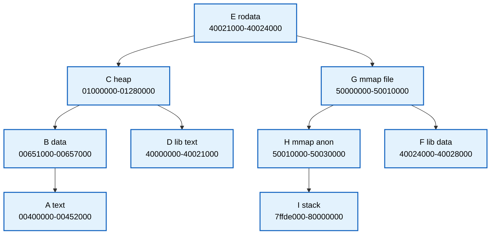
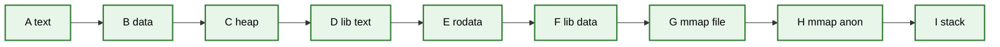
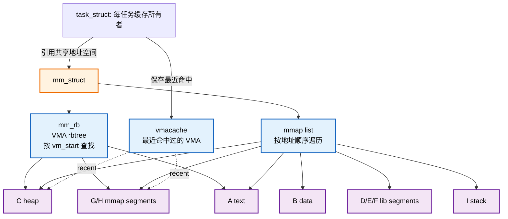
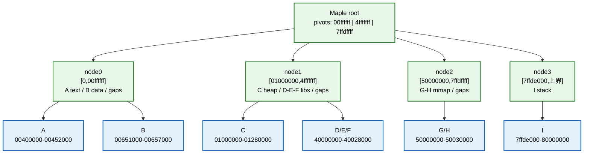
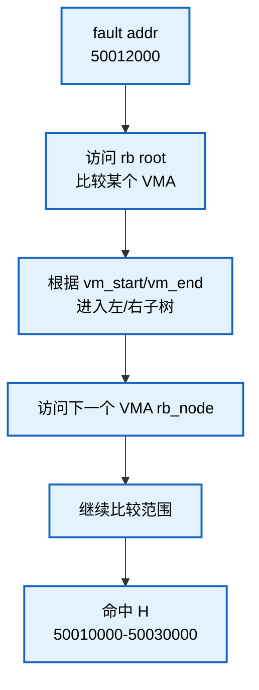
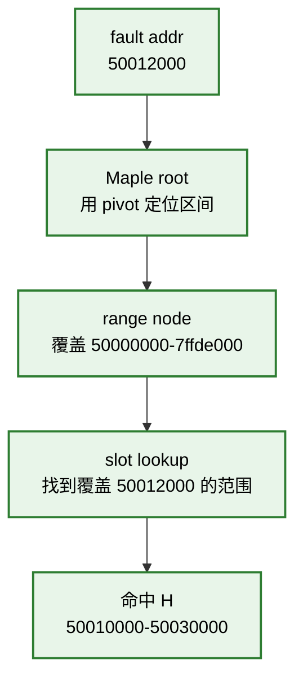
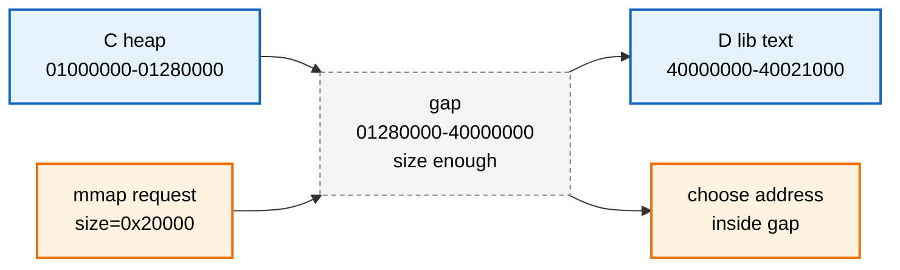

# 第48章\_从VMA辅助索引到Maple范围节点

上一单元已经用 G/H 观察了精确查询、向后查询、改权限和取消映射。本章保持这些语义不变，比较旧版三种入口和新范围索引的状态组织，再检查 pivot、slot 与空洞汇总各自解决什么问题。

## 48.1\_Maple\_Tree\_是什么

Maple Tree 是 Linux 内核中的一种范围索引结构。

固定版本文档把它定位为 B-Tree 范围容器。这里先说明 RCU 是 Read-Copy Update（读复制更新），用于约束并发读取、更新与旧节点回收；其具体使用条件在 [P49](P49_范围查询返回后怎样保护VMA.md#49.2_Maple_Tree_的锁和_RCU_边界)展开。容器提供的能力包括：

```text
B-Tree 数据类型；
优化用于保存非重叠范围；
范围大小可以是 1；
支持范围迭代；
支持 cache-efficient 的 previous / next 访问；
可以启用 RCU（Read-Copy Update，读复制更新）模式保护树的并发读取；
最重要的用途是跟踪 virtual memory areas，也就是 VMA。
```

所以它不是普通哈希表，也不是普通红黑树。

更接近的说法是：

```text
RCU-safe、面向非重叠范围集合的 B-Tree 变体。
```

这句话里有三个关键词。

第一，range-based。

Maple Tree 管理的核心对象不是离散的单个 key，而是范围：

```text
[start, end]
```

或者在 VMA 语义里更常见的：

```text
[vm_start, vm_end)
```

第二，B-Tree。

Maple Tree 不是二叉结构。

它走的是多路树方向，一个节点可以保存多个边界和多个槽位，因此树通常比“一个对象一个二叉节点”的结构更矮。

第三，RCU-safe。

Maple Tree 可以配置成 RCU-safe 模式，让读路径和写路径在一定约束下并发工作。

但这不等于写侧无锁。

写者仍须串行化，默认可用树内自旋锁，也可由调用方提供外部锁。RCU 延后旧节点的回收，使正在读取旧结构的任务不立即碰到已释放的节点；它不替 VMA 字段提供一整套锁规则。P49 先闭合外部读写锁这条路径，再限定 RCU 分支。

本章当前实现以 NXP 官方 Linux 6.12.20 固定提交为准；先从 [Maple 范围源码阅读索引](../../../../research/source_reading/maple_tree/navigation/P01_Linux_6.12_Maple范围源码阅读索引.md#1.2_按读者问题进入证据)进入。旧模型另标 Linux v5.19，2020 年 RFC 数据另作历史讨论，三者不混用。

## 48.2\_旧模型\_rbtree\_+\_linked\_list\_+\_vmacache

同一组 A～I 对象同时参与按地址定位、顺序访问与最近命中。先看各入口各自节省什么，再观察一次改动如何跨入口维护一致性。

### 48.2.1\_用复杂示例看旧模型的三套结构

旧模型以 Linux v5.19 为对照：`mm_struct.mm_rb` 是树根，VMA 内嵌 `vm_rb` 并保存 `vm_next/vm_prev`，`rb_subtree_gap` 汇总子树空洞；最近命中缓存则属于每个任务，不能画成 mm 内的一张共享缓存。[旧版范围结构](https://raw.githubusercontent.com/torvalds/linux/v5.19/include/linux/mm_types.h)与[任务结构](https://raw.githubusercontent.com/torvalds/linux/v5.19/include/linux/sched.h)分别说明这两类所有权。

红黑树已经支持后继遍历，链表是这版 VMA 管理采用的直接相邻入口，并非红黑树遍历在算法上必须另有链表。增广空洞信息也能加速空洞搜索。升级要比较整个组合的维护成本，不能先拿掉旧方案的有效能力。

仍然使用前面的 A-I 这组 VMA。

旧模型里，至少可以从三套结构看同一组 VMA。

第一套，rbtree 视角：

```text
按 vm_start 排序；
每个 VMA 是一个 rb_node；
查找 addr 时沿红黑树路径比较 vm_start / vm_end。
```

教学化示意图如下：



这张图是满足二叉排序关系的示意，不是内核快照。若根 E、C/G、B/D/F/H 为黑，A/I 为红，也可满足黑高约束；颜色省略是为了突出对象入口：

```text
一个 VMA 对象对应一个树节点；
树按 vm_start 排序；
查找需要沿二叉路径访问多个 VMA 对象。
```

第二套，linked list 视角：



链表很适合：

```text
找前一个 VMA；
找后一个 VMA；
按地址顺序遍历整段 VMA；
合并时检查邻居。
```

第三套，vmacache 视角：

```text
最近访问过的若干 VMA 被缓存起来；
如果地址仍落在缓存 VMA 内且缓存有效，可以避免完整树查找；仅仅“在附近”并不保证命中。
```

把三者放在同一张图中：



这张图要说明的不是“旧模型很差”，而是：

```text
旧模型用多套结构拼出 VMA 管理所需能力。
```

rbtree 负责查找。

linked list 负责顺序。

vmacache 负责热点。

这些结构组合起来可以工作，但在复杂更新路径里必须保持一致。

## 48.3\_一次范围修改如何维护三个入口

旧模型下，这类操作可能要维护：

```text
rbtree：
	删除原 G/H 节点；
	插入 G1/G2/H1/H2 或更新部分节点；
	保持按 vm_start 排序。

linked list：
	调整前后指针；
	保证线性顺序还是 G1 -> G2 -> H1 -> H2。

vmacache：
	旧 G/H 可能失效；
	需要刷新或避免命中旧对象。

VMA 生命周期：
	拆出来的新 VMA 要初始化；
	被删除或替换的 VMA 要遵守该版本的锁和对象释放规则，不能套用另一版本的 RCU 路径。
```

这就是旧模型的维护成本。

不是查找复杂度一个 O(log n) 能完全概括的。

------

而 rbtree 旧模型要通过：

```text
按 vm_start 找第一个相交 VMA；
沿链表或后继继续遍历相交 VMA；
逐个删除 / 修改 / 插入；
同步维护辅助结构。
```

来完成同一件事。

## 48.4\_新模型\_mm\_mt\_与\_VMA\_iterator

新模型可以简化理解为：

```text
mm_struct 的相关成员：struct maple_tree mm_mt
（位置摘记，不是完整结构体定义）
```

也就是：

```text
mm_struct
	-> mm_mt
```

`mm_mt` 是当前进程地址空间里 VMA 集合的 Maple Tree 索引。

VMA 查找、遍历、插入、删除，更多围绕：

```text
maple_tree；
maple_state / ma_state；
vma_iterator；
vma_lookup()；
vma_find()；
find_vma_intersection()；
```

来组织。

可以把变化画成：

```text
旧模型：

mm_struct
	├── mmap      -> VMA linked list
	├── mm_rb     -> VMA rbtree
	└── vmacache_seqnum -> 失效代号（具体缓存属于 task_struct）

新模型：

mm_struct
	└── mm_mt     -> Maple Tree

调用方局部的 VMA iterator -> 引用 mm_mt，记录当前范围与遍历位置
```

这里要抓住核心变化：

```text
旧模型偏“单 VMA 节点 + 辅助链表 + 缓存”；
新模型偏“非重叠范围集合 + 多路范围索引 + iterator”。
```

VMA iterator 是调用方拥有的游标对象，不是长期挂在树下的共享节点。它包含 ma_state 操作状态，记录索引、范围末端和当前位置；多个调用方各用各的游标。它的意义是：

```text
让 VMA 遍历、查找、插入、删除围绕同一个范围索引状态推进；
避免调用者到处手动维护 rbtree 节点、链表节点和缓存状态；
让范围操作表达得更贴近 VMA 真实语义。
```

------

### 48.4.1\_用复杂示例看\_Maple\_Tree\_的范围视角

仍然用 A-I 这组 VMA。

Maple Tree 不要求你把每个 VMA 想成一个二叉树节点。

更自然的理解是：

```text
一组非重叠范围被压进多路索引节点；
节点内部用 pivot 切分地址空间；
slot 指向下一层节点或具体 VMA entry；
iterator 带着当前位置在范围集合里移动。
```

教学化示意图如下：



此图使用 Maple 的包含式 pivot：等于 pivot 的索引仍走同号槽。它是人为选取的多层布局，九个 VMA 并不必然需要这样的高度；空洞也会占据语义上的范围，不是 VMA 对象。

它表达的是心智模型：

```text
rbtree 从一个 VMA 节点跳到另一个 VMA 节点；
Maple Tree 从一个范围索引节点进入某个范围区间。
```

对 VMA 来说，这个模型更贴近：

```text
地址空间本来就是由一段段范围和空洞组成的。
```

------

### 48.4.2\_page\_fault\_查找路径对比

假设发生 page fault：

```text
fault address = 0x50012000
```

这个地址落在：

```text
H：0x50010000-0x50030000
```

旧 rbtree 模型可以理解为：



Maple Tree 模型可以理解为：



二者都能找到 VMA。

差异是：

```text
rbtree：
	以 VMA 对象为树节点；
	路径上每步比较一个 VMA 范围；
	前后遍历还依赖链表或后继。

Maple Tree：
	以范围索引节点为单位；
	一个节点里有多个 pivot / slot；
	更适合范围定位和范围迭代。
```

------

### 48.4.3\_gap\_search\_为什么是\_VMA\_管理的核心需求

VMA 管理不只是查已有 VMA。

`mmap` 还经常需要找空洞。

例如要映射：

```text
size = 0x20000
```

需要在地址空间里找一个足够大的 unmapped area。

在前面的地址图中，gap 有很多：

```text
A-B 之间 gap；
B-C 之间 gap；
C-D 之间 large gap；
F-G 之间 gap；
H-I 之间 gap。
```

如果只用“一个 VMA 一个 rb_node”的模型，gap 不是显式对象。

它通常存在于：

```text
前一个 VMA 的 vm_end；
后一个 VMA 的 vm_start；
二者之间的差。
```

也就是说，gap 是两个 VMA 之间推导出来的。

普通范围树可存空值；初始化时启用 MT_FLAGS_ALLOC_RANGE 的分配树还维护子树最大空洞，便于跳过容纳不下请求的孩子。这一汇总占空间，降低同大小内部节点能保存的槽数，并增加更新成本。VMA 的 mm_mt 选择了这个配置。

可以用图表示：



这正是为什么不能只说：

```text
VMA 查找是按 vm_start 查找。
```

更完整的说法是：

```text
VMA 管理需要同时处理已映射范围和未映射空洞。
长度够只是必要条件，还要考虑搜索上下限、地址对齐、随机化和栈保护间隔；图中 choose address 不是保证下一次 mmap 必定选中该处。
```

## 48.5\_Maple\_Tree\_节点内部可以怎样理解

本章不展开 Maple Tree 源码，但可以建立一个抽象模型。

Maple Tree 节点内部可以粗略理解为：

```text
maple node
	├── pivots：范围边界
	└── slots：边界对应的下一层节点或存储对象
```

在 VMA 场景中：

```text
pivot：
	可以理解成虚拟地址范围边界。

slot：
	可以指向下一层 Maple Tree 节点；
	也可以在叶层关联到 VMA 对象。
```

这和 rbtree 的模型不同。

rbtree 模型是：

```text
一个 VMA 对象
	嵌入一个 rb_node
	通过 rb_left / rb_right 串进二叉树
```

Maple Tree 模型更像：

```text
一个索引节点里保存多个范围边界；
每个边界区间对应一个 slot；
通过多路下降定位目标范围。
```

所以二者的心智模型是：

```text
rbtree：
	一个对象一个树节点。

Maple Tree：
	一个树节点管理多个范围边界和多个槽位。
```

多个边界放在一个索引对象里，使同次下行可利用邻近元数据；较高有效分支数有机会缩短依赖指针链。不过一个节点可能跨多条缓存行，加载一个节点不是一次硬件加载，缓存未命中也不必随树高同比减少。节点占用率、查询分布与更新带来的分配成本仍要测量。

------

### 48.5.1\_pivot\_/\_slot\_和\_B+\_树节点的区别

为了防止把 Maple Tree 误读成普通 B+ 树，这里做一个对照。

B+ 树内部节点常见模型：

```text
keys:
	[30 | 60 | 90]

children:
	<30
	[30,60)
	[60,90)
	>=90
```

Maple Tree 的教学化模型：

```text
pivots:
	[00ffffff | 4fffffff | 7ffdffff]

slots:
	[0,00ffffff]             -> node0
	[01000000,4fffffff]       -> node1
	[50000000,7ffdffff]       -> node2
	[7ffde000,父范围上界]     -> node3
```

相似点：

```text
都是多路；
都是用节点内部边界减少树高；
都是尽量让一个缓存友好的节点承载更多导航信息。
```

差异点：

```text
前章所选的数据库 B+ 树例子按 key 到 record 组织页级索引；
Maple Tree 主要是 index / range 到 entry 的内核范围映射；
Maple Tree 还要处理非重叠范围、gap、RCU-safe、保留值和内核指针约束；它也能作为内存索引，不能根据名字推断节点对应存储设备页。
```

所以：

```text
Maple Tree 属于 B-Tree 思想方向；
但不能把它直接当作教材 B+ 树。
```

------

### 48.5.2\_范围边界和节点容量都带有前提

VMA 用半开区间 `[start,end)`，Maple 索引用包含两端的 `[first,last]`。只有确认 `start < end` 后才能转换为 `[start,end-1]`；空区间不能先减一，否则无符号的 0 会变成最大值。反方向也不能一律算 `last+1`：通用 Maple 范围可以到 ULONG_MAX，而同宽整数无法表示它之后的位置。VMA 的有效用户范围有自己的约束，不能把通用容器边界直接抄成 VMA 地址上限。

以 G/H 的共同边界 `0x50010000` 为例，G 对应闭区间末端是 `0x5000ffff`，因此边界本身属于 H。在节点里寻找第一个不小于 index 的有效 pivot，等于 pivot 时留在其对应槽；最后一槽上界由当前父范围确定。48.4 图中的 pivot 都据此减一。它和P13 采用“右孩子最小键”为分隔键的 B+ 例子方向不同，不能仅背诵“相等一律向右”。

内核节点使用 unsigned long 边界，槽可能指向下一层，也可能关联最终对象；NULL 表示未存对象的空范围。指针不是比较键。`maple_range_64` 名字里的 64 不意味着在 ARM32 构建中 unsigned long 自动变为 64 位。CONFIG_64BIT 表示 64 位内核构建，BUILD_VDSO32_64 是头文件中的另一容量选择条件，不应只凭宿主位宽判断。固定头文件按构建条件选择容量：

| 构建条件 | 范围节点槽数组上限 | 带空洞汇总节点槽数组上限 |
| --- | --- | --- |
| CONFIG_64BIT 或 BUILD_VDSO32_64 | 16 | 10 |
| 普通 32 位分支 | 32 | 21 |

这些是数组容量，不是每个节点始终装满的分支数；节点类型、有效项、元数据占用与填充情况还会影响可用项。带 gap 汇总的布局用额外空间换取快速排除不够大的子树。本次 ARM32 配置走后一分支，因此早期文章中的 10/16 不能不加条件抄成所有 Maple 树的固定事实。[版本模块导读](../../../../research/source_reading/maple_tree/navigation/P02_范围契约与查询入口.md#2.2_先核对区间再核对容量)给出对应声明位置。

如果局部数组有帮助，为何不把所有 VMA 放进一张大数组？要先区分 **VMA 本体数组** 与 **VMA 指针数组**。移动前者可能改变对象地址；移动后者不会搬走 VMA，但中间插入仍要移动后续指针，扩容和并发发布也要另行处理。静态、小规模集合可以接受这些成本，不能因存在移动就说数组一无是处。


Maple 节点集中的是索引元数据，不要求 VMA 本体或用户物理页连续。它增加了独立节点的分配、再平衡和 RCU 回收工作；减少树高不能抹掉这些成本。

## 48.6\_Maple\_Tree\_为什么不是普通\_B+\_树

Maple 字面上是“枫树”，这里是具体实现的名称；不能从植物名称推出分支数或平衡规则。Maple Tree 和 B/B+ 树都采用多路组织，但名称相近也不意味着接口契约相同。

但不要把 Maple Tree 直接等同于教科书 B+ 树。

B+ 树通常用来说明：

```text
内部节点只存索引；
叶子节点保存数据；
叶子节点按 key 顺序串联；
非常适合数据库范围查询。
```

Maple Tree 面向的是 Linux 内核范围管理场景。

它要处理：

```text
内核指针存储；
非重叠范围；
gap 查找；
RCU-safe 读路径；
内部锁或外部锁；
节点预分配；
VMA split / merge；
VMA iterator；
特殊值保留和指针编码限制。
```

所以更稳的说法是：

```text
Maple Tree 是面向 Linux 内核范围管理场景设计的 B-Tree 变体。
```

它借用了多路树降低高度、提高节点信息密度、改善缓存局部性的思想。

但它的接口、锁模型、范围语义和工程约束都不是教材 B+ 树可以完整概括的。

下一单元：[P49 范围查询返回后怎样保护VMA](P49_范围查询返回后怎样保护VMA.md)。
