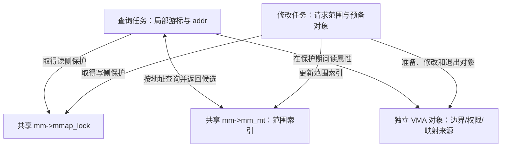
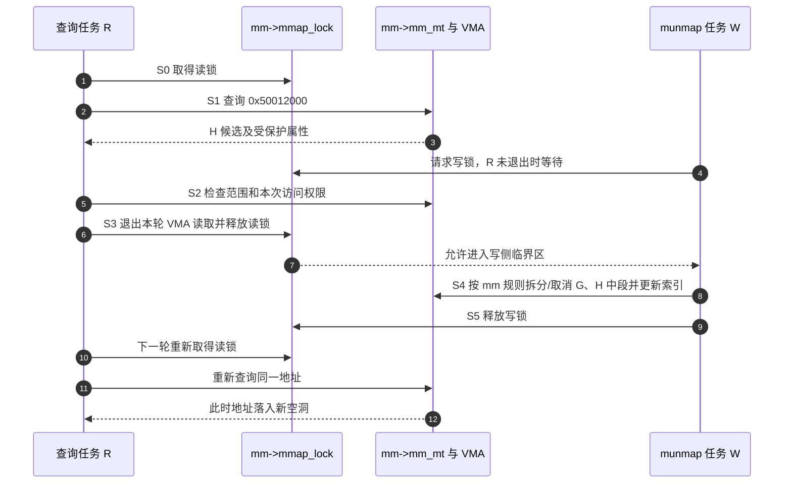
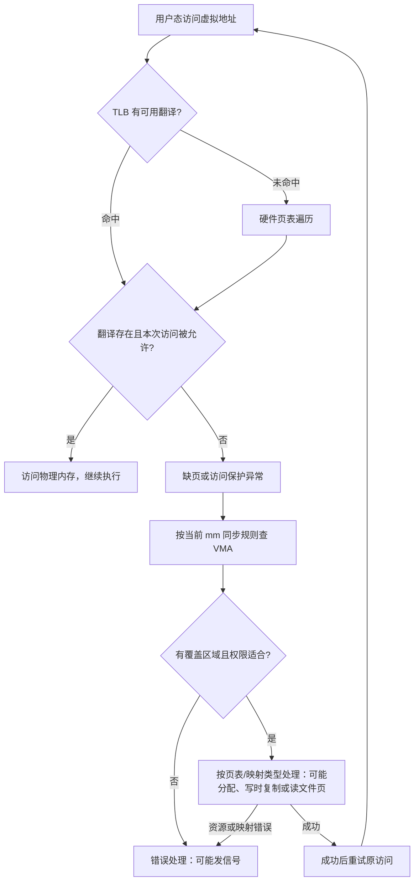

# 第49章\_范围查询返回后怎样保护VMA

[P48 范围节点](P48_从VMA辅助索引到Maple范围节点.md#48.7_多路节点怎样切分地址范围)能找出 VMA，却没有自动回答调用结束后还可读多久。本章先按操作目标选择接口，再沿共享索引、对象属性与调用方游标说明保护边界，最后把查询放回缺页路径。

## 49.1\_一次查询和连续操作为什么使用不同接口

如果只想查询一个地址，调用方可以把索引交给一个封装，由封装创建临时操作状态；如果要沿多个范围继续行走或在写入前准备节点，就需要把位置与资源状态保留在相邻调用之间。固定版本据此提供普通接口和围绕 ma_state 的高级接口。

API 即 Application Programming Interface，供调用方使用的程序接口。普通查询在内部短暂取得 RCU 保护，返回对象的保护仍由调用方负责。普通 store、insert、erase 等写封装则直接调用 mtree_lock，取得树内 ma_lock；它不会自动转用登记的外部锁。VMA 的 mm_mt 采用外部 mmap_lock，写入应沿其规定的高级接口和 mm 包装，不应把下表的普通写接口直接套上去。固定语句见[普通锁宏](../../../../research/source_reading/maple_tree/source_explanations/include/linux/maple_tree.h.md#1.12_普通接口的锁与迭代宏)。

先把输入范围和返回对象分开。下面均是通用 Maple 容器接口：范围采用包含两端的索引，entry 是载荷；它们不会自动执行 P14 的 VMA 权限修改或页表撤销。

| 操作与接口 | 输入和可观察结果 | 调用方必须另行负责 |
| --- | --- | --- |
| 点查 mtree_load | 一个 index，返回该点的 entry 或 NULL | 返回后仍有效的对象保护 |
| 覆盖 mtree_store / mtree_store_range | 单点 / [first,last] 替换载荷；成功 0，失败负错误码 | 旧载荷对象的寿命，不把覆盖当作自动释放 |
| 条件插入 mtree_insert / mtree_insert_range | 只在目标为空时接入；已有内容返回 -EEXIST | 输入、资源与失败分支 |
| 整段擦除 mtree_erase | 以一个 index 定位已有范围，清除整段并返回旧 entry | 若只清子区间，应使用 store NULL；旧对象仍需自行处理 |
| 向后 mt_find / mt_for_each | 从当前位置找非空项至 max；命中后推进调用方 index 到范围末端之后 | ULONG_MAX 后会回绕，循环应使用相应迭代约定 |
| 相邻 mt_next / mt_prev | 查当前范围之后 / 之前的对象 | 范围跨度与边界；不等于索引机械加减一后取值 |
| 销毁 mtree_destroy | 清理树索引的节点和入口 | 载荷对象并不因此自动全部释放 |

-EEXIST 表示目标已有条目；写入还可能报告输入无效的 -EINVAL 或节点内存不足的 -ENOMEM。表中返回规则与错误路径在[普通接口模块](../../../../research/source_reading/maple_tree/navigation/P07_普通接口与范围契约.md#7.2_沿一次调用划分责任)定位固定实现，完整可运行调用实验进入 P40。

普通 API 的特点是：

```text
封装程度更高；
普通读封装内部 RCU，普通写直接使用树内锁；外部锁路径另选相容接口；
适合多数使用者；
不要求使用者自己写 search core。
```

这点和 Linux `rbtree` 很不一样。

`rbtree` 的普通使用方式要求：

```text
调用者自己写 search；
调用者自己写 insert core；
调用者自己决定比较规则；
调用者自己加锁。
```

Maple Tree 普通 API 则更像一个范围映射容器接口。

高级 API 围绕 `ma_state` 展开。

常见接口包括：

```text
mas_walk()
mas_store()
mas_erase()
mas_for_each()
mas_next()
mas_prev()
mas_find()
mas_empty_area()
mas_empty_area_rev()
mas_preallocate()
mas_pause()
```

高级 API 的特点是：

```text
允许复用操作位置与预分配，具体是否更快取决于调用路径；
可以复用 walk 状态，但释放保护后需要按暂停/重置契约重新定位；
适合复杂范围操作；
调用者要更小心锁、RCU 和状态管理。
```

把它们和 VMA 对起来，可以这样理解：

```text
普通 API：
	像是“直接对树做存取操作”。

高级 API / vma iterator：
	像是“带着当前范围状态在 VMA 集合里移动和修改”。
```

------

### 49.1.1\_rbtree\_使用方式和\_Maple\_Tree\_普通\_API\_的差异

前面的 [P26 红叶接入与插入修复](P26_Linux红叶接入与插入修复.md#26.1_章节内容说明)讲过，Linux `rbtree` 的典型使用方式是：

```text
调用者定义业务结构体；
业务结构体内嵌 rb_node；
调用者手写 search；
调用者手写 insert core；
调用者决定比较规则；
rb_link_node() + rb_insert_color() 完成插入；
rb_erase() 完成删除修复。
```

Maple Tree 普通 API 的方向不同。

它提供的是更接近范围映射容器的接口：

```text
store index/range -> entry；
load index -> entry；
find range；
iterate range；
erase 所在的整段范围，或通过 store NULL 清除指定子范围。
```

对比表：

| 项目 | Linux rbtree | Maple Tree |
| --- | --- | --- |
| 基本对象 | `struct rb_node` 嵌入业务对象 | index / range 映射到 entry |
| 查找逻辑 | 调用者手写 search | 普通 API 不要求手写 search |
| 排序方式 | 调用者自定义比较规则 | 按 unsigned long index / range |
| 典型用途 | 动态有序对象集合 | 非重叠范围集合 / 稀疏范围映射 |
| 遍历 | `rb_first()` / `rb_next()` | `mt_for_each()` / `mas_for_each()` 等 |
| 并发 | 调用者负责锁和生命周期 | 普通读封装 RCU，普通写使用树内锁；外部锁更新走相容的高级接口 |

这不是谁高级谁低级的问题。

它们抽象层次不同。

`rbtree` 更像：

```text
给你红黑树结构维护工具，你自己组合成业务容器。
```

Maple Tree 普通 API 更像：

```text
给你一个面向 index/range 的内核映射容器。
```

## 49.2\_谁保护树节点与返回的VMA

范围索引保存的是 VMA 指针。即使树节点仍可读取，指针指向的对象也可能正在改权限、改边界或退出地址空间。要使用结果，必须同时解决 **树结构可读、对象存活、属性稳定** 三个问题。

先固定最容易闭合的路径：查询者持有地址空间 `mm->mmap_lock` 的读锁，修改者持有其写锁。这里的读写锁让多个只读操作共存，范围写入必须等待这些读者退出。这不是一个由单个字段决定的状态机：索引形状、VMA 属性/寿命和私有游标是三组关联状态，锁把本轮观察约束在同一个稳定周期。Maple 的 `mm_mt` 位于共享 mm；VMA 对象另行分配；游标 `vma_iterator` 位于各调用方自己的执行上下文。锁保护期间才能把三类状态看成可使用的一组，不能保存一个 VMA 指针、释放所有保护后继续访问。

`MM_MT_FLAGS` 将 VMA 树配置为记录空洞、使用外部锁及 RCU 模式。`kernel/fork.c` 的地址空间初始化把外部锁关联到 `mm->mmap_lock`。这没有取消外部同步要求：`find_vma` 的固定版本实现还检查 mmap 锁的持有条件。接口、返回边界与锁断言见[三类查询的实现讲解](../../../../research/source_reading/maple_tree/source_explanations/mm/mmap.c.md#1.2_find_vma与上界)。



### 49.2.1\_复杂并发场景\_page\_fault\_读路径与\_munmap\_写路径

现在让查询 H 的任务与取消 G/H 中段映射的任务交错。下图描述外部锁下的 **VMA 元数据观察周期**，不是整个缺页处理函数逐行时序。进入页表修改等后续阶段可能释放或重取锁，必须按对应路径重新判断，不能把这个图当成“所有缺页从头到尾都持同一锁”。

沿图中的 S0～S5，可以把状态所有权列清：

| 阶段 | 参与者和位置 | 进入、修改与后续读取 |
| --- | --- | --- |
| S0 | R 与共享 mmap_lock | 取得读锁后才能开始本轮受保护查询 |
| S1～S2 | R 的局部游标；mm_mt 和独立 VMA | R 更新自己的位置，读取共享范围与属性；W 请求写锁但尚不能修改 |
| S3 | R 退出读取，释放共享锁 | R 不再沿用未保护指针；锁协议允许等待的写者继续 |
| S4 | W 与共享范围索引/VMA | 写锁下组织拆分、撤销及索引更新；旧对象退出另遵循 mm 的生命周期规则 |
| S5 | W 释放锁，后续 R 重新进入 | 新一轮读者重新查询，得到新空洞；旧游标不能替代新查询 |



S0～S3 的私有查询状态由 R 维护；共享边界和索引在本周期内由锁阻止 W 同时改动。S4 改变的是共享映射关系，不是把 R 的旧游标直接交给 W。R 再次进入时重新查询，不能沿用锁外的旧 H 指针。这里等待方得到继续执行的依据来自读写锁的释放与获取，不是每次查询向所有 CPU 广播。

RCU（读复制更新）允许另一种树节点读取方式：写者发布新路径，旧节点延后回收，读者在规定的读侧区间内访问可追踪的节点。被移除的“全程读写互斥”成本换成了发布顺序、旧节点保留、重试和对象同步，而不是所有通信都消失。节点生命周期与 VMA 对象生命周期是两套协议，不能因索引节点暂未回收就读取一个已退出的 VMA。普通 `mtree_load` 内部短暂进入 RCU，只保护其内部查找过程；函数返回后不会自动替业务对象持有引用或 VMA 锁。

固定版本还存在 `CONFIG_PER_VMA_LOCK`（逐 VMA 锁配置）控制的 `lock_vma_under_rcu`：它从树取得候选后尝试稳定该 VMA，并再次检查隔离状态和地址边界，失败不能直接使用候选。这个分支需结合各架构调用方阅读；本次 ARM32 配置未启用它，不能把其他架构的 RCU 缺页快路径宣称为当前目标的运行现象。源码模块导读保留[同步分支入口](../../../../research/source_reading/maple_tree/navigation/P02_范围契约与查询入口.md#2.4_返回指针的使用期限)，P14 的实验只验证独占区间语义，不模拟 RCU。

高级 `mas_*` 接口把更多锁与游标管理责任交给调用方；普通写封装的内部自旋锁与 VMA 外部锁不是可互换的保护。释放树节点和释放 VMA 是不同对象的生命周期。

## 49.3\_范围查询位于缺页处理的哪一步

现在把范围管理放回一次访问中，检查索引优化发生在哪一段。

因为 Maple Tree 管 VMA，而 VMA 又和虚拟内存相关，所以容易误以为：

```text
Maple Tree 负责虚拟地址到物理地址转换；
Maple Tree 替代页表；
Maple Tree 负责物理页预取；
Maple Tree 让用户数据页连续存放。
```

这些都不对。下面提到的 TLB（Translation Lookaside Buffer）是地址翻译缓存，页表则保存翻译与访问控制信息；两者的访问层次不由 VMA 索引取代。

地址访问路径可以粗略拆成：

```text
CPU 访问虚拟地址
	↓
TLB / 页表翻译
	↓
若页表翻译或权限等条件不满足，产生异常；TLB 未命中本身不等于异常
	↓
内核根据 fault address 查找 VMA
	↓
检查权限和映射类型
	↓
根据匿名页、文件页、COW 等路径处理缺页
```

Maple Tree 参与的是：

```text
根据 fault address 查找对应 VMA；
遍历、插入、删除 VMA 范围；
查找虚拟地址空洞；
维护 VMA 范围集合。
```

它不负责：

```text
页表项硬件翻译；
物理页分配器；
页缓存本身；
磁盘预读；
把用户数据页重新排列成连续物理内存。
```

一句话：

```text
Maple Tree 优化的是 VMA 索引元数据路径，不是物理内存访问路径本身。
```

------

### 49.3.1\_page\_fault\_路径中的\_Maple\_Tree\_位置

TLB 是 Translation Lookaside Buffer，保存近期的地址翻译。下图选用硬件页表遍历模型：TLB 未命中仍可能从有效页表得到翻译；命中也不能绕过权限检查。COW（Copy-on-Write，写时复制）造成的保护异常则可能是正常优化路径。固定版本 [页表文档](https://github.com/nxp-imx/linux-imx/blob/dfaf2136deb2af2e60b994421281ba42f1c087e0/Documentation/mm/page_tables.rst)解释这一区别，图不规定全部架构的异常入口细节。



图中“按当前 mm 同步规则查 VMA”使用范围索引；余下处理还可能遍历映射，但 Maple 本身并不执行硬件地址翻译。处理失败也不保证每次都只产生同一种信号。

后面的：

```text
页表项；
物理页；
COW；
文件页读入；
TLB 更新；
缺页异常返回；
```

不是 Maple Tree 自己负责。

所以不能说：

```text
Maple Tree 优化整个虚拟地址到物理地址翻译过程。
```

更准确地说：

```text
Maple Tree 优化 page fault 等路径中的 VMA 元数据查找和范围管理部分。
```

下一单元：[P50 区分范围索引与其他内核变化](P50_区分范围索引与其他内核变化.md)。
