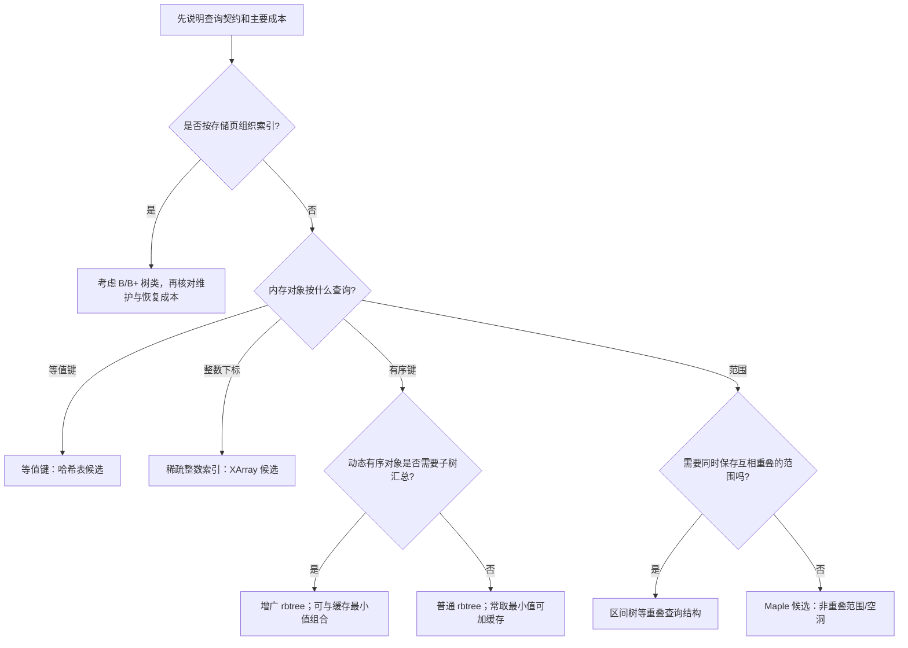

# 第50章\_区分范围索引与其他内核变化

前面已经建立范围语义、节点组织与返回对象的保护条件。现在才能判断哪些收益来自索引、哪些属于调度或锁协议的变化，以及历史性能表实际支持什么结论。

## 50.1\_不能把\_Maple\_Tree\_扩大成\_所有\_rbtree\_都被替代

Maple Tree 替代 VMA rbtree，不等于整个内核不用 rbtree。

先把类型区分开：CFS（Completely Fair Scheduler）和后面的 EEVDF 讨论调度策略；XArray 是稀疏整数索引容器；cached/augmented 是对红黑树入口缓存和子树汇总的扩展。下表给出场景入口，不将它们当作同一类型的竞争产品：

| 子系统或场景 | 更准确的结构理解 |
| --- | --- |
| 虚拟内存 VMA 管理 | Maple Tree |
| 页缓存 / 一些 ID 索引 | XArray / radix tree 演进 |
| 普通内核有序对象集合 | rbtree 仍然适合 |
| 高精度定时器等最小 key 场景 | cached rbtree 仍然合理 |
| 区间重叠查询 | augmented rbtree / interval tree 仍有意义 |
| 公平调度语义 | CFS 到 EEVDF，不是 Maple Tree |

所以这句话要避免：

```text
新内核都改用 Maple Tree 了。
```

更准确的说法是：

```text
新内核的 VMA 内存区域管理，从传统 rbtree + linked list + vmacache 模型转向 Maple Tree；
但普通有序集合、定时器、epoll、I/O 调度等场景仍可能继续使用 rbtree 或其他结构。
```

数据结构替换不是“新结构全面战胜旧结构”。

更常见的真实原因是：

```text
某个子系统的访问模式变得更适合另一种结构。
```

VMA 是范围集合，所以 Maple Tree 更贴合。

普通按 key 排序的内存对象集合，rbtree 仍然是清楚、稳定、成本可控的选择。

------

### 50.1.1\_更细的结构选择图

下图按查询契约列候选，不是自动选型器。XArray 是内核的稀疏整数索引容器，支持按索引迭代，不能因为它出现在“等值”分支就说它没有顺序。cached 最小值与 augmented 子树汇总也可以同时使用。



这张图的关键是：

```text
Maple Tree 不是 rbtree 的普遍替代；
它更适合非重叠范围集合。
```

VMA 刚好满足这个条件。

## 50.2\_不要和\_EEVDF\_调度混淆

同一个版本既可能更新调度策略，也可能更新内存管理索引。先区分算法要选择的对象，再比较所依赖的数据结构，才能避免把两个变化串成一条错误因果链。

### 50.2.1\_EEVDF\_介绍

**EEVDF = Earliest Eligible Virtual Deadline First。**

它是 Linux 公平调度器里的一个调度算法，解决的是：

> 当前 CPU 上有多个 runnable task，下一次应该选谁运行？

不是数据结构，不是 Maple Tree，不是 XArray，也不是 rbtree 的替代品。

#### (1)\_名字拆开看

```text
EEVDF
= Earliest Eligible Virtual Deadline First
= 最早“合格”的虚拟截止时间优先
```

核心概念：

| 概念                 | 含义                                             |
| -------------------- | ------------------------------------------------ |
| **virtual runtime**  | 虚拟运行时间，用来衡量任务已经占用了多少公平份额 |
| **lag**              | 任务是“欠 CPU 时间”还是“多拿了 CPU 时间”         |
| **eligible**         | 当前是否有资格被调度                             |
| **virtual deadline** | 虚拟截止时间，越早越应该先运行                   |

---

### 50.2.2\_Maple\_tree\_与CFS区别

任务调度这边也容易混淆。

CFS 是 Completely Fair Scheduler，完全公平调度器。经典模型的说法是：

```text
可运行调度实体按 vruntime 放在 tasks_timeline 红黑树中；
调度器倾向于选择 vruntime 较小的实体。
```

Linux 官方 CFS 文档也明确说，CFS 使用按时间排序的红黑树构建运行时间线。

后来公平调度语义开始转向 EEVDF。

EEVDF 关注：

```text
lag；
eligible；
virtual deadline；
选择更早 virtual deadline 的任务。
```

在本仓库固定版本中，pick_eevdf 仍从 tasks_timeline 的红黑树根读取，并结合可运行资格和虚拟截止时间选择实体。虚拟截止时间用于公平份额排序，不是硬实时截止期限；这里仅说明策略与结构的分工，不把不同内核版本的完整 EEVDF 行为压成这几句话。证据来自固定提交 kernel/sched/fair.c，见[基线的本批核对记录](../../../../research/source_reading/linux/SOURCE_BASELINE.md#1.28_Maple范围与VMA查询证据)。

这件事和 Maple Tree 不是一条线。

可以这样分开记：

```text
VMA 管理变化：
	rbtree / linked list / vmacache -> Maple Tree / VMA iterator

公平调度变化：
	CFS vruntime 语义 -> EEVDF lag + virtual deadline 语义
```

前者是内存管理的数据结构变化。

后者是调度器选择任务的算法语义变化。

不要把它们合并成：

```text
任务管理也改成 Maple Tree。
```

更准确地说：

```text
Maple Tree 是 VMA 范围索引模型变化；
EEVDF 是公平调度策略变化。
```

## 50.3\_和前面\_rbtree\_章节的关系

学到这里，容易产生一个问题：

```text
既然 VMA 从 rbtree 走向 Maple Tree，那前面学 rbtree 还有什么意义？
```

答案是：

```text
rbtree 仍然是理解内核有序对象管理的基础结构；
Maple Tree 的出现反而能帮助看清 rbtree 的适用边界。
```

前面第 8～12 章与 P43～P47 讲的 Linux rbtree，适合回答：

```text
一个业务对象如何嵌入 rb_node；
如何按 key 手写 search；
如何插入、删除、旋转、染色；
cached 最左节点如何优化最小值访问；
augmented 信息如何随旋转更新；
调用者如何负责锁和生命周期。
```

本章讲的 Maple Tree，适合回答：

```text
当对象本质是非重叠范围集合时，为什么单对象 rbtree 模型不一定最贴合；
为什么多路范围索引可以减少树高和辅助结构；
为什么 VMA 管理需要 iterator、gap search、RCU-safe 等工程特性。
```

所以两者不是互相否定。

它们是同一条学习线上的两个层次：

```text
rbtree：
	动态有序对象集合。

Maple Tree：
	动态非重叠范围集合。
```

## 50.4\_复杂示例总复盘

最后回到 P14 建立的 A～I 地址空间。

```text
A text
B data
C heap
D/E/F libA segments
G mmap file
H mmap anon
I stack
```

如果用旧模型思考：

```text
查找一个地址：
	走 rbtree。

顺序遍历 VMA：
	走 linked list。

最近访问命中：
	靠 vmacache。

修改一段范围：
	可能同时改 rbtree、linked list、vmacache 和 VMA 生命周期。
```

如果用 Maple Tree 思考：

```text
查找一个地址：
	在 mm_mt 中按范围定位。

遍历一段范围：
	用 iterator 沿范围前进。

查找空洞：
	用 range/gap 语义定位 unmapped area。

修改一段范围：
	围绕 range update / iterator / ma_state 更新非重叠范围集合。
```

这就是本章最重要的变化：

```text
不是“红黑树慢，所以换 Maple Tree”；
而是“VMA 是范围集合，所以用范围树表达更贴切”。
```

------

### 50.4.1\_怎样读历史性能表而不误用它

原先用于解释 Maple 收益的数字来自 2020 年 12 月 RFC（Request for Comments，征求意见补丁）。它以 Linux 5.10-rc1 为基线，在 144 核机器运行 mmtests；作者明确说该版尚未支持 32 位、当时运行在非 RCU 模式。它不是本仓库 ARM32/Linux 6.12.20 的测量，更不能拿来证明当前 RCU 缺页路径收益。[原始 RFC](https://lkml.iu.edu/hypermail/linux/kernel/2012.1/03913.html)

保留原摘要数字时，必须把摘要与逐项结果区别开：

| 作者的摘要项 | 原摘要范围 | 阅读限制 |
| --- | --- | --- |
| malloc1-processes | 约 +1%～+9% | 同信详细结果也有负值，不是所有进程数都提升 |
| malloc1-threads | 约 +29%～+71% | 不是详细结果的最小/最大值 |
| pthread_mutex1-threads | 约 0%～+16% | 不代表所有线程数都非负 |
| signal1-processes | 约 +2%～+17% | 是历史摘要，不能当置信区间 |
| brk1 | 约 -25%～-33% | 作者对测试目标提出疑问，但不能据此删除回退 |
| kernbuild system time | 约 -3%～-5% 的性能变化 | 是系统 CPU 时间增加造成的回退，不是耗时减少 |

例如同一份详细结果中，malloc1-threads 的 110 线程项为 -63.21%，而 2 线程项为 +1295.39%。只摘 +29%～+71% 会把复杂曲线改写成稳定收益。系统时间、墙钟时间和单位时间完成量的“越大越好”方向也不同，比较前要先说明指标。

2022 年 v14 补丁说明可用于确认替换红黑树、VMA 链表与缓存的演进范围，但不能把不同补丁版本的数字并入一张无版本表。[v14 原始说明](https://lists.infradead.org/pipermail/maple-tree/2022-September/001576.html)

现在能够提出的是待验证假设：VMA 多、查找或范围迭代多时，较短的索引依赖链可能减少访问成本；写入密集时，节点分配、复制和汇总维护也可能增加成本。mmap_lock 竞争明显时，必须确认到底更换了查询结构还是也改变了锁协议，不能把两者收益混算。小集合、热点命中、不同填充率和不同机器均可能给出不同结果。

要验证本机，应固定内核提交、配置、机器、VMA 数量、地址分布、线程数和操作比例，分别记录吞吐、延迟、CPU 时间、内存用量与可取得的缓存/锁指标，重复运行并报告波动。P14 仅运行区间语义模型，没有执行这项性能实验。

---

## 50.5\_本章小结

本章最重要的结论是：

```text
你记的是 Maple Tree；
它主要替代的是内存管理里的 VMA rbtree / linked list / vmacache 模型；
它不是泛泛替代所有 rbtree。
```

更完整地说：

```text
第一，Maple Tree 是 RCU-safe、面向非重叠范围的 B-Tree 变体。

第二，VMA 天然是 [vm_start, vm_end) 范围对象，因此很适合 Maple Tree。

第三，旧 VMA 管理大致是 rbtree + linked list + vmacache，多套结构需要同步维护。

第四，新 VMA 管理围绕 mm_mt、maple_tree、ma_state 和 vma_iterator 展开。

第五，Maple Tree 优化的是 VMA 范围索引元数据路径，不是页表、物理页分配器或预取系统。

第六，Maple Tree 不是普通 B+ 树，而是 Linux 内核场景下的范围 B-Tree 变体。

第七，rbtree 在普通有序集合、cached 最小值、augmented 区间树等场景中仍然有价值。

第八，调度器从 CFS 走向 EEVDF 是调度算法语义变化，不是 Maple Tree 替代调度树。
```

回到最初的问题，地址相等时到底命中 G 还是 H，取决于区间的包含规则；查不到时返回空还是下一段，取决于查询契约；得到指针后能否继续读，取决于锁与对象生命周期。三者不能由“用了多路树”一句话替代。

下一章进入 [Linux 6.12 Maple 源码与接口层次](P15_Linux_6.12_Maple_Tree_源码结构与_API_分层.md#15.1_本章涉及的源码文件)，进一步追踪这些契约怎样落在节点与操作状态上。
