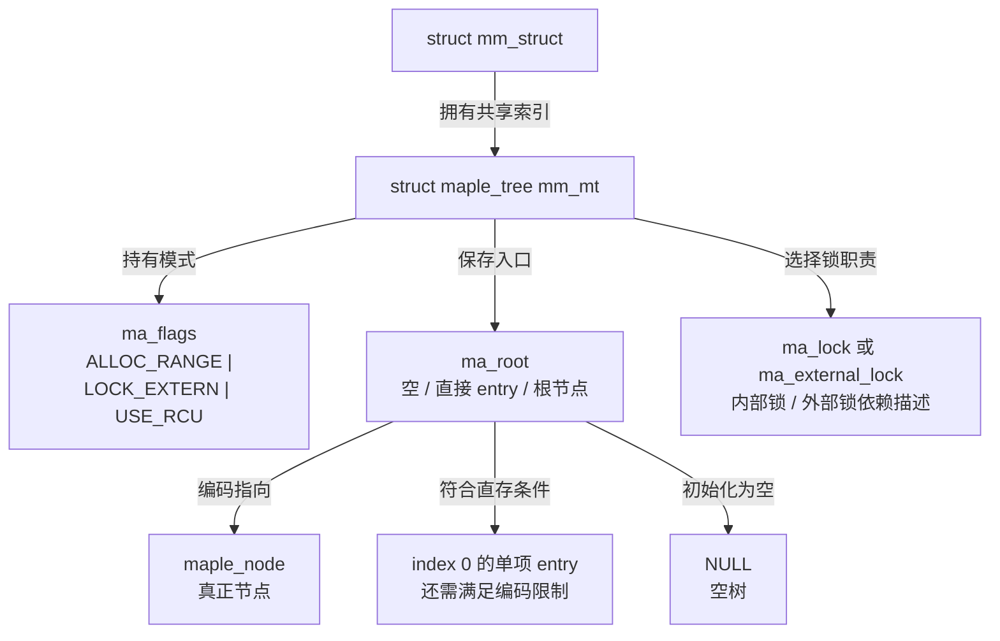

# 第51章\_共享树根怎样确定表示与保护模式

P49 已建立返回对象的保护期限。进入固定实现时，先找一棵树的共同入口：查询者如何看见同一份范围集合，空根和小树怎样表示，以及哪一种锁实际保护它。

## 51.1\_struct\_maple\_tree\_树对象本身

如果一个查询者临时建立游标就拥有一整棵新树，另一个查询者便看不到同一个地址空间的变化。实际设计把共享索引放在 mm_struct.mm_mt 中，把当前操作的位置留在调用方状态里。多个线程可以共享同一个 mm；因此这里是每个地址空间的索引，不能按线程数量数树。

固定[maple_tree 定义](../../../../research/source_reading/maple_tree/source_explanations/include/linux/maple_tree.h.md#1.2_共享树字段与模式位)有三组职责：

| 位置 | 保存的状态 | 写入和使用责任 |
| --- | --- | --- |
| ma_root | 空、index 0 的直接 entry 或编码节点入口 | 初始化建立空根，树操作更新；查询按表示分支读取，不能总是强转节点 |
| ma_flags | 创建模式、锁选择、高度和 RCU 模式等位域 | 初始化确定基础模式，适当保护下的专用路径更新动态状态；不同读写路径读取相应掩码 |
| ma_lock / ma_external_lock | 内部自旋锁或外部锁的 lockdep 描述 | 内部锁由树使用；外部锁由调用者真正持有，描述信息只供锁依赖检查 |

先看根的小树优化。只在 **索引 0 上的一项** 可直接保存在根的条件下，才省去节点；不是“任意地方只存一个对象都可直接放根”。固定头说明低两位为 10 的 entry 不使用这种根直存，而允许的其他形式可直存。更大范围或其他布局需要节点。根中的编码不等于业务指针，稍后的编码节会分别讨论根、父指针与操作状态。

再看锁。ma_lock 和 ma_external_lock 是 union 的不同使用方式；选择外部锁后，不能继续把该存储当作已经初始化的内部自旋锁。[mt_init_flags](../../../../research/source_reading/maple_tree/source_explanations/include/linux/maple_tree.h.md#1.3_初始化先选择锁模式再建立空根)先写模式，只在内部锁模式下初始化自旋锁，然后建立空根。它不会分配 Maple 节点，不会建立 VMA，也不是清理活跃树后重新开始的销毁函数。

MM_MT_FLAGS 选择的三项能力见[唯一宏定义](../../../../research/source_reading/maple_tree/source_explanations/include/linux/mm_types.h.md#1.2_VMA树的三项模式)。下表为便于比较省略共同的 MT_FLAGS_ 前缀；三者都是 ma_flags 中的模式常量，回答不同问题：

| 模式 | 为什么需要 | 额外责任或成本 |
| --- | --- | --- |
| ALLOC_RANGE | mmap 等路径需要寻找足够大的空洞 | 节点增加空洞汇总信息，相应减少部分布局容量，并在更新时维护摘要 |
| LOCK_EXTERN | 地址空间操作还需统筹 VMA 属性和其他状态 | 调用者持有相应 mmap 锁；仅声明外部锁不会自动串行化写者 |
| USE_RCU | 内部树节点须满足允许的并发读侧访问 | 更新和退休节点路径遵守 RCU 模式；业务对象期限还需自己的协议 |

图中的 ma_external_lock 是锁依赖描述，不是锁定动作。固定 kernel/fork.c 的 mm_init 先用 MM_MT_FLAGS 初始化 mm_mt，再关联 mmap_lock 的描述；[mt_set_external_lock](../../../../research/source_reading/maple_tree/source_explanations/include/linux/maple_tree.h.md#1.4_外部锁登记不是取得锁)在锁依赖检查配置 CONFIG_LOCKDEP 关闭时没有这项登记工作，也不会因此取消实际的外部持锁要求。

最后看容易混淆的 RCU 模式。头文件的历史注释提到了为单用户复用节点而引入模式选择；不能把它缩写成“开 USE_RCU 就可立即复用”。固定[mas_free 分支](../../../../research/source_reading/maple_tree/source_explanations/lib/maple_tree.c.md#1.2_退休节点根据模式选择去向)实际是：RCU 模式交给 ma_free_rcu，非 RCU 模式推回当前 ma_state 的节点资源池。内部节点可复用与某个 VMA 对象可释放仍是两个问题。

[mt_clear_in_rcu 与 mt_set_in_rcu](../../../../research/source_reading/maple_tree/source_explanations/include/linux/maple_tree.h.md#1.5_RCU模式读写不代替生命周期协议)维护模式位及相应锁约定，没有调用 synchronize_rcu。持有写锁只排除了由这把锁串行化的参与者，不能单凭它证明所有无锁读者都已离开。固定 exit_mmap 在地址空间退出这一更大生命周期下清除模式；不能把那一行拿到仍可被并发访问的树上当作通用优化。

回到与 rbtree 的比较：后者通常把 rb_node 嵌入业务对象，比较键由调用者定义；Maple 管理内部范围节点，entry 指向独立对象，index/range 由接口传入。两者都需要清楚的对象保护，但不能把 rbtree 的“摘节点”直接套成 Maple 的“对象立刻死亡”。VMA 按地址索引无需为这项职责继续内嵌 rb_node，也不代表 VMA 的所有其他索引关系都消失。

到这里可以回答三个检查题：一个非零索引上的单项为什么不能直接按根 entry 读取；登记外部锁后，哪个参与者实际取得它；模式清零为什么不等于完成宽限期。答案分别来自根表示条件、调用者同步责任和模式函数没有等待动作。下一单元进入 [P38 节点与空洞](P38_Maple节点中的范围与空洞.md#38.1_从一个共享根继续向下)，继续看节点如何装下多个范围，以及为了记录空洞付出了多少槽位空间。
