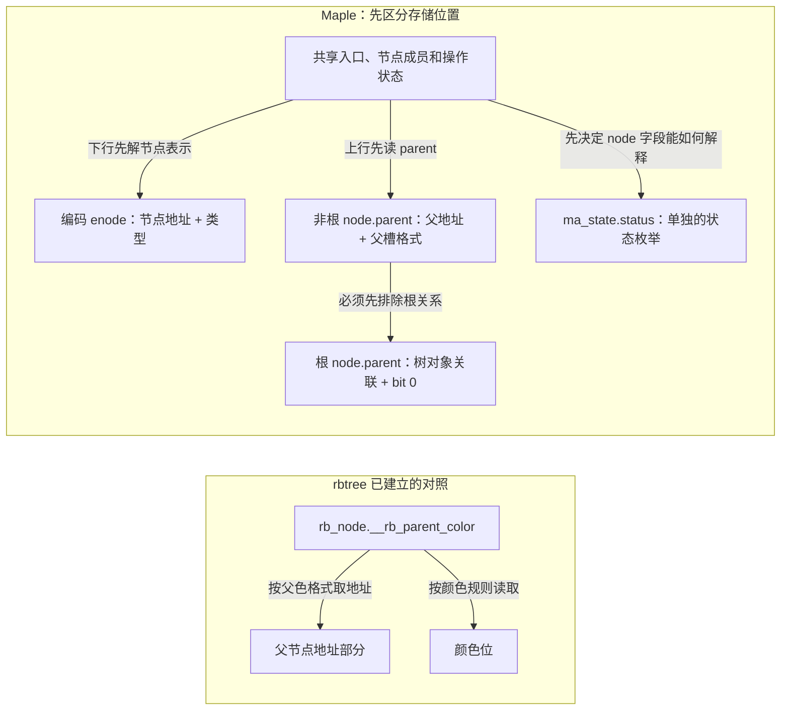

# 第52章\_按字段区分Maple编码与错误状态

P38 已把范围分区放进节点。继续沿一个 slot 向下或沿 parent 向上之前，要先判断这个字段保存裸地址、节点类型、父槽还是错误载荷；同一组低位在不同位置承担不同职责。

## 52.1\_指针低位编码\_Maple\_Tree\_的\_隐形字段

P38 说明了节点怎样组织范围。现在沿父子关系前进一步：如果一个 slot 保存的数值不是裸地址，读者凭什么知道该去掉哪些位？答案不是对所有 Maple 指针统一清低八位，而是先确认 **这个值存在哪个字段、表达哪种关系**。

节点容器按 256 字节对齐，为其地址留下低八位空间。但根节点的 parent 指向 maple_tree 对象，这个树对象并不因此也保证 256 字节对齐；叶 entry 指向的 VMA 更不是 Maple 节点。相同整数掩码作用到不同字段上，会改变完全不同的信息。

### 52.1.1\_编码节点与父指针是两套格式

固定[编码常量与节点入口](../../../../research/source_reading/maple_tree/source_explanations/lib/maple_tree.c.md#1.4_编码节点保存类型而不是父槽)中，mt_mk_node 把节点地址与类型放到一起；mte_node_type 从位 3～6 取类型，mte_to_node 清 MAPLE_NODE_MASK 所覆盖的低八位恢复节点地址。这些操作的前提是输入本来就是合法的编码节点，不是拿一个整数清位便证明地址可访问。

用整数 0x1000 表示已对齐的节点地址，type 为 2 时，构造结果是 `0x1000 | (2 << 3) | 4 = 0x1014`。其中 4 是构造函数加入的 MAPLE_ENODE_NULL 位，不属于地址；仅观察这个初始化位也不能代替真实空洞搜索或证明所有更新路径的摘要维护。根入口另外通过 mte_mk_root 加上 0x02，mte_safe_root 只撤掉这一根入口标记，**没有恢复裸节点地址**。

再看节点的 parent 字段。在本版本 range/arange 的非根父关系中，低位保存的是父关系格式与孩子在父里的槽号，而不是该孩子自身的 enum maple_type。具体写入见[mas_set_parent](../../../../research/source_reading/maple_tree/source_explanations/lib/maple_tree.c.md#1.5_父关系编码与根例外)。父地址同为 0x1000，槽号为 17 时，得到 `0x1000 | (17 << 3) | 6 = 0x108e`；取槽号应使用父槽掩码与位移，不能调用节点类型解码后解释成“第几个孩子”。

这里有一个需要按实际代码判断的版本细节：固定 maple_tree.h 的较早注释仍把部分父槽说成四位，lib/maple_tree.c 的实际 SLOT_MASK 是 0xF8，覆盖位 3～7，共五位，足以编码普通 ARM32 范围节点的 32 个槽号。正文以实际掩码与写入函数为依据，不把两个注释悄悄合并成同一种格式；16-bit 历史格式的常量也不表示当前四种节点类型都按它写入。

### 52.1.2\_根父关系不能套用节点地址掩码

根节点没有父 Maple 节点。它的 parent 以 bit 0 标识根，其余部分关联树对象；ma_is_root 读取的是这个 parent 低位。它与 ma_root 中标识“根内容为节点”的 bit 1 属于 **不同存储字段**，不能因都叫 root 就用同一测试。

假设树对象的抽象地址为 0x1232，只要求低一位可用，根 parent 可表示为 0x1233。去掉 bit 0 得到 0x1232；错误地清低八位则得到 0x1200，已经丢掉树对象地址的一部分。mte_parent 的普通父节点解码不能在未排除根关系时机械套用。



这保留了与 rbtree 的比较，却不再把 maple_enode、ma_root、entry 和状态画成一个混合的编码箱子。解码是对已有契约的解释，不能替代节点是否仍存活、调用者是否持有保护的检查。

### 52.1.3\_用户entry与错误状态分别判断

叶 entry 属于用户数据。Maple 的普通保留值检查[mt_is_reserved](../../../../research/source_reading/maple_tree/source_explanations/lib/maple_tree.c.md#1.6_保留entry与操作错误分别判断)要求同时满足“值小于 4096”和“低两位为 10”，例如 2、6、10 到 4094。4098 虽然低两位相同，却不属于这个 **小值保留区**；这不保证它适合所有接口、更不证明它是有效对象指针。

需要保存小整数时，官方文档建议使用 XArray 的 value 编码。固定[xa_mk_value/xa_to_value](../../../../research/source_reading/maple_tree/source_explanations/include/linux/xarray.h.md#1.2_整数值使用低位标记并限制有效位宽)把有效值左移一位并置低位，再右移还原；容量是 BITS_PER_LONG−1 位，不能把全 unsigned long 值域无损塞入。高位越界的 WARN_ON 不是拒绝返回，调用者必须满足输入边界。VMA entry 使用对象指针，但其有效性与使用期限仍要按 VM 协议判断。

操作错误又是另一层。固定[MA_ERROR 与 mas_is_err](../../../../research/source_reading/maple_tree/source_explanations/include/linux/maple_tree.h.md#1.9_错误载荷与独立状态)表明：错误号先转 unsigned long，再左移两位并置 2，载荷写入 mas->node；mas_set_err 还把 **单独的 mas->status 设为 ma_error**。mas_is_err 实际检查 status，并不靠扫描任意叶 entry 的位形来自动判错。

因此不要把 start、none、pause 全说成“ma_state.node 里的特殊指针值”。在这个版本，它们主要由独立状态枚举表达；只有先读对 status，才能知道 node 当前能否按编码节点使用。头文件关于 errno 的旧注释写过移位方向和混淆风险，当前证据应以 MA_ERROR 和实际状态检查函数为准，也不能写成对有符号负数直接左移。

### 52.1.4\_用定宽整数观察错误掩码

下面的完整 C11 程序只计算整数，不将编码值转换成宿主指针。它分别实现当前节点、range/arange 父槽和根父关联的算术形状；32/64 是模型位宽，不声称 Windows 的 unsigned long 或真实目标指针具有同一布局。状态转换和 RCU 不在该模型中。

```c
// SPDX-License-Identifier: MIT
#include <assert.h>
#include <inttypes.h>
#include <stdbool.h>
#include <stdint.h>
#include <stdio.h>

/* 只观察定宽整数，不构造或解引用宿主指针。 */
static uint64_t width_mask(unsigned width)
{
    assert(width == 32 || width == 64);
    return width == 32 ? UINT32_MAX : UINT64_MAX;
}

static bool node_word(uint64_t base, unsigned type, unsigned width, uint64_t *out)
{
    if (base > width_mask(width) || (base & 255) || type > 3)
        return false;
    *out = base | ((uint64_t)type << 3) | 4;
    return true;
}

static bool parent_word(uint64_t base, unsigned slot, unsigned width, uint64_t *out)
{
    if (base > width_mask(width) || (base & 255) || slot > 31)
        return false;
    /* 仅覆盖固定实现中 range/arange 的父槽格式。 */
    *out = base | ((uint64_t)slot << 3) | 6;
    return true;
}

static bool root_parent_word(uint64_t tree, unsigned width, uint64_t *out)
{
    if (tree > width_mask(width) || (tree & 1))
        return false;
    *out = tree | 1;
    return true;
}

static bool reserved_entry(uint64_t entry)
{
    return entry < 4096 && (entry & 3) == 2;
}

static uint64_t error_word(int error, unsigned width)
{
    assert(error < 0);
    /* 先转无符号再移位，最后保留目标位宽，避免有符号负数左移。 */
    return (((uint64_t)(int64_t)error << 2) | 2) & width_mask(width);
}

int main(void)
{
    uint64_t enode, parent, root_parent;
    assert(node_word(0x1000,2,32,&enode));
    assert(parent_word(0x1000,17,32,&parent));
    assert(root_parent_word(0x1232,32,&root_parent));
    printf("enode=0x%" PRIx64 " type=%" PRIu64 "\n", enode, (enode >> 3) & 15);
    printf("parent=0x%" PRIx64 " slot=%" PRIu64 "\n", parent, (parent & 248) >> 3);
    printf("root parent=0x%" PRIx64 " tree=0x%" PRIx64 " wrong mask=0x%" PRIx64 "\n",
           root_parent, root_parent & ~UINT64_C(1), root_parent & ~UINT64_C(255));
    assert((enode & ~UINT64_C(255)) == 0x1000);
    assert((parent & ~UINT64_C(255)) == 0x1000);
    assert((root_parent & ~UINT64_C(1)) == 0x1232);
    assert(reserved_entry(6) && !reserved_entry(4098));
    assert(!node_word(0x1232,2,32,&enode));
    assert(!parent_word(0x1000,32,32,&parent));
    assert(!root_parent_word(0x1233,32,&root_parent));
    printf("error -12: word32=0x%" PRIx64 " word64=0x%" PRIx64 "\n",
           error_word(-12,32),error_word(-12,64));
    unsigned checks=0;
    for(unsigned width=32;width<=64;width+=32) {
        for(uint64_t base=0;base<65536;base+=256) {
            for(unsigned type=0;type<4;++type) {
                assert(node_word(base,type,width,&enode));
                assert((enode & ~UINT64_C(255))==base && ((enode>>3)&15)==type);
                ++checks;
            }
            for(unsigned slot=0;slot<32;++slot) {
                assert(parent_word(base,slot,width,&parent));
                assert((parent & ~UINT64_C(255))==base && ((parent&248)>>3)==slot);
                ++checks;
            }
        }
        uint64_t last_aligned=width_mask(width) & ~UINT64_C(255);
        assert(node_word(last_aligned,3,width,&enode));
        assert((enode & ~UINT64_C(255))==last_aligned);
    }
    printf("node/parent round trips: %u\n",checks);
    return 0;
}
```

材料为[maple_encoded_words.c](../../../../labs/kernel/tree_basics/materials/maple_encoded_words.c)。保持断言启用，从仓库根目录运行：

```bash
cc -std=c11 -O2 -Wall -Wextra -Werror \
  labs/kernel/tree_basics/materials/maple_encoded_words.c -o /tmp/maple_encoded_words
/tmp/maple_encoded_words
```

输出应包含：

```text
enode=0x1014 type=2
parent=0x108e slot=17
root parent=0x1233 tree=0x1232 wrong mask=0x1200
error -12: word32=0xffffffd2 word64=0xffffffffffffffd2
node/parent round trips: 18432
```

先解释每一行属于哪个字段，再做三个修改：将父槽改为 31 与 32，观察容量边界；把根树对象地址改为另一个偶数但非 256 对齐值，判断两种掩码；将 -12 的错误载荷误当节点清位，说明得到一个整数为什么不等于得到可解引用的对象。最后一个实验只在纸上或整数模型里进行，不构造虚假的 C 指针访问。

本单元已经把相同低位位置上的不同职责分开。下一单元 [P39 游标](P39_Maple操作游标的暂停与继续.md#39.1_从查一个对象走到继续遍历)继续追踪 ma_state 的 index、last、offset 和 status 怎样随一次查询变化，而不是再把这些状态压回一个指针比喻。
