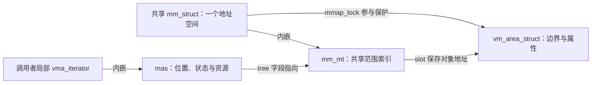
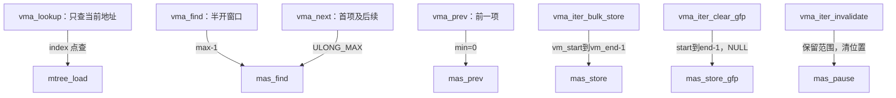
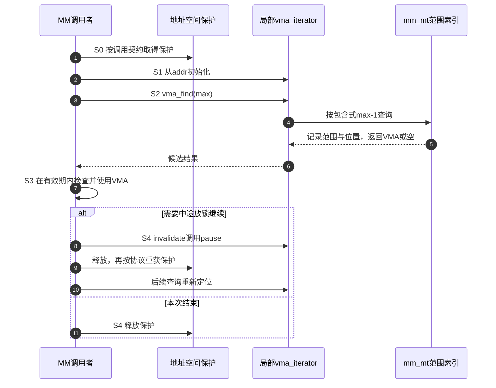

# 第53章\_VMA游标怎样翻译范围请求

P41 已区分一次写入的位置、资源准备与锁。现在进入地址空间调用者：共享树属于 mm，私有游标属于一次操作，VMA 的半开端点需要在接口处转换。用两个相邻范围观察一次转换错在哪里。

## 53.1\_VMA\_接入层\_mm\_struct.mm\_mt

[P41](P41_Maple写入准备与锁边界.md#41.3_沿S0到S5区分位置与资源)已把请求、节点位置、资源与锁分开。现在把它们放进真实地址空间：mm_struct 表示一个用户地址空间，它内嵌的 mm_mt 索引这个地址空间的 VMA；线程可以共享同一个 mm_struct，不能理解成每个线程必有一棵独立树。VMA 对象保存半开边界与属性，树中的 entry 指向这个对象，不是页表项或物理页号。

### 53.1.1\_树模式决定哪些职责交给调用者

固定源码沿[VMA 适配模块](../../../../research/source_reading/maple_tree/navigation/P09_VMA游标与边界适配.md#9.2_从地址空间到局部游标)进入。MM_MT_FLAGS 组合值仍由[mm_types.h 唯一标题](../../../../research/source_reading/maple_tree/source_explanations/include/linux/mm_types.h.md#1.2_VMA树的三项模式)解释；这里关心这三项对调用方的含义。

| 模式 | VMA 场景需要它的原因 | 不能据此推导什么 |
| --- | --- | --- |
| ALLOC_RANGE | 为 mmap 一类空洞搜索维护可用于排除子树的 gap 信息 | 不自动决定地址对齐、保护间隔和映射政策 |
| LOCK_EXTERN | mmap 锁等外围协议需要同时协调树与 VMA 属性，而不只是节点变化 | 登记不等于加锁，普通写封装不会自动转而获取 mmap_lock |
| USE_RCU | 树节点退休和受支持的读路径按 RCU 协议工作 | 不自动稳定返回后的 VMA，也不等于当前配置已启用所有无锁 VMA 读路径 |

固定 kernel/fork.c 初始化 mm_mt 时设置这些模式，并关联 mm->mmap_lock。这个关联是检查器能识别的保护关系；真正持锁范围由 MM 调用路径建立。当前已核对配置没有 CONFIG_PER_VMA_LOCK，不能从树的 USE_RCU 标志声称目标已走该配置下的缺页快路径。

### 53.1.2\_游标属于一次遍历

struct vma_iterator 内含一份 ma_state，让调用者连续操作同一棵 mm_mt。共享的是树，局部的是游标位置；创建一个新游标既没有复制 VMA 集合，也没有创建新地址空间。结构、VMA_ITERATOR 宏和 vma_iter_init 的完整固定实现见[游标初始化](../../../../research/source_reading/maple_tree/source_explanations/include/linux/mm_types.h.md#1.3_VMA游标与两种初始化)。

两种初始化有一个不能靠印象补齐的区别。VMA_ITERATOR 指定 tree、index、NULL node 和 ma_start，未显式初始化的 last 按聚合初始化规则为 0；vma_iter_init 调用 mas_init，后者把 index 与 last 都设为 addr。两者都为后续查询建立入口，但不表示初始化后的每个字段逐字节相同。不要把尚未执行查询时的 last 直接当成“已经命中的 VMA 末端”。



适配层因此可以把调用意图写成 vma_next、vma_prev、vma_iter_bulk_store，但“包装很薄”只描述转发代码的体量，不能据此省略锁、对象期限和区间前置条件。下一节专门看这些转发究竟改变了什么。

## 53.2\_VMA\_封装函数\_把半开区间翻译成\_Maple\_Tree\_闭区间

范围模型已经建立，现在给出两个相邻 VMA：A=[0x1000,0x3000)，B=[0x3000,0x4000)。A 包含最后一个地址 0x2fff，不包含 0x3000；进入 Maple 后应分别表示为 A[0x1000,0x2fff] 和 B[0x3000,0x3fff]。这里的减一针对 **地址索引**，不是把页数减一。

### 53.2.1\_一次查询如何推进边界

vma_find(vmi,max) 把排除式上界 max 转成包含式 max-1，再调用 mas_find，见[唯一实现](../../../../research/source_reading/maple_tree/source_explanations/include/linux/mm.h.md#1.4_VMA查找复用高级游标)。如果上界为 0x3000，它最多搜索到 0x2fff，不应因为 B 从 0x3000 开始就越过窗口去返回 B。

vma_next 的第一次调用也使用 mas_find。游标若从 A 内部开始，当前范围就是应该访问的第一项；改成 mas_next 可能跳过它。后续调用再依据保存的状态继续。vma_prev 则转给 mas_prev，并以 0 为下界。完整转发见[方向与范围包装](../../../../research/source_reading/maple_tree/source_explanations/include/linux/mm.h.md#1.5_VMA方向与范围遍历)。

vma_iter_next_range 又承担不同任务：它调用 mas_next_range，推进到下一个范围槽，可能访问空范围。不能只见返回 NULL 就断定“状态一定越界”，还要按高级接口检查位置和边界状态；这与只遍历有值 VMA 的循环不是一回事。

### 53.2.2\_写入和清除的请求从哪里来

| 包装 | 请求区间的来源 | 传给 Maple 的动作与返回处理 |
| --- | --- | --- |
| vma_iter_bulk_store | vma->vm_start 与 vma->vm_end | 直接写入 index 与 end-1，再调用 mas_store；依据错误状态返回 0 或 -ENOMEM |
| vma_iter_clear_gfp | 调用者的 start/end | 使用 __mas_set_range 设置 start/end-1，写入 NULL；依错误状态返回 0 或 -ENOMEM |
| vma_iter_set | 调用者的单个 addr | 调 mas_set 改变后续查询起点，不修改共享树 |
| vma_iter_invalidate | 既有游标 | 调 mas_pause，清失效位置但不解锁；下一次行为沿 P39 的 pause 契约 |
| vma_iter_free | 本次状态关联的资源 | 调 mas_destroy，不释放 VMA 对象，不等于销毁 mm_mt |

固定代码分别见[写入和清理包装](../../../../research/source_reading/maple_tree/source_explanations/include/linux/mm.h.md#1.6_VMA写入请求与资源退出)及[已有 invalidate](../../../../research/source_reading/maple_tree/source_explanations/include/linux/mm.h.md#1.3_VMA游标失效调用暂停)。clear 与 bulk 的封装将状态错误映射为 -ENOMEM，不是通用地原样转发所有底层 errno；bulk 也不能通过 mas_store 返回 NULL 就判断成功。它们都没有在这里取得 mmap 锁。

__mas_set_range 保留已有操作的定位背景，不能把 clear 包装当成随时可用的独立普通写接口。准备、位置与批量资源应由真实调用方建立。与此同时，当前固定 mm/mmap.c 还使用 mm/vma.h 中的 config/prealloc/store 路径；本表保留旧文实际引用且固定版本仍存在的接口，不把它们宣称成所有 VMA 修改的完整调用链。后续源码阅读必须跟随真实调用点选择入口。

### 53.2.3\_减一之前必须知道什么

若误把 A 存成闭区间 [0x1000,0x3000]，它就侵入了本应属于 B 的地址 0x3000；根据写入先后，覆盖操作可能改掉该地址的映射。直接后果是一个地址索引归属错误，不能不经后续页对齐和 MM 路径分析就写成“删掉一整页”。相交查询、空洞搜索、缺页候选、munmap/mprotect/mremap 等修改依赖边界正确，因而会受到错误输入影响；具体故障仍要沿对应调用链判断。

空区间是另一类问题。start=end 没有成员，不能机械转换为 [start,end-1]；当 end=0 时，无符号减一得到 ULONG_MAX，反而把上界扩到最大值。上述短封装并未统一替调用者拒绝所有空、逆序或溢出请求。进入适配前，应已经证明 `start < end`，并保证 end 可由使用的地址类型表达；加法产生的 end 还须先排除溢出。

本章的边界程序主动检查这些前提，和内核包装按既有调用约定转发不同。代码保留失败输出不变，方便观察“没有产生一个闭区间结果”，而不是制造一个伪装成成功的巨大范围。

### 53.2.4\_运行边界等价性实验

完整材料[vma_boundary_contract.c](../../../../labs/kernel/tree_basics/materials/vma_boundary_contract.c)只处理整数区间，不操作真实进程或内核树。它逐一比较半开与闭区间的成员关系，另展示错误 end、零减一和最大可表示终点。

```c
#include <stdbool.h>
#include <stdint.h>
#include <inttypes.h>
#include <stdio.h>
#include <stdlib.h>

struct closed_range { uint64_t first, last; };

/* 教学转换器主动检查输入；不声称实际 VMA 包装函数都执行此检查。 */
static bool to_closed(uint64_t start, uint64_t end, struct closed_range *out)
{
    if (start >= end)
        return false;
    *out = (struct closed_range){start, end - 1};
    return true;
}

static bool contains(struct closed_range range, uint64_t address)
{
    return range.first <= address && address <= range.last;
}

static void require(bool condition, const char *message)
{
    if (!condition) {
        fprintf(stderr, "check failed: %s\n", message);
        exit(EXIT_FAILURE);
    }
}

int main(void)
{
    struct closed_range a, b;
    require(to_closed(0x1000, 0x3000, &a), "A input");
    require(to_closed(0x3000, 0x4000, &b), "B input");
    printf("A=[%" PRIx64 ",%" PRIx64 "] B=[%" PRIx64 ",%" PRIx64 "]\n",
           a.first, a.last, b.first, b.last);
    require(contains(a, 0x2fff) && !contains(a, 0x3000), "A excludes end");
    require(contains(b, 0x3000), "B owns boundary");
    struct closed_range wrong_a = {0x1000, 0x3000};
    require(contains(wrong_a, 0x3000) && contains(b, 0x3000), "wrong overlap");

    unsigned accepted = 0, rejected = 0, membership_checks = 0;
    for (uint64_t start = 0; start <= 32; ++start) {
        for (uint64_t end = 0; end <= 32; ++end) {
            struct closed_range result = {99, 100};
            bool ok = to_closed(start, end, &result);
            require(ok == (start < end), "validity");
            if (!ok) {
                require(result.first == 99 && result.last == 100, "failure unchanged");
                ++rejected;
                continue;
            }
            ++accepted;
            for (uint64_t address = 0; address <= 32; ++address) {
                require(contains(result, address) ==
                        (start <= address && address < end), "same membership");
                ++membership_checks;
            }
        }
    }
    /* 最大可表示 end 仍是排除式边界；本类型不能表示 2^64。 */
    require(to_closed(UINT64_MAX - 1, UINT64_MAX, &a), "high interval");
    require(a.last == UINT64_MAX - 1 && !contains(a, UINT64_MAX), "high boundary");
    uint64_t zero = 0;
    require(zero - 1 == UINT64_MAX, "unsigned wrap is not an empty interval");
    printf("accepted=%u rejected=%u membership_checks=%u; zero-1 wraps\n",
           accepted, rejected, membership_checks);
    return EXIT_SUCCESS;
}
```

```bash
cc -std=c11 -Wall -Wextra -Werror -O2 labs/kernel/tree_basics/materials/vma_boundary_contract.c -o /tmp/vma_boundary_contract
/tmp/vma_boundary_contract
```

本批宿主实际结果：

```text
A=[1000,2fff] B=[3000,3fff]
accepted=528 rejected=561 membership_checks=17424; zero-1 wraps
```

528 组有效区间分别核对 33 个地址，561 组空/逆序输入拒绝且输出不变。使用 uint64_t 是为了明确整数模型的宽度，不表示当前 ARM32 VMA 能使用任意 64 位地址。固定包装另用显式后端夹具检查转发参数、两种初始化和错误映射；真实内核 VMA 更新、锁竞争和页表操作未运行。

### 53.2.5\_把边界转换放回操作周期



这保留了原查询/修改分组，并为原先孤立的点查节点补上真实转发箭头。把实际观察顺序写成 S0～S4：S0 调用者建立地址空间保护；S1 初始化局部游标；S2 查询包装转换窗口并更新局部位置；S3 调用者在保持对象有效的条件下使用结果；S4 完成遍历或按协议暂停再释放保护。树的模式位不代替 S0，得到指针也不允许跳过 S3。



先预测三个结果再进入查询对照：从 A 内部首次 vma_next 是否返回 A；max=0 能否表示一个安全的空搜索窗口；得到 VMA 指针后是否能随意越过解锁点使用。答案分别是按首次查询包含当前位置、不能机械使用零上界、必须另有对象稳定协议。接下来在 [P54 四种查询](P54_同一地址的四种VMA查询结果.md)进一步比较点查、向后查、范围相交和同时取得前驱。
