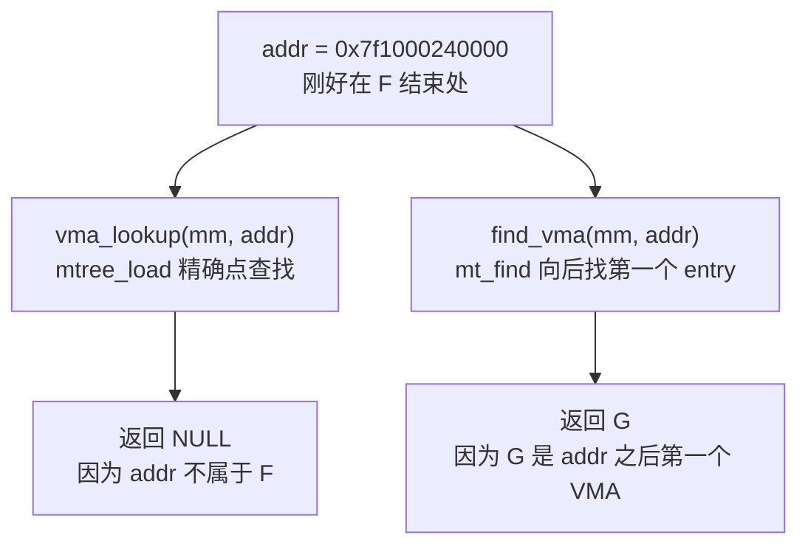
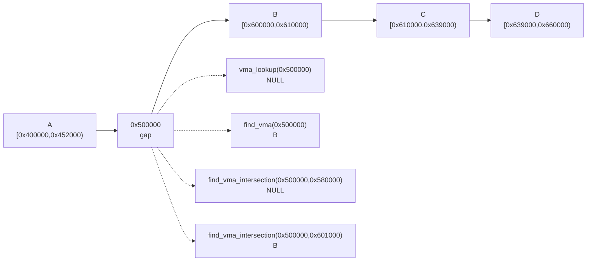
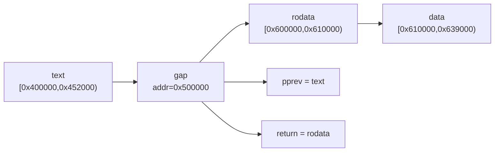

# 第54章\_同一地址的四种VMA查询结果

P53 已说明边界转换与对象保护。现在保持一张固定地址图，分别提出点查、向后、相交和同时取前驱四种问题，追踪返回值和局部游标为何不同。

## 54.1\_用一个复杂\_VMA\_场景理解\_ma\_state

下面保留八段 VMA 的 64 位抽象地址图，用于比较查询任务，不表示当前 ARM32 目标可使用这些高地址：

```text
A: [0x0000000000400000, 0x0000000000452000)  text
B: [0x0000000000600000, 0x0000000000610000)  rodata
C: [0x0000000000610000, 0x0000000000639000)  data
D: [0x0000000000639000, 0x0000000000660000)  heap
E: [0x00007f1000000000, 0x00007f1000200000)  lib.so text
F: [0x00007f1000200000, 0x00007f1000240000)  lib.so relro
G: [0x00007f1000600000, 0x00007f1000800000)  anonymous mmap
H: [0x00007fff00000000, 0x00007fff00021000)  stack
```

转换到 Maple Tree 里，范围变成：

```text
A: [0x0000000000400000, 0x0000000000451fff]
B: [0x0000000000600000, 0x000000000060ffff]
C: [0x0000000000610000, 0x0000000000638fff]
D: [0x0000000000639000, 0x000000000065ffff]
E: [0x00007f1000000000, 0x00007f10001fffff]
F: [0x00007f1000200000, 0x00007f100023ffff]
G: [0x00007f1000600000, 0x00007f10007fffff]
H: [0x00007fff00000000, 0x00007fff00020fff]
```

现在发生一次缺页异常，地址是：

```c
addr = 0x00007f1000212345
```

这个地址应该命中 F。

如果用 `vma_lookup(mm, addr)`，最终会走：

```text
vma_lookup()
  -> mtree_load(&mm->mm_mt, addr)
       -> MA_STATE(mas, mt, addr, addr)
       -> mas_start()
       -> mtree_lookup_walk()
```

MA_STATE 初始化时 tree 关联 mm_mt，index 与 last 都是输入地址。上述调用链描述普通节点树的主要分支，根直接 entry 和空树会提前返回。尤其要注意：mtree_lookup_walk 的固定注释明确说明快速点查不维护完整状态，不能承诺返回时 node/offset 或 index/last 已更新为 F 的完整范围，也不能把高级遍历的 S0～S6 状态图套在这里。

如果查到了 F，返回的是 `struct vm_area_struct *F`。

如果这时不是精确 lookup，而是问：

```text
从 0x00007f1000240000 开始，下一个 VMA 是谁？
```

那它应该跳过空洞，返回 G。

这时更像 `find_vma(mm, addr)`：

```text
find_vma()
  -> mt_find(&mm->mm_mt, &index, ULONG_MAX)
       -> MA_STATE(mas, mt, index, index)
       -> mas_state_walk()
       -> 如果当前位置没有 entry，就 mas_next_entry()
```

`mt_find()` 和 `mtree_load()` 的关键差别是：

```text
mtree_load(index):
    只问 index 这个点有没有 entry。

mt_find(&index, max):
    问 index 或 index 之后，直到 max 之间，第一个 entry 是谁。
```

这就是为什么 `find_vma()` 可以返回“命中地址的 VMA，或者地址之后的下一个 VMA”。



这个差别在读 `mm/mmap.c` 时非常重要。很多时候代码不是在判断“这个地址是否在 VMA 里”，而是在找“这个地址附近的 VMA 布局”。

## 54.2\_VMA的三个查找入口

VMA 相关源码里经常出现三个名字：

```text
vma_lookup()
find_vma()
find_vma_intersection()
```

它们不是同义词。上一节已经证明半开上界如何转换；现在保持同一组 A～D，只改变查询问题。返回的是完整候选 VMA，不把对象边界裁剪成查询窗口，也不由非空返回自动取得对象引用。

### 54.2.1\_vma\_lookup()\_只查这个地址有没有\_VMA

源码位置：[include/linux/mm.h](../../../../research/source_reading/linux/include/linux/mm.h)

完整固定版本函数体及仓库补充注释见[唯一实现讲解](../../../../research/source_reading/maple_tree/source_explanations/include/linux/mm.h.md#1.2_vma_lookup只查询当前地址)。这里继续用查询结果对照其职责，不重复展开函数体。

语义：

```text
addr 必须落在某个 VMA 范围内，才返回这个 VMA。
如果 addr 位于两个 VMA 之间的 gap，返回 NULL。
```

### 54.2.2\_find\_vma()\_查这个地址\_或者地址之后的第一个\_VMA

源码位置：[mm/mmap.c](../../../../research/source_reading/linux/mm/mmap.c)

完整固定版本函数体及仓库补充注释见[唯一实现讲解](../../../../research/source_reading/maple_tree/source_explanations/mm/mmap.c.md#1.2_find_vma与上界)。这里继续用查询结果对照其职责，不重复展开函数体。

语义：

```text
如果 addr 命中某个 VMA，返回它；
否则返回 addr 之后的第一个 VMA。
```

这适合需要继续遍历或查看后续布局的调用方。若用于判断故障地址是否已映射，还必须核对候选起点不大于 addr；“后面存在一个 VMA”并不使当前空洞变成有效映射。

### 54.2.3\_find\_vma\_intersection()\_查范围是否与\_VMA\_相交

源码位置：[mm/mmap.c](../../../../research/source_reading/linux/mm/mmap.c)

完整固定版本函数体及仓库补充注释见[唯一实现讲解](../../../../research/source_reading/maple_tree/source_explanations/mm/mmap.c.md#1.3_find_vma_intersection翻译排除式终点)。这里继续用查询结果对照其职责，不重复展开函数体。

它和 `find_vma()` 的关键差别是上界：

```text
find_vma():
    max = ULONG_MAX

find_vma_intersection(start, end):
    max = end - 1
```

所以 `find_vma_intersection()` 只在指定范围内找，不会越过 `end_addr` 找到后面的 VMA。

下面用复杂例子对比三者。

```text
VMA:

A: [0x400000, 0x452000)
B: [0x600000, 0x610000)
C: [0x610000, 0x639000)
D: [0x639000, 0x660000)
```

查询：

| 调用 | 结果 | 原因 |
| --- | --- | --- |
| `vma_lookup(mm, 0x500000)` | `NULL` | `0x500000` 在 A 和 B 之间的 gap |
| `find_vma(mm, 0x500000)` | B | B 是 `0x500000` 之后第一个 VMA |
| `find_vma_intersection(mm, 0x500000, 0x580000)` | `NULL` | `[0x500000, 0x580000)` 范围内没有 VMA |
| `find_vma_intersection(mm, 0x500000, 0x601000)` | B | B 与该范围相交 |
| `vma_lookup(mm, 0x610000)` | C | `0x610000` 是 C 的起点，不属于 B |

图示：



这些封装把范围和向后搜索的契约集中在 VMA/Maple 接口上；红黑树也能实现相同查询，不能由接口名称反推只有 Maple 才能查前驱或后继。

## 54.3\_find\_vma\_prev()\_为什么还要找\_previous

`find_vma_prev()` 在 [mm/mmap.c](../../../../research/source_reading/linux/mm/mmap.c) 里：

完整固定版本函数体及仓库补充注释见[唯一实现讲解](../../../../research/source_reading/maple_tree/source_explanations/mm/mmap.c.md#1.4_find_vma_prev保持两个结果)。这里继续用查询结果对照其职责，不重复展开函数体。

这个函数说明一件事：即使不再有全局 VMA 链表，VM 子系统仍然需要“前驱 / 后继”语义。

例如 mmap 新区域、扩展栈、合并 VMA 时，都需要看相邻 VMA：

```text
prev 是否能和新 VMA 合并？
next 是否能和新 VMA 合并？
prev 和 next 之间的 gap 是否够大？
addr 是否正好落在 prev 结束处？
```

复杂例子：

```text
prev: [0x0000000000600000, 0x0000000000610000)  rodata
vma : [0x0000000000610000, 0x0000000000639000)  data
next: [0x0000000000639000, 0x0000000000660000)  heap

addr = 0x0000000000618000
```

此时：

```text
vma_iter_load(&vmi) 命中 data；
vma_prev(&vmi) 返回 rodata；
函数返回 data，同时 pprev = rodata。
```

如果：

```c
addr = 0x0000000000500000
```

它位于 text 和 rodata 之间的 gap：

```text
vma_iter_load(&vmi) 返回 NULL；
vma_prev(&vmi) 返回 text；
vma_next(&vmi) 返回 rodata；
函数返回 rodata，同时 pprev = text。
```

图示：



这类“同时拿到当前位置和前驱”的需求，就是 `vma_iterator` 封装存在的原因之一。若 addr 在第一项之前，返回第一项但 pprev 为 NULL；若 addr 在最后一项之后，返回 NULL 而 pprev 仍可能是最后一项。两个输出独立表达两个问题，不能只检查其中一个。

下一单元进入 [P42 撤销映射](P42_撤销映射中的两棵Maple树.md#42.1_从查到VMA到不再允许找到它)，观察取得对象后怎样组织退出。
