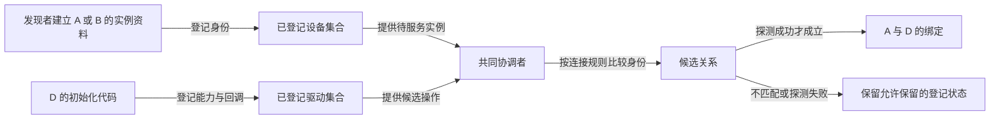

# 第1章\_为什么需要设备模型

前面的[驱动框架入门](../../driver_model/fundamentals/framework_model/大纲.md)已经把实例与操作分开：同一份驱动可以服务两只同型号传感器，每只保留自己的地址和缓存。本专题继续追问一个运行问题：如果第二只设备晚到，或者驱动晚于设备出现，谁记住尚未配对的一方，谁负责再试一次？

贯穿场景仍是入口传感器 A、出口传感器 B 和驱动 D。A/B 是两个实例，D 是可以复用的一组操作；它们属于一套相同的连接与匹配规则。先不加入硬件中断、用户文件和电源依赖，直到这些约束确实改变当前方案。读完本章，应能解释为什么“已登记”和“能服务”必须分开，下一章再设计让两边相遇的机制。

## 1.1\_固定启动顺序曾经足够

最初的板级程序可以按固定次序工作：启动时建立 A 的实例资料，调用 D 的初始化，再开始测量。只要设备永远存在、驱动总能立即取得资源、系统也不需要停掉其中一只设备，这条直线容易理解和调试。它并没有因为简单而天然错误。

加入 B 后，共享代码已经避免复制驱动；但如果仍在 D 初始化时仅扫描一次，那么扫描之后出现的 B 就永远错过机会。把扫描写到设备创建处也只解决另一半问题：A 创建时 D 尚未装载，创建者此时没有可调用的服务。两个正确的局部动作，因为没有共同保存“谁已出现”的状态，组合起来仍可能漏掉绑定。

可以要求所有设备必须先于所有驱动出现，但这种约束会传到整套启动顺序：发现设备的控制器可能本身就需要驱动，模块可能按需装载，外部设备还可能运行中加入。每增加一种设备，就要检查它在全局启动表中的位置。问题由此从“一次调用写在哪里”变成“系统怎样接纳不同到达顺序”。

## 1.2\_先记住存在\_再判断能否合作

解决漏配对的第一步，是保存两个事实：有哪些已登记设备，以及有哪些已登记驱动。登记只说明这一方愿意参与后续查找，不宣称两方已经成功合作。后来的一方进入集合时，可以检查先前已到达的一方；暂时没有候选也不是登记失败。

配对还分两步。先依据身份判断 D 是否可能认识 A，这叫匹配；再让 D 为 A 取得资源并建立运行状态，这叫探测，回调通常名为 probe。匹配成功而资源不足时，必须允许 A 留在设备集合中，同时没有成功绑定。否则我们无法表达“设备存在，但本次服务建立失败”。

图中协调者不执行传感器协议，它安排谁去执行。A 成功、B 失败时，两者可以处于不同绑定状态；不应把 D 是否已登记当作全体实例的健康标志。至于失败后何时再次尝试，必须由失败原因和重试策略决定，不能在本章把所有错误都写成无限重试。

## 1.3\_共同规则与硬件策略怎样分工

如果每条总线都自行实现两集合、查找、失败清理和删除协调，同一个对象生命周期问题会被重复解决。Linux 的 **驱动核心（Driver Core）** 提供这些公共组织与协议；**总线类型（bus type）** 提供本连接体系的匹配、探测适配等规则。总线类型是软件组织对象，可能对应实际总线，也可能用于组织平台设备。

公共部分决定何时查找、怎样协调同一设备的一次绑定与撤销；具体规则决定身份如何比较、怎样把公共设备对象转换成该总线驱动理解的实例。驱动仍负责自己的硬件操作、私有状态和服务停止。公共框架不能因为两个名字相同就证明硬件响应正常。

框架还要让管理员能观察对象和关系，并协调有依赖的设备进入或离开工作状态。后文才引出 sysfs、对象事件和电源依赖；它们分别解决可观察性、通知与顺序约束，不是增加一个万能“已完成”标志。付出的代价是调用者要遵守登记、引用、回调和清理的契约，不能再任意释放一块已经交给别人使用的内存。

一次性的板级验证可以继续采用严格受控的固定调用顺序。当目标进入 Linux 的长期设备管理，或要支持设备增减、多个实例、独立驱动装载与退出时，应使用所在子系统的公共协议。继续自行维护另一份并行登记表，反而会产生两个对“设备是否可用”意见不一的来源。

## 1.4\_先做两个到达顺序的预测

写下两条时间线：A 登记后 D 登记；D 登记后 A 登记。如果匹配规则相同、探测成功且没有并发删除，两条线都应到达 A 与 D 绑定。再加入 B：D 已服务 A 时 B 到达，不应要求重新创建 D，也不能把 A 的私有状态搬给 B。

这里还不能直接写出正确实现，因为没有说明集合何时更新、后来者检查谁，以及同一设备怎样避免重复绑定。下一章先在单线程、无失败条件下实现最小闭环，第三章再故意加入能破坏它的交错。

练习：如果 D 已登记却没有任何匹配设备，登记应失败吗？如果 A 已登记但 probe 失败，应该把“设备不存在”作为结论吗？参考思路是两者都不能直接推出：前者可以合法等待设备出现，后者保留了存在事实但没有建立服务。观察时应分别检查登记、匹配尝试和探测结果。

本章的稳定角色划分可继续对照[固定版本驱动入口索引](../../../research/source_reading/driver_entries/navigation/P01_Linux_6.12_驱动入口源码阅读索引.md)；具体集合与调用路径在第四章落到地址，不把本章教学推导当成 Linux 内部调度算法。

下一篇：[设备模型抽象机制推演](P02_设备模型抽象机制推演.md)。
