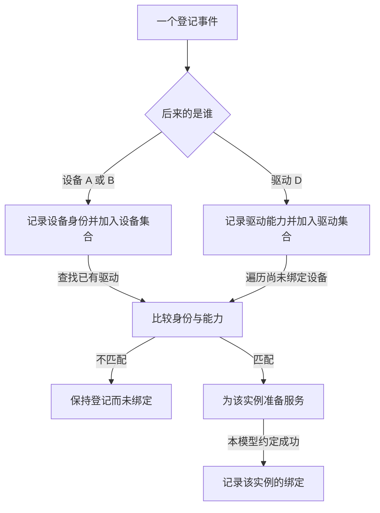

# 第2章\_设备模型抽象机制推演

上一章提出了到达顺序问题：不能只在启动时扫描一次。本章先把约束缩小到容易验证的范围：一个执行者串行登记两只设备和一份驱动，匹配由整数类型标记决定，探测总是成功，没有删除与资源申请。模型只证明两种到达顺序都能找到候选；它还不能用来实现可热拔插驱动。

## 2.1\_后来者为什么要看对面的集合

设设备集合最初为空，驱动集合也为空。A 到来时先保存身份，并把自己放入设备集合，然后查看驱动集合。没有 D 就结束这次尝试，A 仍留在集合中。D 后来登记时，先进入驱动集合，再遍历已登记设备；此时能找到 A，并为 A 尝试建立服务。

顺序反过来，D 先登记时没有设备可尝试；A 到来后从驱动集合中找到 D。两条路径的共同点是：**先记录自己，再检查对面已经记录的对象**。已有绑定的 A 在随后遍历中应被跳过，否则添加 B 可能重复初始化 A。



模型不需要后台轮询线程：登记动作主动查看已经保存的状态。读写都在当前调用栈中完成。这个结论依赖串行前提，不能推广成 Linux 不需要任何锁或异步工作；第三章会检查“两个登记者同时看见空集合”的漏洞。

## 2.2\_用一个完整程序交换到达次序

下面把设备集合缩为两个数组元素，把驱动集合缩为一份描述。present 表示已经登记，bound 表示这个实例已经配对，kind 是教学模型的类型编号，不是 Linux 设备号。每个 case 都重新构造对象，避免前一次运行的绑定影响下一次预测。

保存为 arrival_model.c，也可取用[同源材料](../../../labs/kernel/device_model/materials/arrival_model.c)。这个普通 C 程序不加载驱动，不建立 sysfs，也没有真实 probe：

```c
#include <stdio.h>

struct model_device {
    const char *name;
    unsigned int kind;
    int present;
    int bound;
};

struct model_driver {
    unsigned int kind;
    int present;
};

static void try_bind(struct model_device *device, const struct model_driver *driver)
{
    if (!device->present || !driver->present || device->bound)
        return;
    if (device->kind != driver->kind)
        return;
    /* 模型只验证相遇，本行假定服务准备总能成功。 */
    device->bound = 1;
    printf("bound=%s\n", device->name);
}

static void register_device(struct model_device *device,
                            const struct model_driver *driver)
{
    device->present = 1;
    try_bind(device, driver);
}

static void register_driver(struct model_driver *driver,
                            struct model_device *devices, size_t count)
{
    size_t index;

    driver->present = 1;
    for (index = 0; index < count; ++index)
        try_bind(&devices[index], driver);
}

static int run_case(int driver_first)
{
    struct model_device devices[] = {{"A", 7, 0, 0}, {"B", 7, 0, 0}};
    struct model_driver driver = {7, 0};

    printf("case=%s\n", driver_first ? "driver_first" : "device_first");
    if (driver_first)
        register_driver(&driver, devices, 2);
    register_device(&devices[0], &driver);
    if (!driver_first)
        register_driver(&driver, devices, 2);
    register_device(&devices[1], &driver);
    /* 再次查找已经绑定的 A，不应再次打印绑定。 */
    try_bind(&devices[0], &driver);
    return devices[0].bound && devices[1].bound ? 0 : 1;
}

int main(void)
{
    int first = run_case(0);
    int second = run_case(1);

    if (first || second) {
        fputs("model check failed\n", stderr);
        return 1;
    }
    return 0;
}
```

先编译，再执行两条顺序，最后改变 B 的类型重新运行。每一步都在普通练习目录完成：

```bash
# 执行位置：已保存 arrival_model.c 的目录，有 C11 编译器。
cc -std=c11 -Wall -Wextra -Werror -pedantic arrival_model.c -o arrival_model
```

编译成功后才运行本轮生成物：

```bash
# 执行位置：同一普通练习目录。
./arrival_model
```

预期有两个 case，每个都只打印一次 bound=A 和一次 bound=B。D 先到时，第一次遍历看到两个尚未 present 的数组元素，不能提前绑定；B 晚到时，只处理 B 的配对。末尾的显式检查在失败时返回 1，不依赖断言是否启用。

现在把 B 的 kind 从 7 改为 8，重新编译运行。应只绑定 A，程序按当前“两者都应绑定”的检查报告失败。失败没有说明登记算法坏了，而是你改变了匹配前提却尚未改变预期。若要把它变成“B 不匹配”的通过用例，应同时把最终检查改为 A 已绑定且 B 未绑定；不要仅删除检查来获得返回 0。

## 2.3\_绑定状态不能代替对象寿命

到这里，只证明了登记事件能触发候选查找。模型中的内存由 run_case 的栈帧持有，所有访问在函数返回前结束，因此没有暴露生命周期问题。真实系统的集合、回调和用户访问可能跨越多个调用栈，不能让创建者一返回就回收对象。

于是需要分开四个动作：初始化对象，让对象进入可发现集合，为它建立服务，最终归还对象内存。停止服务不必删除设备登记，删除登记也不表示最后一个观察者已经退出。如果把这些动作全写成一个 present 位，退出时就无法判断该撤销哪部分。

本模型允许串行地重新检查 bound，却没有处理并发检查、探测失败或删除。下一章依次加入这些条件；每次只增加当前反例需要的协议，不直接把 Linux 的全部字段塞回这个小程序。

练习：删除 register_driver 中的遍历，只保留它设置 present，并暂时去掉 run_case 末尾用于演示重复检查的那次 try_bind，哪个 case 会失败？答案是 device_first 中的 A：A 登记时没有驱动，驱动后来又没有查看 A，B 则仍能在自己登记时发现 D。如果保留末尾重查，A 会被额外尝试补上，输出变为先绑定 B 再绑定 A，最终成功反而掩盖了缺少登记触发的问题。检查行为发生的时刻，和检查最终状态同样必要。

上一篇：[为什么需要设备模型](P01_为什么需要设备模型.md)。

下一篇：[机制完善：生命周期、并发与失败](P03_机制完善_生命周期并发与失败.md)。
