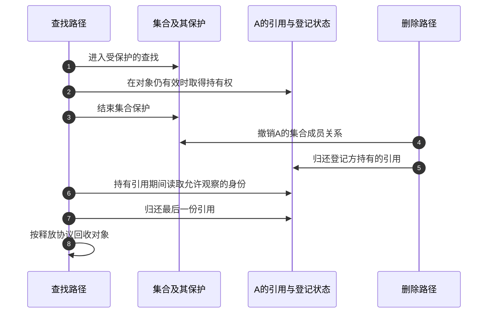

# 第3章\_机制完善\_生命周期并发与失败

上一章的数组模型能处理两种登记顺序，但对象都由同一个函数持有，绑定检查也没有被另一个执行者打断。本章保持 A/B 与驱动 D 的场景，只改变运行条件。目标不是给模型堆字段，而是弄清每增加一种保护，究竟修复了哪一条交错。

## 3.1\_从集合消失以后\_旧观察者还握着地址

假设查找者先从设备集合取得 A 的地址，准备读取其类型。此时删除者摘掉 A，并立即释放内存；查找者随后访问 A，就访问了已经结束生命期的对象。集合里已经没有 A，并不能抹掉查找者手里的地址副本。

只锁住集合的插入与删除还不够。查找者若解锁后继续使用对象，必须在对象尚受集合保护时取得一份可延续到解锁后的持有权；用完后归还。删除者可以阻止新的查找，但最终释放必须等已有持有者也退出。这里引入的是对象引用协议，不能先解锁，再从可能已经失效的地址上尝试加引用。

步骤 1～3 跨过集合保护边界而保留对象，步骤 4、5 让新查找不再发现 A；步骤 6 仍可读取引用协议允许的对象内存。步骤 7、8 才可能完成最终回收。图是抽象的引用交接，最后释放由实际归还最后引用的路径承担，也可能按实现延迟；不是固定由删除线程执行。

引用只保证这块对象内存仍存在。传感器可能已经断开，驱动可能已经解绑，引用不会让硬件重新响应。因此“可读取对象的身份”和“可发起新的硬件操作”必须分别判断。

## 3.2\_两次看到未绑定\_不等于只有一次准备服务

再让两个执行者同时尝试 A：甲读取 bound 为假后被打断，乙也读到假并开始初始化；甲恢复后同样初始化。即使它们最后都写 bound=true，两个初始化过程也可能重复申请中断、覆盖私有指针，或者重复向硬件发送启动命令。最后那个布尔值看似正确，过程中已经出错。

因此必须协调“检查候选资格 → 准备服务 → 提交结果”这一段操作，而不只保护最后一次赋值。最朴素的办法是给每个设备一把可覆盖探测过程的锁：同一设备的两次尝试串行，A 与 B 则不必因使用同一驱动而共用所有业务锁。实际系统还可能有父对象、总线及依赖方的锁，第四章起按源码区分它们的保护范围。

两集合的发布和搜索也需要相应的串行化与可见性协议。不能从上一章的单线程程序推出“分别写入一个普通 int 后扫描即可”：两个执行者若都在对方发布对自己可见前完成查找，就可能漏掉相遇。模型证明的是事件规则，Linux 实现还必须保证集合遍历、引用和状态检查在并发下成立。

## 3.3\_准备到一半失败\_该撤回哪一部分

现在让 A 的身份匹配 D，但第二项资源申请失败。A 已登记这个事实不一定要撤销，D 也可以继续服务 B；本次应回收的是为 A 的这次探测取得的资源和临时关系。把失败写成“删除整个驱动”会伤及 B，把失败仅写成 bound=false 又可能泄漏 A 的第一项资源。

需要记录本次已经完成的动作，以及每项动作的配对恢复。简单路径可以手写逆序清理；重复的资源责任可以交给设备资源登记机制，但仍要先明确责任范围。内存回收不能自动撤销已经启动的硬件操作，也不能自动等待任意后台任务结束。

若失败原因是 A 依赖的供电控制器尚未就绪，立刻无限重试只会重复同样的失败。系统需要记录“本次尚不能完成”，在依赖条件可能变化时重新发起一次完整尝试。这样的 **延迟探测（deferred probe）** 与对象引用、互斥保护解决不同问题。它不是保留半个初始化现场，等几秒后从失败指令往下执行。

## 3.4\_停止新服务与等旧使用者退出

最后让 A 已经服务应用。解绑时撤掉新的打开入口，可以阻止后来的使用者，但先前打开的文件、已经进入的属性回调或排队的工作仍可能保存实例地址。若立即释放 D 的私有状态，旧使用者仍会越过销毁点。

因此撤销通常需要两段协议：先使新业务不再进入，再停止或排空已经进入的活动，最后才回收这些活动使用的状态。不同入口有不同协议：属性活动由对应文件系统路径保护，字符文件可能需要独立的实例引用和失效标志，后台工作需要取消与等待。不能把一份设备引用、一个 remove 回调或一把设备锁当成全部入口的统一保护。

父对象先被删除时，子设备对父对象的依赖也需要安排；功能依赖又未必都是父子关系。例如 B 与一个供电控制器可能位于不同父节点，B 工作期间仍需要它提供资源。后文用依赖链接讨论这种关系和电源顺序。模块退出还涉及代码是否仍被调用，它与设备内存是否存在也是两件事。

## 3.5\_把缺口对应到协议\_再进入实现

现在可以总结已经推导出的职责，而不是从名词表猜用途：

| 已看到的交错或缺口 | 必须建立的保证 | 仍不能由它证明 |
| --- | --- | --- |
| 摘链后仍有旧地址 | 受保护地取得引用，最后归还才销毁 | 硬件仍可用、驱动仍绑定 |
| 两个执行者都看到未绑定 | 协调检查、准备和提交整个过程 | 所有驱动业务字段都已经互斥 |
| 本次探测部分成功后失败 | 对实际完成的动作配对回滚 | 所有外部效果都能恢复 |
| 依赖方暂未就绪 | 保留重试原因，条件变化后重新尝试 | 重试必然成功或在固定时间内完成 |
| 撤入口时仍有旧访问 | 阻止新请求并排空或保活旧使用者 | 只删一个目录就能卸载所有代码 |
| 父子以外还有功能依赖 | 单独记录依赖及适用的顺序约束 | 任意链接都能永久保证资源可用 |

思考一次解绑：A 已从新查找中消失，旧文件仍持有 A 的引用。此时能否报告“新打开应失败”，又让旧文件读取已保存的软件状态？可以，但必须由驱动契约明确允许，并保证所需软件状态与代码仍存活；旧文件不能据引用存在继续访问已经撤销的硬件。下一章将这些正交状态放回固定版本的真实地址，再逐项检查 Linux 提供了哪些保证。

上一篇：[设备模型抽象机制推演](P02_设备模型抽象机制推演.md)。

下一篇：[Driver Core 状态拓扑](P04_Driver_Core状态拓扑.md)。
