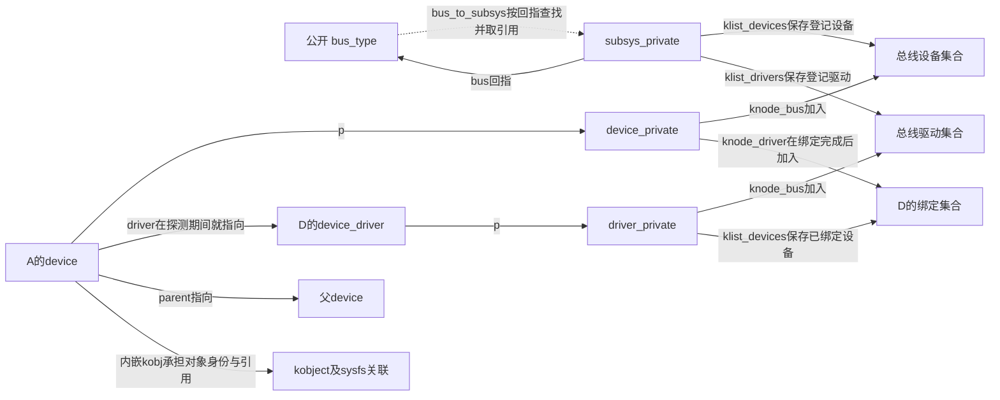
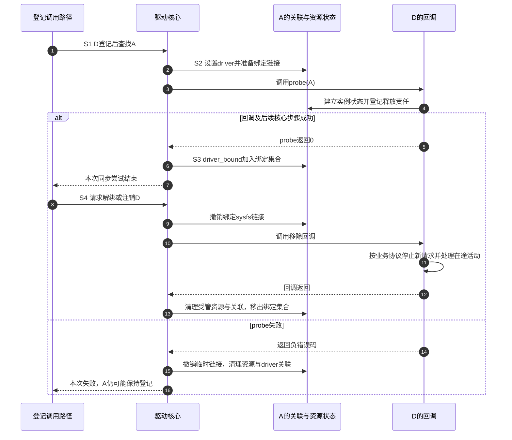

# 第4章\_Driver\_Core状态拓扑

前三章已经得到两集合、引用、绑定协调和回滚的职责。现在把它们放回固定 Linux 实现：A 的登记在哪里，D 服务哪些设备记在哪里，probe 期间谁写这些状态？如果只有一张结构体名字图，仍无法区分“候选已找到”和“服务已建立”。

本章沿用[驱动框架入门](../../driver_model/fundamentals/framework_model/P01_驱动框架模型.md#1.2_追踪一次完整绑定)的 S0～S4：准备、相遇、准备服务、服务、撤销。它们是教学观察阶段，不是内核枚举，也不同于错误指针专题给一次局部失败划分的编号。默认设备已登记、驱动后来登记、同步探测、没有尚未就绪的依赖；后续章节再展开其他分支。

源码身份为 NXP 官方 Linux 6.12.20 固定提交 dfaf2136deb2af2e60b994421281ba42f1c087e0，入口见[驱动入口阅读索引](../../../research/source_reading/driver_entries/navigation/P01_Linux_6.12_驱动入口源码阅读索引.md)。以下说明这一版本的公共实现，不根据本地目录名判断版本。

## 4.1\_公开描述为什么不是全部运行状态

调用者需要准备设备身份和驱动能力，但不应自行改动驱动核心的内部集合。Linux 将两层分开：公开 struct device 表示实例，公开 struct device_driver 表示驱动描述；它们的 p 分别指向 device_private 和 driver_private，由核心管理列表节点等运行状态。p 不是驱动随意存放业务数据的指针；业务数据通过 driver_data 及相应接口另行关联。

总线也有公开的 struct bus_type 和内部 subsys_private，但固定 6.12.20 的 bus_type **没有 p 成员**。bus.c 内部的 bus_to_subsys 在已登记总线的 bus_kset 集合中按 sp->bus 回指匹配公开描述，找到管理对象并取得引用，调用方用 subsys_put 归还。不能因为 device 与 driver 都有 p，就替总线补出一个同名字段。

这里会看到三种集合名称。klist 是带节点引用协议的内核链表设施，用来遍历设备或驱动；klist_node 是一个对象加入某条 klist 的连接节点。kset 则把 kobject 组织在一起，参与对象层次和表示。它们各有自己的管理状态，不是三个可互换的“设备数组”。本章只使用它们在驱动核心中的职责，不展开通用链表算法。

## 4.2\_同一设备为何需要几个链节点

A 需要回答至少三个不同问题：它属于哪条总线，它当前由哪个驱动服务，它的父对象是谁。如果只用一个链节点，就无法同时进入这些不同集合；从总线删除时也可能误删仍要保留的另一种关系。device_private 因此有按关系命名的独立节点。

实线中带字段名的箭头表示实际关联或集合成员，虚线表示查找操作，不是 bus_type 中的隐藏指针。D 可以登记却没有绑定设备，A 也可以在总线集合中但不在 D 的绑定集合中。dev->driver 还可能在探测期间暂时指向 D，因此它非空不能单独证明 probe 已经完成。

下面只列本轮状态推进需要的地址，便于对照图中谁改、谁读：

| 地址或字段 | 写入事件 | 后续读取者与证明范围 |
| --- | --- | --- |
| sp->klist_devices、dev->p->knode_bus | bus_add_device 加入，bus_remove_device 撤销 | 总线遍历与驱动匹配；证明登记成员关系 |
| sp->klist_drivers、drv->p->knode_bus | bus_add_driver 加入，bus_remove_driver 撤销 | 设备侧查找候选；不保证有成功实例 |
| dev->driver | really_probe 在调用 probe 前设置，失败或解绑清理清空 | 当前探测及相关回调；须结合阶段解释 |
| drv->p->klist_devices、dev->p->knode_driver | driver_bound 加入，解绑移除 | 已绑定设备遍历，device_is_bound 检查节点归属 |
| dev->mutex | 设备锁接口协调绑定及解绑路径 | 保护相应核心操作；不自动锁住所有业务回调 |
| dev->devres_head、dev->devres_lock | devm 成功登记，清理路径摘取记录 | 失败或解绑时读取回调及数据，执行配对释放 |
| dev->kobj.kref | 初始化、取得及归还对象引用 | 最后归还决定能否销毁对象，不证明硬件可用 |

这些状态由锁、引用和调用顺序共同维护。缓存一致性不会代替锁协议，返回一个成功值也不会原子地更新所有列表、文件系统链接和业务字段。观察 sysfs 时看到的是这些步骤的某个窗口。

## 4.3\_把一次绑定推进到撤销

先把默认场景固定住：A 已在总线设备集合中，D 后来登记且允许自动探测。登记路径触发查找，匹配成功后进入同一设备受协调的探测过程。下表把第三章要求的各项保证接到同一周期：

| 阶段 | 触发与执行者 | 关键变化及进入下一阶段的条件 |
| --- | --- | --- |
| S0 准备 | 创建者准备身份与回调 | 初始化必要对象；尚未交给框架的资源仍由创建者负责 |
| S1 相遇 | 登记路径加入两侧集合，核心按策略查找 | 匹配候选；没有候选时可保持登记而未绑定 |
| S2 准备服务 | really_probe 建立临时关联并调用 probe | dev->driver 先设置，sysfs 驱动关联也在回调前尝试建立；驱动准备私有状态与资源 |
| S3 服务 | probe 返回 0，后续核心步骤也成功 | driver_bound 将 knode_driver 加入 D 的绑定集合；业务入口是否可用仍由其发布协议决定 |
| S4 撤销 | 注销或解绑路径协调消费者，调用移除及清理 | 撤销绑定链接、停止服务、回收受管资源和关联，移出绑定集合；设备可继续保持登记 |

probe 返回 0 以后，核心仍可能在建立附加属性等步骤中失败；这些失败会走相应撤销路径，不能把回调返回的一瞬间当成全部绑定完成。反过来，回调以前已经出现的 dev->driver 或链接，也不能被误认成成功标志。

步骤 1～4 进入 S2，步骤 5～7 对应成功路径的 S3；步骤 8～13 才是随后一次 S4。步骤 14～16 是未进入 S3 的回调失败。图省略了核心后置失败的细分标签，阅读第八章时要按失败位置决定是否调用移除回调，不能给所有失败画同一个 remove。

这不是一条在所有配置中完全相同的时间线。异步探测改变执行者和登记调用返回时刻，延迟探测改变下一次尝试何时发起，供应者依赖还会增加检查。它们不消除“登记、临时关联、绑定完成、停止服务、最终释放”的区别。

## 4.4\_用什么证据区分这些状态

沿[错误指针四场景实验](../error_handling/error_pointer/P04_观察返回值与释放顺序.md#4.3_运行时区分装载成功与探测成功)保持模块装载，比较设备目录、driver 链接和 probe 日志。它用同步、无硬件的受控场景解释稳态差别；不要在任意并发现场只读一次链接就声称已经捕获绑定提交点。

例如 A 的目录还在，失败日志已经出现，driver 链接没有：这与 A 已登记但本次探测失败相容。它不能证明所有资源均已正确释放，资源回收还要看登记记录与对应观察。若引用还在而设备已解绑，则对象内存可能仍存活，但新硬件请求应按服务状态判断。

证据位置为固定提交的 drivers/base/base.h、bus.c、driver.c、dd.c 与 include/linux/device.h、device/bus.h。已有[对象与入口模块导读](../../../research/source_reading/driver_entries/navigation/P02_对象属性与字符入口导读.md#2.4_带着一次修改继续阅读)组织集合入口，[返回值与清理导读](../../../research/source_reading/error_pointer/navigation/P02_返回值与清理路径导读.md#2.3_跟随驱动失败而不混用返回类型)组织回调失败；正文不复制第二份上游函数体。

练习：A 的 dev->driver 非空，但 knode_driver 尚未加入 D 的绑定集合，能否断言数据损坏？不能，这可以是正常 S2；应结合正在执行的路径、锁与失败回滚判断。若发现旧资料直接读取 bus->p，应先核对版本中的结构声明，而不是为编译通过自行补字段。

上一篇：[生命周期、并发与失败约束](P03_机制完善_生命周期并发与失败.md)。

下一篇：[kobject、kset 与 sysfs 对象树](P05_kobject_kset与sysfs对象树.md)。
