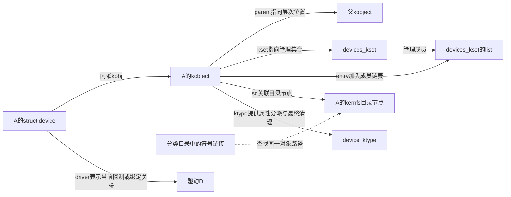
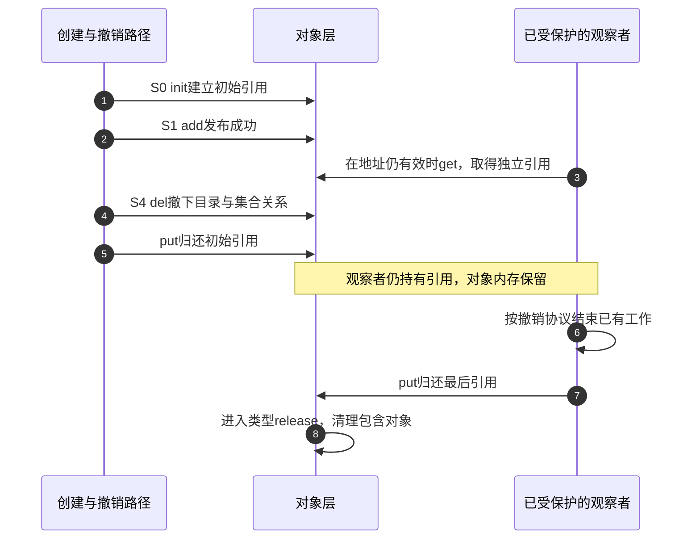

# 第5章\_kobject\_kset与sysfs对象树

上一章用不同链节点区分了总线登记、驱动绑定和父子关系。还有一个尚未解释的共同部分：设备、驱动和总线管理对象都有名字，在 sysfs 中有表示，也都不能在仍被使用时直接释放。若让每类对象各写一套命名、层次和引用协议，这些共同职责就会散落在各个子系统中。

Linux 用 **内核对象（kernel object，kobject）** 承担这一层公共职责。它通常嵌在较大的对象里，例如 A 的 struct device 内含 kobj；它不承载传感器采样算法，也不决定 A 能否由驱动 D 服务。本章要解释同一个 A 如何同时拥有对象位置、集合归属和绑定关系，以及为什么从目录撤下 A 后，它的内存仍可能存在。

默认沿用第四章的固定 Linux 6.12.20 源码身份。首次进入引用实现可从 [kref 源码阅读索引](../../../research/source_reading/kref/navigation/P01_Linux_6.12_kref源码阅读索引.md#1.2_按问题进入已落地证据)查找；下面先在本地建立关系与生命周期，再用具体函数核对。

## 5.1\_共同管理什么\_具体类型还要决定什么

假设设备创建者分配一个包含 device 的传感器对象。驱动核心认识其中的 device，通用对象层只认识其中的 kobject。通用层可以保存名字和引用，却不知道整个分配块有多大、是否还有额外成员需要释放。引用归零时若直接对 kobject 地址执行 kfree，甚至可能把一个嵌入成员误当成分配起点。

因此还需要 **对象类型描述 kobj_type**。它是回调与属性规则的描述结构，规定最后清理时调用哪个 release，以及属性读写如何分派。release 的实现负责回到正确的包含对象并按其分配方式收尾；“提供一个空 release 消除警告”没有完成这项责任。sysfs_ops 则承担属性访问的分派，不是设备的业务线程。

device 已经由驱动核心选择 device_ktype，并由其 release 再选择设备级释放回调。设备创建者应使用 device 的初始化和引用接口，不能另外对同一 dev->kobj 重做初始化，或把自定 kobj_type 覆盖上去。通用层复用的是管理机制，具体类型仍保留释放对象的知识。

这里的 **sysfs** 是向用户空间呈现内核对象及属性的文件系统；**kernfs** 是其使用的目录节点和访问管理基础设施。kobject 的 sd 关联相应 kernfs 节点。目录节点、kobject 和传感器对象是三个不同对象，文件路径不是包含它们全部状态的一块“设备内存”。

## 5.2\_父对象与集合归属为什么要分开

A 的连接层次回答“它位于哪个父对象下面”，而某类公共操作回答“哪些对象属于同一个管理集合”。两者可能重合，也可能不同。例如设备的 kobject 可统一属于 devices_kset，但每个设备仍有自己的父对象位置；不能把全部设备都理解成 /sys/devices 下彼此平级的目录。

**对象集合 kset** 用链表组织 kobject 成员，同时内嵌一个 kobject 表示集合自身。成员的 kset 字段指出集合，entry 是加入集合链表的节点；parent 则指出对象树的父 kobject。没有明确父对象而指定了 kset 时，添加路径可以用该 kset 自身的 kobject 作为父对象。这项默认规则没有把两种关系合并成一个字段。



图中 parent、kset 和 driver 分别回答层次、集合、服务者三个问题。虚线只表示文件路径解析，不是增加了一份 device。对有 class 的设备，核心还可能在对象路径中安排分类相关目录；因此 dev->parent 与 dev->kobj.parent 也不能不经实现核对就当成同一个地址。

kset 还可以提供 uevent 操作：决定一类对象的事件是否发送、用什么子系统名，以及补充哪些环境变量。**uevent** 是对象变化通知，不是属性文件本身；仅调用 kobject_add 并不自动代表已经发送 KOBJ_ADD。device 添加流程会另行调用事件接口，第十一章再把通知与用户空间动作接起来。

理解这些关系以后，再看当前所需字段会更容易判断其用途：

| 状态位置 | 由什么动作维护 | 可以回答什么，不能回答什么 |
| --- | --- | --- |
| kobject.name、parent | 命名及添加、移动、撤下路径 | 对象叫什么、放在哪里；不能证明驱动已绑定 |
| kobject.kset、entry；kset.list、list_lock | 添加和撤下路径在集合锁下加入或摘除成员 | 集合成员关系；不是总线的匹配结果 |
| kobject.sd、state_in_sysfs | sysfs 创建及删除路径 | 对象目录关联与登记状态；不是全部业务活动计数 |
| kobject.kref | 初始化、get、put | 对象引用寿命；不能证明硬件仍可访问 |
| kobject.ktype | 初始化时选定 | 属性分派与最终释放规则；不替业务协议停止硬件传输或后台任务 |
| kset.uevent_ops | 集合建立时提供，事件路径读取 | 通知策略；不是给所有成员执行 probe 的驱动 |

成员加入时，kobject 取得的是对 kset 的引用，使所用集合保持存在；这不能反推“只要还在集合中，本对象就自动有无限期引用”。父对象也有相应的引用保持与归还。两种关系的引用和调用者对本对象持有的引用，需要分别记账。

## 5.3\_撤下目录为什么不等于释放对象

第三章已经遇到过一种交错：观察者取得 A 的有效引用以后，另一路径开始撤销 A。此时需要同时满足两个目标：不再让新查找者从原入口找到 A，让已经持有引用的观察者能安全完成约定范围内的工作。如果一个“删除”动作立即释放全部内存，第二个目标就无法成立。

这正是初始化、发布、撤下和归还分开的原因。以下操作面向普通 kobject；包含它的 device 还需要第六章的设备级协议，不能只删 kobject 绕过驱动核心。

| 操作 | 对本次对象做什么 | 调用者仍要负责什么 |
| --- | --- | --- |
| kobject_init | 初始化引用和内部状态，关联类型；初始引用成立 | 确保类型及包含对象有效，最终配对 put |
| kobject_add | 命名并接入对象层次，成功后建立 sysfs 表示 | 处理返回错误；成功后的发布状态最终要撤销 |
| kobject_del | 撤下成功添加的对象，移除目录及集合关系，归还对应父关系引用 | 不会替调用者消费其持有的本对象引用 |
| kobject_get / kobject_put | 取得或归还本对象引用；最后归还进入清理 | get 以前已经具有有效地址与生命周期保护，不能用它抢救悬空指针 |



步骤 1～3 建立对象、发布和独立使用责任；步骤 4～5 撤下发布关系并归还创建者的份额。步骤 6 不能因为对象还在就继续任意硬件访问，必须服从已建立的服务关闭状态。步骤 7 才使最后一个引用消失；步骤 8 的类型清理可能受 CONFIG_DEBUG_KOBJECT_RELEASE 调试配置延后，所以不能把“最后 put 已发生”与“该行指令后内存必已释放”写成无条件等式。

若最后 put 时对象仍在 sysfs，通用清理也会撤下它；[只读属性入门](../../driver_model/fundamentals/framework_model/kobject讲解.md#1.4_一轮创建读取与拆除)使用的动态 kobject 就走这种简化路径。显式 del 的意义是让“停止发布”能早于“最后引用消失”，而不是要求每个便利接口的调用者无条件多调一次 del。

相应实现见 [kobject 撤下层次](../../../research/source_reading/kref/source_explanations/lib/kobject.c.md#1.3_撤下层次不消费本对象引用)与[最后归还](../../../research/source_reading/kref/source_explanations/lib/kobject.c.md#1.4_最后归还进入类型清理)。固定提交 lib/kobject.c 的 kobj_kset_join/leave 和 kobject_add_internal 则给出了集合及父引用的具体交接。sysfs 撤入口时对属性活动的协调，不代表所有打开的文件描述符都已关闭，更不覆盖驱动自行启动的异步任务。

## 5.4\_从两条路径判断是否真有两个对象

把刚才的模型用于一个实际观察：分类视图里的 note_class0 与 /sys/devices/virtual 下的 note_class0，是否需要各释放一次？无需先背目录规则，可以先判断两个路径是否指向同一对象表示。

这是[两份分类实例实验](class_sysfs/P01_两个没有设备节点的分类实例.md#1.3_构建并预测目录)加载成功期间的追加观察；该实验提供完整源码、构建、加载和撤销步骤。下面只读已有实例，不会创建模块或对象：

```bash
# 目标 Linux，note_class 已成功加载且 sysfs 挂载在 /sys。
readlink -f /sys/class/note_class/note_class0
```

readlink 的 -f 解析符号链接并输出最终路径。本例应得到 /sys/devices/virtual/note_class/note_class0；它说明 class 入口是另一条访问路径，不能据此给 device_unregister 配出第二次调用。随后按原实验卸载模块即可，本追加观察没有取得一个需要读者手工归还的内核 device 引用。

如果没有运行实验，也可以完成两道判断题。第一，A 的目录消失，但某观察者仍有有效引用，是否一定泄漏？不是，可能处于图中步骤 5 与 7 之间；要核对观察者最终是否归还。第二，A 属于 devices_kset，是否说明它一定绑定了驱动？不是，集合和绑定是独立关系。

到这里，共同对象层解释了名字、层次、集合和引用如何共存。下一章把这一协议放到 device 上，追踪注册失败、注销和最终设备释放；这一步还要区分“调用者自己提供 device”和“便利函数内部创建 device”。

上一篇：[Driver Core 状态拓扑](P04_Driver_Core状态拓扑.md)。

下一篇：[device 注册与生命周期](P06_device注册与生命周期.md)。
