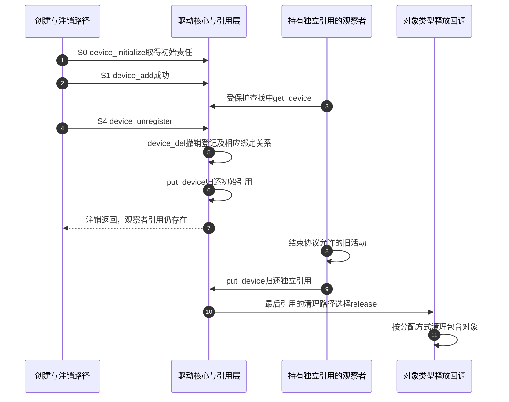

# 第6章\_device注册与生命周期

上一章把对象发布与引用寿命分开了。现在回到传感器 A：创建者准备了一个 device，注册时却因为名字冲突失败。A 没有成功进入系统，是否可以直接 kfree？如果注册成功后又有观察者取得引用，device_unregister 返回时又能否断定 A 的内存已经释放？

这两个问题的共同缺口是 **谁持有哪一份引用，以及哪一个动作归还它**。本章以创建者自己提供的 device 为主线，再与内部创建 device 的便利接口比较。固定源码为 NXP Linux 6.12.20 提交 dfaf2136deb2af2e60b994421281ba42f1c087e0；实现阅读入口见 [kref 源码索引](../../../research/source_reading/kref/navigation/P01_Linux_6.12_kref源码阅读索引.md#1.2_按问题进入已落地证据)。

## 6.1\_为什么初始化就建立了释放责任

创建者分配包含 device 的对象时，先拥有的是一块内存。device_initialize 随后把它变成可以参加设备引用协议的对象：初始化内嵌 kobject，选择设备类型，将其接到设备 kset 的归属上，初始化设备锁、受管资源链表、电源管理和设备依赖状态。此时还没有完成 device_add，不应因为对象已经初始化就期待 sysfs 中出现目录。

关键变化是 dev->kobj.kref 有了 **初始引用**。这份责任由创建者最终归还，设备的最终释放路径也必须提前安排好。它并不取决于随后能否发布成功，所以“添加失败”不能成为绕过引用协议直接释放的理由。若设备嵌入更大的结构，释放回调还需要知道怎样找回该结构。

device_register 把 device_initialize 与 device_add 顺序组合起来，返回后者的整数状态。已经调用过 device_initialize 的对象应走 device_add；再对同一个对象调用 device_register 会重复初始化，不能把它当成“多做一点更保险”。固定实现也明确禁止把同一个注销后的 device 再注册成新的一代；需要重新出现时分配并初始化新的对象，避免旧引用与新身份混在一起。

## 6.2\_添加成功与探测成功为何是两件事

device_add 要把 A 放进多种系统关系。它先建立 kobject 层次和属性，再添加 class 视图、总线登记、电源管理表示等；有有效设备号时还会建立号码属性和索引，并请求设备节点。它发送设备增加通知，处理相关依赖，再调用总线探测入口，并继续完成父设备及 class 的集合登记。

这些步骤逐项执行，失败时沿已经走过的步骤撤销，并非一次不可分割的“发布提交”。例如在同步探测开始时，一些 sysfs 表示已经存在，而后面的 class 集合登记尚未完成。驱动从入口可以被调用以前，所有被回调读取的对象数据就必须已准备好；不能等注册返回后才初始化这些数据。

还有一个容易误判的边界：**device_add 返回 0 说明设备登记成功，不保证驱动 probe 成功**。没有候选驱动、允许以后重试，或者本次探测失败，都可能留下合法的已登记设备。上一章“目录存在不证明绑定”的结论在这里有了具体来源。

device_add 在入口临时 get_device，在退出时配对 put_device；这保证它执行期间的对象引用，但不消费创建者那份初始责任。添加过程中对父对象和有关集合的引用另行取得、回滚，不能将这些内部配对误记为“函数已经替我释放了整个设备”。

## 6.3\_失败返回以后究竟还欠谁一次归还

先限定失败位置：下面讨论合法初始化后的 device_add 返回错误，而不是分配内存之前就失败，也不是把错误指针传给添加函数。核心会清理本次添加已经建立的关系，但创建者仍拥有初始引用。

因此失败处理是 **put_device 归还初始引用，不调用 device_del，也不直接 kfree**。没有添加成功，就没有一个需要调用者再次撤销的完整登记状态；重复 del 会把核心已经做过的回滚当成尚未完成的工作。put 以后是否立即释放则取决于是否还有引用和类型清理时机。

现在换一种入口：[分类实例实验](class_sysfs/P01_两个没有设备节点的分类实例.md#1.2_先把每个实例的数据放对位置)调用 device_create_with_groups。它不是在调用者已有的 device 上简单包装 register，而是内部完成分配、初始化、命名和添加，并设置内部释放回调。若中途失败，它先 put 自己创建的对象，再把错误指针返回给调用者。调用者保存错误码并清理此前成功的实例，不能再对这个错误指针 put_device。

两种情况下都遵守同一规则：谁拥有创建责任，谁在失败时归还。差别在于责任位于接口内还是接口外。

| 调用前提与结果 | 返回给调用者的内容 | 调用者的后续责任 |
| --- | --- | --- |
| 自己提供合法 device，device_register 失败 | 负整数错误码；初始化已发生 | 对自己的 device 调用 put_device |
| 已单独初始化，device_add 失败 | 负整数错误码；核心回滚已建立关系 | put_device，不再 device_del |
| device_add 或 device_register 成功 | 0，设备已登记 | 正常撤销时 device_unregister，或明确拆成 del 加对应 put |
| device_create_with_groups 失败 | ERR_PTR 编码的错误值 | IS_ERR 判断并 PTR_ERR 取错误，不注销或归还失败值 |
| device_create_with_groups 成功 | 成功创建的 device 指针 | 保存确切对象，后续 device_unregister；设备号查找式销毁只适合能唯一标识对象的场景 |

失败路径的一个自测是“第二个同名实例”：第一个成功，第二个由便利函数回滚并返回错误。调用者只注销第一个；不能因为循环运行了两次就无条件注销两次。若把同样的错误放在自己分配的 device_add 上，则失败实例的初始引用仍由调用者 put。**错误相同，接口层次不同，调用者的动作就不同。**

源码对照见 [device_register 的初始化责任](../../../research/source_reading/kref/source_explanations/drivers/base/core.c.md#1.1_注册包装建立初始份额)和[设备创建便利函数的所有权](../../../research/source_reading/driver_entries/source_explanations/drivers/base/core.c.md#1.1_设备创建便利函数的所有权)。两处解释分别回答低层包装和内部分配，不应把其中一种返回约定套给另一种。

## 6.4\_注销返回以后为什么观察者还能持有对象

假设 A 已成功登记，观察者在受保护的查找路径中取得了独立 get_device 引用。随后创建者决定撤销 A。device_unregister 先调用 device_del 撤销设备登记，再调用 put_device 归还初始化份额。它没有权限替观察者偷偷归还后者的引用，否则观察者保存的地址会在其不知情时失效。

device_del 处理设备级撤销，包括相应的属性、关系、总线成员及绑定清理、通知和电源管理退出；这比对 dev->kobj 单独调用 kobject_del 更广。若设备有驱动，相关解绑路径还会进入驱动的移除处理。业务如何停止提交、结束在途工作，仍属于驱动及其所属子系统的协议，不能假定一个通用引用计数会停止硬件。

步骤 1～3 分别建立初始化责任、系统登记和观察者责任；步骤 4～7 完成注销，却不消费观察者责任。步骤 8～9 使剩余引用归还；步骤 10～11 才到最终释放。这里省略了其他内部临时引用，也假定观察者确实是最后一位持有者；调试配置可能延后 kobject 清理，不能从图中推导固定释放延迟。

下面的引用账只记录这两位参与者在稳定边界的份额，不是对任意真实设备读取计数后的断言：

| 观察点 | 创建者份额 | 观察者份额 | 可以得出的结论 |
| --- | --- | --- | --- |
| 初始化完成，尚未添加 | 1 | 0 | 必须安排最终归还，还没有登记 |
| 添加成功且观察者取得引用 | 1 | 1 | 两位各有责任；绑定状态另看 |
| 注销返回 | 0 | 1 | 登记已撤销，内存仍为观察者保留 |
| 观察者最后归还 | 0 | 0 | 可以进入最终清理，不再使用原指针 |

如果决定把注销拆成 device_del 和 put_device，两步必须各有明确目的和配对。先 device_unregister 再“保险地”put_device 一次，会重复归还初始份额；先 del 后再 unregister，则会重复执行设备撤销。第十三、十四章将继续增加依赖和模块代码寿命，但不会改变这份基本账本。

## 6.5\_最终release如何找到真正的释放者

设备的 kobject 使用通用设备类型，其最终回调是驱动核心的 device_release。该路径先处理残留的受管资源等公共清理，再按 **dev->release → dev->type->release → dev->class->dev_release** 的优先顺序选择第一个可用的设备释放回调；不是把三个都依次执行。type 是设备类型描述，class 是功能分类，两者都可能为其创建的对象提供释放方法，但这条选择链没有 bus->release。

调用设备回调后，核心继续释放自己保存的 device_private 管理区，因此具体回调只处理它按契约拥有的包含对象。若没有任何适用回调，核心会报告缺失，而不是猜测设备是静态对象还是堆分配对象。最终回调也不是驱动的 remove：解绑可以发生在 device 仍然登记且被引用时，release 则属于对象内存寿命的末端。

这还带来一个必须单独满足的条件：执行 release 时，回调代码本身也必须仍然存在。仅持有 device 引用不能自动保证任意自定义模块的代码永久可调用。把 release 放在可卸载模块中时，要通过所属子系统的寿命协议保证代码存续；不能用本章的引用图为未建立的模块卸载协议作证。

具体实现见 [core.c 最终 release 的选择](../../../research/source_reading/kref/source_explanations/drivers/base/core.c.md#1.4_最终release按对象类型选择)，取得及归还见[设备引用进入 kobject](../../../research/source_reading/kref/source_explanations/drivers/base/core.c.md#1.2_设备取得与归还进入kobject)。更完整的设备、驱动私有对象与资源交接由[生命周期集成](../object_lifetime/integration/P01_kobject_device_devres_kref_生命周期集成.md)继续展开。

## 6.6\_用失败和旧引用检验自己的清理路径

先不用硬件，按两道题追踪责任。第一，自己提供的 device_register 返回错误，而且没有其他持有者：应调用什么？调用 put_device；不能因没有目录就直接 free，也不能对没有成功登记的设备 unregister。第二，成功 device_unregister 后仍有一位合法观察者：目录消失而 release 日志尚未出现是否足以证明泄漏？不足，先检查观察者是否仍有未归还的引用，以及是否启用了延迟清理配置。

若已经完成分类实例实验，可沿其同名失败练习观察 insmod 错误及剩余目录。该观察验证便利函数的外部表现，不会直接显示所有内部引用；要证明资源确实成对释放，还需结合其失败路径。不要为了观察引用计数而在真实设备的未知指针上随意 get/put，获取操作本身就要求先有有效地址。

现在可以把设备的登记、绑定、业务服务和对象内存分开判断。下一章回到“相遇”一侧：总线与驱动怎样登记，后来到达的一方如何触发查找，以及为什么驱动注册成功仍不等于每个设备都探测成功。

上一篇：[kobject、kset 与 sysfs 对象树](P05_kobject_kset与sysfs对象树.md)。

下一篇：[bus 与 driver 注册](P07_bus与driver注册.md)。
