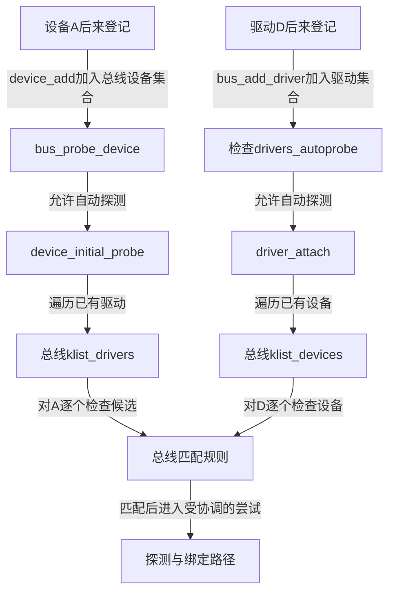
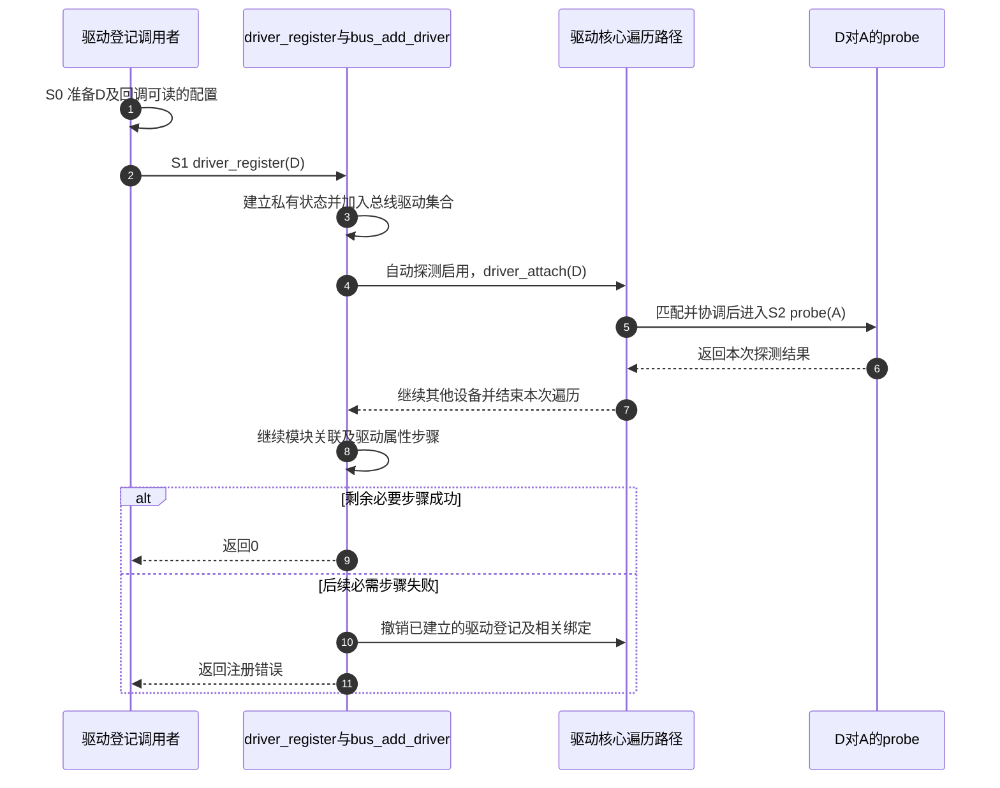

# 第7章\_bus与driver注册

第六章解释了 A 怎样登记和撤销。现在把 D 放回现场：A 已经登记，D 的注册函数刚开始执行。D 是先完整建好所有属性再碰 A，还是注册过程中就可能调用 probe？如果 A 探测失败，D 是否也必须从系统中消失？

要回答这些问题，需要把 **总线管理者的建立、驱动加入集合、对各设备尝试服务** 分开。沿用前文的 S0～S4 和固定 Linux 6.12.20 源码身份，主线先采用同步探测与默认自动探测策略。异步分支只在它改变返回时刻时引入。

## 7.1\_总线要先提供一个可以相遇的场所

第二章的模型已有两个数组，真实系统则必须先有管理它们的对象。bus_type 是总线提供者给出的规则描述，包括名称、匹配及可能的探测包装等回调；它不是一张已经初始化好的设备表。bus_register 根据描述建立第四章的 subsys_private，把公开描述保存在 sp->bus，再建立设备与驱动的管理集合和 sysfs 表示。

为什么还需要两个 devices、drivers 目录？它们分别提供“这条总线登记了哪些设备”和“有哪些驱动可供查找”的观察入口。设备目录里的总线视图可用链接指向设备原有路径，不是复制设备；驱动目录则由 driver_private 中的 kobject 表示。真正参与遍历的是 klist_devices 和 klist_drivers，不能把目录名当成内核直接扫描磁盘文件的实现。

bus_register 还初始化通知链、子系统接口集合及相应锁，并把 drivers_autoprobe 默认设为 1。这个字段是 **自动探测策略开关**：设备或驱动加入时，是否自动发起配对。它不是“是否允许设备存在”的总开关。建立这些管理设施也可能失败，注册路径按已完成步骤撤销；调用方只有在总线注册成功后，才能把设备和驱动登记到它上面。

普通外设驱动通常使用所属子系统已经建立的总线，例如前面无硬件实验采用的 platform 总线。它是现成的设备管理类别，具体枚举与匹配规则由相应子系统负责；不要求每写一个传感器驱动就新建一条总线。自定义 bus_type 只有在确实需要独立的成员与匹配协议时才有意义。

## 7.2\_后来者查找为什么要保留两条入口

假设 A、B 都能由 D 服务。若只在设备登记时查找驱动，先有 A 后有 D 的顺序就会漏掉 A；若只在驱动登记时查找设备，D 先到而 B 后到又会漏掉 B。因此真实核心保留与第二章模型相同的对称入口，但两条路径的遍历目标不同。

左边是 **一个设备找一个可用服务者**，已经成功绑定后无需继续找另一个。右边是 **一个驱动尝试服务多个设备**，A 失败不应阻止它继续尝试 B。这也是不能简单把两条遍历的返回值照搬的原因。

在固定实现中，驱动侧 __driver_attach 对单个设备的匹配不成立、匹配错误或探测结果通常继续返回 0，让设备遍历继续。这个 0 表示“继续遍历”，不表示刚才那个设备 probe 成功。设备侧则用自己的返回处理区分继续寻找、已找到服务者和应终止当前查找的错误，下一章再对齐这几层整数约定。

drivers_autoprobe 为 0 时，两类登记仍能建立集合关系，自动尝试被跳过。将它恢复为 1 本身只是修改策略，不等于对所有旧对象自动补做一次扫描；需要具体重探测触发。第二章的串行模型已足够先验证“漏掉后来者触发会怎样”的因果关系，这一步无需修改真实总线策略。

## 7.3\_注册尚未返回为什么probe已经能执行

现在固定为 D 后到、A 已登记、自动探测启用且 D 采用同步探测。driver_register 先检查总线已注册以及同名驱动冲突，再进入 bus_add_driver。后者分配 driver_private，初始化 D 的已绑定设备集合，发布驱动 kobject，并把 D 加入总线驱动集合。

**紧接着就可能 driver_attach，而不是等所有驱动属性都建完。** 因此 A 的 probe 可能在 D 的注册调用栈内运行，甚至已成功绑定，然后注册路径才继续创建模块关联和其余属性。凡是 probe 需要读取的共享配置，调用者都必须在发起注册之前准备好；写在“注册成功后的下一行”已经太晚。

步骤 1 的配置准备必须早于步骤 2。步骤 5～6 已执行探测，而调用者到步骤 9 或 11 才拿到注册结果；步骤 7 不代表所有设备成功。步骤 10 是后续注册失败的回滚概括，具体撤销顺序取决于失败位置，不能据此断言每个属性创建错误都导致整次注册失败。

固定版本有一个需按源码区分的细节：bus_add_driver 中一些 uevent、总线默认驱动属性或 bind/unbind 文件创建错误会记录错误后继续；模块关联失败则会进入回滚。外层 driver_register 添加 drv->groups 失败，也会调用 bus_remove_driver 撤销登记。因此既不能说“返回 0 就保证所有可选观察文件齐全”，也不能把任意一次属性错误都写成同样的返回路径。

异步探测让另一条执行路径稍后完成 S2，注册返回与探测结束更不重合。核心会在安排异步工作时保存必要关联和设备引用，并在真正执行时重新检查设备是否已被移除或占用；不是把一个裸指针交给后台就可以不管生命周期。具体异步、模块退出和重试边界分别在后续章节展开。

## 7.4\_遍历与退出怎样保护已经找到的对象

两集合模型还欠第三章的并发保证：如果遍历到 A 时另一方正在注销 A，怎样避免读到已释放内存？真实 bus_for_each_dev 使用 klist 迭代，设备集合配置了取得和归还设备引用的回调。迭代与删除按节点协议协调，而不是把原始链表地址直接交给任意代码。

但迭代期间的保护不会自动变成回调返回后的永久所有权。如果回调要把 A 保存给稍后运行的任务，必须在地址受保护时取得自己的引用，并安排稍后的 put。bus_find_device 找到对象时会额外取得返回给调用者的引用，使用者要配对 put_device；它与“在 for_each 回调中看了一眼”具有不同的返回契约。

对驱动集合，节点迭代与移除也有自己的协议。正常 bus_remove_driver 会先用 klist_remove 从总线驱动集合撤下节点，再 driver_detach 处理已绑定设备，最后整理模块关联及私有对象引用。不能由此推导“每个绑定都永久增加模块引用”，也不能把 driver_private 的引用直接等同于模块代码寿命。第十四章会专门把对象和代码分开。

此处的锁与引用用于驱动核心的集合和绑定协调。驱动业务数据是否可以并发修改，还要由其自己的协议决定；probe 受设备锁协调，不会自动替所有属性回调和异步工作上锁。

## 7.5\_根据登记结果能判断到哪一步

把同一现场的三种结果放在一起，才能确定应当检查哪个层次：

| 观察到的结果 | 当前可以判断 | 仍需独立核对 |
| --- | --- | --- |
| 总线注册成功 | 管理设施已建立，可供设备和驱动登记 | 是否有成员、是否有可匹配的设备 |
| 驱动注册成功但没有绑定设备 | D 可以作为后续候选；零成功实例是合法状态 | 没有设备、匹配不成立、探测失败、异步未完成或自动探测关闭 |
| A 探测失败，B 探测成功 | D 可继续服务 B；单实例失败不等于驱动登记失败 | A 的错误原因、失败资源是否回收、能否重试 |
| 注册最终失败但日志显示 probe 执行过 | 可能在后续必要步骤失败后撤销过已有绑定 | 最初错误位置与回滚，而非假定日志不可能出现 |

练习：在第二章模型中让 A 的类型不匹配而 B 匹配，D 登记后是否应因 A 被拒绝就退出全部查找？不应，仍要检查 B。再设想把 D 的业务配置初始化放到 driver_register 返回后：同步探测中谁可能先读它？A 的 probe；应提前准备配置，不能靠“通常注册很快”避免问题。

源码身份和对象集合阅读入口见[驱动入口阅读索引](../../../research/source_reading/driver_entries/navigation/P01_Linux_6.12_驱动入口源码阅读索引.md)。固定证据为官方仓库 [drivers/base/bus.c](https://github.com/nxp-imx/linux-imx/blob/dfaf2136deb2af2e60b994421281ba42f1c087e0/drivers/base/bus.c) 的 bus_register、bus_add_driver、bus_probe_device、bus_for_each_dev 与 bus_remove_driver，以及 [drivers/base/driver.c](https://github.com/nxp-imx/linux-imx/blob/dfaf2136deb2af2e60b994421281ba42f1c087e0/drivers/base/driver.c) 的 driver_register；本次核对的是该固定提交，未保存为新的仓库内全文副本。第八章接着进入一次尝试，区分匹配、临时关联、probe 和绑定完成。

上一篇：[device 注册与生命周期](P06_device注册与生命周期.md)。

下一篇：[匹配、绑定与 probe 状态机](P08_匹配绑定与probe状态机.md)。
