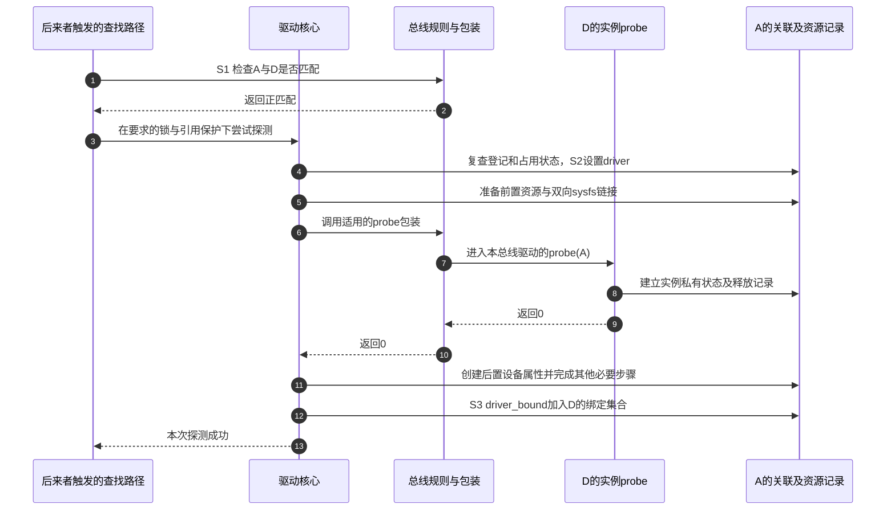

# 第8章\_匹配绑定与probe状态机

第七章把两种到达顺序送到了同一个问题前面：总线认为 D 可能服务 A，接下来怎样把“可能”变成真正可用？如果 A 的型号相符，但申请资源失败，匹配结果并没有替它完成服务准备。反过来，准备过程中已经写入一些关联，也不能只清掉一个成功标志就当作没有发生过。

本章跟踪 **一次候选检查到绑定完成**，以及失败发生在不同位置时的回滚。默认采用同步探测、依赖已就绪、未启用驱动移除自测的路径；沿用 S1 相遇、S2 准备服务、S3 服务和 S4 撤销。源码版本仍是固定 NXP Linux 6.12.20，失败返回的阅读入口见[错误指针源码索引](../../../research/source_reading/error_pointer/navigation/P01_Linux_6.12_错误指针源码阅读索引.md)。这里传递的是整数状态，不能把所有负数都当成错误指针。

## 8.1\_型号相符为什么还需要probe

总线的 **match 回调** 根据该总线约定的身份信息判断候选，例如设备标识是否出现在驱动支持范围内。它回答“值得让这个驱动尝试吗”，不承担全部资源申请和运行初始化。具体总线的身份来源到第十章再展开；此处只需要知道匹配规则属于总线协议，驱动核心负责在适当时机调用它。

**probe 回调** 才为这个具体实例建立服务：取得资源、建立私有数据、初始化必要硬件状态，并按自己的发布协议开放业务入口。同一个 D 可以成功处理 B，却因为 A 的某个资源不可用而拒绝 A。因此匹配和探测必须保留独立结果，不能在表中找到型号后直接跳到“已工作”。

固定实现的匹配结果有三类：大于 0 表示匹配，0 表示不匹配，小于 0 表示错误。其中 -EPROBE_DEFER 表示当前条件尚不满足，核心可把设备纳入稍后重试的协调；这不是要求 match 睡眠固定毫秒。若总线没有提供 match，driver_match_device 默认返回 1，让候选继续进入后续尝试，并不表示核心凭空识别了设备型号。驱动侧和设备侧遍历收到结果后怎样继续不同，必须结合第七章“一个驱动找多个设备”和“一个设备找服务者”的目标解释。

候选成立后也不能不加检查就调用 probe。driver_probe_device 要在规定的设备锁保护下运行；内部再次拒绝已撤销的设备和已有 driver 关联的设备。若两个触发路径都看到了 A，后来的路径必须面对前一条路径已经改过的状态，而不是沿用最初的无锁观察。引用保证地址仍可访问，锁和状态检查才决定这一次能否继续绑定。

## 8.2\_为什么probe以前就要写入临时关联

probe 执行时，公共帮助函数需要知道当前正在为哪个设备、哪个驱动配置资源，驱动回调也需要访问本实例的上下文。核心因此不能等 probe 返回后才建立所有关联。really_probe 在前置检查通过后先设置 dev->driver，再准备引脚、设备内存访问配置、sysfs 驱动关联以及适用的电源域状态。

这些前置步骤各有独立作用：引脚配置决定引脚如何接到设备功能；设备内存访问配置为相应传输方式准备条件；电源域激活使依赖该供电管理域的设备可以进入探测。并非每个总线或设备都实现全部回调。它们失败时，驱动自己的 probe 可能根本没有被调用。

driver_sysfs_add 还会尝试建立两个方向的链接：驱动目录中的 A 指向设备对象，设备目录中的 driver 指向 D。建立第二条失败时，会撤回第一条。**即使两条都已经建立，也仍处于准备阶段**；它们不是一个与 probe 成功同时出现的原子提交标志。

对 probe 的实际分派同样要分层：总线提供 bus->probe 时，call_driver_probe 先调用总线包装；否则才直接调用通用 drv->probe。总线包装可以进一步把通用 device 转成对应子系统的设备类型，再调用该子系统的驱动回调。把每个总线都画成直接调用同一个 driver->probe，会漏掉这些适配责任。

图采用存在总线 probe 包装的正常路径。步骤 1～3 只得到并接纳候选；步骤 4～5 已写临时状态，却还没有执行驱动回调。步骤 6～10 才是实例准备；步骤 11～13 再完成核心的后置步骤和绑定登记。没有总线包装时，步骤 6～7、9～10 简化为核心直接调用及接收驱动回调，但前后顺序不变。

driver_bound 将 dev->p->knode_driver 加入 D 的 klist_devices，并更新设备依赖、延迟探测及通知等状态。它是多步骤函数；这里用它定位 S3，不宣称列表、依赖状态和用户空间事件在同一瞬间原子更新。驱动自行发布的数据接口也可能有自己的时序，需按接口协议判断可用性。

## 8.3\_三种失败为什么不能共用一个remove

把上图中的步骤 5、8 和 11 分别改成失败，就得到三条不同的路径。核心知道自己完成了哪些步骤，驱动也必须知道自己申请了哪些非托管资源；回滚必须沿这些事实处理，而不是只看最终错误码是否相同。

**前置失败** 发生在驱动 probe 之前。核心按失败标签撤回已建立的配置和关联，没有理由调用一个尚未成功建立服务的驱动 remove。例如 sysfs 链接建立失败，其局部清理负责已建的那一条链接，后续公共清理负责其他状态。

**probe 自己返回失败** 时，核心也不会通用地补调驱动 remove。驱动必须在失败返回前撤回自己已经发布的非托管入口、停止自己启动的活动，并释放自己负责的非托管资源；核心随后通过受管资源记录完成相应清理。受管资源是登记了释放方法的数据记录，不能替驱动推断任意后台活动是否已经结束。

**probe 返回 0 后，核心后置步骤失败** 则不同。驱动已经声明服务准备成功，例如随后创建 drv->dev_groups 失败，核心会进入 device_remove，调用适用的总线或驱动移除回调，再撤回关联和资源。remove 因此可能在注册最终失败的回滚中被调用，而不只是用户主动卸载时调用。

| 失败位置 | 驱动probe是否成功过 | 这一失败路径是否调用移除回调 | 主要收尾责任 |
| --- | --- | --- | --- |
| 前置检查或前置配置 | 没有 | 不因这次失败调用 | 核心按实际进入的标签清理自己的已建状态 |
| probe返回负错误码 | 没有成功返回 | 不通用补调remove | 驱动先收好非托管责任，核心清受管记录及临时关联 |
| probe成功后的设备属性等步骤 | 已返回0 | 这些后置失败标签调用device_remove | 移除回调停止已建立服务，核心再做公共清理 |
| 已进入S3后的正常解绑 | 有完整绑定 | 走正常移除路径 | 第九章按解绑次序协调服务、依赖与资源 |

本表限定到固定版本默认路径，不把所有内核分支都缩成一条“失败后 remove”。device_unbind_cleanup 会调用 devres_release_all，清 dev->driver 与 drvdata，并整理有关电源、内存访问配置；具体前置失败有没有先建立 sysfs 关联，必须沿实际标签判断。源码定位见 [dd.c](../../../research/source_reading/linux/drivers/base/dd.c) 的 really_probe、device_remove 和 device_unbind_cleanup，[返回值与清理导读](../../../research/source_reading/error_pointer/navigation/P02_返回值与清理路径导读.md#2.3_跟随驱动失败而不混用返回类型)解释它们之间的整数传递。

## 8.4\_同一个0为什么在不同层表示不同动作

前面多次出现“返回 0”，现在可以给它们各自标上接口边界。match 的 0 是不匹配，probe 的 0 是该回调成功，遍历回调的 0 又可能是继续查下一个。忽略函数边界，把每个 0 都翻译成“设备已成功”，就会把正常查找读成矛盾。

固定实现还专门区分核心错误与驱动 probe 错误：really_probe 将回调的负错误码变为正值返回，使上层能够与核心自己的负错误区分。特定依赖策略可能先把回调失败归为延迟探测，再做这一转换。驱动作者仍应按 probe 契约返回 0 或负错误码，不能模仿内部转换直接返回正数。

| 接口位置 | 0 | 正数 | 负数 |
| --- | --- | --- | --- |
| 总线match | 不匹配 | 匹配候选 | 匹配出错或延迟 |
| 驱动probe回调 | 本回调成功 | 不应当作正常成功约定 | 拒绝、普通失败或延迟 |
| 本版本driver_probe_device | 此次绑定成功 | 从probe错误变号得到的失败 | 核心检查或准备失败等 |
| bus_for_each系列的回调 | 继续遍历 | 非零使遍历停止 | 非零使遍历停止 |

例如 __device_attach_driver 收到 driver_probe_device 的正值，知道这是一次回调失败，返回 0 让其他候选有机会尝试；收到成功的 0，反而转换成 1 停止查找。__driver_attach 为继续处理其他设备又采用不同处理。接口之间做的是有意的语义转换，不是错误码自己携带了全局统一含义。

## 8.5\_哪些观察能够支持绑定结论

只看 dev->driver 非空或某一瞬间的 driver 链接，会把 S2 当成 S3。只看到 probe 成功日志，也可能漏掉其后属性创建失败和撤销。观察应结合入口、调用返回、核心绑定状态和错误日志；并发时还要承认读取多个位置之间可能已经发生变化。

可以复用[错误指针四场景实验](../error_handling/error_pointer/P04_观察返回值与释放顺序.md#4.3_运行时区分装载成功与探测成功)：其完整模块在成功路径保持绑定，在主动返回错误时留下已登记但未绑定的设备。先装载并保持在场，再观察目录、driver 链接和释放标记，最后卸载。它验证受控同步场景的稳定结果，不承诺用一次 ls 捕获内部所有窗口。

想检验自己的理解，分别回答三个问题。第一，probe 在调用中打印 dev->driver 非空是否异常？不是，核心已设置临时关联。第二，probe 返回错误后 remove 没有执行是否必然是核心漏清理？不是，失败回调必须完成自身非托管回滚，核心再清受管记录。第三，probe 返回成功以后马上执行 remove，是否只可能有人卸载模块？不是，后置核心步骤失败也可能如此。

还有一个明确的配置分支：启用 CONFIG_DEBUG_TEST_DRIVER_REMOVE 且驱动未禁止相关绑定属性时，really_probe 可在成功准备后主动测试 remove，再重新 probe。这是驱动移除自测，不属于上面的默认一次成功路径，分析日志前必须核对配置；不能将两次 probe 一律解释成外设重复登记。

现在能沿具体失败位置判断清理责任，但还没回答 -EPROBE_DEFER 由谁记住、谁触发下一次尝试，以及完整绑定怎样被安全撤下。下一章将把这些后续事件接回同一组设备状态。

上一篇：[bus 与 driver 注册](P07_bus与driver注册.md)。

下一篇：[deferred probe、解绑与 remove](P09_deferred_probe解绑与remove.md)。
