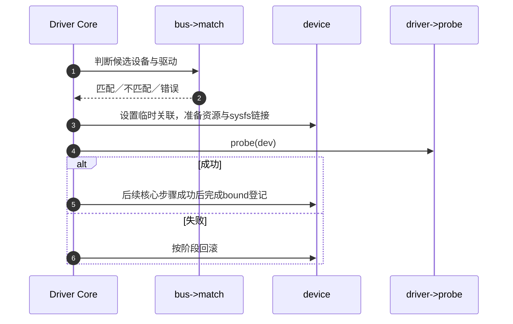

# 第8章\_匹配绑定与probe状态机

设备登记触发对已有驱动的查找，驱动登记触发对已有设备的查找；应按“本次后来登记的是谁”区分设备侧 attach 与 `driver_attach()`，不能把先到者与触发者倒置。二者沿匹配与探测路径进入驱动核心。匹配成功只表示候选关系；固定 6.12.20 的 `really_probe()` 在调用 probe 之前已设置 `dev->driver` 并尝试建立 sysfs 绑定链接，后续全部必要步骤成功才调用 `driver_bound()`。失败路径撤销这些临时关系。

源码见 `drivers/base/dd.c::device_attach/driver_attach/driver_probe_device/really_probe/driver_bound`。

下一篇：[deferred probe、解绑与 remove](P09_deferred_probe解绑与remove.md)。
