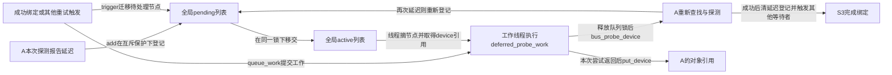
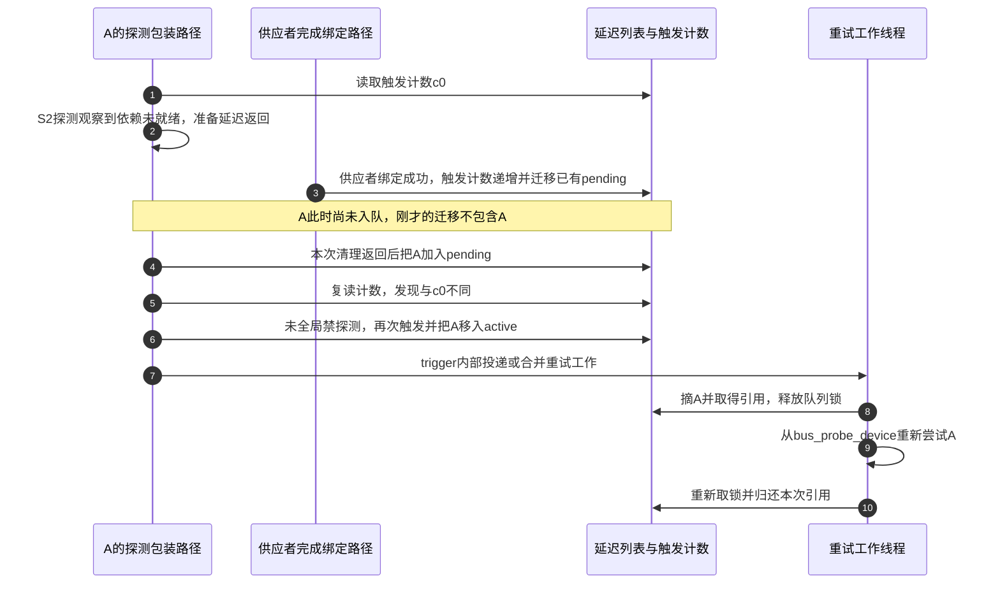
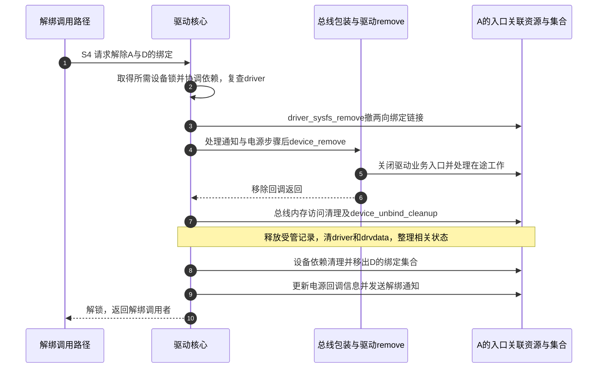

# 第9章\_deferred\_probe解绑与remove

第八章已经把一次 probe 的成功和失败收好，但系统不会就此停止变化。A 的驱动可能需要一个晚到的资源提供者；已经工作的 A 也可能被主动解绑。前者要在失败清理后重新尝试，后者要把已建立的服务撤回。它们都会涉及“当前未绑定”，却不能共用一个没有过程的布尔标志。

本章沿固定 NXP Linux 6.12.20 的默认路径，先追踪 **延迟探测（deferred probe）** 怎样保存重试意图，再追踪正常解绑怎样回到已登记、未绑定的设备。S1 相遇、S2 准备、S3 服务、S4 撤销沿用前文；队列中的 pending、active 是本章延迟工作自身的状态，不是新的设备绑定阶段。

## 9.1\_晚到的提供者为什么不该变成永久失败

给传感器 A 增加一个条件：启动它以前，需要从另一个设备取得必要的控制资源。那个设备是 **供应者（supplier）**，使用其功能的 A 是 **消费者（consumer）**。供应者可能已经被描述和登记，但它的驱动还没有准备好服务；A 的型号匹配成功，仍无法完成本次 probe。

如果直接把这种条件归为永久错误，供应者稍后就绪也不会自动恢复 A。若在 A 的 probe 中循环睡眠等待，执行路径又可能长期卡住，而且无法说明应等多久。延迟探测采用另一种交接：本次回调返回 -EPROBE_DEFER，按失败协议清理当前尝试，核心记录设备需要再次探测，等适当触发后由工作队列重新进入查找与探测。

这里的 **工作队列（workqueue）** 是内核安排任务由工作线程执行的机制。原 probe 不会在某一行暂停，随后从那一行恢复；第二次尝试从完整入口重新开始。因此第一次已经撤回的资源必须重新申请，第一次未清理的非托管副作用则可能在重试时重复发生。延迟返回不是豁免回滚的特殊成功。

也不是所有错误都该转换为 -EPROBE_DEFER。无效配置、确实不存在且不应出现的资源，或硬件永久拒绝的条件，应按接口实际含义报告。可选资源的缺席可能允许继续工作。只有提供者接口或子系统约定表明“可能稍后满足”的条件，才有依据请求延迟；否则重试会把真实故障藏在等待列表中。

## 9.2\_谁记住设备\_谁真正再次调用probe

一次失败已经退出，原调用栈不再替 A 等待。重试意图必须落在不会随该调用栈消失的状态中：设备私有区 dev->p 有 deferred_probe 链节点，核心的全局 deferred_probe_pending_list 保存等待触发的设备，deferred_probe_active_list 保存已经被触发、等待工作线程处理的设备。

driver_deferred_probe_add 在允许匹配且节点尚未加入时，将 A 加到 pending。全局 deferred_probe_mutex 保护两张表及节点迁移，避免同一个节点被重复加入或一边摘除一边遍历。节点归属于设备；队列不会复制一个新的 device，更不会保存一份可供恢复的旧 probe 栈。

触发路径 driver_deferred_probe_trigger 在重试机制启用后，把 pending 中的节点整体移到 active，并将 deferred_probe_work 投递到 system_unbound_wq。该队列的工作不固定绑定到某一个 CPU；具体工作线程随后执行 deferred_probe_work_func。**供应者成功绑定** 是重要触发点：driver_bound 会发起触发，但它移动的是当前等待列表，并非只直接调用某一个消费者。



图中列表是共享状态，工作线程才是执行者。工作函数在锁内摘出 A 并 get_device，然后释放列表锁再调用 bus_probe_device；否则新的探测又要加入延迟列表时会与自己持有的锁冲突。探测返回后重新取得队列锁并归还这次设备引用。若 A 在期间被注销，引用只保住对象地址，新的探测仍要通过设备是否存活、登记和占用的检查。

因此这里同时使用两种保护：队列锁维护成员关系，device 引用覆盖离开队列锁后的处理窗口。单靠锁不能覆盖已经解锁的工作，单靠引用又不能保证节点迁移正确。设备成功绑定或设备删除时，也会从延迟登记中清理对应节点。

| 状态地址 | 谁写入或修改 | 后续谁读取及其含义 |
| --- | --- | --- |
| dev->p->deferred_probe | add、trigger、工作函数及del，在队列锁下操作 | 全局重试协调使用同一节点表示等待或待执行 |
| deferred_probe_pending_list | 延迟路径加入，trigger整体移出 | 等待新的触发，不表示正在执行probe |
| deferred_probe_active_list | trigger移入，工作函数逐个摘出 | 本轮待处理，不表示已经成功绑定 |
| dev->p->deferred_probe_reason | 错误报告路径设置，重试或删除时清理 | 调试输出中的原因，不是决定资源就绪的状态 |
| deferred_trigger_count | 启用后的trigger递增 | 探测包装前后比较，发现探测期间经过了触发 |
| dev->kobj.kref | 工作函数在解锁前取得，处理后归还 | 保持对象内存，不代替设备存活检查 |

## 9.3\_先触发后入队为什么还需要一个计数

两张表还不能消除所有遗漏。设 A 的探测路径刚观察到供应者未就绪，正准备返回延迟；此时供应者完成绑定并触发重试。触发那一刻 A 还没进入 pending，因此列表迁移没有包含 A。随后 A 才入队，如果再没有其他事件，它就可能一直留在等待状态。

固定实现用 deferred_trigger_count 记录触发经过：driver_probe_device 在尝试前读取计数；收到延迟结果并完成入队后，再比较当前计数。若两者不同，且不是全局禁止探测的状态，就再触发一次。它并不证明供应者一定可用，只保证“本次探测期间发生的触发”不会因为 A 入队稍晚而被漏掉。



步骤 1～4 制造最容易漏掉的交错；步骤 5～7 用计数比较补上触发；步骤 8～10 才进行下一次尝试。线程可能已经在处理其他设备，重复投递不要求创建一个全新的线程。若触发发生在 A 入队以后，正常列表迁移已经可以包含它；计数补偿可能带来额外触发，但不能把等待正确性建立在“事件恰好晚一点到”上。

成功绑定、解除全局探测阻止、初始化末期及超时处理等都可能触发协调。重试机制在内核初始化的较后阶段才启用，早期进入 pending 的设备不会因为函数名叫 trigger 就立即执行。某些供应依赖还有 device_link 的显式状态，第十三章会解释；本章这套全局重试不等于已经建立了精确的逐供应者等待队列。

## 9.4\_超时与调试列表能告诉我们什么

等待不一定能结束：提供者模块可能根本没加载，描述可能缺失，错误条件也可能被误报为延迟。因此核心有初始化和超时处理边界。固定版本的超时工作会触发并等待一轮重试，对仍 pending 的设备报告原因，并更新相关固件依赖协调。

这不是“每个设备入队后固定睡若干秒”的定时器。超时属于全局初始化协调，配置和启动参数会改变它，驱动登记还可能延长尚在排队的超时工作。调用 driver_deferred_probe_check_state 的驱动或子系统会根据初始化、模块支持与超时状态得到继续延迟的 `-EPROBE_DEFER`、表示设备条件不成立的 `-ENODEV`，或表示等待超时的 `-ETIMEDOUT`。这是选择使用该帮助接口的路径，不能推成超时之后所有 probe 都被核心强制改成同一个错误。

有 CONFIG_DEBUG_FS 支持且 debugfs 已挂载在 /sys/kernel/debug 的目标 Linux，可以只读观察当前 pending 列表。**debugfs** 是内核提供诊断数据的文件系统，不是稳定用户空间接口，也不是设备正常业务入口：

```bash
# 目标Linux；已确认上述调试配置及挂载位置。
sudo cat /sys/kernel/debug/devices_deferred
```

输出每个当前等待设备的名称及已记录原因；若未记录原因，可能只有名称。dev_err_probe 在遇到延迟错误时可帮助保存原因，但不能假设任意驱动返回延迟都会提供完整文字。该文件只遍历 pending，不包含已经移入 active 或正在执行的所有设备，因此空输出不能证明系统没有待完成探测。文件不存在则先检查配置、初始化和挂载条件，不把不存在解释成“没有依赖问题”。

练习：A 的名称刚从列表消失，是否足以断言 A 已绑定？不够，它也可能刚被移入 active、正在重试或已被删除。应继续结合第八章的绑定状态和实际错误路径判断。

## 9.5\_解绑为何不能简单倒放probe

现在换到 A 已进入 S3 的场景。调用者要求解除它与 D 的绑定，但仍保留 A 的设备登记。驱动核心必须先协调该设备及必要父对象的锁；若设备依赖要求先撤下消费者，还要处理消费者再重新核对当前 driver。不能拿最初保存的关联穿过解锁窗口后直接继续。

在固定版本的正常 __device_release_driver 路径中，**driver_sysfs_remove 在 device_remove 之前执行**。也就是说，两向绑定链接先被撤下，然后经过相应通知和电源管理步骤，进入移除回调。看到 driver 链接不在，仍不能推断 remove 已经完成，更不能推断所有业务活动都停止。

device_remove 先移除相应的核心设备属性，再优先调用总线 remove 包装，否则调用驱动 remove。驱动回调需要停止新业务请求、撤销自己发布的入口，并按具体机制处理正在运行的工作。它应在即将被公共清理释放的资源仍有效时完成这些动作；等 devres 清完再让任务访问原资源，就把清理顺序倒过来了。



步骤 1～3 是协调和撤下绑定表示；步骤 4～6 才进入服务停止。步骤 7 清理受管资源及驱动关联，步骤 8 移除绑定集合节点，步骤 9～10 完成后续通知与调用。该图不表示所有驱动私有内存都必须在步骤 5 释放：旧打开者可能还需要其会话对象，但这些对象不能再使用已经撤销的硬件资源。

正常解绑并不包含一个通用的“归还本次绑定持有的模块引用”动作，因为绑定本身没有无条件永久取得那样一份引用。模块代码和文件操作引用有另外的存续协议，第十四章单独分析。device_release_driver 也不是 device_unregister：前者解除服务关系，后者还要撤销整个设备登记并归还初始引用。

如果随后删除 A，device_del 会在设备锁下标记 dead，撤销总线、class、属性、电源管理和对象层次，清理延迟探测及设备依赖等状态。与此并发的工作即使持有引用，也必须看到“不能再探测或服务”的状态。引用只延长最后释放时刻，不能让被删除的设备重新变成合法的新候选。

## 9.6\_把重试与退出放回同一个周期

两条路径现在可以接回前文：延迟失败从 S2 退出并清理，经过 pending、active 和工作线程重新进入 S1/S2；正常解绑则从 S3 进入 S4，完成后可留下已登记而未绑定的设备。对象引用归零后的 release 又是第六章的独立末端，不能把这三种“结束”揉在一起。

再做一个交错推演：工作线程在锁内摘出 A 并取得引用，刚解锁，另一条路径就删除 A。会不会因为已经从 active 摘除而不再需要引用？恰好相反，引用正是为了覆盖这个窗口；同时后续探测会复查 dead、登记和占用状态。若把引用取得移动到解锁以后，A 可能在 get_device 之前已经被释放，后补引用无法修复悬空地址。

最后检查自己的 remove：只删除 sysfs 链接是否足以停止一个后台采样任务？不够，链接只是查找关系，任务还有自己的执行路径与资源地址。只等任务结束而不阻止新请求是否充分？也不够，新的请求可能继续提交工作。驱动需要按其业务协议先限制新进入者，再处理在途活动，最后让核心清理所依赖的受管资源。

源码身份入口见[错误返回与清理导读](../../../research/source_reading/error_pointer/navigation/P02_返回值与清理路径导读.md#2.3_跟随驱动失败而不混用返回类型)。固定 [drivers/base/dd.c](../../../research/source_reading/linux/drivers/base/dd.c) 的 driver_deferred_probe_add/trigger、deferred_probe_work_func、driver_probe_device、__device_release_driver 和 driver_detach 对应上述队列、计数、引用和解绑；[drivers/base/core.c](../../../research/source_reading/linux/drivers/base/core.c) 的 device_del、dev_err_probe 对应设备删除及原因记录。下一章再回到设备最初的来源，解释固件描述怎样变成可匹配的运行对象。

上一篇：[匹配、绑定与 probe 状态机](P08_匹配绑定与probe状态机.md)。

下一篇：[fwnode、OF 与 Platform 适配](P10_fwnode_OF与Platform适配.md)。
