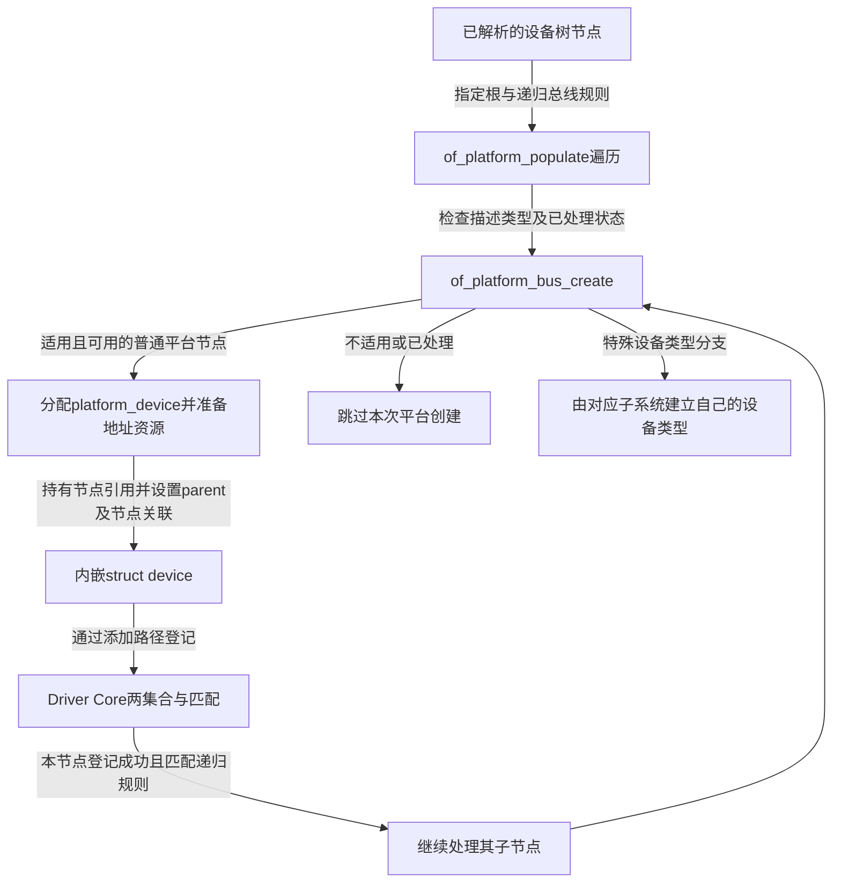
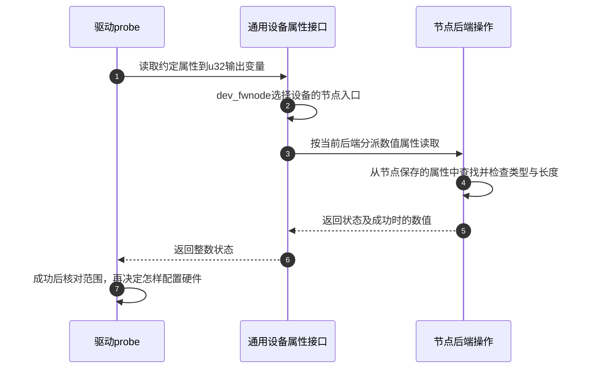

# 第10章\_fwnode\_OF与Platform适配

前九章假定 A 的 device 已由某个创建者准备好，随后登记、匹配、探测或重试。现在往前追一步：启动时谁告诉内核 A 在哪里、有哪些资源，又是谁把这些描述变成可以进入设备模型的对象？如果在设备树中写出一个节点，就等同于已经登记并绑定了设备，那么前面那么多阶段也就没有存在的必要了。

本章先以设备树描述的片上控制器为主线，再引入其他描述来源和通用属性接口。具体实现仍按 NXP Linux 6.12.20 固定提交 dfaf2136deb2af2e60b994421281ba42f1c087e0 核对；这里解释公共适配路径，不把某块板的节点或外设地址推广成所有平台的规定。

## 10.1\_硬件描述为什么不能直接代替device

同一个驱动可能用于多块板，但寄存器地址、连接的中断、供电或时钟关系并不相同。若把这些信息全部写死在驱动里，换一块板就要改业务代码。**设备树（Device Tree，DT）** 用树形节点和属性表达这类硬件结构与配置，内核的 struct device_node 表示解析后的节点。

节点能说明“这里描述了一个怎样的硬件对象”，却没有替驱动核心建立设备锁、引用、总线成员和绑定状态。运行对象 struct device 负责后者；在 platform 子系统中，它嵌入 **平台设备 struct platform_device**，连同资源数组、名称等信息构成可登记的实例。平台设备是 Linux 的设备类型，不是“整块开发板”的另一个名字，也不是所有设备的统称。

节点与运行对象需要保持关联：属性读取要回到原描述，最终释放运行对象时又要归还它持有的节点引用，而不是直接销毁整个硬件描述树。固定实现通过 device_set_node 同时设置 dev->fwnode 和相应的 dev->of_node；其中 OF 是 **Open Firmware** 的历史命名，在 Linux 的这些接口中用于设备树支持，并不要求本次启动程序就是一个 Open Firmware 实现。

因此至少有四个独立事实：描述存在、运行设备已建立、驱动已登记、实例已成功绑定。一个 compatible 属性只参与其中的身份判断，无法独自证明另外三件事。

## 10.2\_哪些节点会成为platform设备

从一个表示片上总线的父节点出发，of_platform_populate 遍历其子节点，交给 of_platform_bus_create 处理。它要求适用节点具有 compatible，跳过相应的特殊描述节点和已经处理过的总线；创建设备的路径还检查节点是否可用、是否已经被实例化。**compatible 是描述兼容身份的属性名**，不是“要求加载某个模块”的命令。

创建成功后是否继续向下递归，也由这次调用使用的总线匹配表决定。默认填充帮助函数 of_platform_default_populate 传入默认表，其中 simple-bus 表示可继续按这类规则遍历的总线节点。并非任意节点有孩子，就把整个子树全部递归生成为 platform_device。

对主线中的适用节点，of_device_alloc 分配平台设备，统计并转换地址资源，取得节点引用，关联父对象并准备名称。of_platform_device_create_pdata 再设置 platform 总线等信息，通过添加路径进入设备模型。某些资源在使用时才继续解析，不能把这一步说成“所有中断、时钟和供电都已经申请并可用”；第九章的延迟条件正可能出现在后续资源取得中。

图中的跳过是当前平台创建路径的选择，不证明节点无效，也不代表它永远不会被其他子系统处理。固定实现对某些 Arm 外设类型就有专门的设备创建分支；这已经足以反驳“每个设备树节点都对应 platform_device”的说法。

再看一个更具体的边界：**集成电路间总线（Inter-Integrated Circuit，I²C）** 连接的传感器由 I²C 控制器承载。控制器本身可以是平台设备；控制器建立 I²C 适配器后，I²C 核心再遍历适用子节点，按该总线的地址与规则创建 i2c_client。传感器仍有内嵌 device，但其总线、匹配和传输协议属于 I²C。设备树的树形关系没有把子设备的运行类型统一成父控制器的类型。

也因此不能脱离父总线解释 reg：平台地址资源中的 reg 和 I²C 子节点用来表示从设备地址的 reg，遵循各自描述约定。属性同名不表示数值具有同一地址空间和访问方式。

## 10.3\_fwnode为什么要把描述来源挡在属性接口后面

设备树已经把硬件配置与驱动算法分开，但另一种系统可能采用 **高级配置与电源接口（Advanced Configuration and Power Interface，ACPI）** 提供的设备描述。还有些设备由内核代码创建，并用 **软件节点（software node）** 附加属性，不存在来自固件的设备树节点。如果驱动只想读一个已有约定的整数属性，就不应仅因描述来源不同复制三份业务逻辑。

Linux 用 **固件节点句柄 fwnode_handle** 提供统一的描述访问入口。它是带后端操作的内核抽象，设备树、ACPI 和软件节点可以通过各自实现响应属性查询；“固件”在这个抽象的名字中不意味着所有节点都必须来自固件。它不是另一个 device，也不负责把传感器登记到某条总线。

以一个假想驱动约定的 sample-period-us 属性为例：该名字由此教学驱动的描述约定定义，表示采样周期微秒数，不是本仓库声称所有传感器都支持的标准属性。驱动可以通过 device_property_read_u32 读取一个无符号 32 位值。接口先取得 dev_fwnode，再经 fwnode 属性操作读出数据；成功只说明描述值读到了，驱动还要核对取值范围，并通过实际硬件接口配置周期。

步骤 1～3 将业务请求送到描述后端，步骤 4～6 只完成属性读取。步骤 7 才把配置值用于驱动决策，图中没有凭空出现一次寄存器写入。读取失败时不得把尚未取得的输出值继续用于硬件配置；是否使用默认值，必须由这个属性究竟必需还是可选的契约决定。

dev_fwnode 也不总是原样返回 dev->fwnode：固定版本在启用设备树支持且 dev->of_node 存在时，优先返回对应设备树节点的句柄。辅助软件节点还可能用于补充属性，具体回退由属性接口和后端规则决定，不宜把它当成随意覆盖所有固件字段的字典。device_create_managed_software_node 会复制传入属性并将节点与设备关联，调用者仍须遵守该接口的节点寿命与非共享约定；仅创建软件节点不会自动注册一个新 device。

| 对象或接口 | 所处层次及当前作用 | 不保证什么 |
| --- | --- | --- |
| device_node | 设备树描述节点，保有属性与描述关系 | 不自动等于已注册平台设备 |
| fwnode_handle | 统一的描述节点访问入口 | 不自动决定总线类型或完成驱动匹配 |
| struct device | 内核运行实例，保存登记、关联和引用状态 | 不说明描述一定来自设备树 |
| platform_device | 平台子系统实例，内嵌device并携带资源等信息 | 不能代表I²C子设备等所有运行类型 |
| device_property_read_u32 | 从描述中读取一个约定的整数值 | 不校验全部业务范围，不把值写进硬件 |

## 10.4\_平台匹配有哪些停止条件

现在平台设备 A 已登记，D 也已登记，进入第七章的候选查找。platform_match 需要支持不同来源的身份，但它不是同时执行几种投票，也不是在任何匹配失败后都无条件退回名称比较。固定版本按下面顺序决定结果：

| 检查顺序 | 条件与数据 | 什么时候结束，什么时候继续 |
| --- | --- | --- |
| 1 | pdev->driver_override 已设置 | 只比较指定名与 drv->name，直接返回结果；不再尝试下列规则 |
| 2 | OF匹配：设备节点与驱动of_match_table | 成功直接接受；未匹配继续 |
| 3 | ACPI匹配：相应设备描述与驱动身份 | 成功直接接受；未匹配继续 |
| 4 | platform_driver 提供id_table | 比较平台设备名与表项，直接返回结果；表存在却未命中时不再退回驱动名 |
| 5 | 前面未接受且没有id_table | 比较 pdev->name 与 drv->name，返回名称匹配结果 |

这里 driver_override 是显式候选选择字段，指定的是驱动名。它可以改变匹配选择，却不能让不支持 A 的代码突然拥有正确的寄存器或资源协议；后续 probe 仍可能失败。of_match_table 则是驱动声明的设备树匹配表，先前节点中的兼容身份与它对照。为模块生成装载别名还需要相应元数据，运行时能匹配和用户空间能自动找到模块是两个问题，第十一章再衔接。

匹配接受后，platform 总线的 probe 包装将通用 device 和 driver 转回 platform_device、platform_driver。固定实现还处理设备树默认时钟设置、适用的电源域接入等步骤，再调用平台驱动的 probe；失败时相应拆除已接入的电源域。这就兑现了第八章“总线包装并非多余转发”的结论。特定的一次性平台探测接口还有不可重新绑定的边界，不能把普通注册的重试保证套过去。

## 10.5\_按三层身份定位一个未工作的设备

遇到 A 没有工作，先问描述是否适用，再问由哪个子系统建立了什么运行对象，最后问候选与 probe 走到了哪里。仅搜索到 compatible 字符串，会同时跳过实例化选择和资源准备，不能构成绑定成功的证据。

用三道纸面练习验证边界。第一，节点被标成不可用，但驱动有相应 of_match_table，本章平台创建路径是否仍会登记它？不会，创建设备的可用性检查在匹配以前。第二，platform 驱动提供非空 id_table，表中没有 A，但驱动名恰好与 A 名称相同，前面的 OF/ACPI 也没匹配，结果怎样？不匹配，因为 id_table 分支直接返回。第三，一个传感器是 I²C 控制器下面的描述子节点，它的运行对象必然是 platform_device 吗？不是，应跟随 I²C 适配器的子设备创建路径。

这些推演没有创建节点、修改设备树或访问硬件。真实平台实验还需具体绑定规范、地址翻译、中断与时钟提供者，以及目标内核配置，不能把教学属性名直接写进任意板级文件期待驱动生效。

源码身份从[驱动入口阅读索引](../../../research/source_reading/driver_entries/navigation/P01_Linux_6.12_驱动入口源码阅读索引.md)进入；本章只读核对官方固定提交的 [drivers/of/platform.c](https://github.com/nxp-imx/linux-imx/blob/dfaf2136deb2af2e60b994421281ba42f1c087e0/drivers/of/platform.c)、[drivers/base/platform.c](https://github.com/nxp-imx/linux-imx/blob/dfaf2136deb2af2e60b994421281ba42f1c087e0/drivers/base/platform.c)、[drivers/base/property.c](https://github.com/nxp-imx/linux-imx/blob/dfaf2136deb2af2e60b994421281ba42f1c087e0/drivers/base/property.c) 与 [drivers/base/swnode.c](https://github.com/nxp-imx/linux-imx/blob/dfaf2136deb2af2e60b994421281ba42f1c087e0/drivers/base/swnode.c)。子设备反例定位到 [drivers/i2c/i2c-core-of.c](https://github.com/nxp-imx/linux-imx/blob/dfaf2136deb2af2e60b994421281ba42f1c087e0/drivers/i2c/i2c-core-of.c) 的 of_i2c_register_devices；字段与接口声明见同提交 include/linux/{of,fwnode,property,platform_device}.h。链接用于核对实现，本章的创建选择和匹配停止条件已在正文列全。

上一篇：[延迟探测、解绑与 remove](P09_deferred_probe解绑与remove.md)。

下一篇：[class、sysfs、uevent 与 modalias](P11_class_sysfs_uevent与modalias.md)。
