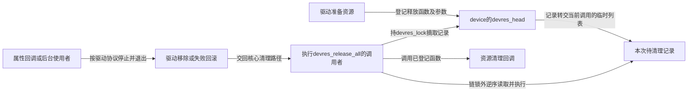

# 第12章\_devres资源事务

第八、九章已经多次经过 device_unbind_cleanup：驱动回调结束后，核心沿设备的资源记录继续清理。第十一章又增加了外部访问者，问题更具体了——一个正在读数据的请求还会用到资源，为什么核心能知道该释放什么，却未必知道什么时候允许释放？

本章把 **设备资源管理（Device Resource Management，devres）** 接回设备模型主线，再进入已有的完整资源管理教材。常见 devm_ 接口把配对释放责任登记到设备，但记录管理、使用者退出和对象引用是不同协议；“托管”没有消除这三者的区别。

## 12.1\_清理记录解决重复回滚而不接管所有使用者

设 A 的 probe 先取得状态内存，再建立一个清理时需要读取该内存的资源。第二项失败时只清内存；全部成功后，正常退出又要先清第二项再清内存。手工分支可以正确实现这些次序，但新增资源时，失败出口和正常退出都要一起更新。

devres 把已经接管的释放责任记为设备上的链式记录。记录带清理函数及数据，dev->devres_head 是链头，dev->devres_lock 保护登记和摘除。按依赖先登记状态内存、后登记依赖它的资源，逆序清理才能先处理使用者、后处理被依赖对象；逆序不是让任意登记顺序都自动正确。

图中核心清理路径是执行者，链表不会自己唤醒资源。devres_release_all 在链锁下摘取记录，释放链锁后由当前调用路径执行回调；没有一个独立的“devres 释放线程”。链锁也没有被插入每次业务访问，不能靠它等待后台采样结束。

因此普通失败回滚和 remove 仍要先履行自己的停止使用协议。若旧请求还在使用资源，仅 get_device 保住设备外壳不能延长已经进入清理的资源寿命。某个 devm_ 包装究竟托管句柄归还、内存释放还是一次关闭动作，必须看该接口的实际配对；前缀本身不作完整保证。

## 12.2\_局部分组为什么不等于硬件事务

有时 A 的基本功能已建立，接着尝试可选增强。增强失败时只想撤回新资源，保留基本功能。若直接 devres_release_all，就连原有功能也清掉；若等待整个解绑，又把本次失败资源留得太久。**devres group** 用开始与结束标记，在同一资源链中圈出本阶段需要回滚的范围。

例如 R0 是已有资源记录，R1 是增强阶段记录，R2 是关闭该组以后登记的另一项资源。链中顺序为“R0、组开始、R1、组结束、R2”。release 这个组会清 R1，随后整设备清理才处理 R2、R0；remove 这个组则只删除分组标记，一个资源也不清，后续仍按 R2、R1、R0 清理。

| 分组操作 | 改变的内容 | 不能从名称推导的含义 |
| --- | --- | --- |
| devres_open_group | 建立开始标记并返回组标识 | 不保证后面的所有资源取得都会成功 |
| devres_close_group | 加入结束标记，界定范围 | 不释放组内资源，也不是让资源免于后续清理 |
| devres_remove_group | 移除分组标记，资源记录仍留在设备链 | 不是执行回滚 |
| devres_release_group | 摘取所选范围并逆序执行释放 | 不自动回滚任意寄存器写入、外部通知或其他未登记副作用 |

这里的“事务”指 **资源责任可以成组提交给后续管理，或在失败时按范围撤回**，不表示硬件上出现原子提交。如果期间已经向外部发送不可撤回的动作，分组不会让它从历史中消失；若其他线程同时往同一设备链登记，链锁也不会自动证明这一段只包含本阶段的资源。阶段范围和并发组织仍由调用者建立。

open 本身也可能因分配失败返回 NULL，必须先检查成功，再保存组标识用于后续操作。用 NULL 查找组时有“最近未关闭组”的选择规则，不能把失败返回值继续传下去，也不能拿它随意代替一个已经关闭的组。完整接口、合法嵌套与失败示例进入下节的唯一教材，不在本章复制第二份函数实现。

## 12.3\_资源清理时刻为什么不能简单写成绑定寿命

最常见路径确实是 probe 失败和驱动解绑后清理资源，但“所有 devres 资源严格等于一次成功绑定的寿命”仍过于绝对。尚未成功绑定时也可能已经登记资源；固定实现的 device_del 还会清理设备上的剩余记录，最终 device_release 也保留清理入口。不能因为设备没有进入过 S3 就假定 devres 必为空。

另一端也要分清：设备被独立引用保留，不表示其中曾经登记的资源必须保留到最终 release。更早的失败、解绑或显式受管释放已经可能结束它的寿命。资源与设备分属不同所有权关系，链头放在 device 里面并没有把两种寿命合并。

因而有三种需要继续设计的情况：资源被多个设备共享，需要明确共享者与最后释放者；只需提前结束某一项，要使用匹配的受管提前释放接口并避免后续重复清理；旧会话需要跨过解绑，则保留独立会话对象并断开已失效资源，不能单纯延长 device 引用。

练习：一位旧打开者仍有 device 引用，驱动已经完成解绑，能否继续使用原 devm 分配的业务缓冲区？不能仅据这份引用作答；应按具体分配、解绑清理和旧访问协议判断。另一题：调用 close_group 后能否手工 free 组内所有资源而不移除记录？不能，记录仍在，后续清理可能再次调用释放。

## 12.4\_进入完整资源教材并带回退出结论

沿 [devres 阅读大纲](../object_lifetime/devres/大纲.md#1.1_从退出责任进入资源接口)继续：先在[资源账本与分组](../object_lifetime/devres/P01_从失败回滚到设备资源账本.md#1.1_从两条退出路径提取同一份责任)中运行完整 C 模型，区分登记失败、关闭、移除和释放；再到[托管资源与使用者退出](../object_lifetime/devres/P02_托管资源与使用者退出.md#2.3_时序与控制流)追踪请求、后台工作和实际清理的交错。该分支的 S0～S4 是资源管理周期的局部编号，与本专题准备到解绑的阶段有关联但不是同一组枚举。

固定源码从 [devres 阅读索引](../../../research/source_reading/devres/navigation/P01_Linux_6.12_devres源码阅读索引.md#1.1_固定版本与阅读任务)进入；[devres_release_all](../../../research/source_reading/devres/source_explanations/drivers/base/devres.c.md#1.6_devres_release_all交出待清理记录)和[release_nodes](../../../research/source_reading/devres/source_explanations/drivers/base/devres.c.md#1.7_release_nodes执行实际清理)分别说明摘取与执行。设备删除及最终清理的额外入口见固定 [core.c](../../../research/source_reading/linux/drivers/base/core.c) 的 device_del、device_release。这些证据针对本专题固定版本，不从名字推断其他内核版本的细节。

完成分支后应能回答“谁记录、谁停止使用、谁实际清理，以及哪份引用保留什么”。下一章再增加另一种顺序约束：A 依赖的供应者在另一条设备分支上，仅靠父子层次和 A 自己的资源链，怎样知道谁必须先运行、谁应先暂停或解绑？

上一篇：[class、sysfs、uevent 与 modalias](P11_class_sysfs_uevent与modalias.md)。

下一篇：[device link 与电源管理](P13_device_link与电源管理.md)。
