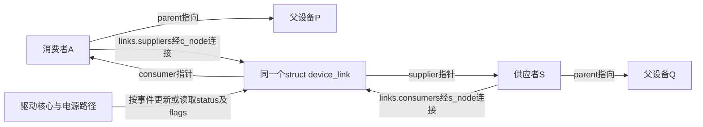
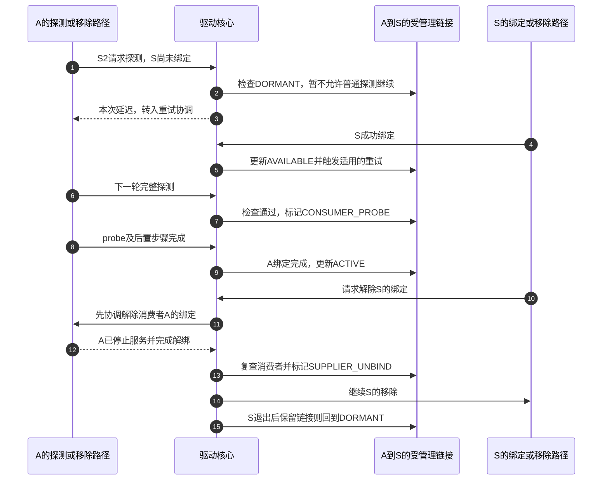

# 第13章\_device\_link与电源管理

第十二章的资源链记录 A 自己的释放责任，却不能完整表达 A 与另一台设备 S 的关系。假设 A 采样需要 S 提供控制服务，两者分别位于设备树的不同分支。如果系统先暂停 S，再让 A 执行仍要访问 S 的暂停回调，A 就会在收尾过程中失去所需服务。

这个问题不宜靠把 S 改成 A 的虚假父设备解决：父子层次还承担真实连接和所属关系，一个设备也可能依赖多个供应者。**设备链接（device link）** 单独记录消费者与供应者之间的依赖，让驱动核心和电源管理框架在相应事件上读取它。本章沿固定 NXP Linux 6.12.20，先建立普通受管理链接，再比较只要求顺序和运行时电源联动的变体。

## 13.1\_把功能依赖从父子树中独立出来

父子层次本来已有价值：系统暂停通常先处理子设备，恢复则先恢复父设备。这能覆盖经过父设备才能访问子设备的情况，但不能自然表达 A 依赖另一个分支上的 S。默认父子关系也不通用地保证“父设备驱动已经绑定，子设备才允许 probe”。层次顺序和驱动在场条件本来就是两个约束。

普通 **受管理链接（managed device link）** 把这两类约束交给驱动核心：消费者探测前要检查供应者驱动的状态；系统暂停、恢复和关机要遵循依赖顺序；撤销供应者的绑定前，先处理仍在使用它的消费者绑定。这里的 managed 指驱动核心维护链接，不等于上一章的 devm_ 资源记录。

图中同一个链接进入两端的不同链表，使核心既能问“A 等谁”，也能问“撤下 S 会影响谁”。parent 没有改写。两个成员节点分别叫 c_node、s_node；status 保存驱动在场相关状态，flags 决定启用哪些保证。维护链及这些状态的写路径由全局互斥锁 device_links_lock 协调；并发读路径须使用设备链接规定的读取与回收保护，不能把这些列表当作驱动可随意插入的普通业务链表。

这份关系可由驱动或子系统显式建立，也可由固件依赖处理路径推导。**不是每个硬件依赖都必然已被正确登记**；缺失的关系不会因为框架存在而被自动猜出。本章的状态推演以链接已经按合法时机建立为前提。

## 13.2\_普通受管理链接怎样限制探测与解绑

先限定一个简单周期：链接在消费者探测前建立，没有自动删除标志，没有特殊的仅同步状态用途。最初 S 尚未绑定，A 不应进入需要 S 的实例初始化；S 成功绑定后，A 才有机会完成自己的 probe。链接状态与第九章重试队列配合，但两者不是同一份状态。下面的 DL_STATE_ 名称是 Linux 的 enum device_link_state 枚举值，标记等待、可尝试、消费者探测、双方绑定和供应者退出这些不同阶段；图中为便于阅读省略共同前缀。

| 链接status | 谁在什么事件上推进 | 当前允许得出的结论 |
| --- | --- | --- |
| DL_STATE_DORMANT | 链接建立时两端未绑定，或供应者退出后整理 | 尚不能依据此链接接纳普通消费者探测 |
| DL_STATE_AVAILABLE | 供应者绑定完成路径更新 | 供应者驱动已在场，消费者尚未完成绑定 |
| DL_STATE_CONSUMER_PROBE | 消费者前置检查接受供应者条件 | 消费者正在准备；仍可能失败回滚 |
| DL_STATE_ACTIVE | 消费者绑定完成路径更新 | 两端驱动均在场；不是运行时电源状态active |
| DL_STATE_SUPPLIER_UNBIND | 供应者解绑协调确认无探测中或已绑定消费者后设置 | 阻止消费者在供应者离场过程中重新成功进入 |

really_probe 前置调用 device_links_check_suppliers。普通受管理链接未满足供应者条件时返回延迟原因，进入第九章的重试协调；满足时将对应链接转入消费者探测状态。消费者失败时，核心依据供应者状态把关系退回可再次尝试的状态，或按自动移除策略删除，不会把一次失败永久留成 ACTIVE。

步骤 1～5 把供应者完成与等待者联系起来；步骤 6～9 才完成 A 的一轮服务准备。步骤 10～15 展示供应者退出时的反向协调，不能跳过消费者直接让 S 先失效。实际路径为解绑消费者会释放并重新取得相关设备锁，所以还要复查关联；不是持着一把全局锁调用所有驱动回调。

本图中的 ACTIVE 表示驱动关系活跃。A 和 S 此后可以在保持绑定的同时进入低功耗状态，因此不能用 link->status 代替 dev->power 中的运行时电源状态。软件能够保证的是接口约束和顺序，不能由“已绑定”推断外部硬件永远不会故障。

## 13.3\_运行时电源联动是另一个可选约束

**电源管理（Power Management，PM）** 包含两种此处需要区分的场景。系统睡眠要协调整机暂停和恢复；**运行时电源管理（runtime PM）** 则在系统仍运行时，根据单个设备的使用情况暂停或恢复它。驱动仍可保持绑定，devres 资源也通常仍保留，暂停不等于解绑。

即使已经安排系统睡眠顺序，也未必解决“A 正在使用时，S 被运行时暂停”的问题。需要运行时联动时，建立链接加入 DL_FLAG_PM_RUNTIME，让 PM 核心在消费者恢复并保持活跃期间，对供应者进行相应恢复与使用计数管理。消费者暂停后解除这种约束，供应者才可能在其他条件也允许时暂停；不能反过来声称 S 一定立即断电，因为它还可能有其他使用者。

创建链接时若消费者当前已经需要供应者工作，可在 PM_RUNTIME 基础上使用 DL_FLAG_RPM_ACTIVE，请求当场恢复并保持供应者。固定实现只在同时具有 PM_RUNTIME 时采用这个请求。它不是免于检查的开关：恢复失败可导致 device_link_add 返回 NULL，调用者仍需处理失败和已有使用状态的同步。

有些关系只需要系统顺序，不要求供应者驱动在场，例如特定子系统能够自行满足服务可用性，此时可以采用 **无驱动状态跟踪的链接（stateless device link）**。这里 stateless 不是“没有结构体和标志”，而是不按普通 managed 链接跟踪两端驱动在场关系；它仍表达相应顺序，并可按合法标志启用运行时联动。

还要决定这份依赖应保留多久。如果它只服务消费者当前这一轮 probe，消费者失败或解绑后就不再需要，可以要求核心自动移除；若关系应持续到供应者退出，则采用另一端的移除策略。持续存在的依赖还可以请求供应者绑定以后自动探测消费者。Linux 用 DL_FLAG_AUTOREMOVE_CONSUMER、DL_FLAG_AUTOREMOVE_SUPPLIER 和 DL_FLAG_AUTOPROBE_CONSUMER 这些标志宏分别表达上述策略，不是让调用者在同一链接上把所有位都设为1。

理解功能与寿命需求以后，再选择标志就有依据：下表中的 STATELESS、PM_RUNTIME 等短名均对应同一行解释的 DL_FLAG_ 宏后缀。

| 选项 | 增加或改变的保证 | 清理与组合边界 |
| --- | --- | --- |
| 不设置STATELESS的普通链接 | 核心管理驱动在场条件及系统顺序 | 通常由核心管理寿命；不是调用者直接del的普通对象 |
| DL_FLAG_STATELESS | 保留顺序关系，不要求供应者驱动在场 | 创建者负责配对device_link_del或device_link_remove |
| DL_FLAG_PM_RUNTIME | 加入运行时恢复与活跃约束 | 不等于供应者永久上电，也不替驱动处理传输错误 |
| DL_FLAG_RPM_ACTIVE | 创建时要求供应者恢复并计入使用 | 依赖PM_RUNTIME；重复取得同一链接还有使用计数约束 |
| DL_FLAG_AUTOREMOVE_CONSUMER | 消费者失败或解绑后可由核心移除管理关系 | 不与STATELESS或AUTOPROBE_CONSUMER组合 |
| DL_FLAG_AUTOREMOVE_SUPPLIER | 供应者失败或解绑后可由核心移除管理关系 | 同样不与STATELESS或AUTOPROBE_CONSUMER组合 |
| DL_FLAG_AUTOPROBE_CONSUMER | 供应者绑定后安排消费者探测 | 用于持久受管理链接，不与两种AUTOREMOVE组合 |

普通且不自动移除的链接可在一次解绑后继续存在，直到端点注销等核心清理时刻。内部还有用于固件推导和特定同步用途的标志，它们不是上表所有保证的等价替代；不能从某个名为 device_link 的对象就反推它启用了全部功能。

## 13.4\_建立链接以前要证明哪些前提

device_link_add 的调用顺序是 consumer、supplier、flags。此时供应者至少已经完成设备添加，消费者至少已经初始化；调用者还须保证两端地址有效，不能把一个未经保护的查找结果长期保存后再建链接。创建失败返回 NULL，不是 ERR_PTR，也不是负整数。

建立时机同样影响保证。如果直到 A 的 probe 已运行才建立依赖，而 S 尚未开始探测，就不能用“现在有链接了”倒推此前的访问已经安全。消费者必须检查提供者是否已经可以服务，必要时返回延迟。只有确实取得了证明供应者功能可用的资源，才能依该具体契约处理“供应者还在探测中”的情况。

添加或删除链接还应与系统睡眠转换互斥，通常利用能够提供这种保证的现有调用上下文。链接可能改变 PM 的处理顺序；在正在进行的暂停序列中随意改变依赖，就可能破坏该序列已经依赖的先后关系。重复添加同一对设备还可能复用已有链接并调整标志与引用，不能把每次成功返回都理解成一块完全独立、可随意释放的关系。

还有一种容易混淆的“接入”：设备需要多个电源域时，dev_pm_domain_attach_by_id 可按索引创建并返回接入某个电源域的虚拟 device。这个返回对象能供调用者建立所需的 device link，但 **该接口本身不代替调用者建好链接**。它成功返回 struct device 指针，无需电源域时可返回 NULL，错误为 ERR_PTR；不能把结果装进 int，再按普通零成功处理。成功取得的虚拟设备还需按契约调用 dev_pm_domain_detach，链接寿命则依据另外选择的策略处理。可见“得到电源域承载对象”和“登记消费者到它的依赖”仍是两个动作；固定依据见 [drivers/base/power/common.c](https://github.com/nxp-imx/linux-imx/blob/dfaf2136deb2af2e60b994421281ba42f1c087e0/drivers/base/power/common.c) 的该函数说明与 [drivers/pmdomain/core.c](https://github.com/nxp-imx/linux-imx/blob/dfaf2136deb2af2e60b994421281ba42f1c087e0/drivers/pmdomain/core.c) 的 genpd_dev_pm_attach_by_id。

练习：A 可在没有 S 时用较慢的替代功能运行，是否应该无条件建立要求 S 驱动在场的链接？不能仅凭“更完整”这样选择，否则 S 永不出现时 A 也可能一直无法 probe。应先确定该依赖是必需还是可选，以及降级路径如何保证正确。再问：只设置 STATELESS 是否能阻止 A 在 S 未绑定时 probe？不能，它恰好没有要求这一保证。

## 13.5\_谁执行电源回调与谁规定设备顺序是两件事

链接回答 A 与 S 的先后和使用约束，还没有回答一次 A 的 runtime_suspend 到底调用哪个函数。电源域、设备类型、class、bus 和驱动都可能参与管理；如果把它们全部无条件调用，可能重复关闭同一硬件，因此框架需要明确选择与转发职责。

以固定版本的运行时 PM 为例，核心先按 **电源域 → 设备类型 → class → bus** 的顺序选择第一份存在的子系统操作表，再从选中表取这次需要的 runtime 回调。若没有该回调，才回退到驱动的相应回调。**不是发现高层缺少某一个回调，就逐层扫描所有较低子系统表。** 选中的子系统回调如需继续调用驱动，也由它按协议转发。

例如 A 有电源域操作表，但其中没有 runtime_suspend；bus 虽有同名回调，这个选择器也不会因此改选 bus，而会尝试驱动的 runtime_suspend。读源码时先看选了哪份表，再看表内函数，才能解释“我明明写了一个 bus 回调，为什么没有走到它”。系统睡眠还分准备、暂停、较晚阶段及恢复等步骤，并可能根据设备状态采用优化路径，应按对应阶段核对，不能由运行时例子推断每次睡眠都会调用所有回调。

到这里，父子层次、功能依赖、驱动在场和运行时电源已经可以分别判断。下一章再加入一种不能用这些状态替代的寿命：驱动代码来自可卸载模块，旧文件或异步工作仍可能保存回调地址，怎样保证代码离场时不再有人进入？

本章依据固定提交的 [Device links 文档](https://github.com/nxp-imx/linux-imx/blob/dfaf2136deb2af2e60b994421281ba42f1c087e0/Documentation/driver-api/device_link.rst)、[运行时 PM 文档](https://github.com/nxp-imx/linux-imx/blob/dfaf2136deb2af2e60b994421281ba42f1c087e0/Documentation/power/runtime_pm.rst) 与 [设备 PM 文档](https://github.com/nxp-imx/linux-imx/blob/dfaf2136deb2af2e60b994421281ba42f1c087e0/Documentation/driver-api/pm/devices.rst)。源码身份入口见[驱动入口索引](../../../research/source_reading/driver_entries/navigation/P01_Linux_6.12_驱动入口源码阅读索引.md)，状态定位到 [core.c](../../../research/source_reading/linux/drivers/base/core.c) 的 device_link_add、device_links_check_suppliers、device_links_driver_bound、device_links_busy 和 device_links_driver_cleanup；运行时选择器为官方 [drivers/base/power/runtime.c](https://github.com/nxp-imx/linux-imx/blob/dfaf2136deb2af2e60b994421281ba42f1c087e0/drivers/base/power/runtime.c) 的 __rpm_get_callback。正文给出的是上述默认条件与所列变体，没有声称已经在目标设备上验证休眠或热拔出。

上一篇：[devres 资源事务](P12_devres资源事务.md)。

下一篇：[热插拔与模块生命周期](P14_热插拔与模块生命周期.md)。
