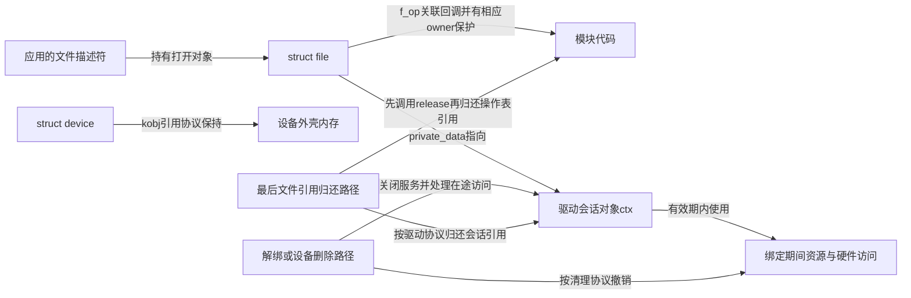
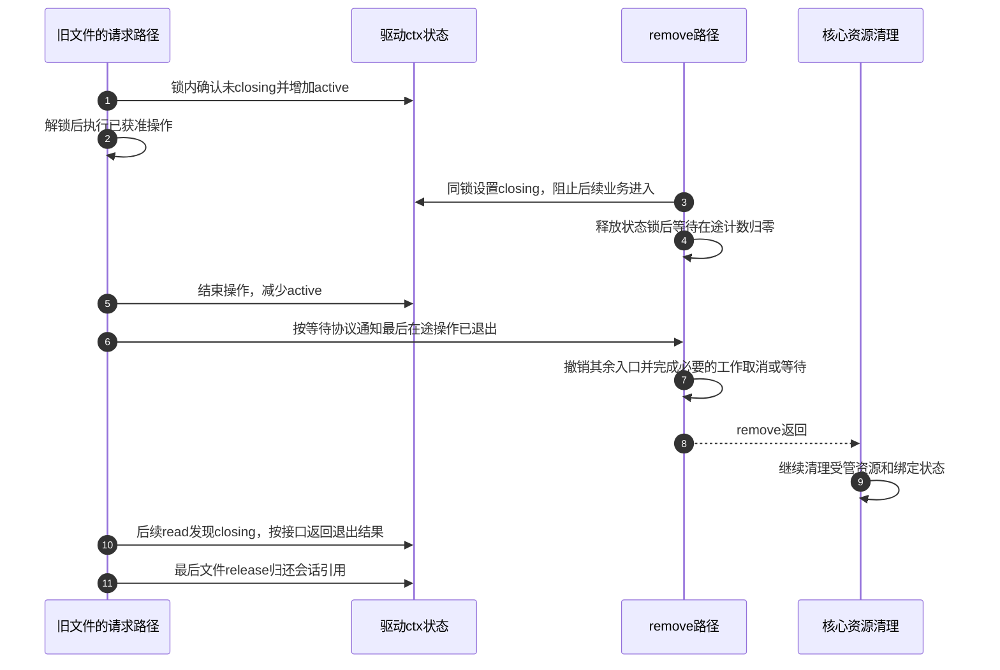

# 第14章\_热插拔与模块生命周期

第十三章保证供应者退出时先协调消费者，但消费者内部还可能有旧打开者和后台任务。假设应用已经打开 A 的字符接口，保存了文件描述符；此时 A 被拔出，或者管理员决定卸载提供驱动 D 的模块。把 sysfs 目录删除以后，应用保存的打开对象会一起消失吗？模块不能卸载时，又是否说明 A 的硬件一定还在？

这些问题需要把 **硬件可用、设备登记、驱动绑定、对象内存和模块代码** 分开跟踪。本章先解释普通热拔出，再解释正常模块卸载，排除强制卸载路径。具体源码仍按固定 NXP Linux 6.12.20 核对；驱动私有状态用教学命名，不假装是驱动核心自带字段。

## 14.1\_一个消失动作为什么结束不了所有寿命

应用成功打开字符设备后，文件描述符指向 struct file。file 保存文件操作表 f_op，驱动还可以把独立会话对象的地址保存在 private_data 中。随后删除设备节点或撤销字符分派，阻止的是相应的新查找与新打开，不会把已有 file 的操作表自动换成空值。

因此旧请求仍可能进入驱动代码。它需要两种不同保证：代码地址仍可执行，会话和数据地址仍有效。如果该请求还要访问硬件，又必须满足第三种条件——硬件服务没有被撤回。只保护其中一个不能推出另外两个。

图中的“保持”不是无条件箭头：驱动必须确实取得并配对相应引用，不能因为 private_data 存了一个地址就自动获得所有权。设备 get_device 保护的是设备外壳，不自动保护任意私有会话、devm 缓冲区或映射；操作表 owner 引用保护代码，也不让已经拔掉的外设重新出现。

| 状态或对象 | 典型维护者与位置 | 它不能单独证明什么 |
| --- | --- | --- |
| 硬件是否仍可访问 | 总线检测、设备状态及驱动错误处理 | 不能由模块引用数判断 |
| 设备是否登记 | 驱动核心的设备状态、总线集合与对象层次 | 有目录不表示probe成功 |
| 设备是否绑定 | dev->driver与绑定集合，结合当前阶段 | 临时关联不等于完整服务，解绑也不等于设备内存释放 |
| 设备外壳是否存活 | dev->kobj.kref | 不延长已清理的绑定资源寿命 |
| 打开对象是否存活 | file->f_count以及持有者 | 一个close不一定归还最后份额 |
| 会话对象是否存活 | 驱动独立引用及file->private_data关联 | 不表示允许继续访问硬件 |
| 模块代码是否允许离场 | 模块状态、引用及入口注销协议 | 不保证业务数据仍有效或所有后台工作已自动取消 |

## 14.2\_旧请求怎样与remove完成一次交接

给驱动会话对象 ctx 设三个教学字段：closing 表示不再接受新业务，active 统计已经获准且尚未结束的操作，refs 记录独立持有者。它们都由驱动设计，不是 struct device 自动维护的状态。refs 用于会话内存寿命，active 用于一次操作对即将撤销资源的占用，不能用同一个计数含混代替。

请求入口在同一个状态锁下检查 closing，并在允许时增加 active，然后才离开锁执行操作。remove 取得同一把锁设置 closing，释放锁后等待已登记的 active 归零。操作退出时减少 active，并按等待协议通知退出方。这样关闭和“获准进入”具有可解释的先后：关闭以前已经登记的请求被等待，关闭以后进入的请求被拒绝。

步骤 1 必须把检查和登记放进同一协议；若先看 closing 为假、解锁、再加 active，remove 可能在这个空窗看到零计数并释放资源。步骤 4 也不能持有操作退出所需的状态锁等待，否则步骤 5 无法执行。步骤 8～9 是资源责任交回核心，步骤 10～11 则允许旧 file 在硬件服务结束后只处理关闭状态和会话回收。

这是一种说明责任的模型，不是可以原样套给所有驱动的完整停机算法。中断、定时器、工作队列及映射访问各有自己的停止和同步接口；例如已经建立的用户映射可能直接访问页，不经过每次 read 的 closing 检查。必须逐个证明访问来源停止或已切换到有效的独立对象，不能仅给一个 read 回调加标志就宣布热拔出安全。

实际热拔出还可能先发生物理失联，软件稍后才得到通知。关闭标志只能协调软件访问，不能追溯保证已经发出的总线操作成功。相关子系统与驱动还要处理传输错误、取消及硬件特定的失联行为；本章不把可控的软件解绑时间线冒充所有物理拔出情形。

## 14.3\_打开的文件为什么可能挡住模块卸载

默认字符打开路径会取得对应 cdev，并通过 fops_get 取得目标文件操作表。fops_get 根据操作表的 owner 调用 try_module_get，成功后才把操作表交给 file；正常可卸载驱动通常通过 **THIS_MODULE 宏** 指出当前代码所属模块。cdev 的 owner 还参与其自己的取得与归还，不能把这些来源粗略合成“每个打开文件恰好一份模块引用”。

file 最后清理时，__fput 先调用适用的 release，再归还 cdev 与文件操作表的模块引用。这个次序使 release 执行期间代码仍受到对应保护。关闭一个描述符只会归还它的一份文件持有，复制的描述符、映射或其他使用者仍可能保留 file，因此 release 也不等同于任意一次 close。

这解释了一个看似矛盾的现场：A 已经被解绑甚至拔掉，但旧 file 仍保存操作表，所以模块仍可能正常拒绝卸载。被保留的是代码，用于让旧请求得到合理结果并完成最后清理；不是要求硬件继续存在。相反，模块可以卸载也不能证明未接入引用或注销协议的自定义回调安全，漏掉的协议不会自动反映在引用数里。

只注销 cdev 同样不等于旧 fops 不会再被调用。固定 cdev_del 的契约明确保留已打开者的后续操作可能性，驱动必须在自己的回调和会话寿命中处理它。前述 closing/active/ref 分工就是为这个缺口服务，而不是重复文件系统已经有的计数。

## 14.4\_已经绑定设备为什么仍能正常卸载驱动

另一种常见误解是“绑定一个设备就永久给模块加引用，所以不先手工解绑就无法卸载”。普通驱动注册并没有建立这样的无条件永久绑定引用。正常模块退出函数可以调用 driver_unregister，撤销候选登记并同步处理它已经绑定的设备；这正是许多驱动正常卸载的路径。

在固定 delete_module 默认非强制路径中，模块核心先检查使用者、状态和退出条件，通过后将模块标记为 MODULE_STATE_GOING，再调用模块退出函数。此时模块代码仍在，否则退出函数自身就无处执行。退出函数注销驱动，驱动核心撤下总线驱动集合节点、协调相应探测并解绑设备；随后模块还要完成自己负责的其他入口撤销和活动停止。

退出回调返回后，模块核心继续其通知、异步协调及模块内存清理。这里的异步协调不等于“自动取消任意工作队列、定时器和外部保存的函数指针”：这些活动必须由注册它们的代码遵守各自协议收好。把 driver_unregister 当成全模块所有并发活动的万能等待，会留下代码已经释放、旧回调仍要进入的窗口。

因此正确的判断是：正常模块引用和状态检查决定是否允许开始退出；退出路径仍须履行注销与排空责任，才能让代码安全离场。不要把 MODULE_STATE_GOING 当作通知所有外部调用者的广播，只有通过相应协议的进入路径才会受到协调。

## 14.5\_用三个现场分别检查自己的证明

第一，A 仍登记但手工解除绑定，独立会话还被一个 file 持有。此时可以保留会话用于返回“服务已关闭”及最终清理，但不能继续使用已由解绑清掉的受管资源。第二，A 物理拔出而模块被旧操作表引用保留，模块仍在是合理现象，不证明拔出没有生效。第三，模块没有外部引用而开始退出，自己的工作队列还在运行；这仍需要退出协议同步处理，零模块使用数不是后台任务已停止的证明。

继续练习：把状态模型中增加 active 的动作移到检查 closing 的锁外，能否构造 remove 先看到零并释放、请求随后开始的交错？可以，这正说明“有标志、有计数”还不足，二者的读写时机必须组成一个协议。再问，把 ctx 分配成会在解绑自动释放的资源，同时让旧 file 长期保存它，能否靠 file 的模块引用补救？不能，代码保护和数据内存保护是两份责任。

完整的私有对象与停机模型进入[生命周期集成](../object_lifetime/integration/P01_kobject_device_devres_kref_生命周期集成.md#1.9_完整停机状态机)，文件持有者的完整实验进入[文件操作专题](../../driver_model/file_operations/大纲.md)。本章的图用于比较寿命，未提供或宣称验证了任意硬件热拔出模块。

固定源码从[字符设备阅读索引](../../../research/source_reading/character_device/navigation/P01_Linux_6.12_字符设备源码阅读索引.md)进入，[文件操作与打开寿命导读](../../../research/source_reading/character_device/navigation/P03_文件操作与打开寿命导读.md#3.1_打开对象由谁持有)说明 file、release 和 fops_put 的交接。模块边界定位到官方 [kernel/module/main.c](https://github.com/nxp-imx/linux-imx/blob/dfaf2136deb2af2e60b994421281ba42f1c087e0/kernel/module/main.c) 的 try_stop_module、delete_module；驱动撤销定位到固定 [dd.c](../../../research/source_reading/linux/drivers/base/dd.c) 的 driver_detach 与 device_release_driver_internal。下一章将从单个 A 扩展到一颗芯片里的多个功能和多个组件共同提供一项服务。

上一篇：[device link 与电源管理](P13_device_link与电源管理.md)。

下一篇：[复合设备、MFD 与 Component](P15_复合设备_MFD与Component.md)。
