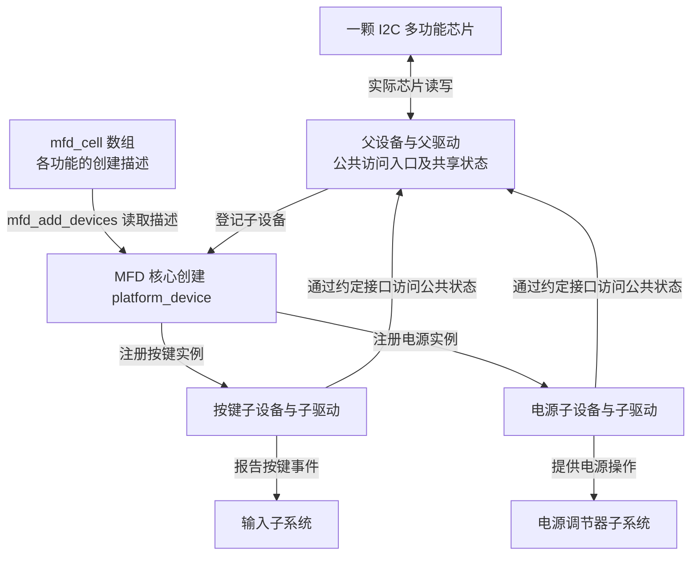
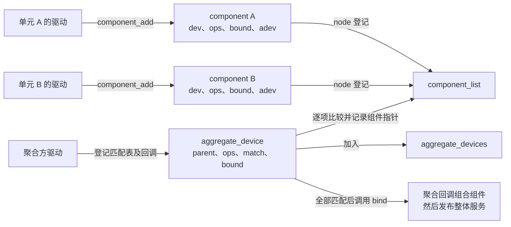
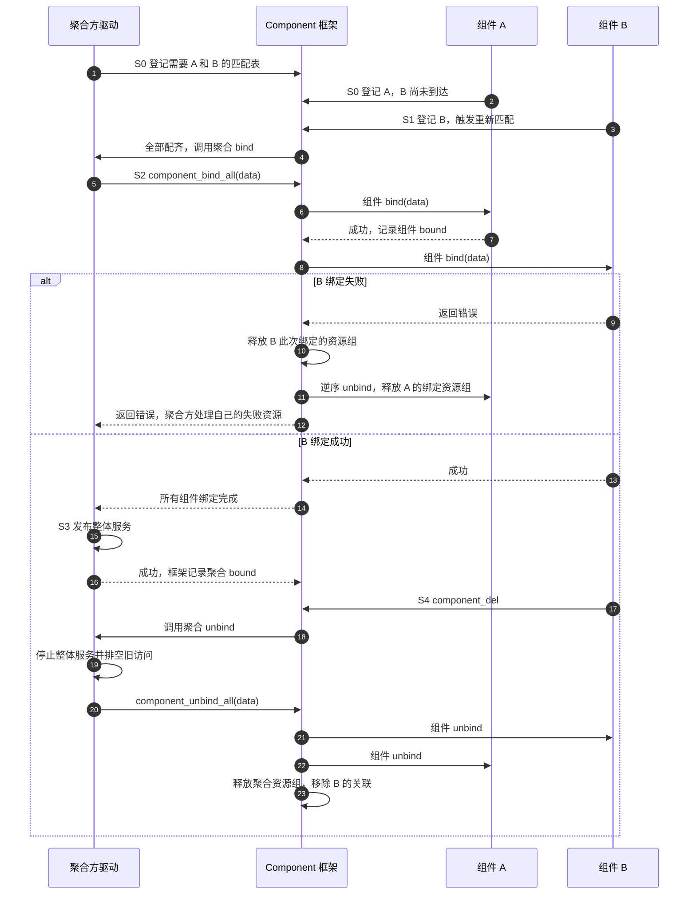

# 第15章\_复合设备\_MFD与Component

前一章已经把“停止服务”和“最后释放对象”分开，但一直把一次驱动绑定当作一份服务的起点。实际硬件还会打破这个对应：一颗芯片同时提供时钟、按键和电源控制功能；另一套显示功能却需要扫描输出、图像混合、输出编码等多个硬件单元共同工作。前者需要把功能分别交给合适的驱动，后者需要确认所有参与者已经到齐。

这两种问题都涉及多个设备，却不能仅凭“有几个设备”选择框架。本章先从一颗多功能芯片推出 MFD，再从多个独立单元推出 Component，最后比较它们怎样登记、回滚和退出。这里讲驱动的组织与生命周期，不假定这些教学功能对应某款实际芯片的寄存器布局。

## 15.1\_一颗芯片的不同功能为什么要拆成子设备

设想一颗通过 I2C 连接的控制芯片，内部既有按键扫描，又有电源输出控制。最直接的方案是一个驱动管理全部功能：它拥有 I2C 访问入口，也能统一处理共享寄存器。这对功能少、始终一起使用的芯片完全可行。

问题出现在两个功能需要接入不同内核子系统时。按键部分要向输入子系统报告事件，电源部分要向电源调节器子系统提供开关与电压操作。如果都塞在父驱动里，每增加一种功能都要改同一份驱动，并把各子系统的初始化和失败回滚交织起来。反过来，若让各功能各自假装发现了一颗独立 I2C 芯片，又会丢失“它们共享同一条芯片访问路径”的事实。

**MFD（Multi-Function Device，多功能设备）** 在这两端之间分工：父驱动负责芯片公共部分，再为各功能创建可由驱动核心分别匹配的子设备。子驱动负责接入自己的功能子系统。拆出来的是 Linux 设备对象和职责，芯片没有因此变成几颗物理器件。

在本章核对的 Linux 6.12.20 中，MFD 核心创建的是 `struct platform_device` 类型的设备对象。父设备即使在 I2C 总线上，子设备也可以在 Platform 总线上；子设备的总线表示其软件匹配方式，不意味着它另有一条物理 Platform 连线。子设备通过 `dev.parent` 找到公共宿主，但怎样取得父驱动的数据、怎样互斥访问共享寄存器，仍是具体驱动之间的约定。MFD 不会凭一个父指针自动生成共享寄存器锁。图中的 `mfd_cell` 数组是父驱动给出的功能创建描述，下一节再展开其内容。

沿图看一次按键事件：子驱动读取状态所需的访问仍落到父芯片，事件解释与上报却属于按键功能。这样拆分保留了公共硬件入口，又允许按键与电源驱动分别维护。代价是父子资源的可用时间必须清楚：不能子驱动还在读芯片，父驱动就先释放通信资源。

## 15.2\_从功能描述到子设备实例

父驱动要先告诉 MFD 核心“要创建哪些功能、每个功能能用什么”。`struct mfd_cell` 就是这份描述；它不是已经注册的设备，更不是一块由内核划出的物理电路。核心为每项描述分配子设备，保存 cell 副本，设置父设备和资源，再调用 Platform 注册路径。注册过程中可能立即进入子驱动的 probe，因此父驱动必须在登记子设备之前准备好子驱动需要的公共状态。

以下字段只展开本章创建过程所需的部分。具体硬件是否使用它们，由父驱动决定。

| 描述位置 | 核心怎样使用 | 不能据此推断什么 |
| --- | --- | --- |
| `mfd_cell.name`、`id` | 形成子设备名称与实例编号；也受 `mfd_add_devices()` 的编号参数影响 | 名称相同不表示是同一物理实例 |
| `resources`、`num_resources` | 描述子功能的地址或中断资源，转换后交给子设备 | 描述资源不等于已经映射地址、申请中断或启动硬件 |
| `platform_data`、`pdata_size` | 提供需要复制给子设备的平台数据 | 不是 `pdev->mfd_cell` 本身，也不会深复制其中每个指针指向的对象 |
| `of_compatible`、可选 `of_reg` 与 `use_of_reg` | 从父设备的设备树子节点中寻找对应功能描述 | 不代表每个设备树节点都会被 MFD 创建 |
| `level` | 区分普通子设备和需要延后拆除的子设备 | 不是自动推导出来的任意依赖图 |

地址资源也有转换规则。给定父地址资源 `mem_base` 时，子 cell 的内存资源起止值会加上父资源起始地址；不提供这个基准时，不能再默认相同值仍会被当作偏移。中断资源若提供 `irq_domain`，核心通过该中断映射域把硬件编号映射为 Linux 中断号；否则使用 `irq_base` 加上描述值。这里的“资源交给子设备”与中断是否已经到达处理器，是两层不同事实。

把登记与拆除分开，便能理解这组接口：

| 接口 | 本章关心的效果 | 调用方仍负责的边界 |
| --- | --- | --- |
| `mfd_add_devices()` | 按 cell 数组创建并注册子设备 | 成功只证明相应登记流程成功，不保证所有子驱动 probe 成功；禁用的设备树功能还可能被跳过 |
| `mfd_remove_devices()` | 逆向遍历父设备的子对象，注销 MFD 类型且属于普通级别的设备 | 并非删除父设备下所有任意类型的子对象 |
| `mfd_remove_devices_late()` | 按较高级别范围继续注销 MFD 子设备 | 使用延后级别的驱动必须安排实际拆除时机 |
| `devm_mfd_add_devices()` | 登记成功后，在父设备 devres 中记录调用普通 MFD 拆除的清理动作 | 不能把公共资源提前手工释放，也不能据此认为延后级别自动获得了完整清理策略 |

若第一个普通子设备已注册，创建第二个时失败，`mfd_add_devices()` 会走普通子设备拆除路径，再返回错误。这会撤销已登记对象，必要时也触发其驱动解绑；不是只释放第二项的临时内存。若同一个父设备被多次添加子设备，还要注意该错误路径按父设备范围拆除，不能假定它只撤销“这次调用刚添加的那几个”。使用延后级别时，更不能把普通清理路径当作对所有级别的事务回滚保证。

正常退出同样先完成子功能撤销，再释放它们依赖的公共硬件资源。使用 devres 时，应让子设备清理动作在公共资源清理之前执行，并注意父驱动 remove 回调早于常规 devres 释放。**子设备对象可能因额外引用暂时保留，但这些引用不会延长父驱动硬件资源的有效期。** 保留一个已注销对象的壳，与允许继续访问芯片，是不同的承诺。

## 15.3\_多个单元已经有驱动为何还需要一次聚合

现在换一个约束。显示扫描单元负责从内存取图像，混合单元合成画面，输出单元把结果送往显示接口。它们各自可以完成设备枚举和驱动 probe，却只有组合起来才能提供完整显示服务。先 probe 的单元不能假定其他单元也已完成登记；把整条显示链都放进某个设备的 probe，又容易使这个驱动承担其他独立设备的发现和退出协调。

**Component framework（组件框架）** 处理这类特定硬件聚合：各参与驱动显式登记自己的组件，聚合方登记“本次组合需要哪些组件”的匹配表；框架等这些组件均可取得时，才调用聚合方的 bind 回调。若已有子系统提供标准的依赖查找与协作接口，应先使用那些接口，不必为了多个设备相连就引入 Component。

这里有两个不同的“绑定”。驱动核心的 probe 建立设备与驱动之间的服务关系；Component 的 bind 则把已经提供组件接口的参与者组合成更高层的服务。`component_add()` 常从驱动 probe 内调用，甚至可能在这次 probe 返回之前触发聚合，所以“组件已登记”也不能替代“驱动核心已完成全部绑定收尾”的判断。

聚合方沿用带 `master` 的接口名称；固定版本内部的记录类型叫 `struct aggregate_device`，即聚合记录。这个记录保存宿主 `parent` 指针，不会自动创建一个新的驱动核心 `struct device`。是否另行向显示等子系统发布服务，由聚合回调完成。

这些是 `drivers/base/component.c` 中的实际状态载体。`component_list` 和 `aggregate_devices` 保存两类登记记录，`match->compare[]` 保存所需项、比较函数及找到的组件指针，组件的 `adev` 指向已关联的聚合记录。框架在 `component_mutex` 下查找并修改关联和 bound 标志，回调也在相应调用上下文中执行；并不存在一个不断扫描硬件的“组件线程”。驱动不能在这些回调中随意递归调用需要同一把互斥锁的登记或删除入口。

## 15.4\_到齐以后怎样绑定以及怎样撤回半成品

用 A、B 两个必需组件走完一次周期。聚合 bind 通过 `component_bind_all()` 这个辅助函数依次调用各组件的 bind，并把自己的上下文传给它们；退出时用 `component_unbind_all()` 逆序拆下组件。下面 S0～S4 是本章分析阶段，不是内核枚举值；各记录的 `bound` 字段只表示对应层的绑定已经成功。

| 阶段 | 触发与写入者 | 状态落点和下一步 |
| --- | --- | --- |
| S0 等待 | 聚合方登记匹配表，或某个组件先登记 | 记录加入对应全局链表；缺少匹配项时聚合 `bound` 仍为假，登记可以返回成功 |
| S1 配齐 | 后来的登记路径在锁内重新尝试匹配 | `match->compare[]` 记录组件，组件 `adev` 记录归属；全部满足后调用聚合 bind |
| S2 逐项绑定 | 聚合 bind 调用 `component_bind_all()` | 按匹配顺序调用组件 bind，成功的组件 `bound` 变真；失败时逆序撤回此前成功项 |
| S3 发布完成 | 聚合方完成自己的发布并成功返回 | 框架才把聚合 `bound` 置真；“所有组件 bind 成功”与“整体服务发布成功”仍是两个检查点 |
| S4 拆除 | 组件删除或聚合方删除进入框架 | 若聚合已绑定，先调用聚合 unbind；由它停止发布并解绑组件，再清除相应登记与关联 |

图中 1～4 表示登记成功可以先于聚合成功；5～8 才开始逐项绑定。B 失败分支只对之前 **成功** 的 A 调用组件 unbind，B 自己的 bind 必须负责未被资源组涵盖的失败收尾。成功分支中聚合方还要发布整体服务；如果这一步失败，应由聚合 bind 撤销已经成功的组件绑定和自己的部分发布，不能指望框架在聚合 bind 返回错误后再自动调用聚合 unbind。

S4 中删除 B 会拆下整个已绑定聚合，但不会因此把 A 的驱动从驱动核心解绑，也不会删除 A 的设备对象。A 可以继续登记在组件集合中，聚合记录也可继续等待所需组件。若删除的是聚合方，则 `component_master_del()` 拆除并移除聚合记录，解除组件对它的关联。无论哪种路径，应用访问、工作项和硬件请求都必须由驱动的停止协议排空，框架的链表删除不能代做这些工作。

## 15.5\_组件资源为什么不能只等设备最终释放

前面已经知道 devres 可以用组界定一次事务。Component 正好说明为何不能把所有资源都笼统地绑到“设备最终退出”：A 的设备和驱动还活着时，B 离开就可能让聚合服务经历一次解绑；随后 B 回来，还可能再次聚合。聚合资源应该随这一次 bind/unbind 周期变化，而不是一直等到 A 的 device 释放。

固定版本在聚合 bind 外建立宿主资源组，在各组件 bind 外又建立组件设备资源组。组件成功绑定后保留其组边界，组件 unbind 后释放该组；失败则释放本次失败组，并逆序解绑此前成功组件。宿主聚合组在整个聚合失败或拆除时释放。这是框架显式管理的 **绑定事务范围**，并非任何位置的 devm 分配都会自动获得同样的范围。

因此，头文件关于“聚合寿命不等于底层 device 寿命、不能依靠普通 devm 生命周期”的提醒，要与这些资源组实现一起理解：明确资源是在哪个设备、哪个仍打开的组中登记，框架何时释放该组；组外分配、异步活动和对外发布仍须显式收回。更不能用设备引用代替聚合引用，令旧调用者继续拿着上一轮已经销毁的聚合数据。

现在再查接口，名称就能对应到具体阶段：

| 接口或回调 | 所属职责 | 关键约束 |
| --- | --- | --- |
| `component_match_add()` | 向初始为 `NULL` 的匹配表增加必需项 | 匹配表由 devm 管理不等于比较数据自动获得引用；需要释放比较数据时使用带 release 的变体 |
| `component_master_add_with_match()` / `component_master_del()` | 登记、撤销聚合方 | 加入时若已经配齐，可同步调用聚合 bind；返回成功也可能只是继续等待 |
| `component_add()` / `component_del()` | 登记、撤销一个组件及其回调 | 删除已参与聚合的组件会触发整体拆除；不能先销毁回调需要的私有数据 |
| `component_add_typed()` | 在同一 device 上区分多个组件身份 | 使用非零子组件标识，并配合带类型的匹配方式 |
| `component_master_ops.bind/unbind` | 组织、发布和停止整体服务 | 负责调用下列批量组件操作及整体失败收尾，不是 Driver Core 的 probe/remove 别名 |
| `component_bind_all()` / `component_unbind_all()` | 按匹配顺序绑定、逆序解绑组件 | 应从聚合回调使用，不能脱离框架锁和状态自行当作普通外部开关 |
| `component_ops.bind/unbind` | 一个组件加入或离开本轮聚合 | 取得的 `data` 是聚合方传下来的上下文，其有效期由聚合协议保证 |

Component 也没有替代上一章之前建立的 device link：组件集合解决“整体功能是否配齐、怎样组合”，device link 处理相应设备依赖与电源管理顺序。聚合存在，不自动建立所有运行时电源依赖。

## 15.6\_先判断缺口再选择组织方式

两套机制现在可以在同一组问题上比较，而不是按名字猜用途。

| 现场问题 | 首先考虑的方案 | 为此必须承担的成本 |
| --- | --- | --- |
| 一颗芯片的多个功能要分别接入不同子系统 | MFD 父驱动创建功能子设备 | 公共资源准备、父子访问协议、部分创建回滚及拆除顺序 |
| 已有独立设备共同组成一种没有合适标准协作接口的整体功能 | Component 匹配所需组件并组织聚合 | 组件登记、聚合发布回滚、任一必需组件离开后的整体停止 |
| 只是某设备依赖另一设备供电或提供普通服务 | 相应子系统接口及必要的 device link | 服务取得与依赖生命周期，不能用聚合框架回避标准接口 |
| 功能很少且始终一起出现、一起退出 | 保持一个驱动也可以 | 仍需写对自身失败与退出路径，无须为了拆分而增加中间对象 |

试着判断两个变化。第一，一个 MFD 子驱动 probe 失败，父设备及其他子功能是否一定全部失败？答案是否定的：子设备登记与子驱动绑定分层，某个 probe 的错误不等于创建子设备失败；若父功能确实要求全部子功能可用，需要另有明确协议。第二，MFD 创建的一个子设备能否再作为 Component 参与者？可以，两套机制分别解决对象拆分和服务聚合，并不互斥；同时使用时，两套退出协议都要落实。

本章能够据此区分“创建子设备”和“组合已提供接口的组件”，也能预测部分失败会撤销哪一层。下一章把登记、绑定、聚合、服务和引用这些已建立的状态，整理成接口与调试入口，避免拿某个目录出现当作所有层都成功。

> 源码依据：NXP `linux-imx`，发布标签 `lf-6.12.20-2.0.0`，固定提交 `dfaf2136deb2af2e60b994421281ba42f1c087e0`。MFD 的创建、资源转换与级别拆除见 [`drivers/mfd/mfd-core.c`](https://github.com/nxp-imx/linux-imx/blob/dfaf2136deb2af2e60b994421281ba42f1c087e0/drivers/mfd/mfd-core.c)，描述字段见 [`include/linux/mfd/core.h`](https://github.com/nxp-imx/linux-imx/blob/dfaf2136deb2af2e60b994421281ba42f1c087e0/include/linux/mfd/core.h)。组件状态、匹配、绑定回滚与资源组见 [`drivers/base/component.c`](https://github.com/nxp-imx/linux-imx/blob/dfaf2136deb2af2e60b994421281ba42f1c087e0/drivers/base/component.c)，回调契约见 [`include/linux/component.h`](https://github.com/nxp-imx/linux-imx/blob/dfaf2136deb2af2e60b994421281ba42f1c087e0/include/linux/component.h)。本章为固定源码的机制分析，未将教学芯片或显示链声明为已实测硬件。

上一篇：[热插拔与模块生命周期](P14_热插拔与模块生命周期.md)。

下一篇：[API、调试与选择边界](P16_API调试与选择边界.md)。
