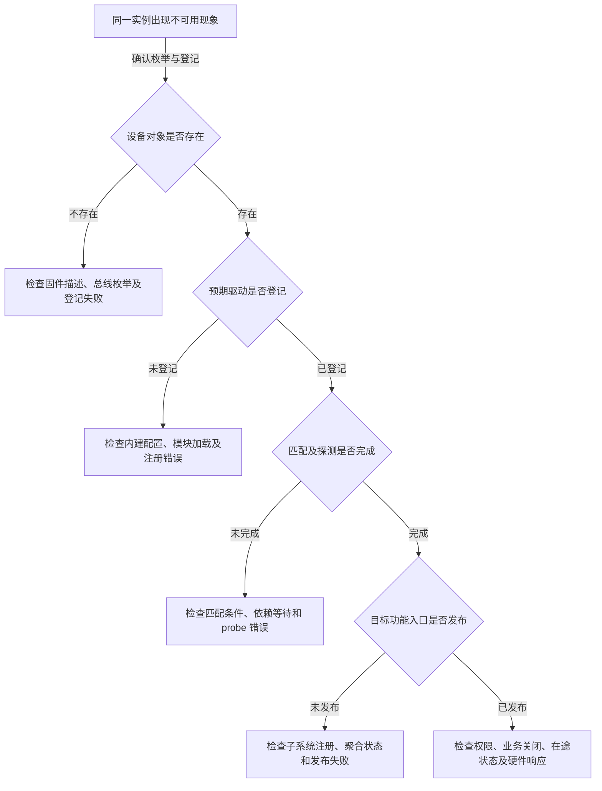

# 第16章\_API调试与选择边界

前十五章已经区分对象登记、驱动绑定、功能发布、依赖和最后释放。本页按这些状态查询接口与排错证据：遇到“模块已加载，但设备不能用”，先判断哪一步没有成立，再选对应入口。各表是前文机制的操作索引，不把某一条目录、日志或返回值当作整个设备已经可用的证明。

## 16.1\_先问准备改变哪一种状态

API 是 Application Programming Interface，即程序之间约定的调用接口。以下接口改变的对象不同，不能因为名称里都有 device 就互相替换。尤其要区分“调用方持有的初始化引用”和“注册产生的可见关系”：注销结束并不代表所有观察者都已经归还引用。

| 当前任务 | 对应接口或接口组 | 必须同时检查的契约 | 回到机制 |
| --- | --- | --- | --- |
| 调用方自己分配对象并分步登记 | `device_initialize()`、`device_add()` | 初始化后由引用归还走向 release；add 失败仍须处理调用方持有的初始化引用，不能直接绕开释放契约 | [device 生命周期](P06_device注册与生命周期.md) |
| 一次完成初始化与登记 | `device_register()` | 返回失败不等于对象可直接 `kfree()`；同样按设备引用协议收尾 | [device 生命周期](P06_device注册与生命周期.md) |
| 撤下登记并归还注册方引用 | `device_unregister()` | 内含删除与引用归还；额外持有者可能让对象继续存在，但硬件服务不因此继续存在 | [注销与最后释放](P06_device注册与生命周期.md) |
| 只撤销登记关系 | `device_del()` | 不等于替所有持有者 put；不能与 unregister 随意叠加形成重复删除 | [device 生命周期](P06_device注册与生命周期.md) |
| 已取得合法对象后延长内存寿命 | `get_device()`、`put_device()` | 原始指针本身必须仍有效；不能从悬空指针“补拿”引用，也不保证驱动资源有效 | [热插拔寿命](P14_热插拔与模块生命周期.md) |
| 把驱动放入总线匹配域 | `driver_register()`、`driver_unregister()` 及各总线包装 | 登记过程中即可 probe，解绑过程中需停止各实例服务；模块加载与每个实例绑定分开判断 | [总线与驱动登记](P07_bus与driver注册.md) |
| 发布功能分类对象 | `device_create()`、`device_destroy()` | 属于 class 设备便捷接口；不代替字符号/cdev 注册，不保证用户空间已建立预期节点 | [分类与用户入口](class_sysfs/大纲.md) |
| 给失败回滚登记资源动作 | `devm_*`、devres group 接口 | 先区分各接口的返回约定、资源归属及组边界；自动释放不负责排空所有使用者 | [资源事务](P12_devres资源事务.md) |
| 表示跨设备依赖 | `device_link_add()` 及适用删除接口 | flags 决定驱动存在、自动移除和运行时电源语义；托管与非托管链接的删除责任不同 | [设备依赖](P13_device_link与电源管理.md) |
| 拆分芯片功能或聚合多个单元 | MFD、Component 的登记与退出接口 | 创建子设备、驱动 probe 和聚合 bind 是不同阶段；按实际缺口选择 | [复合设备](P15_复合设备_MFD与Component.md) |

例如，把手工 `device_add()` 改成 `device_create()` 不能自动修好一个未注册 cdev 的字符驱动。两者解决的问题不同：后者可以帮助创建分类设备对象，但打开设备号时仍要有字符分派目标。同样，增加一次 `get_device()` 也不能修好 remove 提前释放寄存器映射的问题；那需要停止新请求并等待在途使用者退出。

## 16.2\_沿一个实例定位故障层

先固定同一个设备实例及发生时间，再从左到右判断。系统仍在异步探测或热插拔时，两个读取结果可能分别来自两个时刻，不能拼成一次原子快照。下面箭头表达排查顺序，不表示内核严格串行完成所有用户空间动作。



这些问题可以用下列证据缩小范围。路径中的尖括号是实例占位符，不是可以原样复制的名字。

| 观察位置 | 能支持的有限结论 | 仍不能证明 |
| --- | --- | --- |
| `/sys/bus/<bus>/devices/` 中的实例 | 该实例在这次观察时有总线设备入口；解析链接可定位对象目录 | 对应驱动一定匹配、probe 成功或硬件仍连通 |
| `/sys/bus/<bus>/drivers/<driver>/` | 该驱动有总线侧登记入口 | 存在与它匹配的设备，或每个实例都已绑定 |
| 设备目录的 `subsystem` 链接 | 当前对象的子系统观察归属 | 仅凭链接名推断所有物理连线、父子对象或用户服务 |
| 设备目录的 `driver` 链接 | 驱动关联已建立到可见阶段，稳定状态下可用于定位驱动 | 瞬时观察不能独立证明 probe 已成功返回：核心可在 probe 前创建链接，失败后再撤销 |
| `/sys/class/<class>/` 中的入口 | 功能分类对象已经发布到该视图 | 任意分类对象都应有 `/dev` 节点，或文件操作已经可用 |
| 设备的 `uevent` 属性 | 本次读取生成的适用事件环境键值 | 历史事件已发送、用户空间已收到、规则已执行 |
| `modalias` 属性或适用的 `MODALIAS` 键 | 提供模块匹配提示 | 模块存在、已加载、当前驱动由模块提供或 probe 成功 |
| 业务系统调用结果及驱动日志 | 某次实际请求走过的路径和返回结果 | 单次成功覆盖退出竞态、所有错误路径或其他设备实例 |

`uevent` 文件尤其容易误读。固定版本的 `uevent_show()` 组织当前环境并输出，并不查询一个保存历史通知的事件队列；向它写动作则进入合成事件路径，会改变观察现场。排查时不要把只读属性与主动重发事件混成同一个动作。要证明接收，应观察当时的事件接收者；事后看到属性不能补出过去是否送达的事实。

### 16.2.1\_只读检查一个已经选定的Platform实例

下面在目标 Linux 的 Bash 中执行，要求 sysfs 已挂载于 `/sys`，并使用前文已经介绍的 Platform 总线。命令只用于取证，没有在本文声称某台板已经给出这些结果。先列出实际实例名：

```bash
# 目标 Linux；任意当前目录。
ls /sys/bus/platform/devices
```

选择与故障相关的一项，不能任选一个名字再把其结果归给目标硬件。接着交互输入刚确认的完整实例名；变量只是本次 shell 观察路径：

```bash
# 同一 Bash 会话；按提示输入上一条列表中的实例名。
read -r -p 'Platform 实例名: ' device_name
device_path="/sys/bus/platform/devices/$device_name"
readlink -e -- "$device_path"
```

`readlink -e` 解析所有现存路径分量，成功时输出实际对象路径。输入为空、名字错误或设备恰好删除时，应停止沿旧路径推断，重新确认实例；不要把没有输出解释成 probe 返回了某个错误码。

```bash
# 同一会话；已确认 device_path 指向目标实例。
ls -ld -- "$device_path/driver" "$device_path/subsystem"
```

这显示两个链接各自是否存在及目标。某项不存在时，`ls` 会报告错误；分别解释两项，不把命令的整体非零退出值等同于设备不存在。对 probe 中间态的疑问，要结合对应时间段日志或受控复现场景，而不是无限快速刷新链接猜先后。

```bash
# 同一会话；读取该实例当前生成的事件环境。
cat -- "$device_path/uevent"
```

按实际出现的键解释输出。没有 `MODALIAS` 不代表所有总线都异常；有该键也不能证明自动加载成功。对模块化驱动还要检查实际模块加载结果，对内建驱动则不应强求一个可加载模块文件。

## 16.3\_探测未完成时再选择诊断设施

上一节先确定对象和驱动是否存在。只有问题已经落到探测或依赖阶段，下面的诊断工具才有明确目标。**debugfs** 是内核诊断文件系统；**动态调试（dynamic debug）** 控制源码中已有调试打印点；**tracepoint** 是内核预先定义的跟踪事件点，通常经 tracefs 跟踪文件系统观察。它们提供的证据不同，缺少输出也各有不同原因。

| 设施 | 用途与前提 | 读不到或没记录时先检查什么 |
| --- | --- | --- |
| debugfs `devices_deferred` | 在支持 `CONFIG_DEBUG_FS` 且入口已建立的系统中查看当前 pending 探测设备及已有原因 | 已移到 active/正在重试的设备不一定在此；文件缺失可能是配置、初始化或挂载问题 |
| debugfs `device_component/<宿主名>` | Component 启用相应诊断后查看该聚合的整体与匹配项状态 | 某组件未登记不等于其物理设备未枚举；组件 bound 与驱动核心 bound 分层 |
| 动态调试控制目录 | 查找已有打印点，按目标文件或函数启用相应记录 | 是否编译了目录、目标调用点是否存在和已启用、执行路径是否走过，以及日志是否被保存 |
| tracefs `available_events`、各事件 `format` | 发现本内核实际提供的事件及其字段后，选择能覆盖问题的记录 | 是否支持跟踪、事件是否编入、是否启用并在故障之前开始记录；不能臆造一个所有版本都有的 probe 事件 |

若目标已将 debugfs 挂载到 `/sys/kernel/debug`，可先读延迟探测列表：

```bash
# 目标 Linux；已确认 debugfs 配置与上述挂载点。
sudo cat /sys/kernel/debug/devices_deferred
```

这里报告当前 pending 集合，不是完整探测历史。空输出不能证明“所有设备已经成功”；具体为什么可能漏掉正在执行的重试，见[延迟队列与触发](P09_deferred_probe解绑与remove.md#9.4_超时与调试列表能告诉我们什么)。

需要更多路径细节时，先查询动态调试已有目录。以下入口存在时，查询固定源码的驱动核心打印点：

```bash
# 目标 Linux；内核已提供 /proc/dynamic_debug/control，当前用户有读取权限。
grep -F 'drivers/base/dd.c:' /proc/dynamic_debug/control
```

每行通常给出文件、行号、模块、函数、标志及打印格式；`p` 标志控制打印。这里的查询不启用打印，也不产生过去的日志。完整 `CONFIG_DYNAMIC_DEBUG` 会建立调试点目录，仅有核心支持的配置还要看各编译单元是否加入目录。若实际系统只提供 debugfs 下的同类控制入口，应以已挂载位置为准。后续启用应缩小到相关调用点、复现后恢复设置，避免全局打印淹没真正需要的时间顺序。

使用跟踪事件前也先看本机目录，而不复制别的内核事件名：

```bash
# 目标 Linux；tracefs 已挂载于 /sys/kernel/tracing，当前用户可读。
head -n 20 /sys/kernel/tracing/available_events
```

这只显示可用事件列表的前二十行，不启用或捕获任何事件。找到与目标路径有关的事件后，还需读取其 `events/<系统>/<事件>/format`，确认字段及发生位置，再安排受控记录。若没有覆盖当前 probe 交接的事件，应选择实际存在的日志或其他合适观测点；没有记录不能被解释为“函数一定没执行”。

## 16.4\_把诊断结论带回代码审查

调试得到的是某一层的证据，修复时仍要回到该层的状态变化。例如 deferred 列表一直有 A，先检查 A 所需供应者、错误码和重试条件；不要直接加一个固定睡眠。若 driver 链接短暂出现又消失，应沿 probe 及其后续步骤的错误回滚查原因；不要把现象直接判成用户空间自动卸载模块。

| 审查问题 | 应当能指出的具体位置 | 常见错误替代 |
| --- | --- | --- |
| 对象由谁分配、持有和最终释放 | 初始化引用、额外 get/put、release 回调及其代码寿命 | “注册成功后内核会管全部事情” |
| probe 失败发生在哪一步 | 尚未取得、已取得需回滚、已发布需撤销的资源 | 对所有失败统一调用正常 remove |
| remove 怎样拦住新请求 | 关闭状态与进入登记的共同同步点 | 先检查一次指针非空，以为后续一直安全 |
| 旧请求何时退出 | 在途计数、完成通知、同步取消或所属子系统的停止契约 | 用对象引用代替资源有效性，或只睡固定时间 |
| 依赖与聚合由谁维护 | device link flags、Component 匹配及各自解绑责任 | 用父子树解释所有供电与功能关系 |
| 最后一次回调时模块代码是否仍在 | 文件操作 owner、相关模块引用及退出时的排空协议 | 以“模块已注册驱动”替代真实代码寿命证明 |

这些审查项是前面章节的结果，不是一张填完就保证驱动正确的清单。真正的修复应使失败、重试、正常服务和退出都遵守同一份所有权协议；随后再用与修改相关的目标场景验证。静态源码核对、图表和只读目录观察各自有价值，但不能代替模块构建、真实设备运行或竞态验证。

> 依据：本专题统一使用 NXP `linux-imx` 发布标签 `lf-6.12.20-2.0.0`、提交 `dfaf2136deb2af2e60b994421281ba42f1c087e0`。事件属性读取见 [`drivers/base/core.c`](../../../research/source_reading/linux/drivers/base/core.c) 的 `uevent_show()`；链接建立、探测与延迟列表见 [`drivers/base/dd.c`](../../../research/source_reading/linux/drivers/base/dd.c)。动态调试目录与配置见固定版本 [dynamic-debug-howto.rst](https://github.com/nxp-imx/linux-imx/blob/dfaf2136deb2af2e60b994421281ba42f1c087e0/Documentation/admin-guide/dynamic-debug-howto.rst)，可用事件与字段查询见 [trace/events.rst](https://github.com/nxp-imx/linux-imx/blob/dfaf2136deb2af2e60b994421281ba42f1c087e0/Documentation/trace/events.rst)。以上命令是目标 Linux 的取证方法，本轮未在目标系统执行。

上一篇：[复合设备、MFD 与 Component](P15_复合设备_MFD与Component.md)。
