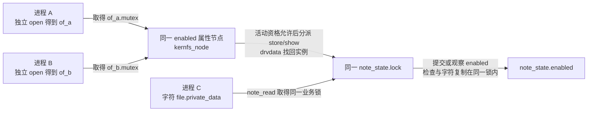
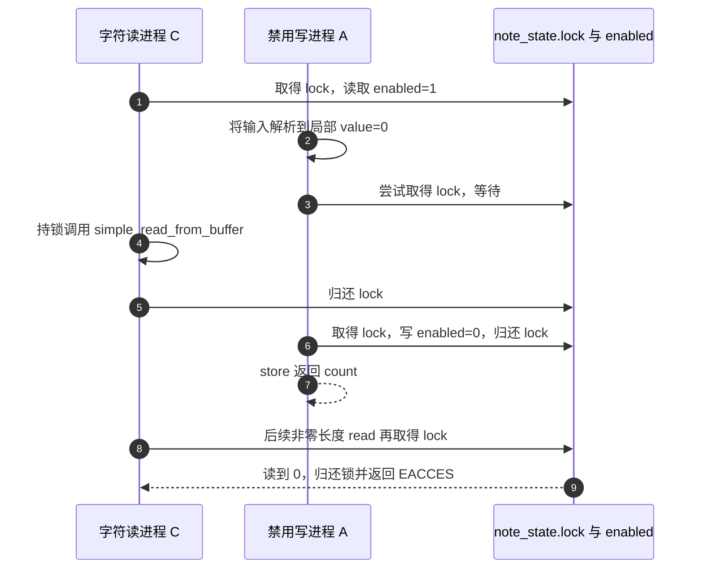
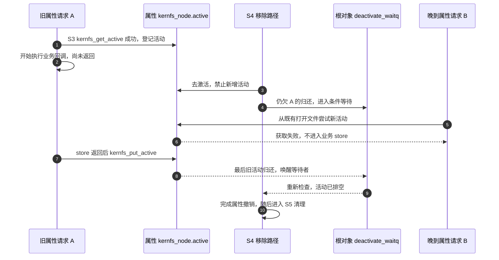
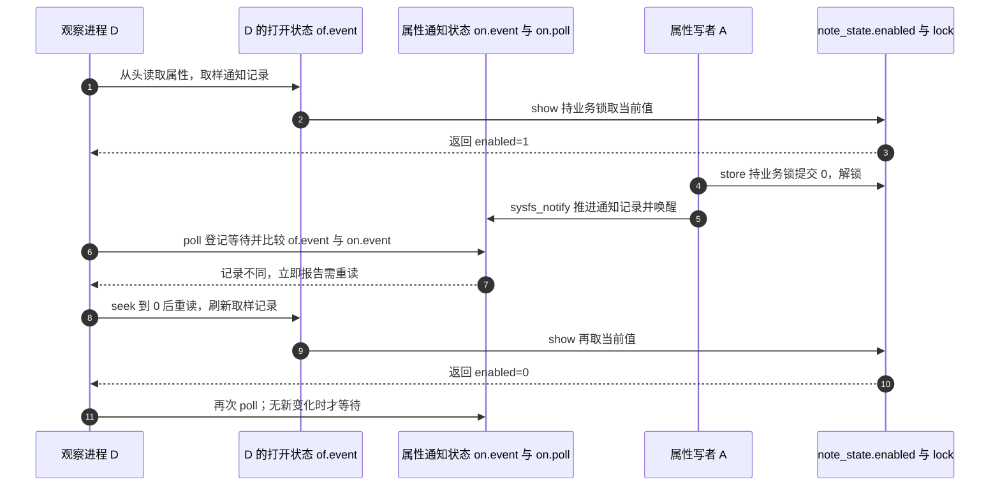

# 第4章\_并发访问与撤销

前两章的模块已经能回答一次读取或一次写入，第三章又说明了这些入口如何发布。现在让进程 A 和 B 分别打开 enabled，准备写 0 和 1；进程 C 已经打开字符文件，准备读取消息。管理员也可能请求卸载模块。这些操作分别跑得通，并不能证明它们交错时仍然符合约定。

第二章已经为 `note_control` 加了一把 mutex。sysfs 内部也有锁，为什么不能删掉我们自己的锁？反过来，既然业务数据已有锁，卸载时拿住它再删除目录是否更保险？本章先跟踪一次禁用与读取的交错，再沿同一个实例走到入口撤销，用这两个问题区分业务一致性、回调活动和对象寿命。

## 4.1\_两个打开者为何仍需要同一把业务锁

A 与 B 打开的是同一个属性路径，但独立 `open` 分别建立打开状态。kernfs 是承载 sysfs 节点与文件操作的内核基础设施；它用 `kernfs_open_file` 记录一次打开，并在其中放置 `mutex`。A 的锁可以把使用 A 这份打开状态的操作串行化，却挡不住持有 B 那把锁的进程。两扇门各有钥匙，不等于屋里只能进一个人。

两个打开状态最终都指向同一属性节点，分派到同一个 `enabled_store`，再从 device 的 drvdata 找到同一个 `note_state`。字符读取从 file.private_data 找回的也是这份状态。**业务数据的汇合点在实例中，保护它的锁也必须在实例中。** 第一章的只读编号发布后不变，不需要这把业务锁；增加可变 enabled 后，那个前提已经变了。

`dup` 或继承文件描述符可以共享同一个打开对象，不属于这里的“两次独立 open”。但即使 A、B 恰好共享打开对象，字符文件仍有自己的访问路径，不能依赖属性内部的锁覆盖它。

先固定第二章的业务约定：一次非零长度字符读取，要么在 enabled 为 1 时完成本次允许的复制，要么看到 0 返回 `-EACCES`。禁用写者提交 0 以后，不能还有一个刚才通过检查、却把实际复制拖到提交之后的旧读取。仅仅把 enabled 读成一个完整的整数，不足以提供这个保证；需要把“检查允许”和“执行本次复制”作为同一个受保护区间。

### 4.1.1\_把禁用放进一次正在进行的读取

假设 C 先拿到业务锁，A 已解析好输入 0。C 可以在锁内看到 1 并复制；A 此时只能等。C 归还锁以后，A 才能提交 0。随后再取得锁的非零长度读取看到 0，返回权限错误。这个顺序没有撤回已完成的读取，也没有把写者的提交假装成发生在它拿到锁以前。

图中假设中间没有 B 再次启用。若 B 随后持锁提交 1，之后的读取恢复是正常结果；A、B 都成功而最终只保留后一次提交，符合“设置当前值”的接口契约。它不是保存全部写入历史的队列。

交换前两位的先后顺序再预测一次：若 A 先拿到锁提交 0，C 就不会开始复制。两种结果都可以解释为按取得业务锁的顺序执行。相反，若只在锁内检查 1，解锁后才复制，A 可以在两步中间提交 0 并返回。这不一定是所有接口都禁止的行为，但已经改变了本例承诺，不能当作等价优化。

### 4.1.2\_锁保证读取时点\_不保证世界停止变化

`enabled_show` 只需要报告某个合法时点的值。它在锁内把 enabled 复制到局部 value，随后解锁并格式化字符串。即使 B 立刻更新 enabled，show 返回旧快照仍然合法：结果对应取快照的那个时点。若增加两个必须配对的字段，应在同一锁区间复制两者；分别读取两个属性文件，不能自然得到跨文件原子快照。

非法输入走另一条更短的路径。`enabled_store` 先解析局部 value，再检查是否为 0 或 1；失败就返回错误，不取得业务锁提交。两位写者的解析可以同时发生，因为它们修改的是各自调用栈上的局部量。到共同状态的写入才需要串行。这里还保留了第二章的失败保证：输入错误不会先污染 enabled 再尝试修复。

mutex 也建立内存访问的同步关系，让后续取得同一把锁的执行者观察已经提交的状态；不能只把它理解为禁止“同一瞬间写”。这份保证并不需要手工向每个读者发送通知，但仍有成本：多个 CPU 争用共享锁状态及数据所在缓存行，竞争者可能睡眠，解锁路径再让等待者继续。

本例在 mutex 内复制用户数据，缺页处理可能睡眠，写者因而可能等得更久。把 mutex 换成自旋锁会引入睡眠上下文问题；把 enabled 换成 `atomic_t` 也不能自动把检查与复制合成事务。需要减少持锁时间时，应先决定是否接受“按开始时的快照授权读取”的不同契约，再重设保护范围，而不是只替换锁名称。

## 4.2\_入口撤销时\_怎样知道旧回调已经退出

业务锁现在解决了 S3 请求事务，但没有解决“何时能撤掉回调要使用的状态”。例如 A 已经进入 store，正在等业务锁；管理员此刻开始删除属性。如果目录删除后马上让模块数据消失，A 获锁后仍会沿 drvdata 使用原地址。问题不是 enabled 的值错了，而是访问者可能还没走完。

先把第二章的完整模块放回同一个周期。这里的 S0～S5 描述 `note_control`，不是第一章只有分类对象的模块；S1、S2 的不同发布点正是第三章已经观察到的窗口。

| 阶段 | 进入触发与状态变化 | 通信与退出条件 |
| --- | --- | --- |
| S0 准备 | 初始化 enabled=1、mutex、号码与 cdev | 无公开回调；状态先于发布准备 |
| S1 属性发布 | device_create_with_groups 使属性可达 | drvdata 将实例地址交给属性分派；回调可能立即进入 |
| S2 数据发布 | cdev_add 建立号码到操作表的关系 | open 可取得模块引用并保存实例地址 |
| S3 请求事务 | 解析局部值；持业务锁提交或检查并复制 | 锁归还后，下一个持锁者观察新值；错误输入不提交 |
| S4 撤销入口 | 普通卸载进入 exit 后先 cdev_del，再注销 device | 不持业务锁；属性移除排空既有活动，阻止后续活动 |
| S5 清理 | 撤类、归还号码，退出函数返回 | 本例无工作项、定时器或动态私有内存；不能省略真实驱动额外使用者 |

### 4.2.1\_先关入口\_再等已经进入的人

要安全完成 S4，移除方需要两条互补证据：从一个明确边界起，不再允许新的业务回调进入；边界以前已经进入的回调，全部归还了访问资格。只有等待，没有关入口，新访问者就可能不断加入；只有关入口，没有等待，旧回调还可能使用模块数据。

固定 Linux 6.12.20 的 kernfs 用属性节点的 `kernfs_node.active` 承载这份状态。正常活动取得会增加计数，回调结束归还时减少计数。去激活操作把状态移入拒绝新活动的范围，同时保留尚未归还的旧活动数量。这里的“活动引用”是一次访问的资格，不等于“我已经 open，所以以后永远能调用回调”的长期许可。

移除方检查到还有旧活动，就在根对象的 `deactivate_waitq` 等待队列上等待。最后一个旧活动归还后，释放路径发现已经达到去激活基值，唤醒等待者；等待者重新检查条件，确认旧活动排空才继续。等待不是固定睡几个毫秒，也不是要求所有用户进程主动退出。

图中的 B 已经有一个打开文件，所以失败发生在获取活动资格处；本版本普通写路径在这里返回 `-ENODEV`。若它直到目录撤销后才尝试 open，则可能在路径查找阶段就失败。这是不同阶段，不能要求它们返回同一个错误。对于普通文本属性，既有文件中已经形成的读取缓冲也不等于又执行了一次 show；“没有新回调进入”比“每个旧 fd 立刻不能读出任何字节”更准确。

第一次追踪本章源码可从[驱动入口总索引的版本与范围](../../../../research/source_reading/driver_entries/navigation/P01_Linux_6.12_驱动入口源码阅读索引.md#1.1_版本与范围)进入。上述计数与唤醒位于固定提交的 `fs/kernfs/dir.c`，写入口位于 `fs/kernfs/file.c`；[属性排空导读](../../../../research/source_reading/driver_entries/navigation/P02_对象属性与字符入口导读.md#2.2_移除属性怎样等待读者)提供定位路径。这些链接供核对实现，等待成立的理由就是正文中的“关闭新活动 + 旧活动全部归还”。

### 4.2.2\_为什么拿着业务锁删除属性反而会卡住

现在尝试一个看似更稳妥的改法：退出路径先拿 `note_state.lock`，再调用 `device_unregister`。此时属性回调 A 可能已经取得活动资格，却还没拿到业务锁。退出路径占着锁，A 走不完；移除又必须等 A 归还活动，退出路径也走不完。

第二章因此在 **不持有业务锁** 时撤销属性。活动排空负责封闭回调集合，业务锁只在业务事务内持有，两条协议才能相容。kernfs 自己也会在实际等待活动排空前释放目录结构写锁，等待结束后再取得；这不代表它能替调用者释放外层的业务锁。

这里既有安全性，也有进展条件：关闭新活动可以防止新回调逃过清理边界，但旧回调必须最终返回，移除才能结束。若 show 在硬件访问里无限等待，排空不会凭空使它完成。更不能在当前属性回调内随意调用普通移除，等着自身活动退出；自移除需要专门协议，不属于本例。

## 4.3\_目录已撤掉\_为什么对象和代码还可能活着

S4 的活动排空只回答“这些属性回调还会不会使用实例”。如果另一个内核使用者还持有 device 引用，撤目录不应让它手里的对象内存立刻失效；同样，字符文件已经打开时，操作表指向的模块代码也不能先消失。于是除了业务状态和活动计数，还需要分别管理对象与代码的寿命。

`device_unregister` 先撤可见关系，再归还注册者的初始 device 引用。有额外引用时，device 内存继续存在，最后一个引用归还才执行 release。第一章便利函数安装的 release 在公共内核中释放动态 device；它不顺便释放 drvdata 指向的任意私有数据。本例 `note_state` 是模块静态数据，其寿命由模块协议保证。

第二章同时设置了 cdev 与 file_operations 的 owner。成功打开的字符文件通过模块引用约束普通卸载，已有使用者不会因为管理员执行 `rmmod` 就被强行关闭；命令可能报告模块正在使用，需要关闭文件后重试，不能画成 exit 已经开始、再由 exit 自动等所有字符文件关闭。强制卸载不属于本例保证。单纯保留一个 sysfs 属性 fd 则没有同样的长期模块持有关系，活动协议在每次回调进入和返回处承担保护。

因此，这是几组彼此配合的状态，不能压缩成一个“设备仍在”的布尔值：

| 状态地址或持有关系 | 写入者与读取者 | 本例提供的保证 |
| --- | --- | --- |
| note_state.enabled 与 lock | S0 初始化；S3 store 提交，show/read 观察 | 当前业务值，以及禁用与一段读取的互斥 |
| kernfs_open_file.mutex | kernfs 的读写路径取得和归还 | 同一打开对象的回调串行；独立 open 不共享此锁 |
| kernfs_node.active 与根的 deactivate_waitq | S3 获取/归还活动；S4 去激活、检查与等待 | 阻止新业务回调，等待旧活动归还；不保护 enabled 的读写 |
| device 的对象引用 | 创建者、额外持有者取得/归还；注销归还初始引用 | 最后一个引用结束前保留对象内存；不保证属性仍可达 |
| 字符打开路径的模块引用 | open 成功后持有，最后关闭等路径归还；卸载路径检查 | 普通卸载不能先移走仍可能使用的模块代码；不保证硬件在线 |

设想以后给 note_control 加一个后台采样工作：show 结束只归还自己的活动，已经排队的工作仍可能保留 state 地址。S4 还必须先禁止继续提交工作，再同步取消或等待现有工作，最后才释放其数据。等待时也不能持有工作函数退出所需的锁。这与属性排空采用同样的证明思路，但等待对象已经变了，不能认为 device_unregister 会自动覆盖它。

真实拔出还会让“模块在、file 在、硬件却不在”同时成立。那时需要独立的离线状态、实例引用、挂起请求终止和硬件访问边界；owner 引用不能让拔掉的设备重新供电。后续[设备热插拔](../P14_热插拔与模块生命周期.md)处理这个问题，本例没有模拟设备拔出，也没有引入定时器、工作项或中断，S5 才能采用当前简短的清理流程。

## 4.4\_状态很少变化时\_怎样减少反复查询

现在再加一个观察进程 D：它不改 enabled，只想在状态变化时更新界面。最简单的做法是定期读取并比较。它不需要驱动提供新接口，而且每次能拿到当前值；如果每秒查一次已经足够，就没有必要为了名称听起来更先进而改用通知。

但如果 enabled 几分钟才改一次，D 却每毫秒重新打开、读取、关闭，绝大部分操作只是重复确认同一个值。减少查询间隔可以缩短发现变化的延迟，也会增加路径查找、打开状态分配、系统调用、锁访问与格式化。反复启动 cat 还混入进程启动成本；系统调用是权限边界切换，并不必然发生任务调度，不能把所有差值都叫作“上下文切换”。

### 4.4.1\_把定期查询换成变化后唤醒

此时可改变通信方式：写者在提交业务状态之后报告“这个属性可能变了”，D 平时等待，被唤醒后再读取当前值。sysfs 提供 `sysfs_notify`，沿属性节点进入 kernfs 的通知路径；用户程序用 `poll` 等待支持通知的属性。**第二章的 note_control 没有调用 sysfs_notify**，所以这一节是在推导扩展方案，不能给原模块加一个 poll 程序就宣称它会自动通知。

仅有一次唤醒还不够。假设 D 刚读完 1，A 就改成 0，而 D 还没真正睡下：如果通知只能唤醒“此刻已经睡着的人”，D 就可能错过它。固定实现因此保存两份可以比较的记录：该属性打开节点的 `kernfs_open_node.event` 记录通知变化，每个打开文件的 `kernfs_open_file.event` 保存它取样时观察的记录。通知推进前者；读取路径更新后者。poll 登记等待队列并比较二者，不同就报告应重新检查。

这里的 event 是通知记录，不是 enabled，也不是保存每个中间值的数组。业务值仍在 `note_state.enabled` 中，由原业务锁保护；等待者在节点的 `poll` 等待队列上登记，通知路径推进 event 后唤醒等待者。这个状态分工解释了“没赶上睡眠”为什么不必直接等同于丢掉提醒。

这张图专门放大“变化发生在读与等待之间”的窗口。若 D 已经在等待，则通知唤醒它；仍然是同一份通知记录与等待队列，没有新增另一套业务状态。

实际用户协议还要处理几个细节。先从头读取，建立基线；等待变化时关注 `POLLPRI` 等适用事件，不能把普通可读标志 `POLLIN` 当成“值刚变化”，因为普通属性可能始终显示可读。固定 kernfs 的变化提示包含 `POLLERR` 与 `POLLPRI`，节点去激活也可能返回这类提示，因此唤醒后必须检查重读是否成功。重新读取需要定位到偏移 0，或关闭后重新打开；沿旧位置继续 read 可能只得到文件末尾。信号中断、超时和属性消失应分别处理，不能在重读失败后无限立即重试。

`sysfs_notify` 没有把值装进消息，也没有承诺一次写入对应一次用户唤醒。A 写 0、B 写 1、D 最后才重读时，D 可以只看到 1；不能据此推出“从来没有禁用过”。若每一次变化都必须保留，需要带容量、顺序、溢出和消费规则的事件队列。单纯加一个 poll 回调或提高轮询频率，不能把“当前状态接口”变成无丢失历史接口。

实现证据位于 `fs/sysfs/file.c` 的 `sysfs_notify`，以及 `fs/kernfs/file.c` 的读取、`kernfs_generic_poll` 与 `kernfs_notify`；[分类属性源码导读](../../../../research/source_reading/driver_entries/navigation/P03_分类对象与属性事务导读.md#3.3_一次属性写入的状态落点)提供同版本入口。这里讨论的是 sysfs 属性通知，不是第三章的设备添加 uevent，也不是让 devtmpfs 创建节点。

### 4.4.2\_省掉的查询\_由谁承担代价

通知使平静时期的反复查询变成状态变化时的记录更新和唤醒，代价转到写者、等待队列和用户程序的重读协议上。等待方式还需要属性明确支持；超时未返回事件不能证明状态从未变化。对变化很少、允许合并且只关心当前值的界面显示，它比极密查询更贴近需求；若既有属性没有通知契约，低频查询仍是合理方案。

性能测量还要固定真正执行的操作。普通文本属性使用 seq_file 缓冲，同一次打开后的分段 read 不一定每次都执行 show。应记录打开策略、读取频率、seek/pread 行为、是否采用属性预分配路径，再比较同一设备与同一采样负载的读取次数、耗时和错误。本教材没有用未经执行的吞吐数字为某个接口背书。

如果换成真实传感器，show 每次通过 I²C 这类可能睡眠的总线采样，慢的环节可能是硬件事务。工作队列可以提前采样并公开缓存，让属性读者快速取得最近结果；但原来“本次 read 发起采样”的契约变成“返回上次采样”。必须同时定义采样时间、有效性、过期与失败语义，并按同一锁协议取得配对快照。普通定时器回调不能直接做可睡眠 I/O，若用定时触发，仍需把实际采样交给允许睡眠的执行路径。后台采样还增加了 4.3 节所述的撤销责任。

高频数据流、每条事件都必须保留或大量二进制数据，应先对照已有子系统的数据接口，必要时再设计有队列契约的字符文件。sysfs 虽有 binary attribute，也不能仅凭“能放二进制”就替代完整的数据流协议。选择接口之前，先决定读者要的是当前值、最新样本，还是每一条记录。

## 4.5\_回顾与练习

sysfs 管理属性活动，业务锁管理状态一致性，对象引用管理内存寿命，模块引用管理代码寿命。它们互补，任意一个都不能替另外三个给出保证。

1. 两个 store 都顺利完成，最终只看到后一值，一定是竞态错误吗？
2. show 取快照后，写者马上更新值，show 返回旧值是否违反 mutex 保证？
3. 删除属性时，先持有业务锁能否“更保险”？
4. 把采样搬到后台后，如何让应用区分旧值与新值？

解答：第一题取决于 ABI；本例允许顺序覆盖，不提供累加或比较交换。第二题没有，它只承诺在某个持锁时点观察，不能承诺返回后世界不再变化。第三题可能与活动排空死锁：退出等 A 归还活动，A 等退出释放业务锁，谁也无法前进。第四题定义采样时间、有效性或序号与读取一致性；通知只能提醒重读，不能替这些字段提供无丢失历史。

再对照第二章程序手工演练一次撤销：字符文件都已关闭，某个属性 fd 仍打开但没有进行读写，此时是否必须等它 close？不必。普通属性撤销等待的是已经取得的活动资格；fd 存在不等于持续持有活动。把条件改成 store 已经取得活动资格却尚未返回，移除就必须等待。用“fd 还在不在”替代这两种状态，会把正确等待和不必要等待混在一起。

这些交错是依据程序与固定实现进行的推演，不是已经在目标板执行过的并发测试。真正测试排空时，需要确认回调确实已进入，再触发移除并记录退出顺序；仅仅连续运行几次 cat 和 rmmod，可能一次关键窗口都没有覆盖。本章给出的边界可以用来设计这样的测试，下一章再将它们用于真实系统的接口选择。

上一篇：[从发布到设备节点](P03_从发布到设备节点.md)。

下一篇：[系统属性与接口选择参考](P05_系统属性与接口选择参考.md)。返回[大纲](大纲.md)。
