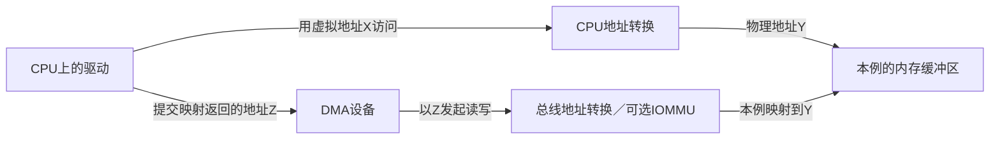
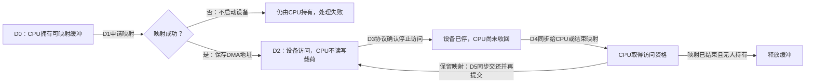
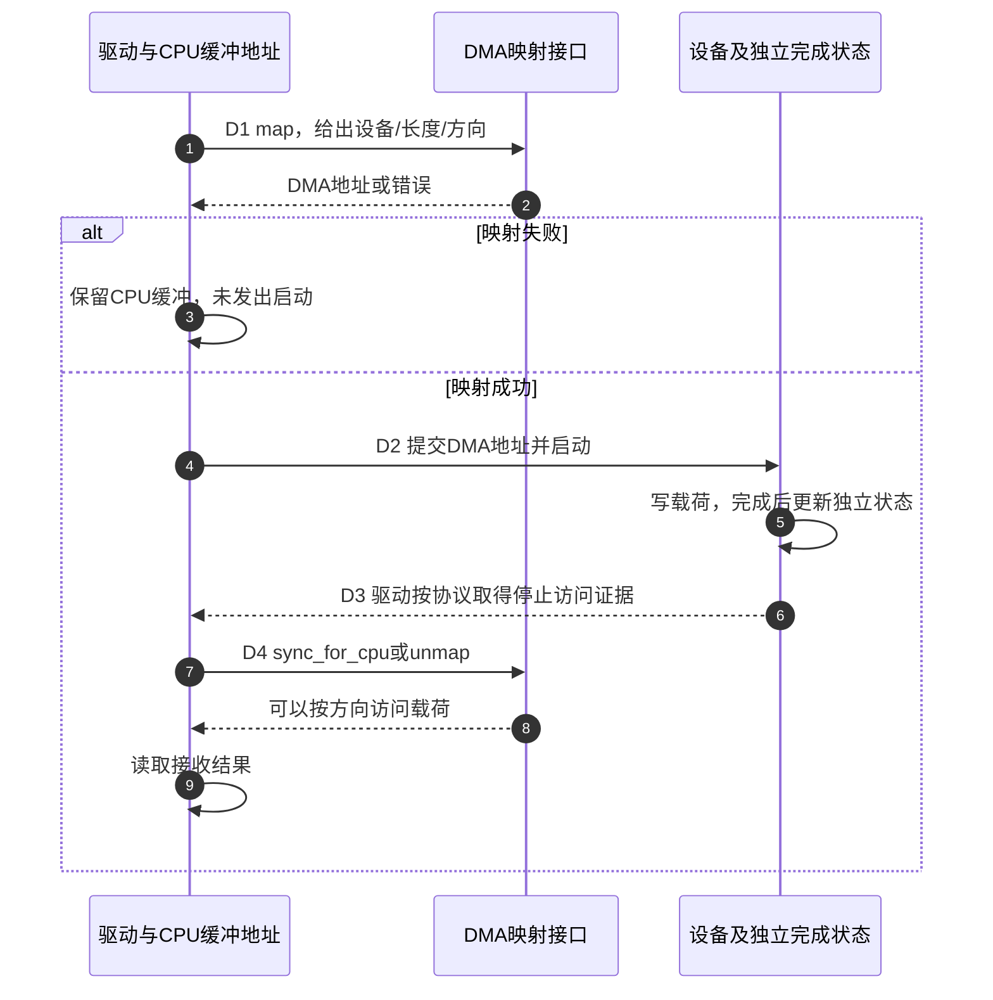

# 第1章\_DMA\_映射同步与门铃顺序

## 1.1\_DMA\_API\_同时解决四个问题

上一专题已经把写门铃、命令送达和设备完成分开。现在设备收到命令后要把一帧数据写进内存：它通过哪个地址找到缓冲区，CPU何时能读到结果，读取过程中设备会不会又覆盖它？直接内存访问（Direct Memory Access，DMA）让设备发起内存传输，减少CPU逐字搬运；代价是地址和访问资格不能再只按当前线程的指针推理。

本章先沿一次接收建立映射与所有权，再比较长期描述符和复用缓冲。MMIO负责寄存器命令，DMA负责设备访问内存，两者接口不同，完成证据仍由设备协议提供。

设备发起 DMA 时，驱动不能把 CPU 虚拟地址直接写给硬件。即使地址正确，也还要约定设备读还是写、当前轮到谁访问，以及平台怎样让接手者得到正确数据。因此，DMA API 同时承担下面四项职责；它们不是四个依次经过的硬件模块。

| 问题 | DMA API 的职责 |
| --- | --- |
| 设备地址 | 处理物理地址、总线偏移、IOMMU 映射和设备 DMA mask |
| 方向 | 表明设备读、写或双向访问缓冲区 |
| 所有权 | 规定 CPU 和设备在什么阶段可以访问 streaming 映射 |
| 缓存维护 | 在非一致性平台执行所需 clean/invalidate 等架构操作 |

DMA 是否经过或嗅探 CPU cache 取决于平台。驱动不猜微架构，也不手写 cache flush，而是遵守 DMA API 契约。

先在纸上写下三个地址：CPU用虚拟地址X访问缓冲，页表把X翻译为物理内存Y；设备使用映射接口返回的DMA地址Z，由总线或IOMMU把Z送到Y。简单平台上Y和Z的数值可能相等，但这种相等不是驱动可以依赖的通用契约。dma_addr_t是设备侧地址的载体，不是可以直接在CPU上解引用的指针；同一块内存给另一设备使用，也不能直接复用前一设备的映射。



图示选取设备直接访问原缓冲区的情况，重点是两条地址路径汇合到同一份数据，不是CPU的页表替设备完成翻译。映射层也可能借助中转缓冲解决设备寻址限制；这时设备实际访问的物理区与原缓冲不同，复制工作由DMA映射/同步实现处理。驱动仍使用返回的Z，并遵守同一交接契约，不能通过数值反推平台一定采用图中的直接路径。

地址图按固定Linux 6.12.20 [dma-api-howto.rst 的 CPU and DMA addresses](https://github.com/nxp-imx/linux-imx/blob/dfaf2136deb2af2e60b994421281ba42f1c087e0/Documentation/core-api/dma-api-howto.rst)重绘；中转情形见同版本[swiotlb说明的开头及Core Functionality](https://github.com/nxp-imx/linux-imx/blob/dfaf2136deb2af2e60b994421281ba42f1c087e0/Documentation/core-api/swiotlb.rst)。中转会增加复制和CPU开销，说明“使用DMA”也不等于整条路径绝无CPU搬运。

dma_map_single还不是“任意指针转DMA地址”的万能转换。缓冲必须来自适合该接口的内存；不能把栈变量或vmalloc返回的虚拟连续地址直接传入并假定物理连续。分散页应使用与其组织方式相符的页/SG接口。缓存行边界同样重要：如果设备和CPU分别修改同一缓存行内的不同对象，维护整行时仍可能互相覆盖，不能因为字段地址不同就判定它们独立。

## 1.2\_先设置设备寻址能力

DMA mask告诉映射层设备能够发出多少位地址，依据是硬件能力，不是本机CPU指针宽度。下面的36位只是示例：若设备只有32位地址寄存器，就不能照抄它；否则高位可能在编程硬件时丢失，使传输落到错误位置。

```c
ret = dma_set_mask_and_coherent(dev, DMA_BIT_MASK(36));
if (ret)
    return dev_err_probe(dev, ret, "DMA mask unsupported\n");
```

streaming 和 coherent mask 可以不同；设备若对两类地址宽度要求不同，应分别使用相应接口。mask 设置失败不能继续提交可能被截断的 DMA 地址。

## 1.3\_两类主要映射模型

沿一次接收区分两种需求：环形队列的描述符可能长期同时被CPU和设备观察，而数据缓冲往往在两者之间轮流移交。前者适合先考虑一致性分配，后者适合streaming映射；不是“一个高级、一个低级”，而是维护可见性与访问资格的方式不同。

| 模型 | 典型接口 | 生命周期 | CPU/设备交接 |
| --- | --- | --- | --- |
| 一致性分配 | `dma_alloc_coherent()` / `dmam_alloc_coherent()` | 通常较长，返回 CPU 地址和 DMA 地址 | 不需要 `dma_sync_*()`，仍需要内存顺序 |
| streaming 映射 | `dma_map_single/page/sg()` | 一次或一段 DMA 会话 | map/sync/unmap 明确转换所有权 |

一致性分配不等于“所有访问全序”，streaming 也不等于“一定每次真正 flush cache”。API 描述语义，平台选择实现。

## 1.4\_一致性分配

一致性分配一次给出两个结果：cpu供CPU读写，dma供设备访问同一分配区。下面ring保存这两个地址和分配长度；hw_desc表示设备手册规定的描述符布局。托管分配的便利在资源回收登记，不在自动停止硬件。

```c
struct my_ring {
    struct hw_desc *cpu;
    dma_addr_t dma;
    size_t bytes;
};

ring->cpu = dmam_alloc_coherent(dev, ring->bytes,
                                &ring->dma, GFP_KERNEL);
if (!ring->cpu)
    return -ENOMEM;
```

CPU 和设备不需要显式 sync 就能观察该分配区，但多个字段的发布仍需要顺序。假设设备会主动轮询描述符中的OWN位：CPU必须先写地址和长度，最后才允许设备接手；否则设备看见OWN时，地址字段可能尚未成为它可观察的新值。

```c
desc->addr = cpu_to_le64(buf_dma);
desc->len = cpu_to_le32(len);

/* 所有描述符字段先于“归设备所有”标志。 */
dma_wmb();
WRITE_ONCE(desc->flags, cpu_to_le32(DESC_OWN));
```

设备完成后，若它先写数据、最后写完成标志，CPU 观察完成标志后通常需要按协议使用 `dma_rmb()` 再消费此前字段。具体位置由描述符协议决定，不是给每个 DMA 缓冲机械添加屏障。

例如约定设备把结果写入同一一致性描述符的result字段，最后清除OWN，表示本轮不再改动结果。CPU的一次检查可以写成：

```c
/* 示意协议：OWN清零才允许CPU读取本轮结果。 */
if (!(le32_to_cpu(READ_ONCE(desc->flags)) & DESC_OWN)) {
    dma_rmb();
    result = le32_to_cpu(desc->result);
}
```

这里假定描述符已经提交且本轮完成尚未被消费，不是把刚初始化的OWN=0当成一次新完成。flags、result、addr和len都是示意描述符字段，宽度/端序按示例采用32位或64位小端；真实布局来自设备手册。`READ_ONCE`固定一次状态采样，`dma_rmb`约束取得完成后的数据读取；两者都不生成设备完成事件。若result保存的只是streaming载荷的索引或长度，随后读取该载荷仍要先走1.5节的CPU同步，不能拿描述符的一致性替载荷作证。

依据为固定Linux 6.12.20 [memory-barriers.txt 的 dma_rmb/dma_wmb 示例](https://github.com/nxp-imx/linux-imx/blob/dfaf2136deb2af2e60b994421281ba42f1c087e0/Documentation/memory-barriers.txt)。上面采用本章的字段名重新表达所有权协议，不冒充某块设备的寄存器布局。

## 1.5\_streaming\_映射的所有权状态机

streaming映射不是持续传输模式的名字，而是一类把已有缓冲区交给设备使用的映射接口。它常用于发送或接收数据。这里同时存在三组状态：映射是否有效、缓冲区当前允许谁访问、设备是否仍在执行。它们不能合成一个“已完成”布尔值；例如设备停下以后映射仍可有效，但CPU还没执行必要的同步。



这张图显示访问资格交接，不表示dma_sync能命令设备停下。设备正在写时调用sync或unmap，不会自动撤销尚未完成的总线请求；提前释放后，迟到的写可能落进已分给其他对象的内存。

| 阶段 | 驱动或设备修改的状态 | 后续允许动作 |
| --- | --- | --- |
| D0准备 | 驱动持有CPU地址buf，记录长度和方向 | 申请映射，尚无可提交的DMA地址 |
| D1映射 | DMA API返回dma_addr_t，驱动先检查失败 | 仅成功地址写入设备描述符或寄存器 |
| D2提交 | 驱动交出载荷访问资格，设备开始访问 | CPU只检查独立完成状态，不越权读写载荷 |
| D3完成 | 设备按协议发布完成，驱动确认不会继续访问本缓冲 | 可进入CPU同步或unmap，而非靠超时猜测完成 |
| D4收回 | 驱动对同一设备、地址、范围及方向执行同步或结束映射 | CPU按方向契约访问数据 |
| D5复用 | 保留映射时按协议重新交还资格并提交 | 重复D2；最终停机后仍需unmap |

buf属于CPU地址空间，dma是供该设备使用的DMA地址。完成证据可能在MMIO状态寄存器或独立的一致性描述符中，不能把“读取尚归设备所有的streaming载荷”本身当成轮询手段。驱动保存映射地址、长度、方向及提交状态，设备保存自己的执行状态；是否完成经设备协议传回，映射接口本身没有收到业务完成通知。

### 1.5.1\_一次映射一次传输

```c
dma_addr_t dma;

prepare_tx(buf, len);
dma = dma_map_single(dev, buf, len, DMA_TO_DEVICE);
if (dma_mapping_error(dev, dma))
    return -EIO;

program_device(dma, len);
writel(START, regs + COMMAND);

wait_for_device_completion(); /* 示意：必须确证停止访问，不是仅等待超时。 */
dma_unmap_single(dev, dma, len, DMA_TO_DEVICE);
```

这是发送路径示意，prepare_tx和program_device等表示设备驱动自己的操作，不是通用Linux函数。成功map后到合法收回之前，CPU不再访问载荷。wait_for_device_completion在这里假定已经取得可靠完成证据；若实际等待可能超时，失败分支必须先停止/复位设备并确认其不再访问，才能unmap。不能把上面直线片段复制成“无论等待结果如何都释放”的代码。

`regs + COMMAND`示意默认I/O映射上的32位命令寄存器，START是设备协议定义的启动值；本章不指定虚构的偏移或位号。这里仅借它表示提交时刻，实际寄存器的宽度、写入副作用与完成状态必须一起按设备文档替换。

### 1.5.2\_保留映射并循环复用

```c
/* D3已经确认设备不再写本缓冲，然后进入D4。 */
dma_sync_single_for_cpu(dev, dma, len, DMA_FROM_DEVICE);
consume_rx(buf, len); /* 本例只读取接收内容，不修改映射区。 */

/* D5：只修改映射区以外的驱动记账，按协议准备下一轮。 */
dma_sync_single_for_device(dev, dma, len, DMA_FROM_DEVICE);
ring_doorbell();
```

sync 不结束映射，只在 CPU 与设备之间转换所有权。最终不再使用时仍调用匹配的 unmap。

这里刻意不在buf里准备接收元数据：固定DMA文档明确要求CPU不写DMA_FROM_DEVICE映射区。如果算法需要CPU修改随后还交给设备使用的数据，应重新确定双向方向或另设CPU私有元数据，不能只在错误方向下多调用一次sync。固定howto的只读接收复用例还说明，无CPU写入时可不需要for_device同步；上面保留通用显式交还形式，不把一次同步调用的有无当成设备已经停止的证据。



做两个反例推演：如果D1失败却仍敲门铃，错误发生在地址资格而不是屏障数量；如果D3只有超时而没有停止证据，D4不能合法进行，因为设备仍可能写。再考虑D4同步以后保留映射：映射有效不等于设备随时可以重新访问，必须先完成约定的交还和下一轮提交。

本单元按NXP官方Linux 6.12.20固定版本的Documentation/core-api/dma-api-howto.rst核对，证据身份见[源码基线](../../../../research/source_reading/linux/SOURCE_BASELINE.md#1.130_DMA方向与完成前提)。这些片段没有在真实设备执行；设备停止、缓存效果与错误恢复仍需目标平台验证。

## 1.6\_方向参数

方向从设备视角命名：

| 方向 | 数据主要流向 | 典型场景 |
| --- | --- | --- |
| `DMA_TO_DEVICE` | CPU → 设备读取 | 发送缓冲、只读命令表 |
| `DMA_FROM_DEVICE` | 设备写入 → CPU | 接收缓冲、采集结果 |
| `DMA_BIDIRECTIONAL` | 双向 | 设备和 CPU 都会写，只有确实需要时使用 |
| `DMA_NONE` | 调试占位 | 不能用于真实 DMA 映射 |

map、sync 和 unmap 的方向必须一致。方向影响缓存维护；填错可能造成数据损坏，而不只是性能下降。

## 1.7\_scatterlist

一帧数据可能由几个不连续缓冲组成。如果先复制成大块连续内存，会增加CPU搬运及临时分配。散布/聚集（scatter-gather，SG）把原始各段列在scatterlist里，让映射层生成设备能访问的段；相邻片段有时可以合并，硬件边界又可能限制合并。因此驱动必须保留两套计数：原始输入的项数nents，以及返回给硬件的段数mapped。

设三个输入片段分别长1024、1024、512字节，映射层在适用条件下把前两个合并。CPU仍用原始三项描述映射资源，设备得到的却是2048和512两个传输段。用三次循环填写硬件会越过有效映射输出，用两项做unmap又把映射输入描述错了。这两个错误来自把不同职责的计数混在一起，不是边界检查里随便取最小值可以修好。

下面是设备相关的流程片段。hw_add_segment把一段记录到尚未提交的硬件描述符中，submit_and_wait已经包括检查完成/失败并在失败时停止设备的协议；它们不是通用内核API。硬件描述符容量应在提交前检查，未提交的失败路径可以直接解除成功建立的映射。

```c
int mapped, i, ret;
struct scatterlist *sg;

mapped = dma_map_sg(dev, sgl, nents, DMA_TO_DEVICE);
if (!mapped)
    return -EIO;

if (mapped > hw_capacity) {
    ret = -ENOSPC;
    goto out_unmap; /* 尚未提交，设备没有开始访问。 */
}
for_each_sg(sgl, sg, mapped, i)
    hw_add_segment(i, sg_dma_address(sg), sg_dma_len(sg));

ret = submit_and_wait(); /* 返回前必须确认设备不再访问这些段。 */
out_unmap:
dma_unmap_sg(dev, sgl, nents, DMA_TO_DEVICE);
return ret;
```

必须区分：

- `nents` 是传给 `dma_map_sg()` 的原始 SG 项数；
- 返回的 `mapped` 是合并后供设备编程的 DMA 段数；
- unmap 和 sync 接口按 DMA API 要求使用原始 `nents`，不能误传 `mapped`；
- 硬件描述符使用每个映射段的 `sg_dma_address()` 和 `sg_dma_len()`。

再问一个反例：如果dma_map_sg返回0，是否为了“成对”仍调用unmap？不应把失败当作成功建立的映射，错误路径直接返回。本例成功映射以后有容量失败和传输结束两条路径，两条都进入一次unmap；计数和方向沿原始输入保持不变。

### 1.7.1\_用C核对两套计数

下面固定一份“三项合并为两段”的教学输入，不实现Linux映射算法，也不宣称任何真实平台一定这样合并。程序分别检查设备段的总长度、解除映射时的输入身份；最后故意给错计数，要求检查器拒绝。

```c
#include <stdbool.h>
#include <stddef.h>
#include <stdio.h>

struct mapping_record {
    size_t original_count;
    size_t mapped_count;
    size_t dma_lengths[3];
};

static bool describe_hardware(const struct mapping_record *m,
                              size_t count, size_t *bytes)
{
    if (count != m->mapped_count)
        return false; /* 硬件只能消费映射层返回的有效段。 */
    *bytes = 0;
    for (size_t i = 0; i < count; ++i)
        *bytes += m->dma_lengths[i];
    return true;
}

static bool check_unmap(const struct mapping_record *m, size_t count)
{
    return count == m->original_count; /* 解除映射沿原输入身份。 */
}

int main(void)
{
    const size_t input_lengths[] = {1024, 1024, 512};
    const struct mapping_record m = {3, 2, {2048, 512, 0}};
    size_t original_bytes = 0, device_bytes = 0;
    for (size_t i = 0; i < m.original_count; ++i)
        original_bytes += input_lengths[i];
    if (!describe_hardware(&m, 2, &device_bytes) ||
        original_bytes != device_bytes || device_bytes != 2560 ||
        describe_hardware(&m, 3, &device_bytes) ||
        !check_unmap(&m, 3) || check_unmap(&m, 2)) {
        fputs("SG count contract failed\n", stderr);
        return 1; /* 检查失败不得继续打印成功，关闭断言也不能跳过检查。 */
    }
    puts("hardware=2 segments; unmap=3 entries; bytes=2560");
    return 0;
}
```

先预测：总字节数应为2560，硬件消费两段，解除映射用三项。将程序保存为sg_count_model.c，或取用[同源材料](../../../../labs/kernel/memory_ordering/materials/dma_sg_count_model.c)。以下在保存该文件的实验目录、具备C11编译器的终端执行：

```bash
# 当前目录：sg_count_model.c 所在目录。
cc -std=c11 -Wall -Wextra -Werror -O2 sg_count_model.c -o sg_count_model
```

命令把模型编译成可执行文件，警告视为错误；它不构建内核驱动，也不调用实际DMA API。编译成功后运行：

```bash
./sg_count_model
```

应打印 `hardware=2 segments; unmap=3 entries; bytes=2560` 并返回0。Windows原生编译器通常生成sg_count_model.exe，在PowerShell中使用 `./sg_count_model.exe`。返回1并打印错误意味着模型中的某项契约未满足；程序的判断不依赖assert或NDEBUG。

练习一，只把正确解除映射的检查从 `check_unmap(&m, 3)` 改成 `check_unmap(&m, 2)`，重新编译后应失败，因为解除映射仍须沿原始输入。练习二，把合并输出改为三段：需要同时改变mapped_count、dma_lengths、调用describe_hardware的正确计数以及预期输出；原来的“3是错误硬件计数”检查也要改成另一个错误值。original_count仍为3，总长度仍为2560。不能只改返回段数就认为整套测试输入仍相容。真实驱动不自行制造这份输出，而是读取dma_map_sg返回结果。

## 1.8\_DMA\_数据发布与\_MMIO\_门铃

“缓存所有权”“普通内存顺序”“MMIO 写”和“posted write 完成”是四件事：


不能建立一条脱离上下文的“所有门铃前必须 `wmb()`”规则：

- 一致性描述符用所有权位发布时，常由 `dma_wmb()` 排序字段和所有权位；
- streaming 缓冲先完成 map/sync 所有权交接；
- `writel()` 与 `writel_relaxed()` 对普通内存的排序语义不同，选择 relaxed 时必须明确由什么补足；
- `writel()` 返回不一定表示posted write已到设备，安全读回可在适用协议下确认送达；设备工作完成仍要另取证据。

图中特意把“仅门铃触发”和“先发布OWN”分开：前者在默认I/O映射下可由普通writel承担描述符写先于门铃的顺序；后者多出一条设备在看见OWN后就能读取字段的边，不能等到门铃才补。dma_rmb/dma_wmb本身不提供MMIO访问的排序保证，不能把图中的普通writel任意改成relaxed而继续声称所有边都已建立。

详细语义参见 [MMIO 访问顺序](../mmio/P01_MMIO_访问顺序与屏障.md)。

## 1.9\_IOMMU\_与一致性不是一回事

输入输出内存管理单元（I/O Memory Management Unit，IOMMU）位于设备到内存的访问路径上，负责设备地址翻译与权限；SMMU是相关体系结构中的系统内存管理实现名称。地址翻译服务（Address Translation Services，ATS）允许支持它的设备参与翻译请求或缓存，不能据此推断载荷缓存已经一致。这些是地址路径上的机制；CPU缓存是否与设备保持一致是另一条轴。

| 机制 | 主要职责 |
| --- | --- |
| IOMMU/SMMU | 把设备 DMA 地址翻译到内存并实施隔离、权限和域管理 |
| ATS | 允许设备缓存或请求地址翻译，减少翻译开销 |
| 一致性互联/架构映射 | 决定 CPU cache 与设备访问怎样保持一致 |

启用 IOMMU 不自动使 DMA cache coherent；硬件 coherent 也不取消 DMA 地址映射和方向契约。驱动始终通过 DMA API，不能把 CPU 物理地址直接交给设备。

## 1.10\_DMAengine\_边界

DMAengine 管理 DMA 控制器通道、描述符和提交回调，但客户端缓冲区的映射责任取决于具体 API 和子系统约定。不能笼统说“用了 DMAengine 就自动 map”，也不能无条件重复映射框架已经接管的缓冲区。

以slave SG路径为例，客户端在准备传输前建立映射，并使用dmaengine_get_dma_device(chan)得到的DMA设备，而不是凭直觉拿外设本身的struct device。之后sync也使用同一个DMA设备，映射保持到操作结束。不同设备可能有不同地址域和寻址限制，设备参数不是可忽略的记账信息。

使用前核对对应 DMAengine client 文档：谁建立映射、回调表示哪一级完成、terminate 是否同步、描述符和缓冲区何时可以释放。

固定版本区分terminate_async与terminate_sync：前者可能返回时硬件或正在执行的完成回调尚未停稳，释放相关内存前须dmaengine_synchronize；后者等待传输和正在执行的完成回调结束，但不能在原子上下文或完成回调自身调用。异步终止到同步之间又issue_pending，会破坏这个使用前提。不要把函数名里的terminate当成无条件可以free的许可。

这里还必须检查终止接口的返回值。固定版本的terminate_sync先请求异步终止；若底层返回错误，它直接返回该错误，不会执行后续synchronize。因此只有成功完成停机协议，才获得释放许可；失败时保留相关内存并进入设备规定的恢复路径，不能在通用示例中假定复位一定成功。异步终止后的synchronize也要求非原子上下文，且不能在本通道的完成回调里等待自身退出。

依据：[固定版本DMAengine客户端说明](https://github.com/nxp-imx/linux-imx/blob/dfaf2136deb2af2e60b994421281ba42f1c087e0/Documentation/driver-api/dmaengine/client.rst)的Further APIs，以及[同版本dmaengine.h](https://github.com/nxp-imx/linux-imx/blob/dfaf2136deb2af2e60b994421281ba42f1c087e0/include/linux/dmaengine.h)中terminate_sync的错误返回分支。

## 1.11\_停止与释放


`dma_unmap_*()` 只能在设备不再访问映射后调用。unmap 之后 DMA 地址失效，绝不能再把它写入门铃启动设备。

本章使用的dmam_alloc_coherent只托管该分配的最终释放，不会替驱动停止DMA、同步中断或阻止新提交。不能把这个结论扩大成“所有devm包装都只做free”；其他托管接口可能登记启停动作，必须按其具体契约判断。对本例而言，remove仍要先完成停机协议；unmap本身可承担结束streaming映射并收回CPU访问资格，无须为了图中分成两步而机械先做一次sync。

## 1.12\_常见错误

| 错误 | 后果 |
| --- | --- |
| 把 CPU 虚拟/物理地址直接给设备 | IOMMU、总线偏移或 mask 下地址错误 |
| 忽略 `dma_mapping_error()` | 用无效 DMA 地址启动设备 |
| 设备拥有 streaming 缓冲时 CPU 继续访问 | 数据竞争和缓存不一致 |
| unmap 后才写门铃 | 设备访问失效映射 |
| map/unmap/sync 方向不一致 | 错误缓存维护与数据损坏 |
| SG 用 mapped 数调用 unmap | 映射释放错误 |
| 把 coherent 理解成全序 | 描述符字段和所有权位观察顺序错误 |
| 把 `wmb()` 当 cache flush | 未完成 DMA 所有权转换 |
| 认为 IOMMU 等于 cache coherent | 混淆地址翻译与数据一致性 |
| 只依赖 dmam 自动释放 | 设备仍 DMA 时资源被回收 |

## 1.13\_核对表

回到一帧接收，先沿D0～D5复述：取得合适缓冲、成功映射、提交地址、确认设备停止访问、同步给CPU、读取并决定复用或结束。然后考虑三个变化：设备只能寻址低32位、SG映射合并成更少段、等待只得到超时。它们分别改变地址资格、硬件编程计数和停机证据，不能用同一条屏障回答。

- DMA mask 是否在分配和映射前正确设置？
- 缓冲区使用一致性分配还是 streaming 映射，原因是什么？
- 方向是否从设备视角正确填写并在所有 API 中保持一致？
- streaming 缓冲当前由 CPU 还是设备拥有？
- map 和 SG 返回值是否检查，原始 nents 与 mapped 段数是否区分？
- 门铃前的数据发布顺序由哪个 DMA/MMIO 原语建立？
- remove 是否先停止设备和回调，再 unmap/free？
