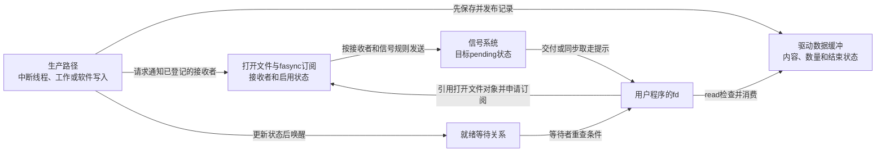
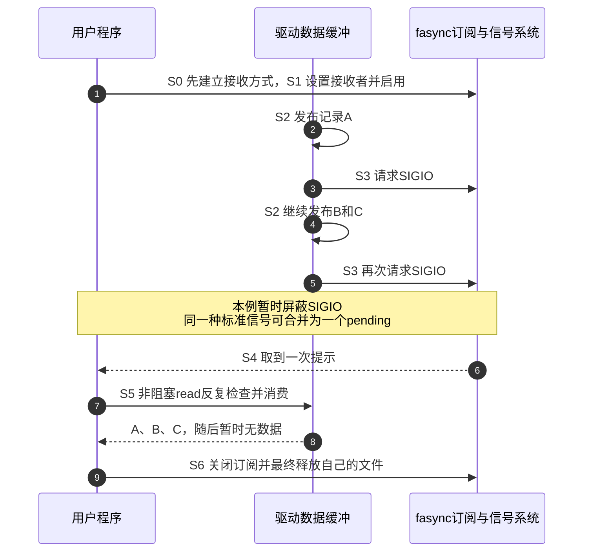

# 第1章\_异步通知全景与知识地图

设备已经有数据，驱动也把数据保存在缓冲区里，但用户程序正在做别的工作：怎样提醒它回来读取？这个问题比“怎样收中断”多了一层。硬件中断使内核取得处理机会，却不会直接把用户进程的 `read()`调用出来，更不会把数据自动交给应用。

本专题从这份“已保存、尚未读取”的数据出发，学习Linux文件异步通知 **fasync** 与常用的输入输出（Input/Output，I/O）信号 **SIGIO**。本章先建立通知与数据的分工，再用一个不需要外设的完整实验观察“写入三份数据，却只接收一次信号”。具体订阅结构和驱动实现稍后逐步进入。

## 1.1\_有数据以后程序可以怎样等它

假设一个采集程序每隔一段时间得到一份记录。最直接的办法是反复调用 `read()`检查有没有数据。如果打开时选择 **非阻塞（nonblocking）** 行为，暂时无数据时可以返回错误供应用决定下一步；应用可以继续其他工作，也可以反复检查。成本取决于检查频率与工作安排，不能把所有非阻塞I/O都称为忙等。

若程序此时没有别的工作，可以让一次 **阻塞（blocking）** 读取在条件不满足时睡眠，生产者更新状态后唤醒等待者。等待期间任务通常不持续占用CPU去查数据。因此“阻塞read也是轮询”并不准确。睡眠返回后仍要重新检查条件，因为可能有信号、设备退出或其他读者先取走数据。

再增加一个要求：同一线程同时照顾采集设备和网络连接，不能卡在其中一个read里。这时 `select()`、`poll()`、`epoll()`提供 **就绪等待**：用户集中等待一组文件是否具备读写等条件。名字中的poll不意味着用户必须用无休止的忙循环；带等待期限的调用可以睡眠，由内核的等待与唤醒路径推进。

最后考虑已有信号处理框架的程序，希望设备出现相关I/O条件时向指定接收者发送信号。fasync提供这种 **附加信号通知**。它不取代read，也不把设备变成异步数据搬运器；接到提示以后，程序仍需检查并读取数据。

现在已经建立四种行为，才可以在同一个场景中比较：

| 程序要解决的问题 | 使用路径 | 谁保存数据与判断结果 | 代价或边界 |
| --- | --- | --- | --- |
| 当前只想等这一路数据 | 阻塞read | 驱动保存数据，read检查并消费 | 该线程在等待期间不处理其他任务；错误和退出仍可能使等待结束 |
| 当前不能等，稍后再决定 | 非阻塞read | 同一数据状态，暂时不可读则返回 | 若立即无限重试，检查会消耗CPU；也可与事件循环组合 |
| 一次等待多个文件 | select/poll/epoll | 文件就绪状态，经等待机制通知 | 返回就绪不是预留数据，之后read仍可能遇到竞争 |
| 需要把I/O条件接入信号机制 | fasync + SIGIO | 数据仍在原缓冲，信号只提示再检查 | 增加接收者、信号屏蔽、合并和生命周期问题 |

没有哪一行天然“更高级”。对一个已经使用epoll的程序，直接把设备fd加入等待集合可能更合适；对确实需要I/O信号契约的应用，fasync提供另一条通路。为什么会保留这种设计、它改变了哪些约束，第三章再展开。

## 1.2\_订阅者与数据不能放进同一张想象中的队列

先不用内核字段，自己设计一次通知：驱动需要保存数据，也需要知道谁要求接收信号。数据缓冲记录“有什么可读”，订阅记录“该提醒哪些打开者”，信号系统记录“哪些通知仍待接收”。三者不能合并成一个 `ready`变量。

**文件描述符（file descriptor，fd）** 是进程内用来引用打开文件的整数；内核 **`struct file`对象** 表示一次打开形成的文件状态。两个不同整数可以通过dup等方式指向同一个打开文件对象，因此“每个fd必定有一份独立订阅”不是可靠模型。详细共享关系在第二章建立，这里只要记住整数入口与实际状态对象不同。

fasync通常把订阅关联到这个打开文件对象，再由该对象的接收者设置决定发给哪个进程、进程组或所选线程。订阅成功只说明通路建立，不保证马上有数据，也不保证对已经发生的所有事件补发一遍信号。



图1-1画的是状态与动作的关系，不是说信号绕过调度器直接调用用户函数。生产者更新数据以后可以同时唤醒read/poll等待者并请求SIGIO，两条通知都指向 **同一份可读取状态**，不应各自再维护一份互相不一致的“有数据”。

这些角色在Linux中有具体落点。先知道每个对象承担哪项责任，第四、五章再读其字段、锁和调用顺序：

| 已经推出的职责 | Linux中的对象或接口 | 不能替它完成的事情 |
| --- | --- | --- |
| 记录这次打开及其状态 | `struct file`、文件状态标志；用户使用O_ASYNC请求异步通知 | fd整数不是该对象的唯一拥有者 |
| 保存接收者和所选信号 | 与file关联的 `struct fown_struct`；由fcntl等接口设置 | 不是设备数据队列，也不是文件系统属主UID |
| 登记/撤销订阅 | `struct fasync_struct`链、`.fasync`回调、`fasync_helper()` | 不自动保存每个硬件事件，也不管理驱动全部对象寿命 |
| 请求发送I/O提示 | `kill_fasync()`及信号发送路径 | 名字中的kill不表示终止应用，但接收端未正确处理SIGIO仍可能被默认动作终止 |
| 等待可读或可写 | `wait_queue_head_t`、`.poll`及 `poll_wait()`等 | 唤醒或就绪不等于已经读到数据 |
| 保存和消费业务 | 驱动缓冲、read及应用协议 | 必须自己定义容量、丢失、并发和结束条件 |

这里的 **虚拟文件系统（Virtual File System，VFS）** 是Linux组织文件操作的公共层，它根据文件的操作表调用实际实现。并非所有能open的文件都支持fasync；一个设置标志的系统调用返回成功，也不足以单独证明事件发送链已经成立。实验选用Linux已实现这条路径的管道，避免先假设存在某个自制设备节点。

## 1.3\_为什么一次提示可以对应多份数据

设想程序暂时屏蔽SIGIO，生产者连续放入记录A、B、C。驱动每次更新后都请求通知，但 **标准信号不会把同一种待处理信号无限排成次数队列**：已有SIGIO待接收时，后续同类信号可能合并。解除或同步取走提示时，只看到一次SIGIO，并不证明只生产了一份数据。该语义见[Linux signal手册](https://man7.org/linux/man-pages/man7/signal.7.html)。

这不是“信号丢了，所以数据一定丢了”。A、B、C是否还在，取决于设备缓冲、容量和消费协议。也不能反过来说“缓冲在就绝不丢”：缓冲可能溢出，多个读者可能争抢，驱动也可能只保存最新值。要按数据协议核对，而不是数信号猜记录数。



图1-2给全书约定一个共同周期：S0准备、S1订阅、S2发布数据、S3请求通知、S4接收提示、S5读取、S6退出。这不是单一状态机：S2可能在S4以前发生多次，信号订阅与文件生命状态也可能在数据仍未读完时变化。后续并发章节会用这些阶段重建注册前已有数据、多个读取者和设备移除的交错。

如果程序每接一个SIGIO只读一条记录，然后就无条件等下一次信号，B与C可能一直留在缓冲里。对本例这样的流式非阻塞读取，应一直读到暂时不可读，再回到等待；也要分别处理文件结束（End Of File，EOF，即本例中read返回0）和真实错误。某次通知到来后read却暂时不可读，同样可能是其他读者先消费了数据，而非必然发生内核错误。

## 1.4\_不用外设验证通知次数与数据量的差别

**管道（pipe）** 是内核中的字节流：一端write写入，另一端read取走。本实验让一个单线程进程持有两端，连续写入三个单字节，再接收SIGIO并读取。没有并发生产者，不需要设备树、模块或root权限，因此可以把现象集中到信号合并与数据缓冲。

我们先屏蔽SIGIO，再用 `sigtimedwait()`同步取走它；屏蔽不是丢弃，信号可以保持待处理。这种方式不运行异步signal handler，避免在第一章就引入处理函数可重入性。SIGIO默认动作可能终止进程，不能先启用通知再慢慢准备接收。Linux管道读端O_ASYNC的支持见[pipe手册](https://man7.org/linux/man-pages/man7/pipe.7.html)。

程序中只需要几项设置，先说明它们的用途：

| 操作 | 本实验中的作用 |
| --- | --- |
| `sigemptyset()`、`sigaddset()`、`sigprocmask()` | 建立只含SIGIO的信号集合并在本线程阻塞交付 |
| `sigaction(SIGIO, ...)` | 在屏蔽之后恢复SIGIO默认处置，避免继承的忽略设置把通知直接丢弃 |
| `pipe()` | 创建本进程独占的读端和写端 |
| `fcntl(F_SETOWN, getpid())` | 把本进程设置为该打开文件的I/O信号接收者 |
| `F_GETFL`再`F_SETFL` | 保留原文件状态标志，同时加入O_NONBLOCK与O_ASYNC |
| `sigtimedwait()` | 等待并取走集合中的信号；超时返回错误EAGAIN，不是读取管道数据 |
| `read()`直到EAGAIN | 在写端仍打开时，把本轮已经保存在管道的字节全部读完 |

代码中的 `sigset_t` 保存信号集合；`SIG_BLOCK` 表示把集合中的信号加入屏蔽集合，`SIG_DFL` 表示默认处置。等待期限用 `struct timespec` 表示，`tv_sec` 是秒、`tv_nsec` 是纳秒。`errno` 保存失败原因：这里 `EAGAIN` 表示暂时无数据或等待超时，`EINTR` 表示调用被信号中断；读取遇到后者可以重新尝试。第二章会把这些返回结果放进完整的等待与退出过程。

将下面完整程序保存为 `sigio_pipe.c`。它只创建自身管道和自身信号状态；结束时关闭文件，进程退出。为了避免清理阶段尚有SIGIO触发默认动作，本程序直到退出都保持SIGIO屏蔽；这不是可直接嵌入长期进程的库函数，长期进程的退出协议在第九章另行建立。

```c
#define _GNU_SOURCE
#include <errno.h>
#include <fcntl.h>
#include <signal.h>
#include <stdio.h>
#include <unistd.h>

int main(void)
{
    int pipe_fd[2] = {-1, -1};
    int flags = -1, rc = 1, sig, total = 0;
    sigset_t set;
    struct sigaction action = {.sa_handler = SIG_DFL};
    struct timespec wait_time = {.tv_sec = 1, .tv_nsec = 0};
    struct timespec no_wait = {.tv_sec = 0, .tv_nsec = 0};
    const char data[] = "ABC";
    char buffer[16];
    ssize_t n;

    sigemptyset(&set);
    sigaddset(&set, SIGIO);
    if (sigprocmask(SIG_BLOCK, &set, NULL) < 0) {
        perror("sigprocmask");
        return 1;
    }
    /* SIGIO已屏蔽，再清除可能继承的忽略处置。 */
    sigemptyset(&action.sa_mask);
    if (sigaction(SIGIO, &action, NULL) < 0) {
        perror("sigaction");
        return 1;
    }
    if (pipe(pipe_fd) < 0) {
        perror("pipe");
        return 1;
    }
    flags = fcntl(pipe_fd[0], F_GETFL);
    if (flags < 0 || fcntl(pipe_fd[0], F_SETOWN, getpid()) < 0 ||
            fcntl(pipe_fd[0], F_SETFL, flags | O_NONBLOCK | O_ASYNC) < 0) {
        perror("fcntl setup");
        goto out;
    }
    for (int i = 0; i < 3; i++) {
        /* 写入量远小于空管道容量，三次写入都发生在接收信号以前。 */
        if (write(pipe_fd[1], &data[i], 1) != 1) {
            perror("write");
            goto out;
        }
    }
    sig = sigtimedwait(&set, NULL, &wait_time);
    if (sig != SIGIO) {
        if (sig < 0)
            perror("sigtimedwait");
        else
            fprintf(stderr, "unexpected signal: %d\n", sig);
        goto out;
    }
    /* 此时没有新写入，再次立即查询应没有第二份标准SIGIO。 */
    sig = sigtimedwait(&set, NULL, &no_wait);
    if (sig >= 0 || errno != EAGAIN) {
        fprintf(stderr, "unexpected second signal result\n");
        goto out;
    }
    for (;;) {
        n = read(pipe_fd[0], buffer, sizeof(buffer));
        if (n > 0) {
            total += (int)n;
            continue;
        }
        if (n < 0 && errno == EINTR)
            continue;
        if (n < 0 && errno == EAGAIN)
            break;
        fprintf(stderr, "unexpected read result: %zd\n", n);
        goto out;
    }
    printf("signals=1 bytes=%d\n", total);
    rc = total == 3 ? 0 : 1;
out:
    /* 先撤销本文件通知，再关闭两端；失败也保持信号屏蔽到进程退出。 */
    if (flags >= 0 && fcntl(pipe_fd[0], F_SETFL, flags) < 0) {
        perror("fcntl restore");
        rc = 1;
    }
    if (close(pipe_fd[1]) < 0)
        rc = 1;
    if (close(pipe_fd[0]) < 0)
        rc = 1;
    return rc;
}
```

在Linux实验目录编译并运行；本机没有编译器时，也可用与目标用户空间ABI匹配的交叉编译器构建后复制到目标运行。ABI指应用与系统之间的二进制接口，不能把Windows可执行文件直接拿到Linux运行。

```bash
# Linux实验目录；不加载模块，不接触真实设备。
cc -std=c11 -O2 -Wall -Wextra sigio_pipe.c -o sigio_pipe
./sigio_pipe
```

满足本例前提时，预期输出是 `signals=1 bytes=3`，退出码为0。三次write都发生在SIGIO被取走之前，所以标准信号可合并，而三个字节仍留在管道。管道是字节流，read可能合并多次write；这里比较的是字节总数，不宣称保留三条消息边界。系统调用失败时程序报告错误并退出，不能把未取得信号的运行解释成合并实验成功。

修改实验时，先把写入次数和预期总量一起改成2，仍保持“全部写完以后才收信号”，预测提示与字节数。再思考如果每次write之后立刻接收，会发生什么：由于之前的pending被取走，后一次可以形成新提示。因此本章结论是“待处理期间会合并”，不是“一个打开文件一生只收到一次SIGIO”。

## 1.5\_回到驱动时哪些责任仍然没有被通知机制解决

管道已经替我们实现了缓冲、订阅和关闭。自制设备不能因为调用了一个通知函数，就省掉这些责任。生产路径必须先把数据置于读者可见的稳定状态，再通知；read与poll要围绕同一状态判断；多个打开者之间是共享消费、广播副本还是独占访问，必须由设备协议说明。

**fasync不是异步I/O完成框架。** 它提示I/O相关条件；提交一笔读写请求、跟踪请求完成、保存结果和归还缓冲是另一组职责。**signalfd**则把待处理信号转成可读文件接口，便于接入事件循环；它不会撤销SIGIO已经发生的合并，也不会把设备内容放入信号记录。

标准子系统同样不是“复杂以后才用”。一个普通按键就可能应使用input事件接口，复用按键码、按下/释放及通用应用。网络状态消息可由相应Netlink协议表达，设备拓扑变化可使用uevent；这些选项规定了事件含义或消息格式，而read/poll/fasync规定等待和提示方式，比较轴不同。固定evdev实现本身就有 `.fasync`，说明“使用input”和“具备信号通知”并不互斥。

高吞吐流也不能只凭“低频适用、高频禁止”决定。若每次提示导致一次调度，却只消费极少数据，通知成本会放大；批量读取和明确缓冲协议可以改变这一过程。是否值得再引入信号通路，应结合已有事件循环、吞吐、延迟和丢失要求判断，第八、十二章再用同场景比较。

对象寿命还要独立证明。`devm_kzalloc()`管理的是绑定设备的资源释放，并不自动保证所有仍打开的file都已消失。用户关闭一个fd也未必是该file最后一个引用；设备remove、最终file释放和撤销订阅必须协调。不能让fasync链头随着硬件解绑被释放，却留下用户file和生产者继续访问它。

## 1.6\_固定源码身份而不是用版本大小猜兼容

本专题实现核对使用NXP官方Linux仓库的Linux 6.12.20固定提交 `dfaf2136deb2af2e60b994421281ba42f1c087e0`，本章的证据见[异步通知入口与管道实验核对](../../../../../research/source_reading/linux/SOURCE_BASELINE.md#1.194_fasync的订阅身份与标准信号合并)。用户ABI的依据另见[fcntl接收者与信号控制](https://man7.org/linux/man-pages/man2/F_GETOWN.2const.html)。不能因为 `uname -r`大于6.1就保证任意驱动代码都直接可用。

i.MX6ULL是ARM32平台实例，不代表ARMv8或多核；GPIO连线和控制器接入需要平台资料，但fasync的文件、订阅和信号关系并非该芯片独有。先做本章软件管道实验，再进入具体板级生产者，可以把通知协议与接线错误分开。真实模块还须匹配目标内核源码、配置、工具链与加载权限，不能只验证用户程序能编译。

调试时也沿状态走：先确认数据路径和read/poll，再检查订阅与owner设置，最后确认信号是否生成、阻塞、合并或已被其他线程接收。`strace`可查看用户系统调用结果，`/proc/PID/status`可提供信号状态线索，内核追踪用于定位实际生产和发送路径；每一种观察都只证明对应一段。第十一章将给有范围、有结束条件的采集过程。

## 1.7\_怎样沿问题继续读而不是先复制骨架

本章没有把省略锁、缓冲和释放的几行 `.fasync`包装成可用驱动。接下来先建立文件与信号基础，再逐步把抽象角色映射到真实代码；完整章节入口由[专题大纲](大纲.md)统一组织，现有正文到P13，没有独立P14。

| 阅读任务 | 建议路径 | 做到什么才继续 |
| --- | --- | --- |
| 从零理解并实现 | P01～P05 → P06完整软件设备 → P07硬件生产 → P09接收 → P10并发 | 先证明数据与通知分离，再增加硬件、线程和退出条件 |
| 已有驱动，开发用户程序 | P02文件/信号 → P09接收 → P11诊断 | 知道实际设备支持什么、共享file如何影响owner，能处理无数据和退出 |
| 维护或替换已有fasync代码 | P04～P05订阅生命周期 → P10竞态 → P11证据 → P12选择 → P13整合 | 重建订阅、生产、接收与最终释放，不能仅看kill_fasync被调用过 |

原型阶段先完成一条可解释的软件链；集成阶段再加入中断与设备生命周期；优化阶段用数据量、提示次数、丢失与CPU成本作对照。交叉编译与rootfs可以来自Buildroot、Yocto或其他工具链，但不能替代这些语义验证。

**练习：** 看到一次SIGIO和三条业务记录，能否判断丢了两次设备事件？复制fd以后，是否必定多一个独立订阅者？

**答案：** 都不能。标准信号可以合并，业务是否丢失要看缓冲与协议；不同fd可能引用同一个file，订阅与owner不能按整数数量猜。下一章就从这个共享身份开始，补齐阻塞、就绪与信号接收所需的基础。

下一篇：[P02 Linux IO 与信号机制基础](P02_Linux_IO_与信号机制基础.md)。
