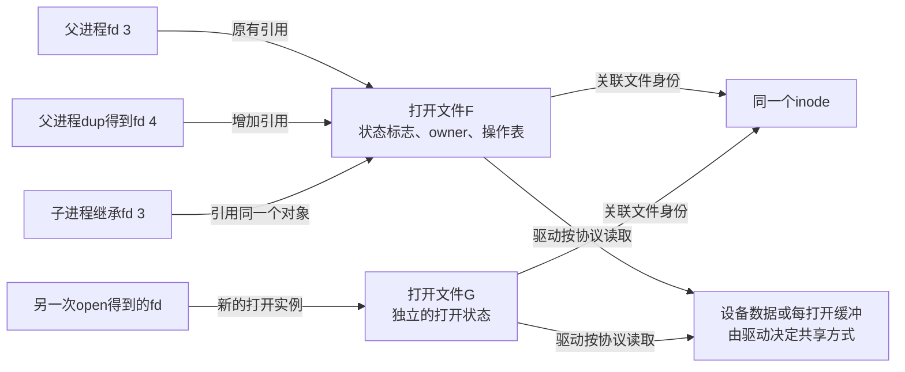
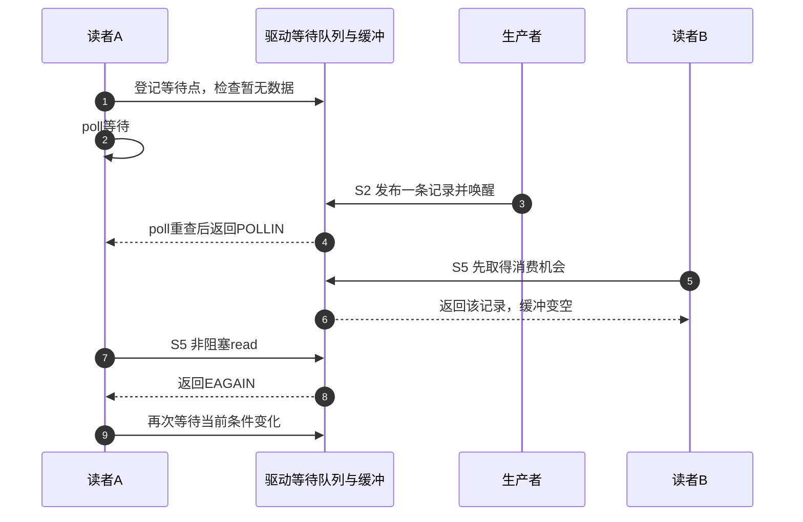
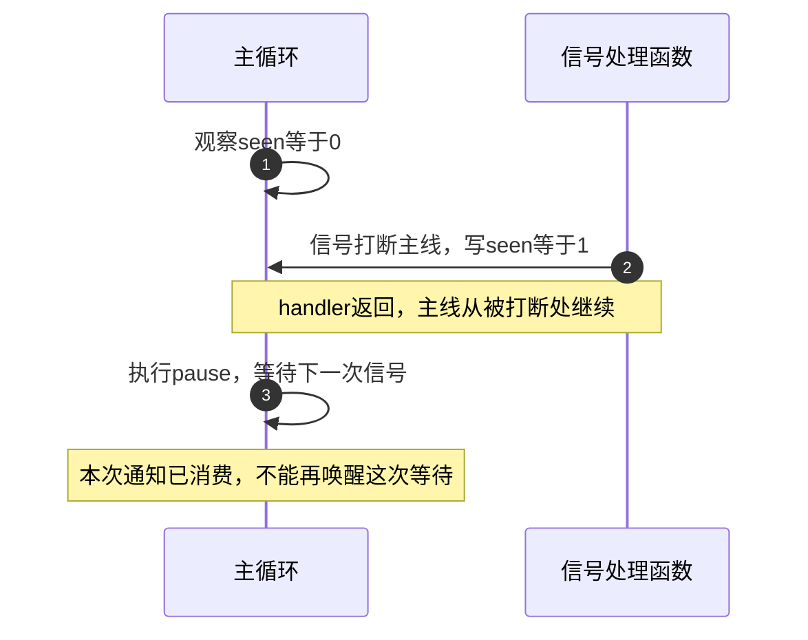

# 第2章\_Linux\_IO\_与信号机制基础

上一章用管道看到：三次写入可以只留下一个待接收SIGIO，数据仍要另外读取。现在把同一个读端复制成两个fd，让两个执行路径都能访问它，问题就多了起来：修改其中一个fd的非阻塞标志，会不会影响另一个？poll已经报告可读，为什么下一次read仍可能没有数据？信号被屏蔽和被忽略又有什么不同？

这几件事分别取决于 **打开文件的身份、设备当前状态和信号接收状态**。本章沿这三条线补齐基础，再把它们接回上一章的S0准备、S1订阅、S2发布、S3通知、S4接收、S5读取、S6退出周期。暂不编写驱动：先用内核已有管道观察契约，避免把尚未实现的 `/dev/demo_async` 当作实验前提。

## 2.1\_两个fd究竟共享什么

fd是进程用来查找打开文件的整数入口，整数本身不保存设备数据，也不保存整套订阅状态。调用 `dup(fd)` 复制入口后，新旧fd引用 **同一个打开文件对象**；`fork()` 创建子进程时，继承的fd同样引用原有对象。若对同一路径分别调用两次open，通常得到两个不同的打开文件对象，但它们仍可能访问同一份设备数据。

这里要区分三层：路径指向的文件身份、一次打开形成的状态、进程内引用它的入口。Linux用 **索引节点 `struct inode`** 表示文件的类型、权限、设备号等信息；这些属性可以变化，并非一份永远不变的“静态对象”。**`struct file`** 保存打开状态；进程的 **`files_struct`** 通过 **`fdtable`** 中的fd槽位引用它。线程可能共享描述符表，fork通常复制表并继续引用原来的file，不能把“表被复制”误解为“每份打开状态也复制”。



图2-1中的F、G是教学名称。F的三个整数入口共享文件状态标志，包括本章的 `O_NONBLOCK` 和后文的 `O_ASYNC`。后者在内核常称FASYNC。它们也共享与file关联的I/O信号接收者设置：父子进程轮流执行 `F_SETOWN`，不是各自增加一个接收者，而是在修改同一份设置。独立open可以形成独立订阅，但“是否每人得到一份数据”仍由驱动缓冲协议决定。

关闭其中一个入口，只减少相应引用；其他入口仍在时，不能按“这个fd已经close”推断 `.release` 已运行或fasync订阅已撤销。最终文件释放才进入对应释放过程，临时内核引用还可能推迟这一时刻。驱动的 `.release` 回调类型包含 `struct inode *` 和 `struct file *` 两个参数；它不是每一次close都执行的用户通知函数。

下面的表把容易混淆的状态放回所属层：

| 状态 | 保存在哪一层 | dup以后是否共享 | 操作入口 |
| --- | --- | --- | --- |
| 非阻塞、异步通知等文件状态标志 | 打开文件的 `f_flags` | 是 | `F_GETFL` / `F_SETFL` |
| I/O信号目标及所选信号 | 与file关联的 `fown_struct` | 是 | `F_SETOWN` 等fcntl命令 |
| 执行新程序时关闭此入口的标志 `FD_CLOEXEC` | 描述符表的对应槽位 | 各槽位独立；普通dup的新槽位清除此位 | `F_GETFD` / `F_SETFD` |
| 数据游标或设备私有上下文 | `f_pos`、`private_data`或设备对象 | 同一file的字段共享；设备协议另定 | read和驱动回调 |
| 已经产生的业务数据 | 文件/设备缓冲 | 不由fd数量决定 | 驱动的数据发布和消费协议 |

`F_GETFL`是查询文件状态，`F_GETFD`是查询描述符标志，名称相近却不能互换。`FD_CLOEXEC`作用于exec这类“执行新程序映像”的操作；它不等于非阻塞，也不决定信号屏蔽。用户接口依据见[dup手册](https://man7.org/linux/man-pages/man2/dup.2.html)。

再把一次字符设备open接回驱动：VFS先取得inode和通用入口，字符设备入口 `chrdev_open()` 再找到注册的字符设备对象 `cdev`、取得它的操作表并替换 `file->f_op`，然后调用实际 `.open`。因此不能把 `inode->i_fop` 无条件画成驱动最终操作表。**`struct file_operations`** 是回调集合；`.read`、`.poll`、`.fasync`等由它连接VFS与具体实现。驱动可以在 `.open` 为 `file->private_data` 绑定每打开上下文，也可以绑定共享设备对象，后续必须按这个选择管理寿命。

## 2.2\_先用管道观察共享标志与数据结束

只看对象图还不足以判断实际调用。下面做一个有限实验：创建管道，复制读端，通过副本设置非阻塞，验证原入口看到相同标志；随后关闭原入口，继续通过副本读取。写入三个字节并关闭唯一写端后，同时观察“有数据”和“写端已结束”。

先认识本实验的两个返回结构。`read()` 返回有符号字节数 `ssize_t`：正数表示实际读到的量，0在本例表示EOF，-1表示错误并设置 `errno`。`poll()` 接收 `struct pollfd` 数组，其中 `fd` 是入口，`events` 是希望观察的条件，`revents` 是内核返回的条件；超时参数单位为毫秒，0表示只检查当前状态。

实验用 `POLLIN` 表示输入可读，用 `POLLHUP` 表示管道写端已全部关闭，两种状态可以同时成立。空管道仍有写端时，非阻塞read用上一章的EAGAIN表示暂时不可读。先预测这三个结果，再运行下面的程序；更多事件掩码到2.4节集中对照。

把以下完整程序保存为 `pipe_identity.c`。这里没有另一个进程读写、没有异步handler，任何不符合预期的系统调用结果都会使实验失败并关闭已创建的入口。

```c
#define _GNU_SOURCE
#include <errno.h>
#include <fcntl.h>
#include <poll.h>
#include <stdio.h>
#include <unistd.h>

int main(void)
{
    int pipe_fd[2] = {-1, -1};
    int alias_fd = -1, flags, observed, rc = 1, close_result;
    struct pollfd watched;
    char buffer[3];
    ssize_t n;
    const char *stage = "pipe";

    if (pipe(pipe_fd) < 0)
        goto failed;
    stage = "dup";
    alias_fd = dup(pipe_fd[0]);
    if (alias_fd < 0)
        goto failed;
    stage = "set nonblocking";
    flags = fcntl(alias_fd, F_GETFL);
    if (flags < 0 || fcntl(alias_fd, F_SETFL, flags | O_NONBLOCK) < 0)
        goto failed;
    observed = fcntl(pipe_fd[0], F_GETFL);
    if (observed < 0 || !(observed & O_NONBLOCK))
        goto failed;
    puts("shared_nonblock=1");

    /* 关闭一个引用以后，副本仍持有打开文件。 */
    stage = "close original";
    close_result = close(pipe_fd[0]);
    pipe_fd[0] = -1;
    if (close_result < 0)
        goto failed;
    stage = "empty read";
    n = read(alias_fd, buffer, sizeof(buffer));
    if (n != -1 || errno != EAGAIN)
        goto failed;
    puts("empty=EAGAIN");

    stage = "write";
    if (write(pipe_fd[1], "ABC", 3) != 3)
        goto failed;
    stage = "close writer";
    close_result = close(pipe_fd[1]);
    pipe_fd[1] = -1;
    if (close_result < 0)
        goto failed;
    watched = (struct pollfd){.fd = alias_fd, .events = POLLIN};
    stage = "poll data and hangup";
    if (poll(&watched, 1, 0) != 1 ||
            (watched.revents & (POLLIN | POLLHUP)) != (POLLIN | POLLHUP))
        goto failed;
    puts("before_read=POLLIN|POLLHUP");

    stage = "read first two bytes";
    if (read(alias_fd, buffer, 2) != 2 || buffer[0] != 'A' || buffer[1] != 'B')
        goto failed;
    stage = "read remaining byte";
    if (read(alias_fd, buffer, sizeof(buffer)) != 1 || buffer[0] != 'C')
        goto failed;
    stage = "read EOF";
    if (read(alias_fd, buffer, sizeof(buffer)) != 0)
        goto failed;
    puts("reads=2,1,0");
    rc = 0;
    goto out;
failed:
    /* 有些失败是结果不符，errno未必有意义，因此输出失败阶段。 */
    fprintf(stderr, "experiment failed at: %s\n", stage);
out:
    if (alias_fd >= 0 && close(alias_fd) < 0)
        rc = 1;
    for (int i = 0; i < 2; i++)
        if (pipe_fd[i] >= 0 && close(pipe_fd[i]) < 0)
            rc = 1;
    return rc;
}
```

在Linux用户空间编译运行；不加载模块，不要求管理员权限：

```bash
# 当前Linux实验目录。
cc -std=c11 -O2 -Wall -Wextra pipe_identity.c -o pipe_identity
./pipe_identity
```

正常运行依次输出 `shared_nonblock=1`、`empty=EAGAIN`、`before_read=POLLIN|POLLHUP`、`reads=2,1,0`，退出码为0。第一项验证同一file的共享标志；第二项发生在写端仍存在、缓冲为空时；最后两项说明写端结束并不抹掉已经写入的字节。第一次只读取两个字节，第三个字节必须留下，不能因为一次read结束就把整个缓冲清空。

做一次修改：把关闭写端的步骤移到最后一次read以后。此时poll不应再要求POLLHUP，最终read也应从EOF改判EAGAIN，因为仍存在未来写入的可能。若只移动close却不修改判断，实验应失败；这正好检验读者是否理解“暂时没有”和“已经结束”的差别。实验只证明Linux管道契约，自制字符设备应明确自己的结束与错误语义。

## 2.3\_无数据时究竟应该睡眠还是返回

刚才空管道返回EAGAIN，是因为设置了O_NONBLOCK。如果没有这个标志，而且写端仍存在，同样的read可以睡眠等待生产者。睡眠使任务让出CPU，生产者更新缓冲后唤醒它；任务恢复执行后还要重新检查数据、结束和错误条件。

这个重新检查不能省略。假设读者A在等待，生产者放入一条记录并唤醒A，但读者B先运行并取走记录。A恢复时，唤醒确实发生过，数据却已没有。若只把“曾被唤醒”当作“现在有数据”，A就可能读空缓冲。正确的驱动必须把检查与消费放进同一同步协议，不能在锁外检查一个 `data_ready` 就直接复制。

| read所遇到的条件 | 本例的用户结果 | 应用下一步 |
| --- | --- | --- |
| 有可读数据 | 正字节数，可能小于请求量 | 按实际长度处理；流式排空可继续读取 |
| 暂无数据、仍可能继续，非阻塞 | -1，errno为EAGAIN；其他接口也可能用EWOULDBLOCK | 返回事件等待，不做无限立即重试 |
| 暂无数据、仍可能继续，阻塞 | 睡眠等待条件变化 | 返回后仍按实际结果分支 |
| 管道空且所有写端关闭 | 0，即EOF | 结束该输入流，避免反复读取0形成忙循环 |
| 等待被信号打断且未自动重启 | -1，errno为EINTR | 按停止策略决定退出还是重试 |
| 无效入口、设备错误等 | -1，其他errno | 按错误类型报告、恢复或退出 |

这里要求read的请求长度大于0；零长度请求返回0不能用来判断EOF。`O_NONBLOCK`也不表示系统调用绝不因任何原因延迟：它控制特定文件的I/O等待语义，不是给缺页、内部锁等所有执行步骤加上实时上限，普通磁盘文件也不能照搬管道的行为。

内核驱动常用 `wait_event_interruptible()` 等等待接口。它们可能返回 `-ERESTARTSYS` 这类 **内核内部重启结果**；用户程序通常面对的是系统调用重启或 `-1/errno=EINTR`，不应在用户代码中检查ERESTARTSYS。`SA_RESTART`是安装信号动作时影响部分系统调用重启的标志，不保证所有等待都自动重启；poll等调用仍需按自己的契约处理EINTR。

驱动还有两个常被骨架代码隐藏的责任：短读后保留未消费的数据，复制到用户地址失败时按协议处理已复制与未复制部分。`copy_to_user()`可能涉及缺页与睡眠，不能随意放在自旋锁保护的不可睡眠区间。具体缓冲和锁方案放到第六章，在这里用返回值与两读者交错先固定它必须满足的条件。

## 2.4\_poll为何需要登记等待而又不能保证下一次读取成功

现在要同时等待多个输入，单个阻塞read就不够了。poll先检查各文件的当前条件；没有符合条件的文件且允许等待时，把任务交给等待机制。设备状态变化后，唤醒路径使等待者重新检查。**就绪是某次观察的结果，不是给这个调用者预留的数据。**

对一个会从“无数据”变为“有数据”的驱动，`.poll`需要做两件事：通过 `poll_wait(file, &queue, table)` 登记可能改变条件的等待点，再观察并返回当前条件。这里的queue是驱动长期存在的等待队列，table带有登记回调；`poll_wait()` 本身不睡眠。当调用只检查当前状态或无须登记时，table可以没有登记动作，不能把每次poll_wait都画成一次任务入睡。

登记在前，是为了覆盖“检查完没数据、刚要登记时数据已经到来”的窗口。生产者先发布数据，再唤醒；如果事件早于登记，后续状态检查能看到它；如果事件晚于登记，等待路径能收到唤醒。驱动仍须用正确的锁和可见性协议读取状态，这个顺序不允许把数据访问本身写成竞态。共享等待队列应在所属对象发布前初始化，不能每次open都重新初始化已有读者正在使用的队列。



图2-2中poll与read没有矛盾，它们观察的是两个时刻。若没有其他消费路径而poll持续报告可读、read持续EAGAIN，才应继续检查条件是否过期或实现是否错误。SIGIO提示与稍后的poll结果也可能因同样原因不同，不能用两个不同时刻的值不相等直接判定映射错误。

对Linux实现，普通poll登记的等待项保存文件引用、队列地址、关注的事件和唤醒回调；回调设置本轮等待已触发并唤醒相应任务。epoll则把监视关系保存在长期存在的 **eventpoll对象** 中，用关注集合和就绪链组织重复等待。驱动队列里的项可能是epoll回调关系，并不都是“直接睡在设备队列上的用户任务”。epoll仍要检查实际状态，`epoll_wait()`不是简单不加判断地取出一串永远有效的fd。

已经知道共同机制以后，再比较接口成本：

| 接口 | 用户保存和提交什么 | 重复等待的主要工作 | 选择边界 |
| --- | --- | --- | --- |
| select | fd集合及最大fd边界 | 调用时提交集合并检查范围；集合会被结果修改 | 使用C库fd_set时受FD_SETSIZE范围限制，适合明确的小集合或已有接口约束 |
| poll | pollfd数组 | 每轮提交并扫描数组 | 少量文件、简单短期等待容易组织 |
| epoll | 先登记关注项，随后等待事件 | 维护持久关注关系，回调组织候选就绪项，再检查交付 | 大量长期监视且活跃比例较低时可减少重复扫描；登记、唤醒、锁和结果复制仍有成本 |

因此不能只记“epoll总是更快”，也不能把它称为普通poll的无成本包装。**水平触发**表示条件仍满足时可继续报告；epoll的 **边沿触发** 更依赖应用把当前可处理状态读尽，不能假设未读数据会自动带来下一次边沿。第九章再提供完整事件循环，不在此处复制一个缺少EOF与退出处理的无限循环骨架。

最后看条件掩码。它们是可以按位组合的标志，状态可能同时成立：

| 用户poll的revents位 | 含义及需要继续做的判断 |
| --- | --- |
| `POLLIN` / `POLLRDNORM` | 输入可读；仍以read实际返回为准，类型不同的文件可有不同细节 |
| `POLLOUT` / `POLLWRNORM` | 具有写入机会；不保证任意长度的写都不会等待 |
| `POLLPRI` | 文件协议定义的优先事件，不等同于普通字节数据 |
| `POLLERR` | 错误状态，查询相应文件或设备协议 |
| `POLLHUP` | 对端结束等挂断状态；可能与POLLIN并存，先前缓冲不一定为空 |
| `POLLNVAL` | 非负fd不是有效的打开描述符，普通poll核心可直接报告；不是驱动必须自行维护的设备状态 |

POLLERR、POLLHUP等返回条件并非都需要在events中显式请求。第二节已经用管道验证POLLIN与POLLHUP可以同时存在。详细用户契约见[poll手册](https://man7.org/linux/man-pages/man2/poll.2.html)。

## 2.5\_信号的目标\_屏蔽与动作为什么必须分开

poll等待者主动调用等待接口，SIGIO则先进入信号系统。要解释“发出过却未执行handler”，不能只寻找一个总开关：必须分别知道信号送往谁、是否待处理、接收线程是否屏蔽、交付时采用什么动作。

**信号动作（disposition）**由 `sigaction()` 设置，常规多线程进程内各线程共享：可以默认、忽略，或执行用户处理函数handler。**屏蔽集合（mask）**则按线程保存，决定哪些信号暂不按通常方式交付；待处理（pending）表示已经产生、尚未被取走。忽略与屏蔽是两件不同的事：SIG_IGN可以使通知被丢弃；屏蔽可以让信号保留pending，供稍后的同步接收使用。

**Linux SIGIO的默认动作是终止进程，SIGPOLL是它的同义名称。** 它们不是两个供驱动任选的独立通知通道。上一章先屏蔽SIGIO再准备接收，就是为了使默认动作不会在准备完成前生效。不能把SIGIO当成默认忽略的信号。[信号手册](https://man7.org/linux/man-pages/man7/signal.7.html)分别列出动作、屏蔽和待处理语义。

信号可以发给整个进程，也可以定向某个线程。发给进程的信号通常由某个符合接收条件的线程处理，不向每个线程广播一次。若想由专门线程同步接收，应在创建其他线程之前建立屏蔽约定，让后续线程继承，并使用 `pthread_sigmask()` 等多线程接口管理；只在接收线程屏蔽，而其他线程未屏蔽，仍可能在那里发生通常交付。

这几项状态在固定Linux实现中的地址关系如下。这里定位职责，完整锁与发送路径到第四章展开：

| 状态 | 内核承载对象 | 哪条路径修改或消费 |
| --- | --- | --- |
| 每线程屏蔽集合 | `task_struct.blocked` | 线程的信号屏蔽操作修改，接收判断读取 |
| 定向该线程的pending | `task_struct.pending` | 发送路径登记，交付或同步等待取走 |
| 进程共享pending | `signal_struct.shared_pending` | 进程定向发送登记，合适的接收路径取走 |
| 信号动作表 | `sighand_struct.action` | sigaction修改，通常交付路径读取 |
| 文件I/O通知目标 | file关联的 `fown_struct` | fcntl配置，fasync发送路径读取；不是上述pending本身 |

信号pending里除了种类集合还可能保存信号信息记录，不能把所有标准信号实现简单说成“只有一位，没有其他信息”。同一种标准信号在同一待处理集合中已经pending时不会按次数无限排队；实时信号具有排队能力，但受资源限制，具体fasync路径还存在回退。设备队列仍是记录业务的依据。

“同步信号”和“同步接收”也不能混成一个分类。同步异常信号可由当前线程执行出错指令产生；fasync的SIGIO通常是独立于接收线程当前指令的异步事件。但这个异步事件完全可以用 `sigtimedwait()` **同步接收**：调用者在普通控制流中等待并取走通知。signalfd则让线程通过read读取信号信息，还可接入poll/epoll；它不会把设备数据装入信号记录，也不是安装一个新的signal handler。

## 2.6\_把处理函数移到主循环以后仍要解决哪一个窗口

传统handler在用户态执行，但可能打断本线程正在进行的库函数。例如主线正在操作stdio内部状态时被打断，handler又调用printf，就可能遇到重入或锁问题。因此要遵守 **异步信号安全（async-signal-safe）** 的接口限制；“这个函数能在普通线程里用”不足以证明能在handler里用。

一种简化做法是handler只修改 `volatile sig_atomic_t` 标志，把实际工作留给主循环。这个类型适合受限的信号标志访问，并不让任意复合操作变为原子事务，也不自动提供跨线程数据同步。看下面的错误现场，它用于暴露窗口，不是可复制的完整接收程序：

```c
/* 错误现场：seen由handler置1。测试与pause并非不可分割。 */
if (!seen)
    pause();
```

若主线刚判断seen为0，信号到达并把seen置1，然后主线才调用pause，就可能等到另一个信号才继续。通知已经执行过，主线却刚开始睡。另一个窗口是主线准备清seen时又来一个通知，清零覆盖了新标记。只加volatile或固定sleep间隔，都不能把这些步骤变成正确的等待协议。



图2-3展示的是应用检查与睡眠之间的竞态，不是信号硬件传播延迟。传统handler方案可以在屏蔽目标信号时检查状态，再借助 `sigsuspend()` 原子地替换屏蔽集合并等待；同步等待方案则保持目标信号被屏蔽，用sigwait系列或signalfd取走它。第九章会分别给出接收、数据排空、停止和清理过程，不能把条件变量的普通用法直接搬进handler。

回到第一章的周期：S0先确定接收方式和屏蔽，S1再设置owner与启用订阅，并检查已经存在的数据。S4只证明取得提示，S5仍需读取当前状态。S6撤销订阅后，已经pending的信号不会因此神奇消失，关闭fd以后整数还可能被复用；退出协议要同时处理来源、pending与文件寿命。

## 2.7\_相似的POLL名字为什么不能共用一套数值

到这里已知道poll报告当前条件，fasync请求发信号。现在看一条驱动通知语句，理解其参数类型，暂不展开链表实现：

```c
/* 现场片段：数据已经按驱动协议发布后，请求输入事件通知。 */
kill_fasync(&dev->fasync_queue, SIGIO, POLL_IN);
```

第一参数是订阅链头的地址，链项按打开文件登记；第二参数用于这条发送接口的信号处理逻辑，通常写SIGIO，不能假定换成任意信号号就实现自定义发送；第三参数 `POLL_IN` 是 **事件原因码**。它和poll返回的 `POLLIN` **位掩码**不是同一种编码，拼写中的下划线具有实际意义。

固定实现用原因码索引 `band_table`，在带信息的发送路径中生成 `si_band`。因此不能把 `POLLIN | POLLRDNORM` 当作第三参数传入，也不能把读、写原因码按位或起来。下面把不同位置分开，便于检查代码：

| 驱动报告的原因 | kill_fasync第三参数 | 带信息路径产生的用户si_band掩码 |
| --- | --- | --- |
| 输入事件 | `POLL_IN` | `POLLIN \| POLLRDNORM` |
| 输出事件 | `POLL_OUT` | `POLLOUT \| POLLWRNORM \| POLLWRBAND` |
| 消息事件 | `POLL_MSG` | `POLLIN \| POLLRDNORM \| POLLMSG` |
| 错误事件 | `POLL_ERR` | `POLLERR` |
| 优先事件 | `POLL_PRI` | `POLLPRI \| POLLRDBAND` |
| 挂断事件 | `POLL_HUP` | `POLLHUP \| POLLERR` |

表中的RDNORM、WRNORM、RDBAND、WRBAND分别属于普通读写与带区读写事件名称，MSG是消息事件名称；是否存在这类业务由具体文件协议决定，本专题的简单管道只需要普通输入。表是固定内核映射，并不要求每个字符设备都实现六种事件。`.poll`在本版本返回内核类型 `__poll_t`；内核常用EPOLL前缀位常量，普通poll出口会转换为用户的POLL编码，别用裸整数绕过这种边界。

**安装SA_SIGINFO或使用signalfd，并不保证普通SIGIO自动携带有效的si_fd、si_band。** `F_SETSIG`是用户选择I/O信号及扩展信息路径的fcntl命令；默认普通SIGIO路径与带信息路径不同，扩展发送失败还可能回退普通SIGIO。`siginfo_t.si_signo`是信号号、`si_code`是来源/原因，`si_fd`是登记信息中的fd、`si_band`是映射后的条件位。signalfd使用自己的 `signalfd_siginfo` 字段，如 `ssi_signo`、`ssi_fd`、`ssi_band`，不能把两种结构字段写混。路由、信息有效性和fd复用在第四、九章继续展开，用户接口依据见[fcntl接收者与信号设置](https://man7.org/linux/man-pages/man2/F_GETOWN.2const.html)。

这也限定了调试方法：同一数据条件可以同时支持poll与SIGIO，但通知是历史上的一次请求，poll是当前观察；只有确认信息路径、来源和时间关系后，才能比较语义。打印“第三参数与revents数值不等”不能证明错误。

## 2.8\_把基础关系带回一次通知周期

现在能沿同一条路径检查问题了：fd先找到file，file上的设置确定是否登记及通知目标；生产者发布数据，再分别唤醒等待路径或请求信号；接收者最终仍用read决定实际消费和退出。每一步都有独立证据，不是只看一条kill_fasync日志。

| 看到的现象 | 先区分哪一层 | 观察的含义 |
| --- | --- | --- |
| 修改fd A以后fd B也变成非阻塞 | 是否通过dup/fork共享file | F_GETFL能观察共享标志，不证明独立订阅 |
| poll可读但read返回EAGAIN | 两次观察之间是否有其他消费者 | 就绪不是数据预留；持续异常才进一步查条件 |
| 生产路径调用过kill_fasync，应用没有handler日志 | owner、pending、屏蔽、忽略、接收方式 | 调用次数不等于交付次数；同步接收本来不执行handler |
| signalfd一直无数据 | 订阅/目标是否正确，信号是否被忽略或被别处消费 | signalfd要求屏蔽约定，不能建议先取消屏蔽试试 |
| 读完后CPU持续繁忙 | EOF、EAGAIN和错误是否正确退出或等待 | read返回0不能继续当作普通成功无限重试 |

`strace`帮助观察系统调用和信号交付；`/proc/PID/status`里的SigBlk、SigIgn、SigCgt分别提供屏蔽、忽略和捕获动作线索，SigPnd与ShdPnd分别指向线程及共享待处理集合。多线程诊断还要看对应线程，瞬时未见pending不证明从未产生。驱动日志可关联file和设备对象，但 `%p` 通常经过哈希，不能把日志值当成可解引用的真实地址；高频路径也不能无限打印。第十一章给出受控采集方法。

本章实现核对使用NXP官方Linux 6.12.20固定提交，文件、poll和信号状态的具体证据见[本章源码核对记录](../../../../../research/source_reading/linux/SOURCE_BASELINE.md#1.195_异步通知的文件共享与等待基础)。这份定位不表示本章已经展开整个VFS、epoll或信号子系统；这里建立的是后续fasync所需的共同契约。

**练习：** 父进程启用订阅后fork，子进程通过继承fd改变owner，再关闭这个fd。能否推出父进程的订阅已经撤销？若最后一个写端关闭且管道仍有两个字节，POLLHUP是否要求立即丢掉它们？

**答案：** 不能。父子引用同一file，owner修改作用于共享设置；关闭子进程入口不等于最终文件释放。挂断与缓冲数据可以并存，应先按读取协议消费，随后观察EOF。接下来可以问一个更具体的设计问题：既然等待队列和信号机制都存在，fasync为什么还需要独立的订阅连接层？

上一篇：[P01 异步通知全景与知识地图](P01_异步通知全景与知识地图.md)。
下一篇：[P03 fasync机制的历史与设计动机](P03_fasync_机制的历史与设计动机.md)。
