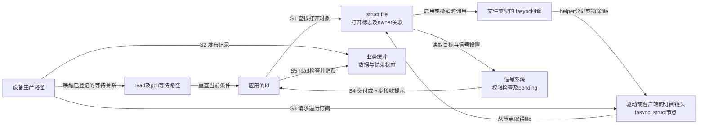
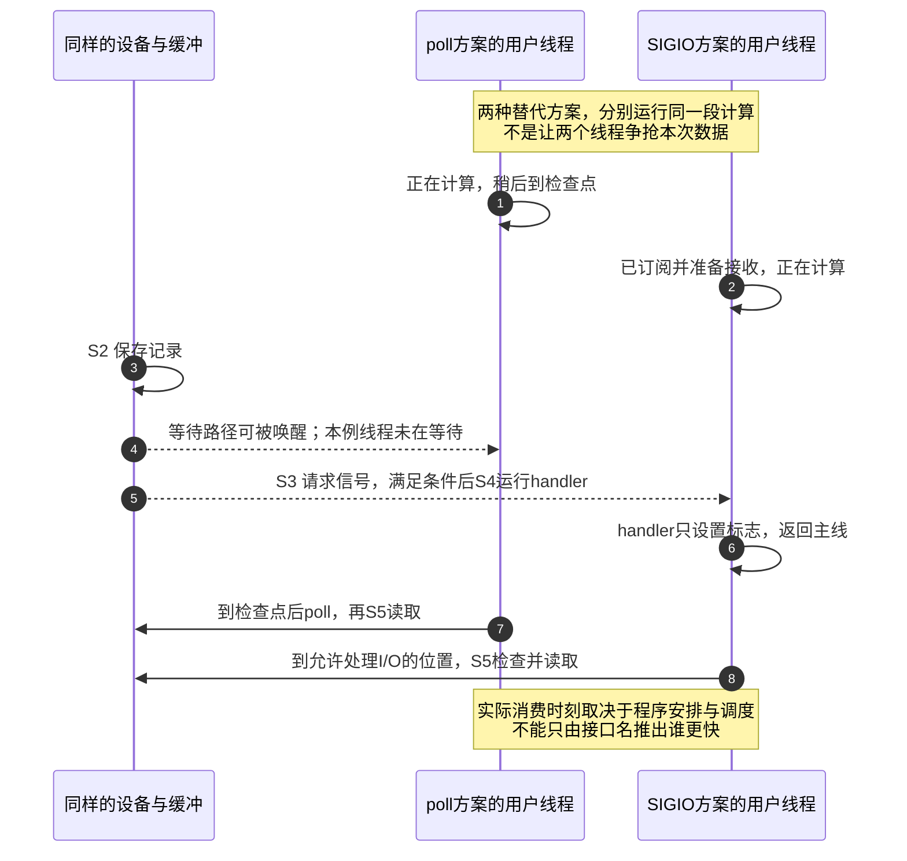

# 第3章\_fasync\_机制的历史与设计动机

上一章已经把文件、等待和信号分开：file保存打开状态，驱动保存可读数据，信号系统保存待接收提示。现在假设我们维护一个已有的采集程序，它约定用SIGIO获知输入，再通过read取走记录。驱动已经能保存数据、唤醒阻塞读者，却仍不知道哪些打开者要求SIGIO，也不能把每次open都当成一个永久有效的进程号。

缺的并非又一份数据缓冲，而是 **从打开文件的通知意愿连接到信号接收者的订阅关系**。本章先区分能够核对的历史事实与用于理解设计的推演，再逐步回答这层关系为何存在、由谁维护，以及它值不值得加入当前程序。

## 3.1\_已有的信号约定怎样留下文件通知接口

SIGIO并非Linux为了替代epoll而新造的机制。Linux信号手册把它的来源标为4.2BSD；BSD（Berkeley Software Distribution，伯克利软件发行版）是UNIX系统家族，4.2BSD是其中一个历史发行版本。这说明I/O信号有早于本书所用Linux版本的接口背景，不证明Linux内部 `fasync_helper()` 的首次提交时间。Linux管道的O_ASYNC支持则有另一条具体版本边界：手册记录它从Linux 2.6开始提供。依据分别见[signal手册](https://man7.org/linux/man-pages/man7/signal.7.html)和[pipe手册](https://man7.org/linux/man-pages/man7/pipe.7.html)。

这两点有实际用途：一个约定接收SIGIO的应用，需要文件实现支持对应通知协议；管道是否具备该能力，还要看所用系统的支持边界。不能把“信号已存在”推出为“所有文件从一开始都支持fasync”。第二章的文件操作表也解释了这一点：具体文件类型决定是否提供 `.fasync`。

由此看待现有代码更准确：fasync把文件订阅与既有信号通路连接起来。它与阻塞read、poll、epoll可以共存，不应画成“阻塞 → poll → 信号 → input”的单线升级史。阻塞和poll本来就有生产者主动唤醒；input定义的是输入事件业务，而不是等待方式的新一代。

后文的推演是从当前需求重建设计理由，不冒充某位内核作者当年的决策记录。我们要解释的是：在仍需提供I/O信号契约的条件下，哪些状态与步骤不可缺少。

## 3.2\_为什么只在设备中保存一个进程号不够

最朴素的做法是：应用打开设备时，把当前进程号记在设备对象里，数据到来后向它发信号。单进程短期实验也许能运行，但一旦增加另一个打开者，这个模型就开始丢失信息。

设A打开采集设备并要求通知，B随后打开同一设备但只使用poll。若设备只有一个“最近打开进程号”，B可能覆盖A，甚至让未订阅的B收到SIGIO。若把所有open都当订阅，程序就失去选择通知方式的能力；SIGIO默认动作还是终止，不能擅自替用户启用。

于是需要先把 **是否订阅** 从open动作中分离。打开取得数据访问入口，订阅表示该打开文件要求额外提示。再增加一个约束：A调用dup，或者fork后让子进程继续使用文件。第二章已经证明它们共享同一file，若按fd整数或“谁最后调用了read”识别订阅，就会错误创建重复项或改错接收者。

因此订阅身份应关联打开文件，发送目标另由该文件的owner配置确定。这里的owner是I/O信号接收者，既不是文件系统属主，也不是总能用生产者的 `current` 代替的“当前任务”。生产可能在中断线程、工作队列或另一进程写入路径发生，这些执行者不因此成为业务接收者。

最后加入退出：A关闭一个dup入口，不应立刻拆掉其他入口仍使用的订阅；最终文件释放以后，又不能继续沿悬空file发送。动态订阅表必须支持增加、撤销和发送并发，并与file的最终释放衔接。否则所谓“发信号很简单”只是把复杂性藏进了错误路径。

问题已经逐步推出了四项职责，才可以映射到Linux接口：

| 推演中缺少的职责 | Linux提供的连接点 | 仍需具体驱动负责的部分 |
| --- | --- | --- |
| 让打开者选择附加通知 | O_ASYNC与 `.fasync` 回调 | 该文件是否支持、订阅属于哪份设备或客户端状态 |
| 按打开文件登记或撤销 | `fasync_helper()` 维护 `fasync_struct` 链 | 链头所在对象必须有效，不能在仍可访问时释放 |
| 确定真正接收者 | file关联的owner设置、F_SETOWN等命令 | 应用定义进程/线程/进程组接收约定 |
| 事件发生时请求发送 | `kill_fasync()` 遍历订阅并进入信号路径 | 先发布可读状态，选对事件原因，协调停止与发送 |

`.fasync`只连接这层通知意愿，不生成驱动的数据协议。`fasync_helper()`也不会自动初始化read缓冲、保证复制成功或阻止硬件解绑。第四章将沿这些职责读取真实字段与锁，现在先把边界画完整。

## 3.3\_订阅连接层到底放在哪里

继续使用采集设备。其生产路径先把记录写入驱动缓冲，然后根据等待关系唤醒read/poll路径，根据fasync订阅请求信号。订阅链里指向file，file再提供接收者设置；不是“驱动设备直接永久指向某个用户线程”。

图3-1中箭头表示访问和动作，不表示所有对象互相持有永久强引用。尤其不能把fasync节点中的file指针想成“自动把整个设备留到永远”的引用计数协议。固定内核最终文件释放路径会在相关条件成立时撤销fasync，然后进入 `.release`；文件类型也可能在自身关闭、挂断等路径处理通知。第五章核对具体调用位置，第十章再处理设备退出与发送并发。

订阅链头放在哪一级，由文件类型的业务组织决定。一个共享设备可以集中保存多个打开文件的订阅；一个为每位打开者复制事件的子系统，也可以把链头放在各自客户端对象里。两者都可以调用同一helper，不能把“驱动里有一个全局链头”写成fasync的唯一架构。

这解释了为什么需要这一层，却也给出了它的边界：它连接 **已经建立的数据接口** 与 **已经建立的信号接口**。只要应用继续通过read取得数据，数据保存、通知、接收和消费就仍是四个不同动作。一次信号请求不承诺数据已经读走，更不承诺接收者已经执行完成。

## 3.4\_在相同时间线上比较等待与信号

现在给采集程序增加工作：每读完一批数据，它要做一段计算。比较两个版本，设备、缓冲容量和计算任务相同；一个版本在计算后的检查点调用poll，另一个版本已经订阅SIGIO并准备好handler。

如果记录在计算中途到达，poll版本的生产者仍会发布数据并唤醒已登记等待者；但本例当前线程正在计算，没有停在poll中，普通就绪等待不自动把它改成调用read。计算结束进入poll时，只要数据仍在，就能观察到可读。这里没有“必须不停查询才能不丢通知”的前提，持久的数据状态保存了事实。

SIGIO版本则可以在满足交付条件时运行handler，使线程在原定检查点以前获知提示。可这也没有替它完成业务：handler若只设置标志，主线依然要在允许处理I/O的位置检查；若handler直接执行复杂采集逻辑，又要面对异步信号安全和重入限制。**提前得到提示与提前完成业务，是两个不同的延迟。**

图3-2把两个替代程序放在一张图里比较，不表示一定发生图上所画的绝对时刻。SIGIO被屏蔽、线程暂不可调度、进程定向信号由别的线程接收等条件，都会改变交付；fasync不提供固定延迟或硬实时保证。

若程序本来就在epoll事件循环中等待设备，把设备直接加入该循环通常已能满足需求。再绕一次“设备 → SIGIO → signalfd → epoll → read”会增加信号目标、屏蔽和pending管理。**signalfd是实际的文件描述符接口**，适合统一已有信号来源，但它的桥接价值来自现存契约，不来自“现代”这个标签。它也不会恢复已合并的标准信号次数。

反过来，若现有上层接口明确只接受I/O信号提示，保留fasync就有具体理由。此时仍可用同步等待或signalfd管理接收，避免把所有业务写进handler。选择依据是程序已有的控制流与外部契约，不是单进程必用fasync、多进程必用epoll。

## 3.5\_信号合并以后成本为什么仍可能存在

第一章证明标准SIGIO可以合并，但合并发生在通知链的后段。假设一个教学设备有三个独立打开文件都订阅同一种输入事件，生产者每写入一条记录就调用一次kill_fasync。在这三项订阅稳定不变、每次都完整遍历的前提下，400条记录意味着400次发送入口和1200次链项访问机会。

即便接收者一直屏蔽SIGIO，最后只看到少量pending种类，前面的生产、链表遍历、目标查找和权限判断也不能因此视为没有执行。若多个file指向同一进程与同一信号，后端还可能再次合并；“用户只收一次”不是“内核只做一次工作”的证明。

现在改变的是通知策略，而不是业务记录：若设备协议允许把400条记录分成四个完整批次，先发布每批数据，再请求一次提示，发送入口可以降为四次，遍历机会为12次。但要同时说明代价：

- 第一条记录可能等到本批结束才触发提示，增加等待；
- 缓冲必须容纳尚未消费的数据，容量和溢出行为需要定义；
- 当记录数未达到批量阈值而生产停止时，不能把最后半批永远留住，需要结束刷新或有界期限；
- 多个读者、挂断和错误仍可能产生额外通知，不能把这份教学计数当作真实内核的固定总成本。

这才是“批量处理可能降低通知成本”的因果链。poll/epoll也能批量消费，fasync也不是只能一次信号读取一条；两者成本要在同一工作量、相同丢失与延迟要求下测量。没有测量就不能给出“超过某频率禁止fasync”或“epoll必定更快”的结论。

**纸面实验：** 将上述三个订阅者改为一个，将400条改为40条，并保持每10条一批。逐条通知需要40次入口、40次链项访问机会；分批通知需要4次入口、4次访问机会。再令接收者在每批间按已经准备好的接收方式取走SIGIO，实际接收次数可能增加，数据总量却没有改变。把“发布记录数、通知请求数、信号接收数、读取字节数”分别记在四列，就不会用一个计数冒充整条链。

如果业务要求每一条记录都可追溯，应该先在数据协议中保存序号、容量与丢失信息，再选择如何提示读取。切换为实时信号并不自动解决设备缓冲溢出，也不使接收队列无限大。第四章会核对扩展信号发送失败时的回退路径，第八章再讨论流式批量处理。

## 3.6\_实际实现如何证明它不属于某一类外设

前面推出的是通用连接关系。现在查固定Linux 6.12.20实现，看看不同业务怎样承载它，而不是先按“低频适合、高频不适合”给设备贴标签。

**TTY**的名称源于teletype（电传打字机），这里指Linux终端接口体系，串口可以通过它向应用提供终端语义；**socket**是网络等通信端点；**evdev**是input子系统向应用暴露事件的文件接口。管道则是前两章使用的内核字节流。它们的数据含义、缓冲和关闭方式不同，却可以复用文件异步通知连接层。

| 文件类型 | 固定源码中的订阅位置 | 能证明什么 | 不能据此推出什么 |
| --- | --- | --- | --- |
| TTY终端文件 | `tty_fasync()`进入内部处理，helper维护 `tty->fasync` | 终端实现接入文件通知，且有自己的锁与接收者处理 | 任意串口协议都适合在handler里解析，或所有终端的细节相同 |
| socket | `sock_fasync()`维护 `socket_wq.fasync_list`，`sock_wake_async()`按事件请求通知 | 网络通信端点也有此连接；数据/空间/紧急条件并非同一触发路径 | 网络吞吐由fasync这一项单独决定 |
| pipe | `pipe_fasync()`区分读写端通知链 | 不需要真实硬件也能验证文件与信号关系 | 管道字节流天然保留每次write的消息边界 |
| evdev客户端 | `evdev_fasync()`维护 `evdev_client.fasync` | 标准input业务与fasync能够共存，链头可按客户端放置 | input是取代fasync的下一代等待机制 |

evdev还给出一个具体批次边界：输入事件先进入客户端缓冲，到表示一组事件结束的 `SYN_REPORT` 同步报告时请求输入通知。这里的同步报告是input业务协议的一部分，不能照抄为所有采集设备的边界；它只帮助说明“保存每个事件”和“每个事件都单独发提示”并非同一要求。源码位置与原始字节记录见[本章实现核对](../../../../../research/source_reading/linux/SOURCE_BASELINE.md#1.196_fasync的文件类型与设计边界)。

因此设计一个普通按键接口时，应先判断是否属于标准input业务，复用其按键码和按下/释放语义；不能因为中断稀疏就绕开子系统自造SIGIO字符设备。反之，确实存在专用采集协议和现有SIGIO用户契约时，fasync也不因设备数据较多就自动失去作用。

Netlink用于内核与用户之间的消息协议，uevent用于设备等对象变化通知，异步I/O完成接口则围绕已提交请求及其结果组织状态。它们与fasync的“文件I/O条件提示”承担的任务不完全相同。第十二章在分别建立需求后比较，不把这些名称列成一条从落后到先进的排行榜。

## 3.7\_进入实现前先作一次有条件的选择

现在考虑三份具体需求。

第一份是一个已经用epoll管理串口、网络和退出事件的程序，设备也提供可靠poll语义。它需要的是把设备加入现有关注集合；增加fasync会多出一套通知状态，除非有额外接口要求，否则没有从当前问题推出这一步的必要。

第二份是维护一个明确以SIGIO为契约的既有程序。驱动应正确提供订阅、事件原因和关闭行为，用户端可以继续使用安全handler方案，也可以在不改变所需契约的前提下采用同步接收。这里学习fasync是为了兑现实际接口，而不是迁就某段未知历史。

第三份是每条事件都要留痕的采集系统。先要定义数据记录、丢失检测和恢复，再选择等待路径。信号合并能否接受，取决于它是否只承担“回来排空数据”的提示；如果应用把每个SIGIO当成一条不可丢事件，设计前提就已经错了。

| 选择前要回答的问题 | 对设计的影响 |
| --- | --- |
| 已有应用是否明确要求I/O信号？ | 有则需要兑现fasync契约；没有则先检查现有等待框架是否足够 |
| 接收者能否协调共享file与线程屏蔽？ | 不能只按fd数量推断owner，也不能只屏蔽一个无关线程 |
| 通知可以合并而数据仍完整吗？ | 必须由缓冲、排空、丢失与恢复协议支持 |
| 能否接受提示与处理之间的调度延迟？ | 不能把SIGIO当硬实时执行保证 |
| 退出时谁停止生产、撤销订阅并保留对象？ | 文件通知清理与设备寿命需要共同协议 |

这些问题也构成代码阅读和故障分析的入口：看到 `.fasync` 先找链头归属，看到kill_fasync先找数据发布和事件条件，看到close先判断是不是最终file释放。它们比背诵“fasync用于低频事件”更能解释真实代码。

**练习：** 一次open后dup得到十个fd，只在其中一个入口启用fasync，能否据此宣称有十个独立订阅者？若应用只收到一次SIGIO，能否证明生产路径只遍历过一次订阅链？

**答案：** 都不能。dup共享file，订阅身份不能由入口数推算；标准信号可在后端合并，之前的生产与遍历可能已经执行多次。下一章沿S1登记、S3发送和S6撤销，把刚才推出的角色落实到固定内核的结构、锁与调用路径。

上一篇：[P02 Linux IO与信号机制基础](P02_Linux_IO_与信号机制基础.md)。
下一篇：[P04 内核视角 核心数据结构与控制路径](P04_内核视角_核心数据结构与控制路径.md)。
