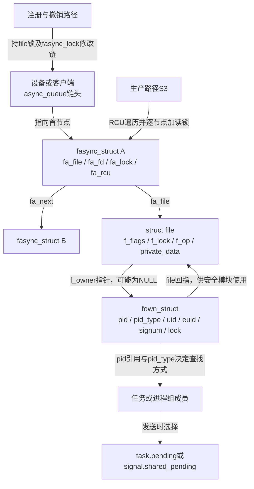
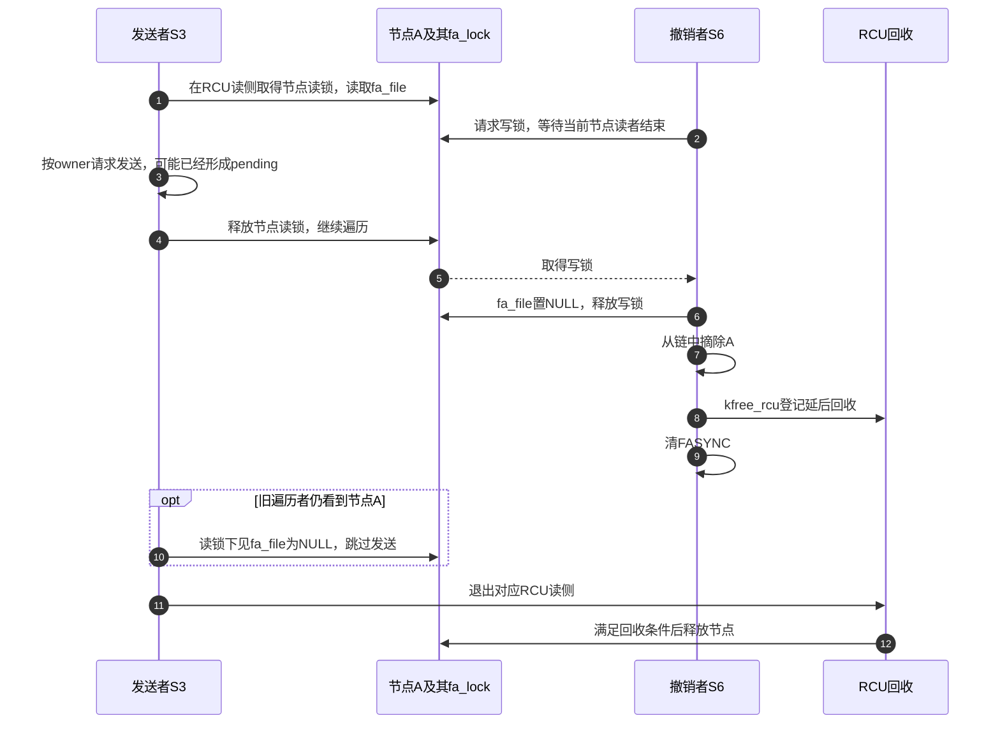
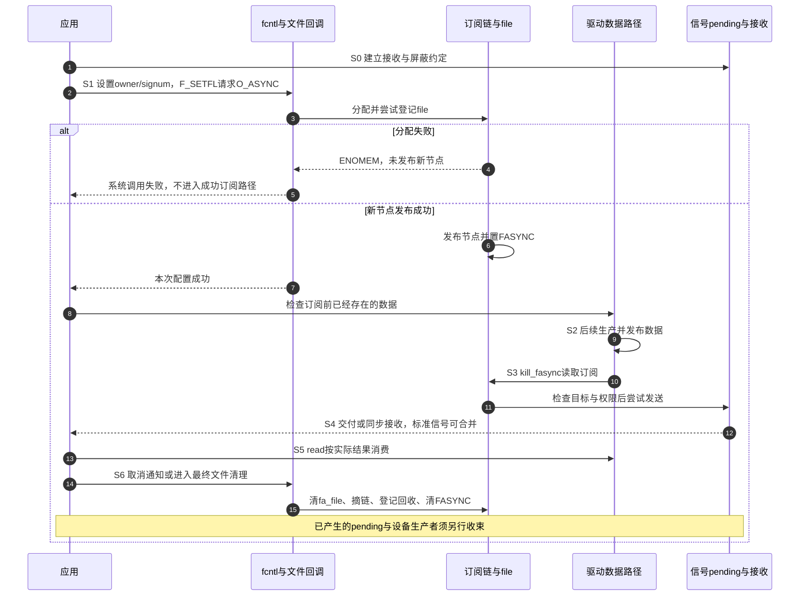

# 第4章\_内核视角\_核心数据结构与控制路径

上一章从多个打开者、共享file和退出约束推出了订阅连接层。现在沿同一个采集设备检查实现：应用先设置接收者并启用通知，生产者发布记录后请求SIGIO，应用读完并撤销订阅。如果启用时分配失败，FASYNC会不会已经变成1？发送者正沿链表访问，另一条路径又撤销这个file，怎样避免访问已释放对象？

本章固定到NXP官方Linux 6.12.20提交 `dfaf2136deb2af2e60b994421281ba42f1c087e0`，只使用这份实现解释字段与顺序。文件寿命的上游阅读入口见[字符设备源码阅读索引](../../../../../research/source_reading/character_device/navigation/P01_Linux_6.12_字符设备源码阅读索引.md#1.1_版本和阅读边界)，本章fasync专门证据见[源码核对记录](../../../../../research/source_reading/linux/SOURCE_BASELINE.md#1.197_fasync注册发送与撤销的固定实现)。下文代码均为注明路径的 **上游裁剪摘录，中文注释为本仓库补充**，用于解释局部实现，不是独立驱动或可单独编译的程序。

## 4.1\_先固定一轮周期中的状态地址

假设设备对象有一个名为 `async_queue` 的链头，file的 `private_data` 能找到这个设备。async_queue是本章选择的教学成员名，不是内核要求所有驱动使用的字段名；第三章的evdev客户端、管道读写端可以选择不同归属。无论链头放在哪里，链头所在对象都必须在注册、发送和撤销期间仍然有效。

我们要跟踪的不是一个布尔值，而是几组能独立变化的状态：业务缓冲是否有数据、file是否在订阅链中、owner指向谁、信号是否pending，以及file/设备是否仍活着。把第一章周期落到本版本，可以得到下面的分工：

| 阶段 | 触发与写入者 | 修改或读取的位置 | 本阶段结束意味着什么 |
| --- | --- | --- | --- |
| S0 准备 | 应用建立信号接收方式并打开文件 | 线程屏蔽集合、信号动作、fd到file的引用 | 接收路径准备好；还不表示订阅成立 |
| S1 配置与订阅 | fcntl进入owner设置、setfl和文件 `.fasync` | `file->f_owner`、`fown_struct`、订阅链及 `file->f_flags` | 本次配置成功；应用还要检查订阅前已存在的数据 |
| S2 发布 | 驱动生产者按自己的同步协议保存数据 | 设备或客户端的缓冲、数量、结束状态 | 读路径能够观察到稳定业务状态 |
| S3 请求发送 | kill_fasync沿订阅读取file及owner | `fa_file`、`fa_fd`、owner目标与信号设置 | 尝试向合适目标发送，不证明用户已经接收 |
| S4 接收 | 内核信号交付或用户同步等待 | 线程/共享pending、屏蔽和动作 | 提示被取走，不等于设备数据被取走 |
| S5 消费 | 应用read进入驱动 | 业务缓冲及消费位置 | 按read结果推进数据，可能仍有剩余或竞争 |
| S6 撤销与释放 | 显式取消，或最终文件清理 | 摘除对应订阅、清FASYNC、延后回收节点 | 撤销不删除已产生的pending，也不替设备停止生产 |

下面只画S1、S3、S6所需要的具体对象。发送者可能仍看着被摘除的节点，实现用 **RCU（Read-Copy Update，读—复制—更新）** 推迟节点回收，具体配合过程稍后展开。图中“指向”表示字段关系，不能自动推断每根箭头都增加引用计数。



图4-1还没说明这些锁为什么足够。接下来先建立owner，进入订阅，再沿发送与撤销交错逐步解释；不能因为看见RCU三个字就认为整个驱动的寿命问题都已解决。

## 4.2\_接收者为什么是独立分配的对象

应用先执行F_SETOWN，目的是说明“这个打开文件的I/O提示发给谁”。本版本的 `file->f_owner` 是 **`struct fown_struct *` 指针**，初始可以为空；不是把一个完整fown结构内嵌在每个file里。`file_f_owner()` 用 `READ_ONCE()` 读取该指针，`file_f_owner_allocate()` 在需要时分配并初始化。

分配还可能并发：两个调用者都看到空指针，都准备了新对象，最后通过 `cmpxchg()` 比较并交换来发布，只有一个对象成为file的owner，另一个未发布的分配被释放。这里 `READ_ONCE` 限定一次读取，`cmpxchg`完成条件更新；它们不表示后续所有owner字段都无需锁。

owner的读写锁允许多个受保护读者并行，修改时排除同一锁保护下的其他读写访问；它并不保护设备的数据缓冲。`include/linux/fs.h`中实际字段如下：

```c
struct fown_struct {
    struct file *file;       /* 回指所属打开文件，供安全模块使用。 */
    rwlock_t lock;           /* 保护目标及凭据字段的读写锁。 */
    struct pid *pid;         /* 引用内核PID对象，不是带正负号的整数。 */
    enum pid_type pid_type;  /* 区分线程、线程组或进程组目标。 */
    kuid_t uid, euid;        /* 设置owner时记录的用户身份。 */
    int signum;             /* 0走普通SIGIO路径，非0选择相应信号。 */
};
```

**PID（Process ID，进程标识）对象**在内核里承载目标身份与查找关系。用户给F_SETOWN的负数表示进程组，但进入内核后是“pid对象引用 + pid_type”的组合，不能把这份结构的pid字段写成负整数。`kuid_t`是内核用户身份类型；uid/euid分别记录设置者的真实与有效用户身份，用于后续发送权限判断。

`do_fcntl()`处理F_SETOWN时调用 `f_setown(filp, argi, 1)`。它解析正负目标，分配owner，查找PID对象，再经 `__f_setown()` 在owner写锁下替换目标、更新类型与凭据。最后的force值1表示覆盖既有目标；某些文件类型内部可使用不强制覆盖的调用，不能把两种调用混成一条固定规则。

| 用户请求 | 本版本的内部目标类型 | 实际含义 |
| --- | --- | --- |
| F_SETOWN正数 | `PIDTYPE_TGID` | 进程/线程组定向，实际接收线程仍由信号规则决定 |
| F_SETOWN负数 | `PIDTYPE_PGID` | 查找该进程组的目标成员，不是把负数存入pid指针 |
| F_SETOWN为0 | 空目标 | 清除发送目标；并不等于删除fasync节点 |
| F_SETOWN_EX的 `F_OWNER_TID` | `PIDTYPE_PID` | 定向指定线程 |
| F_SETOWN_EX的 `F_OWNER_PID` / `F_OWNER_PGRP` | `PIDTYPE_TGID` / `PIDTYPE_PGID` | 显式选择进程或进程组 |

TGID是线程组标识，PGID是进程组标识；进程组可以包含多个进程，与一个进程内的多个线程不是一回事。F_SETOWN_EX使用 `struct f_owner_ex` 的type和pid字段表达这个选择，错误的type返回EINVAL，找不到非零目标可返回ESRCH，分配失败可返回ENOMEM。用户态实际看到的是系统调用-1及对应errno。

F_SETSIG走本版本的 `f_owner_sig()`，先检查信号号并按需要分配owner，再设置signum。**只设置signum不创建有效接收目标，也不登记订阅。** 发送侧用READ_ONCE取得一次signum用于本次决定，但owner目标设置、信号设置和订阅启用不是一个不可分割的大事务。应用应协调共享file上的配置者，而不能让父子进程各自随意改动后期待独立效果。

## 4.3\_FASYNC是在回调以前还是以后被设置

现在owner已经准备好，应用用F_GETFL取得原标志，再以F_SETFL请求加入O_ASYNC。用户接口名称与内核FASYNC指向相应文件状态位，这里没有一份“用户开关”和另一份“驱动开关”需要逐级翻译。**请求的新标志还不等于已成功建立的订阅状态。**

`fs/fcntl.c`的 `setfl()`先完成适用的权限、标志和文件检查，然后进入下面的分支：

```c
/* 裁剪自setfl：回调负责落实FASYNC，尚未预先替它置位。 */
if (((arg ^ filp->f_flags) & FASYNC) && filp->f_op->fasync) {
    error = filp->f_op->fasync(fd, filp, (arg & FASYNC) != 0);
    if (error < 0)
        goto out;
    if (error > 0)
        error = 0;
}
```

异或找出发生变化的位，按位与只保留FASYNC：只有请求与当前状态不同、且文件确实提供回调时才调用。回调的on是请求结果，不是对“已经改完的file”发一封通知。负值直接结束；正值可表示helper确实改了链，setfl将它归为系统调用成功。

随后setfl用 `SETFL_MASK` 更新其他允许动态修改的状态位。**这个掩码不包含FASYNC**，因此它保留回调已经建立的FASYNC结果。通常回调调用helper，helper在插入/删除节点时同步维护此位。让驱动使用helper，是为了复用这份协议，不是因为“FASYNC只能由VFS事先修改”。

| 进入setfl时的条件 | 是否进入 `.fasync` | 请求完成后的解释 |
| --- | --- | --- |
| FASYNC请求与旧值相同 | 否 | 不是再订阅一次，也不会仅因换了dup入口就更新fa_fd |
| 位变化，存在回调，新增节点成功 | 是 | helper建立链项并置FASYNC，setfl返回成功 |
| 位变化，helper分配失败 | 是 | 返回负错误；这次新增未发布，也未由helper置FASYNC |
| 位变化，但没有回调 | 否 | 不能凭F_SETFL成功证明该文件支持通知；通用掩码不会替它创建订阅 |

这里的成功和失败表以使用标准helper的文件实现为前提；自定义回调还必须审查自身副作用和回滚。把O_ASYNC直接塞进open参数也不能代替这条已经核对的配置流程，第五章继续跟踪打开入口的实际处理。

`.fasync`的接口是 `int (*fasync)(int fd, struct file *file, int on)`：fd记录本次入口信息，file是订阅身份，on非零请求启用、零请求取消。回调先通过private_data找到正确的链头所属对象，再把四个参数交给helper。链头必须初始化为空并随所属对象一起管理；同类设备是否共享链头取决于业务，而不是“全局变量永远错误”或“每设备永远一条链”的语法规定。

## 4.4\_helper如何把一份订阅发布给发送者

需要保存多个打开文件，就要有可遍历的节点。`include/linux/fs.h`的实际定义使用 **读写锁 `rwlock_t`**，不能复制旧稿的spinlock_t布局：

```c
struct fasync_struct {
    rwlock_t fa_lock;              /* 保护本节点的file/fd交接。 */
    int magic;                    /* 节点身份检查值。 */
    int fa_fd;                    /* 带信息信号所使用的登记fd。 */
    struct fasync_struct *fa_next; /* 单向链的下一项。 */
    struct file *fa_file;          /* 订阅身份；撤销时先置NULL。 */
    struct rcu_head fa_rcu;        /* 延后释放节点所用的回收记录。 */
};
```

`fa_fd`并非只有日志用途，发送路径会用它构造信号信息中的fd。真正查找已有订阅时比较的是fa_file，所以dup不会自动生成新身份；fd后来关闭或复用，历史通知里记录的数字也不会自动变成当前正确入口。`FASYNC_MAGIC`是本版本的节点检查常量，不是锁、引用计数或防止释放后访问的证明。

在 `fs/fcntl.c` 中，`fasync_helper()`按on选择删除或新增。新增路径先调用 `fasync_alloc()` 从 `fasync_cache` 分配候选节点，使用GFP_KERNEL，允许睡眠；缓存由内核初始化路径建立。候选分配失败就返回ENOMEM，不会发布半个节点。

随后 `fasync_insert_entry()`先取file的f_lock，再取全局fasync_lock，遍历选定链头。若已存在相同file，在节点写锁下更新fa_fd，返回已有节点；新增路径据此释放 **尚未发布的候选节点**，返回0。注意0在这里不表示“一位状态都没变”，fa_fd可能已经改变。并且分配发生在查重以前，所以即使原来已有节点，调用新增helper也可能先遇到分配失败。

若没有已有项，初始化完成后才把新节点发布：

```c
/* 裁剪自fasync_insert_entry：此前已持file锁与全局链修改锁。 */
rwlock_init(&new->fa_lock);
new->magic = FASYNC_MAGIC;
new->fa_file = filp;
new->fa_fd = fd;
new->fa_next = *fapp;
rcu_assign_pointer(*fapp, new);
filp->f_flags |= FASYNC;
```

RCU在这里解决的是：发送者可能仍沿旧链访问，修改者不能把已发布节点当作无人使用的内存。`rcu_assign_pointer()`提供这条链所需的发布关系，发送侧用相应读侧访问；它不把设备的数据缓冲也纳入同一保护范围。

新增完成后helper返回1，已有项更新返回0，失败返回负错误。回调可以原样返回helper结果，因为setfl已经处理正值；若回调另有工作，则必须保留负错误，并核对它自己的回滚。不能规定所有回调只准写成同一行，TTY等文件类型还有自己的处理。

链和owner使用不同范围的锁，再由RCU承担节点的延后回收。把它们放在一起看，才能分清每种保护的边界：

| 同步对象 | 主要保护什么 | 哪条路径使用 |
| --- | --- | --- |
| `file->f_lock` | file状态与本次链修改的配对 | helper插入/删除先取得，setfl更新其他标志也使用 |
| 全局 `fasync_lock` | 多条fasync链的修改序列 | 插入、删除遍历与改链；不是每设备独立一把锁 |
| 节点 `fa_lock` | fa_file有效性和fa_fd读取/更新 | 更新/撤销取写锁，发送取读锁 |
| owner的 `lock` | 目标与凭据的修改和读取 | 配置取写锁，发送取读锁 |
| RCU读侧与延后回收 | 已被发送者看到的节点存储寿命 | 发送遍历与摘链后的节点回收配对 |

这解释了第三章的成本：发送不靠全局fasync_lock串行遍历，但逐节点仍有锁与目标处理；配置多条设备链也会使用公共修改锁。不能把“用了RCU”简化为整个机制无锁或没有跨执行者同步。

## 4.5\_发送怎样从节点走到pending

S2已经由驱动完成数据发布，S3才调用 `kill_fasync(&queue, SIGIO, POLL_IN)`。链为空是正常状态，不要求先存在订阅者才能调用。kill_fasync内部已有空链快速检查，驱动再加一个裸指针判断并不能解决寿命或并发问题。

进入非空路径后，kill_fasync在RCU读侧中调用 `kill_fasync_rcu()`。发送者检查节点magic，取得节点fa_lock读锁，再检查fa_file；有file时通过file_f_owner读取owner，owner为空则跳过。本版本这里必须使用指针访问，不能写成 `&file->f_owner` 得到“指针的地址”。

节点读锁使撤销者不能在发送者仍使用该file时先完成清空fa_file。发送者调用send_sigio以后释放节点锁，再沿fa_next前进；RCU使它走过的旧节点不会在其读侧尚未结束时被直接释放。**节点锁保护当前file交接，RCU保护遍历所需节点内存**，这两份责任不能互相替代。

进入 `send_sigio()` 后，先取owner读锁并读取pid和pid_type。没有目标则结束；线程/线程组目标通过PID对象找到任务，进程组目标在tasklist_lock保护下遍历组内任务，再逐个调用 `send_sigio_to_task()`。tasklist_lock保护任务关系，不是设备缓冲锁。

发送前的 `sigio_perm()`读取目标凭据：设置者记录的有效身份为内核全局root，或设置者uid/euid满足与目标真实/保存用户身份的匹配条件，还要通过 **Linux安全模块（Linux Security Modules，LSM）** 的检查。这里不是只比较一个当前进程号。目标已退出、权限不通过或没有owner，都可能使本次请求不形成应用可见信号；kill_fasync返回void，没有“全部接收者处理成功”的返回码。

通过权限以后，`send_sigio_to_task()`按本次读取的owner signum选择路径：

| owner设置与发送结果 | 本版本的动作 | 应用应据此作何判断 |
| --- | --- | --- |
| signum为0 | 请求普通SIGIO，不附带该扩展路径的fd/band信息 | 重新检查自己管理的文件，不能假定si_fd有效 |
| signum非0且带信息发送成功 | 构造信号号、来源原因、登记fd和映射后的band | 信息可辅助定位，但仍不是数据或永久fd身份 |
| 非0路径发送返回失败 | 回退普通SIGIO | 即使主要使用实时信号，也必须处理SIGIO回退 |
| 权限检查未通过 | 不继续该目标的发送 | 不能从“驱动调用过”推出pending已经出现 |

非0信号号不必然是实时信号；只有选中的信号本身具有实时排队语义，才能按那个契约理解排队，不能把F_SETSIG非0直接等同于无限队列。

第二章已区分原因码与位掩码。本版本使用reason索引band_table生成si_band，si_code通常携带原因，某些信号具有自己的专用si_code语义时改用SI_SIGIO消除歧义；si_fd来自节点fa_fd。越界原因会触发源码检查，所以不要把POLLIN组合掩码传进第三参数。驱动第二参数通常仍是SIGIO，实际所选信号来自owner；用于紧急数据通知的SIGURG另有跳过默认通知的特殊分支，不能把该参数当成任意信号发送器。

随后 `kernel/signal.c` 的发送路径根据目标类型选择 `task->pending` 或 `task->signal->shared_pending`，并在信号锁保护下更新。`legacy_queue()`发现同一种标准信号已经pending时可以合并；实时排队也会受分配与配额约束。至此只是进入S3产生提示的后段，S4何时接收、由哪个线程接收，还取决于第二章的屏蔽、动作与调度条件。

接口头文件注明kill_fasync可从中断调用；本章按未启用PREEMPT_RT实时抢占配置的普通执行模型理解其自旋型读写锁与RCU路径，不因此承诺不可屏蔽中断（Non-maskable Interrupt，NMI）安全或任意配置、任意调用方锁顺序都成立。注册新增可能睡眠，不能放进硬中断。进程上下文的调用者能否持mutex互斥锁，要看自身锁顺序和寿命协议，不能把“硬中断不能睡眠”误写成“所有kill_fasync附近都禁止mutex”。

## 4.6\_撤销为何先清file再摘链最后延后释放

现在发送者已经可能拿到节点A，应用请求关闭O_ASYNC。若撤销者直接从链上删除A并马上释放，发送者手里的A地址仍会被访问。若只推迟释放A，却让A继续指向马上销毁的file，也仍然不安全。这里需要同时切断file访问资格，并保留旧遍历者还会触碰的节点存储。

`fasync_remove_entry()`先取file的f_lock和全局fasync_lock，在链中按fa_file找到目标。它的关键步骤如下：

```c
/* 裁剪自fasync_remove_entry：fp指向当前链指针位置。 */
write_lock_irq(&fa->fa_lock);
fa->fa_file = NULL;
write_unlock_irq(&fa->fa_lock);

*fp = fa->fa_next;
kfree_rcu(fa, fa_rcu);
filp->f_flags &= ~FASYNC;
result = 1;
```

先取得节点写锁，意味着已持读锁的发送者先完成这一节点的访问；写入NULL以后，新进入的发送者即使还从旧链看到A，也会跳过file访问。接着摘链，新的遍历不再从该链位置取得A。`kfree_rcu()`安排在相应读侧结束后回收节点，不是当场释放；最后清FASYNC，使本次成功修改完成后的标志与链项存在关系一致。

若没有找到该file，helper返回0，不凭空删除别人的订阅，也不会为了“修复”任意错误状态而强行清位。正常调用方必须维持链项与标志的协议，不能手工先改FASYNC再指望helper猜出正确恢复。



图4-2证明的是节点/file交接，不保证撤销返回时应用没有pending：图中第一份发送可能已经发生，必须由用户退出协议处理。图里的旧遍历者可以是另一条并发发送路径；它已在摘链前取得A，所以仍需RCU和节点锁共同保护。

最后文件释放还有另一条入口。固定 `fs/file_table.c` 的 `__fput()`在FASYNC与回调条件成立时，先调用 `.fasync(-1, file, 0)`，再调用 `.release(inode, file)`，随后释放owner等资源。因此“VFS不会自动撤销，所有驱动若没在release重复调用就必定悬空”不符合这份实现。驱动仍须保证回调能定位有效链头，并审查其自定义关闭、挂断和设备移除路径；通用清理不会替它保住提前释放的private_data。

## 4.7\_把注册失败\_发送与退出放进同一条路径

前面已经分别解释地址与局部交接，现在复用S0～S6走完整一轮。应用准备好接收再配置owner和订阅；分配失败就停在S1，不应把设备已经就绪当成订阅成功。成功后应检查既有数据，避免依赖“注册一定补发过去事件”的假设。



图4-3中owner、链项、pending和数据各自推进。FASYNC位只是其中一项证据：它不能单独证明目标有效、权限通过、应用未忽略信号或业务数据存在。

为下一章的实际文件接入留下一个可以手工核对的状态实验。设F为同一个打开文件，fd3与fd4是它的两个入口，初始链为空，owner有效：

| 操作 | 应预测的结果 | 为什么 |
| --- | --- | --- |
| fd3通过F_SETFL启用且分配成功 | 一个节点，fa_file为F、fa_fd为3，FASYNC为1 | 新增成功才发布并置位 |
| fd4再次F_SETFL请求已置位的O_ASYNC | setfl不再调用该回调，fa_fd仍为3 | 相同标志不等于刷新登记入口 |
| 直接分析helper对已有F的启用调用 | 分配成功后更新fa_fd，返回0；也可能先分配失败 | 这是helper层语义，不是上一行必然执行的路径 |
| 关闭fd3，但fd4仍持有F | 不因此发生最终file释放 | 数字入口结束不等于打开对象结束 |
| 一次扩展通知仍报告登记fd3 | 不能直接把3当作当前有效数据入口 | 旧整数可能关闭或复用，仍需应用映射与状态检查 |
| fd4显式取消，随后生产者调用kill_fasync | 当前链无F，不再从它开始新发送 | 撤销前已经形成的pending仍可能接收 |

这组推演不需要修改真实内核，也不能用来证明实际硬件没有丢数据。若要改动实现，至少维护四项不变量：同一链按file匹配、成功修改后标志与订阅配对、节点撤销先切断file访问且延后回收、发送始终经过目标与权限规则。仅删一把看似多余的锁或把kfree_rcu改成直接释放，会改变已经推导过的并发保证。

诊断也按阶段选择证据：strace证明用户调用与返回，F_GETFL观察标志；回调和helper结果定位S1；生产与发送观察定位S2/S3；线程及共享pending、同步接收结果定位S4；实际read与数据序号定位S5。第十一章再给有范围和停止条件的采集步骤，不能为“看清”而在高频发送链无限打印。

**练习：** `.fasync`返回1是否一定让用户fcntl得到1？撤销已经完成、随后收到SIGIO是否一定证明仍有悬空节点？

**答案：** 都不是。setfl将回调正值归为成功0；已产生的pending可能在撤销后才被取走。需要把每个观察放回对应阶段，不能只按日志出现顺序推断数据结构是否仍存在。下一章继续检查open、fcntl、最终释放和不同文件类型怎样接入这些共同操作。

上一篇：[P03 fasync机制的历史与设计动机](P03_fasync_机制的历史与设计动机.md)。
下一篇：[P05 VFS与文件系统中的异步通知支持](P05_VFS_与文件系统中的异步通知支持.md)。
