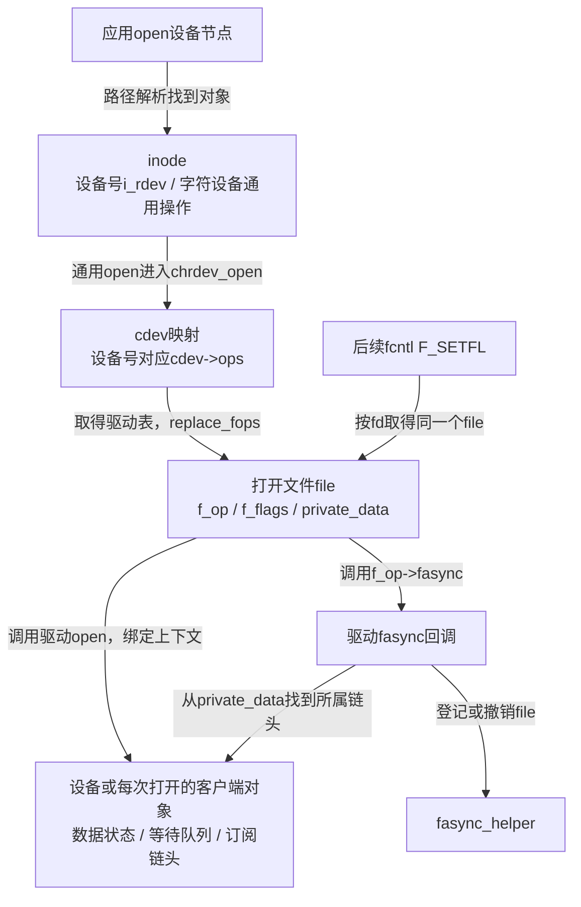
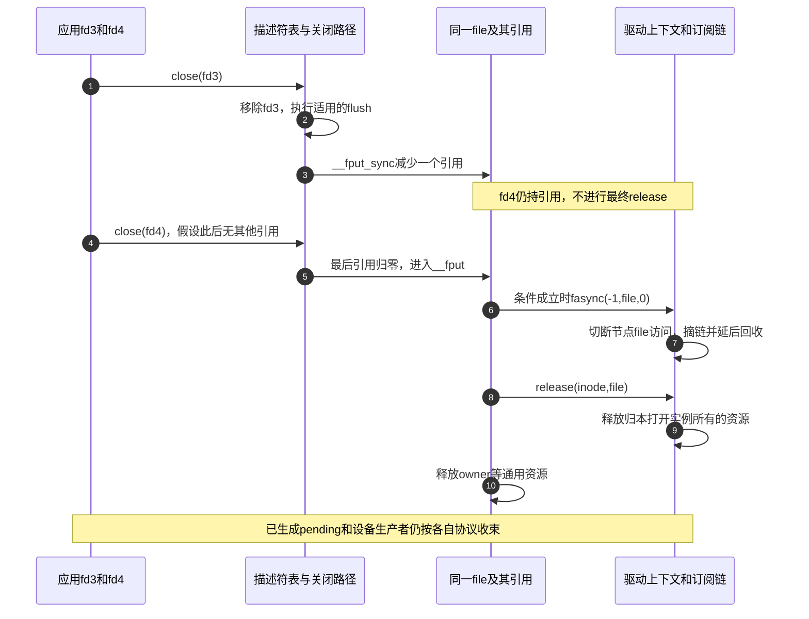

# 第5章\_VFS\_与文件系统中的异步通知支持

上一章说明了helper怎样建立订阅、发送者怎样找到owner、撤销怎样保护file和节点。现在还有一个入口问题：这些函数不会自己决定何时运行。应用打开一个设备，再用fcntl设置通知，究竟是谁把请求交给正确的回调？换成普通文件或管道，同样成功的系统调用为什么可能产生不同结果？

本章沿第二章已经建立的 **VFS（Virtual File System，虚拟文件系统）** 接口继续走，用统一的file连接不同实现。版本仍固定为NXP官方Linux 6.12.20提交 `dfaf2136deb2af2e60b994421281ba42f1c087e0`。源码阅读入口是[字符设备索引](../../../../../research/source_reading/character_device/navigation/P01_Linux_6.12_字符设备源码阅读索引.md#1.1_版本和阅读边界)，新增文件及核对范围见[本章证据记录](../../../../../research/source_reading/linux/SOURCE_BASELINE.md#1.198_VFS接入fasync的打开配置与最终释放)。先接通入口和退出，再比较各实现的差量；不重复第四章已经展开的helper内部锁代码。

## 5.1\_同一个fcntl为什么能找到不同设备

应用的fd先指向一个打开文件对象file。file的 `f_op` 指向一张 `struct file_operations` 操作表，其中的函数指针决定read、poll、fasync等请求交给谁。VFS提供通用调用规则，文件实现决定业务含义：采集设备检查记录队列，管道检查管道缓冲，终端还要考虑行处理状态。

以字符设备为例，不能把这条关系缩写成“inode中的操作表就是驱动表”。**inode是文件系统中的对象，cdev是字符设备号与驱动操作的连接对象**；设备节点的inode先使用字符设备通用入口，打开时再找到对应cdev。`fs/open.c` 的 `do_dentry_open()`取得 `inode->i_fop`；接着 `fs/char_dev.c` 的 `chrdev_open()`找到cdev，从 `cdev->ops` 取得操作表，用 `replace_fops()`替换file的表，最后才调用实际驱动的open。



图5-1中替换的是file上的操作表引用，不是把驱动函数复制成另一份代码。驱动open常用 `private_data` 保存设备或客户端指针，让后续回调不用从全局变量猜测“当前访问哪个设备”。这份指针不自动拥有所指对象的寿命，后文关闭与移除还要检查它是否有效。

字符设备的装配因此有几个不同动作：分配设备号；用 `cdev_init()`把cdev与驱动表关联；用 `cdev_add()`让设备号能够找到它；通过设备模型及相应用户环境提供可打开的节点。填上 `.fasync` 只是提供回调，既不替代设备注册，也不等于给所有打开文件立即登记订阅。具体完整初始化和失败回滚放在第六章。

管道通过pipe创建，socket通过socket系统调用创建，也会得到可由fd访问的file及各自操作表；不能要求它们全部先走路径解析和字符设备的chrdev_open。**相同的是后续file接口，不是所有创建入口。**

## 5.2\_为什么打开文件以后还要单独启用通知

打开阶段需要先建立可供回调使用的file、操作表和私有上下文。此时还没有完成应用的接收方式、owner、所选信号和订阅配置。把这些步骤分开，应用才能先准备接收，再允许事件进入通知路径。

在固定源码中，`build_open_how()`及 `build_open_flags()`检查打开参数，`fs/namei.c` 的 `path_openat()`用已经整理的open_flag分配file；分配初始化将flags放进 `f_flags`。随后才执行文件实现的open。对普通字符设备通用打开路径，VFS没有顺便调用fasync来建立订阅。

这里存在一个容易误判的细节：`include/linux/fcntl.h` 的有效打开标志包含FASYNC，通用路径并非简单丢弃这个位。若直接给open传O_ASYNC，**看见位值不能证明已经登记节点**。更糟的是，后面只是再把同一个位按位或进去，setfl可能发现它已经为1而不调用回调。Linux用户接口文档也明确要求用fcntl启用信号驱动I/O，不能依靠open的O_ASYNC参数完成它。[open(2)，BUGS](https://man7.org/linux/man-pages/man2/open.2.html)

因此本专题完整示例始终从不含O_ASYNC的正常打开开始，准备接收、设置owner，再F_GETFL取得当前标志并F_SETFL加入O_ASYNC。分析继承或共享的既有fd时，不能擅自关闭再开启别人的订阅来“刷新”；先明确由谁拥有配置权。特别实现可以有自己的打开行为，必须检查该实现，不能拿它反推通用VFS会自动登记。

| 动作 | 已建立的关系 | 仍没有由该动作保证的事情 |
| --- | --- | --- |
| 打开成功 | fd引用有效file，实际操作表和打开上下文成立 | 接收者配置、订阅节点、业务事件已经产生 |
| F_SETOWN成功 | 为这个file设置发送目标 | 目标永远存活、发送权限永远通过、节点已登记 |
| F_SETSIG成功 | 设置owner的信号选择 | 自动设置owner目标、信号永远排队成功 |
| F_SETFL启用且实现正确完成回调 | 相应file进入该实现订阅关系 | 未来一定有事件、用户已经接收或消费 |

如果驱动open自己失败，应清理由它已经取得而通用层不知道的资源；不能假定失败后一定进入该驱动的release来完成一切。正常打开的最终release与打开失败回滚属于不同路径。

## 5.3\_成功返回为何还不是支持能力的证明

现在沿S1看一次真正的启用。setfl先进行通用检查，再比较请求与当前FASYNC；位变化且存在 `.fasync` 时，才调用回调。helper新增成功后置FASYNC，setfl最后更新其他允许修改的状态位；负错误向用户传播，正返回值归为成功0。具体顺序和字段已在[第四章的标志更新](P04_内核视角_核心数据结构与控制路径.md#4.3_FASYNC是在回调以前还是以后被设置)展开。

这意味着两个结果必须分开看：系统调用是否成功，以及这份文件实现究竟接受了哪些状态。没有fasync回调时，setfl的通用更新掩码不会替它建立订阅；没有发生位变化时，也不会强行重新调用。F_SETFL还可能在进入回调以前失败，所以失败不能直接定位为helper分配失败。F_SETFL不负责调用flush；flush属于另一类关闭相关操作。

对照固定 `fs/ext4/file.c`，普通ext4文件的操作表没有 `.fasync`。对一份正常打开、原来没有O_ASYNC的此类文件，仅请求加入O_ASYNC可以返回成功，而回读标志仍没有该位。它不会因此变成“文件内容写入完成就发SIGIO”的接口。是否异步完成磁盘I/O，是另一种契约；`O_DIRECT`改变缓存使用方式，也不自动等于异步完成。

可以用一个有限实验比较 **返回值和回读位值**，不必先写驱动。下面程序在当前目录创建自己的临时普通文件，立即unlink去掉名字；打开的fd仍保有文件，关闭后回收。另建匿名管道，只对读端配置通知，不配置owner、不写入数据，所以本实验不测试信号交付。保存为 `async_support.c`：

```c
#define _GNU_SOURCE
#include <errno.h>
#include <fcntl.h>
#include <stdio.h>
#include <stdlib.h>
#include <unistd.h>

/* 每个对象独立观察；恢复原标志后交还调用者关闭。 */
static int inspect_flags(const char *name, int fd)
{
    int before = fcntl(fd, F_GETFL);
    int after;
    int result = 0;

    if (before == -1) {
        perror("F_GETFL before");
        return 1;
    }
    errno = 0;
    int set_result = fcntl(fd, F_SETFL, before | O_ASYNC);
    int set_errno = errno;
    after = fcntl(fd, F_GETFL);
    if (after == -1) {
        perror("F_GETFL after");
        result = 1;
    } else {
        printf("%s: set=%d errno=%d async_before=%d async_after=%d\n",
               name, set_result, set_result == -1 ? set_errno : 0,
               !!(before & O_ASYNC), !!(after & O_ASYNC));
    }
    if (set_result == -1)
        result = 1;
    if (fcntl(fd, F_SETFL, before) == -1) {
        perror("restore flags");
        result = 1;
    }
    return result;
}

int main(void)
{
    char path[] = "./async_support_XXXXXX";
    int file_fd = -1;
    int pipe_fd[2] = {-1, -1};
    int named = 0;
    int result = 1;

    /* mkstemp创建本程序独有的文件，不覆盖已有文件。 */
    file_fd = mkstemp(path);
    if (file_fd == -1) {
        perror("mkstemp");
        goto out;
    }
    named = 1;
    if (unlink(path) == -1) {
        perror("unlink");
        goto out;
    }
    named = 0;
    if (pipe(pipe_fd) == -1) {
        perror("pipe");
        goto out;
    }
    result = inspect_flags("regular", file_fd);
    result |= inspect_flags("pipe_read", pipe_fd[0]);
out:
    /* 只关闭确实取得的fd；即使一个关闭失败也继续清理其余资源。 */
    for (int i = 0; i < 2; ++i) {
        if (pipe_fd[i] >= 0 && close(pipe_fd[i]) == -1) {
            perror("close pipe");
            result = 1;
        }
    }
    if (file_fd >= 0 && close(file_fd) == -1) {
        perror("close file");
        result = 1;
    }
    if (named && unlink(path) == -1) {
        perror("cleanup temporary name");
        result = 1;
    }
    return result;
}
```

`mkstemp()`将模板末尾的六个X替换为独有名字并返回打开的fd；`unlink()`删除名字，不使已打开的file失效。`errno`只在调用报告失败时用来解释错误，所以程序先保存F_SETFL的errno，再做下一次F_GETFL，避免后续调用掩盖原始错误。恢复标志是清理动作，即使回读失败仍会尝试。

```bash
# 在Linux测试机的可写实验目录中，先保存上面的async_support.c。
cc -std=c11 -O2 -Wall -Wextra -Werror async_support.c -o async_support
./async_support
```

第一行编译本章完整用户程序，第二行执行一次后退出；不需要root、设备节点或无限等待。若当前目录在本章核对的ext4上，且管道登记没有遇到资源失败，预期两次set均为0，而regular的async_after为0、pipe_read为1。其他文件系统或内核实现应记录真实结果，不把这组值写成所有Linux的强制断言。

这时仍不能说“管道能收到信号了”：实验没有设置owner，更没有产生数据。第一章的完整管道实验才继续验证S2～S5。可以在本章实验前面加 `strace -e trace=fcntl,close,unlink ./async_support` 查看有限调用记录；strace观察的是调用和返回，不能直接显示内核订阅链节点。

## 5.4\_关闭一个fd和销毁一个file为何不是同一件事

第二章已经通过dup说明两个fd可以引用同一file。现在把这个事实接回S6：关闭fd3只撤掉这个数字入口；只要fd4或其他内核引用还持有file，就没有到最终释放。因此“每次close都调用一次release”不成立，继承或复制fd也不会凭空产生另一个独立owner。

固定版本的普通close系统调用先以 `file_close_fd()`从描述符表取得并移除入口，再执行 `filp_flush()`，最后调用 `__fput_sync()`减少引用。只有最后引用归零才进入 `__fput()`。其他调用者使用的 `filp_close()`则走filp_flush和fput；普通fput还有延后处理情况，不能把所有路径都拼成同一条同步调用链。

flush与release的边界由此清楚了：前者如果提供，可以在一次关闭入口的处理上运行；后者是最终打开文件清理。它们都不是“把所有设备数据读完”的同义词，也不自动停止驱动的中断、定时器或工作项。

下面是 `fs/file_table.c` 的 **上游裁剪摘录，中文注释为仓库补充**，不是独立驱动：

```c
/* 裁剪自__fput：有效打开文件的最终清理中的相邻步骤。 */
if (unlikely(file->f_flags & FASYNC)) {
    if (file->f_op->fasync)
        file->f_op->fasync(-1, file, 0);
}
if (file->f_op->release)
    file->f_op->release(inode, file);
```

通用层在条件成立时 **先撤销fasync，再调用release**。这允许release随后释放自己管理的打开上下文；前提是private_data及其指向的链头在撤销回调时仍然有效。若设备移除早就释放了这些对象，不能指望最后这次回调让时间倒流。也不能直接手改FASYNC，使最终清理跳过一个实际上还存在的订阅。



图5-2只画本次普通close且没有其他引用的分支。进程退出会清理自己的fd，但fork出来的子进程若仍持同一file，最终释放也可能更晚。扩展通知里保存的fa_fd只是登记时的整数；不能因图中fd3已关闭，就期待通知自动改报fd4。

有些驱动在release、挂断等路径还显式调用撤销，这是具体实现的组织选择。标准helper对未找到的file返回0，但“重复删除能返回0”不能替代对私有对象寿命的分析：第二次访问一个已释放的private_data，仍然错误。

## 5.5\_管道为什么需要按读写方向维护订阅

现在公共接入已经成立，再回到第一章的管道。读端关心“有数据可取或写端已经结束”，写端关心“有空间可写或读端已经结束”。若把两者混成一个没有方向的业务条件，通知会要求所有调用方都解释与自己无关的状态。管道在同一 `pipe_inode_info` 中保存 `fasync_readers`、`fasync_writers` 两个链头，由file的访问方向决定登记位置。

固定 `fs/pipe.c` 中， `pipe_fasync()`在管道mutex下处理这两个链头。读模式调用读端helper，写模式调用写端helper。有名管道也称 **FIFO（First In, First Out，先进先出）**；它有路径入口，内部仍采用管道的数据与方向模型。在Linux中，一个以读写模式打开的FIFO可以同时涉及两条链：若读端登记成功、随后写端登记失败，回调主动撤销已登记的读端项，再返回错误。这是 **文件实现组合多个动作时自己的回滚**，不能归功于setfl会自动理解并恢复任意回调副作用。

| 管道动作 | 独立变化的业务状态 | 通知或等待路径的含义 |
| --- | --- | --- |
| 写入字节 | 管道缓冲增加可消费内容 | 写路径对读端请求SIGIO/POLL_IN；不只靠“空变非空”这一种条件描述全部调用 |
| 读出字节 | 缓冲释放空间 | 读路径在相应分支对写端请求SIGIO/POLL_OUT |
| 最后一个读端或写端释放 | readers/writers计数变化 | release相应分支唤醒两侧等待队列，并对读/写订阅使用POLL_IN/POLL_OUT |
| 应用poll或read | 重新观察当前缓冲及对端计数 | 可能得到可读、挂断、错误、字节、EOF或EAGAIN，按实际操作解释 |

注意第三行：本版本pipe_release不是简单“发送POLL_HUP原因”。POLL_HUP是poll观察挂断时可能返回的位，不能因为现象叫挂断，就捏造kill_fasync的实际参数。`POLL_IN`等原因与 `POLLIN`等掩码的区别仍按第二章。

同一状态来源也不保证先收到提示的进程一定读到字节。设两个独立读者共享管道内容：生产者放入A并通知两者，读者甲先取走A，读者乙后来收到提示，非阻塞read得到EAGAIN。这是合法竞争；如果要求每个打开者都收到一份数据，必须设计每客户端队列，不能仅增加fasync节点就获得广播数据语义。

## 5.6\_终端与socket怎样在公共helper外增加约束

管道已说明方向会改变链头选择。终端还多了一层“原始输入何时算应用可读”的问题。**行规程（line discipline）** 是终端中处理输入输出规则的一层，例如把字符组织成行、处理回显。它可以先接收若干字符，等满足自己的边界才发布可读状态，所以串口硬件收到一个字节不等于应用立即得到一份完整输入。

固定TTY实现由 `tty_fasync()`取得终端锁，`__tty_fasync()`维护 `tty->fasync`。新增订阅还会按终端前台进程组或当前进程等条件尝试设置默认owner，并使用不强制覆盖既有owner的方式。它因此不只是把helper原样返回的一行函数。N_TTY这个默认行规程的规范行结束路径先发布canon_head，再请求SIGIO/POLL_IN并唤醒读等待队列；其他输入分支使用commit_head发布，输出唤醒也有POLL_OUT路径。这里的head是终端自己的消费边界，不是fasync节点字段。

因此分析终端通知要同时检查终端模式、行规程和数据状态，不能把所有modem引脚变化、错误或挂断都承诺为同一SIGIO编码。终端具体接口不是本章的完整范围，此处的真实路径只是说明：业务层先定义就绪，再使用公共通知机制。

socket的新增约束不同。它有协议状态与等待条件，通知入口也需要服从这些条件。固定版本的链头在 **`sock->wq.fasync_list`**；wq是 `struct socket_wq`，里面还包含等待队列与标志，不是旧稿写的直接 `sock->fasync_list`。 `sock_fasync(int fd, struct file *filp, int on)`取得socket锁，维护该链并更新协议对象上的SOCK_FASYNC标志。

这个回调还有值得实际看代码的错误边界：本版本在sk为空时返回EINVAL，但调用helper后没有传播其返回值，而是依据链是否为空更新SOCK_FASYNC，然后返回0。因此不能把第四章“正确传递helper错误的教学回调”当成每个子系统都完全遵循的实现。资源失败时，系统调用成功仍未必意味着新增了订阅。

发送侧的真实接口是 `sock_wake_async(struct socket_wq *wq, int how, int band)`。how选择处理分支，band仍是传给kill_fasync的原因码，而不是让调用者随意OR的位组合：

| how分支 | 本版本的额外条件或动作 | 对通知的影响 |
| --- | --- | --- |
| SOCK_WAKE_WAITD | 检查SOCKWQ_ASYNC_WAITDATA；已置位时跳过 | 不能仅凭进入函数断言发送 |
| SOCK_WAKE_SPACE | 测试并清除SOCKWQ_ASYNC_NOSPACE；原来未置位则跳过 | 可写提示与此前的无空间记录关联 |
| SOCK_WAKE_IO | 进入普通kill_fasync路径 | 使用SIGIO参数，实际信号还受owner配置影响 |
| SOCK_WAKE_URG | 进入紧急通知分支 | 使用SIGURG参数及第四章解释的特殊规则 |

这里的WAITDATA/NOSPACE是socket等待策略状态，不是应用数据本身。调用函数需要遵守该路径的RCU和socket侧保护约定；把它改成“只要链非空就发SIGIO”的包装，会删掉条件与紧急分支。协议如何置这些标志仍需继续看相应协议路径，本章不把表格扩张成所有网络协议事件的完整保证。

## 5.7\_文件类型支持什么应怎样形成证据

第三章已经用evdev说明标准输入业务与fasync可以共存。现在可以进一步解释其位置：evdev每个打开客户端有自己的缓冲和 `client->fasync`，输入事件写入客户端后，在SYN_REPORT这个报告边界更新可读包位置并请求SIGIO。它不是只把信号留给“严重错误告警”，也不意味着其他所有字符设备采用同样的每客户端数据广播。

再看两个容易仅凭名字猜错的对象。**eventfd**通过fd表达可读写的计数及等待接口；**signalfd**把所选的已有pending信号交给read读取。固定版本二者都提供poll，但操作表没有fasync。signalfd可以消费另一设备产生的信号，并不要求signalfd自身也先启用O_ASYNC。

把已经建立的对象放在同一张表中，比较的是“订阅接入及业务状态归属”，不比较哪个名字更新、哪个更先进：

| 本版本实例 | fasync回调及链头 | 正文已经证明的边界 |
| --- | --- | --- |
| ext4普通文件 | 操作表没有fasync | 不能用O_ASYNC取得文件写入完成通知 |
| 管道/FIFO | pipe_fasync；pipe的读写链头 | 按方向登记，业务字节仍由读者竞争消费 |
| TTY终端 | tty_fasync；tty->fasync | 行规程发布条件和终端owner处理参与流程 |
| socket | sock_fasync；sock->wq.fasync_list | socket锁、协议标志和发送how分支参与流程 |
| evdev输入客户端 | evdev_fasync；client->fasync | 客户端缓冲及报告边界决定提示时机 |
| eventfd / signalfd | 操作表没有fasync | 可poll不推出支持O_ASYNC，两种fd各有自己的业务契约 |
| 自定义字符设备 | 取决于实际操作表与实现 | 必须同时检查登记、业务发布、消费和退出协议 |

表中的每一行都来自固定源码，不把“字符设备”“misc设备”当成自动具备fasync的能力标签。misc只是字符设备注册组织方式的一种，不能代替检查其操作表。文件变化监视、数据就绪通知和异步操作完成也是不同需求，不能因都带“通知”二字而互相替换；第十二章在相同应用需求下再比较选择。

## 5.8\_把接入规则交给下一章的驱动

现在可以回到贯穿的采集设备，给第六章留下完整责任链。S0打开得到有效操作表和上下文；S1应用准备接收并经fasync登记file；S2生产者按数据锁或其他既定协议发布记录；S3对正确链头请求通知；S4用户取得提示；S5read重新检查并消费；S6取消订阅、停止相关生产并在所有引用结束后回收资源。信号层只覆盖其中一段。

| 驱动要提供的接口 | 它需要使用的状态 | 不能让它替代的职责 |
| --- | --- | --- |
| open | 找到设备，必要时创建客户端并保存private_data | 不自动代替用户owner与接收方式配置 |
| fasync | 找到链头，登记/撤销当前file并正确处理错误 | 不负责保存数据或把一次提示变成一条记录 |
| read | 检查缓冲、消费位置、结束及非阻塞状态 | 不因收到过信号就跳过当前状态检查 |
| poll | 先按等待协议登记，再检查同一业务状态 | 不提前消费数据，也不保证稍后的read一定成功 |
| release与设备移除 | 分清打开引用、生产者、订阅和设备对象寿命 | 不把cdev删除等同所有旧file已经消失 |

为了让读者可以检查这张表，第六章会提供真正可运行的软件生产源和完整数据路径。当前不提供一个“只差生产者”的可移植骨架：若read在自旋锁内copy_to_user，用户页访问可能睡眠；若短读就清空全部长度，会丢剩余数据；若暂时无数据就返回0，又把“稍后会来数据”误写成EOF。这些不是以后接上中断就能自动修复的小缺口。

**练习一：** 同一file有两个fd，甲启用O_ASYNC，乙只关闭自己的fd。是否可以由乙的close推出订阅已经撤销？

**答案：** 不能。关闭一个入口不保证最终引用归零；同一file的配置仍共享。若乙显式F_SETFL撤销，则改变共享file上的订阅，而不是只取消乙的数字入口。

**练习二：** 普通文件与管道都报告F_SETFL成功，随后却只有管道回读O_ASYNC为1。哪个观察应该推翻？

**答案：** 不必推翻任何一个。成功返回、位值和实际通知能力是不同层证据。应检查具体回调与更新掩码，而不是把系统调用成功解释成“所有请求位都已生效”。

**练习三：** helper正确处理链节点寿命，是否就允许热移除立即释放private_data？

**答案：** 不允许。回调还需要从private_data找到链头，旧file也可能继续read或poll。必须设计设备对象的引用与停止协议；helper不能保护调用它之前已经失效的设备地址。

现在公共入口、类型差量与最终退出都有了位置。下一章只选一个可控制的软件设备，先让数据、等待、订阅与关闭形成可运行闭环，再考虑真实GPIO事件。

上一篇：[P04 内核视角 核心数据结构与控制路径](P04_内核视角_核心数据结构与控制路径.md)。
下一篇：[P06 字符设备中实现异步通知的基础模式](P06_字符设备中实现异步通知的基础模式.md)。
