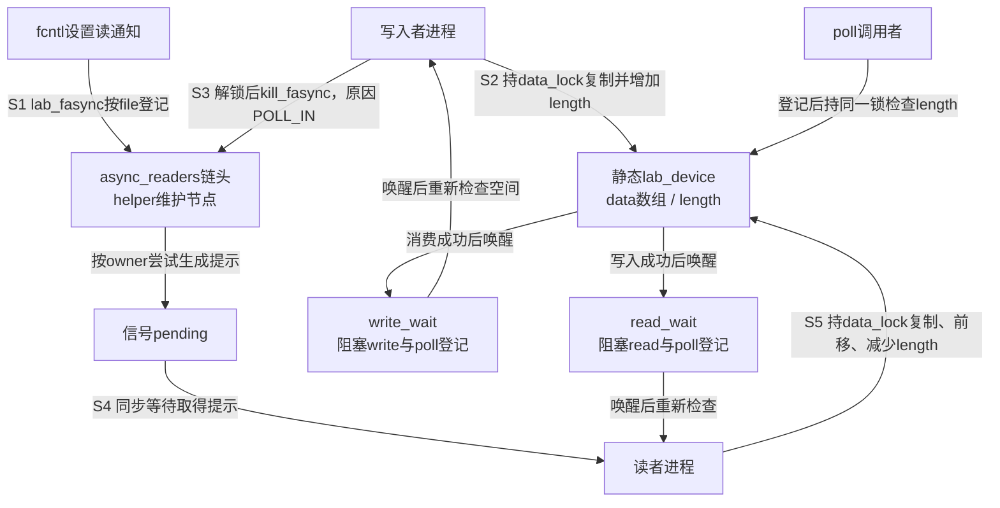
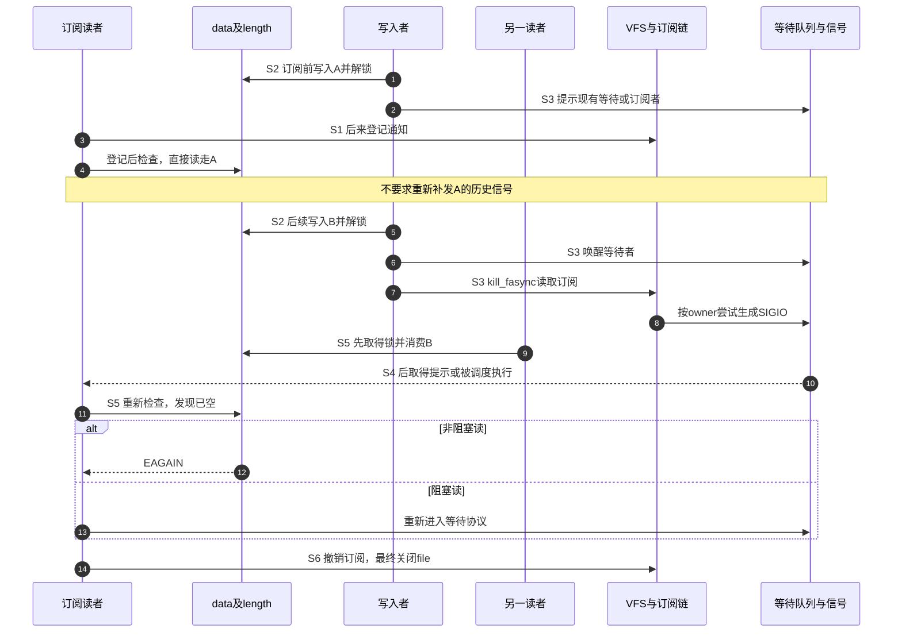

# 第6章\_字符设备中实现异步通知的基础模式

第五章已经把打开、订阅、文件类型差量和最终释放接在一起。现在由我们实现一个文件：让应用写入字节作为软件事件，让另一个打开文件收到提示并读出它。先不连接外部引脚，便能区分“通知协议错误”与“硬件没有产生中断”，也能主动制造队列满、短读和多读者竞争。

本章给出完整内核模块、用户程序、构建文件和有限验证步骤。接口按NXP官方Linux 6.12.20固定提交 `dfaf2136deb2af2e60b994421281ba42f1c087e0` 核对；使用其他目标内核时要以其配置和构建树编译，不承诺所有5.x/6.x接口都相同。源码入口见[字符设备阅读索引](../../../../../research/source_reading/character_device/navigation/P01_Linux_6.12_字符设备源码阅读索引.md#1.1_版本和阅读边界)，核对与验证范围见[本章证据记录](../../../../../research/source_reading/linux/SOURCE_BASELINE.md#1.199_软件fasync设备的数据等待与寿命协议)。本章代码是仓库教学实现，不是上游驱动摘录。

## 6.1\_先决定字节保存在哪里以及满了怎么办

假设应用先写AB，再写C，读者只申请两个字节。我们希望第一次读到AB，下一次还能读到C。一个“最新值 + data_ready”槽位做不到这个保证：第二次写可能覆盖第一批，第一次短读也可能清掉未读尾部。那种模型适合明确约定只取最新快照的设备，本实验则选择 **有界字节流队列**，容量256字节。

它不是记录队列，连续write的边界不保留；AB与C可能被一次read合并。这里“事件”是成功加入的字节，而不是一份必须与一次SIGIO配对的消息。所有打开者共享同一份内容：多位读者竞争消费，谁先取走，其他读者就不能再读同一字节。订阅可以有多份，数据不会因此复制多份。

队列满了，写入者必须知道没有接收成功。非阻塞write返回EAGAIN；阻塞write等待空间；只有部分空间时允许短写，调用者继续提交余下部分。这个策略没有主动丢弃旧字节，也没有把新字节覆盖旧字节，所以暂时不需要“已丢弃计数”。第七、八章面对不能阻塞的硬件生产者时，才必须重新选择满队列策略。

用户缓冲地址访问失败使用EFAULT错误表示；它与表示暂时没有进展条件的EAGAIN不同。下面沿用第二章的POLLIN可读位、POLLOUT可写位，把错误、长度和就绪状态放在同一张表里。

| 条件 | read规则 | write规则 | poll可观察结果 |
| --- | --- | --- | --- |
| 请求长度为0 | 返回0，不消费 | 返回0，不生产、不发提示 | 不由零长度调用改变 |
| 队列为空 | 非阻塞EAGAIN，阻塞等待 | 可接收字节 | 读端无POLLIN，写端有POLLOUT |
| 队列部分占用 | 返回至多请求长度，保留余下内容 | 返回至多剩余容量 | 相应读写端可同时就绪 |
| 队列已满 | 仍可消费 | 非阻塞EAGAIN，阻塞等待 | 读端可读，写端暂不可写 |
| 用户内存只复制了一部分 | 只消费实际复制部分 | 只发布实际复制部分 | 按实际变化后的长度判断 |
| 用户内存一个字节也未复制 | EFAULT，不消费 | EFAULT，不发布、不通知 | 原有有效内容保持 |

本软件设备没有“最后一个写者关闭就永久结束”的协议：未来还可以有新写者。因此空队列不能返回EOF。用户程序需要有自己的结束条件；本章程序全部有有限操作次数或等待期限。

## 6.2\_同一份数据怎样连接等待者和订阅者

数据保存在模块内的静态 `lab_device`，其中data是字节数组、length是有效字节数。read从数组开头取走字节后把剩余内容前移，write追加到末尾。这样不用先引入环形下标，但每次read最多要移动256字节；容量变大或速率上升时，环形队列能避免这份搬移成本。

数据路径只在进程上下文运行，所以使用 **mutex互斥锁** 保护数组与长度。`copy_to_user()`、`copy_from_user()`访问用户地址时可能因缺页而睡眠，不能放在自旋锁内；持mutex允许这类等待，但会让其他读写者等待这位调用者完成复制。这是教学方案的代价，不能称为适合任意高频中断的通用锁法。

等待队列保存“需要重新检查条件”的等待关系，不保存数据。读者等待length非零，写者等待length小于容量；唤醒以后还要重新取得mutex并检查，因为别人可能先消耗数据或占满空间。等待谓词用READ_ONCE读取一次length，写入用WRITE_ONCE；这里的无锁值仅作等待提示，数组内容和最终条件始终在mutex下读取，不能拿READ_ONCE当作数据发布的全部同步。



图6-1中的数据锁不保护fasync节点，订阅由helper自己的协议保护。反过来，helper的RCU也不保护data数组。发布后先唤醒还是先请求信号，不会把数据复制给等待者；本实现先解锁，再唤醒读等待者，最后请求信号，所以另一个读者完全可能在SIGIO被取走之前已经读空队列。

本实验只向有读权限的file提供 **读就绪信号**，写空间变化通过write_wait及poll表达。读写打开的file也只订阅读提示。若要提供两类信号，应像第五章管道那样明确方向、链头、错误回滚和用户解释规则，不能随意把POLLIN与POLLOUT掩码按位或后传入kill_fasync的第三参数。

## 6.3\_把数据规则实现为完整模块

在Linux实验目录新建 `fasync_lab.c`，内容如下。LAB_CAPACITY和LAB_NAME是本例自定常量，`lab_device`是本例设备状态，不是内核要求的专用类型。`stream_open()`声明这是不依赖文件偏移的流式打开，read/write忽略position；它不会替我们锁住共享缓冲。

模块采用第五章的cdev路径。静态存储在模块存活期间地址稳定，操作表及cdev的owner指向THIS_MODULE，使正常打开引用阻止模块被正常卸载。本例没有硬件、后台生产者或设备解绑入口，也不支持强制卸载；后面不能把这一寿命前提直接搬到可热移除设备。

这里的操作表 `.owner` 表示所属模块，和信号接收者 `file->f_owner` 不是同一字段。FMODE_READ、FMODE_WRITE检查file的访问方向；EINVAL表示请求不适用，ENOMEM表示分配失败。MAJOR、MINOR从设备号取出主、次编号，供后面的节点创建使用。

```c
// fasync_lab.c：软件写入产生数据，不访问任何硬件。
#include <linux/module.h>
#include <linux/fs.h>
#include <linux/cdev.h>
#include <linux/mutex.h>
#include <linux/wait.h>
#include <linux/poll.h>
#include <linux/uaccess.h>
#include <linux/string.h>
#include <linux/signal.h>

#define LAB_CAPACITY 256U
#define LAB_NAME "fasync_lab"

struct lab_device {
    struct mutex data_lock;
    wait_queue_head_t read_wait;
    wait_queue_head_t write_wait;
    struct fasync_struct *async_readers;
    unsigned char data[LAB_CAPACITY];
    size_t length;
};

/* 模块存活期间地址稳定；本实验没有热移除入口。 */
static struct lab_device lab_device;
static dev_t lab_number;
static struct cdev *lab_cdev;

static int lab_open(struct inode *inode, struct file *file)
{
    /* 本模块只有一个实例，多实例时必须另做设备到状态的映射。 */
    file->private_data = &lab_device;
    return stream_open(inode, file);
}

static int lab_fasync(int fd, struct file *file, int on)
{
    struct lab_device *dev = file->private_data;

    /* 本实验只提供读就绪信号；取消路径始终允许执行。 */
    if (on && !(file->f_mode & FMODE_READ))
        return -EINVAL;
    return fasync_helper(fd, file, on, &dev->async_readers);
}

static ssize_t lab_read(struct file *file, char __user *buffer,
                        size_t count, loff_t *position)
{
    struct lab_device *dev = file->private_data;
    size_t amount, copied;
    int error;

    (void)position;
    if (!count)
        return 0;
    for (;;) {
        error = mutex_lock_interruptible(&dev->data_lock);
        if (error)
            return error;
        if (dev->length)
            break;
        mutex_unlock(&dev->data_lock);
        if (file->f_flags & O_NONBLOCK)
            return -EAGAIN;
        error = wait_event_interruptible(dev->read_wait,
                                         READ_ONCE(dev->length) != 0);
        if (error)
            return error;
        /* 唤醒不预留数据，重新加锁并检查，允许其他读者先消费。 */
    }
    amount = min_t(size_t, count, dev->length);
    copied = amount - copy_to_user(buffer, dev->data, amount);
    if (copied) {
        memmove(dev->data, dev->data + copied, dev->length - copied);
        WRITE_ONCE(dev->length, dev->length - copied);
    }
    mutex_unlock(&dev->data_lock);
    if (!copied)
        return -EFAULT;
    wake_up_interruptible_poll(&dev->write_wait, EPOLLOUT | EPOLLWRNORM);
    return copied;
}

static ssize_t lab_write(struct file *file, const char __user *buffer,
                         size_t count, loff_t *position)
{
    struct lab_device *dev = file->private_data;
    size_t amount, copied;
    int error;

    (void)position;
    if (!count)
        return 0;
    for (;;) {
        error = mutex_lock_interruptible(&dev->data_lock);
        if (error)
            return error;
        if (dev->length < LAB_CAPACITY)
            break;
        mutex_unlock(&dev->data_lock);
        if (file->f_flags & O_NONBLOCK)
            return -EAGAIN;
        error = wait_event_interruptible(dev->write_wait,
                                         READ_ONCE(dev->length) < LAB_CAPACITY);
        if (error)
            return error;
    }
    amount = min_t(size_t, count, LAB_CAPACITY - dev->length);
    copied = amount - copy_from_user(dev->data + dev->length, buffer, amount);
    if (copied)
        WRITE_ONCE(dev->length, dev->length + copied);
    mutex_unlock(&dev->data_lock);
    if (!copied)
        return -EFAULT;

    /* 先发布数据，再分别唤醒等待者和请求信号。 */
    wake_up_interruptible_poll(&dev->read_wait, EPOLLIN | EPOLLRDNORM);
    kill_fasync(&dev->async_readers, SIGIO, POLL_IN);
    return copied;
}

static __poll_t lab_poll(struct file *file, poll_table *wait)
{
    struct lab_device *dev = file->private_data;
    __poll_t mask = 0;

    if (file->f_mode & FMODE_READ)
        poll_wait(file, &dev->read_wait, wait);
    if (file->f_mode & FMODE_WRITE)
        poll_wait(file, &dev->write_wait, wait);
    mutex_lock(&dev->data_lock);
    if ((file->f_mode & FMODE_READ) && dev->length)
        mask |= EPOLLIN | EPOLLRDNORM;
    if ((file->f_mode & FMODE_WRITE) && dev->length < LAB_CAPACITY)
        mask |= EPOLLOUT | EPOLLWRNORM;
    mutex_unlock(&dev->data_lock);
    return mask;
}

static const struct file_operations lab_fops = {
    .owner = THIS_MODULE,
    .open = lab_open,
    .read = lab_read,
    .write = lab_write,
    .poll = lab_poll,
    .fasync = lab_fasync,
};

static int __init lab_init(void)
{
    int error;

    mutex_init(&lab_device.data_lock);
    init_waitqueue_head(&lab_device.read_wait);
    init_waitqueue_head(&lab_device.write_wait);
    error = alloc_chrdev_region(&lab_number, 0, 1, LAB_NAME);
    if (error)
        return error;
    lab_cdev = cdev_alloc();
    if (!lab_cdev) {
        unregister_chrdev_region(lab_number, 1);
        return -ENOMEM;
    }
    lab_cdev->ops = &lab_fops;
    lab_cdev->owner = THIS_MODULE;
    error = cdev_add(lab_cdev, lab_number, 1);
    if (error) {
        /* 尚未发布，只归还cdev_alloc取得的初始对象引用。 */
        kobject_put(&lab_cdev->kobj);
        unregister_chrdev_region(lab_number, 1);
        return error;
    }
    /* 发布成功后没有下一项可能失败的资源申请。 */
    pr_info(LAB_NAME ": major=%u minor=%u capacity=%u\n",
            MAJOR(lab_number), MINOR(lab_number), LAB_CAPACITY);
    return 0;
}

static void __exit lab_exit(void)
{
    cdev_del(lab_cdev);
    unregister_chrdev_region(lab_number, 1);
}

module_init(lab_init);
module_exit(lab_exit);
MODULE_LICENSE("GPL");
MODULE_DESCRIPTION("Bounded software stream with read readiness signals");
```

先沿read检查一次：空队列时解锁再等待，唤醒以后回到循环顶部；这避免拿着mutex睡在等待队列上，阻止生产者取得同一把锁。进入复制分支后，返回值按实际复制字节计算，剩余字节前移；全失败返回EFAULT，部分成功返回正长度。write采用对称规则，先把字节放进有效区域并增加length，再在解锁以后发出两种提示。这里O_NONBLOCK只选择队列空满时是否等待，不承诺mutex竞争或用户缺页绝不发生等待。

`poll_wait()`只登记唤醒关系；真正是否就绪由后面的length检查决定。调用它必须早于条件检查，否则可能在“观察为空”和“登记完成”之间错过唯一一次唤醒。使用的EPOLLIN、EPOLLRDNORM等是内核poll位掩码：IN/RDNORM表示普通可读，OUT/WRNORM表示普通可写；kill_fasync使用的POLL_IN则仍是单独原因码。

这里没有release回调，因为没有每次打开独立分配的资源。第五章已经核对：最终__fput在条件成立时会先调用fasync撤销。不要为了套旧模板再复制一遍撤销；也不要在open时把整个async_readers设为NULL，那会丢掉其他打开者的订阅。多次open产生不同file，dup/fork共享file，都使用前几章同一套身份规则。

初始化先申请设备号，再用cdev_alloc取得独立的cdev对象。后者失败就归还设备号；cdev_add失败时，kobject_put归还尚未发布的cdev初始引用，再归还设备号。发布成功后没有后续可能失败的资源申请；退出由cdev_del撤销映射并归还对象引用，随后归还设备号。cdev的最终存储回收由字符设备核心负责，不能再额外kfree。这里将cdev对象与模块内的数据状态分开，使核心的对象回收不依赖模块静态cdev存储；设备只有一个，open明确绑定同一个lab_device，多实例不能直接复制这份绑定。加入class、设备对象、中断或工作项以后，还必须逐项补全失败与退出配对。

`module_init()`与 `module_exit()`登记模块加载、卸载时的入口；它们不让用户直接调用这些C函数。MODULE_LICENSE声明许可证，GPL是GNU General Public License的缩写；MODULE_DESCRIPTION保存说明文字。这些模块元数据也不替代前面已经建立的数据与退出协议。

## 6.4\_先构建并加载再验证一次有限事务

模块构建需要与准备运行的内核匹配的构建树、配置、生成头文件，以及适用时的符号版本信息。只有源码目录名称看起来相同并不够；`modules_prepare`也不总能代替完整构建所需的Module.symvers。下面先选择在Linux测试机本机编译和加载，不把Windows上的语法或模型检查声称为目标模块构建。[外部模块构建说明](https://docs.kernel.org/kbuild/modules.html)

在同一目录保存名为 `Makefile` 的完整文件。obj-m是Kbuild规定的变量名，fasync_lab.o对应刚保存的fasync_lab.c；命令行前使用Tab。

```makefile
obj-m += fasync_lab.o
kernel_dir ?= /lib/modules/$(shell uname -r)/build

.PHONY: all clean
all:
	$(MAKE) -C $(kernel_dir) M=$(CURDIR) modules
clean:
	$(MAKE) -C $(kernel_dir) M=$(CURDIR) clean
```

`-C`让内核构建系统在指定树内运行，`M`指出当前外部模块目录。生成的fasync_lab.ko才是可加载模块；运行内核不匹配、模块签名策略拒绝或该配置不支持模块时，应修复环境，不能靠强制加载跳过。

```bash
# Linux测试机，本章实验目录；目录中已有fasync_lab.c和Makefile。
make && sudo insmod ./fasync_lab.ko
```

make失败时先停止，不执行insmod。insmod成功后，模块已经注册名为fasync_lab的设备号，但本例没有创建设备模型class，也没有依赖udev自动创建设备节点。下面在本次独有的临时目录创建节点，避免碰到已有同名路径：

```bash
# 继续在同一终端执行，保留lab_dir供后续测试和清理。
lab_dir=$(mktemp -d)
major=$(awk '$2 == "fasync_lab" { print $1 }' /proc/devices)
test -n "$major"
sudo mknod "$lab_dir/node" c "$major" 0
sudo chmod 600 "$lab_dir/node"
```

`/proc/devices`给出本次分配的主设备号，次设备号由模块固定为0；不能复制上次机器上的数字。test失败时不继续mknod，应先检查模块加载结果。临时目录只保存本次节点，后面会移除它；节点不是数据文件，删除节点不会自动卸载模块。

接下来在实验目录保存完整的 `fasync_lab_user.c`。本程序独占一个刚加载的空队列；若其他程序同时读写，断言失败不能直接证明驱动错误。它在订阅之前屏蔽SIGIO、恢复默认动作以排除继承忽略处置，然后配置owner与O_ASYNC，登记后再检查现状。用sigtimedwait同步接收提示，不在异步处理器里printf，也不使用可能错过检查时机的pause循环。

```c
#define _GNU_SOURCE
#include <errno.h>
#include <fcntl.h>
#include <poll.h>
#include <signal.h>
#include <stdio.h>
#include <string.h>
#include <unistd.h>
#include <time.h>

/* 非阻塞空读必须是EAGAIN，不把EOF当作暂时没数据。 */
static int expect_empty(int fd)
{
    char byte;
    errno = 0;
    if (read(fd, &byte, 1) == -1 && errno == EAGAIN)
        return 0;
    fprintf(stderr, "expected an empty live queue\n");
    return 1;
}

int main(int argc, char **argv)
{
    int reader = -1, writer = -1, original_flags = -1;
    int result = 1;
    sigset_t signals;
    struct sigaction action = {0};
    struct timespec timeout = {.tv_sec = 5, .tv_nsec = 0};
    struct pollfd descriptor;
    char data[3];

    if (argc != 2) {
        fprintf(stderr, "usage: %s NODE\n", argv[0]);
        return 1;
    }
    /* 屏蔽先于恢复默认动作；本进程退出前不再解除屏蔽。 */
    if (sigemptyset(&signals) == -1 || sigaddset(&signals, SIGIO) == -1 ||
        sigprocmask(SIG_BLOCK, &signals, NULL) == -1) {
        perror("signal mask");
        goto out;
    }
    action.sa_handler = SIG_DFL;
    if (sigemptyset(&action.sa_mask) == -1 ||
        sigaction(SIGIO, &action, NULL) == -1) {
        perror("sigaction");
        goto out;
    }
    reader = open(argv[1], O_RDONLY | O_NONBLOCK | O_CLOEXEC);
    if (reader == -1) {
        perror("open reader");
        goto out;
    }
    writer = open(argv[1], O_WRONLY | O_NONBLOCK | O_CLOEXEC);
    if (writer == -1) {
        perror("open writer");
        goto out;
    }
    if (expect_empty(reader))
        goto out;
    original_flags = fcntl(reader, F_GETFL);
    if (original_flags == -1 || fcntl(reader, F_SETOWN, getpid()) == -1 ||
        fcntl(reader, F_SETFL, original_flags | O_ASYNC) == -1) {
        perror("subscribe");
        goto out;
    }
    /* 登记后再检查现状，不假定订阅会补发过去的事件。 */
    if (expect_empty(reader))
        goto out;
    if (write(writer, "AB", 2) != 2 || write(writer, "C", 1) != 1) {
        fprintf(stderr, "expected two complete writes to an empty queue\n");
        goto out;
    }
    descriptor = (struct pollfd){.fd = reader, .events = POLLIN};
    if (poll(&descriptor, 1, 0) != 1 || !(descriptor.revents & POLLIN)) {
        fprintf(stderr, "expected readable queue\n");
        goto out;
    }
    /* 同步等待最长5秒；不在异步信号处理器里做stdio。 */
    if (sigtimedwait(&signals, NULL, &timeout) != SIGIO) {
        perror("sigtimedwait");
        goto out;
    }
    if (read(reader, data, 2) != 2 || memcmp(data, "AB", 2) ||
        read(reader, data, sizeof(data)) != 1 || data[0] != 'C' ||
        expect_empty(reader)) {
        fprintf(stderr, "short-read preservation failed\n");
        goto out;
    }
    puts("SIGIO observed; reads=AB,C,EAGAIN");
    result = 0;
out:
    if (reader >= 0 && original_flags >= 0 &&
        fcntl(reader, F_SETFL, original_flags) == -1) {
        perror("unsubscribe");
        result = 1;
    }
    if (writer >= 0 && close(writer) == -1) {
        perror("close writer");
        result = 1;
    }
    if (reader >= 0 && close(reader) == -1) {
        perror("close reader");
        result = 1;
    }
    return result;
}
```

程序分两次写入AB和C，在取走SIGIO以前就用poll查询当前可读状态，然后分两次read验证短读尾部没有丢失。它不要求两次写一定对应两个信号。5秒超时、调用失败或内容不符都会进入清理，尝试恢复原标志并关闭两份file；SIGIO一直保持屏蔽到进程退出，避免撤销前已生成的pending突然执行默认终止动作。

```bash
# Linux测试机，同一实验目录；lab_dir仍指向上一步创建的节点目录。
cc -std=c11 -O2 -Wall -Wextra -Werror fasync_lab_user.c -o fasync_lab_user
sudo ./fasync_lab_user "$lab_dir/node"
```

正常输出为 `SIGIO observed; reads=AB,C,EAGAIN`。若超时，要沿S1登记、S2写入、S3信号目标、S4接收逐段检查，不能马上调整GPIO或中断控制器，本实验根本没有使用它们。程序读到预存数据会失败，表示“独占空队列”的实验前提不成立；先关闭其他使用者、正常卸载重载后再验证。

## 6.5\_用同一周期检查唤醒竞争与容量边界

前面的成功事务只验证一条路径。现在用同一组S阶段看另外两种时序：订阅前已有数据、以及被唤醒者晚于另一个读者。这两种情况都要求 **当前状态检查**，不能由信号次数推断数据次数。



图6-2没有要求每个提示都能兑换一份数据，也没有把正常竞争称为状态不一致。真正的错误是数据写入还未按锁协议发布就依赖提示让另一CPU读取，或读写各检查不同且互不协调的条件。当前mutex模型本身已为多CPU互斥而设计，不能说“单CPU先凑合，多CPU时随便加屏障即可”。

再进行容量实验。下面完整Python程序只使用标准库，保存为 `fasync_lab_limits.py`；它检查空读、满写、短写、短读保存以及poll随容量变化。程序不启用fasync，刻意证明这些数据契约独立于订阅。开始时队列应为空，运行期间也应没有其他读写者。

```python
import errno
import os
import select
import sys


def expect_again(operation):
    try:
        operation()
    except BlockingIOError as error:
        if error.errno == errno.EAGAIN:
            return
        raise
    raise RuntimeError("应返回EAGAIN，不能把空读当EOF或覆盖满队列")


def require(condition, message):
    if not condition:
        raise RuntimeError(message)


def main(path):
    fd = os.open(path, os.O_RDWR | os.O_NONBLOCK | os.O_CLOEXEC)
    try:
        watcher = select.poll()
        watcher.register(fd, select.POLLIN | select.POLLOUT)
        expect_again(lambda: os.read(fd, 1))
        require(os.read(fd, 0) == b"", "零长度读")
        require(os.write(fd, b"") == 0, "零长度写")
        require(os.write(fd, b"x" * 300) == 256, "写入必须受容量限制")
        expect_again(lambda: os.write(fd, b"!"))
        events = dict(watcher.poll(0)).get(fd, 0)
        require(events & select.POLLIN and not events & select.POLLOUT,
                "满队列只能读，不能承诺有写空间")
        require(os.read(fd, 1) == b"x", "首先消费一个字节")
        events = dict(watcher.poll(0)).get(fd, 0)
        require(events & select.POLLIN and events & select.POLLOUT,
                "部分占用时读写都应就绪")
        require(os.write(fd, b"QR") == 1, "只有一个空位，应短写Q")
        chunks = []
        # 固定上限，错误实现不能让实验无限读取。
        for _ in range(257):
            try:
                chunk = os.read(fd, 17)
            except BlockingIOError as error:
                if error.errno != errno.EAGAIN:
                    raise
                break
            require(bool(chunk), "活设备空队列不能返回EOF")
            chunks.append(chunk)
        else:
            raise RuntimeError("超过预期读取次数")
        require(b"".join(chunks) == b"x" * 255 + b"Q", "剩余内容或顺序丢失")
        events = dict(watcher.poll(0)).get(fd, 0)
        require(not events & select.POLLIN and events & select.POLLOUT,
                "读尽后恢复空队列状态")
        print("capacity=256; short write/read preserved; poll coherent")
    finally:
        os.close(fd)


if __name__ == "__main__":
    if len(sys.argv) != 2:
        raise SystemExit("usage: fasync_lab_limits.py NODE")
    main(sys.argv[1])
```

`finally`保证断言或系统调用失败后仍关闭fd。Python把非阻塞EAGAIN表达为BlockingIOError异常；这里检查异常原因，而不是忽略所有异常。poll(0)只做立即查询，循环也有上限。

```bash
# Linux测试机，队列为空且没有其他使用者。
sudo python3 ./fasync_lab_limits.py "$lab_dir/node"
```

正常输出说明这些有限数据场景成立，不证明所有并发交错都已覆盖。若脚本中途失败，队列可能保留已成功写入的字节；停止其他使用者后正常卸载重载，再重跑，不能把“再次打开”当作自动清空。

阻塞行为也要单独观察。下面在同一终端启动一个最多等待5秒、只读3个字节的后台进程，1秒后写入XYZ，然后等待并取得读进程的退出状态；仍要求没有其他读者。

```bash
# Linux测试机，先确认队列为空；timeout和dd来自常用的coreutils工具。
sudo timeout 5 dd if="$lab_dir/node" bs=1 count=3 status=none &
reader_pid=$!
sleep 1
printf 'XYZ' | sudo tee "$lab_dir/node" >/dev/null
wait "$reader_pid"
```

dd以每次1字节、最多3次的方式读取；timeout防止错误实现让验收永久等待。后台读者先等待数据，写入后应输出XYZ并正常退出；若调度使它在写入后才进入read，它会直接读取已经存在的数据，同样不能丢掉这次唤醒机会。wait失败或超时应检查调用结果，不能把屏幕出现几个字符当作完整通过。第十三章再把并发、关闭和故障场景组合成完整验收。

## 6.6\_为什么这个模块不用devm以及移除时会多出什么问题

本例设备存储是模块静态对象，没有单独绑定到一块可拔出的硬件。正常打开引用使模块保持存活，所有文件关闭后才允许正常卸载；用户仍持fd时rmmod失败是这项保护的表现，不能用强制卸载绕过去。设备号和独立cdev对象配对即可完成本例资源清理。

真实platform设备多一个独立事件：驱动可能被解绑或硬件移除，旧file却仍在用户手中。**devres（设备资源管理机制）** 的devm接口把释放动作登记到device的资源账本，在驱动解绑或失败回滚等路径执行；它不是“等最后一个file关闭才自动释放”的引用计数。[devres说明](https://docs.kernel.org/driver-api/driver-model/devres.html)

因此若private_data指向devm_kzalloc取得的内存，remove返回后资源清理可能已经释放它，旧fd下一次read或最终fasync撤销仍会访问这个地址。仅cdev_del或misc_deregister不能阻止旧fd继续调用原操作表。节点消失、驱动解绑、file最终释放是三个不同事件；把它们都叫“关闭”会掩盖这个缺口。

表中的IRQ指 **中断请求（Interrupt Request）** 及其处理注册资源。和字节数组一样，中断、工作项与文件引用各有自己的退出条件，不能由一项资源的释放推断其他使用者已退出。

| 资源或状态 | 手动管理需要落实什么 | 使用devm后仍需落实什么 |
| --- | --- | --- |
| IRQ及硬件访问 | 停止来源、同步处理者、成对释放 | 停止和同步协议仍由驱动决定，自动释放不替代停产 |
| 工作项或定时器 | 阻止再次入队并同步取消 | 不能因IRQ被托管就认为派生工作也已停止 |
| 被旧file引用的软件对象 | 活跃引用结束前保持存储，退出时释放 | 若需跨越解绑存活，不能直接依赖解绑即释放的内存 |
| fasync订阅 | helper登记/撤销，链头对象保持有效 | devm不自动建立file订阅协议或删除既有pending |
| 设备号与对外入口 | 撤销新访问入口，处理并发打开边界 | 仍须核对对应注册接口实际提供的托管能力 |

可以为可移除设备设计独立引用计数的软件对象：移除先标记离线、禁止新的生产和打开，等待中断/工作等已进入路径退出，唤醒等待者使其看到离线结果；旧file继续持有软件对象，但不再访问已撤走的硬件，最后引用释放才回收软件对象。这个协议里的“等待生产者退出”和“等待用户最终关闭”不是同一件事，不能在remove中无条件等一个不受控制的用户永远关闭。

devm与手动管理也不是整驱动只能二选一。可以托管仅服务绑定期间的硬件资源，同时手动管理必须跨越解绑的软件对象；每一项资源必须只有清楚的释放责任。提前释放托管项要使用其对应managed释放接口以撤销账本，不能直接kfree后又让账本重复释放。更完整的引用与解绑推导见[devres与用户态访问](../../../object_lifetime/devres/P03_驱动资源与用户态访问的协作.md#3.1_资源归还和用户访问为什么需要两条协议)。

本章暂不把静态模块改成platform驱动，目的是让数据和通知协议先独立成立；下一章接入 **通用输入输出（General-Purpose Input/Output，GPIO）** 引脚时，增加的正是硬件资源、执行上下文与退场条件，而不是只把write函数名换成irq_handler。

## 6.7\_把软件生产者换成中断之前要改变哪些保证

当前write可以阻塞，也可以持mutex访问用户地址。硬中断不能沿用这条路径：它不能睡在满队列上，更没有一个可以调用copy_from_user取得数据的普通写入者。必须从硬件读取或从已经保存的内核数据中生成记录，再选择满时丢新、丢旧、覆盖快照或硬件背压等策略，并能报告损失。

中断上半部、软中断/tasklet、普通工作队列和中断线程也不能统称“可以睡眠的下半部”。下面只比较与本章协议直接有关的约束：

| 生产执行位置 | 能否照搬本章mutex与睡眠操作 | 迁移时必须补上的内容 |
| --- | --- | --- |
| 硬中断 | 不能 | 有界采集、不可睡眠同步、满队列策略、正确确认或撤销硬件来源 |
| 软中断或tasklet | 不能按普通可睡眠线程使用 | 不因叫下半部就调用会睡眠的总线接口 |
| 普通工作队列工作函数 | 具备可睡眠上下文，但仍受当前持锁约束 | 工作合并不保存每个事件，另存计数/记录；退出同步取消 |
| 中断线程 | 可以设计可睡眠的数据路径，但不能在自旋锁内睡眠 | 与硬中断入口、屏蔽/解除及硬件确认协议配合 |

第四章已经给出kill_fasync可从适用中断上下文调用的边界，这不保证任意持锁组合都正确，也不替代生产数据的同步。耗时总线读取应在允许睡眠的位置完成，不能先取自旋锁再因为“当前在线程里”就放心睡眠。IRQ编号必须来自真实设备资源，request_any_context_irq选择注册方式，并不负责凭空模拟一次硬件中断。

**练习一：** 改成每次open都清length，是否能让实验更容易重复？

**答案：** 会破坏共享队列协议。一个写者或第二读者打开时就能丢掉其他调用者尚未读出的数据。重置必须是明确的受控操作，本实验使用正常卸载重载建立新实例。

**练习二：** 把copy_to_user移到mutex外，再无条件减少length，是否只是缩短持锁？

**答案：** 还改变了数据所有权。复制期间另一个读者可能先消费或写者改变数组，最后减长度可能删除不属于本次读取的数据。需要先设计独占读段、快照或每客户端缓冲，不能只搬动解锁位置。

**练习三：** 两次write只收到一个SIGIO，但读取内容完整，是否算丢事件？

**答案：** 对本章字节流契约不是。标准信号可以合并，内容是否完整由成功写入量、读取字节及队列策略判断。若业务要求逐条事件与时间戳，必须先定义记录协议，不能把信号计数当作业务计数。

完成实验后，先确认所有程序退出，再清理本次节点和模块：

```bash
# 同一Linux终端，lab_dir仍是本次mktemp创建的目录。
sudo rm -- "$lab_dir/node"
rmdir -- "$lab_dir"
sudo rmmod fasync_lab
make clean
```

删除节点只撤掉这个路径；rmmod失败时先找仍持有fd的程序并正常退出，不强制卸载。make clean只清理本实验Kbuild产物，源码和用户程序仍可保留。现在软件闭环已经具备数据、等待、订阅和寿命边界，下一章再加入具体GPIO生产源。

上一篇：[P05 VFS 与文件系统中的异步通知支持](P05_VFS_与文件系统中的异步通知支持.md)。
下一篇：[P07 中断驱动设备的异步通知实践](P07_中断驱动设备的异步通知实践.md)。
