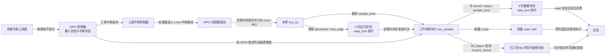
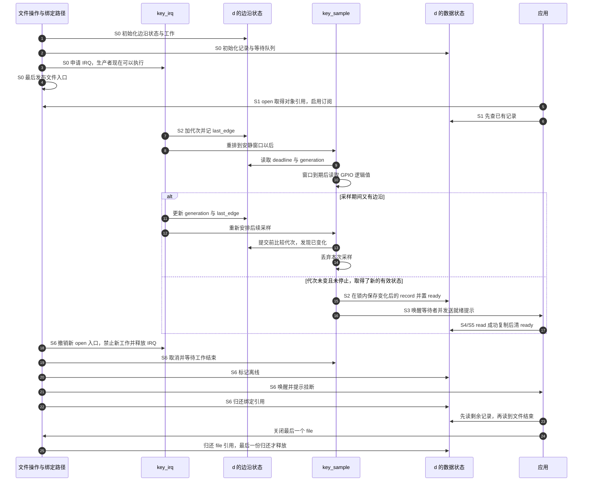

# 第7章\_中断驱动设备的异步通知实践

上一章已经做成一个软件设备：写入者把字节存入缓冲区，读者通过阻塞读取、`poll` 或 SIGIO 得知应当再查数据。现在把写入者换成一只按键。应用想知道按键是否按下，但硬件送来的可能是一串抖动边沿；读取引脚可能需要睡眠；拔掉或解绑设备时，应用还可能握着文件描述符。只把 `kill_fasync()` 搬进中断函数，解决不了这些新增问题。

本章沿“引脚变化 → 采样 → 保存状态 → 通知 → 读取 → 解绑”建立完整教学驱动。它承诺提供 **最新的稳定逻辑状态**，不承诺记录所有物理边沿。内核接口按 NXP Linux 6.12.20 的固定提交 `dfaf2136deb2af2e60b994421281ba42f1c087e0` 核对；源码身份与访问边界见 [源码基线](../../../../../research/source_reading/linux/SOURCE_BASELINE.md#1.200_GPIO异步通知的采样与解绑协议)。本章给出完整模块和有限时长的接收程序，板级引脚仍须由实际原理图及设备树确定，不能仅凭芯片型号承诺上板即用。

## 7.1\_硬件能中断处理器\_为什么应用仍然需要文件协议

设按键接在 **通用输入输出（General-Purpose Input/Output，GPIO）** 引脚上。按下时，线路从高电平变成低电平。GPIO 控制器检测到边沿，向上级中断控制器发出请求；Linux 执行对应的中断处理路径。这说明内核有机会处理变化，尚未说明哪个应用应收到什么数据。

设备 **中断请求（Interrupt Request，IRQ）** 和进程的 SIGIO 位于两条不同通信链中：前者让内核进入处理路径，后者依照 `struct file` 的订阅与信号接收目标通知进程。SIGIO 不携带本章的完整按键记录，也不让用户代码在硬中断现场执行。应用何时真正运行，还取决于信号屏蔽、等待方式和调度。

最朴素的应用可以让一个线程阻塞在设备 `read()` 中。驱动先保存状态，再唤醒这个线程，已经能完成工作。应用还要等网络和定时器时，可把设备放进 `poll`/`epoll`；这些接口在无就绪对象时可以睡眠，并非必须反复忙读。如果已有程序明确采用 SIGIO 协议，驱动再增加 `.fasync` 订阅入口即可。不能按“低于几百赫兹就用 fasync”选接口：低频不意味着信号协议更适合，高优先级业务也不能靠 SIGIO 获得截止时间保证。

对真实键盘或普通板载按键，应先检查标准 `gpio-keys` 驱动与 input 输入子系统是否已经满足要求。它们把按键状态送入通用输入协议，应用经 evdev 事件设备读取，避免自行制定一个按键 ABI（Application Binary Interface，应用二进制接口）。本章自定义字符设备的价值是把采样、状态与异步通知的责任拆开观察，不是要求生产按键驱动绕开 input。

> 实现依据：[gpio_keys.c](https://github.com/nxp-imx/linux-imx/blob/dfaf2136deb2af2e60b994421281ba42f1c087e0/drivers/input/keyboard/gpio_keys.c) 中 `gpio_keys_gpio_isr()`、`gpio_keys_debounce_event()` 和 `gpio_keys_gpio_report_event()` 分别安排去抖、报告逻辑状态并提交输入事件；标准配置由 [gpio-keys.yaml](https://github.com/nxp-imx/linux-imx/blob/dfaf2136deb2af2e60b994421281ba42f1c087e0/Documentation/devicetree/bindings/input/gpio-keys.yaml) 定义。本章后面的 `linux-note,async-key` 是自定教学绑定，不是该标准绑定或 NXP 官方产品接口。

## 7.2\_先确定哪根线在变化\_再取得Linux中断号

软件必须同时知道“读取哪根线”和“哪条中断路径提醒它去读”。GPIO 描述符保存内核对某根 GPIO 的引用；`devm_gpiod_get(dev, "key", GPIOD_IN)` 按设备属性 `key-gpios` 取得它，参数 `GPIOD_IN` 要求输入方向。`gpiod_to_irq()` 再把同一描述符映射到 Linux IRQ 号。芯片常把多根 GPIO 分成若干 bank（引脚组），每根线有组内偏移；Linux IRQ 号属于另一个运行时映射，既不是引脚号，也不能用 bank 编号乘一个常量自行推算。

以 i.MX 的 GPIO 控制器驱动为例，上级中断到达后，`mx3_gpio_irq_handler()` 读取 GPIO 中断状态并结合屏蔽寄存器筛选待处理位；`mxc_gpio_irq_handler()` 按位调用 `generic_handle_domain_irq()`，把 bank 内偏移映射到相应 Linux IRQ。控制器驱动负责这一级汇聚与分派，本章消费者只申请取得的子 IRQ，不自行确认上级控制器或随意清 GPIO 控制器寄存器。不同平台的上级控制器及汇聚接法仍由其设备树和驱动决定。

本章将短中断回调命名为 `key_irq`，将延后读取 GPIO 的工作函数命名为 `key_sample`。图中的 `d` 是本设备的软件对象：它分别保存边沿观察记录、可读数据、等待队列和订阅链表。先沿图看清信息走向，随后再推导为什么边沿记录与可读数据需要分开。



图中有两种相反方向的活动：中断向软件报告“可能变了”，软件通过 GPIO 描述符读取“现在是什么”。它们不是同一条总线事务。处理器接口和中断控制器不会替驱动取得按键记录，更不会替用户程序调用 `read()`。

还有一层容易重复处理的变换。板上低电平代表按下时，GPIO 属性使用 `GPIO_ACTIVE_LOW`。`gpiod_get_value_cansleep()` 返回的已经是 **逻辑值**：有效为 1，无效为 0。因此本章直接把 1 解释为按下，不再执行“读到 0 才按下”的反转。负数是读取失败，必须先检查；不能把它归到松开分支。

| 线路与返回值 | 低有效按键的含义 | 本章处理 |
| --- | --- | --- |
| 物理低电平 → 描述符逻辑值 1 | 按键有效 | 记录 `active=1` |
| 物理高电平 → 描述符逻辑值 0 | 按键无效 | 记录 `active=0` |
| GPIO 访问返回负错误码 | 本次无法得到可信状态 | 保存采样错误，不伪造按下或释放 |

为了同时观察按下与释放，示例请求 `IRQF_TRIGGER_RISING | IRQF_TRIGGER_FALLING`，即物理上升、下降双边沿；低有效属性不替代 IRQ 触发类型。本例只服务专用 GPIO 子 IRQ，不使用共享中断标志。共享线路必须能辨认本设备是否发起请求，不能照搬一个无条件返回 `IRQ_HANDLED` 的处理函数。

下面是教学设备属性的形状，**尖括号占位词须替换后才是可编译 DTS**。DTS（Device Tree Source，设备树源文件）描述板级连接；本段不指定用户板上的真实 GPIO，也不额外虚构一个与 `key-gpios` 不一致的 `interrupts` 来源。

```text
/ {
    async_key {
        compatible = "linux-note,async-key";
        pinctrl-names = "default";
        pinctrl-0 = <&实际输入引脚配置标签>;
        key-gpios = <&实际GPIO控制器标签 bank内偏移 GPIO_ACTIVE_LOW>;
        debounce-interval = <10>;
        status = "okay";
    };
};
```

这个自定绑定使用 `key-gpios` 和可选的 `debounce-interval`；后者单位毫秒，缺省 10，允许 0～1000，0 表示不主动增加安静等待窗口。没有地址资源的节点不加 `@0`。正式产品应为自身硬件建立合适的绑定和校验文件，而不是把教学兼容字符串当成上游已接受规范。

| 上板前要落实的项目 | 从哪里取得 | 为什么不能省略 |
| --- | --- | --- |
| 按键网络、实际焊接引脚、有效电平 | 对应开发板版本的原理图 | 同一 SoC 可接在不同 bank，甚至根本没有该按键 |
| GPIO 控制器标签、bank 内偏移 | 当前板 DTS 与 SoC 引脚定义 | 这是描述符解析输入，不是 Linux IRQ 常量 |
| 引脚复用、上下拉、电气配置 | 本芯片引脚定义、板级 pinctrl 配置 | 线路必须确实处于可用输入状态，不能占用存储或控制台引脚 |
| 当前拥有者 | 板 DTS 中的 gpio-keys、其他消费者及运行时占用 | 同一线路不能同时交给两个互斥驱动控制 |
| 双边沿能力与加载的 DTB | 控制器支持、实际启动日志与设备树 | 编辑源文件不等于板子已经使用新配置 |

> 核对依据：[GPIO consumer API](https://github.com/nxp-imx/linux-imx/blob/dfaf2136deb2af2e60b994421281ba42f1c087e0/Documentation/driver-api/gpio/consumer.rst) 的 *GPIO access that may sleep*、*The active low and open drain semantics* 与 *GPIOs mapped to IRQs*；[gpio-mxc.c](https://github.com/nxp-imx/linux-imx/blob/dfaf2136deb2af2e60b994421281ba42f1c087e0/drivers/gpio/gpio-mxc.c) 的 `gpio_set_irq_type()` 和上述分派函数。这里解释消费者调用边界，不要求读者直接编程 GPIO 寄存器。

## 7.3\_一串边沿怎样变成一次可信状态变化

按键触点在按下和释放附近可能多次接通、断开。若每次 IRQ 都直接写“按下”，保持按住后的波形含义就丢了；若把所有边沿都发成 SIGIO，用户看到的通知数量也不等于按键次数。应先决定什么算有效数据，再决定何时通知。

第一种简单策略是接受第一个边沿，之后 10 毫秒忽略所有边沿。它能限制上报频率，却可能接受第一个毛刺，并漏掉窗口内的真实释放。第二种策略是每次收到边沿都重新起算：直到最近一次已观察边沿之后经过 10 毫秒，再读取逻辑值。它允许抖动继续延后采样，适合本章“最终状态”的目标，但一个完整短按若在窗口内完成，仍可能完全不可见。第三种策略只减少通知次数，例如每积累一批记录再通知；它是 **通知节流**，并没有过滤电气抖动。

本章采用第二种策略。**延迟工作（delayed work）** 是到期后交给工作线程执行的回调，不是每个边沿各分配一个任务。同一个 `d->sample_work` 可被重排，边沿只更新 `generation`（代次）和 `last_edge`（最近观察时间）。工作线程能够睡眠，故可调用 `gpiod_get_value_cansleep()`，也可取得稍后读路径使用的互斥锁；硬中断只做短小的状态更新和重排，不访问可能睡眠的 GPIO 总线。

这里仍有一个交错：旧工作已经开始读取 GPIO，此时新边沿把工作重新排到以后。重排不会撤销正在进行的读取。若旧工作不检查，就可能把新窗口尚未结束时的值当作最终状态发布。因此工作先记下代次，读取后在锁内再比较；代次变化则丢弃这次采样，新 IRQ 已安排下一次工作。提交与 IRQ 更新代次使用同一把 `edge_lock`，避免“检查通过后、新边沿先写入、旧采样再提交”的窗口。



图中工作线程的“读取”与“提交”之间可以插入新 IRQ，代次检查正是为此存在；S6 则反向关闭生产链，保留旧文件仍需访问的软件状态。这个协议证明的是“以驱动已经观察的 IRQ 为边界，旧采样不会越过新代次提交”。它不证明每个物理边沿都被硬件捕获，也不证明整个窗口的电压连续稳定。实际延迟还包括 jiffy（内核节拍）时间粒度、工作调度和 GPIO 读取时间，不等于精确 10 毫秒。代码用内核 `time_before()` 比较可能回绕的 jiffies，并限制窗口大小；代次为 64 位，比较还假定一次采样期间不会绕完整个计数空间。

若控制器提供合适的硬件去抖，可以先请求并核对实际支持。标准 `gpio-keys` 会调用 `gpiod_set_debounce()`，不支持时采用软件路径，并根据 `gpiod_cansleep()` 选择实现；不能由“运行在 i.MX6ULL”推导任意线路具备任意硬件去抖功能。本章统一使用工作线程的软件窗口，便于观察同一模型。

| 执行位置 | 在这里处理有什么条件 | 本章为什么选择或不选择它 |
| --- | --- | --- |
| 硬中断 | 访问必须不睡眠；耗时有界；锁可在该上下文使用 | 只登记边沿，避免 GPIO 总线和用户复制进入这里 |
| 线程化 IRQ | 线程中可进行允许睡眠的处理；共享源仍需正确辨认 | 可用于其他设备，但 `IRQF_ONESHOT` 只约束相关 IRQ 线程期间的屏蔽，不代替数据锁或去抖 |
| 普通工作线程 | 可睡眠；需要明确数据保存、工作合并及退出协议 | 支持安静窗口、GPIO 读取和本章互斥锁；代价是额外调度延迟 |
| 软中断、tasklet | 不能当作一般可睡眠线程使用 | 不能仅因称为“下半部”就使用可睡眠读取 |

> 重排契约见 [workqueue.c](https://github.com/nxp-imx/linux-imx/blob/dfaf2136deb2af2e60b994421281ba42f1c087e0/kernel/workqueue.c) 的 `mod_delayed_work_on()` 注释与实现；该接口允许从 IRQ 调用。`cancel_delayed_work_sync()` 用于退出时等待工作结束，但必须先阻止生产者继续提交。

## 7.4\_保存最新状态时\_read究竟消费什么

采样已经可信，不等于应用来得及逐条读取。假设按下被接受为序号 2，释放被接受为序号 3，而应用一直没运行。本章只保存一条最新记录，序号 3 会覆盖序号 2。应用可以知道现在松开了，也能在有前次读数时发现序号跳跃，却不能从单槽恢复被覆盖的按下时间。后续流式章节才把这个缺口变成队列容量和溢出协议。

为了让不同位数的应用读取同一种记录，接口固定为 16 字节：前 8 字节是小端序号，第 8 字节是 `active`，最后 7 字节保留为 0。序号从首次有效采样的 1 开始，每接受一次不同状态加 1；它不是 IRQ 数，也不是 SIGIO 数。首次采样即便没有按键边沿也发布，以便观察启动时已按住的情况。

| 记录位置或读取条件 | 约定 |
| --- | --- |
| 字节 0～7 | 64 位小端序号；计数按无符号 64 位回绕 |
| 字节 8 | 1 为逻辑有效，0 为逻辑无效 |
| 字节 9～15 | 保留，必须为 0 |
| `count == 0` | 返回 0，不消费记录 |
| `0 < count < 16` | 返回 `-EINVAL`，缓冲区不足一条记录 |
| 有未读记录 | 至多复制一条 16 字节记录；整条成功后清 `ready` |
| 用户复制失败 | `-EFAULT`，保留记录；用户缓冲区可能已有部分改写，应用不能解析失败读取 |
| 在线、无记录、非阻塞 | `-EAGAIN`；阻塞方式进入等待循环并在唤醒后重查 |
| 在线、无记录、最近采样失败 | 返回该采样错误；下一次成功采样清除错误 |
| 离线 | 先读完剩余记录，再返回 0 表示 EOF（End Of File，文件结束） |

所有打开者竞争同一槽。一个读者取走后，另一个已经收到 SIGIO 的读者仍可得到 `EAGAIN`，这是协议允许的竞争，不是通知把数据弄丢了。想让每个打开者各收到全部事件，需要每打开队列或独立游标；增加 fasync 订阅者并不会自动复制数据。

状态分成相互配合的几组，不能把它们压成一个 `data_ready`。边沿由不可睡眠的短自旋锁 `edge_lock` 保护，记录由允许睡眠的互斥锁 `data_lock` 保护。等待队列与 fasync 链表仍沿用上一章的职责；新增的 `kref` 是内核对象引用计数接口，用来记录还有哪些使用者必须保活对象：

| 状态及位置 | 所有者与访问路径 | 保护与寿命 |
| --- | --- | --- |
| `d->generation/last_edge/stopping` | IRQ 写代次与时间；工作读取；退出设置停止 | `edge_lock`，不可睡眠的短临界区 |
| `d->record/ready/valid/sequence/sample_error/offline` | 工作提交；read 消费；poll 查询；退出设置离线 | `data_lock` 互斥锁；等待谓词用 `READ_ONCE`，醒后仍在锁内重查 |
| `d->wait` | read/poll 登记，发布或离线时唤醒 | 内核等待队列协议，不保存按键记录 |
| `d->async_queue` | `.fasync` 通过 helper 增删，工作和退出通过 `kill_fasync` 查询 | helper 自身维护节点并发；`data_lock` 只串行本驱动的订阅与离线判断 |
| `d->refs` | 绑定持有一份引用，每个独立 open 的 file 持有一份 | `kref` 引用计数；最后一份归还才释放软件对象 |

这里把“硬件仍可访问”和“旧文件仍能访问软件状态”分开：解绑可以停止硬件，但 `record`、等待队列和 fasync 链表必须活到最后一个旧 file 结束。`dup`/`fork` 共享已有 file，不会各执行一次 `.open`，也不需要手工为子进程再插入 fasync 节点。

整个周期沿用本专题阶段：S0 建立对象与硬件，S1 应用订阅后先查已有状态，S2 IRQ/工作采样并发布，S3 唤醒和发信号，S4 应用接收提示，S5 读取，S6 退出。数据更新总在通知之前，通知发出时锁已经释放；若读者随后看到空槽，仍需考虑其他读者消费，不能把“先发布”误读成“通知到达时数据必定还在”。

## 7.5\_把采样\_文件操作和退场接成一个模块

现在可以把同一组状态放进代码。下面三段 **按顺序保存在同一个 `async_key.c` 文件中**，合起来是完整模块，不需要从其他章节拼入省略函数。前两段分别闭合生产与消费，第三段处理资源建立和失败退场。模块一次绑定一个设备；固定 `/dev/async_key` 名称不支持多个实例，也没有系统休眠、唤醒源或无损边沿采集承诺。

### 7.5.1\_生产者只提交通过代次校验的采样

`key_irq()` 只持 `edge_lock`。`key_sample()` 的 GPIO 读取在锁外完成，提交时先取 `data_lock`，再短暂取 `edge_lock`；IRQ 不反向取得 `data_lock`，因而没有这两把锁的逆序环。用户复制可能睡眠，所以不能把数据保护直接换成覆盖整段 read 的自旋锁。

负 GPIO 返回值进入 `sample_error` 并通知错误；成功读取清除错误，但只有第一次有效值或状态改变才发布记录。每次接受改变都发一次就绪提示，协议不要求只在空槽变非空时发送。这样做仍不能让普通信号排队保存全部事件；降低通知频率和保留事件是两件事。

```c
// SPDX-License-Identifier: GPL-2.0
#include <linux/module.h>
#include <linux/platform_device.h>
#include <linux/of.h>
#include <linux/property.h>
#include <linux/gpio/consumer.h>
#include <linux/interrupt.h>
#include <linux/workqueue.h>
#include <linux/jiffies.h>
#include <linux/miscdevice.h>
#include <linux/fs.h>
#include <linux/poll.h>
#include <linux/uaccess.h>
#include <linux/slab.h>
#include <linux/kref.h>
#include <linux/mutex.h>
#include <linux/spinlock.h>
#include <linux/signal.h>

struct key_record {
	__le64 sequence;
	u8 active;
	u8 reserved[7];
};

struct key_device {
	struct kref refs; /* 绑定持有一份，每个独立打开的 file 再持有一份 */
	struct miscdevice misc;
	struct gpio_desc *gpio; /* 只有生产者使用，解绑后旧文件不得访问 */
	int irq;
	struct delayed_work sample_work;
	spinlock_t edge_lock;
	u64 generation;
	unsigned long last_edge;
	unsigned long delay;
	bool stopping;
	struct mutex data_lock;
	wait_queue_head_t wait;
	struct fasync_struct *async_queue;
	struct key_record record;
	u64 sequence;
	bool valid;
	bool ready;
	bool offline;
	int sample_error;
};

static void key_free(struct kref *ref)
{
	kfree(container_of(ref, struct key_device, refs));
}

static irqreturn_t key_irq(int irq, void *arg)
{
	struct key_device *d = arg;
	unsigned long flags;

	(void)irq;
	spin_lock_irqsave(&d->edge_lock, flags);
	if (!d->stopping) {
		d->generation++;
		d->last_edge = jiffies;
		mod_delayed_work(system_wq, &d->sample_work, d->delay);
	}
	spin_unlock_irqrestore(&d->edge_lock, flags);
	return IRQ_HANDLED;
}

static void key_sample(struct work_struct *work)
{
	struct key_device *d = container_of(to_delayed_work(work),
					  struct key_device, sample_work);
	unsigned long flags, deadline, now;
	u64 generation;
	int value, reason = 0;

	spin_lock_irqsave(&d->edge_lock, flags);
	if (d->stopping) {
		spin_unlock_irqrestore(&d->edge_lock, flags);
		return;
	}
	deadline = d->last_edge + d->delay;
	now = jiffies;
	if (time_before(now, deadline)) {
		mod_delayed_work(system_wq, &d->sample_work, deadline - now);
		spin_unlock_irqrestore(&d->edge_lock, flags);
		return;
	}
	generation = d->generation;
	spin_unlock_irqrestore(&d->edge_lock, flags);

	/* GPIO 总线访问可能睡眠；此处不持有自旋锁。逻辑值已处理低有效。 */
	value = gpiod_get_value_cansleep(d->gpio);
	mutex_lock(&d->data_lock);
	spin_lock_irqsave(&d->edge_lock, flags);
	if (!d->stopping && generation == d->generation) {
		if (value < 0) {
			WRITE_ONCE(d->sample_error, value);
			reason = POLL_ERR;
		} else {
			WRITE_ONCE(d->sample_error, 0);
			if (!d->valid || d->record.active != !!value) {
				d->record.sequence = cpu_to_le64(++d->sequence);
				d->record.active = !!value;
				d->valid = true;
				WRITE_ONCE(d->ready, true);
				reason = POLL_IN;
			}
		}
	}
	spin_unlock_irqrestore(&d->edge_lock, flags);
	mutex_unlock(&d->data_lock);
	if (reason) {
		wake_up_interruptible(&d->wait);
		kill_fasync(&d->async_queue, SIGIO, reason);
	}
}
```

`kzalloc()` 在第三段把对象清零，因此记录保留字节为 0。`__le64` 与 `cpu_to_le64()` 使序号的字节顺序固定，`u8` 保存单字节状态。`generation` 检查与数据提交位于同一个短自旋锁区间；已有新代次时直接放弃，不能顺手清掉新 IRQ 安排的工作。

### 7.5.2\_读取成功才消费\_离线仍允许取消订阅

第二段使三个入口服从同一份数据状态。read 等待后必须循环重查：另一个读者可能先取走记录，此时应继续等待或按非阻塞契约返回 `EAGAIN`，不能伪造 EOF。`.poll` 先登记等待队列，再检查状态，避免先查到空、生产者唤醒、读者才开始登记的缺口。

```c
static int key_open(struct inode *inode, struct file *file)
{
	struct key_device *d = container_of(file->private_data,
					  struct key_device, misc);

	if (!(file->f_mode & FMODE_READ) || (file->f_mode & FMODE_WRITE))
		return -EINVAL;
	/* misc_open 的锁使本回调与 misc_deregister 串行。绑定引用尚未释放。 */
	kref_get(&d->refs);
	file->private_data = d;
	return stream_open(inode, file);
}

static int key_fasync(int fd, struct file *file, int on)
{
	struct key_device *d = file->private_data;
	int ret;

	mutex_lock(&d->data_lock);
	ret = on && d->offline ? -ENODEV :
		fasync_helper(fd, file, on, &d->async_queue);
	mutex_unlock(&d->data_lock);
	return ret;
}

static int key_release(struct inode *inode, struct file *file)
{
	struct key_device *d = file->private_data;

	(void)inode;
	/* 固定内核的 __fput 已撤销 FASYNC；这里只归还本 file 的对象引用。 */
	kref_put(&d->refs, key_free);
	return 0;
}

static ssize_t key_read(struct file *file, char __user *buf,
			size_t count, loff_t *pos)
{
	struct key_device *d = file->private_data;
	int ret;

	(void)pos;
	if (!count)
		return 0;
	if (count < sizeof(d->record))
		return -EINVAL;
	for (;;) {
		ret = mutex_lock_interruptible(&d->data_lock);
		if (ret)
			return ret;
		if (d->ready) {
			/* 整条成功才消费；EFAULT 时同一记录仍可重读。 */
			ret = copy_to_user(buf, &d->record, sizeof(d->record)) ?
				-EFAULT : (int)sizeof(d->record);
			if (ret > 0)
				WRITE_ONCE(d->ready, false);
			mutex_unlock(&d->data_lock);
			return ret;
		}
		ret = d->offline ? 0 : d->sample_error;
		if (d->offline || ret) {
			mutex_unlock(&d->data_lock);
			return ret;
		}
		mutex_unlock(&d->data_lock);
		if (file->f_flags & O_NONBLOCK)
			return -EAGAIN;
		ret = wait_event_interruptible(d->wait,
			READ_ONCE(d->ready) || READ_ONCE(d->offline) ||
			READ_ONCE(d->sample_error));
		if (ret)
			return ret;
	}
}

static __poll_t key_poll(struct file *file, poll_table *table)
{
	struct key_device *d = file->private_data;
	__poll_t mask = 0;

	poll_wait(file, &d->wait, table);
	mutex_lock(&d->data_lock);
	if (d->ready)
		mask |= EPOLLIN | EPOLLRDNORM;
	if (d->offline)
		mask |= EPOLLHUP;
	else if (d->sample_error)
		mask |= EPOLLERR;
	mutex_unlock(&d->data_lock);
	return mask;
}

static const struct file_operations key_fops = {
	.owner = THIS_MODULE,
	.open = key_open,
	.release = key_release,
	.read = key_read,
	.poll = key_poll,
	.fasync = key_fasync,
};
```

`misc_open()` 会把 `file->private_data` 初始设为所注册的 `miscdevice`，本章 `.open` 再找回 `key_device` 并取得引用。`stream_open()` 表明这里不是可按文件位置定位的普通文件流。只读限制使写方向没有模糊语义；`FMODE_READ/WRITE` 是内核对打开方向的标记，不是信号目标。

`.fasync` 在线时允许订阅，离线后拒绝新订阅但始终允许撤销。`fasync_helper()` 可能分配内存，所以这里用互斥锁而非自旋锁。固定版本 `__fput()` 在 `.release` 之前已对带 `FASYNC` 的 file 调用 `.fasync(-1, file, 0)`；释放回调因此只归还自己的对象引用，不手工释放 fasync 节点。这项顺序也说明“忘写 `.release` 中的重复 helper 就一定泄漏”不成立。

> 顺序依据：[misc.c](https://github.com/nxp-imx/linux-imx/blob/dfaf2136deb2af2e60b994421281ba42f1c087e0/drivers/char/misc.c) 的 `misc_open()`、`misc_deregister()` 共用 `misc_mtx`；[file_table.c](https://github.com/nxp-imx/linux-imx/blob/dfaf2136deb2af2e60b994421281ba42f1c087e0/fs/file_table.c) 的 `__fput()` 先撤销异步订阅再调用释放回调。不能把 misc 的这项 open 串行保证不加核对地移植到任意自制入口。

### 7.5.3\_解绑停止生产\_最后一个file才释放软件状态

还差一个关键问题：申请 IRQ 以后回调就可能执行，所以不能等注册设备节点后才初始化锁和工作。反过来，设备节点一旦可打开，失败路径也不能直接释放已被打开者取得的对象。本例先初始化全部状态、取得 GPIO、申请 IRQ，最后发布 misc 设备；发布失败时停止 IRQ 和工作，再归还绑定引用。

```c
static void key_stop(struct key_device *d)
{
	unsigned long flags;

	spin_lock_irqsave(&d->edge_lock, flags);
	d->stopping = true;
	spin_unlock_irqrestore(&d->edge_lock, flags);
	/* 不持有工作函数可能需要的锁等待它退出。 */
	free_irq(d->irq, d);
	cancel_delayed_work_sync(&d->sample_work);
}

static int key_probe(struct platform_device *pdev)
{
	struct key_device *d;
	u32 debounce_ms = 10;
	int ret;

	d = kzalloc(sizeof(*d), GFP_KERNEL);
	if (!d)
		return -ENOMEM;
	kref_init(&d->refs);
	spin_lock_init(&d->edge_lock);
	mutex_init(&d->data_lock);
	init_waitqueue_head(&d->wait);
	INIT_DELAYED_WORK(&d->sample_work, key_sample);
	if (device_property_present(&pdev->dev, "debounce-interval")) {
		ret = device_property_read_u32(&pdev->dev,
					       "debounce-interval", &debounce_ms);
		if (ret)
			goto fail;
	}
	if (debounce_ms > 1000) {
		ret = -EINVAL;
		goto fail;
	}
	d->delay = msecs_to_jiffies(debounce_ms);
	d->gpio = devm_gpiod_get(&pdev->dev, "key", GPIOD_IN);
	if (IS_ERR(d->gpio)) {
		ret = PTR_ERR(d->gpio);
		goto fail;
	}
	d->irq = gpiod_to_irq(d->gpio);
	if (d->irq < 0) {
		ret = d->irq;
		goto fail;
	}
	ret = request_irq(d->irq, key_irq,
			  IRQF_TRIGGER_RISING | IRQF_TRIGGER_FALLING,
			  "async_key", d);
	if (ret)
		goto fail;
	/* 注册后主动安排首次采样，按键已按住时也能取得初始状态。 */
	key_irq(d->irq, d);
	d->misc.minor = MISC_DYNAMIC_MINOR;
	d->misc.name = "async_key";
	d->misc.fops = &key_fops;
	d->misc.parent = &pdev->dev;
	d->misc.mode = 0600;
	ret = misc_register(&d->misc);
	if (ret) {
		key_stop(d);
		goto fail;
	}
	platform_set_drvdata(pdev, d);
	return 0;
fail:
	kref_put(&d->refs, key_free);
	return ret;
}

static void key_remove(struct platform_device *pdev)
{
	struct key_device *d = platform_get_drvdata(pdev);

	misc_deregister(&d->misc);
	key_stop(d);
	mutex_lock(&d->data_lock);
	WRITE_ONCE(d->offline, true);
	mutex_unlock(&d->data_lock);
	wake_up_interruptible(&d->wait);
	kill_fasync(&d->async_queue, SIGIO, POLL_HUP);
	kref_put(&d->refs, key_free);
}

static const struct of_device_id key_match[] = {
	{ .compatible = "linux-note,async-key" },
	{ }
};
MODULE_DEVICE_TABLE(of, key_match);
static struct platform_driver key_driver = {
	.probe = key_probe,
	.remove = key_remove,
	.driver = { .name = "async_key", .of_match_table = key_match },
};
module_platform_driver(key_driver);
MODULE_LICENSE("GPL");
MODULE_DESCRIPTION("GPIO logical state and fasync teaching driver");
```

`miscdevice` 是内核提供的简化字符设备注册对象，`MISC_DYNAMIC_MINOR` 让它分配次设备号；系统挂载 devtmpfs 或运行相应设备管理服务时才会得到 `/dev` 节点。`module_platform_driver()` 生成模块注册、注销平台驱动的入口，`MODULE_DEVICE_TABLE` 保存匹配信息；GPL 是模块声明的许可证。GPIO 取得及 IRQ 映射的负错误原样向 probe 上层传播，包括依赖提供者尚未就绪时的延迟探测错误。这里 `.remove` 返回 `void`，符合核对的 6.12.20 接口，不沿用旧教程的 `int remove()`。

正常解绑按以下顺序走完 S6：`misc_deregister()` 撤销入口并与正在进入的 `.open` 串行；设置 `stopping` 阻止新工作；`free_irq()` 等待该 IRQ 处理路径结束；`cancel_delayed_work_sync()` 撤销待执行工作并等待正在运行的工作；最后设置 `offline`，唤醒读者并发出 `POLL_HUP` 原因的信号，再归还绑定引用。等待工作结束时不持有它需要的锁，否则退出线程会等一个永远拿不到锁的工作。

这不是“解绑等待所有 fd 关闭”。旧文件可在解绑返回以后读取剩余软件记录、查询 HUP、撤销订阅及关闭，期间不会再访问 GPIO。`devm_gpiod_get()` 的 GPIO 资源由驱动解绑清理；`d` 却由 `kzalloc/kref` 单独管理，不能改成 `devm_kzalloc` 后期待 devres 自动等待旧 file。手动和托管资源可以在同一驱动共存，前提是每项资源都有唯一释放责任。详情见 [设备资源与用户访问的两条协议](../../../object_lifetime/devres/P03_驱动资源与用户态访问的协作.md#3.1_资源归还和用户访问为什么需要两条协议)。

`.owner = THIS_MODULE` 保护文件操作所在模块的代码寿命，与 `F_SETOWN` 指定的信号接收进程不同。通常打开文件会阻止正常模块卸载，但不会阻止驱动解绑；不要用“无法 rmmod”推导对象永不脱离硬件。实验不使用强制卸载。

## 7.6\_先观察稳定状态\_再分别验证poll和SIGIO

实验路线是 S0 确认线路与构建加载，S1 启动接收器，S2～S5 缓慢按下、释放并读取记录，最后 S6 关闭或解绑。先用 `poll` 模式验证数据路径，再单独运行信号模式；两个读者同时跑会争用槽，不能要求两边打印同一份记录。

将下面的 `Makefile` 与 `async_key.c` 放在同一实验目录。命令行开头是实际 Tab；目标机本地构建默认采用正在运行内核的构建目录。

```makefile
obj-m += async_key.o
kernel_dir ?= /lib/modules/$(shell uname -r)/build
.PHONY: all clean
all:
	$(MAKE) -C $(kernel_dir) M=$(CURDIR) modules
clean:
	$(MAKE) -C $(kernel_dir) M=$(CURDIR) clean
```

`obj-m` 指定要构建的模块对象，`-C` 进入内核构建目录，`M=$(CURDIR)` 指回保存本章源码的目录；`clean` 也由同一构建系统清理该模块产物。它不是在随意一棵内核源码树中直接执行 `make M=...` 就能跳过配置与准备步骤。

在 Linux 目标机的该目录执行：

```sh
make
sudo insmod async_key.ko
ls -l /dev/async_key
cat /proc/interrupts
```

逐条检查结果再继续。构建目录必须对应目标内核配置与符号版本；交叉构建时把 `kernel_dir`、`ARCH` 和 `CROSS_COMPILE` 设为目标环境实际值，不能用主机 `/lib/modules` 生成 ARM 模块。设备树修改还需按该板构建、部署 DTB 的既有流程完成。`insmod` 成功只证明模块已装入；没有匹配设备、probe 失败或未创建设备节点时，不能视为硬件链路通过。查看内核日志，按 `async_key` IRQ 名称核对实际计数，不猜 IRQ 号。

下面是完整Linux用户态C程序，保存为 `observe_key.c`。它只在一个执行流里读设备：信号模式先屏蔽SIGIO，再启用订阅，用 `sigtimedwait()`同步取信号，不在异步signal handler中解析或打印。`decode_record()`按字节组合小端64位序号，再检查一个字节状态和七个保留字节，正好对应16字节协议；不能把这16字节强制转换为宿主结构体来替代解码。

`monotonic_seconds()`从单调时钟取得当前时间，供30秒观察期限使用；double只参与这个秒级期限计算，不承担记录中的64位序号或精密时延测量。`have_previous`区分是否已有前序记录，序号相邻判断按uint64_t自然回绕。每轮最多尝试32次读取，预算用尽就先检查期限再继续；只有实际读到EAGAIN才进入等待，避免有数据时仅因没有新信号而停住。

```c
#define _GNU_SOURCE
#include <errno.h>
#include <fcntl.h>
#include <inttypes.h>
#include <poll.h>
#include <signal.h>
#include <stdbool.h>
#include <stdint.h>
#include <stdio.h>
#include <string.h>
#include <time.h>
#include <unistd.h>

static double monotonic_seconds(void)
{
    struct timespec now;
    if (clock_gettime(CLOCK_MONOTONIC, &now) == -1) return -1.0;
    return (double)now.tv_sec + (double)now.tv_nsec / 1000000000.0;
}

static bool decode_record(const unsigned char *data, uint64_t *sequence, unsigned *active)
{
    *sequence = 0;
    for (unsigned i = 0; i < 8; ++i)
        *sequence |= (uint64_t)data[i] << (8 * i); /* 明确按小端解码，不依赖宿主布局。 */
    *active = data[8];
    if (*active > 1) return false;
    for (unsigned i = 9; i < 16; ++i)
        if (data[i] != 0) return false;
    return true;
}

int main(int argc, char **argv)
{
    if (argc != 3 || (strcmp(argv[2], "poll") != 0 && strcmp(argv[2], "signal") != 0)) {
        fprintf(stderr, "usage: %s NODE poll|signal\n", argv[0]);
        return 1;
    }
    bool signal_mode = strcmp(argv[2], "signal") == 0;
    int fd = -1, old_flags = -1, result = 1;
    uint64_t records = 0, signals = 0, previous = 0;
    bool have_previous = false;
    sigset_t signals_to_wait;
    if (signal_mode) {
        /* 单线程独立程序：先屏蔽并恢复默认处置，再打开及订阅。 */
        struct sigaction action = {.sa_handler = SIG_DFL};
        if (sigemptyset(&signals_to_wait) == -1 || sigaddset(&signals_to_wait, SIGIO) == -1 ||
            sigprocmask(SIG_BLOCK, &signals_to_wait, NULL) == -1 ||
            sigemptyset(&action.sa_mask) == -1 || sigaction(SIGIO, &action, NULL) == -1) {
            perror("prepare SIGIO");
            return 1;
        }
    }
    fd = open(argv[1], O_RDONLY | O_NONBLOCK | O_CLOEXEC);
    if (fd == -1) { perror("open"); return 1; }
    if (signal_mode) {
        old_flags = fcntl(fd, F_GETFL);
        if (old_flags == -1 || fcntl(fd, F_SETOWN, getpid()) == -1 ||
            fcntl(fd, F_SETFL, old_flags | O_ASYNC) == -1) {
            perror("subscribe");
            goto out;
        }
    }
    double now = monotonic_seconds();
    if (now < 0) { perror("clock_gettime"); goto out; }
    double deadline = now + 30.0;
    puts("Observe for 30 seconds; initial state is also a record.");
    for (;;) {
        now = monotonic_seconds();
        if (now < 0) { perror("clock_gettime"); goto out; }
        if (now >= deadline) break;
        bool emptied = false;
        for (unsigned attempt = 0; attempt < 32; ++attempt) {
            unsigned char data[16];
            ssize_t count = read(fd, data, sizeof data);
            if (count == -1) {
                if (errno == EINTR) continue;
                if (errno == EAGAIN) { emptied = true; break; }
                perror("read");
                goto out;
            }
            if (count == 0) {
                puts("Device offline; remaining records drained.");
                result = 0;
                goto out;
            }
            uint64_t sequence;
            unsigned active;
            if (count != 16 || !decode_record(data, &sequence, &active)) {
                fprintf(stderr, "invalid record length, state or reserved bytes\n");
                goto out;
            }
            if (have_previous && sequence != previous + UINT64_C(1))
                puts("Sequence gap: overwrite or another consumer may have advanced it.");
            previous = sequence;
            have_previous = true;
            ++records;
            printf("sequence=%" PRIu64 ", active=%u\n", sequence, active);
            if (fflush(stdout) == EOF) { perror("stdout"); goto out; }
        }
        /* 预算用尽时先回到期限检查，不能遗忘尚未排空的数据。 */
        if (!emptied) continue;
        now = monotonic_seconds();
        if (now < 0) { perror("clock_gettime"); goto out; }
        double remaining = deadline - now;
        if (remaining <= 0) break;
        double interval = remaining < 1.0 ? remaining : 1.0;
        int timeout_ms = (int)(interval * 1000.0);
        if (timeout_ms < 1) timeout_ms = 1;
        if (signal_mode) {
            struct timespec timeout;
            timeout.tv_sec = (time_t)interval;
            timeout.tv_nsec = (long)((interval - (double)timeout.tv_sec) * 1000000000.0);
            int signum = sigtimedwait(&signals_to_wait, NULL, &timeout);
            if (signum == SIGIO) {
                ++signals;
                puts("SIGIO received; querying device state again.");
            } else if (signum == -1 && errno != EAGAIN && errno != EINTR) {
                perror("sigtimedwait");
                goto out;
            }
            timeout_ms = 0; /* 信号等待后仍查询设备错误和离线条件。 */
        }
        struct pollfd entry = {.fd = fd, .events = POLLIN};
        int count = poll(&entry, 1, timeout_ms);
        if (count == -1) {
            if (errno == EINTR) continue;
            perror("poll");
            goto out;
        }
        if (entry.revents & (POLLNVAL | POLLERR)) {
            fprintf(stderr, "invalid fd or GPIO sampling error\n");
            goto out;
        }
        /* HUP可以和IN并存：下一轮先排空记录，再由read返回0结束。 */
    }
    result = 0;
out:
    if (old_flags != -1 && fcntl(fd, F_SETFL, old_flags) == -1) {
        perror("unsubscribe");
        result = 1;
    }
    if (close(fd) == -1) { perror("close"); result = 1; }
    printf("records=%" PRIu64 "; synchronously received SIGIO=%" PRIu64 "\n", records, signals);
    if (fflush(stdout) == EOF) result = 1;
    /* 不解除SIGIO屏蔽，撤销订阅不会撤回此前已待决的信号。 */
    return result;
}
```

在Linux实验目录编译：

```sh
cc -std=c11 -O2 -Wall -Wextra -Werror observe_key.c -o observe_key
```

本程序使用Linux用户态头文件和接口，编译方式与前章接收器相同。下面两次分开执行，分别观察poll数据路径和SIGIO接收；仍使用本章已建立的设备节点：

```sh
sudo ./observe_key /dev/async_key poll
```

第一轮正常结束后再运行信号模式，不要让两个消费者争用单槽：

```sh
sudo ./observe_key /dev/async_key signal
```

程序订阅后先读取已有数据，循环按30秒截止点退出，单次等待最多1秒；这不是对调度延迟或终端打印阻塞的硬实时上限。信号模式等待后还立即poll查询错误和离线，HUP允许下一轮先读剩余记录，再由EOF结束。出错也进入out，尝试恢复文件状态并关闭fd；即使撤销失败仍关闭，已排队SIGIO保持屏蔽直到这个独立程序退出。

结束时分别打印 `records`和已同步收到的SIGIO数。定期状态重查也可能读到记录，所以“读到数据”本身不证明信号到达；必须结合独立信号计数观察。系统调用失败、格式错误或清理失败都返回非零状态，不能只看到打印过一条数据就判定通过。

先让按键保持松开，初始采样通常输出 `active=0`。缓慢按下并保持明显超过窗口，再松开并保持，后续记录应依次反映 1、0；首次读取若已被其他程序消费，则不会再凭空获得初始记录。信号模式应能另外观察到 SIGIO，但其次数不要求与记录数相等。保持不动不应持续增加接受状态序号；快速短按可能被窗口滤掉，不能据此断言中断失效。

若要检查“慢读者只拿最新值”，可在接收器尚未启动时完成几次缓慢按下、释放，再启动。它最多取得槽里的最新记录，不会回放历史。这验证的是有意选择的覆盖语义；若业务不允许覆盖，应修改数据保存方案，而不是增加 `kill_fasync()` 调用。

最后单独验证解绑。先启动一次接收器，再在另一终端列出真实绑定设备：

```sh
ls -l /sys/bus/platform/drivers/async_key/
```

确认列表中指向目标设备的名字，将它填入 `device_id` 后执行下面两条；`bind`、`unbind`、`module` 等控制文件不是设备名字。

```sh
# 第二终端；替换成刚核对的实际设备名。
device_id='实际设备名'
printf '%s' "$device_id" | sudo tee /sys/bus/platform/drivers/async_key/unbind >/dev/null
```

接收器应先取得尚未消费的记录，再打印离线；等待者不应永远挂住，内核不应出现释放后访问。这个实验检查旧 fd 跨解绑的协议，与“关闭所有程序后正常卸载”不同。需要继续实验时，用同一 `device_id` 写入该目录的 `bind`；绑定失败须先查日志，不反复制造未确认状态。

```sh
# 所有接收程序退出后，清理本次模块与构建产物。
sudo rmmod async_key
make clean
```

本章代码经过接口证据与本地控制流模型核对，但当前编写环境没有完成目标内核 Kbuild、模块装载和板上电气测试。上述步骤是目标环境需要实际执行的验证，不能把示意预期当作已经取得的日志。

## 7.7\_用三个反例确定这个方案的边界

先看一个常见的“修复”：只要槽已有未读数据，就不再通知。这可以减少重复提示，但如果序号与状态仍然覆盖，历史照样丢失。若连状态更新也停止，则应用拿到的甚至不是最新状态。因此，空转非空通知策略、机械去抖、记录保存策略必须分别决定；没有一条“只能在 0→1 时 kill_fasync”的通用规则。

再看“先发通知再写状态”的说法。发布后通知是清楚且容易核对的顺序，本章采用它。但若旧示例在同一数据锁内先发信号、再写状态，而读者也必须拿这把锁，就不能凭代码文本顺序断言读者一定抢先看到旧值。真正需要分析的是数据的锁与可见性、等待登记顺序、通知时持锁代价以及对象寿命。`kill_fasync()` 自身的链表锁也不能代替驱动的数据锁。

最后看配置命令等待硬件确认的情况。**完成量（completion）** 保存“某项操作已经完成”的同步证据，等待方可以带超时睡眠；它可以在生命周期正确的协议中重复使用，不是只能用一次。按键当前状态与某条配置命令是否完成属于不同状态域，不能因为二者都由 IRQ 触发，就共用一个 `ready`。

若要增加“发命令、等确认”，还须规定同一时刻允许几个命令、由谁初始化完成量、哪条确认对应哪条命令、超时后旧确认怎样被隔离，以及解绑如何终止等待。尤其不能在上一次操作仍可能回调时直接 `reinit_completion()` 并发下一条，让迟到确认误完成新请求。当前 GPIO 按键协议没有硬件配置完成中断，因此不虚构一个 ioctl 来演示该行为。

试着在纸上推演下面三种情况，再核对答案：

1. 采样函数已经读到 1，提交前来了新边沿，结果还能写入吗？不能；代次改变后旧结果被丢弃，新工作再等待窗口并采样。这解决软件观察顺序，不保证硬件绝不漏边沿。
2. 两个 file 都收到 SIGIO，第一个读取成功，第二个非阻塞读得到什么？若期间没有新数据，可得到 `EAGAIN`。通知是广播提示，单槽消费却是竞争；需要独立投递就必须新增每读者状态。
3. 用户缓冲区复制失败，随后设备解绑，记录和软件对象还能存在吗？可以；失败没有消费记录，解绑停止生产并标记离线，旧 file 的引用仍保护对象。成功读完剩余记录后返回 EOF，最后关闭才可能释放对象。

现在能把 GPIO 事件、安全采样、订阅提示和旧 fd 退场连成同一条路径。仍未解决的是“每一条记录都要保存、生产者持续快于消费者”——下一章从这个约束引入流式缓冲、批量通知和溢出证据，而不是把信号数当成数据容量。

上一篇：[P06 字符设备中实现异步通知的基础模式](P06_字符设备中实现异步通知的基础模式.md)。
下一篇：[P08 流式设备与高级场景中的异步通知](P08_流式设备与高级场景中的异步通知.md)。
