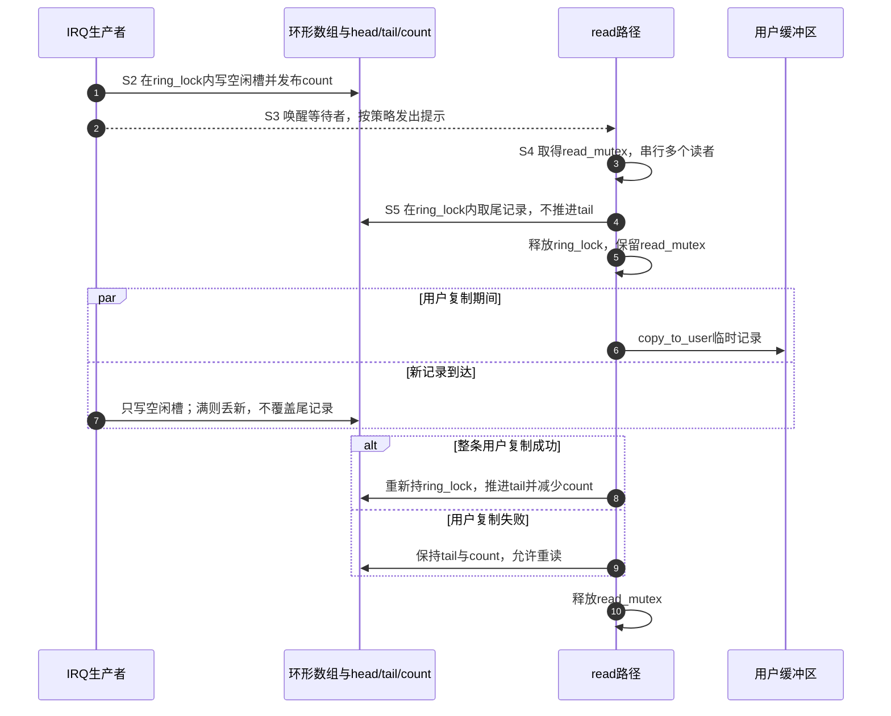
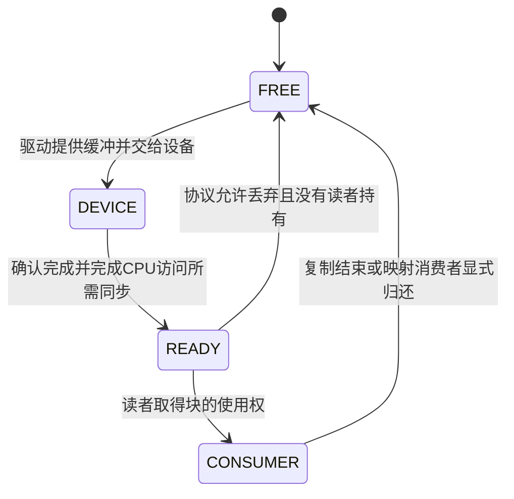
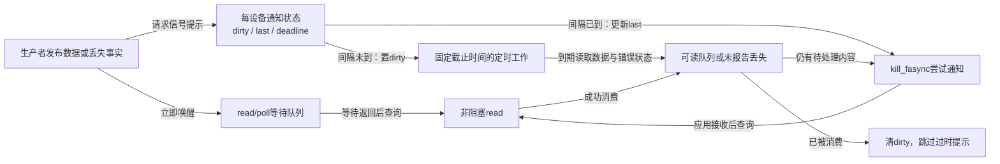

# 第8章\_流式设备与高级场景中的异步通知

上一章的按键驱动保存最新状态：应用晚一点运行，仍可知道按键现在是否有效，却可能看不到中间变化。如果设备送来的是串口命令的字节、连续采样点，或者必须逐条处理的按键历史，覆盖旧值就破坏了业务内容。此时首先需要改变的是数据保存协议，通知方式并不能替我们把丢掉的内容找回来。

本章先建立有界队列，再追踪“保存、复制、回收”之间的所有权；之后给通知增加批量与限频条件，并用没有后续输入的反例检查它能否继续前进。最后把模型放回 TTY、input 和 Netlink，区分通用提示机制与各子系统自己的数据协议。内核证据仍固定在 NXP Linux 6.12.20 提交 `dfaf2136deb2af2e60b994421281ba42f1c087e0`，见 [源码基线](../../../../../research/source_reading/linux/SOURCE_BASELINE.md#1.201_流式异步通知的队列与限频证据)。

## 8.1\_单槽不能保存历史\_增加队列又能保证多久

假设设备先后产生 A、B、C 三条记录，应用在 C 到达后才运行。上一章的单槽只留下 C。若应用的任务是重建操作顺序，就需要三个独立的保存位置，并保证按 A、B、C 的顺序取出。人手按键也可能需要这种历史；串口也可以只监视当前线路状态。应由数据契约决定用快照还是队列，不能把“GPIO 一定单槽、TTY 一定环形队列”当作设备分类规则。

**环形缓冲区（ring buffer）** 用固定数组循环复用存储位置。`head` 指向下一次写入位置，`tail` 指向最早尚未消费的位置；到达数组末端后回到开头。若只靠两者相等表示空，一种常见实现会空出一格区分满与空，N 格只能保存 N−1 条。本章的模型另外保存 `count`，因此 N 格全部可用，空为 0，满为 N。两种约定都可以成立，不能混用判断式。

把“保存下来”进一步拆开：生产者先写入记录内容，再发布新的 `head/count`；消费者先取得一条确定的记录，成功交付后才推进 `tail/count`。序号在每次生产时统一分配，不是每个数组槽各自加一。否则槽 0、槽 1 都可能第一次输出序号 1，应用无法用它判断全局顺序。

| 时刻 | 容量为 4 的逻辑队列 | head / tail / count | 本次结果 |
| --- | --- | --- | --- |
| 初始 | 空 | 0 / 0 / 0 | 等待数据 |
| 依次写 A、B、C、D | A B C D | 0 / 0 / 4 | head 与 tail 相等，但 count 表明已满 |
| 再写 E，选择丢新策略 | A B C D | 0 / 0 / 4 | E 丢失，丢失计数增加 |
| 成功读 A、B | C D | 0 / 2 / 2 | 两格现在可以复用 |
| 写 F、G | C D F G | 2 / 2 / 4 | 数组回绕，逻辑顺序仍连续 |

队列只能吸收有界的突发与停顿。设输入速率为 R 字节/秒，应用最长暂停 T 秒，暂停开始时还有 B 字节积压，那么仅覆盖这次暂停至少需要 B+R×T 字节空间，还要考虑额外突发与尚未归还的硬件缓冲。长期平均消费速率若低于输入速率，增大队列只是推迟满的时刻。

例如每秒 100000 个采样点，每点 2 字节，数据率为 200000 字节/秒。每 1024 点组成一块，则一块 2048 字节、约每 10.24 毫秒完成一次，即每秒约 97.66 块。八块共 16384 字节，在理想空队列开始、全部空间都能积压的条件下，相当于 81.92 毫秒的输入量；如果其中一块正在被设备写、另一块被用户持有，不能仍把八块全算成可用队列容量。一个 20 毫秒的消费停顿至少增加 4000 字节积压，而把通知再推迟 10 毫秒还可能增加 2000 字节。

这也解释为什么“减少信号次数”不会自动提高吞吐：数据仍以原速率进入，延后唤醒还增加了等待期间的存储需求。优化应同时观察数据吞吐、队列高水位和延迟，而不是只看 SIGIO 数量变小。

## 8.2\_用户正在复制一块数据\_生产者能否复用它

上一节把读操作写成一个动作，真实驱动却不能这样省略时间。`copy_to_user()` 可能缺页、睡眠或部分失败。如果读者先推进 tail，解锁后再从旧槽复制，生产者可能已经把该槽当作空闲位置重写。此时应用拿到的头部和负载甚至可能来自不同批次。

先选定一个能证明的简单方案：生产者来自硬中断，满时 **丢弃新记录**；多个读者由 `read_mutex` 串行；数组索引与计数由 `ring_lock` 自旋锁保护。生产者只写空闲槽，不修改 tail，也不覆盖未消费记录。读者取得 `read_mutex` 后，在 `ring_lock` 内把尾记录复制到内核临时变量，但暂不推进 tail；随后释放自旋锁，进行用户复制，整条成功后再持自旋锁提交消费。复制失败则保留尾记录供重试。

这里有两个保证：`read_mutex` 阻止另一个读者提前消费同一条记录；尚未推进的 tail 使生产者仍把该槽算作占用。即使满时新输入被丢弃，用户当前读取的记录也不变。代价是用户复制期间占用一格容量，慢读者还会延迟其他读者。



这个证明有明确条件。若改成满时覆盖最旧记录，生产者就会修改 tail、复用读者正在处理的槽，不能只改入队函数而保留原来的消费证明。需要引入不可变的独立记录、显式预留状态，或其他所有权交接。记录里若只有指向外部负载的指针，复制结构体也没有复制负载，更没有保住负载寿命；必须一起持有该块的引用或所有权。

字节流和整条记录还需区分。字节流可以返回已经成功复制的前缀，并只提交该前缀的消费；固定记录接口则可约定整条成功才消费，失败时用户缓冲区可能部分改变，应用不得解析失败结果。不能在已成功交付一些字节后无条件只返回 `-EFAULT`，也不能对在线空队列返回 0 冒充文件结束。`O_NONBLOCK`、等待重查和 poll 登记顺序仍遵守前两章的契约。

把采样块交给用户时，另定义接口头部的序号、有效样本数、负载长度及字节序，并验证长度乘法不会溢出、不会超过块容量。内核内部结构可能含指针、布尔值和填充字节，不能直接把它的前几字节当作用户头部复制。序号与累计计数还要规定位宽、回绕或饱和行为；后面的C模型只运行计数和时间均不回绕的短序列，只验证队列协议，不替代这个ABI设计；实际驱动不能照抄它的普通大小比较来处理计数回绕。

### 8.2.1\_DMA完成也需要先交接缓冲区所有权

**直接内存访问（Direct Memory Access，DMA）** 让设备直接访问内存。它减少处理器逐字节搬运，但不会消除“谁现在可以改这块内存”的问题。采集块通常经历下面这条路径：



FREE 表示可重新分配，DEVICE 表示设备可能写入，READY 表示内容已经可以供读者取得，CONSUMER 表示仍被消费路径持有。它们是本章为了推理定义的块所有权状态，不是某个通用 DMA API 自带的四个枚举值。

处理器看见“DMA 完成中断”后，还须按实际映射类型和设备协议确认数据可供 CPU 使用。流式映射的重复访问可能需要 `dma_sync_single_for_cpu()`，再次交给设备前需要相应的 `dma_sync_single_for_device()`；一致性分配也不意味着描述符字段发布可以省掉顺序要求。具体 DMA 方向、缓存维护及完成条件由实际驱动决定，不能从 fasync 调用反推出来。

通过 `mmap` 将块映射给用户，也只是减少某些复制，仍需规定哪些块可读、用户怎样归还、设备何时可复用，以及解绑怎样处理存活映射。`read()` 返回或一次 SIGIO 并不是任意映射消费者已经释放块的证明。没有对应硬件和完整 DMA 协议时，不应把一个仅有 `void *data` 的结构体称作可运行采集驱动。

> 依据：[DMA API HOWTO](https://github.com/nxp-imx/linux-imx/blob/dfaf2136deb2af2e60b994421281ba42f1c087e0/Documentation/core-api/dma-api-howto.rst) 的一致性映射、流式映射与同步说明。本文建立所有权约束，不宣称某个 i.MX6ULL ADC 或板载设备已经具备所举的采样与 DMA 通路。

## 8.3\_通知少一点\_怎样避免数据已经到了却无人再醒来

队列解决了保存位置，应用还需要知道何时再读。可以每批数据发布后通知，也可以只在空变非空时通知。后一种策略减少积压期间的重复提示，但要求消费者醒来后持续推进消费：如果只读一条就等待下一次“空变非空”，而队列从未读空，就可能不再收到提示。

应用通常用非阻塞读取循环处理已有数据，直到 `EAGAIN`。为避免一个持续输入的设备饿死其他工作，还可以设单轮处理预算；预算用完但仍可能有数据时，应把该设备放进本地待处理列表，稍后继续，不能把它遗忘直到新边沿。采用电平触发 poll/epoll 时，就绪状态仍可再次返回；采用边沿触发或只依赖一次 SIGIO 的路径时，这个本地继续执行责任尤其重要。收到可读提示也不保证随后的阻塞 read 一定不会睡眠，因为其他消费者可能抢先取走数据，所以事件循环通常保持 fd 非阻塞。

再增加“至少相隔 10 毫秒才发一次信号”。若只在新输入到达时检查时间，会出现下面的停滞：

| 时刻 | 数据与应用动作 | 只检查间隔的错误实现 |
| --- | --- | --- |
| 0 ms | A 到达，发信号；应用读空后睡眠 | 记住最后通知时刻 0 |
| 1 ms | B 到达，队列重新变非空 | 距上次不足 10 ms，跳过通知 |
| 10 ms | B 仍在，之后没有新输入 | 没有任何代码被安排执行 |
| 更晚 | 应用继续睡眠 | 队列有数据，却等不到下一次提醒 |

如果同一条件还控制 `wake_up_interruptible()`，连阻塞 read/poll 的等待者也被一起饿住。修复不在于把时间比较从大于改成大于等于，而在于 **保存一项尚未完成的通知责任，并安排将来执行它**。

每个设备维护 `dirty`（有待提示的变化）、`last`（最后通知时间）和 `deadline`（已经安排的补发时刻）。未到间隔时置 dirty，并把定时工作安排在固定的 last+interval；后续输入可以继续积累，但不能把该截止时间一再后推，否则限频变成了上一章的末沿去抖。到期回调即使没有新数据到达也要运行，重新检查仍有可读数据或待报告错误才发提示。若其他路径已经读空，可以取消这次过时提示。



在真实驱动中，这些通知字段需要同一套并发保护，到期回调与新输入不能互相清掉对方的 dirty；停止生产后还要同步取消定时工作，再释放状态。本章下一节的确定性模型只展示这个调度责任，不用单线程程序冒充内核并发证明。阻塞等待的唤醒与信号限频分开，数据一旦满足读取条件就可唤醒，避免把可用数据隐藏到定时器以后。

按“累计 N 块才通知”同样需要尾部规则：只来了 N−1 块以后永久停止输入时，谁把它交出去？可用最长等待时间、结束标记或明确的刷新操作收尾。可配置的快、中、慢模式也必须给出具体阈值、截止时间、配置改变时如何处理待发责任；仅增加几个模式名称不是实现。

## 8.4\_队列满了\_丢失报告也不能再被挤掉

容量已经有限，就必须规定满时丢谁。丢新记录保住已经排队的数据，但不会保住完整历史；覆盖旧记录倾向保留近期内容，但若记录是增量操作，丢掉一个前提也可能使最新记录无法解释。可睡眠的软件生产者可以等待空间或返回错误，硬中断不能睡眠；把工作移到线程里也不会自动让外设停止产生数据。真正的反压还需要设备暂停、流控或上游可重试的协议。

| 策略 | 保住了什么 | 必须承担的后果 |
| --- | --- | --- |
| 满时丢新 | 已入队记录不会被新输入覆盖 | 最新数据缺失；生产序号与丢失计数必须继续变化 |
| 满时丢旧 | 尽量保留近期内容 | 读者持有的块不能被复用；增量语义可能需要重同步 |
| 暂停或拒绝生产 | 有条件地避免继续积压 | 只在源可暂停或可重试时成立；设备内部也可能已溢出 |
| 增大队列 | 延长可容忍停顿 | 增加内存与最坏排队延迟，不能修复长期速率失衡 |

只在满队列中“再插一条 DROP 标记”并不充分。这里 DROP 只是自定的丢失报告名称。标记也占位置；腾出一格后插入标记，再不检查容量就插入正常事件，会破坏队列的满空不变量。若标记本身被覆盖，读者还可能永远不知道发生过丢失。

一种简单的自定协议把累计 `lost_total` 放在数据队列外，另存 `reported_loss` 表示已成功交给消费者的累计值。两者不同就有一条虚拟丢失报告可读，不消耗数据槽。消费者成功复制快照 L 后，只把 reported_loss 更新到 L；不能无条件把 lost_total 清零，因为复制期间可能又出现新丢失。若有多个独立消费者，则“谁已经看过报告”的确认状态也应按消费者保存，不能继续共享一个确认值冒充每人都已知。

这个报告只说明“截至快照时累计丢了多少”，不精确定位每个历史缺口。它可能先于仍排队的旧数据被读出，也不是 input 的 `SYN_DROPPED` 协议。需要准确缺口位置时，应另外定义序号范围、代次或重同步边界；绝不能把丢失标记数量当成丢失记录数。

还要防止错误报告饿死数据：队列一直满、丢失不断增加时，若每次 read 都优先返回新的丢失报告，数据槽永远腾不出来。下面的模型增加 `data_turn`，每交付一次丢失报告，下一次有数据时先交付一条数据，再允许报告更新。它规定的是共享流的公平顺序，不承诺多个读者各自取得所有报告。

### 8.4.1\_运行一个同时检查队列与延迟补发的模型

下面是完整C11程序，保存为 `stream_model.c`。数组加索引实现容量为4的环形队列；`struct queue`保存队列状态，`struct notifier`保存一个设备的通知状态。`read_one()`返回的结构体用kind区分数据、累计丢失报告、暂时无数据和复制失败；只有前两种结果的number有意义，分别表示生产序号和累计丢失数。它们是本例的私有协议，不是Linux的返回类型。

状态操作按单线程顺序执行，没有伪造自旋锁。`copy_ok=false`注入整条交付失败，`run_due()`模拟已安排的到期回调；`scheduled`区分有没有截止点，`has_last`区分是否曾经发过提示，避免把合法时刻0当作不存在。通知日志记录的是 `kill_fasync` **调用尝试** 的类比，不代表真实SIGIO接收数量。日志有16格，超出即报错，不能静默丢掉测试证据；计数和模型时间只在本例不回绕的小范围内使用。

```c
#include <stdbool.h>
#include <stddef.h>
#include <stdio.h>
#include <stdlib.h>

enum { CAPACITY = 4, MAX_NOTICES = 16 };
enum read_result { DATA, LOSS_TOTAL, WOULD_BLOCK, COPY_FAILED };
struct record { unsigned sequence; char value; };
struct queue {
    struct record slots[CAPACITY];
    unsigned head, tail, count, next_sequence, lost_total, reported_loss;
    bool data_turn;
};
struct result { enum read_result kind; unsigned number; char value; };
struct notifier {
    unsigned interval, last, deadline, notices[MAX_NOTICES], notice_count, wakeups;
    bool has_last, scheduled, dirty;
};

static void require(bool ok, const char *message)
{
    if (!ok) {
        fprintf(stderr, "FAIL: %s\n", message);
        exit(EXIT_FAILURE);
    }
}

static bool readable(const struct queue *q)
{
    return q->count > 0 || q->lost_total > q->reported_loss;
}

static bool push(struct queue *q, char value)
{
    unsigned sequence = q->next_sequence++;
    /* 满时丢新，生产序号仍推进；丢失事实保存在队列外。 */
    if (q->count == CAPACITY) {
        ++q->lost_total;
        return false;
    }
    q->slots[q->head] = (struct record){sequence, value};
    q->head = (q->head + 1) % CAPACITY;
    ++q->count;
    return true;
}

static struct result read_one(struct queue *q, bool copy_ok)
{
    unsigned loss_snapshot = q->lost_total;
    if (loss_snapshot > q->reported_loss && (!q->data_turn || !q->count)) {
        if (!copy_ok)
            return (struct result){.kind = COPY_FAILED};
        q->reported_loss = loss_snapshot;
        q->data_turn = true; /* 让下一条数据先行，避免报告饿死数据。 */
        return (struct result){LOSS_TOTAL, loss_snapshot, 0};
    }
    if (!q->count)
        return (struct result){.kind = WOULD_BLOCK};
    struct record record = q->slots[q->tail];
    if (!copy_ok)
        return (struct result){.kind = COPY_FAILED};
    q->tail = (q->tail + 1) % CAPACITY;
    --q->count;
    q->data_turn = false;
    return (struct result){DATA, record.sequence, record.value};
}

static void send_notice(struct notifier *n, unsigned now)
{
    require(n->notice_count < MAX_NOTICES, "notice log full");
    n->notices[n->notice_count++] = now;
    n->last = now;
    n->has_last = true;
}

static void request_notice(struct notifier *n, unsigned now)
{
    /* 数据已发布：等待队列的唤醒不跟随信号限频。 */
    ++n->wakeups;
    n->dirty = true;
    if (!n->has_last || now >= n->last + n->interval) {
        send_notice(n, now);
        n->dirty = false;
        n->scheduled = false;
    } else if (!n->scheduled) {
        n->deadline = n->last + n->interval;
        n->scheduled = true; /* 新输入不得无限推后已有截止点。 */
    }
}

static void run_due(struct notifier *n, unsigned now, bool still_readable)
{
    if (!n->scheduled || now < n->deadline)
        return;
    n->scheduled = false;
    if (n->dirty && still_readable)
        send_notice(n, now);
    n->dirty = false;
}

int main(void)
{
    struct queue q = {.next_sequence = 1};
    struct notifier n = {.interval = 10};
    for (char value = 'A'; value <= 'F'; ++value)
        (void)push(&q, value);
    require(q.count == 4 && q.lost_total == 2, "bounded queue");
    require(read_one(&q, false).kind == COPY_FAILED, "failed copy");
    require(q.reported_loss == 0, "loss not acknowledged");
    struct result result = read_one(&q, true);
    require(result.kind == LOSS_TOTAL && result.number == 2, "loss report");
    printf("loss_total=%u\n", result.number);
    for (char value = 'A'; value <= 'D'; ++value) {
        result = read_one(&q, true);
        require(result.kind == DATA && result.value == value, "data order");
        printf("data sequence=%u value=%c\n", result.number, result.value);
    }
    require(!readable(&q), "drained queue");
    require(push(&q, 'G'), "space reclaimed");
    result = read_one(&q, true);
    require(result.kind == DATA && result.number == 7 && result.value == 'G', "sequence gap");
    printf("next data sequence=%u value=%c\n", result.number, result.value);
    request_notice(&n, 0);
    request_notice(&n, 1);
    request_notice(&n, 2);
    require(n.scheduled && n.deadline == 10, "fixed deadline");
    run_due(&n, 9, true);
    require(n.notice_count == 1 && n.notices[0] == 0, "not due yet");
    run_due(&n, 10, true); /* 没有新输入也必须完成欠下的提示。 */
    require(n.notice_count == 2 && n.notices[1] == 10 && n.wakeups == 3, "tail delivery");
    printf("notice attempts: %u %u; wakeups=%u\n", n.notices[0], n.notices[1], n.wakeups);
    return EXIT_SUCCESS;
}
```

在Linux终端进入保存文件的目录，先编译：

```sh
cc -std=c11 -Wall -Wextra -Werror -O2 stream_model.c -o stream_model
```

命令启用C11和常用警告，`-o`指定生成的程序名。编译成功后运行：

```sh
./stream_model
```

预期先输出 `loss_total=2`，再输出序号1～4的A～D，随后输出序号7的G，最后输出 `notice attempts: 0 10; wakeups=3`。A～F的输入只有四条能留在队列，但E、F的丢失不会因为没有后续输入而消失；G的序号让读者看见生产历史中存在缺口。通知模型中，1 ms、2 ms的变化都欠下一项提示，10 ms的回调补发，后续到达没有把期限改成11、12 ms。`require()`即使定义NDEBUG也继续核对这些结果，失败时返回非零退出状态。

可以做三次小修改来检验理解。第一，把CAPACITY改成2，同时把主程序的count、loss和输出循环预期改为2、4以及只读A～B；随后G仍应为序号7。第二，在取得丢失报告之后、读取A之前调用一次 `read_one(&q, false)`，它应返回COPY_FAILED且tail、count不变。第三，把10 ms回调的 `still_readable`改为false，同时把最终预期改为只有时刻0的一次通知，输出也只读第一格日志；因为别的读取路径已经消费完毕，这次到期提示应被跳过。不要直接删除检查来得到“通过”，而要解释预期为何随条件改变。

这个模型没有 Linux 文件操作、真实时间、信号投递或 DMA。将其映射到驱动时，队列临界区与读者串行责任按上一节的所有权协议落实，通知回调与生产者按同一锁保护 dirty/deadline。模型证明有限状态下的队列和补发结果，目标环境仍需验证并发交错、用户复制、退出及真实数据率。

## 8.5\_TTY的可读条件为什么不是硬件FIFO非空

模型把一条完整记录当作可读单位，真实终端还有中间加工层。**TTY** 是 Linux 终端子系统的传统名称；串口控制器可以先把收到的字符放入硬件 **先进先出缓冲（First In, First Out，FIFO）**，终端 **线路规程（line discipline）** 再决定行编辑、特殊字符与读取规则。常用 `N_TTY` 线路规程在规范模式下可以等到一行完成才对应用形成可读输入，因此“硬件已经收到一个字节”不一定意味着应用现在能读取一整行。

在核对的 `drivers/tty/n_tty.c` 中，`read_head` 表示接收处理推进的位置；`canon_head` 表示规范行边界；`commit_head` 表示非规范处理已提交的位置；`read_tail` 表示消费者推进到哪里。它们位于该终端线路规程的 `struct n_tty_data`，通过 `tty->disc_data` 找到，不是四个独立驱动的队列。

| 模式或操作 | 关键状态与条件 | 对本章模型的修正 |
| --- | --- | --- |
| 规范输入，且没有外部处理模式 | `canon_head != read_tail` | 有完成的规范输入边界才认为可用，不能只看接收 FIFO |
| 非规范输入的 poll 检查 | `commit_head - read_tail` 达到所需数量 | `VMIN` 表示最少字符配置，`VTIME` 表示读取计时配置；此版本 poll 在 VTIME 为 0 且 VMIN 非零时使用 VMIN，否则阈值为 1 |
| 规范行结束或非规范提交 | 先发布相应 head，再走通知路径 | 不是所有路径都只检查从空到非空 |
| 应用 read | 按线路规程取已提交内容并推进 tail | 一次通知与一次 read 的字符数没有固定比例 |
| 挂断或错误 | 另有终端状态与 poll 返回位 | 可读字节条件不能代替终端寿命判断 |

`VMIN/VTIME` 是终端配置中的控制字符槽名称，具体 read 行为还受规范模式和非阻塞标志影响；上表只给出当前源码 poll 谓词，不能把它直接当作所有 read 的等待公式。规范模式的 EOF 控制字符也不能用“read 返回 0 只可能设备解绑”解释。应用应遵守所打开终端的具体契约。

> 依据：[n_tty.c](https://github.com/nxp-imx/linux-imx/blob/dfaf2136deb2af2e60b994421281ba42f1c087e0/drivers/tty/n_tty.c) 中 `input_available_p()`、`n_tty_poll()`、`n_tty_receive_char_special()` 与接收提交路径。实现使用 release 发布及配对的 acquire 读取来约束数据与索引的观察顺序；这套并发保证不来自 `kill_fasync()`，不能把通知函数当作所有数据的通用内存屏障。

试着预测：规范模式下仅输入字母 A，没有行结束字符，底层 RX（接收）计数增加但应用 poll 尚未返回可读，这两份观察可以同时成立。若把它们当作同一个“收到事件”计数，就会错误地把线路规程的正常等待诊断成 fasync 丢通知。

## 8.6\_input与Netlink改变的是数据协议\_不只是提醒方式

若设备产生的是按键、坐标等输入，应用往往需要标准语义，而不只是自定字节流。input 驱动通过 `input_report_key()` 等接口报告状态，通过 `input_sync()` 建立报告边界；evdev 再为打开它的客户端保存事件队列。`EV_KEY` 表示按键类别，`EV_ABS/EV_REL` 分别表示绝对值与相对变化，`EV_SYN/SYN_REPORT` 表示一批相关更新的边界。这些是输入协议的类型和编码，不是 fasync 的信号原因码。

`struct input_event` 除 type、code、value 外还包含时间字段，其用户 ABI 布局受目标类型定义影响，应用应使用系统 `<linux/input.h>`，不能自行声明一个只有三个字段的近似结构体来读设备。通常用 read/poll 就能消费 evdev；evdev 也实现了 fasync，在 `SYN_REPORT` 处对客户端发出提示，所以“input 与 fasync 二选一”并不是正确的层次划分。

### 8.6.1\_SYN\_DROPPED要求重建状态\_不是补回历史

evdev 的客户端队列溢出时，`__pass_event()` 的处理会丢弃未消费事件，留下 `EV_SYN/SYN_DROPPED` 标记与最新事件，并调整报告边界。`SYN_DROPPED` 表示客户端不能继续假设事件流完整，它本身不提供丢失数量，也不证明之后的普通事件已经替应用完成重同步。

应用应忽略从这个标记之后直到 **下一个 SYN_REPORT（包含它）** 的事件，再使用相应 `EVIOCG*` 查询获取当前设备状态，例如当前按键状态或绝对轴状态。这些 ioctl 是输入协议提供的状态查询，不是一个通用的“恢复所有丢失事件”指令。重新取得当前按键状态不能复原每次按下时间，丢掉的相对移动增量和采样波形也不能凭一个快照重新生成。

> 规范依据：[event-codes.rst 的 SYN_DROPPED](https://github.com/nxp-imx/linux-imx/blob/dfaf2136deb2af2e60b994421281ba42f1c087e0/Documentation/input/event-codes.rst)；实现见 [evdev.c](https://github.com/nxp-imx/linux-imx/blob/dfaf2136deb2af2e60b994421281ba42f1c087e0/drivers/input/evdev.c) 的 `__pass_event()`、`evdev_client` 和 fasync 回调；结构定义见 [input.h](https://github.com/nxp-imx/linux-imx/blob/dfaf2136deb2af2e60b994421281ba42f1c087e0/include/uapi/linux/input.h)。

### 8.6.2\_管理消息需要结构\_多播仍可能丢失

另一类需求是把设备或系统的配置、状态变化交给多个管理程序。**Netlink** 是 Linux 内核与用户空间之间的一类套接字通信接口；Generic Netlink 在其中提供动态注册的消息族、命令及属性机制。消息族定义某个接口的操作和数据语义，多播组定义哪些订阅者接收相关通知。消息通过带固定头部及属性的消息缓冲区进入套接字接收队列，应用用 `recvmsg()` 等读取；属性采用类型、长度、值组织，便于添加可识别的新字段。

因此 Netlink 可以直接携带结构化状态消息，而 SIGIO 只是让应用再查询已有设备接口。选择前应先查是否已有适合该子系统的消息族，而不是每个私有按键都创建一个新族。一个只有 `genlmsg_multicast()`、却没有族注册、属性规则、权限、组编号含义和接收恢复协议的片段，还不是可运行的接口。

多播并不等于可靠送达。接收缓冲不足等情况可能丢失消息，内核 `netlink_overrun()` 会记丢失，并在相应选项允许时报告 `ENOBUFS`（缓冲不足）。应用需要按该消息族的协议重新查询或转储当前状态；不能因为换成结构化消息，就省掉丢失识别与重同步。

> 依据：[Netlink introduction](https://github.com/nxp-imx/linux-imx/blob/dfaf2136deb2af2e60b994421281ba42f1c087e0/Documentation/userspace-api/netlink/intro.rst) 的套接字、Generic Netlink 与属性说明；[af_netlink.c](https://github.com/nxp-imx/linux-imx/blob/dfaf2136deb2af2e60b994421281ba42f1c087e0/net/netlink/af_netlink.c) 的 `netlink_overrun()` 和多播投递失败路径。

回到同一组选型问题：如果应用只想从既有字符设备取得数据，read/poll 已经提供保存与等待契约，有明确 SIGIO 需求时再增加 fasync；如果业务就是标准输入事件，则复用 input/evdev 的语义；如果要维护可查询、可扩展的管理对象，则检查适用的 Netlink 接口。吞吐数据是否经过 DMA、是否映射给用户，是另一条数据搬运选择轴，不应该与这三者混成“更先进通知机制”的排名。

## 8.7\_测量五种数量\_才能判断瓶颈在哪里

“信号风暴”可以描述通知处理挤占业务时间的现象，但仅看 SIGIO 打印很多，不能证明每个硬件事件都触发一次上下文切换。标准 SIGIO 会合并，信号目标可能处于屏蔽、待决或已经运行状态；把信号作为文件记录读取的 `signalfd` 能整理接收控制流，也不会自动降低驱动调用 `kill_fasync` 的次数。

对同一输入负载，应分别记录：生产记录数、成功入队与丢失数、通知尝试次数、实际接收信号数、成功消费数，并观察队列高水位、处理延迟及 CPU 时间。独立 open 的 file 可以形成多个订阅节点；`dup/fork` 共享一个 file，并不按进程数复制节点。进程组目标还可能向组内多个进程投递，不能用“fd 数量×IRQ 数量”直接计算成本。

| 观察量 | 它能说明什么 | 它不能单独说明什么 |
| --- | --- | --- |
| 输入、入队、消费、丢失计数 | 哪段数据生命周期存在积压或缺口 | 信号路由是否正确 |
| `kill_fasync` 调用次数 | 驱动尝试通知的频率 | 最终生成或接收了同样多的信号 |
| 应用接收 SIGIO 次数 | 接收路径实际处理了多少次提示 | 数据是否无损，或每条记录的边界 |
| `/proc/PID/status` 的 SigPnd、ShdPnd | 线程与线程组待决信号位图 | 相同标准信号曾经合并过多少次 |
| 同文件的 SigQ | 相关用户计数域的排队信号计数与进程限制 | 该进程独占的 SIGIO 队列深度 |
| CPU 使用率、时延分布、队列高水位 | 通知与消费策略的实际代价 | 某个固定 kHz 阈值对所有平台都成立 |

> SigQ 字段的本版本证据是 [fs/proc/array.c](https://github.com/nxp-imx/linux-imx/blob/dfaf2136deb2af2e60b994421281ba42f1c087e0/fs/proc/array.c) 的 `task_sig()`：计数取自任务对应的 `ucounts`，限制取自 `RLIMIT_SIGPENDING`。不能把它称作“标准 SIGIO 队列快满了”。

实际诊断先固定采样率、块大小、客户端数和处理预算，再比较逐批提示、空变非空提示、固定期限补发三种策略。用受控输入核对序号与累计丢失；再用有时限的跟踪观察通知路径，避免在高频中断里逐条打印改变被测负载。input 可使用支持相应设备的事件观察工具，Netlink 需匹配实际消息族；不存在一个通用工具能替三种数据协议判断业务完整性。详细的跟踪与权限步骤放到调试章，本章不凭某个工具名称宣称已经得到性能结论。

最后再检验三项设计。若只收到 N−1 块，批量通知必须有尾部完成路径；若用户复制期间生产者要覆盖同一块，必须先解决所有权；若丢失报告到来，应用只能恢复协议提供的状态，不能假定历史复原。下一章转到应用接收端，建立信号屏蔽、目标设置、同步接收及事件循环，让提示最终进入可控制的执行路径。

上一篇：[P07 中断驱动设备的异步通知实践](P07_中断驱动设备的异步通知实践.md)。
下一篇：[P09 用户态编程 从 SIGIO 到 signalfdepoll](P09_用户态编程_从_SIGIO_到_signalfdepoll.md)。
