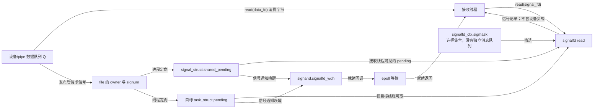
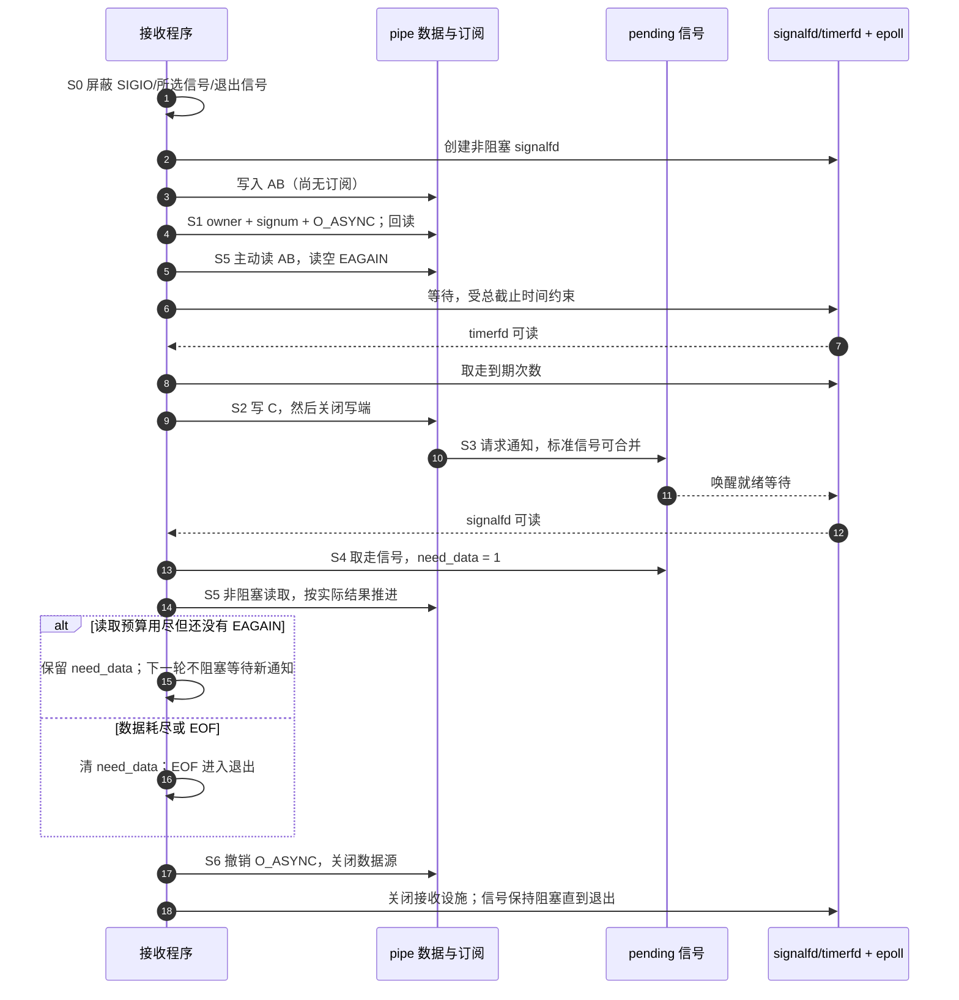

# 第9章\_用户态编程\_从\_SIGIO\_到\_signalfdepoll

第八章已经把数据保存和通知分开：队列承载字节或记录，通知只要求用户重新检查。现在把视角移到接收进程：即使驱动完全正确，用户在配置期间没有接住信号，或在检查标志后才去睡眠，仍可能退出或漏掉继续读取的机会。本章沿着 **准备接收 → 订阅 → 检查现状 → 接收提示 → 非阻塞消费 → 撤销** 建立同一套协议，再选择 handler、同步信号等待或 signalfd 来落实。

内核事实沿用本专题固定的 NXP Linux 6.12.20 提交，见[源码基线](../../../../../research/source_reading/linux/SOURCE_BASELINE.md#1.202_用户态异步通知的接收与退出协议)。本章完整程序是独立 Linux 进程，所用信号由它独占；库、已有多线程服务和任意设备记录协议不能只换路径就直接套用。

## 9.1\_在开启通知前先安排好接收者

假设一个程序打开设备，先启用 `O_ASYNC`，随后才创建 signalfd。设备恰在中间产生数据，内核按 owner 发送 SIGIO，而此时进程没有屏蔽它，也没有安装处理函数。SIGIO 的默认动作是终止进程；后面的 signalfd 根本来不及建立。反过来先屏蔽信号，信号可以保持待处理，稍后由接收代码取走。**先准备接收，是为了关闭这段窗口，并不是为了延迟驱动生产。**

接收方案也不能只考虑启动后的新事件。设备在登记前可能已经有数据，而驱动只在状态变化时通知；如果启用后直接等下一条信号，旧数据就会一直留下。因而 S1 要包括一次主动非阻塞读取。用本书统一阶段把责任排清：

| 阶段 | 用户执行与状态位置 | 到下一阶段的条件 |
| --- | --- | --- |
| S0 准备 | 在当前线程的信号掩码中屏蔽接收集合；同步等待或 signalfd 方案不解掩。为 handler 方案安装处理动作 | 接收路径先于通知源可用；实时信号方案同时接住回退 SIGIO |
| S1 订阅 | 新开 `O_NONBLOCK` 的文件，设置 owner、所选信号、`O_ASYNC`；回读标志并检查已有数据 | owner/信号/文件状态配置成功，已有数据已处理或已安排继续处理 |
| S2/S3 生产与提示 | 驱动保存数据，再唤醒等待者、请求信号；数据和 pending 信号属于两套状态 | 用户不能从信号次数推出队列长度 |
| S4 接收 | handler 标志、同步等待返回值或 signalfd 记录，令用户的 `need_data` 变为真 | 只表示该检查哪些当前仍有效的数据源 |
| S5 消费 | 非阻塞 `read`，处理实际返回的数据；耗尽返回 `EAGAIN`；EOF 按设备契约终止 | 预算耗尽时用户主动继续，不能无条件等待新的边沿 |
| S6 退出 | 撤销异步订阅、关闭源，再释放接收设施；处理遗留 pending 与线程交接 | 不让尚未处理的 SIGIO 在错误的处置下突然解掩 |

这里有三种不同的配置：`sigaction` 的处置在进程线程间共享，信号掩码属于各线程，owner/所选信号/`O_ASYNC` 属于打开文件对象。`O_CLOEXEC` 则控制这个描述符是否跨 `exec` 保留，不属于前述文件状态标志。

### 9.1.1\_fcntl每一步究竟配置什么

先确定了接收顺序，再看配置接口；下面的表是协议细节，不替代上面的先后证明。用户代码包含 `<fcntl.h>`，使用用户接口名 `O_ASYNC`；GNU 扩展声明需要在头文件之前定义 `_GNU_SOURCE`。

| 操作 | 参数与效果 | 必须检查的边界 |
| --- | --- | --- |
| `F_GETFL` | 返回文件状态标志 | `-1` 才是失败；后续保留已有可修改位 |
| `F_SETOWN` | 正 PID 指向进程，负值指向进程组；本章用 `getpid()` | 不代表“当前调用线程”；修改共享 file 会影响别名 |
| `F_SETOWN_EX` | 指针指向含 `type`、`pid` 的 `struct f_owner_ex` | `F_OWNER_PID`、`F_OWNER_TID`、`F_OWNER_PGRP` 分别表示进程、线程、进程组 |
| `F_GETOWN_EX` | 回读 type/pid | 比只看一个带正负号的 owner 值更清楚 |
| `F_SETSIG` / `F_GETSIG` | 设置/查询该 file 的异步通知信号选择 | 0 与 SIGIO 不是完全相同的设置，见下表 |
| `F_SETFL` | 以旧标志为基础增加 `O_ASYNC` | 返回成功后仍应回读确认；第五章已说明缺少 fasync 回调时的陷阱 |

`F_GETFL → 修改 → F_SETFL` 并非原子的“只改这一位”。同一打开文件对象若被多个线程配置，仍要在应用里串行化。`F_SETFL` 也不是覆盖 `file->f_flags` 的所有位，只有其契约允许的状态位可改；不能用 `F_SETFL(O_NONBLOCK)` 随意抹掉已有异步状态。

| `F_SETSIG` 参数 | 所请求的行为 | 接收端不能推导什么 |
| --- | --- | --- |
| 0 | 传统普通 SIGIO 通知 | 没有可依赖的 I/O fd/band 信息 |
| SIGIO | 非零选择，走构造 I/O siginfo 的路径，但信号仍是标准 SIGIO | `SA_SIGINFO` 或 signalfd 不会令标准信号自动变为逐次排队 |
| `SIGRTMIN + n` | 选择范围内的实时信号，正常情况下可保留多条信号记录 | 队列有容量限制；发送失败可回退普通 SIGIO，不能据此保证数据无损 |

实时信号编号应在运行时检查不超过 `SIGRTMAX`，不要硬编码体系结构上的数字。其收益是保留更多通知信息，代价是排队资源与消费工作；它不替代第八章的数据队列和丢失协议。固定源码 `fs/fcntl.c:send_sigio_to_task` 明确包含失败回退路径，接收集合必须包括所选实时信号与 SIGIO。

## 9.2\_为什么换成sigaction仍不能拿信号次数读数据

handler 是信号处理函数，它会在一个未屏蔽该信号的线程中打断原执行流。若被打断处正持有日志库或堆分配器内部状态，handler 又调用同一套非可重入功能，就可能破坏状态或等待自己释放锁。因此 handler 通常只置一个简单标志，把日志和协议解析留给正常执行流。

`sigaction` 可以明确配置动作，而 `signal` 的历史接口不能同样清楚地表达这些选项：

| 字段/标志 | 本章需要的作用 | 不应误解为 |
| --- | --- | --- |
| `sa_handler` | 接收一个信号号的处理函数 | 与 `sa_sigaction` 同时启用的第二个函数；实现可让两者共用存储 |
| `sa_sigaction` + `SA_SIGINFO` | 接收信号号、`siginfo_t *`、上下文指针 | 自动生成有效 `si_fd`；信息仍取决于发送来源 |
| `sa_mask` | handler 执行期间额外屏蔽的集合 | 所有线程的永久掩码 |
| 默认同号阻塞 / `SA_NODEFER` | 默认抑制同号递送重入；后者可取消该保护 | 能保护其他线程访问共享对象 |
| `SA_RESTART` | 使部分被打断的系统调用按接口规则重启 | 所有等待都自动重启，或永远不返回 `EINTR` |

一个合适的最小动作是：

```c
static volatile sig_atomic_t need_scan;

static void note_io(int signo)
{
	(void)signo;
	need_scan = 1;  /* 提醒主循环检查，不累计业务事件数。 */
}
```

这只是 handler 片段，**不是完整接收程序**。`sig_atomic_t` 允许这里的简单赋值/读取，`volatile` 防止编译器把这类观察当作普通不变值；两者并不构成线程间队列锁或通用内存顺序协议。把赋值换成 `counter++` 也不能恢复内核已合并的标准信号，主循环“读 counter，再清零”还会覆盖中途到来的更新。设备数据量只能从数据协议、序号与成功读取量得到。

`read` 本身属于 async-signal-safe 接口，不能把它与 `printf`、`malloc`、`pthread_mutex_lock` 一概说成“handler 禁用函数”。但阻塞读、共享 fd 的寿命、解析和处理耗时仍需要协议；如果 handler 调用可能改动 `errno` 的安全函数，还应保存并恢复 `errno`。本章把读取留在正常执行流，便于统一预算、错误和退出处理。[Linux man-pages 的异步信号安全接口表](https://man7.org/linux/man-pages/man7/signal-safety.7.html)给出了接口边界；`sigaction` 的参数见[接口说明](https://man7.org/linux/man-pages/man2/sigaction.2.html)。

### 9.2.1\_检查标志与进入等待之间还差一个原子交接

仅把 handler 写小并不能修复下面的时间线：

| 时刻 | 主循环 | handler / 结果 |
| --- | --- | --- |
| t0 | 检查 `need_scan == 0`，准备调用 `pause` | 暂无信号 |
| t1 | 尚未执行 `pause` | 信号到达，handler 置 1，然后返回 |
| t2 | 调用 `pause` | 已处理的信号不会再唤醒它；若没有新信号就一直等 |

handler 方案应在普通执行期间屏蔽目标信号，持有这个掩码时检查/清标志并安排读取；需要等待时用 `pselect` 或 `sigsuspend` **原子地换成允许递送的掩码并等待**，返回后恢复原掩码。`pselect` 可给出有限超时；每次重试都按单调时钟的总截止时间重算剩余时间，而不是每次 `EINTR` 又重新等完整时长。信号在交接前已经 pending 时，也会在临时解掩期间被递送，窗口才被关闭。重复 `usleep` 检查可以限定某些延迟，但不能当成这个原子交接的证明。

如果程序的任务本来就是等待信号，`sigwaitinfo` / `sigtimedwait` 更直接：始终在用户态保持目标集合阻塞，由调用同步取走可见的 pending 信号，不安装异步 handler。`sigtimedwait` 成功返回信号号，超时返回 `-1/EAGAIN`，被其他未阻塞信号打断可返回 `-1/EINTR`。等待前仍要检查已有数据，等待后仍要非阻塞读取；第六章的软件设备实验已经提供了完整同步等待程序。同步等待和 handler 是两种接收策略，不能让两者竞争同一集合后再假设每一方都收到一份。[同步等待接口](https://man7.org/linux/man-pages/man2/sigwaitinfo.2.html)

## 9.3\_signalfd把接收动作放回事件循环\_没有复制信号队列

当程序还要等待网络、管道和定时任务时，只等信号会把控制流分开。signalfd 提供一个可读描述符，让 `epoll` 同时等待它与其他文件。这里 `epoll` 是就绪聚合器：通知哪些登记对象当前有事件，不执行设备读取，也不保存业务记录。

在固定源码中，`signalfd_ctx` 只保存信号选择掩码。`signalfd_poll` 登记到 `current->sighand->signalfd_wqh`，随后检查调用线程的 `pending` 与线程组的 `shared_pending`；`signalfd_dequeue` 则在信号锁下取走这些 pending 中符合选择的信号。这里的 `current` 是执行该内核路径的线程，**不是创建 signalfd 时永久绑定的线程**。



信号被 signalfd 取走后就不再 pending，不会再由 handler 处理同一份记录。若未正确屏蔽，普通递送与同步读取可能竞争；这不是“一条信号必然复制给两边”。多个 signalfd 选择同一集合也不是广播订阅。标准 SIGIO 的合并规则不会因换用 signalfd 改变。

先有上面的状态模型，下面才是用户接口和记录细节：

| 接口/记录 | 本地阅读契约 |
| --- | --- |
| `signalfd(-1, &mask, SFD_NONBLOCK \| SFD_CLOEXEC)` | 新建描述符；mask 是选择集合，调用本身不替线程屏蔽信号 |
| `signalfd(existing_fd, &mask, flags)` | 更新已有 signalfd 的选择集合，不能用它原子配置整个进程的掩码 |
| `read(signal_fd, records, bytes)` | 缓冲区至少一个 `struct signalfd_siginfo`；正常成功是整记录的整数倍；非阻塞空时 `EAGAIN` |
| `sizeof(struct signalfd_siginfo)` | 固定 UAPI 中为 128 字节；应用包含系统头文件，不自行重造近似结构 |
| `ssi_signo` / `ssi_code` | 信号号与来源/原因。先看来源，才知道其他字段是否有意义 |
| `ssi_fd` / `ssi_band` | I/O 来源布局中的登记 fd 数字、就绪位集合；`POLL_IN` 是原因枚举，`POLLIN` 才是 band 中的一种位 |
| `ssi_pid` / `ssi_uid` | 适用发送来源的进程与用户信息，不是所有来源都有这些值 |
| `ssi_tid` / `ssi_overrun` | POSIX 定时器来源的标识与溢出次数；`ssi_tid` 不是接收线程的 Linux TID |

不能用“`ssi_fd != 0`”判断来源有效，fd 0 也合法；更不能无条件执行 `read(info.ssi_fd, ...)`。订阅时记住的数字可能经 `dup`、关闭和复用后指向另一对象，pending 通知也可能晚于关闭被消费。多数据源程序维护自己的活对象注册表；I/O siginfo 仅作检查候选提示。收到普通/回退 SIGIO 或身份不确定时，重新检查当前受管的全部源。即使 fd 数字仍匹配，也要依赖当前对象的非阻塞结果，而不能据此确认“旧通知属于这个新对象”。

本节的状态落点可在[固定版本 fs/signalfd.c](https://github.com/nxp-imx/linux-imx/blob/dfaf2136deb2af2e60b994421281ba42f1c087e0/fs/signalfd.c)核对；用户可见接口与继承行为见[signalfd 接口说明](https://man7.org/linux/man-pages/man2/signalfd.2.html)。

## 9.4\_用一个有截止时间的程序完成订阅\_消费与退出

先用 Linux pipe 消除板卡变量。pipe 的读端有 fasync 实现：程序在订阅前写入 `AB`，启用后主动读出；250 ms 定时器到期时再写 `C` 并关闭写端，由通知驱动后续读取，最终得到 `ABC` 与 EOF。没有 fork、后台生产进程或虚构设备节点，也不会把一次信号与一个字节强行配对。

下面同一文件还可以接收第六章 `/dev/fasync_lab` 字节流。省略设备路径时运行最多约 3 秒的自测；给路径时观察约 30 秒，记录实际读取字节数，输出 `OBSERVED` 而不是把“运行过”标成通过。超时按单调时钟计算；操作系统调度、系统调用耗时不承诺硬实时截止。`SIGINT`、`SIGTERM` 一起交给 signalfd，正常执行流统一退出。



程序只把 signalfd 和 timerfd 加入 epoll，以便观察信号路径。两者使用默认 **LT（Level-triggered，电平触发）**，只要还有可读内容，后续等待仍可返回。每轮有限批处理避免一直读信号而饿死数据，或一直读数据而无法接收退出请求。若改为 **ET（Edge-triggered，边沿触发）**，预算耗尽后必须为相应对象保留主动再处理责任，不能直接套 LT 的等待方式。

将下列完整代码保存为 `receive_async.c`。它不解析设备记录，只统计字节；第七章 `/dev/async_key` 的 16 字节记录和序号解析仍使用那一章的观察程序。

程序用 `struct receiver` 集中持有五类 fd、原文件标志、所选信号及读进度。`need_data` 表示下一轮应主动读，`eof` 表示数据源已结束，`stopped` 表示收到退出请求；`bytes` 与 `notices` 分开计数。自测的 `sample[3]` 保存实际读出的 ABC，`produced` 防止定时器重复注入 C。这里的几个常量按各自接口解释：

| 常量 | 在程序里的作用 |
| --- | --- |
| `SIG_BLOCK` / `SIG_DFL` | 增加阻塞集合 / 设为默认处置；处置改变时信号已经阻塞 |
| `O_RDONLY` | 数据源只读打开；pipe 的读写端由 pipe2 返回 |
| `EPOLL_CTL_ADD` / `EPOLLIN` | 登记监听对象 / 关注可读就绪 |
| `EPOLLERR` / `EPOLLHUP` | 错误 / 挂断；本例只监听自己的 signalfd、timerfd，出现这些位即失败退出，不把这一策略强加给所有设备 |
| `SFD_NONBLOCK` / `TFD_NONBLOCK` | 分别让信号/定时器描述符非阻塞 |
| `SFD_CLOEXEC` / `TFD_CLOEXEC` / `EPOLL_CLOEXEC` | 各创建接口的跨 exec 关闭标志 |
| `CLOCK_MONOTONIC` | 不因调整日历时间而跳变的单调时钟，供总期限和定时器使用 |
| `EPROTO` / `EIO` / `ENOTSUP` | 不符合本例记录协议 / I/O 失败 / 未建立异步能力，作为失败原因 |
| `EXIT_SUCCESS` / `EXIT_FAILURE` | C 程序退出状态；`PASS`、`OBSERVED` 则是本例输出标签 |

```c
#define _GNU_SOURCE
#include <errno.h>
#include <fcntl.h>
#include <signal.h>
#include <stdint.h>
#include <stdio.h>
#include <stdlib.h>
#include <string.h>
#include <time.h>
#include <unistd.h>
#include <sys/epoll.h>
#include <sys/signalfd.h>
#include <sys/timerfd.h>

struct receiver {
	int data_fd, signal_fd, timer_fd, epoll_fd, writer_fd;
	int old_flags, selected_signal, test_mode, produced;
	int need_data, eof, stopped;
	size_t bytes, notices;
	unsigned char sample[3];
};

static int64_t now_ms(void)
{
	struct timespec now;
	if (clock_gettime(CLOCK_MONOTONIC, &now) < 0)
		return -1;
	return (int64_t)now.tv_sec * 1000 + now.tv_nsec / 1000000;
}

static int add_input(int epoll_fd, int fd)
{
	struct epoll_event event = { .events = EPOLLIN };
	event.data.fd = fd;
	return epoll_ctl(epoll_fd, EPOLL_CTL_ADD, fd, &event);
}

/* 每轮最多尝试 32 次读取；预算耗尽时保留主动继续读取的责任。 */
static int drain_data(struct receiver *ctx)
{
	unsigned char buffer[256];
	for (int i = 0; i < 32; i++) {
		ssize_t count = read(ctx->data_fd, buffer, sizeof(buffer));
		if (count > 0) {
			if (ctx->test_mode) {
				if ((size_t)count > sizeof(ctx->sample) - ctx->bytes) {
					errno = EPROTO;
					return -1;
				}
				memcpy(ctx->sample + ctx->bytes, buffer, (size_t)count);
			}
			ctx->bytes += (size_t)count;
			continue;
		}
		if (count == 0) {
			ctx->eof = 1;
			ctx->need_data = 0;
			return 0;
		}
		if (errno == EINTR)
			continue;
		if (errno == EAGAIN || errno == EWOULDBLOCK) {
			ctx->need_data = 0;
			return 0;
		}
		return -1;
	}
	return 0;
}

/* LT 监听允许有限批处理；仍有待处理信号时下一轮继续就绪。 */
static int drain_signals(struct receiver *ctx)
{
	struct signalfd_siginfo records[8];
	for (int batch = 0; batch < 4; batch++) {
		ssize_t count = read(ctx->signal_fd, records, sizeof(records));
		if (count < 0) {
			if (errno == EINTR)
				continue;
			if (errno == EAGAIN || errno == EWOULDBLOCK)
				return 0;
			return -1;
		}
		if (count == 0 || count % sizeof(records[0]) != 0) {
			errno = EPROTO;
			return -1;
		}
		for (size_t i = 0; i < (size_t)count / sizeof(records[0]); i++) {
			unsigned int signo = records[i].ssi_signo;
			if (signo == SIGINT || signo == SIGTERM)
				ctx->stopped = 1;
			else if (signo == SIGIO ||
				 signo == (unsigned int)ctx->selected_signal) {
				ctx->notices++;
				ctx->need_data = !ctx->eof;
				/* 单数据源：不把 ssi_fd 当成可直接使用的活对象。 */
			}
		}
	}
	return 0;
}

static int timer_event(struct receiver *ctx)
{
	uint64_t expirations;
	ssize_t count = read(ctx->timer_fd, &expirations, sizeof(expirations));
	if (count < 0 && (errno == EINTR || errno == EAGAIN))
		return 0;
	if (count != (ssize_t)sizeof(expirations) || expirations == 0) {
		if (count >= 0)
			errno = EPROTO;
		return -1;
	}
	/* 实验只产生一次 C；积压的定时次数不重复生产。 */
	if (ctx->test_mode && !ctx->produced) {
		count = write(ctx->writer_fd, "C", 1);
		if (count < 0 && errno == EINTR)
			return 0;
		if (count != 1) {
			if (count >= 0)
				errno = EIO;
			return -1;
		}
		ctx->produced = 1;
		int writer_fd = ctx->writer_fd;
		ctx->writer_fd = -1;
		if (close(writer_fd) < 0)
			return -1;
	}
	return 0;
}

int main(int argc, char **argv)
{
	struct receiver ctx = {
		.data_fd = -1, .signal_fd = -1, .timer_fd = -1,
		.epoll_fd = -1, .writer_fd = -1, .old_flags = -1
	};
	sigset_t mask;
	struct sigaction action = { .sa_handler = SIG_DFL };
	struct itimerspec timer = {
		.it_value = { .tv_nsec = 250000000 },
		.it_interval = { .tv_nsec = 250000000 }
	};
	int result = EXIT_FAILURE, flags, pair[2];
	int64_t start, deadline;

	if (argc < 2 || argc > 3 ||
	    (strcmp(argv[1], "plain") && strcmp(argv[1], "info") &&
	     strcmp(argv[1], "rt"))) {
		fprintf(stderr, "用法：%s plain|info|rt [字节流设备路径]\n", argv[0]);
		return EXIT_FAILURE;
	}
	ctx.test_mode = argc == 2;
	ctx.selected_signal = !strcmp(argv[1], "plain") ? 0 : SIGIO;
	if (!strcmp(argv[1], "rt")) {
		if (SIGRTMIN + 1 > SIGRTMAX) {
			fprintf(stderr, "没有可用的所选实时信号\n");
			return EXIT_FAILURE;
		}
		ctx.selected_signal = SIGRTMIN + 1;
	}
	/* 本程序独占这些信号；在任何通知源启动前屏蔽并准备接收。 */
	if (sigemptyset(&mask) < 0 || sigaddset(&mask, SIGIO) < 0 ||
	    sigaddset(&mask, SIGINT) < 0 || sigaddset(&mask, SIGTERM) < 0 ||
	    (ctx.selected_signal && sigaddset(&mask, ctx.selected_signal) < 0) ||
	    sigprocmask(SIG_BLOCK, &mask, NULL) < 0 ||
	    sigemptyset(&action.sa_mask) < 0)
		goto error;
	int signals[] = { SIGIO, SIGINT, SIGTERM, ctx.selected_signal };
	for (size_t i = 0; i < sizeof(signals) / sizeof(signals[0]); i++)
		if (signals[i] && sigaction(signals[i], &action, NULL) < 0)
			goto error;
	ctx.signal_fd = signalfd(-1, &mask, SFD_NONBLOCK | SFD_CLOEXEC);
	if (ctx.signal_fd < 0)
		goto error;
	if (ctx.test_mode) {
		if (pipe2(pair, O_NONBLOCK | O_CLOEXEC) < 0)
			goto error;
		ctx.data_fd = pair[0];
		ctx.writer_fd = pair[1];
		/* 订阅前已有 AB，必须靠启用后的现状检查发现。 */
		ssize_t written = write(ctx.writer_fd, "AB", 2);
		if (written != 2) {
			if (written >= 0)
				errno = EIO;
			goto error;
		}
	} else {
		ctx.data_fd = open(argv[2], O_RDONLY | O_NONBLOCK | O_CLOEXEC);
		if (ctx.data_fd < 0)
			goto error;
	}
	ctx.epoll_fd = epoll_create1(EPOLL_CLOEXEC);
	ctx.timer_fd = timerfd_create(CLOCK_MONOTONIC, TFD_NONBLOCK | TFD_CLOEXEC);
	if (ctx.epoll_fd < 0 || ctx.timer_fd < 0 ||
	    add_input(ctx.epoll_fd, ctx.signal_fd) < 0 ||
	    add_input(ctx.epoll_fd, ctx.timer_fd) < 0 ||
	    timerfd_settime(ctx.timer_fd, 0, &timer, NULL) < 0)
		goto error;
	ctx.old_flags = fcntl(ctx.data_fd, F_GETFL);
	if (ctx.old_flags < 0 || fcntl(ctx.data_fd, F_SETOWN, getpid()) < 0 ||
	    fcntl(ctx.data_fd, F_SETSIG, ctx.selected_signal) < 0 ||
	    fcntl(ctx.data_fd, F_SETFL, ctx.old_flags | O_ASYNC) < 0)
		goto error;
	flags = fcntl(ctx.data_fd, F_GETFL);
	if (flags < 0)
		goto error;
	if (!(flags & O_ASYNC)) {
		errno = ENOTSUP;
		goto error;
	}
	start = now_ms();
	if (start < 0)
		goto error;
	deadline = start + (ctx.test_mode ? 3000 : 30000);
	ctx.need_data = 1;
	for (;;) {
		struct epoll_event events[4];
		int64_t now = now_ms();
		if (now < 0)
			goto error;
		if (now >= deadline || ctx.stopped)
			break;
		if (ctx.need_data && drain_data(&ctx) < 0)
			goto error;
		if (ctx.eof && (!ctx.test_mode || ctx.notices > 0))
			break;
		int timeout = ctx.need_data ? 0 : (int)(deadline - now);
		if (timeout > 250)
			timeout = 250;
		int ready = epoll_wait(ctx.epoll_fd, events, 4, timeout);
		if (ready < 0) {
			if (errno == EINTR)
				continue;
			goto error;
		}
		for (int i = 0; i < ready; i++) {
			if (events[i].events & (EPOLLERR | EPOLLHUP)) {
				errno = EIO;
				goto error;
			}
			if (events[i].data.fd == ctx.signal_fd) {
				if (drain_signals(&ctx) < 0)
					goto error;
			} else if (events[i].data.fd == ctx.timer_fd) {
				if (timer_event(&ctx) < 0)
					goto error;
			}
		}
	}
	if (ctx.test_mode && (ctx.stopped || ctx.bytes != 3 ||
	    memcmp(ctx.sample, "ABC", 3) || !ctx.eof || !ctx.notices)) {
		fprintf(stderr, "实验未满足 ABC、EOF、至少一次通知的联合条件\n");
		goto cleanup;
	}
	result = EXIT_SUCCESS;
	goto cleanup;
error:
	perror("接收实验");
cleanup:
	/* 先撤销源订阅，再关闭源和接收设施；保持信号阻塞直到进程退出。 */
	if (ctx.data_fd >= 0 && ctx.old_flags >= 0 &&
	    fcntl(ctx.data_fd, F_SETFL, ctx.old_flags) < 0) {
		perror("恢复文件状态");
		result = EXIT_FAILURE;
	}
	int descriptors[] = { ctx.writer_fd, ctx.data_fd, ctx.epoll_fd,
			      ctx.timer_fd, ctx.signal_fd };
	for (size_t i = 0; i < sizeof(descriptors) / sizeof(descriptors[0]); i++)
		if (descriptors[i] >= 0 && close(descriptors[i]) < 0) {
			perror("关闭描述符");
			result = EXIT_FAILURE;
		}
	if (result == EXIT_SUCCESS)
		printf("%s bytes=%zu notices=%zu eof=%d stopped=%d\n",
		       ctx.test_mode ? "PASS" : "OBSERVED",
		       ctx.bytes, ctx.notices, ctx.eof, ctx.stopped);
	return result;
}
```

### 9.4.1\_构建与观察应分别证明什么

在具有 Linux libc 开发头文件和 C 编译器的目标环境执行；交叉编译时使用目标 sysroot 与工具链，不能拿 Windows 头文件产物装上板：

```bash
cc -std=c11 -O2 -Wall -Wextra -Werror receive_async.c -o receive_async
./receive_async plain
./receive_async info
./receive_async rt
```

三种模式分别用 `F_SETSIG(0)`、`F_SETSIG(SIGIO)`、`F_SETSIG(SIGRTMIN+1)`。自测通过只承诺：订阅前的 AB 没有被遗漏，通知后的 C 被读出，最终 EOF 被观察到，至少取走一条接收集合中的 I/O 信号。它不承诺通知数量固定；输入环境也应没有其他进程主动向本测试注入同号信号。

实际软件设备按第六章先构建并加载，确认节点权限和设备号，再使用两个终端：

```bash
# 终端 A：最长观察约 30 秒，也可用 Ctrl+C 正常退出。
./receive_async rt /dev/fasync_lab

# 终端 B：在 A 已启用接收后写入有限数据。
printf 'ABC' > /dev/fasync_lab
```

第六章是共享消费队列，因此同时运行多个观察者会竞争数据。字节数变少不等于 signal 丢失；先确认是否存在其他读者和此前残留数据。对真实记录设备还必须实现其长度、字节序、序号、错误与挂断契约，不把字节计数程序称为通用业务驱动。

程序创建的 timerfd 使用 `CLOCK_MONOTONIC`，每 250 ms 到期。成功 `read` 得到一个 `uint64_t` 到期计数，可能大于 1；这是定时器积压次数，不是设备事件数。本自测只生产一次 C，所以积压不应重复写 C。给设备路径时这个定时分支不生产数据，也不代替设备检查，仅展示另一类事件与接收循环共存。

本次编辑环境已用 GCC 与 Clang 对替换系统接口后的程序分别执行三种信号选择、每种 54 个控制流场景，覆盖错误清理、部分读取、中断重试、回退 SIGIO、持续可读时的处理预算和截止时间。这验证了程序自身的状态推进；当前 Windows 环境没有完成 Linux 头文件构建与真实信号 ABI 运行，以上 Linux 命令是目标环境验收步骤，不能把接口模型结果当成板上结果。

## 9.5\_多个线程必须先统一掩码\_再决定谁消费

把上面的程序搬到多线程服务，第一件事不是把 `signalfd` 那几行移进 I/O 线程。若主线程或工作线程没有屏蔽 SIGIO，进程定向信号仍可以在那里执行默认动作或 handler。正确初始化是在创建其他线程之前，由初始线程用 `pthread_sigmask` 阻塞所选实时信号、回退 SIGIO 和统一接管的退出信号；后续线程继承掩码，并约定不自行解掩。已存在线程则要逐线程协调，不能靠事件线程的一次调用替所有人修改。

`pthread_sigmask` 与多数 pthread 接口直接返回错误号，失败时用 `strerror(ret)`，不能默认 errno 已设置。进程处置则共享；本章自测主动设为 `SIG_DFL` 是因为它独占这些信号且始终保持阻塞，避免继承的忽略设置影响实验，不是允许库擅自重置宿主程序的处理函数。

| 设计 | owner 与读取者 | 需要保证的寿命和通信 |
| --- | --- | --- |
| 一个事件线程接收进程信号 | `F_SETOWN(getpid())`，各线程均阻塞集合，只有事件线程消费 | 它可取进程共享 pending；工作线程不能同时 sigwait 或读取重叠 signalfd |
| 明确把信号定向到一个线程 | `F_SETOWN_EX`，`type = F_OWNER_TID`，`pid = 目标线程 gettid()` | 目标线程自己接收；其他线程不能从其 signalfd 读走这个线程的私有 pending |
| 给进程组通知 | `F_OWNER_PGRP` 或传统负 owner | 可能通知多个成员进程；权限检查仍适用，并非数据自动复制 |
| 向多个业务消费者分发 | 一个接收者读取数据后，经有界应用队列或 IPC 分发 | 要定义丢弃/反压、队列所有权、唤醒、停止与最终释放，不把 SIGIO 次数当业务记录 |

`pthread_t` 是线程库标识，不能直接当 Linux TID 传给 `F_SETOWN_EX`。线程定向不是天然错误，也不比 signalfd 更“Linux 特有”：两者都是这里使用的 Linux 能力。选择取决于是否确实需要线程私有路由，以及接收线程是否比订阅活得久。

例如事件线程把读取结果交给工作线程时，数据保存在应用的有界队列，入队和出队在同一 mutex 下完成；工作线程用条件变量在锁下循环检查“队列非空或已停止”。事件线程写入后通知条件变量，退出时设置停止状态并唤醒；工作线程决定排空后退出，再由控制线程 join。这里去掉的是异步 handler 的重入，不是线程间同步本身。`volatile sig_atomic_t` 不能替代这套队列协议。

## 9.6\_共享描述符与退出\_为什么不能只关掉signalfd

`dup`、`fork` 继承以及传递已有 fd，可以让不同描述符引用同一个打开文件对象。fork 通常复制描述符表，但表项仍引用同一 file；并不是父子永远共享同一个 `files_struct`。其 owner、signum、`O_ASYNC` 仍只有一份，任何一方改 owner 或关异步标志都会影响另一方。**最后设置 owner 的操作改变接收者；最后切换 O_ASYNC 并不自动把 owner 改成调用者。**

独立 `open` 形成不同 file，驱动可以给各自的订阅者发信号，不能禁止为“同一设备”开多份订阅。但数据是共享消费还是每打开实例一份，要另查驱动协议；第六、七章的共享数据不会因为独立订阅就自动广播。

因此父子交接应当先决定谁负责：父子共同使用同一 file 时不能让子进程未经交接重新配置 owner；若双方要独立管理，可以各自独立打开，在确认驱动支持后分别配置。`exec` 本身不等于产生一个新 PID，不能以“旧进程消失”为由断言 owner 必定失效。描述符、掩码、处置和 pending 跨 exec 的规则不同，新程序必须得到明确交接契约。

signalfd 也不能视为“指向父进程信号队列的管道”。子进程读取继承的 signalfd，观察的是子进程可见的信号；父进程事先登记到 epoll 的 signalfd 等待关系不能直接充当子进程的就绪保证。需要父子各自接收时，在 fork 后各自建立 signalfd/epoll 关系更清楚，具体继承限制见前述接口说明。

退出时，关掉 signalfd 只是释放读取入口，**不会取消源文件的异步订阅，也不会清除已 pending 的信号**。本章独立程序依次撤销 `O_ASYNC`、关闭源和接收设施，保持信号阻塞直到进程结束，所以不会在清理最后突然递送遗留 SIGIO。Linux 的 close 错误也不能机械重试：数字可能已经释放再被复用。

长期运行的库不能照搬“不恢复掩码直到退出”。它必须与宿主约定信号所有权，停止/解绑源，处理已在途和已 pending 的通知，在接收者仍存在时完成交接，才恢复原有处置和掩码。若同一信号还被其他模块使用，库不能擅自把整个集合排空；这也是已有 poll 接口时直接监听数据 fd 往往更简单的原因。

## 9.7\_验证接收协议\_而不是数信号猜数据

本章完整程序适合用有限的系统调用跟踪验证顺序：

```bash
strace -o receive_async.trace \
  -e trace=fcntl,rt_sigprocmask,rt_sigaction,signalfd4,epoll_ctl,epoll_wait,timerfd_create,timerfd_settime,read,write,close \
  ./receive_async rt
```

应先看到阻塞掩码，再看到创建接收设施与配置 owner/信号/异步标志；订阅后第一次读得到 AB；定时分支写 C 后有信号记录读取与后续数据读取。32 位系统、libc 或时间接口变体可能采用不同 syscall 名称，跟踪过滤应按目标 strace 支持调整，不能据缺少某个别名就断言内核没执行。

| 观察 | 能证明什么 | 还不能证明什么 |
| --- | --- | --- |
| 三次 fcntl 返回成功且 `F_GETFL` 有 `O_ASYNC` | 本次文件状态配置成立 | 设备已生产数据、owner 存活、信号已被消费 |
| `/proc/PID/task/TID/status` 的 `SigBlk` | 该线程此刻的掩码 | 所有线程相同；`/proc/PID/status` 不是全线程掩码汇总 |
| `SigPnd` / `ShdPnd` | 线程私有/进程共享 pending 的信号位图 | 普通信号累计出现次数 |
| signalfd 读到记录 | 此接收者取走了一份 pending 信号 | 设备记录数、当前 fd 身份或数据仍然存在 |
| 数据 `read` 到 `EAGAIN` | 此次检查时没有可立即读取的数据 | 未来不会再来数据 |
| 有数据且 EOF | 在 pipe 中先排空已保存数据，再观察所有写端关闭 | 任意字符设备的 EOF 都有同样原因 |

`/proc/PID/fdinfo/FD` 的 flags 通常以八进制显示，不能拿十进制常量硬对照；通用 fdinfo 也不保证列出 owner。优先在程序内回读 `F_GETFL`、`F_GETOWN_EX`、`F_GETSIG`，再结合跟踪。向进程人工发送 SIGIO 只检验信号接收路径，不检验设备发布、fasync 节点或真实 I/O 来源；它也可能干扰本章自测的“至少一次通知”判据。

直接把数据 fd 加入 epoll 可以与信号路径共存：所有提示都设置同一个“需要检查”状态，数据只经同一消费路径交付。两次通知不会凭空复制两份设备数据，第二次 read 可能只是 `EAGAIN`。若驱动已提供满足业务需求的 poll 契约，直接 epoll 数据 fd 常可省掉 owner、信号掩码与回退协议；signalfd 适合已有信号来源需要统一进入事件循环的情况，不能因为被称为“现代”就增加不必要的路径。

练习一：handler 被调用两次，读出五条记录，哪个数字代表设备事件数？**答案：依赖记录协议和序号判断五条记录的业务含义；两次 handler 只表示两次递送，不能回推生产次数。**

练习二：ET 模式一次最多读 32 条，当前有 40 条，只收到一个信号。处理 32 条后能否等待下一个信号？**答案：不能；尚未见 EAGAIN，应用应保留继续消费责任。LT 监听对象仍可读时可以再次返回，但信号被消费后不代表数据源还能靠 signalfd 再次就绪。**

练习三：实时信号路径偶尔收到普通 SIGIO 且没有有效 fd 信息，是不是可以忽略？**答案：不能；它可能来自回退，应该重新检查当前受管数据源，数据完整性仍由序号/队列协议判断。**

至此用户端的启动、等待、读取和退出已经形成连续协议。下一章回到驱动：订阅节点自己的锁为什么不能同时保护设备缓冲，发布数据与发信号之间又需要什么同步关系。

上一篇：[P08 流式设备与高级场景中的异步通知](P08_流式设备与高级场景中的异步通知.md)。
下一篇：[P10 并发、竞态与内存可见性问题](P10_并发_竞态与内存可见性问题.md)。
