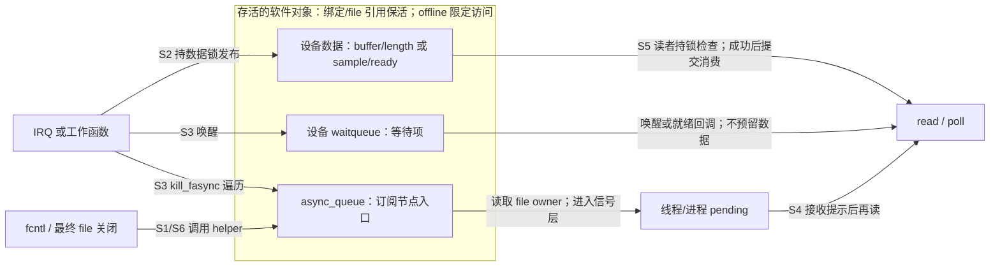
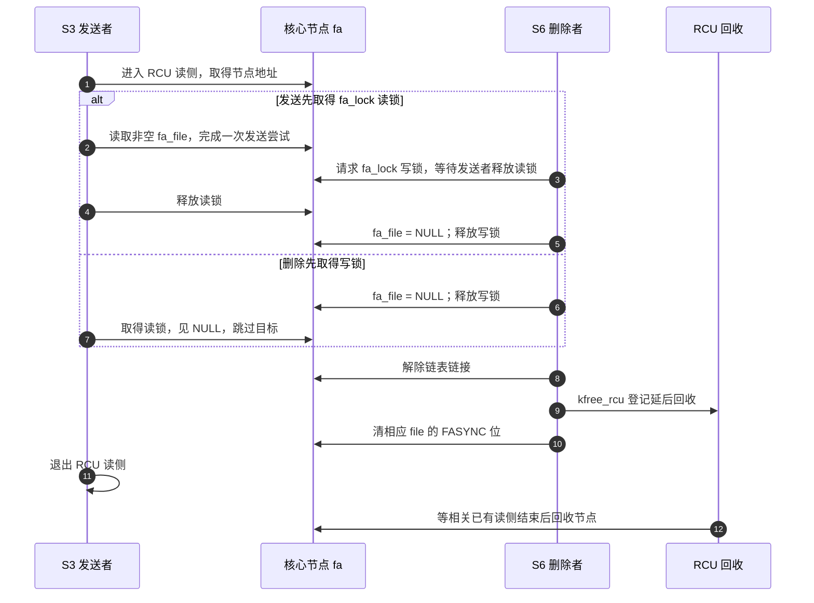
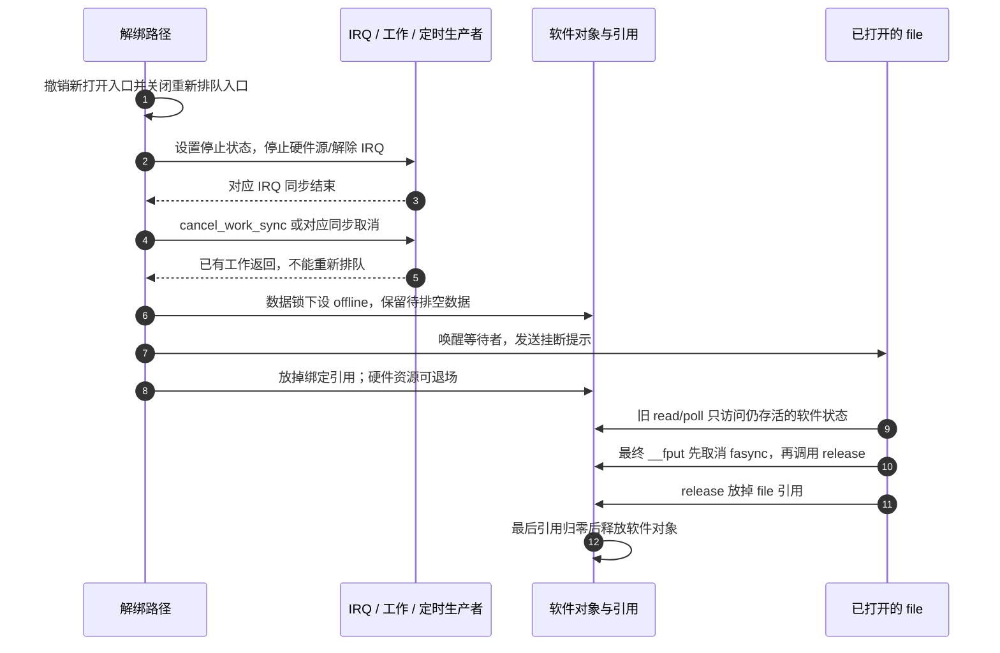

# 第10章\_并发\_竞态与内存可见性问题

上一章解决了用户如何接住提示并继续读取，但驱动内部仍有三个不同问题：生产者正在改数据时读者怎么办，订阅者退出时发送者还能不能访问节点，设备解绑时旧文件操作还能访问哪些对象？把它们统称为“fasync 竞态”，再给所有调用套一把自旋锁，会把本来可以睡眠的注册路径放进原子上下文，也无法阻止已经释放的设备被旧 fd 访问。

本章用已有的软件流设备和 GPIO 设备回收这些问题，按 **数据一致性、订阅并发、对象寿命** 三条责任重建证明。源码身份仍是官方 NXP Linux 6.12.20 固定提交；[本章证据基线](../../../../../research/source_reading/linux/SOURCE_BASELINE.md#1.203_异步通知的并发与对象寿命证据)记录来源和验证边界。文中硬 IRQ 与自旋锁例子先限定非 PREEMPT_RT 内核；实时抢占配置的不同语义在 10.3 说明，不外推为所有内核相同。

## 10.1\_先找出各方修改的状态\_再决定同步责任

以两名读者、一个生产者、一个关闭路径为例：生产者保存一条记录，读者 A 得到可读提示；读者 B 也可能收到提示并先读走。与此同时 A 取消订阅，设备又可能解绑。这至少涉及数据、订阅和存活三组状态，不能用一个 `event_pending` 同时表示。

沿用本书阶段：S0 建立对象，S1 订阅并检查现状，S2 发布数据，S3 通知，S4 接收提示，S5 消费，S6 撤销与退场。**这些阶段描述一个操作周期，不代表所有对象共享一个布尔状态机。** 例如 S5 已读空队列时，信号仍可 pending；S6 已解绑硬件时，旧 file 仍可存活。

下面的字段来自第六、七章的完整模块：`edge_lock` 是保护边沿采样字段的设备锁，`event_pending` 则是这里用来检验错误设计的假设标志。订阅节点类型 `fasync_struct` 与发送函数 `kill_fasync` 已在第四章建立；其中的 RCU（Read-Copy Update，读复制更新）承担节点延后回收，10.2 再展开它与节点锁的配合。

| 状态组与实际落点 | 谁在何时修改 | 谁读取 | 谁负责同步与存活 |
| --- | --- | --- | --- |
| 数据：第六章 `length/buffer`，第七章 `ready/sample/sequence` | S2 生产者写，S5 成功消费后改 | read、poll、等待条件 | 驱动的数据锁与复制/提交协议 |
| 硬件采样：第七章 `edge_generation/last_edge/stopping` | IRQ、停止路径写 | 延迟工作读取并核对代次 | 设备的 `edge_lock`，不是信号锁 |
| 订阅入口：`dev->async_queue` 和其中的 `fasync_struct` | S1/S6 通过 helper 增删或更新 | S3 的 `kill_fasync` | 核心 helper 的锁与 RCU；驱动保持入口所在 dev 存活 |
| 接收目标：`file->f_owner` 指向的 owner、信号选择 | 用户 fcntl 配置 | S3 发送路径 | 核心实现保护字段；应用串行化整个配置协议 |
| 信号：`task_struct.pending`、`signal_struct.shared_pending` | 发送路径加入，接收路径取走 | handler、sigwait、signalfd | `sighand->siglock` 等信号子系统机制 |
| 软件对象寿命：第七章 `kref` 与 `offline` | 绑定/打开取得引用，解绑/最终 file 关闭归还 | 所有访问对象的路径 | 驱动建立引用取得与入口撤销协议 |
| 等待登记：`wait_queue_head_t` 中的等待项 | wait/poll 核心登记、撤销 | 唤醒路径遍历 | 等待队列锁保护登记；它不保护设备负载 |

最后一行很容易漏掉：waitqueue 确实保存等待者和回调，不能说它“完全不存储状态”；它只是 **不保存设备业务数据**。fasync 链表也保存订阅状态，信号层保存 pending；这些状态都真实存在，但各自回答不同问题。



这张图里，S3 的两条通知线都不能绕开数据锁直接修改业务状态。反过来，数据锁也不自动保护链表的 RCU 遍历或设备引用；必须把各条责任分别落实。

外框内的订阅入口是设备保存的链表头；节点本身由核心另行分配，并不是嵌入 dev 的数组。保持头地址存活和保持遍历节点存活仍是两项责任。

## 10.2\_核心已保护订阅节点\_驱动为什么仍可能释放错对象

先看同时取消订阅与发送的具体冲突：发送者已经找到节点 `fa`，关闭者要断开 `fa->fa_file` 并移除该节点。如果直接 free，发送者将访问释放后的内存；如果只延迟节点释放，却允许发送者继续访问已经销毁的 file，同样不够。固定版本用两层协作解决：

1. `kill_fasync` 在 RCU（Read-Copy Update，读复制更新）读侧区间内沿链访问节点；删除通过 `kfree_rcu` 延后回收，避免已有遍历仍持有节点地址时复用其存储。
2. 发送者持 `fa_lock` 读锁使用 `fa_file`；删除者取得同一锁的写侧，把 `fa_file` 置 NULL。这样发送先取得读锁时，删除等待它结束；删除先清空时，后来的发送者跳过这个 file。**节点存储的延后回收，与 file 可否继续被使用，是两个不同保证。**

源码中的各把锁承担如下局部职责，驱动不应模仿一个省略这些机制的“伪 kill_fasync”：

| 核心机制 | 固定版本的动作 | 不包含的保证 |
| --- | --- | --- |
| `filp->f_lock` | helper 更新节点与 `FASYNC` 状态时持有 | 不使应用的多次 fcntl 成为事务 |
| 全局 `fasync_lock` | 串行化链表插入/删除 | 不保护驱动缓冲或硬件资源 |
| 节点 `fa_lock` | 保护发送与清空 `fa_file` 的交接，也用于更新 `fa_fd` | 不等于为设备对象取得引用 |
| `rcu_assign_pointer` / `rcu_dereference` | 初始化节点后发布，读侧按 RCU 协议获取链接 | 不使任意驱动字段自动同步 |
| `kfree_rcu(fa, fa_rcu)` | 解除链接后延迟节点回收 | 不延长包含链表头的 `dev` 寿命 |
| owner 锁、信号 `siglock` | 目标选择和 pending 操作的内部同步 | 不承诺通知与设备记录一一对应 |

典型更新锁顺序是 `file->f_lock → fasync_lock → fa_lock`；发送在 RCU 内取得节点读锁，再进入 owner 和信号路径。读者不需要自己改这些核心锁。第四章已展示节点与目标的具体控制路径，这里重点是为什么同一设备 **可以让 helper 与 kill_fasync 并发**，而不要求额外用驱动自旋锁包住两者。



删除不撤回已经进入 pending 的信号，也不承诺用户刚取消就再也看不到旧提示。因此第九章仍要处理遗留信号和旧 fd 数字。多个 CPU 同时发送时，核心会协调同一信号状态；标准 SIGIO 可合并，实时路径可排队或回退。CPU 争用、订阅者数量和发送频率可能增加开销，但“信号少于硬件事件”本身不构成链表损坏证据。

核心字段不损坏，也不表示多个调用者的配置意图能同时成立。假设 A、B 通过 dup 或 fork 共用一个 file：A 设置 owner 为自己，B 随后改成 B，A 再选择实时信号并开启 O_ASYNC。最终组合可能是“B 接收 A 选择的信号”，每次系统调用都成功却不是 A 预期的订阅。应用需要指定一个配置管理者，或用调用者共享的同步协议包住整个 owner、信号号和使能流程；各自的进程私有 mutex 不能协调另一个进程。独立 open 可建立独立 file 和订阅，但是否共享消费队列仍由设备决定，不能把独立订阅误当成数据广播。

驱动真正不能做的是直接 `kfree(fa)`、在某个 file 关闭时把整条 `async_queue = NULL`，或在仍有人调用 helper/kill_fasync 时释放 dev。正常路径直接把有效链表头交给核心即可，无须在调用前另写一遍无锁的 `if (dev->async_queue)` 预检查。[固定版本 fs/fcntl.c](https://github.com/nxp-imx/linux-imx/blob/dfaf2136deb2af2e60b994421281ba42f1c087e0/fs/fcntl.c)

## 10.3\_把可睡眠的注册与短促的硬中断分开

`fasync_helper` 的启用路径先调用 `fasync_alloc`，使用 `kmem_cache_alloc(..., GFP_KERNEL)`，之后才查是否已有节点。因此“只是更新已有订阅”也不能成为在自旋锁下调用 helper 的理由。`GFP_KERNEL` 分配可以进入回收或睡眠；硬 IRQ、关闭本地中断的区域，以及非 RT 自旋锁临界区都不能承载这个等待。

数据路径则由谁实际访问数据决定。第六章只有进程上下文的 write/read，用 mutex 保持数据和用户复制的一致性；第七章硬 IRQ 只登记边沿，GPIO 的可睡眠读取与结果发布交给工作函数。把工作搬走以后，**IRQ 与工作之间的边沿状态仍需同步**，不能在 IRQ 普通赋值、工作里单方面加 mutex 就宣称已保护。

| 参与路径 | 可使用的设计 | 不能把什么放进去 |
| --- | --- | --- |
| 纯进程生产者、read、poll | 同一数据 mutex；复制完成后提交消费 | 持锁等待“数据出现”，因为生产者也需要这把锁 |
| 非 RT 硬 IRQ 直接发布小记录 | 短数据 spinlock 临界区；进程侧按需 irqsave，防本 CPU 重入 | GFP_KERNEL 分配、mutex、用户复制 |
| IRQ 登记，工作函数处理 | IRQ 用短锁保存队列/代次，工作取快照后处理，再校验提交 | 只依赖工作自身 pending 位保存每次硬件事件 |
| fasync 启用/取消 | 进程上下文调用 helper；可用设备 mutex 串行化 offline 策略 | 额外套一把原子上下文自旋锁以“保护链表” |
| 通知与等待同步 | 在数据已发布后唤醒/发信号，优先在释放数据锁后调用 | 让锁临界区包含无关的全部订阅者遍历和等待回调 |

非 RT 上进程先持普通 `spin_lock`，本 CPU 硬中断又抢同一锁时，中断无法等到被它打断的代码解锁，形成死锁。`spin_lock_irqsave` 的本地关中断避免这种重入，自旋锁本身才协调其他 CPU；只关本地中断不互斥远端 CPU。`spin_lock_bh` 针对本地软中断，不替代硬中断保护。

PREEMPT_RT 是改变内核抢占与锁实现的实时配置；其 `spinlock_t`、`rwlock_t` 可以采用可睡眠实现，`raw_spinlock_t` 保持严格自旋。不能据名称断言所有配置下“spinlock 都不睡眠”，也不能为了让旧模板在 RT 上通过就把所有锁换成 raw。应重新确认 IRQ 是否线程化、哪些路径仍是真正硬中断、共享字段由谁访问；实际硬件访问或睡眠要求不随命名消失。[固定版本锁类型规则](https://github.com/nxp-imx/linux-imx/blob/dfaf2136deb2af2e60b994421281ba42f1c087e0/Documentation/locking/locktypes.rst)

### 10.3.1\_工作调度请求和业务数据不能共用一个清零标志

考虑旧式写法：IRQ 把 `event_pending = 1` 后排工作；工作取得 mutex，先清零，再唤醒 read。读者醒来检查同一个字段，只会发现没有数据。若 IRQ 在工作“读到 1”和“写回 0”之间再次置 1，新输入也会被清掉；工作里的锁从未约束 IRQ。

应分成两件事：边沿队列、计数或代次保存“需要处理什么”，工作调度状态负责“安排执行”；处理完成后把可供用户读取的结果发布到数据队列或快照。GPIO 最新状态方案可以合并原始抖动，但有序采样必须保留记录或显式计数丢失。第七章的 `edge_generation` 与 `ready` 就是两个职责；它们不是应被机械消除的冗余标志。

选择直接 IRQ 发布还是工作处理，应核对设备访问是否睡眠、要保存全部历史还是最新状态、最大处理时间和可接受延迟。工作引入排队调度成本，短 IRQ 方案节省一次转交却承担中断处理时间；不能根据“GPIO 简单”就一律选硬中断访问。

## 10.4\_等待者为什么要先登记\_并在真正消费前再检查

只做“生产者先改数据再唤醒”仍不足以解释等待端。若读者先查空，生产者随后发布并通知，此时读者尚未登记，通知没有接收者；读者最后登记睡眠，数据已在队列里而没有下一次通知。这才是具体的丢唤醒窗口。

固定版本的 `wait_event_interruptible` 包含外层快速检查和内层循环；内层先 `prepare_to_wait_event` 登记等待项、设置任务状态，再计算条件，满足则退出，否则才调度。`finish_wait` 恢复任务状态并清理登记。驱动仍须用正确的数据访问协议计算条件，不能以“宏里有等待锁”为由无锁读取任意负载。

| 生产发生的位置 | 为什么正确等待不会把这次数据永久漏掉 |
| --- | --- |
| 等待登记之前 | 登记之后的条件检查会发现已发布数据，不睡 |
| 登记之后、检查之前 | 条件检查可以发现数据；唤醒路径也已能找到等待项 |
| 检查为空之后、真正调度之前 | 已登记且设置等待状态，唤醒改变其可运行状态，调度交接不会把一次已发生的唤醒遗忘 |
| 已睡眠以后 | 发布后通知命中等待项，使其重新检查 |

`poll_wait` 名字里虽然有 wait，但驱动的 poll 回调调用它通常是在 **登记等待关系**，不是就在该行睡眠。固定版本在登记后有相应内存顺序约束；驱动随后检查同一受保护的数据状态并返回位图。poll 核心的 `triggered` 和唤醒/调度配合处理检查到睡眠之间的交接，不能自己删掉登记、只返回当前快照后另起一个睡眠。

### 10.4.1\_可读只是观察\_不会替读者预留一条记录

两个读者都可以在等待条件里看见 `count == 1`，但其中一个随后先取得数据锁并消费。另一个取得锁时看到 0，是 **正常的竞争结果**：

| 时刻 | 读者 A | 读者 B |
| --- | --- | --- |
| t0 | 等待条件观察到一条数据 | 等待条件也观察到一条数据 |
| t1 | 获得消费权，复制成功，提交出队 | 等待消费权 |
| t2 | 返回数据 | 重新检查为空；非阻塞返回 EAGAIN，阻塞路径重新等待 |

因此不能写“wait 返回以后 count 为 0 就报 EIO”，也不能仅凭“唤醒后看到 0”诊断缓存可见性错误。第六章的 read 外层循环在重新加锁后检查数据、离线及错误，再决定是否继续等待；用户复制失败不提交未完成的消费。第八章的 IRQ 环形队列还用读者 mutex 保留尾部，再以短自旋锁协调生产，避免自旋锁下复制用户内存。

以下是协议步骤，**不是可直接编译的驱动**；完整代码保留在[第六章完整模块](P06_字符设备中实现异步通知的基础模式.md#6.3_把数据规则实现为完整模块)：

```text
read 开始：
    count 为零时按接口返回 0，记录长度不足时先拒绝
    循环：
        取得数据/读者锁
        若有数据：取得消费权，按复制协议交付；成功后提交；返回
        若已离线且数据已排空：返回约定的 EOF
        若有待报告错误：按设备 ABI 返回或确认该错误
        若本次为非阻塞：返回 EAGAIN
        释放锁
        wait_event_interruptible(数据可读或离线或错误)
        若等待被信号打断：返回相应错误
        否则重新取得锁检查，不把唤醒当成数据所有权
```

阻塞等待和用户复制是两个不同的可睡眠位置。前者必须释放生产者要用的锁，否则永远等不到数据；后者可以持合适的进程 mutex，但不能持非 RT 自旋锁。复制期间硬件继续生产时，需要预留、不可变负载或明确丢弃策略，不是“解锁再 copy”就自动正确。

### 10.4.2\_两个通知通道不要求固定接收顺序

生产者先在数据锁内保存结果，释放锁，再调用 wake 与 kill_fasync。等待者实际运行、信号实际消费的顺序受调度与掩码影响；即便函数调用顺序固定，也不能承诺“应用先走 poll，再走 SIGIO”。两者只应触发同一消费协议，读空后第二条提示可合法得到 EAGAIN。

只在空转非空通知可以减少尝试次数，但前提是用户启用后检查现状、在无新提示时仍能把已知待处理数据读完，错误/挂断变化也有通知。不能用这个策略替代第八章固定期限补发，也不能假设任何设备的就绪谓词都只是 count 非零。poll 可读、非阻塞 read 和信号提示必须对应同一数据契约，而不是同一个简单变量名。

## 10.5\_锁建立交接顺序\_发信号不替代数据发布协议

“写完数据再发信号”描述的是逻辑先后；跨 CPU 的读者要用什么机制观察这些写入，还需要明确。先看最简单的有锁方案：生产者持数据锁写缓冲和长度后释放，消费者后来取得 **同一把锁** 再检查和读取。锁的 release/acquire 语义构成这次交接。消费者可能看到生产者之后又被其他消费者修改过的合法状态，但不能跳过锁只凭信号就直接读取共享负载。

不能把每次 lock/unlock 都写成任意意义的 full barrier（全屏障）。获取主要约束后续访问，释放主要约束之前访问；一次 acquire 后紧接 release，不自动成为隔开所有外部读写的全屏障。已经把共享状态放进正确锁协议时，不需要随手追加 smp_mb；锁外还有无锁读者时，也不能说“写者持锁，所以读者自然安全”。

| 原语 | 它实际提供的部分保证 | 本场景仍要回答的问题 |
| --- | --- | --- |
| `READ_ONCE / WRITE_ONCE` | 约束指定访问的编译器处理，并有类型/尺寸/体系结构边界 | 不自动发布其他字段，不保证任意宽度原子性，也不保活对象 |
| `atomic_inc` | 同一原子对象的不可分割增量 | 无返回值增量不自动为其他位置提供完整顺序；计数也可能溢出 |
| `atomic_xchg` | 原子交换并按该无后缀接口约定排序 | 交换为 0 后用户复制失败，谁恢复消费责任？多读者如何重查？ |
| `smp_store_release / smp_load_acquire` | 通过匹配的发布值建立相应写读顺序 | 读取必须观察对应发布；复用同一槽还需要归还/代次协议 |
| `smp_mb / smp_wmb / smp_rmb` | 按屏障类别限制访问顺序 | 需要匹配参与者和观察条件，不是“立刻把所有 CPU 缓存刷到一致” |
| `refcount_t / kref` | 对象引用寿命协议所用接口 | 不是一般事件计数器；取得引用前对象本身也必须可安全访问 |

例如只发布一次、之后永不修改的负载，可以先写 payload，再以 release 写 ready；读者用 acquire 观察到对应 ready 后才读 payload。这说明发布的作用点。若生产者立即重用 payload，读者仍在读取，release/acquire 并不会阻止覆盖；循环队列还要解决槽所有权和回收，因此本章不把这个一次性片段包装成通用无锁驱动。

`kill_fasync` 内部的 RCU 和信号锁只针对订阅与信号状态，驱动不能把函数调用当成自己缓冲的通用发布屏障。等待唤醒核心同样有它的配对顺序，但“无人可唤醒时”不能凭想象得到一次万能全屏障。若想用 `waitqueue_active` 无锁省掉 wake 调用，还需满足该接口文档规定的条件写入与屏障配对；本书模板直接调用正常 wake，不引入这项额外证明负担。

内存顺序问题首先要给出冲突访问、状态和交接关系，再决定是否需要原子或屏障；不能见一次“信号后 EAGAIN”就添加 smp_mb 试错。[固定版本内存屏障说明](https://github.com/nxp-imx/linux-imx/blob/dfaf2136deb2af2e60b994421281ba42f1c087e0/Documentation/memory-barriers.txt)与[原子类型说明](https://github.com/nxp-imx/linux-imx/blob/dfaf2136deb2af2e60b994421281ba42f1c087e0/Documentation/atomic_t.txt)给出具体语义；MMIO、DMA 另有设备访问契约，不能把上述普通共享内存协议直接替代设备同步。

## 10.6\_停止硬件不等于旧文件消失\_退场要分两次结束

假设用户一直持有 fd，管理员对平台设备解绑。`cdev_del` 或 misc 撤销阻止新的打开入口，却不会让旧 file 的 read、poll、fasync 和最终 release 瞬间消失。`file_operations.owner` 的模块引用主要阻止正常卸载模块代码，**不阻止平台设备解绑，也不把 devm 分配的设备私有数据延长到最后一个 fd**。

第七章因此把软件对象用 kref 保活，把硬件资源限定在绑定期间。退场首先终止生产；旧 fd 仍可以排空最后的记录、观察离线、取消订阅，最终归还软件引用。不能在 remove 一返回就释放所有 file 仍指向的数据，也不能禁止 release 归还最后引用而坚持“对象只能在 remove free”。



图中“IRQ 同步结束”不是只等当前 CPU。`free_irq` 对相应 handler 做释放/同步，`synchronize_irq` 等待该 IRQ 相关的执行，`disable_irq_nosync` 自身不等待，不能据它返回就 free。是否屏蔽整条 IRQ 还取决于专用还是共享中断；共享线不能随意全局禁用，先停止自己的设备源，并按真实注册方式解除处理器。第七章教学 GPIO 子 IRQ 是专用方案，不外推所有设备。

工作取消也必须配合生产入口关闭。`cancel_work_sync` 返回前处理已排队或正在执行的目标 work，但不能阻止另一条仍活动的 IRQ/定时器随后重新排它。同步等待期间不能持有 worker/handler 为退出所必需的锁，否则出现“解绑拿锁等 worker，worker 等解绑释放锁”的死锁。循环重排的 timer/work 还必须切断重排关系，选相应 shutdown/cancel 协议。

### 10.6.1\_devres与手动释放的差别是资源登记\_不是生命周期假设

| 方式 | 能替驱动完成什么 | 仍要主动完成什么 |
| --- | --- | --- |
| 手动申请/释放 | 驱动选择明确的 free/cancel 顺序 | 初始化失败回滚、入口关闭、生产停止、旧 file 引用全部由协议保证 |
| devm 管理硬件资源 | 绑定结束时按资源登记的释放动作清理；IRQ 释放动作可包含其自身同步 | 要在工作和旧 file 不再访问硬件后退场，不能仅取消 work 却让 IRQ 继续重排 |
| 非 devm 软件对象 + kref | 覆盖解绑后旧 file 的 read/poll/fasync/release | 每个取得引用的入口都要和解绑协调，最后引用才释放 |
| 等待队列随软件对象存活 | 现有等待项/epoll 回调仍有合法地址 | 若另行提前销毁等待队列，必须满足 pollfree/RCU 等完整契约，不能仅清空链表头 |

devres 不是“只调用 free 从不管同步”，具体释放函数可能同步它自己的 IRQ；它也不是“自动理解驱动的全部工作关系”。本章采用先停生产、同步工作、离线通知、保留软件对象的方案，不需要自造提前销毁等待队列的旁路。

最终 file 清理也要按核心事实读：固定版本 `__fput` 在 `FASYNC` 仍启用且回调存在时，先调用 `file->f_op->fasync(-1, file, 0)`，再调用 `release(inode, file)`。因此“每个 release 必须再调用一次 fasync”不是该版本的普遍要求。驱动必须保证取消订阅时 private_data 仍存活，离线后允许 `on == 0`，并由真实最终 file 清理归还引用。一次 close 不一定是最终 file 释放，dup/fork 的其他引用仍可能存在。

初始化的反方向也不能漏：在 IRQ 可以到来前初始化其会访问的锁、队列与工作；在公开用户入口前建立完整协议。若注册 IRQ 成功后后续步骤失败，先停止并同步生产者再释放；若 open 已取得引用却后续失败，在失败分支归还，不假定未成功打开会自动执行正常 release。第七章的[生产、文件与退场完整实现](P07_中断驱动设备的异步通知实践.md#7.5_把采样_文件操作和退场接成一个模块)给出了这些动作的对应位置。

## 10.7\_用交错反例和有限测试检查证明边界

不能靠“压力跑了几分钟没崩”证明所有交错都正确。先把最关键的窗口缩小成可穷举模型：一个生产者按发布/通知顺序执行，一个等待者按登记/检查/睡眠顺序执行。下面的 Python 程序枚举所有保持参与者内部顺序的交错，再分别打乱登记顺序和发布顺序，输出确实会留下“有数据但等待者睡眠”的反例。

模型把每一步当作原子、立即可见，wake 表示等待核心尚未消耗的唤醒责任。它用于检验 **逻辑交接**，不模拟 Linux 的锁实现、弱内存重排或真实调度。第二个模型让两名读者都可能看到就绪，但消费步骤重新检查，证明一次可读观察不预留数据；结果字符串 DATA 表示实际取得数据，RETRY 表示重新等待或向非阻塞调用者报告暂时无数据。保存为 `wait_interleavings.py`：

```python
from itertools import permutations

def interleavings(left, right):
    """保留各参与者内部顺序，枚举跨参与者交错。"""
    for order in permutations(left + right):
        if [x for x in order if x in left] == list(left) and \
           [x for x in order if x in right] == list(right):
            yield order

def wait_cycle(order):
    """每步原子可见；wake 表示一次尚未消耗的唤醒责任。"""
    data = registered = seen = wake = sleeping = False
    for step in order:
        if step == "publish":
            data = True
        elif step == "notify":
            if registered:
                wake = True
                sleeping = False
        elif step == "register":
            registered = True
        elif step == "check":
            seen = data
        elif step == "sleep":
            sleeping = not seen and not wake
    return data and sleeping

def reader_cycle(order):
    """只有一条记录；检查不预留，提交阶段在同一数据锁内重查。"""
    remaining = 1
    observations, outcomes = {}, {}
    for step in order:
        reader, action = step.split(":")
        if action == "check":
            observations[reader] = remaining > 0
        else:
            if remaining:
                remaining -= 1
                outcomes[reader] = "DATA"
            else:
                outcomes[reader] = "RETRY"
    assert remaining == 0
    assert list(outcomes.values()).count("DATA") == 1
    return observations, outcomes

if __name__ == "__main__":
    producer = ("publish", "notify")
    correct = list(interleavings(("register", "check", "sleep"), producer))
    broken = list(interleavings(("check", "register", "sleep"), producer))
    early_notify = list(interleavings(
        ("register", "check", "sleep"), ("notify", "publish")))
    assert not any(wait_cycle(order) for order in correct)
    bad_examples = [order for order in broken if wait_cycle(order)]
    early_examples = [order for order in early_notify if wait_cycle(order)]
    assert bad_examples and early_examples
    contested = []
    for order in interleavings(("A:check", "A:consume"),
                              ("B:check", "B:consume")):
        seen, result = reader_cycle(order)
        if all(seen.values()):
            assert sorted(result.values()) == ["DATA", "RETRY"]
            contested.append(order)
    assert contested
    print("正确等待交错数：", len(correct))
    print("错误登记顺序反例：", bad_examples[0])
    print("错误发布顺序反例：", early_examples[0])
    print("两个读者都看见就绪仍需重查的交错数：", len(contested))
```

执行 `python3 wait_interleavings.py`，正确等待有 10 种交错且没有该模型内的丢唤醒；两个读者的 6 种交错中，有 4 种双方都观察到就绪，而实际只能一方取走那条记录。错误模式会输出具体步骤，例如 `check → publish → notify → register → sleep`。这些结论不包含 CPU 弱内存证明，不能用 Python 通过替代内核锁与内存模型验证。

### 10.7.1\_把驱动实验拆成能解释结果的场景

使用第六章的软件设备先排除硬件输入不确定性，再用第七章验证真实采样和解绑。每轮限定次数与总时长，记录配置、输入、读取量和错误，不强制卸载正在使用的模块，也不在硬 IRQ 长时间 busy-wait 制造窗口。

| 场景 | 应检查的不变量 | 不能误判的现象 |
| --- | --- | --- |
| 两个读者同时等一条共享数据 | 最终仅一份数据被提交消费，另一方重查或 EAGAIN | 第二名读者醒来为空并非损坏 |
| 接收持续运行时反复启用/取消 | helper 状态一致，失败可返回，旧 pending 安全消费 | 取消后仍看到此前 pending 不表示删除失败 |
| 复制失败或过小缓冲 | 不提交未完成消费，错误按 ABI 返回 | read 返回错误后不能仍悄悄删记录 |
| 生产与订阅在启动附近交错 | 启用后主动检查已有数据，后续按通知策略继续 | 新订阅者不一定收到历史通知 |
| 持有旧 fd 时解绑 | 停生产、同步工作、离线可见，软件对象保活到最终引用 | cdev 已删而旧 fd 仍能调用是预期边界 |
| 高频与慢读者 | 容量、累计丢失、补发责任符合第八章协议 | 信号数少于记录数通常可正常合并 |
| probe/open 中途失败 | 按已取得资源反向回滚，没有半初始化对象公开 | 不能把所有失败都交给正常 release |

lockdep 是运行时锁依赖检查器，`CONFIG_PROVE_LOCKING` 等配置帮助观察已执行路径上的锁顺序和中断使用；sleep-in-atomic 还涉及相应调试配置，不能承诺任何非法调用都必有告警。KCSAN（Kernel Concurrency Sanitizer，内核并发检查器）以插桩和采样发现数据竞争；KASAN 等内存检查器帮助发现越界和释放后访问。未启用、已停检、被抑制或未执行目标路径时，“未告警”不能形成对应证据；无告警也不证明业务计数、通知补发和生命周期设计正确。

不要为调试随意无锁遍历 fasync 链表来“数节点”，那会新增需要证明的读者。优先观察自己的生产序号、成功消费数、丢失数、订阅操作返回值和退场阶段；日志引入的调度变化也要记录。看到崩溃栈经过 kill_fasync 时，先区分释放的是节点、file 还是 dev，不能从函数名就判定核心没加锁。

练习：同一非 RT 自旋锁既保护 IRQ 数据，又包住 fasync_helper，为什么不因为“所有访问统一加锁”而更正确？**答案：helper 启用可用 GFP_KERNEL 分配，不能在该原子上下文调用；订阅节点已有核心同步，数据锁应只保护它自己的状态。**

练习：生产者先持锁写数据，再通知；用户收到 SIGIO 后 read 返回 EAGAIN，还能解释成正确行为吗？**答案：能，例如另一读者先消费、信号合并或延后消费。要结合队列与消费记录判断，不能仅凭通知推断当前还有数据。**

练习：cancel_work_sync 返回后可以立即 kfree 含 async_queue 的 dev 吗？**答案：仍需证明不会再次排工作，所有其他生产者已结束，旧 file 与等待回调也不再引用对象；同步一个 work 只完成其中一部分。**

现在可以分别审查数据、订阅和寿命的正确性，而不靠一把“大锁”混在一起。下一章把这些阶段变成可观察证据，区分生产、请求通知、pending、接收与消费，建立有限的排错过程。

上一篇：[P09 用户态编程 从 SIGIO 到 signalfdepoll](P09_用户态编程_从_SIGIO_到_signalfdepoll.md)。
下一篇：[P11 调试、排错与性能分析](P11_调试_排错与性能分析.md)。
