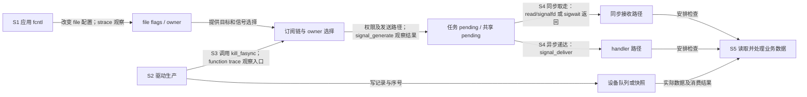
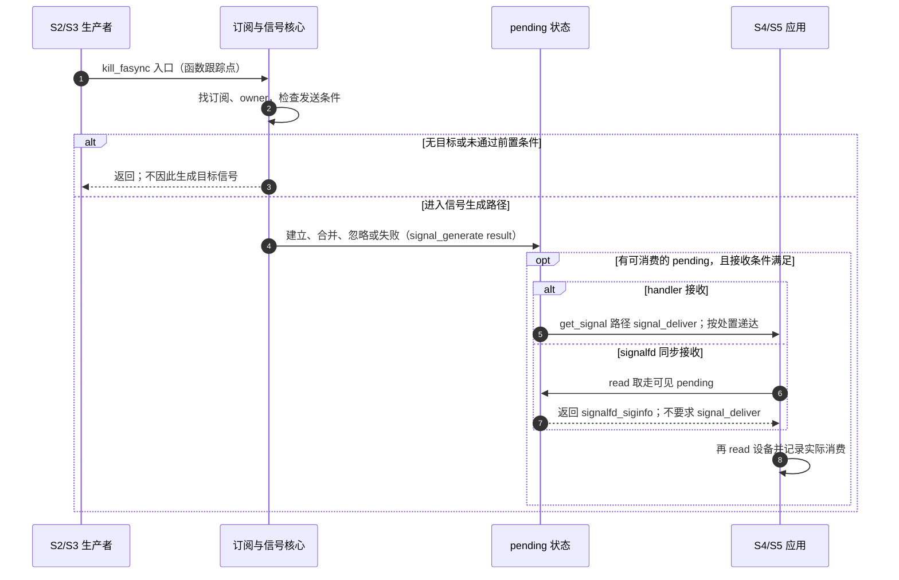
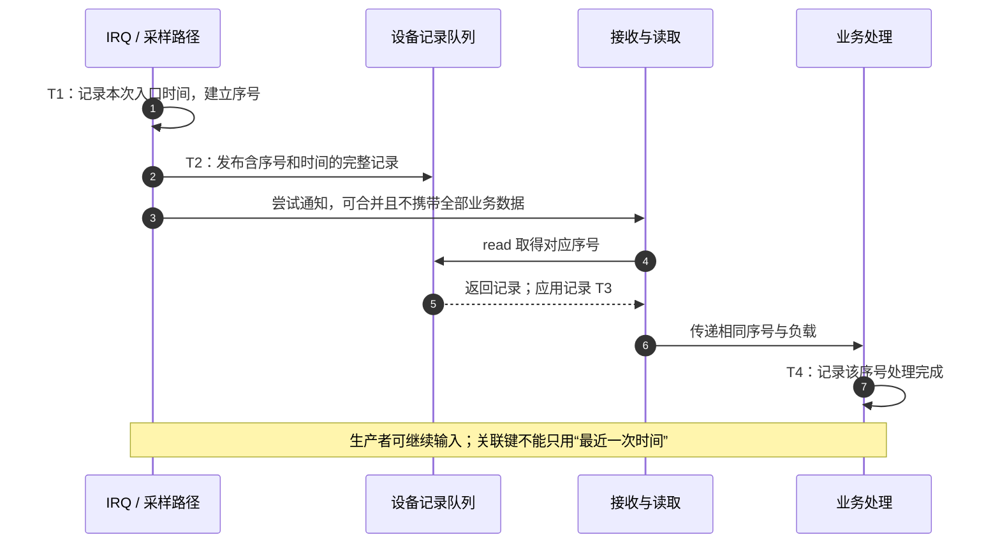

# 第11章\_调试\_排错与性能分析

上一章已经把数据交接、订阅同步和对象寿命分开。但现场往往只留下“我设了 O_ASYNC，应用没有反应”这句话：它可能表示没有硬件输入，也可能表示数据已经读完、信号还留在 pending，或者接收线程根本没运行。现在需要把每一步变成可观察证据，再决定修改哪里。

本章先在第九章的 **有限 pipe 自测** 上校准工具，再把同一方法用于第六章软件设备和第七章 GPIO。这样，第一次验证接收工具时不依赖接线与引脚。源码结论继续限定官方 NXP Linux 6.12.20 固定提交，[证据基线](../../../../../research/source_reading/linux/SOURCE_BASELINE.md#1.204_异步通知的调试观测与时间关联证据)记录具体文件；命令需要在实际 Linux 实验机执行，当前整理环境未运行目标内核跟踪。

## 11.1\_先说清哪一步没有发生\_再选择观察工具

沿用 S0 建立、S1 订阅、S2 发布数据、S3 通知、S4 接收、S5 消费、S6 退场。最先问的是：应用期待的是“一条信号记录”，还是“一个业务记录”？第九章自测在订阅前放入 AB，启动检查可以读到它们；稍后写入 C，才用来观察后续通知。三个字节不需要恰好三个信号。

| 要确认的阶段 | 状态落点与可用证据 | 证据不能越过的边界 |
| --- | --- | --- |
| S1 配置 | file 的 flags/owner；应用 fcntl 返回与回读 | 设置成功不证明已有输入，更不证明业务读取完成 |
| S2 生产 | 驱动队列、序号、丢失计数；生产路径打点 | IRQ 计数不一定等于有效业务事件数，例如去抖 |
| S3 尝试通知 | `kill_fasync` 函数入口、驱动通知计数 | 函数可能看到空链、无目标或未通过权限检查 |
| S3 信号状态变化 | `signal_generate` 事件及 result；任务/进程 pending | 已存在标准信号可合并；生成事件不等于 handler 已执行 |
| S4 接收 | handler 入口，或 signalfd/read、sigwait 的成功结果 | 三种接收路径不能要求同一种 trace 外观 |
| S5 消费 | 设备 read 实际返回的字节/记录、序号与业务完成日志 | 收到提示后仍可能 EAGAIN，不表示订阅链损坏 |
| S6 退场 | 撤销订阅、生产者同步、最终 file 归还 | close 一次不一定释放共享 file，解绑不等于旧 fd 消失 |

`f_owner` 属于 file 关联的所有者对象；线程的阻塞掩码在任务状态中，进程共享 pending 在 `signal_struct` 中。不能把它们画成“任务里的一份 f_owner”，也不能从 fdinfo 的 flags 推出 owner 正确。工具只是这些状态的观察窗口，不是参与传送中断的数据通路。



排查时先保存一次 **能复现且会结束** 的输入。记录内核身份、应用构建、设备实例、接收方式、有效输入数、运行起止和退出码；保留原始日志。若故障依赖多线程，再逐步加入线程和竞争，避免同时换驱动、接收方式、通知策略后无法判断哪一项改变了结果。

## 11.2\_先用strace核对应用真的执行了哪些操作

strace 在系统调用边界记录参数、结果以及异步递达信号；它不读取驱动业务队列。先使用[第九章完整接收程序](P09_用户态编程_从_SIGIO_到_signalfdepoll.md#9.4_用一个有截止时间的程序完成订阅_消费与退出)，保存并编译为 `receive_async`。该程序默认使用 pipe，三秒内完成 AB、C、EOF 自测；plain、info、rt 分别选择 F_SETSIG 的 0、SIGIO 和有效实时信号。

```sh
# Linux 实验目录：先按第九章编译 receive\_async；本次运行无需设备节点。
strace -f -tt -T -yy -o async_info.strace \
  -e trace=%signal,%desc \
  ./receive_async info
```

`-f` 跟踪创建的任务，`-tt` 给出日志时间，`-T` 显示系统调用耗时，`-yy` 补充 fd 对象信息，`-o` 把记录保存到文件。`%signal` 与 `%desc` 是系统调用分类，包含信号接口以及 fd 相关调用，避免只写 open 而漏掉 libc 实际使用的 openat。它们仍会收录启动加载等无关操作；按返回的 fd 和调用先后关联，不把示例中的“3”当作固定设备号。[strace 作者手册](https://man7.org/linux/man-pages/man1/strace.1.html)

沿 S1、S4、S5、S6 阅读日志，而不是先数 SIGIO 行：

| 日志中应检查什么 | 正确解释 |
| --- | --- |
| 先阻塞选定信号与回退 SIGIO，再创建 signalfd | signalfd 接收需要阻塞这些信号；这不是故障 |
| F_GETFL 取旧标志，F_SETOWN/F_SETSIG 配置，F_SETFL 启用，再 F_GETFL 回读 | GET 返回值是查询结果，不要求所有 fcntl 成功都返回 0 |
| 启用以后立即读 pipe 的已有 AB | 避免等待不会补发的历史通知 |
| epoll 返回后 read(signalfd) 取得整记录，再 read(data_fd) | 同步取走信号通常不会出现对应的 `--- SIGIO ---` 异步递达行 |
| 后续读取 C、读到 EOF，撤销 O_ASYNC，关闭对象 | 区分通知记录与数据字节；先停源再撤接收设施 |

若选择 handler，才检查 `rt_sigaction`、异步信号行和 `rt_sigreturn`。handler 处置在线程组共享，不是“哪个线程装 handler 就只能哪个线程运行”；掩码则按线程维护。F_SETOWN 的进程目标与 F_SETOWN_EX/F_OWNER_TID 的线程目标要分别读。SI_QUEUE 的用户排队信号字段不能冒充 I/O 通知的 `si_fd`；只有相应 I/O siginfo 布局才解释 fd/band，普通 SIGIO 或回退不能据此选择设备。

常见反例也能直接从过程解释：未设置 owner 不保证“自动发给父进程”，可能根本没有目标；裸 F_SETFL(O_ASYNC) 可能清掉可修改的 O_NONBLOCK，但不会把只读访问模式改成可写；另一个共享 file 的调用者可以随后改 owner 或关 O_ASYNC。回读状态与完整调用过程要互相印证。

要观察长期程序，可用有明确停止时间的附加跟踪；先确认 PID 是本次实验进程，避免 pidof 返回多个结果后随便取一个。第九章程序本身有截止时间，本章不另外构造无限 pause、handler 中 printf 或仅计数不读数据的“最小测试”。人工发一个 SIGIO 只能测试接收处理路径，不能证明设备生产、订阅和 fasync 路由成立。

## 11.3\_proc快照能看见当前状态\_却不能替代事件历史

如果 strace 表明设置成功但后来仍表现异常，需要检查 **正在运行的那个 file 和各线程**。`/proc/PID/fd/FD` 是 fd 当前目标，fdinfo 提供属性；`/proc/PID/task/TID/status` 提供该线程的信号状态。多次读取不是同一时刻的事务，目标可能关闭、复用 fd 或退出，不能把相邻输出拼成不存在的瞬间。

| 字段 | 数制与实际含义 | 容易误读之处 |
| --- | --- | --- |
| fdinfo `flags` | 八进制；文件访问/状态标志，并反映该 fd 的 close-on-exec | 不是十进制；不提供通用 owner 字段 |
| `SigPnd` | 十六进制位图，线程私有 pending | 不是累计事件数 |
| `ShdPnd` | 十六进制位图，线程组共享 pending | 进程定向信号可能在这里，而非 SigPnd |
| `SigBlk` | 当前线程阻塞位图 | handler 路径与 signalfd 路径的预期不同 |
| `SigIgn / SigCgt` | 忽略处置 / 已安装用户 handler 的位图 | 同步接收不要求 SigCgt 置位；SIG_IGN 不是准备接收的通用办法 |
| `SigQ` | 实际用户计费的排队信号数量与限制 | 不是当前这个 fd 或这个进程的业务队列长度 |
| signalfd 的 `sigmask` | 该 signalfd 选择的信号集合 | 不会自动修改调用线程的 SigBlk |

在采用 asm-generic 常量的目标上，O_ASYNC 的八进制 `020000` 是十进制 **8192**、十六进制 `0x2000`；旧例的 `040200` 并不因此包含它。实际程序应使用目标头文件或运行时提供的常量。O_RDONLY 常量为 0，也不能拿 `040000` 当作“只读位”。固定版本 `fs/proc/fd.c` 明确以 `0%o` 输出 flags，并把 fd 的 O_CLOEXEC 状态合入显示。[fdinfo 说明](https://man7.org/linux/man-pages/man5/proc_pid_fdinfo.5.html)

保存下面完整工具为 `inspect_async.py`，在目标 Linux 上运行。它使用本机 `os.O_ASYNC` 和信号号，逐线程解码；读不到字段、线程退出或 PID 改换时明确报告，而不把异常当成“未设置”。

要留出采样时间，可用第九章最长运行三十秒的设备模式；第六章的真实节点在该次实验的 `"$lab_dir/node"`，不是固定的 /dev 路径。模块与节点已准备好、当前实验终端具备读取权限时，直接后台启动 `./receive_async info "$lab_dir/node" > receive.log 2>&1 &`，立即用 `test_pid=$!` 保存该程序 PID，再用 `ls -l /proc/"$test_pid"/fd` 找到数据 fd。这里没有 sudo 或包装进程，不能在另套启动器后仍把其 PID 当接收者。启动与配置可能在采样期间进行，首次看见标志未置位时还要核对配置先后，不能仅凭快照判错。

```python
import argparse
import os
from pathlib import Path
import signal
import sys
import time


def fields(path):
    """只按字段名解析，不把空格布局当作固定列宽。"""
    return dict(line.split(":", 1) for line in path.read_text().splitlines()
                if ":" in line)


def start_time(process):
    # comm 可以包含空格或括号；最后一个右括号后才是第 3 字段。
    return (process / "stat").read_text().rsplit(")", 1)[1].split()[19]


def inspect(proc_root, pid, fd, signo, async_flag):
    process = proc_root / str(pid)
    started = start_time(process)
    before = time.monotonic_ns()
    target = os.readlink(process / "fd" / str(fd))
    info = fields(process / "fdinfo" / str(fd))
    raw = info["flags"].strip()
    value = int(raw, 8)
    print("fd", fd, "target", target, "flags(octal)", raw,
          "O_ASYNC", bool(value & async_flag))
    bit = 1 << (signo - 1)
    partial = False
    for task in sorted((process / "task").iterdir(), key=lambda p: int(p.name)):
        try:
            state = fields(task / "status")
            bits = {name: bool(int(state[name], 16) & bit)
                    for name in ("SigPnd", "ShdPnd", "SigBlk", "SigIgn", "SigCgt")}
            print("tid", task.name, bits, "SigQ", state.get("SigQ", "未知").strip())
        except (OSError, KeyError, ValueError) as error:
            partial = True
            print("线程快照不完整", task.name, str(error), file=sys.stderr)
    if start_time(process) != started:
        raise RuntimeError("PID 已复用：丢弃本轮关联")
    print("采样窗口 ns", before, time.monotonic_ns(), "非原子快照")
    return 2 if partial else 0


if __name__ == "__main__":
    parser = argparse.ArgumentParser(description="读取目标进程的异步通知状态快照")
    parser.add_argument("pid", type=int)
    parser.add_argument("fd", type=int)
    parser.add_argument("--signal", type=int, default=int(signal.SIGIO))
    args = parser.parse_args()
    if args.pid <= 0 or args.fd < 0 or args.signal not in signal.valid_signals():
        parser.error("PID 必须为正、FD 非负、信号号必须在本机有效")
    try:
        status = inspect(Path("/proc"), args.pid, args.fd, args.signal, os.O_ASYNC)
    except (OSError, KeyError, ValueError, IndexError, RuntimeError) as error:
        print("快照失败：", error, file=sys.stderr)
        status = 2
    raise SystemExit(status)
```

```sh
# Linux 实验目录；1234 与 3 必须换成本次应用自己打印或确认的 PID、数据 FD。
python3 inspect_async.py 1234 3
# 若应用选了实时信号，再以它实际采用的数值检查；不能硬编码别的机器的 SIGRTMIN。
```

信号 n 对应位 `1 << (n - 1)`。工具返回 0 表示所请求的采样完成，2 表示失败或不完整，**都不等于异步通知功能测试的通过与失败**。PID 的启动时间只能排除一部分重用问题，不能把多文件快照变成原子操作，也不能识别同一路径被重新打开的所有情况。权限、hidepid、PID 命名空间和读取者可见范围也要记录。

看不到 pending 位，不足以证明从未产生信号：信号可能在两次采样间被取走，或处于另一线程/共享队列。若确实要观察 pending，可以在专门测试进程中先阻塞再暂缓接收，随后按原协议消费；不要为了“让信号来”随意解除生产程序的阻塞，那可能触发默认终止。owner 与选择信号应由拥有该 file 的应用以 F_GETOWN_EX/F_GETSIG 回读，不能对另一个进程的 fd 数字直接调用 fcntl。[进程状态字段](https://man7.org/linux/man-pages/man5/proc_pid_status.5.html)

## 11.4\_进入内核观察时\_先区分函数入口与信号生成结果

外部快照只能说明状态，无法回答生产者当时走了哪个分支。ftrace 的 function tracer 记录可跟踪函数入口；静态 tracepoint 则在源码预设位置记录指定字段。例如 `kill_fasync` 入口说明发生了一次调用，`signal_generate` 的 result 才说明信号层在该次尝试中走到哪个结果。

tracefs 是内核暴露跟踪控制与输出的文件系统：写控制文件改变采集配置，记录保存在内核的每 CPU 环形缓冲中，读 trace 等文件取得这些记录。它不是把驱动状态直接当磁盘文件保存；后面的脚本会把一次已停止采集的结果另存为普通文件。

固定版本 `include/trace/events/signal.h` 的结果编码如下。名字含 DELIVERED 也不能直接翻译成“用户 handler 已处理”。

| result 值与枚举 | 生成阶段发生了什么 | 下一步检查 |
| --- | --- | --- |
| 0 `TRACE_SIGNAL_DELIVERED` | 生成路径正常建立相应待处理状态 | 哪个目标、私有还是共享、谁随后取走 |
| 1 `TRACE_SIGNAL_IGNORED` | prepare_signal 判断不需继续生成 | 处置、任务状态及相关条件 |
| 2 `TRACE_SIGNAL_ALREADY_PENDING` | 已有同种标准信号，提前合并 | 业务数据是否仍完整、消费者是否继续排空 |
| 3 `TRACE_SIGNAL_OVERFLOW_FAIL` | 需要排队信息却分配/限额失败 | fasync 实时路径是否回退 SIGIO |
| 4 `TRACE_SIGNAL_LOSE_INFO` | 保留信号待处理，但详细信息未能保存 | 不再把附加字段当可靠设备标识 |

`signal_generate` 事件里的 `pid/comm` 是目标任务，通用记录前缀的任务是当时的执行者，两者可能不同；`grp` 区分共享与私有生成。signal_deliver 则在普通 `get_signal` 路径观察将采用的处置，不能替代 signalfd 的 dequeue/read 结果。版本变化时同时保存事件 `format` 文件，不凭日志中一个整数猜语义。



### 11.4.1\_用专用实例完成一次有起止和清理的采集

下面脚本只运行第九章 **不派生子进程的 pipe 自测**，不接管任意守护进程。需要 root、已挂载 tracefs、function/event tracing 相关配置，以及可跟踪的 pipe_fasync/kill_fasync 入口。它按本机实际文件检查能力；缺失就结束并报告，不通过清空系统根 tracer 来“兜底”。保存为 `trace_async.py`：

```python
import argparse
import os
from pathlib import Path
import signal
import subprocess
import sys
import tempfile
import uuid


def write(path, value):
    path.write_text(str(value) + "\n")


def capture(trace_root, receiver, mode):
    # 新建专用实例；不重置根实例或其他人的过滤器。
    instance = trace_root / "instances" / ("async_" + uuid.uuid4().hex)
    output = Path(tempfile.mkdtemp(prefix="async_trace_"))
    print("结果目录", output, flush=True)
    instance.mkdir()
    child = None
    try:
        write(instance / "tracing_on", 0)
        write(instance / "buffer_size_kb", 256)  # 每 CPU 的容量，不是总容量
        clocks = (instance / "trace_clock").read_text().replace("[", "").replace("]", "").split()
        if "mono" not in clocks:
            raise RuntimeError("本机未提供 mono trace clock")
        write(instance / "trace_clock", "mono")
        available = {line.split()[0] for line in
                     (trace_root / "available_filter_functions").read_text().splitlines()
                     if line.split()}
        required = ("pipe_fasync", "kill_fasync")
        if any(name not in available for name in required):
            raise RuntimeError("缺少 pipe_fasync/kill_fasync 可跟踪入口")
        if "function" not in (instance / "available_tracers").read_text().split():
            raise RuntimeError("此实例不支持 function tracer")
        write(instance / "set_ftrace_filter", "\n".join(required))
        write(instance / "current_tracer", "function")
        selected = {int(signal.SIGIO)}
        if mode == "rt":
            if signal.SIGRTMIN + 1 > signal.SIGRTMAX:
                raise RuntimeError("没有本实验需要的实时信号号")
            selected.add(int(signal.SIGRTMIN + 1))
        expression = " || ".join("sig == " + str(n) for n in sorted(selected))
        for event in ("signal_generate", "signal_deliver"):
            directory = instance / "events" / "signal" / event
            (output / (event + ".format")).write_text((directory / "format").read_text())
            write(directory / "filter", expression)
            write(directory / "enable", 1)
        # 不按应用 PID 过滤函数：生产者可能是 IRQ 或另一任务。
        write(instance / "trace", "")
        write(instance / "tracing_on", 1)
        with (output / "application.log").open("w") as log:
            child = subprocess.Popen([str(receiver), mode], stdout=log, stderr=subprocess.STDOUT)
            try:
                result = child.wait(timeout=10)
            except subprocess.TimeoutExpired:
                child.terminate()
                try:
                    child.wait(timeout=2)
                except subprocess.TimeoutExpired:
                    child.kill()
                    child.wait(timeout=2)
                result = 124
        write(instance / "tracing_on", 0)
        (output / "trace.txt").write_text((instance / "trace").read_text())
        for stats in sorted((instance / "per_cpu").glob("cpu*/stats")):
            (output / (stats.parent.name + ".stats")).write_text(stats.read_text())
        (output / "trace_clock.txt").write_text((instance / "trace_clock").read_text())
        print("应用退出码", result, "；先检查日志与各 CPU 丢记录统计")
        return result
    finally:
        errors = []
        if child is not None and child.poll() is None:
            try:
                child.kill()
                child.wait(timeout=2)
            except (OSError, subprocess.TimeoutExpired) as error:
                errors.append(str(error))
        # 每项独立尝试；一项失败不阻止其余停采集动作。
        for relative, value in (("tracing_on", 0), ("events/enable", 0),
                                ("current_tracer", "nop")):
            try:
                target = instance / relative
                if target.exists():
                    write(target, value)
            except OSError as error:
                errors.append(str(error))
        try:
            instance.rmdir()  # tracefs 删除实例，不递归删除伪文件
        except OSError as error:
            errors.append(str(error))
        if errors:
            print("未完成清理的实例", instance, errors, file=sys.stderr)
            raise RuntimeError("采集清理失败；按上面实例路径检查")


if __name__ == "__main__":
    parser = argparse.ArgumentParser(description="有限跟踪第九章单进程 pipe 自测")
    parser.add_argument("receiver", type=Path)
    parser.add_argument("mode", choices=("plain", "info", "rt"))
    args = parser.parse_args()
    receiver = args.receiver.resolve(strict=True)
    if os.geteuid() != 0 or not os.access(receiver, os.X_OK):
        parser.error("需 root 权限，且接收程序可执行")
    roots = (Path("/sys/kernel/tracing"), Path("/sys/kernel/debug/tracing"))
    root = next((p for p in roots if (p / "instances").is_dir()), None)
    if root is None:
        parser.error("未找到已挂载且支持实例的 tracefs")
    raise SystemExit(capture(root, receiver, args.mode))
```

```sh
# Linux 实验目录：receive\_async 是本次已审查、已编译的第九章程序。
sudo python3 trace_async.py ./receive_async info
```

脚本给出独立结果目录，保存应用输出、trace、事件字段格式、trace clock 与每 CPU 缓冲统计。应用正常约三秒结束，十秒超时后先 TERM，仍未退出才 KILL，并保留非成功结果；这只是有限自测，不用于强制卸载驱动。tracefs 的实例通过 rmdir 撤销，不能用递归 rm 删除其中的内核伪文件。若清理失败，程序打印精确实例位置，应先检查该实例仍否采集，不能把失败报成已恢复。

Python 的 `subprocess.Popen` 创建接收进程，`wait(timeout=...)` 只在本次期限内等待；`STDOUT` 让子程序错误输出与普通输出合并进 application.log。`os.X_OK` 检查程序是否可执行，uuid 为实例取独立名字，tempfile 为结果分配目录；这些是脚本工具的组织方式，不是内核通知机制。无论能力检查、子程序还是保存阶段失败，finally 都会逐项尝试停止和撤销本实例。

采集过滤的是相关信号种类，而非唯一设备，因此系统中其他来源也可能出现。用应用 PID、目标 pid、fd 对象和实验窗口关联；函数入口没有设备参数，不能仅凭它把每次调用都归给本次 pipe。不要按应用 PID 过滤所有函数，否则别的生产者、IRQ 或 worker 的调用会被排除。

实例保存独立缓冲与配置并不表示没有全局性能成本。`buffer_size_kb` 是每 CPU 容量；检查 `overrun`、`commit overrun`、`dropped events`，记录发生丢失就不能用“缺少一行”证明未执行。`trace` 是当前缓冲快照，`trace_pipe` 是消费式流接口，不能随便启动第二个读者抢走证据。过滤器、CPU 覆盖、符号可跟踪性、采集起止也属于负面结论的前提。

### 11.4.2\_换成真实驱动时\_保留相同的证据边界

第六章函数是 `lab_fasync`、`lab_write`，第七章另有自己的 IRQ/工作函数。先查 `available_filter_functions`，再把本实验 pipe 名称换成确实存在的入口；模块未装载、编译内联、函数禁止跟踪或配置缺失都可能让名字不存在。fasync 回调通常在 O_ASYNC 位改变时调用，重复设置同一状态不一定再调用，F_SETOWN 本身也不直接等于订阅回调。

硬 IRQ 中的 current 可能只是被打断的任务；记录前缀出现 kworker，不足以证明整条调用发生在可睡眠工作上下文。结合 IRQ/softirq 标记、实际调用栈和源码入口判断，不能从任务名就决定 mutex 可用。function tracer 也不自动给出返回值、耗时或完整调用栈；需要这些信息时另选受支持的 graph/事件方案并记录配置。

若增加 `trace_printk`，只记录在正确锁内取得的状态快照或本地值，不无锁数链表、不为了日志把 fasync_helper 包进自旋锁。它用于临时调试，调试后移除或改成按需的正式事件；dynamic_debug 也需要相应配置和调用点，不能让原本不存在的日志自动出现。固定版本 trace_printk 默认进入顶层实例，选项可改变目的地并影响原目的地；本章脚本不修改这项共享设置，所以不能假定它会出现在专用实例文件里。

## 11.5\_通知次数少于输入次数\_先做数据账而不是信号账

三个有效记录只收到一次 SIGIO，可能完全正确；三次通知最终只读出一条数据，也可能是最新快照协议。首先确定设备保存的是字节流、有序记录还是可覆盖的当前状态，再判断是否丢失。标准 SIGIO 不会无限排出一条条同号记录，但反复发送、接收和重新生成仍会消耗 CPU；“标准信号会合并”不等于高频调用没有成本。

对一个无历史输入的有界记录队列，在同一轮采样窗口内可核对：

```text
有效生产数 = 成功交付数 + 队列中剩余数 + 明确丢弃数
```

这个等式要求计数口径一致：成功交付按复制/消费提交计算，丢弃策略已定义，窗口内没有未计入的在途记录或重置。GPIO 原始边沿、去抖后状态与应用业务动作是不同计数；不能把三者强行代入同一等式。

| 观察组合 | 先验证什么 | 可能采取的改法 |
| --- | --- | --- |
| 信号少，队列能排空且守恒 | 合并或通知批量策略是否符合协议 | 保留正常合并，不为追求信号数改实时队列 |
| 队列有剩余，应用等下一次信号 | 是否只读一次；预算耗尽后是否忘记继续 | 保留主动继续责任或正确的 LT 就绪处理 |
| 唯一空转非空通知被限频丢掉 | 是否登记固定期限的补发，且无新输入也会触发 | 按第八章维护 pending 与期限，不能仅 return |
| 通知很多，read 常 EAGAIN | 其他消费者、延迟提示、回退或无新变化的重复通知 | 先关联消费再调整策略；EAGAIN 本身不是错误 |
| 队列丢失累计增长 | 生产率、容量、消费率及溢出策略 | 批量读、增加合适容量或背压；仅少发信号不能增大容量 |
| 业务没丢但 CPU 高 | 发送尝试、订阅者遍历、系统调用和业务计算各占多少 | 分开测量，再选批量/限频或其他通知方式 |

重复通知和必要补发不能只按“没有新输入”区分：第八章的定时补发正是为了保证尾部数据不会永久滞留。每事件通知也不是原则上错误，稀疏事件可以很简单；空转非空只是满足启动检查、持续排空与错误/离线通知等条件时的一种选择。SIGIO 更没有对每个业务事件“至少一次交付”的一般承诺。

## 11.6\_测延迟前\_把同一条记录和同一个时钟对齐

旧式方法在 dev 中保存“最近一次 IRQ 时间”，用户接到提示后再 ioctl 查询。若第二次输入已覆盖该字段，用户会把第一次消费与第二次时间相减；32 位机器上无同步的 u64 还可能撕裂。换成原子读也只能解决一个字段，不能把不同事件的多个时间戳自动配成一组。

因此先给 **每条可保留记录** 一个序号，把测量字段随该记录发布。内核在相同锁/所有权协议中形成不可变快照；用户成功读取该记录后，把同一序号带到业务完成日志。若仍提供 ioctl 快照，要同时返回序号、有效标志、时间域和完整字段，并说明只是某个已发布快照；没有这些定义，本书不会虚构一个已经能调用的 IOCTL_GET_LAST_IRQ_TS。

| 时间点 | 实际测到什么 | 本章使用的差值 |
| --- | --- | --- |
| T0 外部输入 | 逻辑分析仪或经校准的设备时钟观察到的变化 | 未与主机时钟对齐时，不与内核时间直接相减 |
| T1 IRQ 软件入口 | `ktime_get_ns()` 采样时刻 | 不等于电平刚变化的时刻 |
| T2 记录发布 | 字段完成且进入可读队列的时间 | T2−T1：IRQ 入口到发布，可能含去抖/排队 |
| T3 该记录 read 完成 | 应用 `clock_gettime(CLOCK_MONOTONIC)` 采样 | T3−T2：等待、调度、积压与读取的合计，不叫“纯信号延迟” |
| T4 该记录业务完成 | 同一序号的处理结束 | T4−T3：用户处理；T4−T1：本次软件端到端 |

若另外测 kill_fasync 调用前后，只能得到 **该次发送尝试的调用耗时**。远端 CPU 可能在发送者返回前已经开始接收，不能以“kill 返回”为所有接收动作的必然前驱。通知合并后也不能把一次接收时间机械配给每次生成调用。



`ktime_get_ns` 对应主机单调时钟，用户 CLOCK_MONOTONIC 在初始时间命名空间且无偏移时可用来关联；容器时间命名空间可能给用户读数加偏移，必须先核对。CLOCK_BOOTTIME 包含挂起时间，MONOTONIC 不包含，RAW 又有不同的频率调整语义。ftrace 的 local clock 也不保证跨 CPU 同步。本章采集明确选择 mono，但 `strace -tt` 的文本时间仍不能直接拿来与这些纳秒数相减。[内核时间接口](https://github.com/nxp-imx/linux-imx/blob/dfaf2136deb2af2e60b994421281ba42f1c087e0/Documentation/core-api/timekeeping.rst)、[时间命名空间](https://man7.org/linux/man-pages/man7/time_namespaces.7.html)

### 11.6.1\_先用合成记录验证统计\_再接入真实采样

下面不是板上测量结果，而是两条明确配对的练习记录。将内容保存为 `samples.csv`；CSV（Comma-Separated Values，逗号分隔值）以首行列名说明后续各列。run 是一次实验标识，device 是该轮设备标识，sequence 是记录序号，clock 是采集者确认的时间域声明，四个时间列以纳秒计。

```csv
run,device,sequence,clock,irq_ns,publish_ns,read_ns,done_ns
practice,key0,1,mono_initial,1000000,1100000,1500000,1700000
practice,key0,2,mono_initial,2000000,2200000,2900000,3100000
```

保存完整分析器为 `latency_summary.py`。它拒绝重复关联键、负值、不受支持的时间域和倒序，分别统计同一轮同一设备。百分位采用 nearest-rank：排序后取向上取整的 q×N 位，至少取第一项；这样读者知道两样本的 p99 实际就是最大值。

```python
import csv
import math
from pathlib import Path
import sys


def summarize(path):
    with path.open(newline="", encoding="utf-8") as stream:
        rows = list(csv.DictReader(stream))
    if not rows:
        raise ValueError("没有样本")
    seen, groups = set(), {}
    for row in rows:
        key = (row["run"], row["device"], int(row["sequence"]))
        if key[2] < 0:
            raise ValueError("序号不可为负")
        if key in seen:
            raise ValueError("重复关联键：" + str(key))
        seen.add(key)
        clock = row["clock"]
        if clock != "mono_initial":
            raise ValueError("本示例只接受已核实的初始时间命名空间 MONOTONIC")
        times = [int(row[name]) for name in ("irq_ns", "publish_ns", "read_ns", "done_ns")]
        if min(times) < 0 or times != sorted(times):
            raise ValueError("时间顺序或时钟域错误：" + str(key))
        values = (times[1] - times[0], times[2] - times[1],
                  times[3] - times[2], times[3] - times[0])
        groups.setdefault((row["run"], row["device"]), []).append(values)
    for key, group in sorted(groups.items()):
        print("run/device", key, "样本数", len(group))
        for index, name in enumerate(("IRQ到发布", "发布到read完成", "用户处理", "IRQ到完成")):
            values = sorted(row[index] for row in group)
            def percentile(q):
                return values[max(0, math.ceil(q * len(values)) - 1)]
            print(name, "ns", "p50", percentile(.50), "p95", percentile(.95),
                  "p99", percentile(.99), "max", values[-1])


if __name__ == "__main__":
    if len(sys.argv) != 2:
        raise SystemExit("用法：python3 latency_summary.py samples.csv")
    try:
        summarize(Path(sys.argv[1]))
    except (OSError, KeyError, ValueError) as error:
        raise SystemExit("拒绝统计：" + str(error))
```

```sh
# 任意有 Python 3 的实验目录；此步只处理合成 CSV，不需要内核权限。
python3 latency_summary.py samples.csv
```

练习数据的 IRQ 到完成分别为 700000、1100000 ns；p50 为 700000 ns，p95/p99/max 为 1100000 ns。将第二行 sequence 改成 1，应拒绝重复；将 read_ns 改成小于 publish_ns，应拒绝倒序。程序只是验证输入自洽，不能证明采样者确实使用声明的时钟。

实际统计还需记录未完成、超时、溢出与缺失样本数，不能只展示成功样本的漂亮 p99。多次重复同一负载，分开冷启动、稳定期和扰动期；平均数不能替代尾部，有限观测到的最大值也不是硬实时上界。不要未经测量给所有设备规定“IRQ 到通知必须几十微秒”，更不能把 GPIO 的有意去抖时间误判成信号实现慢。

## 11.7\_优化要改变测得的瓶颈\_并保留尾部数据的去向

确认无数据损失和协议错误后，才比较成本。使用同一输入速率、突发长度、队列容量、订阅者数、用户工作量和运行时长，先无跟踪测基线，再开启必要跟踪定位；strace、trace_printk 与函数跟踪都会改变被测程序。不能用开启大量日志前后的 CPU 百分比证明通知策略改进。

| 方案 | 改变了哪一段成本 | 必须支付或证明什么 |
| --- | --- | --- |
| 批量消费 | 同一系统调用取得多条记录，摊薄调用开销 | 单轮预算与继续责任，不能饿死其他 fd |
| 批量通知 | 多条数据共用一次通知尝试 | 数据仍可逐条保留；合并通知不等于丢弃记录 |
| 固定期限限频 | 减少密集发送与遍历 | 第一条被延后的记录要登记期限，无新事件也补发；期限增加延迟 |
| 分级队列/策略 | 紧急事件绕过普通批量等待 | 明确分类、容量与饥饿约束；不同级别有独立必要状态 |
| 移到工作线程 | 缩短真正硬 IRQ 中的工作 | 增加排队调度；保存全部历史或只保留最新状态要先约定 |
| 直接 poll/epoll 等 fd 就绪 | 省掉额外信号接收通道 | 驱动须有符合业务状态的 poll 支持；不是所有对象可互换 |

例如普通日志允许批量，紧急故障要求尽快尝试通知，可以分别保存 pending、首条待通知时间、期限、批量数与丢失数。共用一个 last_notify 而不核对级别，可能让普通日志推迟紧急项；只在新输入时检查“十毫秒已到”则无法通知最后一条孤立输入。第八章已推导固定期限的补发机制，这里用测量选择参数，不再给出一个没有定时回调却宣称“最大等待十毫秒”的模板。

INFO/WARN/CRIT 可以是业务分类名称，但“立即通知”只表示不主动批量等待，不保证立即调度用户任务，也不自动获得不同信号号之间的业务优先级。统计字段应分别命名累计生产、当前积压、真实丢失、通知合并，不能把“合并了三次提示”计成丢了三条数据。策略参数和时间单位要随结果一起保存。

perf stat 等工具可用于固定时长的 CPU 时间、切换次数等比较，是否可用由构建、权限与计数器支持决定；用 perf record/report 定位热点时也要保留采样丢失与符号信息。先看发送尝试多、消费者读得慢还是业务计算重，再考虑调度优先级或亲和性。提高实时优先级或绑核不是默认修复，会改变其他任务的运行机会，必须按实际调度需求单独验证。

练习：signalfd 自测成功读到 C，trace 有 signal_generate，却没有 signal_deliver，是否说明跟踪坏了？**答案：不能这样推断；signalfd 直接取走 pending，检查它的 read 返回即可，不要求经过普通异步递达路径。**

练习：fdinfo 显示 `flags: 040200`，十进制解析后与 16384 按位与非零，可否证明 O_ASYNC 已开？**答案：不能；字段是八进制，示例常量也算错。按目标 O_ASYNC 解码，040200 不含八进制020000。**

练习：限频后信号数降了一半，业务数据全部保留，但最后一个孤立事件永远无人读取，优化成功了吗？**答案：没有；它丢掉的是继续通知责任，须登记固定期限补发或维持另一条能继续消费的协议。**

现在可以把“没通知”“通知太多”“响应慢”分别归到状态、观察窗口和实际成本。下一章在同一个设备场景下比较 fasync、等待与消息机制，让选择建立在已经测清的需求上。

上一篇：[P10 并发 竞态与内存可见性问题](P10_并发_竞态与内存可见性问题.md)。
下一篇：[P12 fasync 与其他通知机制的对比与整合](P12_fasync_与其他通知机制的对比与整合.md)。
