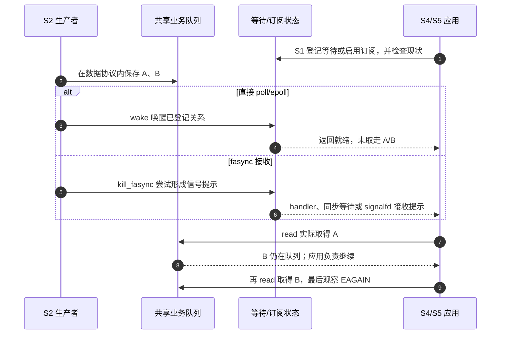
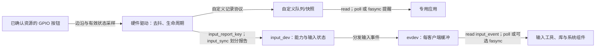
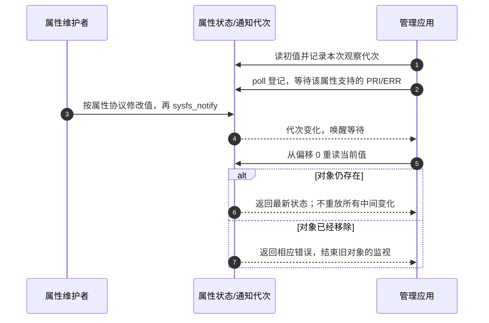
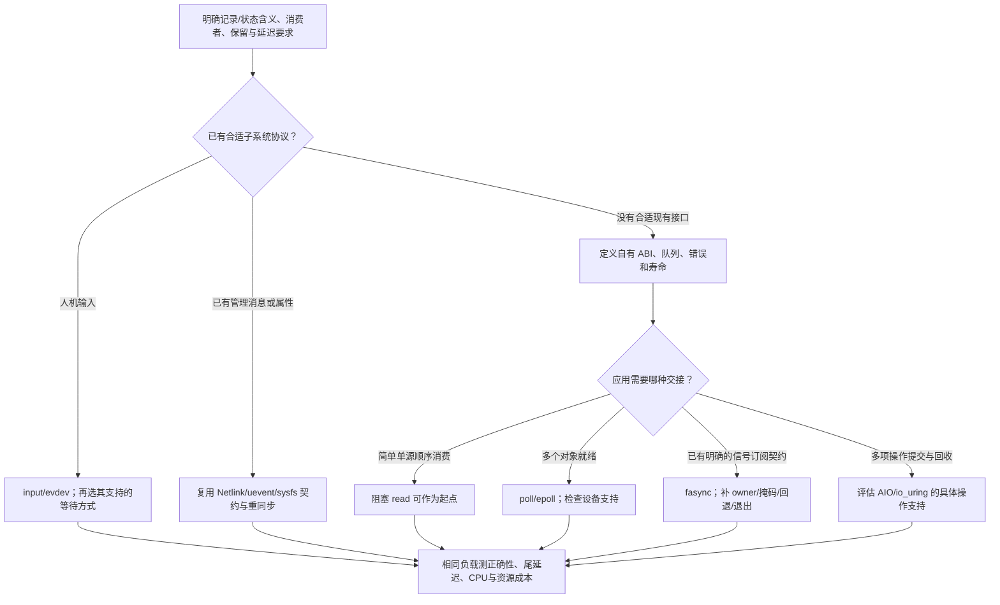

# 第12章\_fasync\_与其他通知机制的对比与整合

上一章已经能分别测量生产、通知尝试、信号接收和数据消费。现在要回答的是：新设备是否还需要走信号这条路？先别把 poll、input、Netlink、io_uring 排成一条“越来越先进”的队伍；它们有的定义数据含义，有的提醒就绪，有的完成已经提交的操作，不在同一比较轴上。

本章仍以一个设备产生记录、应用读取记录为起点。先固定数据与消费者，再改变通知路径；当需求变成人机输入、系统状态同步或请求完成时，再增加相应层。实现核对使用官方 NXP Linux 6.12.20 固定提交，[本章证据基线](../../../../../research/source_reading/linux/SOURCE_BASELINE.md#1.205_通知机制比较的实现与接口边界)记录路径和版本。后面的程序是有限机制实验，不是某块板的性能结论。

## 12.1\_先确定要保存什么\_才知道在比较哪一层

假设板上有一个按钮、一条采样数据流和一个运行模式开关。它们都“会变化”，但应用要保存的东西不同：按钮可能需要按下/松开的标准输入语义；采样可能要求每块记录不丢；运行模式可能只要求重新查询当前 normal/safe 状态。只选择一个唤醒函数，无法决定这些语义。

把问题逐层拆开，表中的接口才有可比较的含义：

| 要回答的问题 | 保存的状态与责任 | 这一层的选择 |
| --- | --- | --- |
| 什么算一条有效数据 | 按键状态、采样记录、消息属性及 ABI | input/evdev、现有设备子系统或自定义格式 |
| 谁拥有消费权 | 全局队列、每次打开的独立队列或共享快照 | 竞争消费、广播副本、最新状态；不是通知方式决定 |
| 何时值得再次尝试 I/O | 就绪谓词、等待登记、订阅节点、pending | 阻塞 read、poll/epoll、fasync 与接收方式 |
| 一项已提交操作完成了吗 | 请求标识、结果、缓冲所有权 | POSIX AIO、Linux 原生 AIO、io_uring 的具体操作 |
| 系统对象现在是什么状态 | 属性、对象身份、消息版本与订阅 | sysfs、uevent、已有 Netlink 协议 |

因此 input 和 fasync 可以同时存在：evdev 定义并保存输入记录，也提供 poll 和 fasync。Netlink socket 本身又可以被 poll/epoll 等待。io_uring 的 POLL_ADD 虽然产生“完成项”，完成的却是等待就绪请求，不是替应用读完业务数据。

前几章的 `async_queue` 与 waitqueue 都保存通知相关状态，不能为了“一份事实来源”把它们合成一个布尔量。应该统一的是 **业务可读/可写、错误和离线的契约**；每条通知路径仍有自己的登记、进度和生命周期。

## 12.2\_同一队列换等待方式\_数据消费规则为什么不变

先固定第六章的共享字节队列：生产者保存数据，读者成功复制后才提交消费。用 poll 等待时，核心登记在设备 waitqueue 上，驱动发布后唤醒；用 fasync 时，驱动遍历订阅并进入信号 pending，应用接收提示后再读。两条路都不能替消费者预留一个字节。



poll 这个名字不表示应用必须定时忙查：给出等待时间后，它可以睡眠，由驱动 waitqueue 唤醒。fasync 也不因“主动”二字就比 epoll 更及时；信号掩码、任务调度和处理线程仍影响它。需要低延迟时应按上一章测量实际路径，而不是给接口名排序。

| 路径 | 登记与返回形态 | 成本来源和使用条件 |
| --- | --- | --- |
| 阻塞 read | 调用中等待，然后返回实际数据 | 单源流程简单；要同时等多个对象时需增加线程或复用机制 |
| select | 每轮传 fd 集合并返回就绪集合 | 需要重建集合；常见 libc 的 fd_set 有 FD_SETSIZE 边界，fd 数值也须在范围内 |
| poll/ppoll | 每轮传 pollfd 数组，返回 revents | 扫描与传递数组有成本；少量 fd 往往足够清楚，ppoll 还提供掩码交接 |
| epoll | 持久兴趣项与就绪项，ctl 管理、wait 获取 | 节省每轮提交完整集合，但仍有登记、回调、重查、锁和返回项成本；不能概括为所有操作 O(1) |
| fasync + 接收 | file owner、信号选择、订阅节点和 pending | 满足已有信号契约时有价值；增加目标、掩码、合并、回退和退出责任 |
| fasync + signalfd + epoll | 先取信号记录，再回到真实设备读取 | 可纳入现有事件循环；设备本身已可 poll 时，需要理由才多绕一层 |

同一驱动可以提供两种通知接口，应用也可以观察两条提示；这不自动复制数据。两个非协作进程同时读共享队列，可能各取一部分，不应要求“两边都读到完整输入”。要广播就必须由设备或用户服务建立每订阅者副本及各自积压策略。两个通知入口统一调用消费函数时，后来的空读可合法返回 EAGAIN，不能凭重复提示就认定业务重复。

### 12.2.1\_用同样的AB与C观察三种就绪接口

下面在Linux上用真实pipe分别验证select、poll和默认LT epoll。LT（Level-triggered，电平触发式就绪报告）在条件仍成立时可以继续报告；ET（Edge-triggered，边沿触发式报告）要求读者自行保留排空责任。本实验只做有限的立即检查，**不测睡眠唤醒延迟**。保存为 `compare_ready.c`：

`ready()`把三种查询结果统一为1、0、-1，分别表示可尝试读取、暂时不就绪和查询失败。select每次重建fd_set并先检查数值范围；poll每次传数组；epoll只登记一次兴趣项，再多次wait。`watcher`只是本例保存这些参数的结构体，业务字节仍在pipe中，不会被查询函数消费。程序不重试EINTR，遇到非预期错误就清理并失败退出。

```c
#define _GNU_SOURCE
#include <errno.h>
#include <fcntl.h>
#include <poll.h>
#include <stdio.h>
#include <sys/epoll.h>
#include <sys/select.h>
#include <unistd.h>

enum wait_kind { USE_SELECT, USE_POLL, USE_EPOLL };
struct watcher { enum wait_kind kind; int reader, epoll_fd; };

/* 返回1表示值得尝试读取，0表示当前不就绪，-1表示查询失败。 */
static int ready(const struct watcher *w)
{
    if (w->kind == USE_SELECT) {
        fd_set readers;
        struct timeval timeout = {0};
        if (w->reader < 0 || w->reader >= FD_SETSIZE) {
            fprintf(stderr, "reader outside fd_set range\n");
            return -1;
        }
        FD_ZERO(&readers);
        FD_SET(w->reader, &readers);
        int n = select(w->reader + 1, &readers, NULL, NULL, &timeout);
        if (n < 0) { perror("select"); return -1; }
        return n > 0 && FD_ISSET(w->reader, &readers);
    }
    if (w->kind == USE_POLL) {
        struct pollfd entry = {.fd = w->reader, .events = POLLIN};
        if (poll(&entry, 1, 0) < 0) { perror("poll"); return -1; }
        if (entry.revents & POLLNVAL) {
            fprintf(stderr, "poll: invalid descriptor\n");
            return -1;
        }
        return !!(entry.revents & (POLLIN | POLLHUP | POLLERR));
    }
    struct epoll_event event;
    int n = epoll_wait(w->epoll_fd, &event, 1, 0);
    if (n < 0) { perror("epoll_wait"); return -1; }
    if (n == 0) return 0;
    if (event.data.fd != w->reader) {
        fprintf(stderr, "epoll: unexpected descriptor\n");
        return -1;
    }
    return !!(event.events & (EPOLLIN | EPOLLHUP | EPOLLERR));
}

static int close_owned(int *fd)
{
    if (*fd < 0) return 0;
    int old_fd = *fd;
    *fd = -1; /* Linux close报错也不盲目重试可能已被复用的数字。 */
    if (close(old_fd) == -1) { perror("close"); return -1; }
    return 0;
}

#define CHECK(test, message) do { \
    if (!(test)) { fprintf(stderr, "FAIL: %s\n", message); goto out; } \
} while (0)

static int run(enum wait_kind kind, const char *name)
{
    int ends[2] = {-1, -1}, result = 1;
    struct watcher w = {.kind = kind, .reader = -1, .epoll_fd = -1};
    char first = 0, second = 0, last = 0, unused;
    if (pipe2(ends, O_NONBLOCK | O_CLOEXEC) == -1) { perror("pipe2"); return 1; }
    w.reader = ends[0];
    if (kind == USE_EPOLL) {
        w.epoll_fd = epoll_create1(EPOLL_CLOEXEC);
        CHECK(w.epoll_fd >= 0, "epoll_create1");
        struct epoll_event event = {.events = EPOLLIN, .data.fd = w.reader};
        CHECK(epoll_ctl(w.epoll_fd, EPOLL_CTL_ADD, w.reader, &event) == 0, "epoll_ctl");
    }
    CHECK(ready(&w) == 0, "empty queue");
    CHECK(write(ends[1], "AB", 2) == 2, "write AB");
    CHECK(ready(&w) == 1, "AB ready");
    CHECK(read(w.reader, &first, 1) == 1 && first == 'A' && ready(&w) == 1, "B remains");
    CHECK(read(w.reader, &second, 1) == 1 && second == 'B' && ready(&w) == 0, "AB drained");
    ssize_t count = read(w.reader, &unused, 1);
    CHECK(count == -1 && errno == EAGAIN, "empty with writer alive");
    CHECK(write(ends[1], "C", 1) == 1, "write C");
    CHECK(close_owned(&ends[1]) == 0, "close writer");
    CHECK(ready(&w) == 1, "C or hangup ready");
    CHECK(read(w.reader, &last, 1) == 1 && last == 'C', "read C");
    CHECK(ready(&w) == 1, "EOF remains ready");
    CHECK(read(w.reader, &unused, 1) == 0, "EOF after drain");
    result = 0;
out:
    /* 每项独立清理，一项close失败不能跳过其余两项。 */
    if (close_owned(&w.epoll_fd) != 0) result = 1;
    if (close_owned(&ends[1]) != 0) result = 1;
    if (close_owned(&ends[0]) != 0) result = 1;
    if (result == 0) printf("%s PASS %c%c%c EOF\n", name, first, second, last);
    return result;
}

int main(void)
{
    const char *const names[] = {"select", "poll", "epoll"};
    for (int kind = USE_SELECT; kind <= USE_EPOLL; ++kind)
        if (run((enum wait_kind)kind, names[kind]) != 0) return 1;
    return 0;
}
```

在Linux实验目录编译，使用本机的系统调用头文件：

```sh
cc -std=c11 -O2 -Wall -Wextra -Werror compare_ready.c -o compare_ready
```

`_GNU_SOURCE`让本机头文件声明pipe2等Linux接口；命令生成 `compare_ready`。运行不需要设备节点或管理员权限：

```sh
./compare_ready
```

`CHECK`是本例的检查宏，失败跳到统一清理；它不依赖assert，NDEBUG不会删去检查。`close_owned()`在调用close之前清除所持数字，避免Linux关闭失败后重复关闭可能已被复用的描述符；三项清理分别执行，某项失败仍处理其余资源。只有操作与清理都成功才打印PASS。

三轮应各输出 ABC 和 EOF 的通过结果。读走 A 后，B 仍让接口报告就绪；写端关闭后，读空得到 EOF，不能把 EOF 当“暂时没有数据”再次无休止等待。poll/epoll 可能通过 HUP 表示关闭，因此真实事件循环也必须处理错误和挂断，而非只看 IN。

本程序用零超时检查，以避免等待未知外部输入；它是步骤化实验，不是建议生产程序忙轮询。若将 epoll 改为 ET，第二次 ready 断言可能失败，即便 B 还在队列；那不表示数据消失。第九章的[完整信号接收程序](P09_用户态编程_从_SIGIO_到_signalfdepoll.md#9.4_用一个有截止时间的程序完成订阅_消费与退出)使用相同 AB/C 思路说明另一条路径。比较结果应核对实际数据、错误和退出，不比较“通知次数必须相同”。

完整自定义设备仍见[第六章模块](P06_字符设备中实现异步通知的基础模式.md#6.3_把数据规则实现为完整模块)，不用另造一个消费前清零、空读返回 EOF 或忽略 O_NONBLOCK 的缩略驱动。普通文件、特殊 fd 和驱动各有接口能力边界；不能由“有 fd”推断 epoll 一定能注册成功。[epoll 接口说明](https://man7.org/linux/man-pages/man7/epoll.7.html)

## 12.3\_按键需要标准事件语义时\_为什么选择input而非另造协议

第七章自定义 GPIO 设备有助于理解采样、去抖、就绪与解绑。但若产品希望按钮作为系统按键使用，只向专用程序返回一个计数并不够：其他程序不知道这是哪个键、当前是否按下，也无法复用既有输入工具。新问题在 **数据语义和生态接口**，不在于换一个更快的提醒函数。

input 核心用 `input_dev` 描述设备能力和输入状态；驱动把已经正确取得的状态报告进去，evdev 再为打开它的客户端保存输入记录，提供读取与通知接口。按键读取可睡眠、有效电平、去抖和 IRQ 资源仍由真实硬件接入路径负责，不能直接在任意 IRQ 中调用可睡眠 GPIO 接口。



图表示两种软件设计的比较，不要求把同一个 GPIO 同时交给两个驱动。标准 GPIO 按键通常应先核对已有 gpio-keys 绑定与驱动，不能因为学习过 fasync 就再写一套产品专用字符协议。

| 输入记录内容 | 作用与边界 |
| --- | --- |
| 时间字段 | 记录输入时间；用户使用目标 `<linux/input.h>` 的布局，不假定所有 ABI 都是同一个 timeval 大小 |
| `type / code / value` | 类型、具体键/轴编码与值；例如 EV_KEY 的 0/1/2 是松开/按下/重复 |
| `EV_SYN / SYN_REPORT` | 划分一组同步报告；不是每条 GPIO 电气边沿自动形成完整帧 |
| `SYN_DROPPED` | 客户端缓冲丢失同步；按第八章丢弃到下一 SYN_REPORT 后查询当前状态，不恢复已经丢掉的历史 |
| `EV_REL / EV_ABS / EV_SW` | 分别表达相对增量、绝对量和开关状态，不能仅当无语义整数 |

`input_report_key`、`input_sync` 是报告接口；能力声明必须匹配上报类型。核心会维护按键状态，并在配置相应能力和条件时处理重复等行为，但桌面键盘布局、组合键动作、长按业务并不都由 input 核心自动完成。evdev 的可读条件与完整报告进度有关，不能简化为“内部有任意一项就必然可读”。

选择代价也明确：标准输入协议需要理解类型、能力、报告边界与溢出恢复，换来既有工具和消费者；私有协议允许特殊负载，却要自行维护版本、广播语义、错误和重同步。判断同一按键的两种实现时，先统一按下/松开/去抖的业务定义，再比较输出，不能把原始 IRQ 次数与 EV_KEY 记录直接要求相等。

已有设备可用 evtest 等输入工具观察本机实际 event 节点，但 eventX 不是固定编号，需先按设备身份定位；采用有限观察窗口并记录退出。核对 type/code/value、SYN_REPORT 和过载恢复。没有事件也要查 input/evdev 是否启用、设备是否成功注册、权限及是否被独占抓取，不把所有缺口归为 fasync 问题。

## 12.4\_需要让多个管理者重新认识系统状态\_消息和属性怎样分工

采样队列告诉业务应用“这一批数据是什么”；设备插拔或运行模式变化还会影响管理者对系统的认识。这时只给某个打开 file 的 owner 发 SIGIO，未必适合表达对象身份、属性集合和重新查询的方式。应先复用所属子系统已定义的控制接口，再考虑新协议。

Netlink 是内核与用户空间通过 socket 交换结构化消息的接口族。经典协议有固定用途，Generic Netlink 则允许子系统注册 family、命令、属性和组，并由用户查询其身份。不能随便把经典协议号 31 当作项目私有号占用。寻址使用 **port ID**，不是在所有情形下都等于进程 PID；同一进程可以有多个 socket，组订阅还受协议、权限与命名空间约束。

消息可以携带具体对象和属性，也能支持请求/回复与状态转储；但异步多播不是可靠历史日志。接收缓冲溢出等可能丢消息，ENOBUFS 或协议序号缺口要求按协议重新查询；请求的 ACK 也不证明每个订阅者都收到了后续广播。数据面/控制面的说法是按用途归类，不是 Netlink 永远只能低频、fasync 永远只能单消费者的硬性限制。

uevent 是设备对象模型中的事件约定，常通过 NETLINK_KOBJECT_UEVENT 通道传递 ACTION、DEVPATH、SUBSYSTEM 等环境项。它与 Generic Netlink 消息不能用同一个任意头格式解析。设备核心和所属子系统已经管理 add/remove 等事件时，不应在驱动里无依据重复发送；裸 kobject 若没有相应 kset/子系统关系，也不能保证 kobject_uevent 调用就会成功广播。更不能为了“属性变化”释放仍在使用的属性名。

sysfs 则提供对象属性的当前文本值与配置接口。属性 show/store 不自动保存每一次变化，写入动作也不自动保证有通知。固定版本的 `sysfs_notify` 找到属性后进入 kernfs_notify：更新通知代次，唤醒属性的等待关系，并安排相关文件通知工作。

| 层次 | 保存的内容 | 消费者如何继续 |
| --- | --- | --- |
| Netlink family/消息 | 命令、对象属性、序号等协议内容及 socket 接收队列 | 解析、检查截断/错误/序号，必要时重新 dump/query |
| uevent | 对象变化的环境项与事件身份 | 管理者按设备模型重新识别或读取属性，不当作设备数据队列 |
| sysfs 属性 | 当前属性状态及每打开实例观察的通知代次 | 首先读取，等待 PRI/ERR 通知后从偏移 0 重读，并处理删除 |
| fasync 提示 | 对订阅 file 的信号通知状态 | 回到该对象的 read/ioctl 数据协议，不携带完整管理状态 |

固定版本 kernfs 的普通属性 poll 以打开实例观察到的代次与当前代次比较，变化时增加 EPOLLPRI/EPOLLERR；不变化时仍有默认可读/可写位。因此把 sysfs 当普通数据流只等 POLLIN，可能一直立即返回。流程应是 **读初值 → 等待该属性约定的变化通知 → seek 到 0 并重读 → 处理新值或删除错误**，每轮有截止时间。只有主动支持通知的属性才成立，不能拿任意 sysfs 路径测试后推出所有属性都支持。



观察 uevent 可用已有管理工具的 monitor 功能，观察 Netlink 要用对应 family 的工具/消息解析器；`tcpdump -i any netlink` 不是通用抓取所有 Netlink 消息的命令，抓取方案还涉及专用监测接口与环境。kernfs_notify 在本版本也安排 fsnotify 工作，但这仍依赖属性确实调用通知，不能由“可以用 inotify”推出所有硬件属性改变都会形成文件事件。

同一事实通过数据记录和管理通告表达并非天生错误：例如采集流中记录设备故障，同时管理通道宣布设备离线。应明确两个消费者的用途，以对象身份、代次或序号关联，避免同一业务动作重复执行；不能简单禁止多通道，也不能默认不同通道天然去重。

## 12.5\_等待就绪与完成读请求\_为什么要分别理解

到目前为止，应用得到就绪后还要自己 read。若需求变成“提交很多读请求，先处理别的工作，再回收每个请求的结果”，就需要请求与完成模型。复杂度随之转移：应用必须保持请求标识、缓冲区和取消状态，直到对应操作真正结束，不能只保存一个 fd 号。

AIO（Asynchronous I/O，异步输入输出）不是单一 Linux API。POSIX AIO 的 `aio_read/aio_error/aio_return` 使用 aiocb 描述操作；glibc 的实现可在用户空间用线程执行。Linux 原生 AIO 的 `io_setup/io_submit/io_getevents` 则是另一套上下文和请求接口，不能把 kioctx、iocb 和 io_getevents 直接写成 POSIX AIO 的内部结构。[POSIX AIO](https://man7.org/linux/man-pages/man7/aio.7.html)、[Linux 原生提交接口](https://man7.org/linux/man-pages/man2/io_submit.2.html)

io_uring 用 SQ（Submission Queue，提交队列）和 CQ（Completion Queue，完成队列）组织请求与结果。提交项 SQE（Submission Queue Entry）保存操作及参数；完成项 CQE（Completion Queue Entry）保存请求标识及结果。普通单提交者、单回收者模型中，应用填写提交项后发布 SQ 尾索引，内核消费后推进 SQ 头索引；内核写完成项后发布 CQ 尾索引，应用读完后推进 CQ 头索引归还空间。这些状态位于双方映射的共享区域，必须按接口规定的内存顺序发布；多线程共同提交或回收还要遵守相应的并发约束。

liburing 是封装这些操作的用户库，不能把它的 queue_init 函数当作同名系统调用。批量提交能摊薄部分边界开销，但执行可能内联完成，也可能等待就绪或进入异步工作路径，不保证所有操作都无需线程或无需系统调用。后面的例子使用库管理共享索引，重点观察一个请求怎样交接，不手写一套缺少排序保证的 ring 操作。[共享队列与内存顺序说明](https://man7.org/linux/man-pages/man7/io_uring.7.html)

| 接口/条目 | 本次需要理解的字段或动作 | 不应推断的保证 |
| --- | --- | --- |
| SQE（提交项） | opcode 指定操作，fd/缓冲等给出参数，user_data 是应用请求标识 | 有一个空位不表示提交已被内核接收 |
| CQE（完成项） | user_data 关联请求，res 表示结果或负错误，flags 表示附加语义 | res 的含义由操作决定；POLL_ADD 是就绪位图，READ 才是读取结果 |
| 单次 POLL_ADD | 登记一次就绪等待；完成后该请求结束 | 不自动持续监控，也不复制设备数据 |
| multishot poll | 同一请求可产生多次 CQE，F_MORE 表示仍可能继续 | 未带 MORE 后不能继续假定旧请求有效，仍有取消与容量责任 |
| READ/WRITE | 尝试完成指定 I/O，可能短传输或失败 | `.poll` 存在不等于所有读写变体/模式都支持 |
| uring_cmd | 驱动明确实现的专用命令契约 | 不能给任意设备随便提交一个 ioctl 数字来替代 |

固定版本 `io_uring/poll.c` 通过 vfs_poll 获取就绪并登记等待。`io_uring/rw.c` 的 io_iter_do_read 优先调用 read_iter，没有时可通过 loop_rw_iter 回退到普通 read；回退拒绝用于轮询 I/O 完成路径的 IOCB_HIPRI 标志，携带“不等待”要求 IOCB_NOWAIT 而文件未设 O_NONBLOCK 时返回 EAGAIN。这些是操作执行模式约束，不能把 HIPRI 理解成任意任务都获得更高调度优先级。原生 AIO 的 `fs/aio.c` 读写路径则检查 read_iter/write_iter。因此既不能说“所有 io_uring 都必须有 read_iter”，也不能说“做好 poll 就自动支持所有 READ/WRITE”。要核对具体操作、文件能力、参数、内核配置和实际结果。

### 12.5.1\_让一个POLL\_ADD完成\_再亲手读出那一个字节

下面只验证单次就绪等待：pipe 中先放 K 并关闭写端，提交 POLL_ADD，检查 CQE 后再普通 read 取 K，最后确认 EOF。没有异步用户数据缓冲，也没有 SIGIO；这能直接区分“完成等待”与“完成读取”。保存为 `uring_ready.c`：

```c
#define _GNU_SOURCE
#include <errno.h>
#include <fcntl.h>
#include <liburing.h>
#include <poll.h>
#include <stdint.h>
#include <stdio.h>
#include <string.h>
#include <unistd.h>

int main(void)
{
    int descriptors[2] = {-1, -1};
    struct io_uring ring;
    int ring_ready = 0, result = 1, ret;
    char value;
    struct io_uring_cqe *cqe = NULL;
    struct __kernel_timespec timeout = {.tv_sec = 1, .tv_nsec = 0};

    if (pipe2(descriptors, O_NONBLOCK | O_CLOEXEC) < 0) {
        perror("pipe2");
        goto out;
    }
    /* 先放入一字节并关闭写端，检验注册时已有就绪与挂断。 */
    if (write(descriptors[1], "K", 1) != 1) {
        fprintf(stderr, "未能写入测试字节\n");
        goto out;
    }
    ret = close(descriptors[1]);
    descriptors[1] = -1;  /* close 失败也不对可能被复用的数字盲目重试 */
    if (ret < 0) {
        perror("close writer");
        goto out;
    }
    ret = io_uring_queue_init(8, &ring, 0);
    if (ret < 0) {
        fprintf(stderr, "queue_init: %s\n", strerror(-ret));
        goto out;
    }
    ring_ready = 1;
    struct io_uring_sqe *sqe = io_uring_get_sqe(&ring);
    if (!sqe) {
        fprintf(stderr, "没有空闲提交项\n");
        goto out;
    }
    io_uring_prep_poll_add(sqe, descriptors[0], POLLIN);
    sqe->user_data = UINT64_C(77);  /* 本程序自定请求标识，不是 fd */
    ret = io_uring_submit(&ring);
    if (ret != 1) {
        fprintf(stderr, "submit: %d，预期提交一项\n", ret);
        goto out;
    }
    ret = io_uring_wait_cqe_timeout(&ring, &cqe, &timeout);
    if (ret < 0) {
        fprintf(stderr, "wait: %s\n", strerror(-ret));
        goto out;
    }
    int mask = cqe->res;
    uint64_t request_id = cqe->user_data;
    io_uring_cqe_seen(&ring, cqe);  /* 先复制字段，归还后不再访问 cqe */
    if (request_id != UINT64_C(77) || mask < 0 || !(mask & POLLIN)) {
        fprintf(stderr, "不是预期的可读完成：res=%d\n", mask);
        goto out;
    }
    /* POLL_ADD 完成未复制业务数据，仍必须执行真实 read。 */
    if (read(descriptors[0], &value, 1) != 1 || value != 'K') {
        fprintf(stderr, "没有读到 K\n");
        goto out;
    }
    if (read(descriptors[0], &value, 1) != 0) {
        fprintf(stderr, "排空后没有得到 EOF\n");
        goto out;
    }
    result = 0;
out:
    if (ring_ready)
        io_uring_queue_exit(&ring);
    for (int i = 0; i < 2; ++i) {
        if (descriptors[i] >= 0 && close(descriptors[i]) < 0) {
            perror("close");
            result = 1;
        }
    }
    if (!result)
        puts("PASS: POLL_ADD 只报告就绪，read 取得 K，然后 EOF");
    return result;
}
```

```sh
# Linux 实验目录；已安装目标机 liburing 开发头文件与库。
cc -std=c11 -Wall -Wextra -O2 uring_ready.c -luring -o uring_ready
./uring_ready
```

缺头文件或库时先补齐目标构建依赖，不把本机没有安装当成 API 不存在。queue_init 可能因配置、权限、资源或策略失败；程序会非零退出，不能把不支持环境算成通过。等待限一秒，错误就清理，不无限重试；普通 read 是非阻塞的。

liburing 这些返回错误的接口和 CQE 使用负错误值，不能只检查 errno。CQE 字段先复制再归还；user_data=77 是本程序的请求标识，不能把可能复用的 fd 数字当永久操作身份。单次 poll 成功后如还需继续监控，应在完成消费责任后重新登记；重新登记会检查当时就绪，不能盲等下一条硬件边沿。[单次与多次 poll](https://man7.org/linux/man-pages/man3/io_uring_prep_poll_add.3.html)

本例 teardown 释放 ring，出错时不再使用其 CQE；它仅有 poll 请求，没有需要异步写入的用户缓冲。**不要把 queue_exit 返回推广成任意 I/O 已完成、所有应用缓冲可立即复用的证明。** 一般读写请求要跟踪目标请求的终态；取消本身也有完成结果，取消提交成功不等于原请求已停止。[ring 退出接口](https://man7.org/linux/man-pages/man3/io_uring_queue_exit.3.html)

signalfd 虽是 fd，也有“哪个线程消费可见 pending”的约束。若将它放进可能由工作线程执行的异步读取路径，必须核对执行者、信号目标和掩码；不能仅凭能提交 READ 就断言与接收线程自己 read 完全等价。需要纳入统一框架时，可以先等待其就绪，再由指定接收线程按第九章协议消费，并实际验证目标实现。

## 12.6\_把同一业务约束带进选择\_不要用接口名替代性能证明

现在再回到按钮、采样流和运行模式。选择顺序应是：找到既有子系统及数据语义，确定消费者与保留要求，选等待/完成模型，最后用真实负载验证成本。它们可以落在同一个事件循环里，却不必强行使用同一种数据格式。



| 具体需求 | 可作为起点的方案 | 实施前还要确认 |
| --- | --- | --- |
| 板上按键要进入系统输入生态 | gpio-keys/input + evdev，应用直接 poll | 实际资源、有效电平、去抖、事件与状态恢复 |
| 少数专有设备，已有 fd 循环 | 直接 poll/epoll 读取 | 设备 poll、错误/挂断、共享还是独立消费 |
| 必须遵守已存在的 SIGIO 接口 | fasync + 明确接收者，必要时 signalfd 接入循环 | 全线程掩码、owner、回退、旧 pending 与关闭顺序 |
| 高频采样需要保留每块数据 | 先选对应采集子系统或数据 ABI，再做批量消费 | 容量、DMA/缓冲所有权、丢失计数、吞吐与延迟；不能只换通知 |
| 多项 I/O 要批量提交并跟踪完成 | 验证 io_uring 或适用 AIO 操作 | 文件能力、请求/缓冲寿命、短传输、取消与队列资源 |
| 多管理者关心设备状态与拓扑 | 既有消息协议加状态查询 | 丢消息恢复、权限/命名空间、对象代次 |

没有一个“几十 Hz 必选 fasync、上千 fd 必选 io_uring”的通用分界。阻塞 I/O 也可能承载高吞吐批量传输，input 也不会保证固定响应延迟，批量提交可能增加等待时间。epoll 的持久登记减少重复工作，fasync 的遍历与信号交接增加一条路径，io_uring 引入请求与共享队列责任；把这些成本放进第十一章同负载测量，才有可辩护的选择。

组合时给每种业务确定唯一消费规则：一个设备同时出现 poll 和 SIGIO 提示，统一进入同一读取逻辑；真正需要多份业务结果时，建立广播队列而非多加几条通知。退出则停止新提交/订阅，完成取消与在途操作，结束旧对象的读取责任，最后归还资源。第十章的两阶段退场仍然成立，不会因改用某个新框架而消失。

练习：evdev 已经提供 fasync，为什么“input 还是 fasync”不是同一层选择？**答案：input 定义输入模型与记录协议，fasync 是它可以采用的通知接口；应先决定输入语义，再选消费者的等待方式。**

练习：两个程序各用 epoll 与 SIGIO 读取第六章同一共享队列，应各自读到全部 ABC 吗？**答案：不应；二者竞争消费，提示不创建副本。若需要两份数据，应另行定义广播存储与积压策略。**

练习：io_uring 的 POLL_ADD 返回 CQE，res 中有 POLLIN，能否释放读取缓冲并宣称数据已拿到？**答案：这项请求根本没读取业务数据；还要执行真实读取。只有相应读操作的完成结果才能决定那次缓冲的交接。**

下一章把这些选择收束到完整工程场景：明确接口、资源和故障注入，用同一组状态证明程序正常运行与退出，而不是再复制几份省略错误路径的驱动骨架。

上一篇：[P11 调试 排错与性能分析](P11_调试_排错与性能分析.md)。
下一篇：[P13 工程实践案例与编码核对表](P13_工程实践案例与编码核对表.md)。
