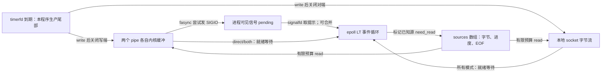
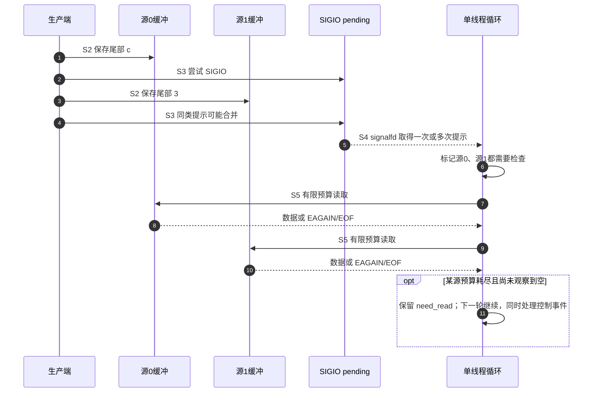
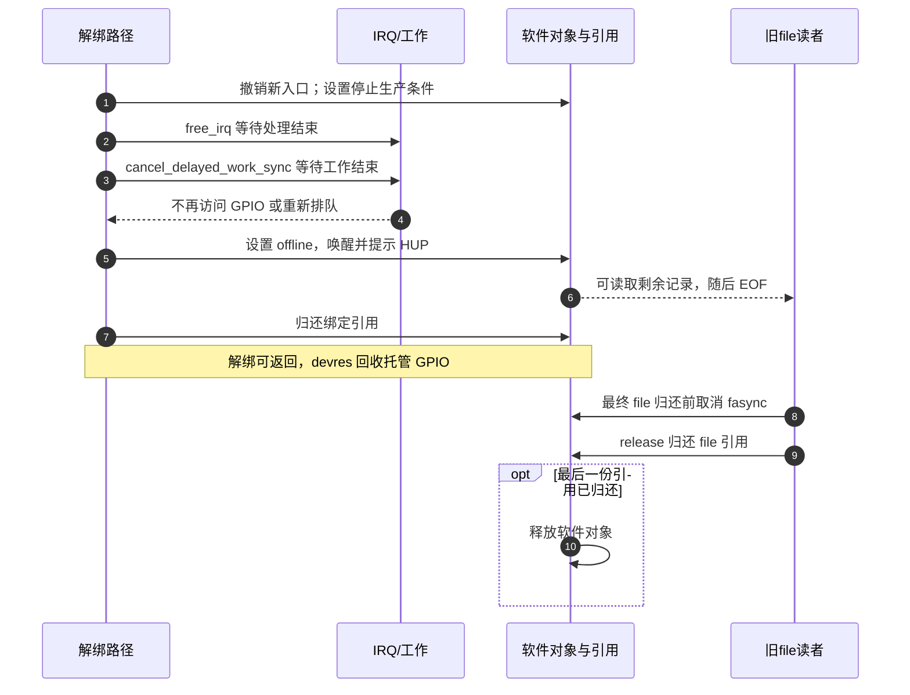

# 第13章\_工程实践案例与编码核对表

上一章已经能按数据语义和交接责任选择接口。现在把选择放进一个完整工程：两个事件源同时更新，另一个 socket 还在收数据；程序必须及时检查每个源，不能把重复提示当重复业务，也不能在退出时留下仍会访问旧对象的回调。

本章先用不依赖开发板的有限实验把多源循环跑清楚，再把其中一个源换成第七章 GPIO 记录协议，最后处理旧驱动迁移与资源退场。第六、七、九章的完整驱动和接收器仍是各自的实现入口；这里增加组合约束，不再维护几份名字不同、错误路径却不完整的驱动副本。实现依据沿用官方 NXP Linux 6.12.20 固定提交，新增核对见[本章证据基线](../../../../../research/source_reading/linux/SOURCE_BASELINE.md#1.206_异步通知工程整合与资源迁移证据)。

## 13.1\_先给每条数据和每个对象定责任\_再连接通知路径

设想一个控制程序：按钮改变工作状态，采集端提供数据，管理连接要求查询。三者都能让程序“有事做”，却不应共用一个无来源计数器。按钮可能只保留最新状态，采集数据可能必须逐块保存，socket 则有字节流边界和连接关闭。通知循环应该调用各自的消费函数，不能把所有 fd 都按一个 `unsigned int` 读取。

延用前章 S0 至 S6：S0 建立对象与接收条件，S1 订阅后检查现状，S2 发布数据，S3 唤醒或发信号，S4 接收提示，S5 实际消费，S6 停产并归还引用。它们描述一轮操作的阶段，不把设备队列、订阅、pending、用户进度和生命周期压成同一个状态机。

先明确本章实验的责任，再看图。两个 pipe 分别保存 `ab→c` 和 `12→3`；本地 socketpair 保存 `N→!`。箭头表示先有初值、稍后追加尾部，不是覆盖。所有端点由同一进程创建并独占，过程中不关闭后重用 reader；一个事件循环负责读取。两个 pipe 用来替代两路设备的通知接口，**没有模拟 GPIO 电气行为或设备记录 ABI**。



| 状态所在位置 | 写入者和读取者 | 本实验的交接保证 |
| --- | --- | --- |
| 各 pipe/socket 的内核缓冲 | 生产函数写；事件循环 read | 每个源有独立顺序，成功 read 才取得字节 |
| pipe 关联 file 的 flags/owner/订阅 | 初始化设置，退出撤销；内核发送时读取 | 本进程独占配置，不与其他线程争改 |
| 线程/进程信号 pending | 信号生成路径写；signalfd 读 | 普通 SIGIO 可合并，不保存每源业务记录 |
| `app.sources[i]` | 同一个事件循环写读 | reader/writer、原 flags、继续责任、累计字节、EOF 分开保存 |
| epoll 登记和就绪关系 | epoll_ctl 建立/删除；epoll_wait 观察 | token 是数组索引；fd 不是永久对象身份 |
| timerfd 到期数 | 内核计时；生产函数读 | 只决定是否执行尾部生产，不当设备事件计数 |

多线程服务若由工作线程处理业务，应另行定义队列及所有权交接；不能把这个单线程数组直接并发共享。动态连接还需要对象代次或稳定引用，防止关闭后的 fd 数字被新连接复用，旧提示却落到新对象上。本实验通过让 reader 活到统一清理来避免这种复用，并不声称解决了任意服务器的对象管理。

## 13.2\_一条SIGIO可能代表两个源\_怎样保证两个都检查

先想一个交错：源 0 更新并产生 SIGIO，源 1 随后更新，而同一标准信号还在 pending。应用后来只取得一次提示。如果据此只读源 0，源 1 的数据就可能一直留在内核中。对普通 SIGIO，`ssi_fd` 也不是可以无条件使用的来源字段；设置了非零 F_SETSIG 时仍有回退和旧 fd 身份问题。

本章采用简单而有明确代价的办法：**每次收到 SIGIO，都把两个已知 pipe 标成待检查**。检查无数据的源只会得到 EAGAIN；检查有数据的源取得记录。两个源时成本很小，很多源时逐个扫描可能不合算，应评估直接 epoll、可验证的来源提示加兜底扫描，或所属子系统的其他接口，不能只因“异步”而保留额外路径。



实验有三种模式，区别只在两个 pipe 的通知路径；socket、数据内容、截止时间和消费函数保持相同。

| 参数 | pipe 直接登记 epoll | pipe 启用 fasync | 用来回答的问题 |
| --- | --- | --- | --- |
| `direct` | 是 | 否 | 直接就绪等待能否取得全部数据并识别 EOF |
| `signal` | 否 | 是 | 合并的提示能否驱动对全部已知源的检查 |
| `both` | 是 | 是 | 两条提示同时存在是否仍只消费一份数据 |

所有模式启动后先检查已有数据。每源每轮最多四次 read，signalfd 每轮最多四批；预算用完保留继续责任，以免一个繁忙源把退出、定时器或另一个源饿死。read 返回 EAGAIN 才清除本轮继续责任；EOF 清除责任并撤销该源的 epoll 登记，避免挂断持续就绪导致空转。HUP 可以与尾部数据同时存在，所以先读取尾部，再以 read 返回 0 确认结束。

### 13.2.1\_完整程序把两路通知与一条socket流接起来

将下面保存为 `multi_async.c`。`socketpair(AF_UNIX, SOCK_STREAM, ...)` 创建相互连接的本地字节流端点：AF_UNIX 选择本地通信地址族，SOCK_STREAM 选择字节流类型，不需要端口、监听器或网络权限。它用来检验另一类 fd 与信号通知共存，不是网络传输控制协议 TCP（Transmission Control Protocol）的服务实现。timerfd 在约 250 ms 后让本程序写入尾部；三秒是失败截止时间，不是承诺调度精度。[socketpair 接口依据](https://man7.org/linux/man-pages/man2/socketpair.2.html)

代码中的 SOURCES 是本例自定的源数量常量 3，SIGNAL_TOKEN 和 TIMER_TOKEN 是控制事件的索引常量；它们不是内核规定的值。`source.need_read` 保存“下一轮仍有检查责任”，`sent_tail` 保证积压多个定时到期也只生产一次尾部。字节累计越过本例固定容量时返回 EOVERFLOW，避免把异常输入写出缓冲区。

```c
#define _GNU_SOURCE
#include <errno.h>
#include <fcntl.h>
#include <signal.h>
#include <stdint.h>
#include <stdio.h>
#include <stdlib.h>
#include <string.h>
#include <time.h>
#include <unistd.h>
#include <sys/epoll.h>
#include <sys/signalfd.h>
#include <sys/socket.h>
#include <sys/timerfd.h>

#define SOURCES 3
#define SIGNAL_TOKEN 3
#define TIMER_TOKEN 4

struct source {
    int reader, writer, old_flags, need_read, eof, sent_tail;
    size_t used;
    char bytes[8];
};
struct app {
    struct source sources[SOURCES];
    int signal_fd, timer_fd, epoll_fd, stopped;
    int use_signal, use_direct;
    size_t notices;
};

static int64_t now_ms(void)
{
    struct timespec t;
    if (clock_gettime(CLOCK_MONOTONIC, &t) < 0)
        return -1;
    return (int64_t)t.tv_sec * 1000 + t.tv_nsec / 1000000;
}

static int close_slot(int *slot)
{
    int fd = *slot;
    *slot = -1;  /* 出错也不盲目重试已可能被回收的描述符数字。 */
    return fd >= 0 ? close(fd) : 0;
}

static int add_input(struct app *a, int fd, uint32_t token)
{
    struct epoll_event event = {.events = EPOLLIN};  /* LT，保留持续就绪 */
    event.data.u32 = token;  /* 稳定数组索引，不用 fd 数值索引固定大表。 */
    return epoll_ctl(a->epoll_fd, EPOLL_CTL_ADD, fd, &event);
}

static int write_exact(int fd, const char *text)
{
    size_t size = strlen(text);
    ssize_t n = write(fd, text, size);
    if (n == (ssize_t)size)
        return 0;
    if (n >= 0)
        errno = EIO;  /* 此有限实验遇到短写即失败，不盲目重发整段。 */
    return -1;
}

static int drain_source(struct source *s)
{
    for (int budget = 0; budget < 4; ++budget) {
        char data[4];
        ssize_t n = read(s->reader, data, sizeof(data));
        if (n > 0) {
            if ((size_t)n > sizeof(s->bytes) - s->used) {
                errno = EOVERFLOW;
                return -1;
            }
            memcpy(s->bytes + s->used, data, (size_t)n);
            s->used += (size_t)n;
        } else if (n == 0) {
            s->eof = 1;
            s->need_read = 0;
            return 0;
        } else if (errno == EAGAIN || errno == EWOULDBLOCK) {
            s->need_read = 0;
            return 0;
        } else if (errno != EINTR) {
            return -1;
        }
    }
    /* 预算耗尽时保留 need_read，下一轮主动继续，不依赖新的边沿。 */
    return 0;
}

static int drain_signals(struct app *a)
{
    struct signalfd_siginfo record[8];
    for (int batch = 0; batch < 4; ++batch) {
        ssize_t n = read(a->signal_fd, record, sizeof(record));
        if (n < 0) {
            if (errno == EINTR)
                continue;
            if (errno == EAGAIN || errno == EWOULDBLOCK)
                return 0;
            return -1;
        }
        if (n == 0 || n % sizeof(record[0])) {
            errno = EPROTO;
            return -1;
        }
        for (size_t i = 0; i < (size_t)n / sizeof(record[0]); ++i) {
            if (record[i].ssi_signo == SIGINT || record[i].ssi_signo == SIGTERM)
                a->stopped = 1;
            if (record[i].ssi_signo == SIGIO) {
                ++a->notices;
                /* 普通 SIGIO 可以合并，也不保证 ssi_fd 有可用的来源身份。 */
                for (int j = 0; j < 2; ++j)
                    a->sources[j].need_read = !a->sources[j].eof;
            }
        }
    }
    return 0;
}

static int produce_tails(struct app *a)
{
    uint64_t ticks;
    ssize_t n = read(a->timer_fd, &ticks, sizeof(ticks));
    if (n < 0 && (errno == EINTR || errno == EAGAIN))
        return 0;
    if (n != (ssize_t)sizeof(ticks) || !ticks) {
        if (n >= 0)
            errno = EPROTO;
        return -1;
    }
    const char *tails[SOURCES] = {"c", "3", "!"};
    for (int i = 0; i < SOURCES; ++i) {
        struct source *s = &a->sources[i];
        if (!s->sent_tail) {
            if (write_exact(s->writer, tails[i]) < 0)
                return -1;
            s->sent_tail = 1;
            if (close_slot(&s->writer) < 0)
                return -1;
        }
    }
    return 0;
}

int main(int argc, char **argv)
{
    struct app a = {.signal_fd = -1, .timer_fd = -1, .epoll_fd = -1};
    int result = EXIT_FAILURE;
    const char *initial[SOURCES] = {"ab", "12", "N"};
    const char *expected[SOURCES] = {"abc", "123", "N!"};
    sigset_t mask;
    struct sigaction action = {.sa_handler = SIG_DFL};
    struct itimerspec timer = {
        .it_value = {.tv_nsec = 250000000},
        .it_interval = {.tv_nsec = 250000000}
    };
    for (int i = 0; i < SOURCES; ++i) {
        a.sources[i].reader = a.sources[i].writer = a.sources[i].old_flags = -1;
        a.sources[i].need_read = 1;
    }
    if (argc != 2 || (strcmp(argv[1], "direct") && strcmp(argv[1], "signal") &&
                      strcmp(argv[1], "both"))) {
        fprintf(stderr, "用法：%s direct|signal|both\n", argv[0]);
        return EXIT_FAILURE;
    }
    a.use_signal = strcmp(argv[1], "direct") != 0;
    a.use_direct = strcmp(argv[1], "signal") != 0;
    if (sigemptyset(&mask) < 0 || sigaddset(&mask, SIGIO) < 0 ||
        sigaddset(&mask, SIGINT) < 0 || sigaddset(&mask, SIGTERM) < 0 ||
        sigprocmask(SIG_BLOCK, &mask, NULL) < 0 || sigemptyset(&action.sa_mask) < 0)
        goto error;
    int signals[] = {SIGIO, SIGINT, SIGTERM};
    for (int i = 0; i < 3; ++i)
        if (sigaction(signals[i], &action, NULL) < 0)
            goto error;
    a.signal_fd = signalfd(-1, &mask, SFD_NONBLOCK | SFD_CLOEXEC);
    a.epoll_fd = epoll_create1(EPOLL_CLOEXEC);
    a.timer_fd = timerfd_create(CLOCK_MONOTONIC, TFD_NONBLOCK | TFD_CLOEXEC);
    if (a.signal_fd < 0 || a.epoll_fd < 0 || a.timer_fd < 0 ||
        add_input(&a, a.signal_fd, SIGNAL_TOKEN) < 0 ||
        add_input(&a, a.timer_fd, TIMER_TOKEN) < 0)
        goto error;
    for (int i = 0; i < SOURCES; ++i) {
        int pair[2];
        struct source *s = &a.sources[i];
        int ret = i == 2 ? socketpair(AF_UNIX, SOCK_STREAM | SOCK_NONBLOCK |
                                     SOCK_CLOEXEC, 0, pair) :
                           pipe2(pair, O_NONBLOCK | O_CLOEXEC);
        if (ret < 0)
            goto error;
        s->reader = pair[0];
        s->writer = pair[1];
        /* 订阅前已有数据，靠启动检查发现。 */
        if (write_exact(s->writer, initial[i]) < 0)
            goto error;
        if (i < 2 && a.use_signal) {
            s->old_flags = fcntl(s->reader, F_GETFL);
            if (s->old_flags < 0 || fcntl(s->reader, F_SETOWN, getpid()) < 0 ||
                fcntl(s->reader, F_SETSIG, 0) < 0 ||
                fcntl(s->reader, F_SETFL, s->old_flags | O_ASYNC) < 0)
                goto error;
            int flags = fcntl(s->reader, F_GETFL);
            if (flags < 0)
                goto error;
            if (!(flags & O_ASYNC)) {
                errno = ENOTSUP;
                goto error;
            }
        }
        if ((i == 2 || a.use_direct) && add_input(&a, s->reader, (uint32_t)i) < 0)
            goto error;
    }
    if (timerfd_settime(a.timer_fd, 0, &timer, NULL) < 0)
        goto error;
    int64_t start = now_ms();
    if (start < 0)
        goto error;
    int64_t deadline = start + 3000;
    for (;;) {
        struct epoll_event events[8];
        int done = 0, continuing = 0;
        int64_t now = now_ms();
        if (now < 0)
            goto error;
        if (now >= deadline || a.stopped)
            break;
        for (int i = 0; i < SOURCES; ++i) {
            struct source *s = &a.sources[i];
            int was_eof = s->eof;
            if (s->need_read && drain_source(s) < 0)
                goto error;
            if (!was_eof && s->eof && (i == 2 || a.use_direct) &&
                epoll_ctl(a.epoll_fd, EPOLL_CTL_DEL, s->reader, NULL) < 0)
                goto error;
            done += s->eof;
            continuing |= s->need_read;
        }
        if (done == SOURCES && (!a.use_signal || a.notices))
            break;
        int timeout = continuing ? 0 : (int)(deadline - now);
        if (timeout > 250)
            timeout = 250;
        int n = epoll_wait(a.epoll_fd, events, 8, timeout);
        if (n < 0) {
            if (errno == EINTR)
                continue;
            goto error;
        }
        for (int i = 0; i < n; ++i) {
            uint32_t token = events[i].data.u32;
            if (token < SOURCES) {
                /* HUP 也走真实 read，先读尾部，再观察 EOF。 */
                a.sources[token].need_read = !a.sources[token].eof;
            } else {
                if (events[i].events & (EPOLLERR | EPOLLHUP)) {
                    errno = EIO;
                    goto error;
                }
                if (token == SIGNAL_TOKEN && drain_signals(&a) < 0)
                    goto error;
                if (token == TIMER_TOKEN && produce_tails(&a) < 0)
                    goto error;
            }
        }
    }
    if (a.stopped || (a.use_signal && !a.notices)) {
        fprintf(stderr, "提前停止或未观察到信号提示\n");
        goto cleanup;
    }
    for (int i = 0; i < SOURCES; ++i) {
        struct source *s = &a.sources[i];
        if (!s->eof || s->used != strlen(expected[i]) ||
            memcmp(s->bytes, expected[i], s->used)) {
            fprintf(stderr, "源 %d 未满足数据与 EOF 契约\n", i);
            goto cleanup;
        }
    }
    result = EXIT_SUCCESS;
    goto cleanup;
error:
    perror("多源实验");
cleanup:
    for (int i = 0; i < SOURCES; ++i) {
        struct source *s = &a.sources[i];
        if (s->reader >= 0 && s->old_flags >= 0 &&
            fcntl(s->reader, F_SETFL, s->old_flags) < 0) {
            perror("撤销订阅");
            result = EXIT_FAILURE;
        }
        if (close_slot(&s->writer) < 0) {
            perror("关闭生产端");
            result = EXIT_FAILURE;
        }
        if (close_slot(&s->reader) < 0) {
            perror("关闭消费端");
            result = EXIT_FAILURE;
        }
    }
    int *controls[] = {&a.epoll_fd, &a.timer_fd, &a.signal_fd};
    for (int i = 0; i < 3; ++i)
        if (close_slot(controls[i]) < 0) {
            perror("关闭控制描述符");
            result = EXIT_FAILURE;
        }
    /* 信号保持阻塞直到本进程退出；清理成功以后才报告 PASS。 */
    if (!result)
        printf("PASS mode=%s data=abc/123/N! notices=%zu all_eof=1\n",
               argv[1], a.notices);
    return result;
}
```

阅读程序时可以沿同一操作周期定位：`main` 先屏蔽信号并建立接收设施，创建三个源并放初值，设置订阅后以 `need_read=1` 启动检查；循环中的 `drain_source` 消费数据，`drain_signals` 只增加检查责任，`produce_tails` 执行一次生产并关闭写端。末尾先核对内容与 EOF，再走统一清理。所有这些动作在一个执行流中完成，所以数组内的进度不需要额外跨线程锁。

`write_exact` 只针对本实验的一次短写入，遇到短写或错误即让实验失败；它不是通用网络发送循环。真正的流式发送器应保存已发送偏移继续剩余部分，不能重发整个消息。`close_slot` 在 close 前让槽位失效，是为了出错后不盲目重试可能已被回收的 fd 数字；它不把关闭错误隐藏为成功。

在 Linux 实验目录执行：

```sh
# 目标 Linux 上保存 multi\_async.c 后编译；三个模式依次独立运行。
cc -std=c11 -Wall -Wextra -O2 multi_async.c -o multi_async
./multi_async direct
./multi_async signal
./multi_async both
```

每次成功都应输出 `data=abc/123/N!` 和 `all_eof=1`，退出状态为 0。signal/both 还要求至少观察到一次信号；**不要求 notices 等于字节数、源数或 write 次数**。错误、提前终止、超时或清理失败都非零退出，只有清理成功才打印 PASS。程序不在 handler 中打印，也不在信号记录里取一个未经验证的 fd 直接读取。

先预测：将 signalfd 批处理缩小后，数据应仍相同，耗费的循环轮数可能变化。再预测：在 signal 模式里故意只标记源 0，源 1 的尾部将缺少检查责任，实验应因数据/EOF条件不成立而失败；这正是合并提示不能充当逐源消息队列的反例。最后把两路 pipe 都改成直接 epoll，观察 fasync 已不再是取得数据所必需的条件。

为了检验退出，可在调试器中将程序停在完成订阅、尚未进入主循环的位置，向确认的实验 PID 发 SIGTERM 后继续执行；这样能把停止请求稳定地放进这次短实验，而不靠手速赶在约 250 ms 的尾部生产前操作。不要按进程名批量终止其他实例。程序会通过 signalfd 记录停止，清理并报告本次实验未完成；若信号发生在接收准备以前而由默认动作终止，不能把它记作优雅退出测试通过。

### 13.2.2\_把本地流换成网络连接\_新增责任在哪里

本例的 socket 已连接、无外部客户端，所有 fd 数目固定。真正添加 TCP listener 时，需要创建非阻塞监听 socket、明确绑定地址和端口、调用 listen，再用 `accept4(..., SOCK_NONBLOCK | SOCK_CLOEXEC)` 取得客户端；不能假定 Linux accept 得到的 socket 自动继承监听者的 O_NONBLOCK。accept、读写都要处理 EAGAIN、EINTR 和连接结束，每轮有预算。[accept 与 accept4 接口依据](https://man7.org/linux/man-pages/man2/accept.2.html)

每个客户端还需要自己的接收缓存、消息边界解析、发送剩余区间和退出状态。SOCK_STREAM 不保留应用消息边界；一次 read 可能只有半条命令或多条命令。输出积压时仅在有待发送数据时监听可写，处理短写及断开；写已断开连接时还要按协议处理 EPIPE/SIGPIPE。否则把网络代码塞入同一 epoll，并不能让它自动成为正确的服务程序。

关闭连接时撤销登记，停止新业务提交，等待仍引用连接对象的工作完成后释放；全部客户端都必须纳入清理。不要按 `FD_SETSIZE` 建一个静默忽略超范围 fd 的表，那是常见 select 接口的限制，不是 epoll 固有上限。已有队列若跨线程传递对象，还要带稳定身份，不能只传一个稍后可能复用的整数。

## 13.3\_把软件源换成GPIO\_需要替换生产和解析\_不能猜测引脚

多源循环成立后，硬件接入仍有独立工作。i.MX6ULL 是 SoC 名，不能凭这个名字断言用户板的按钮接在 GPIO1_IO18、LED 接 GPIO1_IO03。要先核对具体板卡版本、原理图、引脚复用、有效电平、IRQ 与是否已有 gpio-keys 占用。第七章的[资源确认与设备树](P07_中断驱动设备的异步通知实践.md#7.2_先确定哪根线在变化_再取得Linux中断号)给出了定位步骤；没有确认之前不提供“可直接上板”的数字模板。

第七章完整 `async_key.c` 已把短 IRQ、延后采样、静稳窗口、代次检查和软件对象寿命接起来。本章复用[完整模块](P07_中断驱动设备的异步通知实践.md#7.5_把采样_文件操作和退场接成一个模块)，先按[有限观察实验](P07_中断驱动设备的异步通知实践.md#7.6_先观察稳定状态_再分别验证poll和SIGIO)单独验证该源，再接入多源循环。无需同时加载一份旧 demo_async_key，它的虚构资源、重复节点和不同 ABI 反而使结果无法比较。

真实源取代 pipe 时，生产端由 GPIO 驱动承担，应用不再持有 writer；消费者必须从字节累计改为 16 字节记录解析。把采样序号、逻辑状态和保留字节分别读取，不把结构体的本机对齐当作线上的格式。

| 第七章协议 | 集成者的动作 | 能证明与不能证明的内容 |
| --- | --- | --- |
| 字节 0～7：小端 64 位序号 | 解码并按无符号回绕比较进度 | 不同状态采样的进度；不是 IRQ/SIGIO 次数 |
| 字节 8：逻辑有效值 0/1 | 更新按钮业务状态 | active-low 已由 GPIO 描述符语义处理，不再盲目取反 |
| 字节 9～15：保留为 0 | 检查协议是否匹配 | 非零应调查版本/错误，不当作附加计数 |
| 一次成功 read 为完整 16 字节 | 成功才处理；失败不解析用户缓冲 | EFAULT 前用户缓冲仍可能部分改变 |
| 最新状态单槽、所有打开者竞争 | 一个源由一个消费逻辑管理 | 序号跳跃可显示中间状态未读取，不恢复历史 |
| 离线先交付剩余记录，再 EOF | 允许读尾部，结束旧对象登记 | 不能因 HUP 立刻丢弃尚未读取的记录 |

硬件验收分四个动作：启动时保持按住，确认首次采样；缓慢按下与松开，确认逻辑状态；制造接点抖动或重复边沿，观察静稳采样而非简单数 IRQ；保持旧 fd 打开执行已确认目标的解绑，确认旧读者能结束且不再访问 GPIO。每项记录板卡身份、构建版本、预期和实际观察，没有设备就明确标成未运行。

LED 可以作为观察支路，但读写 GPIO 的可睡眠性仍须核对；若在普通工作上下文使用可睡眠访问，也不能把 LED 翻转耗时误算为用户信号延迟。LED 并不是 fasync 正确性的必要组成，不应为了调试指示占用尚未确认的引脚。产品要进入系统按键生态时，优先使用上一章说明的 gpio-keys/input 路径。

## 13.4\_改造旧轮询程序\_先修数据契约\_再改变等待方式

假设旧驱动每次 read 都返回当前计数，应用每 100 ms 读一次。这个设计是“查询最新值”，不必然错误；当只需低频状态且设备没有可靠事件通知时，它可能足够。代价是周期唤醒和采样窗口：某次变化刚好发生在读取之后，要等下一次读取；若计数有回绕或两次查询间状态往返，还可能丢掉业务所需的信息。

若把 read 突然改成“没有新事件就阻塞”，改的不只是等待性能，也改变了原接口语义。应先明确新需求是最新值、累计差量还是逐条记录，决定何时消费、容量溢出和离线行为，再统一修改实现与调用者；不能让旧协议与新协议用同一个字段含糊共存。

| 阶段 | 改动及理由 | 当前必须验证的反例 |
| --- | --- | --- |
| A：确认数据契约 | 对状态、计数或记录建立稳定 ABI；明确共享还是每打开独立消费 | 两个读者会竞争，还是各有游标；计数饱和后如何报告损失 |
| B：建立阻塞与非阻塞读取 | 锁内重查，等待后重试；成功复制才提交消费 | 空且在线为 EAGAIN/等待，不能返回伪 EOF；EFAULT 不吞数据 |
| C：加入 poll 等待 | 先登记等待关系，再按同一谓词检查；发布后唤醒 | 注册时已有数据、登记与发布交错、另一读者先取走 |
| D：需求确实需要 fasync 时加入订阅 | helper 维护订阅；发布后尝试提示；取消与对象寿命配套 | owner、掩码、标准信号合并、启动现状、关闭后的旧 pending |
| E：替换应用等待并验收 | 用本章三模式或目标协议适配器比较数据结果 | 相同输入应产生符合相同契约的输出，不以通知次数配对 |

这是一条便于隔离故障的工程顺序，**不是架构规定 fasync 必须依赖 `.poll`**。若现有 ABI 只提供信号通知，也应尊重它的消费规则；若直接 poll 已满足需求，没有必要为了“升级”额外启用 fasync。

完整字节队列的参考仍是[第六章模块](P06_字符设备中实现异步通知的基础模式.md#6.3_把数据规则实现为完整模块)。它使用互斥锁保护可睡眠的用户复制与消费提交；GPIO 版本把短边沿自旋锁和采样数据锁分开。由实际上下文决定锁型，不把“每个驱动必须有一把保护所有字段的自旋锁”当成模板。

迁移检查要抓住一条具体故障链：先把 ready 清零，再 copy_to_user 失败，应用没有拿到记录、驱动却认为已经消费；随后没有新事件，应用也没有理由再次醒来。添加 kill_fasync 不会补回这条记录。修复位置在消费提交协议，而不是增加通知次数。

## 13.5\_devm缩短回滚代码\_为什么不能替旧fd决定寿命

第七章选择 GPIO 托管、IRQ 显式释放、软件对象用 kref 保活。这个混合方式有明确原因：硬件访问要在解绑时停止，但旧 fd 仍需访问软件记录、等待队列和取消订阅。资源是否托管取决于释放责任与时间，不取决于名字里有没有“设备”二字。

先追踪一次解绑：撤销新打开入口，阻止重新排队，等待 IRQ 和工作结束；此后才宣布离线并唤醒旧读者。解绑路径归还绑定引用，旧 file 归还自己的引用，最后一份引用消失才释放软件对象。devres 在驱动脱离时释放托管资源，不会自动等用户关闭所有 fd。把软件对象机械换成 devm_kzalloc，可能使之后的 `.read/.poll/.fasync/.release` 访问已经释放的存储。



这张图允许旧文件晚于解绑结束；也允许用户早就关闭，最终由绑定引用的归还触发释放。图中先 free_irq 再等待工作，是因为 IRQ 可能排队工作。等待时不能持有 IRQ/工作需要的锁。若还有 timer、其他线程或 DMA 完成路径能再次排队，必须先堵住那些生产入口；只取消一次工作并不能阻止未来重新提交。

| 对象 | 第七章当前做法 | 改成其他管理方式的条件 |
| --- | --- | --- |
| GPIO 描述符 | devm_gpiod_get，解绑自动归还 | 改为 gpiod_get 时须在所有 IRQ/工作停用后 gpiod_put |
| IRQ action | request_irq；key_stop 中 free_irq | 改为 devm_request_irq 后，如需提前停止，应使用配套 devm_free_irq，并同步调整全部失败路径 |
| delayed_work | 显式停止再 cancel_delayed_work_sync | 必须确保所有重排入口已停止；不能仅依赖结构体释放 |
| 软件 `key_device` | kzalloc + kref，绑定与 file 分别持有 | 旧文件仍能调用时不能随 devres 提前释放 |
| misc 登记 | misc_register/misc_deregister | 新入口撤销不撤销已打开 file；与打开回调的串行关系仍须证明 |
| fasync 节点 | helper 维护；最终 file 归还取消 | helper 的节点保护不保活包含链表头的软件对象 |

固定版本提供 `devm_free_irq`：它移除相应 devres 登记，再释放该 IRQ action。所以“托管 IRQ 永远不能提前释放”不成立；错误的是调用普通 free_irq 后仍留下托管登记，导致后续重复释放。反过来，也不能仅把 free_irq 删除而不补停产顺序，让 remove 后半段继续与 IRQ 并发。

clock、regmap 等也有托管接口，不能按资源类别一律禁止。关键是这次取得的句柄由谁持有、什么时候能归还；跨设备共享服务须有真实的共享寿命协议。普通注册函数不会自动挂上 devres，但确有需求时可用托管 action 安排自定义清理；action 的参数对象也必须活到执行时，并处理登记失败，不能用“自动清理”掩盖寿命问题。

同样不能把 `.open` 中分配对象、`.release` 中释放对象一律列为禁用：每打开上下文本来可以这样管理；最后一个引用触发设备软件对象释放也可能发生在 release。应禁止的是 **不顾其他使用者就提前释放共享对象或硬件**。固定版本的 `__fput` 会在仍启用 FASYNC 时先调用取消，再调用 release；驱动依然必须保证取消回调所访问的头和状态有效，不能把所有责任推给 devm。

## 13.6\_用失败现场核对两侧协议\_而不是只勾选函数名

完整工程不能只证明“按一次按钮看到一行输出”。把验证落在同一组阶段，先固定输入和预期，再记录实际返回、数据序号和最终状态。以下检查对应前面已经解释过的因果链，不要求每个设备都套同一组字段。

| 阶段与故障 | 驱动侧应检查 | 应用侧应检查 |
| --- | --- | --- |
| S0 初始化中途失败 | 只归还成功取得的资源；发布入口前状态完整 | 所有 fd 初始为 -1；部分配置失败也执行统一清理 |
| S1 订阅前已有数据 | 数据不依赖下一次中断才能发现 | 屏蔽并准备接收后启用订阅，再主动读现状 |
| S2/S3 两源一起更新 | 数据先发布，通知只作提示 | 合并 SIGIO 后检查已知源，不以次数配对数据 |
| S5 两读者竞争 | 醒来后锁内重查；不伪造 EOF 或 EIO | EAGAIN 可以是正常竞争，不把提示当预留数据 |
| S5 用户复制失败 | 未成功交付的内容不被提前提交消费 | 丢弃失败返回对应的用户缓冲，不能解析半条记录 |
| S5 队列满或快照被覆盖 | 容量、丢失统计和恢复规则明确 | 序号/状态恢复，而不是增加信号数假装补回数据 |
| S6 撤销订阅时还有 pending | 取消后不再靠旧订阅产生未来通知 | 旧提示仍可能被消费；不把其中 fd 当永久身份 |
| S6 旧 fd 跨解绑 | 停产、等待、离线、引用归还分开 | 尾部、HUP、EOF 按目标 ABI 处理，撤销旧对象登记 |
| 任一轮持续忙碌 | 发布和唤醒的代价有边界 | 每源预算、待继续状态和全局截止，不让退出饿死 |

传统 handler 仍是可选接收方式，但要采用第九章的安全交接：保存/恢复 errno，只做允许的动作，以正确屏蔽加等待避免检查后睡眠的窗口。`read` 本身属于异步信号安全接口，并不因此适合在任意 handler 中执行阻塞读取、与主循环争抢设备或随后调用 printf；“轻量统计”也不使普通整数的并发自增自动安全。

多线程程序在创建工作线程前安排信号掩码，或逐线程完成一致配置；只屏蔽事件线程不能控制其他线程的传统递达。fork/dup 共享同一 file 的 owner、signum 和文件状态，不会得到两份独立订阅配置。若多个进程需要业务结果，选择一个接收者再通过明确 IPC 分发，或者为每个独立打开者设计数据队列；不能期待子进程重设 owner 后父进程仍保留原目标。

退出先停止新业务提交和新订阅配置，唤醒正在等待的事件循环，撤销本方负责的通知源，再关闭源与接收设施，等待仍引用对象的工作完成。若进程继续执行而要恢复原信号掩码，还必须处理旧 pending 及原处置；本章独立短程序一直保持阻塞直到进程结束。正常 exit 会让内核归还进程文件，不能把它说成必然泄漏；显式退出协议的价值是处理共享引用、业务尾部和可观测清理，不是纠正 PID 数字复用造成的虚构信号重定向。

第十一章提供[分层调试入口](P11_调试_排错与性能分析.md)。使用时区分 SigBlk、SigIgn 与 SigCgt；函数入口不是现成的 tracepoint，kill_fasync 被调用也不证明接收器已消费。更改静态 DTS 后通常要重新部署并启动相应配置，不能把编辑文件当作正在运行系统的解绑命令。实际解绑实验必须按第七章定位的设备身份执行，不强制卸载模块。

练习：both 模式一次更新可能让 epoll 数据分支和 signalfd 分支都运行，为什么不应该执行两次业务动作？**答案：两条分支只增加检查责任；业务由同一个 read 消费结果驱动，第二次没有数据时得到 EAGAIN 或已结束。**

练习：把第七章软件对象换成 devm_kzalloc，其他代码不变，为什么“卸载时没崩”不足以证明正确？**答案：正常模块卸载可能被打开文件的模块引用阻止，尚未覆盖驱动解绑且旧 fd 继续访问的路径；应检查资源寿命并执行该场景。**

练习：旧程序每 100 ms 查询当前计数，增加 fasync 后能否保证两次查询间的每条样本都保留？**答案：不能；通知不改变存储模型，需要记录队列或可证明的累计协议、容量与溢出策略。**

本专题到这里完成从问题、订阅身份、内核实现到设备与应用整合的主线。继续做产品时，先回到自身的数据契约与资源身份，再使用这些实验逐项建立证据。需要按任务重访章节，可回到[专题大纲](大纲.md)。

上一篇：[P12 fasync 与其他通知机制的对比与整合](P12_fasync_与其他通知机制的对比与整合.md)。
