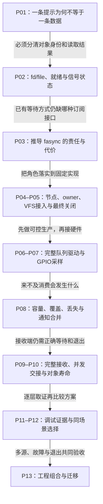

# 第1章\_异步通知全景与知识地图

这个专题研究 fasync：设备已经保存数据以后，怎样通过文件订阅和 Linux 信号告诉应用“值得再检查一次”。它不会替应用搬运数据，也不保证一次通知对应一条记录。正文以一条可运行的 pipe 实验起步，再落到字符设备、GPIO、用户接收与工程组合。

默认从 P01 连续阅读。需要 C 的函数、指针、结构体和基础系统调用经验；Linux 的 file 身份、信号掩码、订阅节点、就绪与生命周期在相应章节逐步建立。这里是阅读导航，完整解释、图、接口表和实验都在各章正文，不要求先读完内核手册才能进入。

## 1.1\_先看到数据与提示的区别\_再进入实现

一条通知链有几个独立事实：数据是否已保存，file 是否订阅，信号是否 pending，接收者是否消费提示，以及真正的 read 是否成功。前三章先分开这些事实，避免后面看到一个字段就猜整个操作已经完成。

图中阶段不表示接口的高低代际。直接 poll 已满足需求时可以继续使用；加入 fasync 是增加信号订阅责任，不是自动获得更快或更完整的 I/O。

## 1.2\_十三章各解决什么问题\_怎样接到下一章

| 章节 | 进入时已经知道 | 本章解决的问题 | 留给后文的问题 |
| --- | --- | --- | --- |
| [P01 异步通知全景与知识地图](P01_异步通知全景与知识地图.md) | 应用需要取得设备数据 | 用有限 pipe 实验区分数据、就绪与提示 | 两个 fd 是否就是两份订阅对象 |
| [P02 Linux IO 与信号机制基础](P02_Linux_IO_与信号机制基础.md) | 提示不消费数据 | 建立 fd/file 共享、EAGAIN/EOF、信号处置/掩码/pending | 为什么需要额外的文件订阅连接层 |
| [P03 fasync 机制的历史与设计动机](P03_fasync_机制的历史与设计动机.md) | 对象身份与等待语义 | 从既有信号约定推导 owner、订阅和成本边界 | 内核把这些状态存在哪里 |
| [P04 内核视角 核心数据结构与控制路径](P04_内核视角_核心数据结构与控制路径.md) | 订阅与数据的责任不同 | 用统一 S0–S6 周期解释 fown、helper、发送与删除 | VFS 怎样选择具体文件实现 |
| [P05 VFS 与文件系统中的异步通知支持](P05_VFS_与文件系统中的异步通知支持.md) | 节点及发送路径 | 比较 setfl、pipe/socket/TTY 和最后 file 归还 | 驱动如何提供一致数据契约 |
| [P06 字符设备中实现异步通知的基础模式](P06_字符设备中实现异步通知的基础模式.md) | VFS 接入与文件寿命 | 完整软件字节队列的 read/poll/fasync、构建与有限注入 | 硬件生产者和解绑会增加哪些约束 |
| [P07 中断驱动设备的异步通知实践](P07_中断驱动设备的异步通知实践.md) | 队列、等待和发布协议 | 资源确认、GPIO静稳采样、16字节快照与旧fd保活 | 单槽覆盖和高频积压如何处理 |
| [P08 流式设备与高级场景中的异步通知](P08_流式设备与高级场景中的异步通知.md) | 采样不等于逐条保存 | 解释容量、复制期间所有权、批量、丢失与重同步 | 用户如何消费合并提示并可靠退出 |
| [P09 用户态编程 从 SIGIO 到 signalfdepoll](P09_用户态编程_从_SIGIO_到_signalfdepoll.md) | 数据和通知数量不同 | 完整接收器、掩码、回退、有限批处理与共享file配置 | 哪些并发由核心保证，哪些仍属驱动责任 |
| [P10 并发 竞态与内存可见性问题](P10_并发_竞态与内存可见性问题.md) | 接收与退出路径 | 分开节点RCU、数据锁、等待重查与两阶段退场 | 运行结果能为哪一层提供证据 |
| [P11 调试 排错与性能分析](P11_调试_排错与性能分析.md) | 各阶段及状态所有者 | 用strace、proc、有限跟踪及逐记录时间关联定位问题 | 对新业务应选哪一层接口 |
| [P12 fasync 与其他通知机制的对比与整合](P12_fasync_与其他通知机制的对比与整合.md) | 能测量而不靠通知数猜数据 | 分开input语义、管理消息、就绪等待与操作完成 | 多源组合与迁移怎样一起验收 |
| [P13 工程实践案例与编码核对表](P13_工程实践案例与编码核对表.md) | 已能选择并验证单一路径 | 三模式多源实验、GPIO适配、旧驱动迁移与资源退场 | 回到具体产品的数据协议、板卡资源与负载验证 |

## 1.3\_按当前任务选择入口\_实验需要什么环境

第一次接触从 P01 的 pipe 实验开始；下面的入口适合已经建立前置模型后的回访，不表示可以跳过所依赖的对象与寿命规则。

| 当前任务 | 正文入口 | 环境与证明边界 |
| --- | --- | --- |
| 观察提示合并而数据仍在 | [P01 有限 pipe 实验](P01_异步通知全景与知识地图.md#1.4_不用外设验证通知次数与数据量的差别) | Linux 用户空间，无开发板；实验结果不能替代设备ABI |
| 写可注入的字符设备 | [P06 完整模块](P06_字符设备中实现异步通知的基础模式.md#6.3_把数据规则实现为完整模块) | 匹配目标内核的构建树和模块加载环境；使用实验创建的节点 |
| 接入真实按钮并测试解绑 | [P07 资源确认](P07_中断驱动设备的异步通知实践.md#7.2_先确定哪根线在变化_再取得Linux中断号)与[有限观察](P07_中断驱动设备的异步通知实践.md#7.6_先观察稳定状态_再分别验证poll和SIGIO) | 具体板卡、原理图、pinmux和GPIO提供者；SoC名字不证明接线 |
| 写SIGIO/signalfd接收程序 | [P09 完整接收器](P09_用户态编程_从_SIGIO_到_signalfdepoll.md#9.4_用一个有截止时间的程序完成订阅_消费与退出) | plain/info/rt三模式先跑自有pipe；接设备要匹配其读取协议 |
| 找丢唤醒或提前释放 | [P10 等待重查](P10_并发_竞态与内存可见性问题.md#10.4_等待者为什么要先登记_并在真正消费前再检查)与[退场](P10_并发_竞态与内存可见性问题.md#10.6_停止硬件不等于旧文件消失_退场要分两次结束) | 交错模型帮助解释，不替代弱内存和真实并发检查 |
| 采集信号路径与延迟 | [P11 有限跟踪](P11_调试_排错与性能分析.md#11.4_进入内核观察时_先区分函数入口与信号生成结果)与[时间关联](P11_调试_排错与性能分析.md#11.6_测延迟前_把同一条记录和同一个时钟对齐) | 需目标tracefs能力与权限；合成CSV只是练习，不是板上测量 |
| 比较就绪与请求完成 | [P12 POLL_ADD实验](P12_fasync_与其他通知机制的对比与整合.md#12.5.1_让一个POLL_ADD完成_再亲手读出那一个字节) | Linux和liburing开发环境；先核对操作支持与结果 |
| 组合多个通知源 | [P13 多源三模式](P13_工程实践案例与编码核对表.md#13.2_一条SIGIO可能代表两个源_怎样保证两个都检查) | 自有两pipe加本地socketpair，无网络服务器或GPIO依赖 |

## 1.4\_源码证据与相邻专题怎样分工

源码身份使用[Linux基线](../../../../../research/source_reading/linux/SOURCE_BASELINE.md)：NXP 官方 linux-imx，Linux 6.12.20，固定提交 `dfaf2136deb2af2e60b994421281ba42f1c087e0`。每章的证据节记录实际核对路径、原始字节身份和配置边界；本地工作树位置不代替版本身份。历史 ARM32 配置记录不自动证明读者当前使用的 ARM64、SMP 或 PREEMPT_RT 配置。

正文把已核对源码、可执行实验和本次实际验证分开。替代接口与状态模型只能验证限定的控制流/交错；未在目标 Linux 构建运行或未上板的内容，不宣称已实测。读者按章内命令执行后，仍需记录自身环境与观察结果。

- [阻塞与I/O等待](../../../io_model/blocking_io/大纲.md)负责显式等待的通用模型；本专题研究信号订阅怎样接回同一消费协议。
- [字符设备专题](../../../../driver_model/character_device/大纲.md)负责注册、打开与文件操作的驱动组合；这里展开fasync机制和通知相关实验，不复制整套字符设备课程。
- [中断](../interrupts/大纲.md)、[工作队列](../workqueue/大纲.md)和[定时与延迟执行](../timers/大纲.md)负责生产与执行上下文；发出用户信号不替代其中的硬件处理或工作寿命。
- [devres](../../../object_lifetime/devres/大纲.md)解释设备资源归还，[kref](../../../object_lifetime/kref/大纲.md)解释引用保活；二者共同约束旧file跨解绑，不由一个通知函数代劳。

返回：[Linux 异步机制](../大纲.md) · [同步与异步机制](../../大纲.md)。
