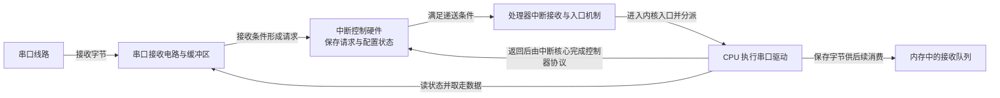
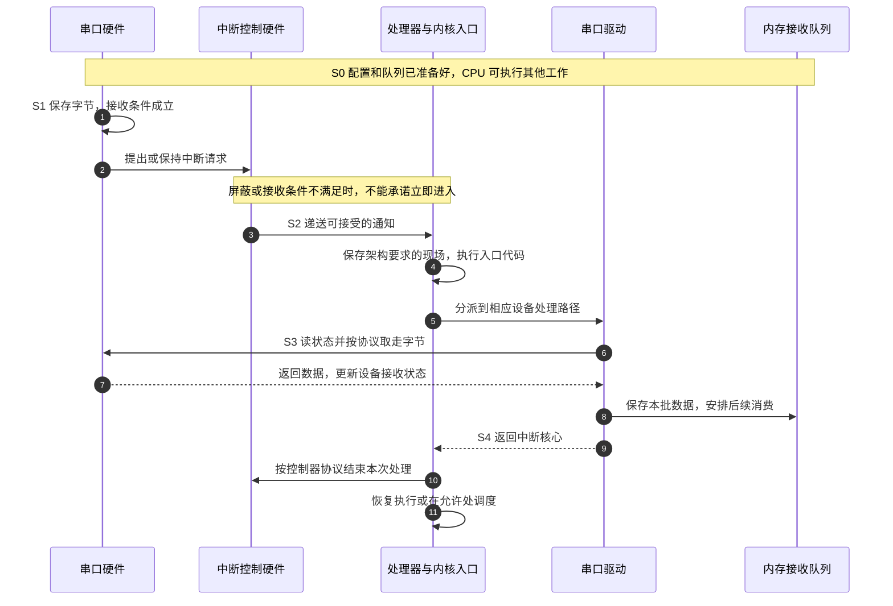

# 第1章\_中断的定位与演化

假设程序正在计算一幅图像，同时串口在接收外部设备发来的数据。串口接收电路可以自己识别线路上的位，并把接收到的字节存入内部缓冲区；中央处理器（Central Processing Unit，CPU）不必执行一条指令，线路才前进一步。问题在于：缓冲区有限，程序怎样及时知道“现在有数据需要取走”？

这一章从这个问题建立中断。我们先看看主动检查能做到什么，再推导通知需要增加哪些硬件和软件步骤。读完后，应能区分 **设备做事、发出请求、CPU 接受请求、软件处理数据**，并根据事件频率和等待代价选择轮询或中断。这里的演化是一条设计推理，不把它当作所有计算机共同经历的历史年表。

## 1.1\_设备可以自己工作\_问题是软件何时回来检查

串口通常通过 **寄存器** 提供接收状态和取数据入口。寄存器是软件观察或控制硬件的接口，读写可能改变硬件状态，不是随意读写的普通变量。软件读状态，发现有数据再读取数据；没有数据就稍后再看。这叫 **轮询（polling）**，即由软件主动反复检查状态。

最直接的写法是在循环里只检查串口。这是 **忙等**：CPU 持续执行检查，却可能一直得不到新数据。但轮询不一定要忙等。程序也可以检查一次串口，计算一小块图像，然后再回来检查。外设接收与 CPU 计算仍然在时间上重叠；没有中断，不等于不能重叠。

轮询有自己的价值。检查发生在程序选定的位置，后续处理可以沿普通调用流程继续，容易控制一次检查的工作量；当设备几乎一直有数据时，也不必为每一批数据反复切换到中断入口。缺口是：**检查太密浪费执行时间，检查太疏可能来不及清空缓冲区。**

把这个矛盾放到可计算的场景中。假设串口有 16 字节接收缓冲区，持续每 100 微秒到达一个字节，检查后会及时取走积累的数据。如果程序一段计算长达 2 毫秒，这期间可到达 20 字节；原先为空的缓冲区也装不下。改成每 0.5 毫秒检查，期间约到达 5 字节，才有余量。但这里还没有计入取数据、其他中断或更长计算造成的延迟，实际设计不能刚好卡满容量。

这也说明“CPU 很快”不能独自解决问题。CPU 即使能在很短时间读一次寄存器，只要程序很久不执行那次读，数据仍可能溢出。真正要约束的是 **两次有效服务之间的最长间隔**，而不只是平均运算速度。

## 1.2\_让事件发出通知\_省掉无事发生时的反复检查

现在保留串口的接收缓冲区和状态检测，只增加一条通知路径：当接收条件满足时，设备向中断控制硬件提出请求。控制硬件根据使能、屏蔽、优先级和目标配置，把符合条件的请求交给处理器。处理器在允许接受的时机转入预先设置的入口，由软件判断来源并处理。

这个异步通知机制称为 **中断（interrupt）**。这里“异步”是说，外部事件的发生不由当前执行到哪一条普通指令决定；不是说硬件内部没有顺序，也不是说请求一出现就无条件打断 CPU。请求可能尚未使能，被屏蔽，等待更高优先级处理，或者还未传播到处理器。

先把参与者放到同一张图上。图中的控制器代表请求管理功能，并不要求它一定是一颗独立芯片；处理器接收接口也属于硬件。驱动则是 CPU 执行的软件。

通知只是告诉软件“该查看设备了”。中断控制器不会因此替驱动读取串口数据，处理器接口也不会变成一个在后台运行的工作线程。数据从哪里来、放在哪里、由谁取走，仍必须由设备协议和驱动确定。

这次改变节约的是无事发生时的检查，不是把检查成本变成零。软件仍要读状态、处理数据，并承担进入和退出中断路径的成本。设备还需要可靠保存待处理的事实；一个只在某瞬间出现、又没有任何地方锁存的变化，不能靠软件事后凭空恢复。

## 1.3\_一次通知结束\_需要设备和处理器分别完成什么

为了看清“收到通知”与“处理完成”的区别，假设本例串口在接收缓冲区非空时保持中断请求。真实设备可能采用阈值、接收超时或其他条件，应按设备定义替换这一假设。

整个周期可以分成五个阶段。**S0** 是设备和入口已经配置好、软件可接收数据；**S1** 是设备收到字节并保存数据和请求条件；**S2** 是处理器接受通知，入口代码建立继续执行所需的现场；**S3** 是驱动读取设备并保存数据；**S4** 是驱动和中断核心完成相关协议，离开本次处理。

第 6～8 步处理的是设备数据；第 10 步处理的是控制器的中断状态。图中采用设备处理函数返回后，由中断核心调用控制器操作的常见分工，具体时序仍受控制器协议约束。两者不能互相代替。如果只结束控制器处理，却没有消除设备上持续有效的请求条件，中断可能很快再次到来。相反，读空串口也不自动替内核完成控制器要求的全部结束动作。

这个周期包含多组不同状态，不能压缩成一个“中断是否完成”的布尔值：

| 状态属于哪里 | 本例保存什么 | 谁改变它 | 谁据此继续工作 |
| --- | --- | --- | --- |
| 串口硬件缓冲区及状态寄存器 | 尚未取走的字节、接收条件 | 接收电路写入；驱动读数据时按设备规则更新 | 驱动判断是否继续取数据 |
| 中断控制硬件 | 请求、使能、屏蔽及实现所需的处理状态 | 硬件接收请求；内核通过控制器接口配置和结束 | 控制器决定能否递送 |
| 处理器寄存器及内核入口保存区域 | 被打断执行的返回位置和必要现场 | 处理器入口机制与架构入口代码共同维护 | 返回路径恢复执行 |
| 软件接收队列 | 已从设备取出、尚待上层消费的数据 | 驱动写入；消费者读取 | 后续协议处理或应用读取 |

硬件会按其架构保证内部状态机正确，软件不需要猜测控制器用了几级触发器，再等待几个内部时钟。软件需要遵守的是 **设备访问顺序、接口同步与生命周期协议**。例如要求设备清除操作生效后才能继续下一步时，应采用该接口规定的完成与同步方法，而不是凭经验插入固定延时。

### 1.3.1\_为什么入口工作要有边界

假设一次串口通知后，驱动直接在不能睡眠的中断路径中解析一份很长的协议报文。这段解析越长，就越久占用本 CPU，并可能延后其他请求和普通任务。若解析还等待一个必须由其他执行路径推进的条件，就可能阻塞整个进展。

因此通常先做必须及时完成的部分：确认来源、取走有溢出风险的数据、保存状态；再把可以推迟的计算交给后续执行路径。这种拆分并没有消除工作，而是改变了它何时、在什么上下文执行。代价是增加队列、交接和退出时的同步。后面的下半部与线程化章节会解释这些选择，现在先保留原则：**中断入口的时限来自设备和系统约束，不能用“越短越好”代替正确完成必要动作。**

## 1.4\_中断\_系统调用和同步异常为什么不能混称

上面的串口事件不依赖当前程序执行了哪条指令。另一些进入内核的事件却由当前指令直接引起：程序执行系统调用指令，请求内核服务；或者一次访存触发地址转换、访问许可等检查，需要软件处理。

这类与指令执行相关的事件通常称为 **同步异常**。异常不一定意味着程序写错了，例如操作系统可以利用合法的缺页异常按需建立映射。外部中断则属于异步到来的通知。不同处理器手册的分类术语并不完全相同：在 Arm 文档中，“异常”也可作为包含同步异常和异步中断的上位概念。

| 入口来源 | 触发关系 | 能据此判断什么 | 不能直接判断什么 |
| --- | --- | --- | --- |
| 系统调用 | 当前程序主动执行规定的指令 | 程序请求一项内核服务 | 该请求一定成功 |
| 同步异常 | 与当前指令的执行相关 | 需要按异常类型检查或处理 | 一定是软件错误、一定能返回原指令 |
| 外设中断 | 设备事件经接收路径递送 | 有一个获准递送的设备请求 | 每个事件都有一条独立记录、数据已被取走 |
| 定时硬件中断 | 计时硬件达到配置条件 | 某个硬件计时条件已成立 | 某个用户任务已立即运行 |

同样，中断处理优先级与任务调度优先级不是一根数轴。前者影响请求能否及按什么次序进入处理器；后者影响可运行任务的选择。一个任务优先级很高，不意味着所有硬件请求都会被它压住；一个中断优先级很高，也不意味着它唤醒的任务立即越过所有其他任务执行。

某些架构还提供 **不可屏蔽中断（Non-maskable Interrupt，NMI）** 或特殊错误入口，用于普通中断屏蔽无法满足的通知需求。“不可屏蔽”通常是相对于普通中断的屏蔽机制而言，不能推导出任何电源状态、处理器故障或嵌套条件下都保证立即处理，更不能推导出硬件错误一定可以恢复。

## 1.5\_操作系统得到控制权\_不等于每次都切换任务

回到图像计算程序。如果它一直计算而不主动调用内核，内核仍可能通过一个已配置、可被接受的定时中断获得执行机会。中断处理路径更新所需状态；如果满足调度条件，内核可以在允许的位置选择其他任务。

这为 **抢占式调度** 提供了重要入口：操作系统不必只等应用主动让出执行权。但入口只是条件之一。中断被屏蔽、内核处于不可抢占区域、没有更合适的可运行任务等情况，都可能使任务不在此刻切换。离开中断后可以继续原任务，也可以经过调度转向另一个任务，不能把“中断返回”一律画成原程序无条件接着运行。

定时事件也不要求永远按照固定周期产生。有的配置使用周期节拍，有的按下一项到期任务安排一次性事件，并在空闲时减少无意义的唤醒。操作系统需要的是合适的时间与调度触发来源，不是每个平台都必须每隔同样长的时间中断一次。时钟、节拍与软件定时器的关系在[定时器专题](../timers/大纲.md)中继续建立。

## 1.6\_把同一个通知模型放到输入\_传输和错误上

串口只是一个入口。键盘或其他输入设备可以先保存事件，再用中断提示软件取走；通知粒度由设备协议决定，不能假设每个字符必然对应一次中断。把事件暂存并成批读取，可以减少入口次数，但会改变延迟和缓冲需求。

对于大块数据，CPU 还可以配置 **直接内存访问（Direct Memory Access，DMA）**，由具备该能力的硬件在设备与内存之间搬运数据。中断常用来报告某批传输完成。这里存在两个相互独立的问题：DMA 决定谁搬数据；轮询或中断决定软件怎样发现完成。DMA 也可以由软件轮询完成状态，不应把“使用 DMA”和“使用中断”写成互斥或必然绑定的选项。

错误通知同样遵循这个分层。硬件记录错误状态并产生通知，软件读取记录，再决定重试、隔离、报告或终止。通知能让软件知道出事了，却不能恢复已经丢失的数据，也不能保证损坏的硬件继续工作。错误严重程度、记录是否完整、恢复协议是否成立，都需另行判断。

这些场景共享的只是“事实保存在某处，通知促使软件去查看”。事实可能是字节、完成描述符、时间条件或错误记录；软件需要读取的状态地址和处理协议不同，不能写出一个“清中断”动作就认为所有设备都一样。

## 1.7\_轮询和中断怎样在同一负载下比较

现在可以用明确假设比较开销。假设一次空检查耗时 2 微秒，每 1 毫秒检查一次，单看空检查占用约为 `2 / 1000 = 0.2%`。假设一次通知的固定入口与退出开销为 6 微秒，每秒仅发生一次通知，这项固定开销约占 `6 / 1000000 = 0.0006%`。这些是教学输入，不是任何芯片的测量值；两种方案都还要加上真正处理数据的成本。

如果事件频率上升到每秒 10 万次，而且每次都独立触发一次处理，固定通知开销便约为 60%。此时减少空检查的收益可能已经很小，合并通知、一次处理多项或转入受控轮询反而更合适。另一方面，轮询的检查间隔可能直接增加发现延迟，不能只比较 CPU 占用。

| 当前约束 | 更值得先考察的方案 | 必须同时检查的代价 |
| --- | --- | --- |
| 事件稀疏，CPU 需要做别的事或进入允许的空闲状态 | 中断通知 | 唤醒路径、缓冲容量、最坏服务延迟 |
| 事件连续密集，CPU 已专门处理该队列 | 有预算的轮询或成批处理 | 占用一个执行者、其他任务的公平性 |
| 等待很短，且当前上下文不能睡眠 | 有严格上限的轮询 | 超时退出、设备访问副作用、忙等成本 |
| 平时稀疏，突发时密集 | 通知启动服务，再在限额内批量检查 | 通知与轮询切换时不能漏掉新事件，退出时需重查状态 |

最后一种混合方式需要额外协议：关闭或抑制通知以后发生的新事件，必须能从保留的状态中发现；重新打开通知前后也要处理竞争窗口。它不是“关掉中断再循环”就自动正确。后文再进入 Linux 的具体执行模型。

### 1.7.1\_用三个判断检查自己的模型

先自行判断，再对照答案。

1. 没有启用串口中断，CPU 一边计算一边每隔一段时间读串口，能否使接收与计算重叠？
2. 中断计数加一，是否证明只收到一个字节，并且应用已经读到它？
3. 某定时中断已经进入内核，是否证明目标任务已经按期运行？

**参考答案：** 第一项可以，前提是外设独立接收，而且检查与取数据的最长间隔满足缓冲和吞吐约束。第二项不能，一次通知可能对应一批数据，也可能有多种共享原因；入口计数与应用消费是不同阶段。第三项不能，还要经过具体的唤醒、可运行状态和调度路径，可能受到其他执行活动影响。

现在已经能解释为什么需要通知、通知改变了哪一段过程，以及它没有替软件做什么。还缺一件事：一块芯片有许多设备，中断控制硬件怎样保留来源，又怎样把请求送到某个 CPU？下一章把这个问题放进 SoC 的连接关系中。

> 依据与边界：本章采用稳定的设备通知模型；Linux 的入口分层和后续处理职责对照固定提交 `dfaf2136deb2af2e60b994421281ba42f1c087e0` 的 [genericirq.rst](https://github.com/nxp-imx/linux-imx/blob/dfaf2136deb2af2e60b994421281ba42f1c087e0/Documentation/core-api/genericirq.rst)。Arm 请求、状态与处理器接口的详细规范依据见 [GIC 的事件与请求章节](../../../../../platforms/arm/architecture/gic/P01_从外设事件到中断请求.md)。本章图和数字均为明确假设下的教学模型，不代表某块板的布线或测量结果。

专题入口：[Linux 中断机制](大纲.md)。
下一篇：[SoC 视角下的中断体系](P02_SoC_视角下的中断体系.md)。
