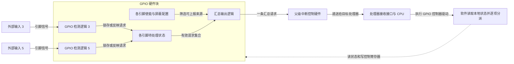
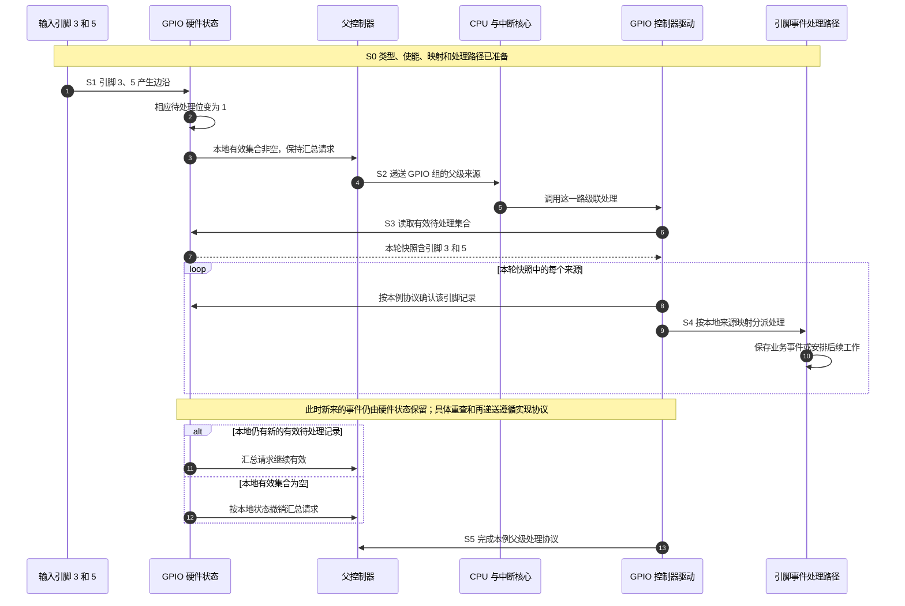

# 第2章\_SoC\_视角下的中断体系

上一章已经把设备数据和中断通知分开：设备保留待处理事实，中断路径让 CPU 有机会执行处理软件。现在给这台系统接上串口、网卡和多个外部输入。如果它们同时要求服务，CPU 只知道“有中断”还不够，还必须查清来源，并决定先服务谁、交给哪个处理器。

**片上系统（System on Chip，SoC）** 把处理器核、存储访问接口和多种外设功能集成在一颗芯片中。本章沿一组通用输入输出（General-Purpose Input/Output，GPIO）观察其中的中断连接。这里把 GPIO 配置为输入，并使用它检测电平或边沿的能力。我们先建立硬件如何保留和汇聚请求，再解释 Linux 为什么还要建立自己的编号和操作接口。

本章图是一种教学连接方案，不是某颗实际芯片的产品布局。学完后，应能把“引脚变化 → 本地状态 → 父控制器 → CPU → 软件查来源”画成一条完整路径，而不是把若干模块名称串起来。

## 2.1\_多个来源汇入处理器\_为什么还要保存身份

先只考虑串口和网卡。若把两者的通知简单合成一条“有事”信号，CPU 可以知道应该进入处理，但还不知道该访问哪一个设备。软件若每次都扫描所有设备，设备越多，确认来源所需的访问通常越多；某些设备寄存器还可能位于较慢的总线上。

**中断控制器** 在这里承担请求管理：按输入来源保存必要状态，根据配置筛选和选择请求，并向处理器递送可识别的通知。软件通过规定的确认或状态查询接口获知来源，再交给相应的处理路径。

“中断控制器”描述的是一组硬件职责，未必对应独立芯片，也不保证所有产品都有可编程优先级、任意 CPU 路由或相同的状态机。简单系统可以只有一层控制功能；大型系统可以把功能分布在多个物理块。应先看该实现提供什么，再决定软件使用什么能力。

在 Arm 系统中常见的 **GIC（Generic Interrupt Controller，通用中断控制器）** 是控制器架构家族；满足规范的产品和 SoC 集成还有各自选择。本章只需要它作为靠近处理器的一层请求管理功能。其架构、产品和芯片身份以及每个处理器的接口关系，由 [GIC 专题](../../../../../platforms/arm/architecture/gic/大纲.md#1.2_因果阅读地图)独立展开。

## 2.2\_一组输入先在本地汇聚\_解决了什么连接问题

现在增加一组外部输入。假设一个 GPIO 控制器管理 8 个输入引脚，每个引脚都能检测指定的变化。如果每个引脚都独占主控制器一个输入，就需要 8 条连接和 8 个父级来源位置。规模较小时这很直接；GPIO 数量增加后，连接和父级资源成本也随之增加。

另一种方案是在 GPIO 控制器内部先处理这些引脚：每个引脚保留自己的检测配置、待处理状态和使能状态，再把符合条件的请求汇成一个输出。主控制器只接收这个 GPIO 组的汇总请求。这种 **级联** 连接把一个控制器的输出接到另一个控制器的输入。

这种设计没有省掉来源辨识，只是把它分成两步：主控制器识别“GPIO 这一组”；GPIO 控制器的状态再指出“组里的哪个引脚”。它也把引脚检测这种局部功能留在 GPIO 模块中，便于随模块一起集成和复用。代价是软件多一次读取和拆分，多个引脚还会共享同一父级递送通道。

图中 GPIO 检测逻辑与父级控制器都是硬件；最后的驱动是 CPU 执行的软件。以后出现的 `irq_chip` 是 Linux 定义的一张控制操作表，用来调用控制器驱动完成屏蔽、确认等动作，**不是插在 GPIO 与父控制器之间的额外硬件块**。

这个方案也不是所有 GPIO 的必选结构。有的实现让每条 GPIO 中断有独立的父级输入，软件不必靠扫描共享状态来辨认是哪条线。还有外接 GPIO 扩展器，读取状态要经过可睡眠的串行总线；它们的处理上下文不能照搬片上快速寄存器的方案。先确定连接和访问方式，才能选择软件组织。

## 2.3\_硬件留下哪些状态\_软件才能拆开汇总请求

观察上图中的本地状态。假设引脚 3 和 5 都配置了边沿检测，它们先后产生事件，CPU 还没有开始处理。GPIO 必须以设备定义的方式留下可读记录，否则汇总线只能告诉软件“发生过什么”，却无法还原来源。

本例采用 **每个引脚一个待处理位** 的教学模型。引脚 3 与 5 对应位都置一，软件读取后得到两个来源。这是位集合，不是无限事件队列：如果同一引脚在该位仍为一时再次产生边沿，硬件未必另存一次计数。不能用一位待处理状态推断准确发生了几次。

寄存器是软件访问这些硬件状态的入口。下面给出本例需要理解的寄存器组职责；它是 **功能对照表**，没有虚构具体芯片的寄存器名或偏移。接入真实芯片时，需要用对应手册的寄存器表替换，并核对访问宽度、读写属性和清除语义。

| 本地寄存器组职责 | 本例按引脚保存的信息 | 软件为什么访问它 | 不可默认的行为 |
| --- | --- | --- | --- |
| 触发配置 | 检测边沿还是电平，以及支持的极性 | 定义什么条件形成请求 | 所有引脚都支持双边沿，或类型能随时无损切换 |
| 使能或屏蔽 | 哪些引脚获准上报 | 初始化、关闭或临时管理递送 | 屏蔽必然清除待处理记录，或一定停止检测 |
| 待处理状态 | 哪些来源目前需要处理 | 从父级汇总通知还原引脚集合 | 读操作一定无副作用，或一位等于一个事件 |
| 确认或清除入口 | 按设备规则消耗已记录的事件 | 避免旧记录被当作新的请求反复处理 | 写零总能清除，或所有设备都采用写一清除 |
| 当前输入值 | 引脚此刻的逻辑值 | 判断持续条件，或供业务再次采样 | 当前值足以重建已经过去的全部边沿 |

对于 **边沿触发**，事件是输入从一个电平向另一个电平的变化，通常需要某处锁存这一事实供稍后处理；对于 **电平触发**，请求条件与某一电平持续有效有关。控制器如何把实时电平与待处理位组合、确认时如何更新，必须依具体实现。这里不能一概写成“清一次状态就结束”。

例如外部设备用低电平持续表示“缓冲区有数据”，它接到 GPIO 的低电平检测输入。软件即使清除了 GPIO 内部的一份记录，外部设备仍可能保持低电平，随后继续形成请求。要完成业务，通常还要访问外部设备，消除或处理让它保持请求的原因。GPIO 引脚值、GPIO 待处理位、父级控制器状态和设备数据是四个不同观察点。

## 2.4\_沿两个引脚的事件走完一轮\_父级结束为何不够

为了固定清除顺序，本节暂时选择一个明确的教学实现：GPIO 的边沿事件被锁存，写入对应的确认位可以清除已锁存记录；汇总输出反映仍有未处理且使能的本地记录，父级按电平接收该输出。真实硬件的确认顺序可能不同，不能直接把这段时间线变成通用驱动。

一次处理经过六个阶段：**S0** 配置和软件映射已准备；**S1** 本地锁存事件；**S2** 父级递送汇总来源；**S3** 控制器驱动读取并拆分本地状态；**S4** 各引脚对应的处理路径消费事件；**S5** 结束父级处理，允许后续轮次继续。

第 6～7 步说明软件实际读取的是 **GPIO 硬件状态寄存器**，不是去猜引脚，也不是等父控制器告诉它所有子来源。第 8 步是本例控制器确认操作，第 9～10 步才是业务分派和处理；这些动作在真实 Linux 中可能分布在控制器驱动、中断流程处理和设备处理函数中。

第 11～12 步表示汇总输出随本地有效集合变化，实际传播可与软件执行重叠，不需要等父级结束命令才撤销。第 13 步结束的是父级处理。如果先前 GPIO 的待处理位仍未按协议消费，父级请求可以再次出现；父级结束操作不会自动擦除子控制器状态。反过来，子控制器记录已经清除，也不等于父级的处理状态已正确结束。

还有一个重要窗口：第 7 步读出快照以后，新事件可能到来。本例没有承诺快照包含未来事件，而是依靠硬件继续保存新状态、汇总请求继续有效以及后续重新服务保证推进。**同一位在清除前重复发生的事件是否会合并**，则取决于硬件记录能力，不能由软件的循环次数弥补。要求准确计数时应使用能够计数或排队的硬件路径，而不是将一位状态当作事件日志。

硬件负责状态机符合规格；软件负责遵循访问、确认和结束协议。普通处理中不需要凭空等待若干个 GPIO 或 GIC 时钟周期，但某次写入是否已完成、是否需要读回或屏障，仍要根据设备和架构契约判断。

## 2.5\_同一个事件为什么会遇到几个不同的编号

现在假设驱动在 S3 读到了引脚 3。这个“3”只是 GPIO 组内的位置。另一组 GPIO 也可以有引脚 3，两者不是同一个来源。父级接收 GPIO 汇总线时，又使用父控制器自己的来源编号。它们属于不同的编号空间。

Linux 还需要给软件使用的中断对象一个标识，使设备驱动可以登记处理函数，而不必把每种控制器的编号方式写进自己的业务逻辑。这个标识叫 **Linux IRQ 号**，常记作 `irq` 或 `virq`。控制器局部编号通常称为 **硬件中断号（hardware IRQ number，hwirq）**。这两个名称说明作用域，不保证数值不同，也不保证某种固定加法关系。

Linux 用 **中断域（irq_domain）** 记录和转换某个编号空间的关系。因此查找键不能只有“3”，还要知道它属于哪一个域。映射建立后，软件可从某个域的本地来源找到相应 Linux IRQ 对象。

| 本例遇到的标识 | 属于哪个范围 | 怎样取得或解释 | 是否直接告诉 CPU 执行哪个 C 函数 |
| --- | --- | --- | --- |
| GPIO 引脚索引 3 | 当前 GPIO 控制器的引脚集合 | GPIO 控制器和其绑定定义 | 否 |
| GPIO 子来源的 hwirq | GPIO 中断域 | 本例与引脚索引相同；真实实现需核对 | 否 |
| 汇总输出的父级 hwirq | 父控制器的中断域 | 芯片连接和父控制器编号规则 | 否 |
| Linux IRQ 号 | 本次内核运行中的中断对象空间 | 由映射和分配过程取得 | 否；内核再从对象找到处理路径 |
| 固件中的中断描述单元 | 对应控制器的绑定格式 | 由控制器及其绑定解码 | 否；它是配置描述，不是处理函数地址 |

在本例的共享父输入方案中，父级中断与各 GPIO 子中断可以有各自的 Linux IRQ 对象。父处理路径读取本地集合，再逐项分派子对象。CPU 最初收到的是父级可识别的硬件通知；它不会从引脚线上直接收到 Linux 给子中断分配的号码。

Linux IRQ 号也不是跨启动、跨板卡和跨内核配置恒定的设备身份。驱动应通过系统提供的资源接口取得它，不能抄一次日志里的数字后永远硬编码。下一章会说明映射、控制操作与处理对象各由什么结构承载。

### 2.5.1\_硬件多级连接\_不一定采用同一种软件层级

刚才的 GPIO 共享输出需要 **先进入父处理，再读状态并分派子中断**。Linux 文档把这一类称为级联 GPIO 中断控制器。它不因为有两级硬件，就自动变成“同一个 IRQ 对象在多个域中逐层分配资源”。

后一种组织是 Linux 的 **层级中断域（hierarchical irq_domain）**：一个中断涉及多层控制资源，各层保留自己的编号和控制信息，并通过父子关系协作分配、配置与释放。它用于适合这种资源关系的硬件路径，不能仅凭框图中画了两个控制器就断言使用了它。

这两种组织都可能出现在 Linux 中。阅读源码时应检查实际建立的是父级处理入口加解复用，还是层级域的分配和控制链；不要把“GPIO → 主控制器”这一条连线当作软件结构的全部证据。第九章再结合真实实现区分这些路径。

## 2.6\_多核与优先级\_是在已保留的请求上继续选择

前面只有一个 CPU 接收请求。SoC 如果有多个处理器核，还需要确定某一路请求允许送给谁。这种目标选择由硬件能力、固件配置和操作系统策略共同约束，不能从“多核”推出所有中断都会广播，或控制器会自动平均分配全部负载。

以能够设置目标的共享外设请求为例，软件可以安排它在一个合适的 CPU 上服务。数据所在内存、驱动锁、线程位置和其他负载会影响这个选择。把不同来源送到不同核可能增加并行性，但本例 GPIO 的多条子来源仍共享一个父级递送通道；能否分别指定处理目标，需要看控制器和 Linux 路径是否支持，不能想当然地逐引脚独立路由。

优先级解决的则是另一件事：多个符合条件的请求竞争服务时，按什么规则选择。并不是每个控制器都有相同的优先级能力，优先级也不能替代屏蔽、路由和设备服务协议。一个请求长期没有得到处理，要沿检测、使能、父级递送、CPU 接收和软件运行逐段检查，而不是只提高一个数字。

## 2.7\_设备树记录连接\_内核仍要建立可运行路径

硬件的连接不会因为装入 Linux 才出现，但内核必须知道这些连接。部分系统使用 **设备树（Device Tree，DT）** 描述设备、资源和连接关系；其他固件机制也能承担类似描述职责。本节不默认所有 SoC 都采用设备树。

对于本例，需要告诉内核：外部设备使用哪一组 GPIO 的哪条中断输入，GPIO 汇总输出接到哪个父控制器，以及各段输入要求怎样的触发方式。于是同一个 GPIO 节点可以一方面提供子中断，另一方面又消耗父级中断。

| 设备树属性 | 在这条路径中回答的问题 | 使用前必须核对的边界 |
| --- | --- | --- |
| `interrupt-controller` | 这个节点是否提供一个中断控制器接口 | 并不自动生成可工作的驱动 |
| `#interrupt-cells` | 引用这个控制器时，一项中断描述有几个 32 位单元 | 单元含义由该控制器的绑定规定 |
| `interrupt-parent` | 当前中断描述由哪个控制器解释 | 可以继承；不是 C 结构体的父指针 |
| `interrupts` | 在选定父控制器中使用什么来源和属性 | 不能脱离父控制器绑定解码数字 |
| `interrupts-extended` | 在每项描述中显式指定控制器及其描述单元 | 两种描述同时存在时，本属性优先，不是将两份来源相加 |

例如某个绑定规定两单元分别表示“本地编号、触发标志”，才能按这个顺序解释那一对数字。换成另一控制器，单元数和编号规则可能改变。这里没有指定实际芯片，因此不提供看似可复制、却没有绑定依据的 DTS 配置；后续 GPIO 与触发语义章节再进入具体配置的验证。

描述被正确解析以后，控制器驱动仍需建立映射、设置硬件、安装处理路径；设备驱动也要完成资源申请和业务准备。文件里写了连接，不等于已经产生过一个被 Linux 正确处理的中断。上述属性的共同规则见同一固定内核提交的[中断描述绑定](https://github.com/nxp-imx/linux-imx/blob/dfaf2136deb2af2e60b994421281ba42f1c087e0/Documentation/devicetree/bindings/interrupt-controller/interrupts.txt)，具体单元仍由控制器绑定解释。

## 2.8\_把连接\_状态与软件映射分别检查

用本例做一次纸面推演。假设引脚 3 和 5 同时有待处理记录，父级只给 CPU 一次服务机会：软件怎样知道要分派两路？如果只完成父控制器的结束动作，会发生什么？日志里的子 IRQ 号与 GPIO 引脚号不同，是否说明接线错误？

**参考答案：** 控制器驱动读取 GPIO 本地待处理集合，识别其中两位，再分别经过各自映射进入处理路径。父级结束不能替代本地记录的消费；在本例的电平汇总设计中，本地仍有有效记录就会继续维持请求。Linux IRQ 号属于软件对象空间，与引脚索引没有必须相等的关系，数值不同本身不构成错误证据。

再把引脚 3 改成连接一个持续拉低请求线的外部设备。仅清 GPIO 状态后中断不断再次出现，是控制器内部状态机必然出错吗？**不是。** 需要先检查外部设备的请求条件是否被消除、触发配置是否匹配，以及各级协议是否完成。持续的有效输入可以合法地再次产生请求。

现在已经知道为什么需要汇聚、哪里保存子来源，以及为什么同一个事件会穿过多个编号空间。下一章把这些职责落实到 Linux：控制器操作由谁提供，映射在哪里维护，一个可处理的中断对象还要保存什么软件状态。

> 依据：固定提交 `dfaf2136deb2af2e60b994421281ba42f1c087e0` 的 [GPIO 控制器与中断说明](https://github.com/nxp-imx/linux-imx/blob/dfaf2136deb2af2e60b994421281ba42f1c087e0/Documentation/driver-api/gpio/driver.rst)、[中断域说明](https://github.com/nxp-imx/linux-imx/blob/dfaf2136deb2af2e60b994421281ba42f1c087e0/Documentation/core-api/irq/irq-domain.rst)及[通用中断分层](https://github.com/nxp-imx/linux-imx/blob/dfaf2136deb2af2e60b994421281ba42f1c087e0/Documentation/core-api/genericirq.rst)。本地来源记录见[源码基线](../../../../../research/source_reading/linux/SOURCE_BASELINE.md#1.182_中断通知与GPIO级联的职责边界)。本文提炼机制，不把文档中的历史实现描述当作本版全部数据结构的证据。

上一篇：[中断的定位与演化](P01_中断的定位与演化.md)。
下一篇：[Linux 的中断抽象](P03_Linux_的中断抽象_irq_chip_irq_domain_与_irq_desc.md)。
