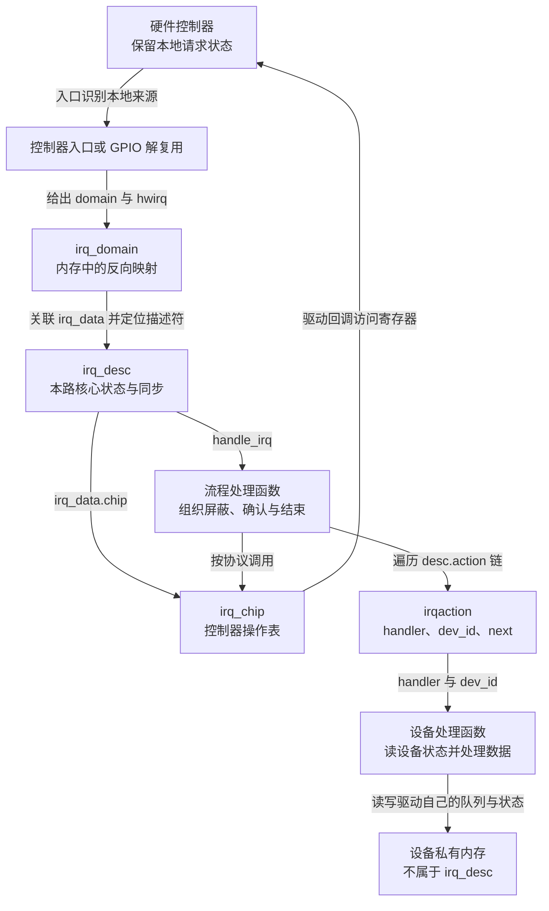
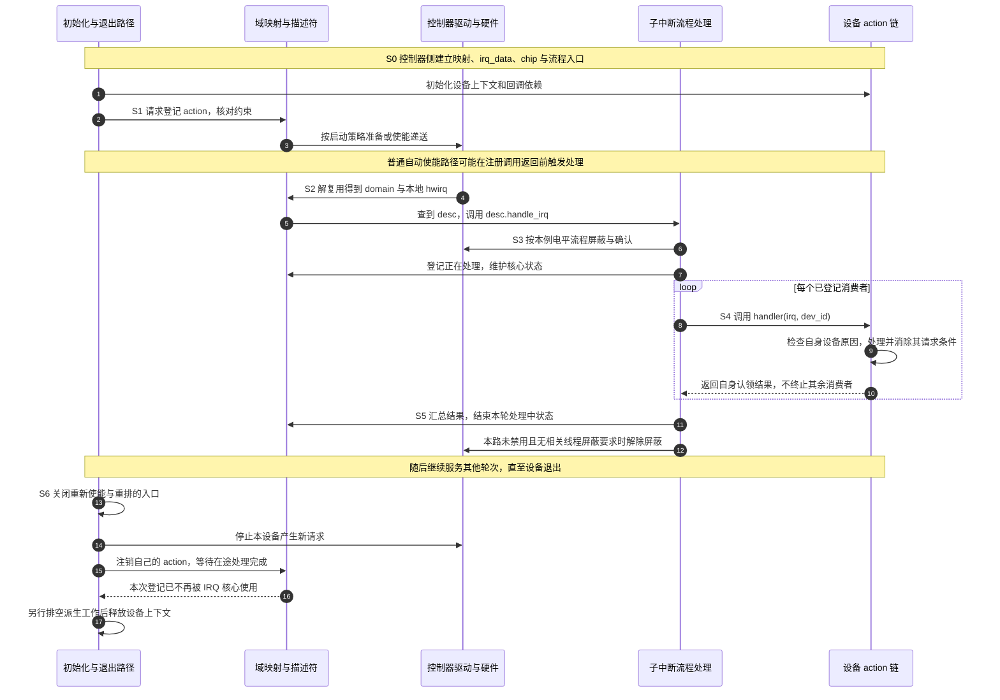

# 第3章\_Linux\_的中断抽象\_irq\_chip\_irq\_domain\_与\_irq\_desc

上一章的 GPIO 控制器在本地保存引脚 3 和 5 的待处理位，再用一条父级请求通知 CPU。软件进入以后，必须读取本地集合，把两个来源交给各自的设备处理路径。现在再接入另一组 GPIO，它也有自己的引脚 3：Linux 怎样避免把两个“3”混为一谈？

解决编号还不够。两组控制器可能用不同寄存器屏蔽来源；同一路 Linux 中断可能登记多个设备处理函数；注销时又必须等正在执行的处理退出。我们需要分别保存 **映射关系、控制操作、每路软件状态和每个消费者的回调**。

本章解释这些对象为什么分开、在内存中怎样相连，以及一次事件怎样沿它们推进。这里阅读的是 Linux 通用中断核心，版本依据固定为 Linux 6.12.20 所在提交 `dfaf2136deb2af2e60b994421281ba42f1c087e0`；[源码基线](../../../../../research/source_reading/linux/SOURCE_BASELINE.md#1.183_中断对象映射_流程分派与消费者登记)记录核对文件。控制器的硬件状态仍在硬件里，不能把内核结构当作硬件状态机的完整镜像。

## 3.1\_先保留编号空间\_才能找到正确的软件对象

假设 GPIO 组 A 的本地来源 3 对应一次按钮变化，GPIO 组 B 的本地来源 3 对应一个外设请求。单独记录整数 3 无法决定该调用哪个驱动，也无法决定该读哪一组寄存器。必须把“属于哪个编号空间”一起带上。

Linux 用 **`struct irq_domain`（中断域）** 表示一个硬件中断编号空间及其映射、分配等方法。对普通来源查找而言，可以把输入理解成 `(domain, hwirq)`：域指明范围，`hwirq` 是该范围内的本地来源。结果关联到一个 Linux IRQ 对象。

下面固定一组纯教学映射，不是本机实际分配结果：

| 域身份 | 域内 hwirq | 本次分配的 Linux IRQ | 能确定的对象 |
| --- | --- | --- | --- |
| GPIO 组 A 的域 | 3 | 42 | 组 A 的来源 3 |
| GPIO 组 A 的域 | 5 | 43 | 组 A 的来源 5 |
| GPIO 组 B 的域 | 3 | 57 | 组 B 的来源 3 |

从域 A 查 3 得到 42，从域 B 查 3 得到 57。这个关系不要求 Linux IRQ 与 hwirq 数值不同，也不要求“加一个基数”就能计算，更不保证下次启动仍分配 42。设备驱动应取得系统为当前设备解析出的资源，而不是保存一次运行中的号码当永久身份。

域不只是一张数字翻译表。它还保存控制器驱动提供的映射或资源分配方法、所属固件节点及私有数据。固件节点帮助内核找到应由哪个域解释配置；真正的反向查找结构则让运行时能够从硬件来源定位软件对象。**解析配置和处理中断是不同阶段**，不需要每来一次中断都重新读设备树。

| `irq_domain` 中的实际成员 | 承担什么职责 | 本章需要保留的边界 |
| --- | --- | --- |
| `fwnode`、`bus_token` | 帮助匹配固件身份与域的用途 | 不能把所有固件节点都与唯一一个域机械一一对应 |
| `ops` | 指向 `irq_domain_ops`，由控制器侧提供转换、映射或层级分配等方法 | 使用哪些方法取决于域的类型 |
| `host_data` | 控制器侧的私有数据指针 | 核心不会把它当成通用设备状态随意解释 |
| `revmap`、`revmap_tree` | 保存从 hwirq 查找关联 `irq_data` 的线性或树形关系 | 是内存中的查找结构，不是硬件布线 |
| `parent` | 启用层级域配置时关联父域 | 普通硬件级联不必使用这条层级关系 |

上一章 GPIO 汇总输入的级联处理，仍然是先识别父来源、再读取子状态。建立子域不会自动替驱动读取 GPIO 寄存器；它只在软件已经知道子来源以后帮助定位正确对象。

## 3.2\_同一个屏蔽动作\_怎样落到不同控制器

假设中断核心现在需要暂时屏蔽 Linux IRQ 42。映射告诉它这是 GPIO 组 A 的本地来源 3，但还没有告诉它该写什么寄存器。把所有控制器的寄存器地址和操作规则塞进通用核心，会让每一种新硬件都要求修改同一套流程。

Linux 因此让控制器驱动提供 **`struct irq_chip`**：一张带名称、标志和操作回调的结构表。回调是函数指针，通用核心通过它调用控制器特有的实现。例如同样是“屏蔽这一来源”，A 控制器可以写自己的屏蔽寄存器，B 控制器可以采用另一种硬件协议。

这张表不是整个控制器驱动。驱动还要完成资源映射、初始化、域建立、电源与其他管理；`irq_chip` 只提供其中与中断控制有关的操作。多个来源甚至多个实例可以共用同一张操作表，因此每次调用还需要参数说明“现在操作哪一路”。

这个参数是 **`struct irq_data`**，表示某个 IRQ 在某一控制层的关联信息。它把 Linux IRQ、该层 hwirq、域、操作表和控制器私有数据连起来。于是屏蔽函数可以从传入的 `irq_data` 找到本地来源和控制器实例，而不把所有来源写成不同的函数。

| `irq_data` 成员 | 作用 | 在例子中的理解 |
| --- | --- | --- |
| `irq` | Linux IRQ 号 | 42 |
| `hwirq` | 所属域中的本地编号 | 域 A 中的 3 |
| `domain` | 所属中断域 | 指向 GPIO 组 A 的域 |
| `chip` | 本层控制操作表 | 指向该 GPIO 实现的 `irq_chip` |
| `chip_data` | 控制器私有实例数据 | 驱动据此找到自己的寄存器映射等资源 |
| `common` | 指向该 IRQ 的共享控制状态 | 各层需要共享的状态由它汇合 |
| `parent_data` | 层级域配置下的上一层关联 | 不等于为每层都新建一个 Linux IRQ |

建立这个关系后，才可以读操作表。下表是本章涉及的真实回调成员，不是每个控制器必须填满的清单。

| `irq_chip` 回调 | 通用核心请求的动作 | 不能从名称直接推导的结论 |
| --- | --- | --- |
| `irq_mask` / `irq_unmask` | 屏蔽 / 解除该来源的屏蔽 | 屏蔽就停止设备产生事件，或清掉已保存数据 |
| `irq_ack` | 按控制器协议确认本次事件 | 它一定读取了设备数据，或所有控制器都必须单独执行它 |
| `irq_mask_ack` | 在支持的实现中组合屏蔽与确认 | 必然等价于任意顺序的两个普通寄存器写入 |
| `irq_eoi` | 按控制器协议结束处理；EOI 是 End of Interrupt | 它一定消除了设备持续请求，或完全等同于 `irq_ack` |
| `irq_set_type` | 设置支持的触发类型 | 调用一定成功，或可任意覆盖共享线路的类型 |
| `irq_set_affinity` | 在支持时设置处理器目标范围 | 每种来源都能独立分发到任意 CPU |
| `irq_set_wake` | 在支持时配置中断唤醒用途 | 软件调用成功就证明整块板已具备可用的睡眠唤醒路径 |

缺少某个回调不总是错误：有些操作有核心回退，有些不被硬件支持，还有些由其他阶段完成。必须结合所选的中断流程和该控制器的契约判断，不能按表格空格数量评估驱动是否完整。

## 3.3\_有了映射和操作\_还缺每路中断的运行状态

现在已经知道 42 对应谁，也知道怎样操作它。但是，哪几个设备登记了处理函数？这一路是否被软件禁用？是否正在执行处理？是否还存在未完成的中断线程？这些信息随运行改变，既不能放进共享的操作函数表，也不能只靠编号映射回答。

Linux 用 **`struct irq_desc`（中断描述符）** 汇集一个 Linux IRQ 的核心软件状态和关联对象。它包含本层 `irq_data`、共享控制状态、处理流程入口、设备处理动作链及同步和统计信息。

这里“一路”指一个 Linux IRQ 对象，不是保证每根物理导线恰好有且仅有一个描述符。某些中断没有传统物理导线，某些每 CPU 中断还会按 CPU 保存状态；硬件的层级与软件对象也不是简单数框对应。更关键的是，GPIO 待处理位、串口缓冲区和驱动私有接收队列都不会自动搬进 `irq_desc`。

| 状态或关联 | 本版中的具体存储位置 | 主要读写路径与用途 |
| --- | --- | --- |
| 来源与控制层关联 | `desc->irq_data` | 域建立及控制器配置时设置；分派和控制操作时读取 |
| 共享控制状态 | `desc->irq_common_data`，由 `irq_data.common` 引用 | 核心通过访问函数维护触发、屏蔽、禁用等软件控制状态 |
| 本路处理流程 | `desc->handle_irq` | 控制器侧选择；事件分派时调用 |
| 已登记消费者 | `desc->action` 开始的 `irqaction` 链 | 注册与注销时改变；事件处理时遍历 |
| 禁用层数 | `desc->depth` | 禁用/启用路径维护，支持配对的嵌套管理 |
| 正在处理与其他核心标志 | 共享状态中的 in-progress 位及描述符内部状态字段 | 流程入口、事件分派和完成路径维护 |
| 中断线程交接 | `desc->threads_active`、`threads_oneshot`、`wait_for_threads` | 唤醒线程时登记，线程结束时更新，等待方据此继续 |
| 计数 | `desc->kstat_irqs` 等 | 处理路径更新；统计接口读取，不等于设备事件精确计数 |
| 核心并发保护 | `desc->lock`、`request_mutex` | 核心串行化相关状态以及注册/释放操作；不代替设备驱动自己的锁 |

这不是一个单独的“开/关”状态机。软件禁用层数、硬件是否还有待处理条件、回调是否在运行、线程是否完成，都可能独立变化。例如禁止后续递送时，先前已经进入的处理仍可能尚未结束。因此“禁用了”与“现在可以释放内存”是两项不同证明。

本版从 Linux IRQ 找到描述符的索引实现也与配置有关：稀疏 IRQ 配置使用树形索引，另一配置使用描述符数组。本章依赖的契约是 **按有效 IRQ 取得对应描述符**，不要求所有系统在内存中存在一张固定大小的全局数组。

## 3.4\_设备登记的是处理动作\_不是控制器操作

描述符建立后，设备驱动需要告诉内核：“这一路通知到来时，调用我的处理函数，并把我的设备上下文交还给我。”Linux 将一次这样的登记表示为 **`struct irqaction`**。

这里的 action 是一次设备处理登记，既不是硬件控制器，也不等于一个 Linux IRQ。共享中断允许多个消费者登记到同一个描述符；它们拥有不同的私有上下文，却共用同一 IRQ 的递送流程。

| `irqaction` 成员 | 保存什么 | 为什么需要它 |
| --- | --- | --- |
| `handler` | 主处理函数 | 收到该 IRQ 后检查设备原因并处理，或请求唤醒线程 |
| `dev_id` | 登记者提供的上下文指针 | 回调借此找到自己的设备；释放时识别要移除的登记 |
| `thread_fn`、`thread` | 可选的线程函数及其内核线程 | 将允许延后的处理交给线程执行；函数不为 `NULL` 不代表此刻正在运行 |
| `flags` | 本次登记的共享、线程及触发等约束 | 核心在建立和运行路径中核对与使用 |
| `name` | 登记名称 | 用于诊断显示，不能代替唯一的设备实例上下文 |
| `next` | 同一 IRQ 的下一项登记 | 将共享消费者串成一条链 |

以普通共享硬中断路径为例，内核会遍历这条 action 链，让各设备检查“是否是我的原因”。**某个处理函数返回 `IRQ_HANDLED` 后，不会因此停止整个共享链。** 两个设备可以同时提出请求，如果第一个说“处理了”就不再看第二个，第二个设备的事件便可能被不必要地延后。

主处理函数的返回值类型是 `irqreturn_t`，常见值表示不同结果：`IRQ_NONE` 表示本处理函数没有认领本次设备事件，`IRQ_HANDLED` 表示已经处理，`IRQ_WAKE_THREAD` 表示需要唤醒已登记的线程继续处理。核心汇总各 action 的结果；返回 `IRQ_HANDLED` 不能代替设备清除协议，也不是“禁止后续消费者运行”的命令。

`dev_id` 不是控制器编号。共享登记应提供有效且可区分的实例上下文，注销时使用同一个身份。普通设备驱动通过注册接口建立 action，不应自己改写 `desc->action` 或控制器的函数指针。

## 3.5\_谁安排确认与结束的次序\_还需要流程处理函数

现在有了消费者和控制器操作，还剩一个顺序问题：应该先屏蔽、先确认，还是先调用设备处理函数？设备处理后又该解除屏蔽还是执行结束操作？如果每个设备驱动都自己安排这些控制器步骤，硬件差异仍然会泄漏到全部业务代码中。

Linux 把这类顺序组织为 **IRQ 流程处理函数（flow handler）**，放在 `desc->handle_irq`。它根据所采用的控制器处理模型，调用 `irq_chip` 操作，并在合适的位置执行 action 链。这与 `action->handler` 是两种不同职责：前者组织本路中断流程，后者处理某个设备的原因。

例如本版 `handle_level_irq()` 的正常路径先屏蔽并确认，检查软件状态，执行设备动作，再在条件允许时解除屏蔽。`handle_fasteoi_irq()` 则采用适合另一类控制器的结束协议，并根据线程化、屏蔽及控制器标志等条件完成结束。它们不是“电平必选前者、边沿必选后者”的二选一，不能仅凭设备树上的边沿/电平标志给所有控制器选同一个函数。

下面把运行时关系与内存对象放在一起。箭头标出的是查找、引用和动作；对象并不是硬件信号依次穿过的电路级。

图中的域查找不会自动调用设备业务，查到描述符以后还要经过流程函数。反过来，控制器操作也不一定经过设备回调：初始化、禁用、路由变化等管理路径同样可能调用它们。

## 3.6\_把建立\_服务与撤销放进同一个生命周期

沿上一章 GPIO 的某个子来源走一轮。这次把子来源从边沿记录换成设备持续请求的电平条件，以观察“处理设备条件后才能安全解除屏蔽”的流程。下面选择 **普通、非强制线程化、使用电平流程处理函数的子中断**；共享消费者已经符合相同线路的约束。该子来源的实际设备条件由处理函数按协议消除。GPIO 父级的汇总处理仍由上一章那条路径包围，本图聚焦子描述符内部。

**S0** 建立域、映射和控制操作；**S1** 准备设备上下文并登记 action；**S2** 事件发生后查找描述符；**S3** 流程函数管理本路控制状态；**S4** 调用设备消费者；**S5** 完成本轮并恢复允许的递送；最终 **S6** 关闭重新启动的入口、停止设备请求、撤销登记并等在途处理退出。

S0 和 S1 不一定都发生在系统早期启动时，设备可以稍后才被发现和绑定。S1 也不只是往链表加一个指针：核心会检查共享与触发等约束、准备必要线程和控制器资源，并按策略启动。有“不要自动使能”的配置，所以不能一概说注册成功必然已经打开；普通自动使能路径又可能在注册函数返回前调用处理函数，因此所有回调依赖必须先准备好。

S3～S5 的核心状态需要同步保护。本版普通事件路径在受保护状态下标记正在处理，调用设备 action 时会释放描述符的自旋锁，返回后再取得它更新状态。这样避免把整个设备处理都压在该核心锁内；但是 **驱动私有队列并不因此自动获得保护**，驱动仍要根据其并发读写者选择自己的同步方式。设备回调也不能据此认为进入了可睡眠上下文。

如果主处理返回 `IRQ_WAKE_THREAD`，交接会增加一个执行者：核心在 action 中保留待运行标志，在描述符中维护活动线程计数，并唤醒其内核线程；线程完成后更新这些状态，必要时唤醒等待退出的一方。线程可以在其他 CPU 上推进，硬中断路径返回也不等于线程完成。这个路径解释了为什么描述符还需要线程计数、位集合与等待队列，而不是仅用一个“已结束”标志。

S6 先由驱动建立共同的退出门控，使管理入口和异步回调不能继续重新使能设备或产生新工作，再按依赖次序停止请求和撤销登记。注销会等待与这次中断登记有关的在途处理，设备上下文不能提前释放。如果处理函数另外排了工作队列或软件定时器，它们是新的使用者，还要单独停止和排空；IRQ 核心不会因为注销 action 就自动追踪所有派生异步工作。若派生工作本身还要使用 IRQ 管理接口，必须把它的停止排在该依赖失效之前，而不能机械照搬图中最后才排空的顺序。共享线路上移除自己的 action，也不意味着可以关闭其他设备仍在使用的线路。

## 3.7\_驱动接口隐藏了哪些差异\_又留下哪些责任

现在再读常见驱动接口，便能看出它们各完成哪一段。这里先认识输入、结果和责任，下一章再写完整驱动；不把几行缺少设备协议和清理路径的片段当作可直接装载的例程。

| 接口 | 与本章对象的关系 | 必须处理的结果或前提 |
| --- | --- | --- |
| `platform_get_irq(pdev, index)` | 从平台设备的资源描述取得可用的 Linux IRQ | 返回类型是 `int`；负值是错误，应先处理，不能直接转成无符号号码继续注册 |
| `request_irq(irq, handler, flags, name, dev_id)` | 登记主处理 action；本版通过共同的线程化注册基础实现 | 返回 0 才是登记成功；不因函数名称就忽略强制线程化配置差异 |
| `request_threaded_irq(irq, handler, thread_fn, flags, name, dev_id)` | 可同时提供主处理与线程处理 | 必须满足共享、线程和屏蔽约束，后续章节展开 |
| `devm_request_irq(dev, irq, handler, flags, name, dev_id)` | 增加以设备为所有者的自动释放记录 | 没有独立 `thread_fn` 参数；把函数起名为 `thread_func` 不会因此创建线程 |
| `free_irq(irq, dev_id)` | 撤销普通登记并等待相关在途执行 | 在允许睡眠的管理路径调用，不能拿着处理方需要的锁等待自己 |
| `devm_free_irq(dev, irq, dev_id)` | 提前执行并移除对应的托管 IRQ 释放记录 | 用于主动释放托管登记，不应再与普通释放重复执行 |

`devm` 是设备资源管理的命名前缀，表示框架为设备保存了释放记录。它解决“谁在解绑时调用释放”的问题，不解决“处理函数何时第一次可运行”“设备何时停止请求”“派生工作何时结束”。把托管登记理解成整个驱动生命周期已经自动正确，会漏掉最容易出错的几个交接窗口。

同样，取得一个 IRQ 号或注册返回成功，只能证明相应软件步骤成功。引脚复用、设备时钟、设备自身请求使能、控制器触发配置和板级连接是否全部正确，仍需要具体设备证据和运行验证。Linux 抽象屏蔽的是控制器差异，不是免除驱动处理自身硬件协议的责任。

## 3.8\_用共享事件检验这组对象是否分清

假设某个 IRQ 下有 A、B 两个 action。设备 A 与 B 恰好都留下待处理原因，核心开始一轮分派。A 先处理，返回 `IRQ_HANDLED`，B 会不会因此跳过？如果两者都没有认领，是否能据此直接判定主控制器损坏？

**参考答案：** 普通共享 action 遍历仍继续调用 B，结果由核心汇总。没有认领只说明这一轮的消费者没有报告已处理，需要检查真实设备原因、清除先后、共享配置和诊断信息；不能仅凭一次未认领就归因于控制器损坏。

再看两个看似相似的“父子”：一条 GPIO 汇总输入下有多个子 IRQ，与一个层级域 IRQ 具有多层 `irq_data`，是不是都意味着“每层一个独立 Linux IRQ”？**不是。** 前者通过父级处理读取本地状态并分派多个子对象；后者可以用一个 Linux IRQ 关联各层的控制数据。两种关系的建立与运行路径不同。

最后，如果要知道按钮当前是否仍按下，该去读 `irq_desc` 的禁用状态吗？**不应如此。** 禁用状态回答软件递送管理问题，当前按钮电平要通过对应 GPIO 或设备读取接口获得。保持状态归属，才能避免用一个层次的字段替另一个层次作证。

现在可以从来源一路追到设备回调，并解释域、控制操作、描述符、流程函数和 action 怎样协作。下一章继续把获取资源、准备上下文、登记、实际处理和退出组合成驱动闭环，重点处理错误返回与生命周期，而不是注册两行代码后假设硬件已经工作。

> 核对入口：固定提交下的 [irqdomain.h](https://github.com/nxp-imx/linux-imx/blob/dfaf2136deb2af2e60b994421281ba42f1c087e0/include/linux/irqdomain.h)、[irq.h](https://github.com/nxp-imx/linux-imx/blob/dfaf2136deb2af2e60b994421281ba42f1c087e0/include/linux/irq.h)、[irqdesc.h](https://github.com/nxp-imx/linux-imx/blob/dfaf2136deb2af2e60b994421281ba42f1c087e0/include/linux/irqdesc.h)、[interrupt.h](https://github.com/nxp-imx/linux-imx/blob/dfaf2136deb2af2e60b994421281ba42f1c087e0/include/linux/interrupt.h)提供对象定义；[kernel/irq/handle.c](https://github.com/nxp-imx/linux-imx/blob/dfaf2136deb2af2e60b994421281ba42f1c087e0/kernel/irq/handle.c)核对 action 全链遍历与线程交接，[chip.c](https://github.com/nxp-imx/linux-imx/blob/dfaf2136deb2af2e60b994421281ba42f1c087e0/kernel/irq/chip.c)核对流程次序，[manage.c](https://github.com/nxp-imx/linux-imx/blob/dfaf2136deb2af2e60b994421281ba42f1c087e0/kernel/irq/manage.c)核对登记与撤销。本文解释稳定职责与本版落点，不展开第二份逐句函数实现。

上一篇：[SoC 视角下的中断体系](P02_SoC_视角下的中断体系.md)。
下一篇：[Linux 驱动中的中断注册与接口](P04_Linux_驱动中的中断注册与接口.md)。
