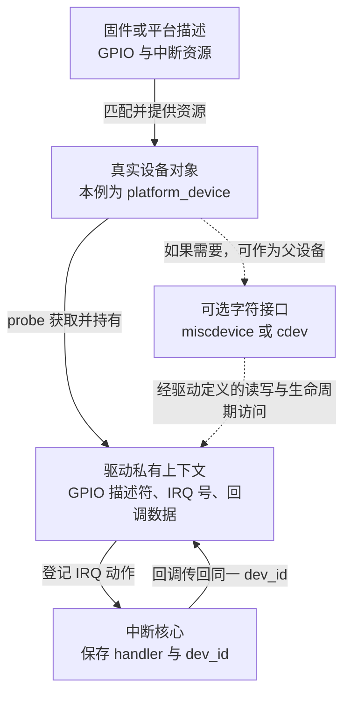
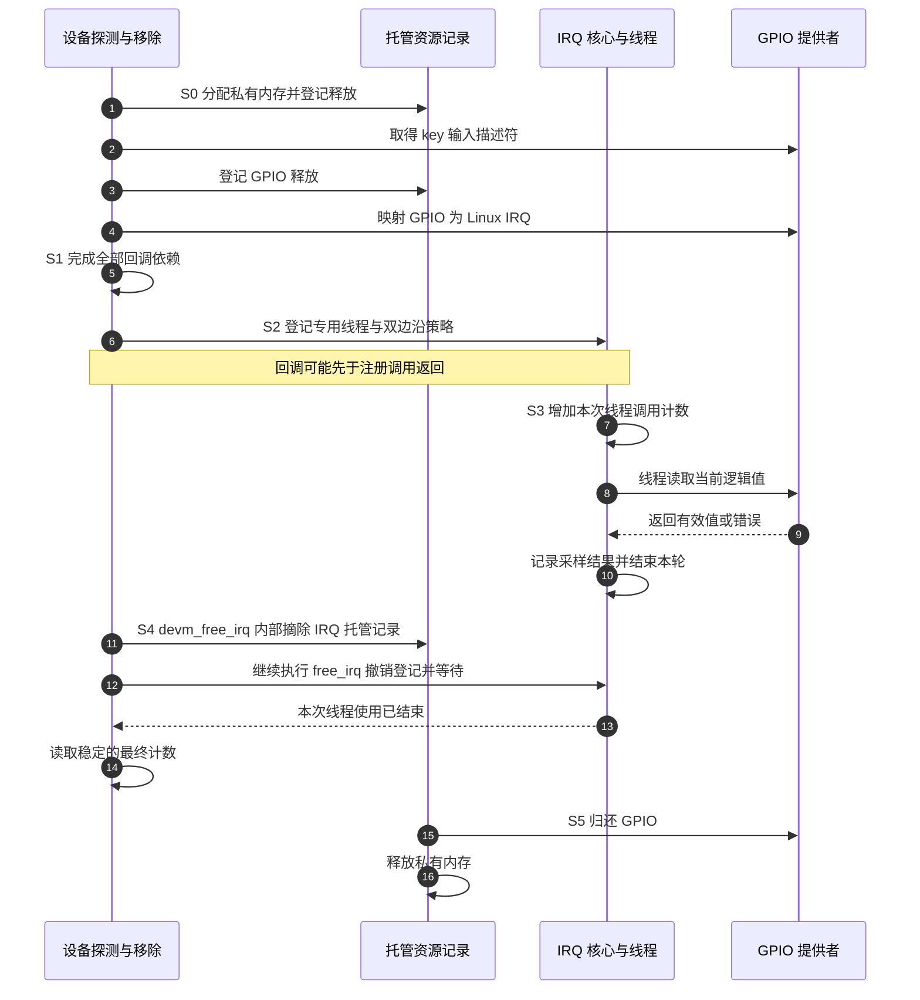

# 第4章\_Linux\_驱动中的中断注册与接口

上一章已经知道，注册中断是在某个 Linux IRQ 对象上登记设备处理动作，控制器操作和流程次序由中断核心协作完成。但这还不能直接变成一个可靠驱动：IRQ 从哪里来，处理函数访问的对象由谁保存，注册中途失败如何退出，卸载时谁还可能使用这些对象？

这一章以 **一根专用 GPIO 输入线的双边沿采样** 为例，把获取资源、准备上下文、登记线程、读取输入和撤销登记连接起来。双边沿表示上升与下降变化都请求服务；我们只观察处理时读到的电平，不把它当作去抖后的按键事件，也不承诺记录每一次物理边沿。这样可以先完成注册生命周期，再由下一章解释触发和逻辑极性。

接口以本仓库固定的 Linux 6.12.20 提交为准。本章给出完整驱动源文件与构建步骤；实际引脚选择、复用和设备树部署仍需与目标板一致，文中的板级模板会明确哪些值必须由板图和控制器绑定提供。

## 4.1\_先找到资源的主人\_字符接口不自动带来硬件身份

假设你想让用户程序通过一个设备文件读取按键。这里有两件独立的事：底层驱动要取得真实 GPIO 和 IRQ；上层可以提供字符设备接口，让用户程序执行读写。后者是访问方式，不是新的硬件来源。

**平台设备（platform device）** 是 Linux 设备模型中表示一类非自枚举设备的对象：这类设备不通过总线探测自行报告全部身份和资源，而由平台描述提供信息。平台驱动在匹配后的 `probe()` 中取得它。设备树可以生成平台设备，但并非每个设备树节点都生成平台设备，也不是所有硬件都使用平台总线；其他总线有自己的设备与资源接口。

`miscdevice` 则用于创建一类简化的字符设备接口。`misc_register()` 为它建立可见设备，并不替你找到某个 GPIO 控制器或复制实际硬件的设备树节点。因此先创建一个 misc 设备，再假设 `misc.this_device->of_node` 就是目标硬件节点，这个模型不成立。



图中的虚线是可选扩展，本章例子不创建字符设备。若需要它，通常在实际设备的 `probe()` 中建立接口，以真实设备作为资源和生命周期的依托；字符接口发布失败要撤销已发布资源，退出时还要解决已经打开的文件对私有数据的引用。不能仅设置一个 `parent` 指针，就认为这些责任全部完成了。

同样，给任意 `struct device` 填一个设备树指针，不等于它已经拥有那套硬件资源。资源获取应沿设备模型和已建立的绑定关系进行。

## 4.2\_取得\_Linux\_IRQ\_不同接口的失败值并不一样

如果硬件描述直接提供中断资源，平台驱动通常使用 `platform_get_irq(pdev, index)`，`index` 是该设备中断资源的零起始索引。例如下面是 `probe()` 内取得第一项资源的完整局部步骤，后续登记仍需上下文准备：

```c
/* 位于平台驱动的 probe() 中，pdev 由设备核心传入。 */
int irq;

irq = platform_get_irq(pdev, 0);
if (irq < 0)
    return irq;
/* 此后 irq 才能交给中断注册接口。 */
```

使用有符号 `int` 很重要。负值可能表示资源缺失，也可能是 `-EPROBE_DEFER`：当前依赖的控制器尚未准备好，设备核心应稍后重试。把负值先赋给无符号变量，或者统一改成“没有设备”，会丢失这个信息。

如果已经按设备绑定取得 **GPIO 描述符 `struct gpio_desc`**，并把它设置为输入，则可以用 `gpiod_to_irq()` 取得这根线对应的 Linux IRQ。GPIO 描述符是一个受内核管理的 GPIO 资源句柄，不是全局 GPIO 数字；本章完整例子选择这条路径。

| 已经成立的资源关系 | 取得方式 | 本版结果与使用边界 |
| --- | --- | --- |
| 平台设备提供第 N 项中断 | `platform_get_irq(pdev, N)` | 成功为非零 IRQ，失败为负错误；保留延迟探测 |
| 驱动已取得并配置为输入的 GPIO 描述符 | `gpiod_to_irq(desc)` | 成功得到 IRQ，失败为负错误；不替代 GPIO 申请和输入配置 |
| 调用方确实拥有正确的设备树节点引用 | `of_irq_get(np, N)` | 正数成功；0 表示映射失败；负数包含延迟探测等错误 |
| 需要理解旧的直接解析调用 | `irq_of_parse_and_map(np, N)` | 返回无符号 IRQ，0 表示失败；不能用 `< 0` 判断，也不保留完整错误信息 |
| 受控实验已经独立建立 IRQ 资源及所有权 | 显式传入已确认的 Linux IRQ | 一个模块参数只能传数字，不能建立物理连接、映射或所有权 |

这些不是从“推荐”到“兜底”的降级阶梯。字符设备并不天然应该走 `of_irq_get()`；它仍应使用真实底层设备的资源。仅凭 `/proc/interrupts` 看到一个数字就申请，也不能证明可以接管别的驱动正在使用的来源。

直接使用 `of_find_node_by_path()` 等接口查节点，还要按其契约用 `of_node_put()` 释放取得的节点引用；注册失败也不能漏掉。中断映射的销毁与节点引用释放是不同生命周期，不应对借来的共享映射随意调用销毁函数。新驱动优先沿真实设备关系获取资源，避免硬编码整条设备树路径。

## 4.3\_先选择执行上下文\_再选择释放由谁负责

取得 IRQ 只回答“哪一路”。下一步要决定处理函数做什么。如果只读几个允许在中断上下文访问的寄存器并保存状态，可以在主处理函数完成；如果读设备需要等待串行总线，就需要可睡眠的执行上下文。

**主处理函数** 是 action 的 `handler`。在普通未强制线程化的中断路径中，它处于硬中断上下文，不能调用可能睡眠的接口。**中断线程函数** 是 `thread_fn`，由对应内核线程执行，可以在接口允许的前提下睡眠；“可以”不等于“必须”，也不意味着可以无限阻塞。

然后才决定释放方式：普通接口要求驱动显式释放；`devm_` 版本把释放记录交给设备资源管理机制。这个轴与“是否线程化”相互独立。

| 执行方式 | 显式登记与释放 | 设备托管登记与提前释放 |
| --- | --- | --- |
| 提供主处理函数 | `request_irq()` / `free_irq()` | `devm_request_irq()` / `devm_free_irq()` |
| 提供线程处理，主处理可按约束省略 | `request_threaded_irq()` / `free_irq()` | `devm_request_threaded_irq()` / `devm_free_irq()` |

这些注册调用成功返回 0，失败返回负错误。托管版本同样可能失败，同样可能在调用返回前开始处理。下面把共享参数放在一起解释，避免只凭函数名字选型。

| 参数 | 调用者提供的内容 | 后续如何使用 |
| --- | --- | --- |
| `irq` | 已核对成功的 Linux IRQ 号 | 核心定位本路描述符 |
| `handler` | 主处理函数，签名为 `irqreturn_t handler(int irq, void *dev_id)` | 检查设备原因、快速处理或返回 `IRQ_WAKE_THREAD` |
| `thread_fn` | 线程函数，签名相同 | 由已建立的中断线程调用；普通 `request_irq()` 无此参数 |
| `flags` | 共享、线程屏蔽与必要的触发约束 | 核心检查登记兼容性并建立运行协议 |
| `name` | 生命周期覆盖登记的名称字符串 | 诊断显示；它不识别设备实例 |
| `dev_id` | 稳定的设备私有上下文指针 | 回调原样取得；释放时用同一值定位 action |
| 托管版本额外的 `dev` | 拥有释放记录的真实设备 | 解绑或失败回滚时调用对应释放动作 |

把函数起名为 `my_irq_thread`，再传给 `devm_request_irq()`，不会因为名字带 thread 就建立显式线程处理。实际线程化还受内核配置影响；驱动不能以“我的测试环境恰好强制线程化”作为允许主处理调用睡眠接口的跨配置保证。

## 4.4\_线程与共享线路\_为什么还需要来源判断和屏蔽协议

设想设备以持续电平请求服务，真正清除原因需要在串行总线上读写。主处理不能做这个可睡眠操作。如果另有不需要睡眠的来源判断和请求控制方式，可以先确认是否属于本设备，再使本设备的请求进入可控状态，返回 `IRQ_WAKE_THREAD`。线程完成读取和清除后，线路才适合恢复服务；如果连来源判断都必须睡眠，就不能凭空假设这一套主处理步骤可用，需要结合专用线或控制器提供的线程化路径设计。

`IRQF_ONESHOT` 表达的是 **线程处理期间按核心与控制器协议保持本路受屏蔽保护，等待相关线程完成后才恢复**。它不是只触发一次，也不是每个物理边沿都创建一个新线程。在线程完成前多次到来的通知可能合并，保留事实仍依靠设备缓冲和硬件状态。

如果是一根本设备专用线，不需要主处理再辨认共享来源，可以令 `handler = NULL` 并提供 `thread_fn`；核心会安装一个请求唤醒线程的默认主处理。通常结合 `IRQF_ONESHOT` 使用。本章完整例子采用这个组合。

共享线路要更谨慎。`IRQF_SHARED` 表示允许多个兼容的消费者共用同一 IRQ，每个消费者必须检查自己的设备状态；不能因为自己的函数被调用就断言是自己的事件。主处理无法确认原因时，不应机械套用“NULL 主处理 + 总是唤醒线程”的专用线方案。

| 标志或返回值 | 本章采用的含义 | 容易混淆的地方 |
| --- | --- | --- |
| `IRQF_SHARED` | 允许符合约束的共享登记 | 不是允许忽略来源判断，也不是允许随意接管任意 IRQ |
| `IRQF_ONESHOT` | 线程阶段保持必要的屏蔽保护 | 长时间睡眠仍可能延迟同路其他消费者，甚至导致设备缓冲溢出 |
| `IRQF_TRIGGER_RISING` / `IRQF_TRIGGER_FALLING` | 请求物理上升 / 下降边沿语义 | 与 GPIO 的逻辑 active-low 不是同一项配置 |
| `IRQF_NO_AUTOEN` | 登记时不自动使能，留给显式启动 | 本版不允许与共享登记一起使用；后续启用仍须配对 |
| `IRQ_NONE` | 没有认领本设备原因 | 不能只为了消除告警一律改成已处理 |
| `IRQ_HANDLED` | 本 action 已处理 | 不会令核心跳过共享链其余 action |
| `IRQ_WAKE_THREAD` | 请求已登记线程继续处理 | 线程函数必须已经存在；不代表工作已经完成 |

共享 IRQ 上调用 `disable_irq()` 管的是整路 IRQ，不是只关自己的 action。若目的只是停止自己设备发请求，应优先使用该设备的局部请求使能协议，保留其他消费者的服务能力。所有消费者还必须满足触发类型等共享约束。

## 4.5\_触发类型和禁用接口\_每次调用都要有依据

设备树描述了线路和触发语义后，驱动不应为了“保险”无条件再改一次类型。错误类型可能来自描述、接线理解或驱动要求不一致，先明确谁拥有这项配置并修正原因。反复写同一个类型既不能清除持续设备请求，也不能修复断线或未解除的屏蔽。

如果设备协议明确要求驱动选择类型，应在受控初始化阶段设置，并检查 `irq_set_irq_type(irq, type)` 的返回值。其 `IRQ_TYPE_*` 类型常量与注册用的 `IRQF_TRIGGER_*` 各有接口位置；不能在未核对共享消费者的情况下在线修改整路配置。本章从 GPIO 描述符取得来源，并由示例绑定约定双边沿采样，所以在登记参数中明确请求双边沿；不额外重复设置。

| 接口 | 改变什么或等待什么 | 调用边界 |
| --- | --- | --- |
| `disable_irq(irq)` | 增加禁用层数，并等待相关处理完成 | 可能睡眠；不能在本 IRQ 的处理函数里等待自己，不能持有处理方需要的锁 |
| `disable_irq_nosync(irq)` | 增加禁用层数，不等待已有处理退出 | 返回不证明上下文可释放；调用上下文还须满足控制器操作约束 |
| `enable_irq(irq)` | 抵消一层禁用，最后一层撤销后才恢复 | 不是任意重复调用都无害；涉及慢总线回调时不能从硬中断上下文调用 |
| `synchronize_irq(irq)` | 等待当前相关处理完成 | 不自行阻止未来新事件；不能替代先停止生产的步骤 |
| `irq_set_irq_type(irq, type)` | 请求设置触发类型 | 检查返回值；不可用来掩盖错误的固件描述和设备协议 |
| `free_irq()` / `devm_free_irq()` | 撤销指定登记并等待相关在途处理 | 使用匹配的释放方式和 `dev_id`，不能释放两遍 |

禁用与启用是有层数的管理，不是给一个布尔变量反复赋值。如果两条路径各禁用一次，只启用一次还不会恢复；如果没有对应禁用却多调用一次启用，也属于不平衡使用。下一章的“只来一次”排查会同时检查这些软件状态与硬件请求。

## 4.6\_写一个完整的专用\_GPIO\_采样驱动

现在把选择固定下来：一个平台设备拥有一根名为 `key` 的 GPIO 输入；该线只由这个驱动使用，控制器支持双边沿；线程读取当前逻辑值，并记录线程被调用的次数。例子观察系统正常运行期间的输入，没有配置睡眠唤醒。这里不创建定时器、工作队列或用户文件，所以退出只需要先撤销并等待 IRQ 线程，再归还 GPIO 和内存。

完整源文件命名为 `irq_input_demo.c`。`irq_input_demo` 是本章自定义驱动名；`key` 决定后面设备树的属性名 `key-gpios`；`example,irq-input-demo` 是本例自定义匹配字符串，不是现成芯片型号。

### 4.6.1\_先准备线程会访问的状态

以下三段依次放入同一个源文件。第一段定义依赖和处理函数。`struct irq_input` 是本例每个设备独有的状态，`input` 是指向它的指针；`u64 calls` 使用内核的 64 位无符号类型保存线程调用数。

```c
#include <linux/device.h>
#include <linux/err.h>
#include <linux/gpio/consumer.h>
#include <linux/interrupt.h>
#include <linux/module.h>
#include <linux/of.h>
#include <linux/platform_device.h>
#include <linux/slab.h>

struct irq_input {
    struct device *dev;
    struct gpio_desc *key;
    int irq;
    u64 calls;
};

static irqreturn_t irq_input_thread(int irq, void *dev_id)
{
    struct irq_input *input = dev_id;
    int active;

    /* 同一 action 的线程串行调用；计数的是线程执行，不是物理边沿。 */
    input->calls++;
    active = gpiod_get_value_cansleep(input->key);
    if (active < 0) {
        dev_err_ratelimited(input->dev, "GPIO read failed: %d\n", active);
        /* 本例是专用线；读取失败不表示它来自另一个共享设备。 */
        return IRQ_HANDLED;
    }

    dev_info_ratelimited(input->dev, "irq=%d sample=%llu active=%d\n",
                         irq, (unsigned long long)input->calls, active);
    return IRQ_HANDLED;
}
```

`gpiod_get_value_cansleep()` 允许底层 GPIO 访问需要睡眠，因此放在线程函数中。它返回逻辑值：若描述为低电平有效，物理低电平读作有效值 1。线程运行时引脚可能已经再次变化，所以读到的是采样时刻的值，不保证就是最初触发边沿之后的值。

计数只由这一个 action 的线程写入，移除路径会先同步结束该线程再读取，因此此例没有并发读写计数。如果以后增加用户态读取接口，就必须重新设计计数读取与对象生命期，不能沿用这里省略锁的前提。

日志接口带有限速。同一次突发中可能有些采样没有逐条打印，最后统计值也不是精确按键次数；打印本身还会增加处理成本。这段驱动用来观察注册和采样路径，不是高速事件记录器。

### 4.6.2\_资源准备完成以后\_才允许登记回调

第二段提供设备匹配后的探测函数。`devm_kzalloc()` 申请并清零托管内存，`GFP_KERNEL` 表示允许在普通内核上下文中睡眠的分配方式，失败返回空指针，此时返回 `-ENOMEM`（内存不足）。GPIO 获取则采用错误指针契约：`IS_ERR()` 判断是否携带错误，`PTR_ERR()` 取出其中的负错误码，不能把错误指针当作 GPIO 描述符使用。

```c
static int irq_input_probe(struct platform_device *pdev)
{
    struct device *dev = &pdev->dev;
    struct irq_input *input;
    int ret;

    input = devm_kzalloc(dev, sizeof(*input), GFP_KERNEL);
    if (!input)
        return -ENOMEM;
    input->dev = dev;

    input->key = devm_gpiod_get(dev, "key", GPIOD_IN);
    if (IS_ERR(input->key))
        return dev_err_probe(dev, PTR_ERR(input->key),
                             "cannot get key GPIO\n");

    input->irq = gpiod_to_irq(input->key);
    if (input->irq < 0)
        return dev_err_probe(dev, input->irq, "cannot map GPIO to IRQ\n");

    /* 在登记前发布管理路径所需的关联，并准备好全部回调依赖。 */
    platform_set_drvdata(pdev, input);
    ret = devm_request_threaded_irq(dev, input->irq, NULL,
                                    irq_input_thread,
                                    IRQF_ONESHOT | IRQF_TRIGGER_RISING |
                                    IRQF_TRIGGER_FALLING,
                                    dev_name(dev), input);
    if (ret)
        return dev_err_probe(dev, ret, "cannot request GPIO IRQ\n");

    dev_info(dev, "bound: irq=%d, sampling both edges\n", input->irq);
    return 0;
}
```

`GPIOD_IN` 要求按输入方向取得 GPIO。内存、`dev`、GPIO 和 IRQ 都在登记前准备；注册调用内部就算发生第一次通知，线程也不会访问尚未初始化的 GPIO。`dev_err_probe()` 保留原错误并按探测语义报告，尤其不把延迟探测改成成功。

本例只从 GPIO 描述符映射一次 IRQ，没有再从 `interrupts` 资源重复取得和申请同一路。如果你的设备绑定直接给出 `interrupts`，应使用前面的 `platform_get_irq()` 路径，并按真实设备协议准备状态，不能把两套获取片段机械拼在一起。

### 4.6.3\_先注销并等待线程\_再让托管资源释放

最后一段提供移除函数、匹配表与模块入口。`MODULE_DEVICE_TABLE()` 输出匹配表对应的模块别名信息；`MODULE_LICENSE("GPL")` 声明本例模块采用 GNU 通用公共许可证，`MODULE_DESCRIPTION()` 提供模块说明。它们都是模块元数据宏，不执行中断处理。

```c
static void irq_input_remove(struct platform_device *pdev)
{
    struct irq_input *input = platform_get_drvdata(pdev);

    /* 执行并摘除托管 IRQ 记录；返回后线程不会再使用 input。 */
    devm_free_irq(&pdev->dev, input->irq, input);
    dev_info(&pdev->dev, "removed: thread calls=%llu\n",
             (unsigned long long)input->calls);
    /* GPIO 与 input 内存随后由设备核心按逆序归还。 */
}

static const struct of_device_id irq_input_of_match[] = {
    { .compatible = "example,irq-input-demo" },
    { }
};
MODULE_DEVICE_TABLE(of, irq_input_of_match);

static struct platform_driver irq_input_driver = {
    .probe = irq_input_probe,
    .remove = irq_input_remove,
    .driver = {
        .name = "irq_input_demo",
        .of_match_table = irq_input_of_match,
    },
};
module_platform_driver(irq_input_driver);

MODULE_LICENSE("GPL");
MODULE_DESCRIPTION("Dedicated GPIO IRQ sampling example");
```

本版平台驱动的 `.remove` 返回 `void`。`module_platform_driver()` 提供模块加载时的驱动登记，以及卸载时的驱动注销；匹配表让正确的设备节点进入 `probe()`，它不会凭空创建一块硬件。

GPIO 输入仍可能被外界改变，驱动不能阻止按钮继续被按下。这里需要切断的是这次 IRQ 登记对 `input` 的使用：`devm_free_irq()` 完成相关等待并摘掉释放记录，随后设备核心释放 GPIO 与内存时不会再重复释放 IRQ。因为没有其他异步生产者，也没有重新使能路径，不必为了形式再加一个永远不被竞争的停止标志。

按初始化顺序，已取得的托管资源形成“内存 → GPIO → IRQ”的关系。任一准备步骤失败，设备核心回滚本次成功登记的资源；成功绑定后移除则先显式完成 IRQ，再回收其依赖。这一顺序不能在增加工作队列或用户文件后不加分析地照搬。

### 4.6.4\_沿资源记录检查一次完整退出

把代码再放回时间线上：S0 取得输入和内存，S1 准备回调依赖，S2 登记以后允许进入 S3 采样。退出的 S4 调用 `devm_free_irq()`，其内部先摘除托管记录，再执行普通 IRQ 释放与等待；S5 才归还 GPIO 和内存。因此设备核心之后不会再次调用那笔已经摘除的 IRQ 释放记录。



图中 S3 可以重复，也可以在尚无事件时直接进入 S4。初始化失败走的是已登记资源的回滚，不会调用一个尚未成功登记的 IRQ 的释放接口。

## 4.7\_把完整驱动接到真实输入\_配置中的数字必须有来处

驱动已经完整，但它不知道你的板子哪一根线连接按钮。下面是 **板级设备树模板**，其中 `board_key_gpio` 和 `BOARD_KEY_OFFSET` 是必须替换的占位符，不是任何现成 SoC 的控制器标签和引脚号，原样不能编译。

```dts
#include <dt-bindings/gpio/gpio.h>

/ {
    irq-input-demo {
        compatible = "example,irq-input-demo";
        key-gpios = <&board_key_gpio BOARD_KEY_OFFSET GPIO_ACTIVE_LOW>;
        status = "okay";
    };
};
```

模板假定所选 GPIO 控制器的绑定采用“控制器引用、组内索引、标志”这种格式。若它的 `#gpio-cells` 或绑定格式不同，要依实际绑定调整。必须从板图和现有设备树确定控制器、组内索引、输入电平与有效极性，并把该引脚复用为 GPIO 输入；需要的上拉和 pinctrl 配置也应来自这块板的已有规则。该线不能同时归属于另一个按键驱动。

`key-gpios` 对应代码中的 `devm_gpiod_get(dev, "key", ...)`；`GPIO_ACTIVE_LOW` 只定义读取的逻辑有效值。本例双边沿触发来自驱动登记的 `IRQF_TRIGGER_RISING | IRQF_TRIGGER_FALLING`，并不由 `GPIO_ACTIVE_LOW` 自动生成。本例没有独立的 `interrupts` 属性，不能据此推广成所有 GPIO 消费者的唯一绑定格式。

完成板级配置后，用目标工程既有的设备树构建和部署流程，把设备树源文件（Device Tree Source，DTS）编译成固件实际加载的设备树二进制（Device Tree Blob，DTB）。只编辑一个没有被启动固件加载的 DTS 文件，不会改变运行系统。这里没有指定板型，因此不编造 DTB 文件名、启动分区或引脚复用值。

在目标 Linux 上建立包含 `irq_input_demo.c` 和下列 `Makefile` 的目录。`obj-m` 是内核构建系统使用的变量，表示将对应对象构建为可加载模块；由同名 `.c` 文件编译得到 `.o`，再链接为 `.ko`：

```makefile
obj-m += irq_input_demo.o
```

若目标系统已经安装与运行内核匹配的模块构建目录，可以在该目录执行：

```sh
# 执行位置：目标 Linux 上保存源文件和 Makefile 的目录。
make -C /lib/modules/$(uname -r)/build M="$PWD" modules
```

`-C` 进入匹配内核的构建目录，`M` 指向当前外部模块源码目录；`$PWD` 是 shell 的当前目录变量，`uname -r` 输出正在运行的内核版本。输出应包含 `irq_input_demo.ko`。如果在开发机交叉编译，必须改用目标内核已经配置并准备好的构建树、目标架构和对应工具链，不能用开发机的 `uname -r` 选择另一套内核。运行内核需具备模块、平台设备、设备树及相应 GPIO/IRQ 控制器支持。

接着用 `insmod` 加载指定模块文件，用 `dmesg` 查看内核日志，`tail -n 30` 只显示末尾 30 行：

```sh
# 执行位置：目标 Linux 的模块目录，需要管理权限。
sudo insmod ./irq_input_demo.ko
sudo dmesg | tail -n 30
```

看到 `bound: irq=...` 才说明某个设备完成了本例探测。仅 `insmod` 返回成功只说明驱动模块登记成功；没有匹配节点时，可能根本没有调用 `probe()`，资源错误也应从设备探测日志检查。

在终端中观察中断统计和后续日志，然后改变输入：

```sh
# 执行位置：目标 Linux；关注对应设备名和 bound 日志中的 IRQ 行。
cat /proc/interrupts
sudo dmesg -w
```

按下或释放输入后，应结合统计变化与 `sample=... active=...` 日志判断事件是否到达线程。先预测低电平有效时按下读到 1、释放读到 0，再观察是否符合。机械抖动、线程调度、事件合并和日志限速都会影响条数，所以不能拿“一次按下打印了几行”直接断言注册有错。用 Ctrl+C 停止日志跟随。

最后用 `rmmod` 按模块名卸载：

```sh
# 执行位置：目标 Linux；先停止本次人工输入操作以便观察清楚。
sudo rmmod irq_input_demo
sudo dmesg | tail -n 20
```

`removed: thread calls=...` 在 IRQ 撤销同步完成以后打印。若系统存在多个匹配节点，会分别探测和移除，每个实例保存自己的 GPIO、IRQ 与计数。记录加载、输入变化和卸载三段证据，比只展示一次中断计数更能说明生命周期是否闭合。

## 4.8\_按失败发生的阶段排查\_不要用改触发类型替代定位

现在可以把失败按阶段拆开。S0 取得 GPIO 失败，应检查资源描述、引脚占用、提供者是否就绪；取得描述符但映射失败，应检查这根 GPIO 是否支持中断及控制器是否建立完成。`-EPROBE_DEFER` 应让核心稍后重试，不是从中断处理函数忙等提供者。

S2 登记失败，检查返回值和共享、触发能力、线程约束。若登记成功但没有进入线程，沿真实输入、电气与复用、请求检测、控制器使能、CPU 接收逐段排查。`/proc/interrupts` 没增长不能独自证明取得了错误 IRQ。

S3 一直触发，需要检查实际输入和设备条件是否持续有效、触发类型是否匹配以及本地清除协议。只来一次，则还要检查禁用层数、未完成线程和设备是否产生新的有效变化。`IRQF_ONESHOT` 下一个很久不返回的线程会延长屏蔽窗口，不会因为换了这个标志就自动解决延迟。

S4 卸载等待很久，先检查线程是否阻塞、退出方是否持有线程所需资源。托管释放也要等待同一批使用者，改用 `devm` 不能化解死锁。若后来增加派生 work 或定时器，必须在退出时关闭重排入口并依赖次序同步排空。

### 4.8.1\_把三个常见判断改成可验证的问题

1. `misc_register()` 已成功，是否可以直接用新字符设备的 `of_node` 取得硬件 IRQ？**不可以据此推断。** 先找到真实硬件设备与其资源关系；字符接口可以附属于它，但不会自动获得节点。
2. 专用线程登记已经成功，能否等函数返回以后才填 `input->key`？**不能。** 普通自动使能路径可能在调用返回前执行回调，全部依赖必须先准备。
3. `IRQ_HANDLED` 已返回，能否认定其他共享设备不再需要处理？**不能。** 核心继续遍历其他 action；每个消费者都应检查自己的原因。

现在已经有一份资源准备、错误返回和退出顺序明确的驱动。下一章继续解释它最容易被误读的配置：物理边沿、电平保持、GPIO 逻辑有效值，以及设备请求条件怎样真正消失。

> 依据：本版的 [platform.c](https://github.com/nxp-imx/linux-imx/blob/dfaf2136deb2af2e60b994421281ba42f1c087e0/drivers/base/platform.c)、[of/irq.c](https://github.com/nxp-imx/linux-imx/blob/dfaf2136deb2af2e60b994421281ba42f1c087e0/drivers/of/irq.c)、[misc.c](https://github.com/nxp-imx/linux-imx/blob/dfaf2136deb2af2e60b994421281ba42f1c087e0/drivers/char/misc.c)分别核对资源、错误语义与字符接口创建；[GPIO 消费者契约](https://github.com/nxp-imx/linux-imx/blob/dfaf2136deb2af2e60b994421281ba42f1c087e0/Documentation/driver-api/gpio/consumer.rst)、[IRQ manage.c](https://github.com/nxp-imx/linux-imx/blob/dfaf2136deb2af2e60b994421281ba42f1c087e0/kernel/irq/manage.c)及 [devres.c](https://github.com/nxp-imx/linux-imx/blob/dfaf2136deb2af2e60b994421281ba42f1c087e0/kernel/irq/devres.c)核对输入、线程、同步和释放。固定文件身份与验证边界见[源码基线](../../../../../research/source_reading/linux/SOURCE_BASELINE.md#1.184_中断资源归属与GPIO线程登记)。

上一篇：[Linux 的中断抽象](P03_Linux_的中断抽象_irq_chip_irq_domain_与_irq_desc.md)。
下一篇：[GPIO 与触发语义](P05_GPIO_与触发语义_电平_边沿_DTS_与_只来一次一直来_为何出现.md)。
