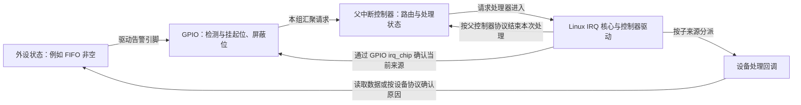
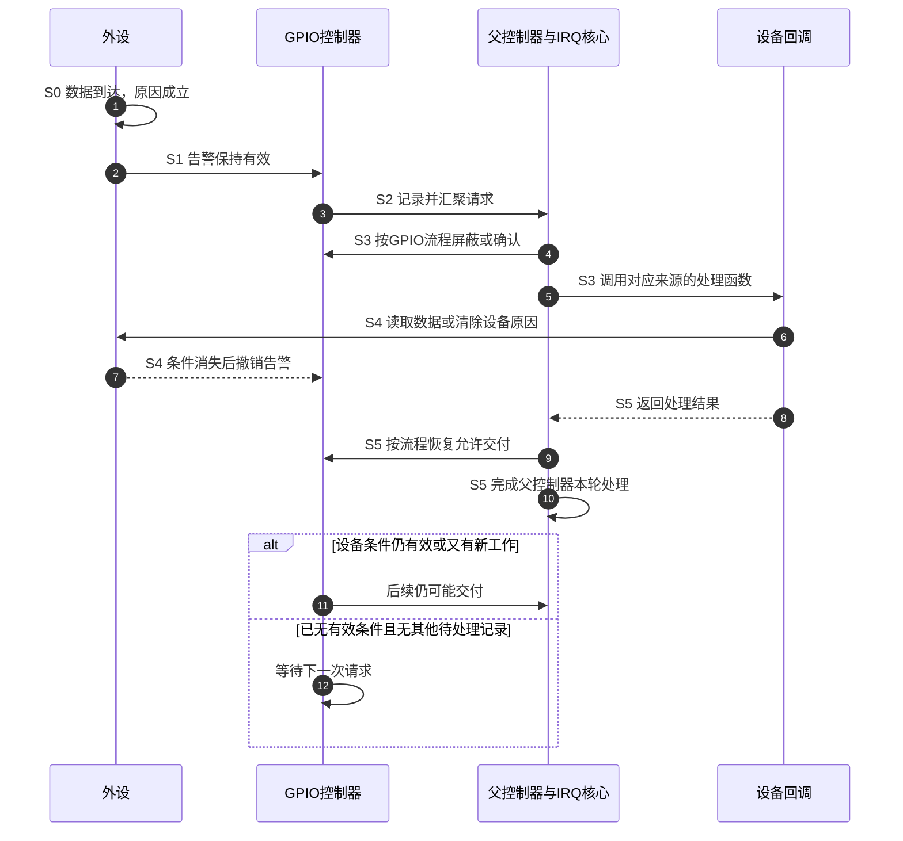

# 第5章\_GPIO\_与触发语义\_电平\_边沿\_DTS\_与\_只来一次一直来\_为何出现

前四章已经把 GPIO 输入变成 Linux IRQ，并用线程回调读取逻辑电平。登记成功只说明这条处理路径建立起来了，还没有回答：什么物理变化会产生请求，为什么按住一次可能不停进入，又为什么若干次变化只看到一次回调？

本章继续使用按键，同时拿一根外设告警线作对照。先分开电气变化、控制器记录和软件采样，再用同一个按键控制 LED 的程序比较三种处理方式。寄存器确认由控制器驱动完成，设备驱动负责自己的业务条件；这个分工会贯穿全文。

## 5.1\_同一根线\_物理电平与逻辑有效不是同一个读数

假设按键的一端接地，另一端接 GPIO 输入，并通过合适的上拉电阻保持空闲高电平。这里的高低是引脚电压相对芯片门限的分类；电压门限、上拉和复用配置必须符合具体芯片与板子的电气要求。

没有抖动时，按下使输入从高变低，松开使输入从低变高。驱动通常更关心“是否按下”，于是 GPIO 描述符可以把低电平解释为逻辑有效，即 `GPIO_ACTIVE_LOW`。`gpiod_get_value_cansleep()` 读到的是已经按该属性转换的逻辑值：成功返回 **1 表示有效，0 表示无效**；负数仍是读取错误，不能当成有效。

| 时刻与动作 | 物理输入 | 物理变化 | 设置 `GPIO_ACTIVE_LOW` 后的逻辑值 |
| --- | --- | --- | --- |
| t0，未按 | 高 | 无 | 0，无效 |
| t1，按下 | 低 | 下降沿 | 1，有效 |
| t2，持续按住 | 低 | 无新边沿 | 1，有效 |
| t3，松开 | 高 | 上升沿 | 0，无效 |

这张表同时给出了三个问题的答案。读取 GPIO 得到的是采样时的值；下降沿描述的是一次高到低的变化；低电平触发描述的是输入仍然为低这一条件。**逻辑有效属性不会自动选择 IRQ 触发方式。** 即使同样使用 `GPIO_ACTIVE_LOW`，驱动也可以只接收按下的下降沿，或接收按下和松开的双边沿。

这里的“下降沿对应按下”只对刚才约定的接线成立。换成空闲低、按下高的电路，按下对应上升沿。先画真实接线，再解释波形，比从宏名反推电路可靠。

## 5.2\_边沿记录一次变化\_电平表达尚未消失的条件

现在把这根线接到中断检测逻辑。选择下降沿时，控制器在高到低的变化上记录待处理请求；一直保持低电平不会凭空产生新的下降沿。选择低电平时，输入持续为低就是请求条件，处理软件返回以后条件若仍成立，后续仍可能交付。

边沿常由挂起位保存“至少发生过一次”。一个挂起位不能表示在它已经为 1 时又来了三次，因此 **IRQ 次数不保证等于边沿次数**。需要逐个保存的设备事件，应由设备 FIFO、计数器或其他有容量的状态承载，不能仅依靠一位通知。

电平适合表达“还有工作未处理”：例如外设接收 FIFO 非空时拉低告警线，驱动读走数据，FIFO 变空后外设撤销请求。按键不同，用户持续按住时，没有一条“清按键”寄存器命令能让触点松开。驱动不能为清中断把输入引脚改成输出并强行拉高；它应选择适合业务的触发与屏蔽策略。

| 请求条件 | Linux 类型 | 何时产生条件 | 处理后还可能再次交付的原因 |
| --- | --- | --- | --- |
| 低到高变化 | `IRQ_TYPE_EDGE_RISING` | 上升沿到来 | 又发生边沿，或已有其他待处理记录 |
| 高到低变化 | `IRQ_TYPE_EDGE_FALLING` | 下降沿到来 | 同上 |
| 任一方向变化 | `IRQ_TYPE_EDGE_BOTH` | 上升沿或下降沿 | 同上；不保证硬件保存每次变化 |
| 输入持续高 | `IRQ_TYPE_LEVEL_HIGH` | 高电平条件成立 | 条件尚未撤销，或有新的请求 |
| 输入持续低 | `IRQ_TYPE_LEVEL_LOW` | 低电平条件成立 | 同上 |

这些是接口可以表达的类型，**不是每个控制器都支持全部类型的承诺**。例如一条直接进入 GIC 的输入和一个 GPIO 控制器的子输入，支持的极性、边沿及双边沿实现可以不同；子输入采用下降沿，也不要求 GPIO 向父控制器输出的汇聚请求采用下降沿。

确认一个边沿记录与读取当前电平也是两件事。线程调度到运行时，按键可能已经松开，所以“因下降沿唤醒，后来却读到无效”完全可能。若业务需要边沿发生时的采样值或精确时间戳，必须核对硬件是否能锁存，不能用回调里的当前读数冒充历史。

## 5.3\_请求经过多层\_为什么不能用一次清零代替全部完成动作

沿外设低有效告警线继续看。外设内部保存产生请求的原因，GPIO 控制器保存本组输入的检测、屏蔽与挂起状态，父控制器再把 GPIO 汇聚请求交给处理器。它们保存的对象不同，因此“处理完”也不可能只指同一个位。



设备驱动执行“读走 FIFO 数据”，改变的是设备条件。GPIO 控制器驱动执行确认，改变的是控制器记录。父控制器的结束动作，结束的是它自己的处理状态。箭头不是软件必须逐级手工写寄存器的指令清单；Linux 的 IRQ 流程已经组织后两类动作，消费 GPIO IRQ 的驱动不应另起一套确认流程。

以持续电平请求的一轮处理为例，下图只表达职责和依赖，不规定所有控制器的确认都必须发生在回调之前。具体流程可能在入口屏蔽并确认，也可能采用其他结束协议。



| 阶段 | 状态放在哪里 | 谁改变它 | 下一位观察者 |
| --- | --- | --- | --- |
| S0～S1，形成原因 | 外设 FIFO、状态位或真实触点 | 外设硬件，或用户动作 | 输入检测电路、设备回调 |
| S2，记录来源 | GPIO 检测与挂起逻辑 | GPIO 硬件 | GPIO 控制器驱动 |
| S3，分派与确认 | GPIO 状态、父控制器状态、Linux IRQ 对象 | 对应硬件及 IRQ 流程 | 设备回调与后续交付路径 |
| S4，消除业务原因 | 外设内部状态 | 驱动按外设协议访问，或物理条件自行消失 | 外设告警输出与 GPIO 检测逻辑 |
| S5，结束本轮 | IRQ 核心及控制器的本轮处理状态 | IRQ 流程 | 下一轮交付判断 |

如果设备访问经由总线缓冲，写入返回并不一定已经证明外设引脚撤销；需要的读回、屏障或总线同步必须来自设备和体系结构协议。软件无需猜测 GPIO 或 GIC 内部用了几个时钟周期，也不能靠随意延时修复硬件状态机。硬件保证内部状态转换正确，软件遵守接口顺序；撤销尚未被观察到时发生一次再次交付，并不能单凭这一现象判定硬件状态机出错。

### 5.3.1\_从gpio-mxc看到控制器驱动拥有的寄存器

前面的分工可以在固定 Linux 6.12.20 源码中找到具体落点。`drivers/gpio/gpio-mxc.c` 的 `mx3_gpio_irq_handler()` 读取 `GPIO_ISR & GPIO_IMR`，将本次可见的子来源逐个交给 `generic_handle_domain_irq()`。每个来源的确认使用 `irq_gc_ack_set_bit()`，该回调向确认寄存器写当前来源的掩码，并非把业务驱动读到的整组状态全部写回。

以下是该驱动 `imx35_gpio_hwdata` 使用的寄存器布局。绑定文件允许 `fsl,imx6ul-gpio` 使用 `fsl,imx35-gpio` 作为兼容项；这里据此解释驱动布局，**不据此断言某块开发板的引脚连接、物理基址或已运行配置**。偏移以对应 GPIO 组的寄存器基址为起点。

| 寄存器 | 偏移 | 在当前问题中的作用 | Linux 中的访问责任 |
| --- | --- | --- | --- |
| `GPIO_DR` | `0x00` | GPIO 数据寄存器，输出控制的一部分 | GPIO 控制器驱动，消费端使用 GPIO API |
| `GPIO_GDIR` | `0x04` | 配置输入或输出方向 | GPIO 控制器驱动 |
| `GPIO_PSR` | `0x08` | 观察引脚状态 | GPIO 控制器驱动；采样不等于确认 IRQ |
| `GPIO_ICR1` / `GPIO_ICR2` | `0x0c` / `0x10` | 每输入两位，分别覆盖低 16 / 高 16 路触发配置 | `gpio_set_irq_type()` |
| `GPIO_IMR` | `0x14` | 中断允许掩码，本驱动置对应位允许、清位屏蔽 | GPIO `irq_mask` / `irq_unmask` 回调 |
| `GPIO_ISR` | `0x18` | 中断状态与确认入口，本驱动写对应的 1 位确认 | GPIO `irq_ack` 回调；消费驱动不自行写 |
| `GPIO_EDGE_SEL` | `0x1c` | 本布局中选择双边沿检测 | `gpio_set_irq_type()` |

本布局在 ICR 中用 `00`、`01`、`10`、`11` 分别表示低电平、高电平、上升沿和下降沿；双边沿另由 `EDGE_SEL` 选择。旧布局没有这个寄存器时，驱动可能采用读取输入并切换检测方向的办法。这说明相同 `IRQ_TYPE_EDGE_BOTH` 接口背后的硬件能力和实现代价不必相同，不能由宏名推断绝不遗漏快速变化。

寄存器前缀中的 `ISR` 在这里是状态寄存器名，不是软件中常说的 Interrupt Service Routine（中断服务例程）。表中的偏移帮助理解控制器驱动，不是让按键驱动直接 `ioremap()` 后越权访问的配方。尤其不能向整组 `ISR` 写全 1：那可能确认掉其他设备的记录，而且不会让仍按住的按键松开。

## 5.4\_设备树描述连接\_触发配置必须有明确来源

设备树源文件 DTS（Device Tree Source）描述硬件连接，启动时使用编译后的 DTB（Device Tree Blob）。同一 GPIO 控制器可以同时提供 GPIO 引脚资源和中断来源，但二者的描述单元属于不同接口。

先看一个**仅表示接线方式的模板**。`board_gpio` 与 `KEY_OFFSET` 必须替换为真实控制器标签和组内索引；索引的解释由该控制器绑定决定。

```dts
#include <dt-bindings/gpio/gpio.h>

key_demo {
    compatible = "example,gpio-trigger-demo";
    key-gpios = <&board_gpio KEY_OFFSET GPIO_ACTIVE_LOW>;
};
```

`key-gpios` 供 `gpiod_get(..., "key", ...)` 取得引脚并解释逻辑有效性。驱动从描述符调用 `gpiod_to_irq()`，随后必须根据其设备契约决定触发条件。本章的实验明确要求两种物理边沿，因此在登记时使用 `IRQF_TRIGGER_RISING | IRQF_TRIGGER_FALLING`，并检查登记结果。

另一个设备可能只把告警线作为 IRQ 资源交给驱动。下面采用 i.MX GPIO 绑定的两单元格式，第一单元是组内来源，第二单元是触发类型；它不是所有控制器通用的格式。

```dts
#include <dt-bindings/interrupt-controller/irq.h>

alarm_demo {
    compatible = "example,alarm-demo";
    interrupt-parent = <&board_gpio>;
    interrupts = <ALARM_OFFSET IRQ_TYPE_LEVEL_LOW>;
};
```

这个模板中的驱动通常通过平台 IRQ 资源接口取得 Linux IRQ，并依照绑定使用已描述的触发方式。两个模板分别演示两条资源路径，不应未经设计就在同一个实验设备上同时登记两份中断。

| 表达位置 | 描述什么 | 不代表什么 |
| --- | --- | --- |
| `GPIO_ACTIVE_LOW` | GPIO 描述符的逻辑有效性转换 | 不自动配置低电平 IRQ |
| `interrupts` 中的 `IRQ_TYPE_*` | 按父控制器绑定描述触发类型 | 不是 GPIO 引脚的逻辑读值 |
| `request_irq()` 系列的 `IRQF_TRIGGER_*` | 消费者登记时明确请求的类型 | 不能忽略硬件能力及共享者约束 |
| `irq_set_irq_type()` | 显式设置已有 IRQ 的触发类型，返回错误码 | 不是每个驱动都必须重复调用的“保险” |

发现设备树与驱动要求冲突时，应核对接线、绑定和唯一配置责任；不能先强改类型，再把失败仅打印警告后继续当作成功。共享 IRQ 的参与者还必须满足共同线路的约束。触发类型最终通过 `irq_chip` 操作落实到硬件，DTS 单元本身不是硬件寄存器编码。

## 5.5\_只来一次与一直来\_先判断哪一层没有继续

按住下降沿按键只收到一次，是预期行为：之后没有新的高到低变化。低电平请求一直有效而重复交付，也可能是按接线和配置正常工作。故障诊断要先写出本来应发生的物理过程，再检查实际路径在哪一段停止。

| 观察现象 | 需要区分的原因 | 下一项有意义的检查 |
| --- | --- | --- |
| 按住只来一次，松开再按又有 | 配的是边沿，持续电平没有新变化 | 对照波形与触发类型，先判断是否符合需求 |
| 第一次以后连松开再按也没有 | IRQ 仍被禁用、线程未返回、输入未恢复、设备未再产生条件等 | 对照 disable/enable、线程结束、当前输入和设备状态 |
| 按住不断进入 | 电平条件持续有效 | 是持续告警仍有工作，还是把机械按键误当可清告警 |
| 未按也不断进入 | 空闲电平与类型相反、输入悬空、错误复用、共享其他来源等 | 板级波形、上拉、资源归属以及真正的来源状态 |
| 短时间多次翻灯 | 抖动、多次合法边沿或双边沿包含松开 | 同时记录时间与物理波形，不直接认定“重入” |
| IRQ 计数增长而业务不动 | 回调拒绝事件、读取失败、线程/业务路径问题 | 分别观察硬回调、被接受事件和线程业务完成 |

其中没有“电平没清，所以控制器等下一条边沿”这条通用解释。电平与边沿不能在推理中互换。也不能把控制器挂起位已清当作外设原因已消失的证明。

`/proc/interrupts` 是软件交付的观察窗口，示波器或逻辑分析仪看到的是引脚波形，两者计数不相等时，还要考虑挂起位合并、屏蔽窗口和线程唤醒合并。日志打印又是第三种观察，它自己会消耗时间。下面把这些差别放进同一个程序。

## 5.6\_用同一份按键点灯程序比较三种处理方式

实验在正常运行状态下使用一根 **非共享、来自板上非睡眠 GPIO 控制器的按键输入**，以及一根 LED 输出。这里“非睡眠”指 GPIO 操作不需要等待可能睡眠的总线事务；不能仅凭引脚名字判断，代码会用 `gpiod_cansleep()` 检查。硬中断模式还要求 LED 也满足这个条件。GPIO 扩展器、共享 IRQ、系统挂起唤醒和用户态输入事件上报不属于这个小程序的实现范围。

我们保留同一接线和双边沿触发，用自定的模块参数 `mode` 选择处理方式，只改变业务在哪执行以及哪些事件被接受：

| `mode` | 硬回调做什么 | LED 在哪翻转 | 用来观察什么 |
| --- | --- | --- | --- |
| 0 | 直接翻灯后返回 | 硬中断上下文 | 最小业务可直接执行；无去抖时每次交付都会影响结果 |
| 1 | 记录一次交付，唤醒线程 | IRQ 线程 | 线程调度与 `IRQF_ONESHOT` 保护期间的合并/延后 |
| 2 | 首沿固定窗口门控，通过才唤醒线程 | IRQ 线程 | 丢弃窗口内的交付能减少翻转，但不证明输入稳定 |

模式 2 的规则是：第一次立即接受；随后距离**上一次接受时刻**不足 `window_ms` 的交付被丢弃，被丢弃者不延长窗口。设窗口 30 ms，交付发生在 0、10、25、31 ms，则接受 0 和 31 ms。这是一个固定窗口过滤器，不是“最后一次变化后稳定 30 ms”的去抖器。后者需要每次变化重新计时并在到期后采样，后续去抖章节再展开。

### 5.6.1\_把状态按写入者分开\_先准备再登记

将下面三个 C 代码块按顺序放入同一个 `gpio_trigger_demo.c`。模块参数都设为只读权限 `0444`，装载后不能随意切换模式；这避免 LED 状态从硬回调转移给线程时引入另一套并发交接。

```c
#include <linux/delay.h>
#include <linux/err.h>
#include <linux/gpio/consumer.h>
#include <linux/interrupt.h>
#include <linux/jiffies.h>
#include <linux/kernel.h>
#include <linux/module.h>
#include <linux/of.h>
#include <linux/platform_device.h>
#include <linux/slab.h>

static unsigned int mode;
static unsigned int log_mode;
static unsigned int window_ms = 30;
static unsigned int delay_ms;
static unsigned int hw_debounce_us;
module_param(mode, uint, 0444);          /* 0 硬处理；1 线程；2 门控加线程 */
module_param(log_mode, uint, 0444);      /* 0 无逐次日志；1 printk；2 trace */
module_param(window_ms, uint, 0444);     /* 接受事件之间的最小时间窗口 */
module_param(delay_ms, uint, 0444);      /* 故意延长线程，用于观察屏蔽窗口 */
module_param(hw_debounce_us, uint, 0444); /* 0 不请求硬件去抖，其他值单位微秒 */

struct trigger_demo {
    struct device *dev;
    struct gpio_desc *key;
    struct gpio_desc *led;
    int irq;
    unsigned long window_j;
    u64 last_j;
    bool have_last;
    bool led_on;
    unsigned long received;
    unsigned long accepted;
    unsigned long rejected;
    unsigned long completed;
};

static irqreturn_t trigger_primary(int irq, void *data)
{
    struct trigger_demo *d = data;
    u64 now = get_jiffies_64();

    (void)irq;
    d->received++;
    if (mode == 2 && d->have_last &&
        time_before64(now, d->last_j + d->window_j)) {
        d->rejected++;
        return IRQ_HANDLED; /* 这次属于本设备，但业务策略不接受 */
    }
    d->have_last = true;
    d->last_j = now;
    d->accepted++;
    if (mode == 0) {
        d->led_on = !d->led_on;
        gpiod_set_value(d->led, d->led_on);
        d->completed++;
        return IRQ_HANDLED;
    }
    return IRQ_WAKE_THREAD;
}

static irqreturn_t trigger_thread(int irq, void *data)
{
    struct trigger_demo *d = data;

    (void)irq;
    if (delay_ms)
        msleep(delay_ms); /* 人为延时不是稳定性判定，也不保证精确唤醒 */
    d->led_on = !d->led_on;
    gpiod_set_value_cansleep(d->led, d->led_on);
    d->completed++;
    if (log_mode == 1)
        dev_info(d->dev, "completed=%lu led_active=%u\n",
                 d->completed, (unsigned int)d->led_on);
    else if (log_mode == 2)
        trace_printk("gpio_trigger completed=%lu led_active=%u\n",
                     d->completed, (unsigned int)d->led_on);
    return IRQ_HANDLED;
}
```

`jiffies` 是内核按节拍维护的时间计数，`msecs_to_jiffies()` 将毫秒换成这个计数单位，因此窗口有节拍精度限制。本例用 `get_jiffies_64()` 取得完整的 64 位计数，保存在 `u64` 成员中；32 位处理器也应调用这个读取函数，不能自行读取一个可能被分两次更新的 64 位变量。

`time_before64()` 按内核规则比较这组计数，要求比较跨度小于半个 64 位计数周期；不能换成普通 `now < last + window`。选择 64 位，是为了避免长期没有按键后，32 位时间比较的半周期范围成为实际限制。`have_last` 单独记录有没有接受过事件，避免把计数为 0 的合法首次事件当成仍处于窗口内。

| 成员 | 写入者 | 为什么这里不加跨路径锁 |
| --- | --- | --- |
| `received`、`accepted`、`rejected`、`last_j`、`have_last` | 此专用 IRQ 的硬回调 | 业务线程不访问它们，退出统计在同步注销以后 |
| `led_on`、`completed` | 模式 0 的硬回调，或模式 1/2 的线程 | 模式不在运行中改变，每种模式只有一条业务写入路径 |
| 描述符、IRQ 号、`window_j` | 登记之前的 probe | 回调使用期间保持有效且不修改 |

这个结论依赖当前程序：如果以后增加 sysfs 读取、工作队列翻灯或运行时切换模式，就必须重新处理共享状态。`completed` 只表示软件已执行一次输出请求，GPIO 写接口没有在这里返回物理 LED 点亮证明；它也不是按键次数。

### 5.6.2\_探测失败要返回\_硬件去抖不能悄悄变成成功

`probe()` 先检查参数和资源，最后才登记中断。`hw_debounce_us` 使用 GPIO API 要求的微秒单位；非零表示本次实验明确要求硬件接受该配置。控制器返回不支持或其他错误时，本例直接失败，避免把“请求了 30 ms 硬件去抖”误报为已经生效。是否退回软件方案应是另一个明确选择。

参数为 0 的含义是本例不调用硬件去抖配置接口，**不是主动关闭既有硬件去抖**。释放 GPIO 描述符也不构成恢复所有硬件配置的通用保证。各轮比较应从已知的相同硬件配置开始；若试过非零值，先按控制器支持的流程恢复基线，再比较软件窗口，不能把上一次留下的滤波效果算到新模式头上。

```c
static int trigger_probe(struct platform_device *pdev)
{
    struct device *dev = &pdev->dev;
    struct trigger_demo *d;
    unsigned long flags = IRQF_TRIGGER_RISING | IRQF_TRIGGER_FALLING;
    int ret;

    if (mode > 2 || log_mode > 2 || window_ms > 1000 ||
        delay_ms > 1000 || hw_debounce_us > 1000000 ||
        (mode == 0 && (log_mode || delay_ms)))
        return dev_err_probe(dev, -EINVAL, "invalid experiment parameters\n");
    d = devm_kzalloc(dev, sizeof(*d), GFP_KERNEL);
    if (!d)
        return -ENOMEM;
    d->dev = dev;
    d->window_j = msecs_to_jiffies(window_ms);
    d->key = devm_gpiod_get(dev, "key", GPIOD_IN);
    if (IS_ERR(d->key))
        return dev_err_probe(dev, PTR_ERR(d->key), "get key\n");
    if (gpiod_cansleep(d->key))
        return dev_err_probe(dev, -EINVAL, "this experiment needs a local GPIO key\n");
    d->led = devm_gpiod_get(dev, "led", GPIOD_OUT_LOW);
    if (IS_ERR(d->led))
        return dev_err_probe(dev, PTR_ERR(d->led), "get led\n");
    if (mode == 0 && gpiod_cansleep(d->led))
        return dev_err_probe(dev, -EINVAL, "hard handler needs a non-sleeping LED\n");
    if (hw_debounce_us) {
        ret = gpiod_set_debounce(d->key, hw_debounce_us);
        if (ret)
            return dev_err_probe(dev, ret, "set hardware debounce\n");
    }
    d->irq = gpiod_to_irq(d->key);
    if (d->irq < 0)
        return dev_err_probe(dev, d->irq, "map key IRQ\n");
    platform_set_drvdata(pdev, d);
    flags |= mode == 0 ? IRQF_NO_THREAD : IRQF_ONESHOT;
    ret = devm_request_threaded_irq(dev, d->irq, trigger_primary,
                                   mode == 0 ? NULL : trigger_thread,
                                   flags, dev_name(dev), d);
    if (ret)
        return dev_err_probe(dev, ret, "request key IRQ\n");
    dev_info(dev, "bound mode=%u log=%u irq=%d window_j=%lu\n",
             mode, log_mode, d->irq, d->window_j);
    return 0;
}

static void trigger_remove(struct platform_device *pdev)
{
    struct trigger_demo *d = platform_get_drvdata(pdev);

    devm_free_irq(&pdev->dev, d->irq, d); /* 等待本回调和线程，不留 IRQ 使用者 */
    dev_info(&pdev->dev, "received=%lu accepted=%lu rejected=%lu completed=%lu\n",
             d->received, d->accepted, d->rejected, d->completed);
    gpiod_set_value_cansleep(d->led, 0); /* 回收前请求 LED 逻辑无效 */
}
```

`GPIOD_OUT_LOW` 中的初始值按逻辑语义设置：对于低有效 LED，逻辑 0 对应物理高，表示本例的初始关闭请求。这里不忽略资源忙、延迟探测等错误，也不在 GPIO 映射失败后换用某个碰巧可用的 Linux IRQ 号。

`IRQF_NO_THREAD` 使模式 0 的实验保持硬处理语义；这也意味着不能往里面添加睡眠或长业务。模式 1/2 使用 `IRQF_ONESHOT`，让核心按控制器能力保护线程处理阶段。它不表示独占线路，也不保证每次电气变化都新建或运行一次线程。

移除使用 Linux 6.12 的 `void remove()` 接口。显式 `devm_free_irq()` 摘掉托管 IRQ 记录并同步释放，因此随后打印的是稳定的软件计数；之后设备核心再回收 GPIO 描述符与内存。程序没有独立 work、timer 或重新使能生产者，所以不需要虚构额外退出标志；增加那些路径时，当前退出顺序必须重新审查。

### 5.6.3\_把模块接入真实节点\_但不猜开发板引脚

最后补齐匹配与模块声明。这里自定的 `example,gpio-trigger-demo` 只用于教学设备，不宣称它是 NXP 官方设备绑定。

```c
static const struct of_device_id trigger_match[] = {
    { .compatible = "example,gpio-trigger-demo" },
    { }
};
MODULE_DEVICE_TABLE(of, trigger_match);

static struct platform_driver trigger_driver = {
    .probe = trigger_probe,
    .remove = trigger_remove,
    .driver = {
        .name = "gpio_trigger_demo",
        .of_match_table = trigger_match,
    },
};
module_platform_driver(trigger_driver);
MODULE_LICENSE("GPL");
MODULE_DESCRIPTION("GPIO trigger comparison experiment");
```

把下面模板加入板子的设备树源文件，并由该板构建与启动流程生成、部署 DTB。`board_gpio`、`KEY_OFFSET`、`LED_OFFSET` 是必须替换的占位名称；两根线不必属于同一组。还要按原理图配置引脚复用、输入上拉与输出电气能力，确认没有其他驱动占用。不能从“某块 i.MX6ULL 板常用 GPIO1_18”推出你的板也能这样接。

```dts
#include <dt-bindings/gpio/gpio.h>

trigger_demo {
    compatible = "example,gpio-trigger-demo";
    key-gpios = <&board_gpio KEY_OFFSET GPIO_ACTIVE_LOW>;
    led-gpios = <&board_gpio LED_OFFSET GPIO_ACTIVE_LOW>;
    status = "okay";
};
```

此模板按低有效接线写；高有效 LED 要调整相应属性。`key`、`led` 与代码的 `devm_gpiod_get()` 名称对应。不另加 `interrupts` 来重复登记同一按键。平台的默认 pinctrl 状态由设备模型按正常流程处理，模板未提供任何虚构的 pinctrl 组；实际部署仍须补足板级复用描述。

在源码同目录创建 `Makefile`：

```makefile
obj-m += gpio_trigger_demo.o
```

`obj-m` 告诉内核构建系统生成模块，文件名对应刚才的 C 文件。目标机具备与运行内核匹配的构建目录时，在该目录执行：

```bash
# 当前目录：gpio_trigger_demo.c 与 Makefile 所在位置
make -C /lib/modules/$(uname -r)/build M="$PWD" modules
```

`-C` 进入目标内核构建目录，`M` 指向模块源码目录；`uname -r` 取得正在运行的内核版本。交叉编译应改用目标内核的实际配置和工具链，不能拿主机内核头文件编出目标板模块。编译成功也不证明 DTB 已部署、节点已匹配或线路接对。

## 5.7\_先固定输入\_再分别改变线程窗口和日志

装载前先让按键静止。下面各轮都要确认日志出现 `bound`，因为 `insmod` 成功只证明模块装载，不证明存在并成功探测了设备。示例命令在目标机模块目录运行，需要相应管理权限。

```bash
# 第一轮：每次交付直接翻灯，不请求去抖
insmod ./gpio_trigger_demo.ko mode=0
# 反复按下、松开，观察 LED 与对应 IRQ 行；随后卸载读取最终统计
cat /proc/interrupts
dmesg | tail -n 20
rmmod gpio_trigger_demo
dmesg | tail -n 20
```

干净的一次按下加松开就有两个边沿，LED 可能翻转两次回到原状态；肉眼“看起来没变”不等于没有处理中断。机械抖动又会增加变化，计数和最终亮灭都不能直接当成按键次数。

```bash
# 第二轮：线程处理，故意增加约 20 ms 的休眠，逐次日志仍关闭
insmod ./gpio_trigger_demo.ko mode=1 delay_ms=20 log_mode=0
# 施加与第一轮尽量一致的输入，观察后卸载
cat /proc/interrupts
rmmod gpio_trigger_demo
dmesg | tail -n 20

# 第三轮：首沿 30 ms 门控，不再人为延长线程
insmod ./gpio_trigger_demo.ko mode=2 window_ms=30 delay_ms=0 log_mode=0
# 同样施加输入并观察，最后回收
cat /proc/interrupts
rmmod gpio_trigger_demo
dmesg | tail -n 20
```

第二轮改变的是线程占用时间，控制器可能在 ONESHOT 保护期间合并若干请求；`msleep(20)` 不是精确 20 ms，更没有检查电平已经稳定。第三轮改变的是业务接受规则，`received = accepted + rejected` 应在计数未溢出的范围内成立；`completed` 则对应实际执行的翻灯业务，不承诺与物理边沿一一对应。窗口为 0 时不按时间拒绝事件，仍不消除硬件与线程层的合并。

手工按键无法提供完全重复的输入。要比较遗漏和延迟，应使用符合电气要求的可重复脉冲源，并记录输入波形；不要把三次手按结果的差别全部归因于软件模式。

### 5.7.1\_日志也是实验变量\_不能把trace当作零成本

接下来固定 `mode=1 delay_ms=0`，分别装载 `log_mode=0`、`1`、`2` 比较。每次卸载后再换参数，不同时更改过滤窗口和输入速率。模式 1 的逐次 `dev_info()` 进入 printk 路径，其开销与消息速率、控制台、内核配置和当时系统状态有关；不能写成“只要打印就一定卡死”。

`log_mode=2` 使用 `trace_printk()` 写入跟踪缓冲区。它是开发调试工具，仍有格式处理、缓冲写入、内存和可能丢失记录的成本，不能宣称“完全无阻塞、对时序无影响”。源码也明确要求不要把这类调用散落在生产代码里；本实验保留它是为了对照，正式驱动应选择合适的 tracepoint 或其他受控诊断方式。

如果当前内核启用了跟踪，并已将 tracefs 挂载到 `/sys/kernel/tracing`，可以在加载模式 1、日志模式 2 后观察：

```bash
# 目标机；先确认这个文件存在，缺失时不要据此断言没有中断
cat /sys/kernel/tracing/trace_pipe
```

`trace_pipe` 持续读取并消费跟踪记录，按 Ctrl+C 结束。其他读取者可能已经消费记录，缓冲也可能覆盖或丢失记录；输出为空不是“GPIO 没有变化”的充分证据。下一章专门讨论如何分层观察和解释这些诊断数据。

## 5.8\_用反例检查触发与去抖的边界

**练习一：** 低有效按键采用下降沿触发，按下进入一次，按住 5 秒不再进入。需要清 GPIO 状态寄存器来修复吗？

**答案：** 先不把它当故障。按住没有新的下降沿；控制器确认由既有 IRQ 流程负责。松开再按才会出现新的下降沿。如果此后仍不进入，再检查输入恢复、使能状态和处理路径。

**练习二：** 低电平告警由外设 FIFO 非空产生。GPIO 挂起位已确认，回调直接返回，随后再次进入，能证明 GPIO 硬件竞争错误吗？

**答案：** 不能。FIFO 仍非空会保持设备请求，控制器可继续观察到有效电平。应按设备协议处理 FIFO 或其原因，并遵守访问完成要求；单清 GPIO 记录不等于外设原因消失。

**练习三：** 模式 2 使用 30 ms 窗口，收到 0、10、25、31 ms 四次交付。是不是说明 31 ms 时按键已经稳定 30 ms？

**答案：** 接受 0 和 31 ms，只能说明两次接受相隔至少 30 ms。25 ms 仍有变化，距 31 ms 只有 6 ms；这个门控算法没有证明稳定。若需要稳定状态，要采用不同的计时与重新采样协议。

**练习四：** 用 `GPIO_ACTIVE_LOW` 读取返回 1，能否解释为“物理高，所以是松开”？

**答案：** 不能。返回 1 是转换后的逻辑有效，在本章低有效按键接线中表示采样时物理低、处于按下状态。它没有说明唤醒中断发生那一刻的电平，也不证明此前没有抖动。

现在可以从波形推导请求条件，从分层职责判断该处理什么状态，再用计数区分交付、业务接受和完成。仍未解决的是如何可靠定位一条中断在哪层消失，以及如何用跟踪证据验证时序；下一章沿这条观察链继续。

> 依据：固定 NXP Linux `dfaf2136deb2af2e60b994421281ba42f1c087e0` 的 GPIO 控制器实现、GPIO/IRQ 绑定、GPIO 消费接口、jiffies 比较及 trace_printk 契约，文件身份见 [源码基线与本章核对记录](../../../../../research/source_reading/linux/SOURCE_BASELINE.md#1.185_触发条件与GPIO分层确认)。本章程序为教学实现，板级 DTS 是待适配模板；未宣称已完成目标内核构建、真实波形或模块运行验证。

上一篇：[P04 Linux 驱动中的中断注册与接口](P04_Linux_驱动中的中断注册与接口.md)。
下一篇：[P06 Linux 中断的调试与诊断](P06_Linux_中断的调试与诊断.md)。
