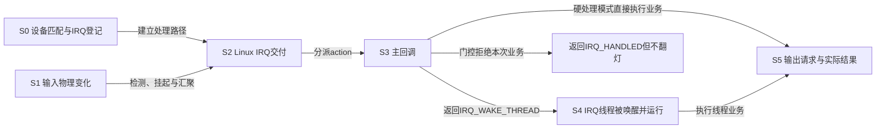
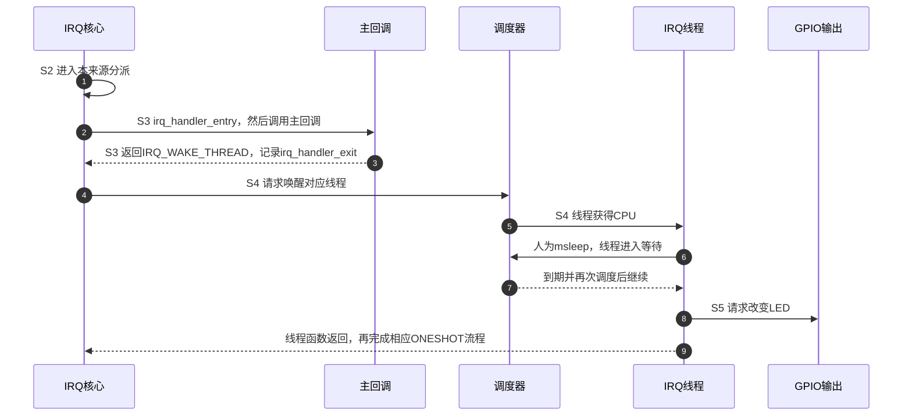

# 第6章\_Linux\_中断的调试与诊断

第五章已经用同一个按键点灯程序区分硬处理、线程处理和首沿窗口门控。现在假设按下按键后 LED 没有按预期改变。这个结果还不能告诉我们：输入没有变化、中断没有交付、事件被过滤、线程尚未运行，还是输出接线不对。

本章沿这条路径逐层取证。我们会先读取已有状态，再建立范围受控的跟踪记录；每条观察都说明它证明到哪一步。目标不是背下一串调试命令，而是能解释“最后一个已知发生的动作是什么，下一条缺失的证据该从哪里取得”。

## 6.1\_先画出要证明的路径\_再选择观察口

按键动作发生在板上，Linux 回调发生在处理器里，二者之间隔着输入检测、控制器状态和内核分派。用户看到的 LED 又位于输出端。下面用 S0～S5 把这些阶段固定下来，后面的命令都回到这张图定位。



`action` 是第三章建立的设备处理登记对象。S3 中的主回调通常就是硬中断回调；线程模式由它决定是否唤醒 S4。S5 又有两个观察层：软件调用 GPIO 输出接口，与引脚电压和 LED 实际改变，不是同一份证据。

| 观察口 | 状态或记录保存在哪里 | 能支持的结论 | 不能单独支持的结论 |
| --- | --- | --- | --- |
| 驱动 `bound` 日志、设备的 `driver` 链接 | 设备模型与内核日志 | S0 的匹配/探测已经到达相应位置 | 后续必然有输入和 IRQ |
| 示波器或逻辑分析仪 | 测量设备记录的波形 | S1 的实际电气变化 | Linux 已运行回调 |
| `/proc/interrupts` 计数差量 | IRQ 描述符的每 CPU 软件计数 | S2 的相应统计发生变化 | 按键次数、线程次数或业务成功次数 |
| `irq_handler_entry/exit` 事件 | 跟踪缓冲区中的主回调边界 | S3 的调用与返回 | S4 线程函数完整执行时长 |
| 调度事件、线程栈 | 调度记录与线程当前执行状态 | S4 在哪些时刻得到 CPU，或在哪里等待 | 没有其他证据时的精确业务完成点 |
| 第五章完成计数、输出波形 | 驱动状态与测量记录 | 分别检查 S5 的软件请求和物理结果 | 自动把两者视为完全等价 |

跟踪缓冲区是内核保存事件记录的内存区域。记录发生后还要被读取、筛选和解释；缓冲容量有限，因此“没有记录”要先排除没有启用、过滤错了、窗口不覆盖、记录已消费或丢失。

## 6.2\_先比较同一来源的计数\_不要期待按一次必加一

第一步先确认当前驱动实际登记的 **Linux IRQ 号**，使用第五章 `bound ... irq=...` 日志，而不是设备树里的组内编号。下面在目标机 Bash 中读取这个号码，变量 `irq_number` 只用于选择观察对象。

```bash
# 目标机：输入本次探测日志中的正整数 Linux IRQ 号
read -r -p 'Linux IRQ: ' irq_number
case "$irq_number" in ''|*[!0-9]*) echo 'IRQ 必须是十进制整数'; exit 1;; esac
cat /proc/interrupts
```

`cat` 输出当前快照。先保存未触发时的计数，再施加少量已知输入，保存第二次快照。不要在这段期间卸载重载设备或改变 CPU 在线状态，否则比较对象可能发生变化。

例如，下面是**用于解释字段的示意**，不是某块板的实测输出：

```text
           CPU0       CPU1
 42:         10          3  gpio-mxc  18 Edge  gpio_trigger_demo
```

| 部分 | 含义 | 需要核对的条件 |
| --- | --- | --- |
| `42` | Linux IRQ 号 | 与本次驱动日志一致，不等于引脚 42 |
| `10`、`3` | 对应 CPU 的累计 IRQ 软件计数 | `/proc/interrupts` 展示在线 CPU；不要只看 CPU0 |
| `gpio-mxc` | 此描述符关联的控制器名称 | GPIO 子来源不必显示为 GIC |
| `18` | 此域内的硬件来源号 | 不能跨 irq_domain 比较或直接当作父 GIC 编号 |
| `Edge` | 此输出配置下的边沿/电平分类 | 不足以区分上升沿、下降沿和双边沿 |
| 最后的名称 | 已登记 action 名称，可能有多个 | 共享者通常以列表显示，不是后注册者覆盖前者 |

不同内核配置可能增加、隐藏或改变显示列，应按本机表头和控制器输出解释。假设第二次 CPU0、CPU1 分别是 12、6，总差量就是 `(12 - 10) + (6 - 3) = 5`。这证明该 IRQ 的这些软件计数增加了 5，不证明恰好按了五次：双边沿包含松开，抖动会增加变化，挂起位合并又可能减少交付。

需要快速定位一行时，可以继续使用刚才的变量：

```bash
# 保留表头，并按第一列精确匹配，避免把 42 匹配进 142
awk -v irq="$irq_number" 'NR == 1 || $1 == irq ":"' /proc/interrupts
```

**找不到一行时，先核对显示条件。** 本书固定 Linux 6.12.20 的通用输出会跳过隐藏描述符、没有 action 的来源、chained 父描述符以及没有统计存储的来源。GPIO 的级联父中断可能因此不显示，而其子 IRQ 正常工作。还应检查当前设备是否已经卸载、probe 是否失败、记录的 IRQ 是否来自上一次启动。

同样，计数不变只能说明这次观察中相应软件计数没有增加。它不能排除引脚已经变化但被屏蔽、映射到其他来源或在更早一层被合并。计数增长也不要求本设备业务必然成功；共享 IRQ 上的其他设备同样可能促成交付。

## 6.3\_读出软件登记信息\_不靠修改触发类型来验证

上一节确认了观察的是哪个 Linux IRQ，接下来查询它的软件身份。`/proc/irq/N/type` 不是本基线提供的通用触发类型接口，缺少它并不表示中断未注册。`/sys/kernel/irq/N/` 在相应内核配置下提供了更适合逐项读取的属性。

```bash
# 目标机，同一个 Bash；irq_number 已从本次探测结果取得
for attribute in actions chip_name hwirq name type per_cpu_count; do
    path="/sys/kernel/irq/$irq_number/$attribute"
    if [ -r "$path" ]; then
        printf '%s: ' "$attribute"
        cat "$path"
    else
        printf '%s: 当前不可读取\n' "$attribute"
    fi
done
```

这段循环只读取存在且可读的属性。文件缺失时先区分内核配置、挂载、权限和该描述符是否存在，不把一个缺失文件解释为硬件损坏。

| 属性 | 本基线中的内容 | 解释边界 |
| --- | --- | --- |
| `actions` | 以逗号分隔的设备 action 名称 | 可能有多个，也可能为空 |
| `chip_name` | 关联 `irq_chip` 的名称 | 不是整个芯片或开发板型号 |
| `hwirq` | 当前 IRQ 数据关联的域内来源号 | 不是所有父层来源号的完整列表 |
| `name` | IRQ 流程处理名称 | 与设备 action 名称不是同一字段 |
| `type` | `level` 或 `edge` | 来自软件状态，不报告完整极性，也不是硬件读回测量 |
| `per_cpu_count` | 按可能 CPU 编号排列的计数 | 与只显示在线 CPU 的 `/proc/interrupts` 列范围可能不同 |

如果需要在驱动调试中观察完整的类型掩码，可以使用 `irq_get_trigger_type()` 读取 IRQ 软件记录，并按第五章的 `IRQ_TYPE_*` 解释。它仍不证明引脚接线或寄存器读回正确。真正核对硬件时，要结合该控制器驱动配置路径和硬件文档，不能向一个未知物理地址直接读写。

`irq_set_irq_type()` 会改变配置，是控制动作，**不能当作只读诊断接口**。发现配置来源冲突，应修正设备树、绑定或驱动契约，并检查返回值；再设置一次却不管是否成功，只会掩盖问题。共享来源也不能由一个消费者为了诊断任意改变全线触发类型。

## 6.4\_把软件身份接回引脚\_检查的是当前生效状态

S0 和 S2 之间还有真实板级连接。源文件里写了正确 DTS，不等于这次启动加载了它；GPIO 描述符取得成功，也不能证明按键的焊接、电压和上拉正确。

先按驱动的设备名定位平台设备，再检查其 `driver` 链接与 `of_node`。前者表示绑定到哪个驱动，后者指向运行中的设备树节点；没有 `of_node` 也可能是通过其他固件或平台方式创建的设备。第五章采用设备树，因此应能沿这条关系核对节点。不要拿模块文件名、设备名、GPIO 芯片名和 Linux IRQ 号互相替代。

```bash
# 目标机：使用本次驱动日志中的平台设备名
read -r -p '平台设备名: ' device_name
device_path="/sys/bus/platform/devices/$device_name"
ls -ld "$device_path" "$device_path/driver" "$device_path/of_node"
```

`ls -ld` 显示目录或符号链接本身及目标，避免把链接指向的目录内容误当作绑定信息。设备路径不存在时先核对名字和设备是否创建；只有 `driver` 不存在时，再查尚未绑定、探测失败或已经解绑等情况。

引脚控制 pinctrl 负责复用与相关引脚配置。设备核心有正常的默认/初始化状态选择流程，并非每个消费驱动都必须再调用一次 `devm_pinctrl_get_select_default()` 才正确。需要显式切换状态时，则要处理返回值，尤其不能吞掉延迟探测错误。

如果目标机启用了 debugfs 和 pinctrl 调试信息，可以读取各控制器的复用记录：

```bash
# 目标机；不存在这些文件时先检查调试支持与挂载
for path in /sys/kernel/debug/pinctrl/*/pinmux-pins; do
    [ -r "$path" ] || continue
    printf '\n%s\n' "$path"
    cat "$path"
done
```

按真实控制器和引脚名称找到目标记录，检查复用功能与拥有者。这里显示的是驱动提供的状态，仍不能取代输入波形。不要在设备运行时为了“试一下”强行改复用，或让另一个程序抢占同一根 GPIO。

安装了 libgpiod 工具时，先查看本机版本和帮助，再读取线路信息：

```bash
gpioinfo --version
gpioinfo --help
gpioinfo
```

`gpioinfo` 展示芯片、线路索引、方向、消费者和可用属性，**不是读取当前电平的通用命令**。不同版本的指定芯片语法有差异；例如官方 2.2.4 文档使用 `-c` 选择芯片，本章无参数列出所有线路，不把 GPIO 组名假定为固定的 `/dev/gpiochipN`。依据见 [libgpiod 2.2.4 gpioinfo 文档](https://libgpiod.readthedocs.io/en/v2.2.4/gpioinfo.html)。

`gpioget`、`gpiomon` 等主动申请线路的程序可能与已经占用它的内核驱动冲突，不能把申请失败当作引脚坏了。若确实要改用用户态线路实验，应先按设备生命周期停止原使用者，并重新建立独立实验条件。

到这里，检查顺序应由证据决定：S0 都未建立，先查匹配和 probe 错误；S0 正常而波形不对，查接线、复用与电气；波形正确而软件计数不变，再向屏蔽、检测、父子映射与路由追踪。没有依据把某类原因说成“一半”或“九成”。

## 6.5\_主回调已经返回\_线程可能还没有开始

假设第五章模式 1 的硬回调立即返回 `IRQ_WAKE_THREAD`，IRQ 线程随后睡眠约 20 ms 再翻灯。`irq_handler_entry` 和 `irq_handler_exit` 包围的是 `action->handler()`，并不包围后续的 `action->thread_fn()`。



图中第 2～3 步的时间差，是那次主回调边界间的经过时间，包含观测开销及可能插入的其他影响，不是从引脚变化开始的中断响应延迟，也不是第 5～9 步的线程全过程。线程唤醒、获得 CPU 和开始业务又是不同事件；不能看到唤醒就断言线程已经完成。

还有一个很容易误读的细节：本基线 `irq_handler_exit` 的原始记录含有整数 `ret`，但默认文本把任何非零值都打印为 `handled`。`IRQ_HANDLED` 是 1，`IRQ_WAKE_THREAD` 是 2，所以文本中的 `ret=handled` **不能区分已在主回调处理与请求唤醒线程**。若要区别，应解析原始字段或另做按数值 `ret` 筛选的采集；不要从这个文本词推导线程状态。

| 跟踪事件/字段 | 读法 | 常见误读 |
| --- | --- | --- |
| `irq_handler_entry` 的 `irq`、`name` | 本次调用的 Linux IRQ 与 action 名称 | 把相同 IRQ 的多个共享 action 当成重复中断 |
| `irq_handler_exit` 的 `irq`、`ret` | 该主回调返回值；默认文本有上述压缩 | 把 `handled` 当作业务完成证明 |
| 记录行前面的任务名/PID | 产生记录时的当前任务 | 在硬中断中常是被打断的任务，不是“产生中断的进程” |
| `sched_wakeup` 的 `pid` | 本事件唤醒的目标线程 | 与记录行前的当前任务 PID 混用 |
| `sched_switch` 的 `prev_pid`、`next_pid` | 被切出与被切入的任务 | 把“离开 CPU”一律解释为函数返回 |

线程可以因为等待、被抢占或本轮工作结束而离开 CPU。要区分这些原因，需要调度状态、栈或函数边界等补充证据。共享 IRQ 还有多个 action，入口和出口应结合 IRQ、CPU、action 顺序与完整记录配对，不能只把相邻两行时间机械相减。

## 6.6\_建立一次范围明确的采集\_同时保存格式和丢失统计

下面给出完整的目标机 Bash 脚本 `capture_irq.sh`。它不依赖第五章程序的私有打印，使用内核已有事件；至少捕获一个 Linux IRQ 的主回调边界，可选加入一个已经确认的 IRQ 线程 PID 的调度记录。

先在目标机确认 tracefs 已挂载到 `/sys/kernel/tracing`，且可以创建实例、启用相关事件。若平台使用其他挂载点，通过环境变量 `TRACE_ROOT` 指定；脚本不会自动替你改挂载或内核配置。新建 **instance（跟踪实例）** 会得到独立的事件筛选与记录缓冲，退出时删除自己创建的实例，避免改掉已有根实例的采集设置。启用探针仍有运行开销，独立缓冲不等于系统性能完全不受影响。

### 6.6.1\_创建实例\_只允许完整配置后开始采集

保存以下脚本。参数 1 为 Linux IRQ 号；参数 2 可省略，提供时必须是本轮确认的 IRQ 线程 PID。`set -eu` 让未设置变量和未处理的失败中止执行；退出陷阱负责关闭并删除本脚本的实例。

```bash
#!/usr/bin/env bash
set -eu

[ "$#" -ge 1 ] && [ "$#" -le 2 ] || {
    echo '用法: capture_irq.sh IRQ [THREAD_PID]' >&2
    exit 2
}
irq_number=$1
thread_pid=${2:-}
for value in "$irq_number" "${thread_pid:-1}"; do
    case "$value" in ''|*[!0-9]*) echo '号码必须是正十进制整数' >&2; exit 2;; esac
    [ "$value" -gt 0 ] || { echo '号码必须大于0' >&2; exit 2; }
done
trace_root=${TRACE_ROOT:-/sys/kernel/tracing}
[ -d "$trace_root/instances" ] || {
    echo '未找到tracefs实例接口，先检查内核支持与挂载点' >&2
    exit 1
}
instance="$trace_root/instances/irq_capture_$$"
created=0
cleanup() {
    result=$?
    if [ "$created" -eq 1 ]; then
        printf '0\n' > "$instance/tracing_on" || result=1
        rmdir "$instance" || result=1
    fi
    exit "$result"
}
trap cleanup EXIT
trap 'exit 130' INT
trap 'exit 143' TERM
mkdir "$instance"                    # 已存在就失败，不接管其他实例
created=1
printf '0\n' > "$instance/tracing_on"

# 使用跨CPU可比较的global时钟；本轮新缓冲还没有有效记录
tr '[]' '  ' < "$instance/trace_clock" | grep -qw global || {
    echo '当前实例没有global时钟，停止本实验' >&2
    exit 1
}
printf 'global\n' > "$instance/trace_clock"
output=$(mktemp -d "$PWD/irq_capture.XXXXXX")

configure_event() {
    group=$1
    event=$2
    expression=$3
    directory="$instance/events/$group/$event"
    [ -r "$directory/format" ] && [ -w "$directory/filter" ] &&
        [ -w "$directory/enable" ] || {
        echo "事件接口不可用: $group:$event" >&2
        exit 1
    }
    printf '%s\n' "$expression" > "$directory/filter"
    cat "$directory/format" > "$output/${group}_${event}.format"
    cat "$directory/filter" > "$output/${group}_${event}.filter"
    printf '1\n' > "$directory/enable"
}
configure_event irq irq_handler_entry "irq == $irq_number"
configure_event irq irq_handler_exit "irq == $irq_number"
if [ -n "$thread_pid" ]; then
    configure_event sched sched_wakeup "pid == $thread_pid"
    configure_event sched sched_switch "prev_pid == $thread_pid || next_pid == $thread_pid"
fi
cat "$instance/trace_clock" > "$output/trace_clock.txt"
printf 'irq=%s\nthread_pid=%s\n' "$irq_number" "$thread_pid" > "$output/target.txt"
cp /proc/interrupts "$output/interrupts_before.txt"
printf '1\n' > "$instance/tracing_on"
printf '现在施加少量输入；完成后按Enter停止并保存: '
read -r answer
printf '0\n' > "$instance/tracing_on"
cp /proc/interrupts "$output/interrupts_after.txt"
cat "$instance/trace" > "$output/trace.txt"
for path in "$instance"/per_cpu/cpu*/stats; do
    [ -r "$path" ] || continue
    cpu_directory=${path%/stats}
    cpu_name=${cpu_directory##*/}
    cat "$path" > "$output/${cpu_name}_stats.txt"
done
printf '记录已保存: %s\n' "$output"
```

`mkdir` 在 tracefs 中创建的是由内核填充接口的实例，而不是一个普通空目录；结束时使用 `rmdir` 撤销实例，**不要用递归删除替代**。`created` 标志确保创建失败时不清理别人已经存在的实例。中途中断会清理实例，但只有正常按 Enter 结束才完成记录导出；看到错误退出时，不把残留的部分输出目录当作完整报告。

`$$` 是当前脚本进程号，用于区分实例名；`mktemp -d` 在 `$PWD` 表示的当前目录下创建唯一输出目录，末尾六个 `X` 是待替换的随机模板。`trap ... EXIT` 安排退出时清理，`INT` 和 `TERM` 分别处理键盘中断与终止请求；强制杀死进程或掉电不保证执行陷阱，之后需核对是否遗留本次实例。

过滤器使用事件原始字段名，写入失败会直接停止。脚本保存 `format` 与实际 `filter`，便于判断字段和文本输出方式；它没有把 `irq_handler_exit` 限制为某一种返回值，避免把正常入口的配对出口过滤掉。可选的线程 PID 过滤只覆盖该线程，不能显示造成它等待的全部其他任务。

### 6.6.2\_运行与收尾\_数字必须来自这一轮设备实例

先让第五章驱动保持装载并成功绑定。若需要线程调度证据，在目标机列出线程，结合 `irq/<IRQ>-...` 名称找到对应对象，核对 PID；名称可能被截断，共享 IRQ 也可能有多个线程，不能只取第一个看起来相似的名字。

```bash
# 目标机；此命令需要支持这些列的ps，例如procps版本
ps -eLo pid,tid,comm,wchan
```

`pid/tid` 帮助定位任务，`comm` 是任务名，`wchan` 是当前等待位置的符号提示；权限、内核配置和工具版本可能使其不可读或不可用。等待位置只是瞬时采样，不证明它永久卡死。如果设备重载，重新取得 IRQ 与线程 PID。

```bash
# 目标机，脚本所在目录；下面的号码需换成本轮已确认值
chmod +x capture_irq.sh
./capture_irq.sh 42
# 要同时记录一个确认属于该IRQ的线程，例如PID 317，则另开一轮：
./capture_irq.sh 42 317
```

42 与 317 是示例，不能直接当成本机事实。每次启动会新建输出目录并等待 Enter；按提示施加输入，保存完成后脚本退出并回收本次实例。输出目录保留，包含前后计数、事件内容、事件字段格式、过滤条件、时钟以及每 CPU 缓冲统计。

前后 `/proc/interrupts` 快照包围了跟踪窗口，但读取快照、开关采集不是同一个原子动作。快照之间可能包含采集开启前或关闭后的交付；各 CPU 统计读取也不是瞬间同时完成。因此不能要求计数差量与保存的事件行数严格相等，更不能忘记共享 IRQ 的一次交付会调用多个 action。

这里读取 `trace` 前先停止本实例写入，得到一个固定窗口。`trace_pipe` 则会持续消费记录；若另一名读取者取走了记录，后来读到空缓冲不能当作无事件证明。本脚本不使用根实例的 `trace_printk()` 输出来补齐线程边界，也不假定它会自动复制进新实例。

## 6.7\_解释记录\_先证明观测完整再讨论延迟

打开输出目录后，先检查 `target.txt` 是这一轮设备的 IRQ/PID，事件过滤条件正确，采集窗口覆盖输入，再查看各 `cpu*_stats.txt`。`overrun` 表示被覆盖的记录，`dropped events` 表示相关模式下丢弃的记录，`commit overrun` 指提交环节出现的异常覆盖压力；发现丢失后，不应把入口出口缺一半直接解释为函数没有返回。

以下是一个**假设的诊断过程**：

1. S0 的 `bound` 日志和设备绑定存在，输入测量也显示 S1 有变化。
2. S2 对应 IRQ 计数增加；跟踪里 S3 入口出口成对，主回调经过时间较短。
3. 目标 IRQ 线程有 `sched_wakeup`，但一段时间后才出现在 `sched_switch` 的 `next_pid`，说明这段等待不能算成主回调执行时间。
4. 线程运行后切出并等待，再被调度回来；若恰好使用第五章 `delay_ms=20`，这是预期的休眠路径，不能自动叫作死锁。
5. 第五章完成计数增加，而输出波形没有符合预期变化，则继续查 GPIO 输出与板级连接；不能回头声称 IRQ 根本没有进入。

这条推理需要完整且同一来源的证据。若只有最后一条 LED 现象，前面的步骤都还没有被证明。若只有入口而没有出口，先查捕获边界、丢失与过滤，再用栈或其他边界证据判断是否仍在处理。

### 6.7.1\_console变慢的假设\_如何变成可检验的对照

第五章已经把日志模式与处理模式分开。固定接线、输入速率、`mode`、过滤窗口和线程延时，先关闭逐次日志取得基线，再分别启用 printk 与 trace 日志，比较交付、线程调度和完成结果。改用 trace 后现象改善，只能说明更换观测路径改变了运行条件，**还不能单独证明唯一原因就是串口 console**。

需要继续核对控制台配置、日志速率，以及线程栈或更细的函数证据，排除锁等待、设备总线访问和调度等待等因素。`trace_printk()` 也消耗时间和缓冲；如果它的记录丢失，不能用“看起来更少”证明业务更快。正式代码不应把开发调试打印当成必备架构组件。

### 6.7.2\_函数跟踪与irqsoff\_各自测量不同区间

当主回调事件不足以定位慢路径时，ftrace 的函数跟踪器可以记录可跟踪函数的调用；`function_graph` 进一步记录函数进入与返回，适合研究明确的线程函数边界。可跟踪函数、跟踪器与实例支持取决于当前内核；先查看 `available_filter_functions` 和 `available_tracers`，再限定目标，不能直接启用全系统所有函数后把额外负载忽略掉。

`irqsoff` 跟踪器关注的是 **本地 CPU 关闭普通中断的区间**。IRQ 线程处于 `msleep()` 或等待 I²C 总线时，通常不意味着本地中断一直关闭，因此 irqsoff 不能充当“所有 IRQ 线程耗时”的测量器。函数经过时间、CPU 实际运行时间、可运行后等待调度的时间和物理输入到输出的响应时间，应分别命名，不能都写成“中断延迟”。

若使用函数图，还要核对睡眠时间是否计入、跨 CPU 的时钟选择和输出过滤。当前事件采集脚本故意没有接管这些函数跟踪设置；只有证据已经指向某段函数或关中断区间时，才开展对应的更深入实验。

## 6.8\_从缺失证据选择下一步

**练习一：** GPIO 子 IRQ 计数持续增长，但 `/proc/interrupts` 找不到它的 chained 父 IRQ，是否说明父控制器没工作？

**答案：** 不能。本基线通用输出跳过 chained 描述符；先按显示规则理解缺失，再结合子来源的交付和控制器拓扑判断。父行未显示不等于父硬件不存在。

**练习二：** `/sys/kernel/irq/42/type` 显示 `edge`，能否确认接线是低有效且只收下降沿？

**答案：** 不能。它只报告软件的边沿/电平分类。逻辑有效性、上升/下降/双边沿、实际波形分别需要其他证据，不应靠再写一次类型去“证明”。

**练习三：** `irq_handler_entry/exit` 相隔 3 μs，文本出口为 `handled`，能否证明线程已经在 3 μs 内翻灯？

**答案：** 不能。边界包围主回调，而非线程；本基线把 `IRQ_WAKE_THREAD` 也显示为非零的 handled。需要线程调度、业务边界和必要的输出观测。

**练习四：** 关闭 printk 后按键恢复响应，是否已经排除所有设备访问与同步问题？

**答案：** 没有。日志改变会改变时序，可能暴露或隐藏其他问题。先保持其他条件一致，核对记录完整性，再逐项检验控制台等待、线程等待和设备状态。

我们现在能把“没反应”拆成一条可验证的路径，并知道每个计数或记录的证明范围。下一章回到设计选择：哪些业务必须留在硬中断，哪些适合 IRQ 线程，什么时候还需要其他下半部机制。

> 固定依据：NXP Linux `dfaf2136deb2af2e60b994421281ba42f1c087e0` 的 IRQ proc/sysfs 实现、主回调及线程调用位置、IRQ/调度事件字段、pinctrl 设备核心与跟踪文档，见 [源码基线与本章核对记录](../../../../../research/source_reading/linux/SOURCE_BASELINE.md#1.186_中断诊断观察范围与事件采集)。正文中的示意数值与事件过程不是实测记录；本轮未在真实内核执行采集、复用切换或 GPIO 实验。

上一篇：[P05 GPIO 与触发语义 电平 边沿 DTS 与 只来一次一直来 为何出现](P05_GPIO_与触发语义_电平_边沿_DTS_与_只来一次一直来_为何出现.md)。
下一篇：[P07 中断下半部机制与驱动中的选择](P07_中断下半部机制与驱动中的选择.md)。
