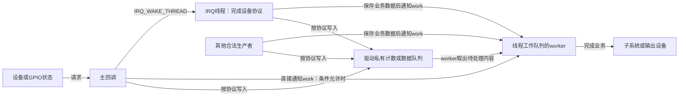
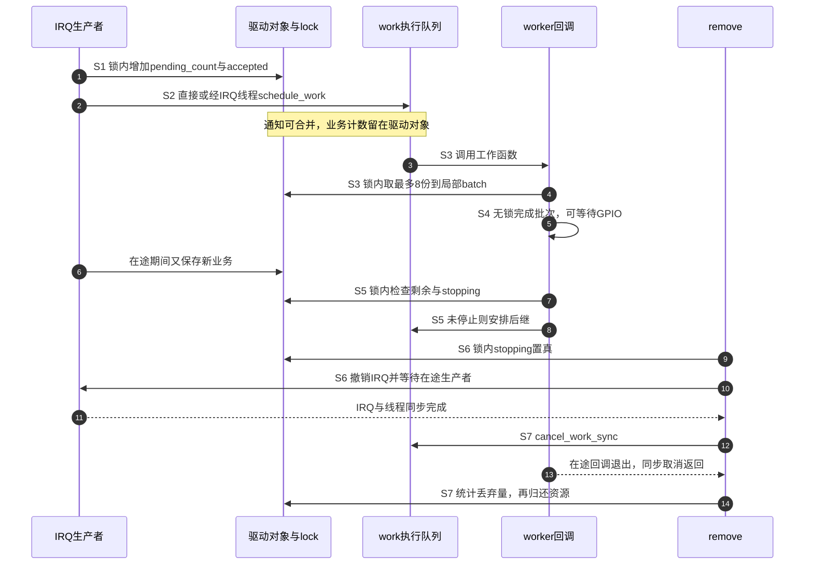

# 第7章\_中断下半部机制与驱动中的选择

上一章已经能够区分 IRQ 交付、主回调、线程调度和业务完成。现在换一个需求：收到一次中断后，设备驱动还要等待总线访问、处理一批数据，或通知另一个子系统。硬中断不能一直留在现场等这些动作，工作应由谁继续执行？

前面使用的 IRQ 线程已经是一种答案。只有出现新的约束时，才需要工作队列等其他交接方式；多加一层并不会自动更快、更安全。本章沿同一个 GPIO 按键控制 LED 的例子比较执行位置，并补上新增异步工作必需的事件保存、容量和退出协议。

## 7.1\_把工作延后以前\_先说清现场必须留下什么

普通硬中断回调没有可用于随意阻塞的任务执行环境。它不能调用会睡眠的操作，也不应占用 CPU 做长时间业务：当前处理期间，其他任务以及受本地屏蔽和优先级规则影响的处理会被延后。CPU 忙于回调时，外设仍可能继续产生数据，最终是否遗漏取决于缓冲容量、通知记录和处理速度。

因此我们先把一次设备处理拆成两类动作。一类必须在当前协议允许的时点完成，例如判断共享来源、保存稍后会被覆盖的信息、控制设备继续发出请求。另一类可以在后续执行环境中完成，例如处理已经保存的数据或访问允许等待的接口。**哪些动作属于前者由设备协议决定，不由函数名叫“上半部”还是“下半部”决定。**

“下半部”（Bottom Half，BH）是延后处理的一类历史称呼，并不是某一个统一 API。选择它之前，要回答：当前动作留下的是完整数据、事件计数，还是仅仅一位“需要再来看看”？如果硬件只留下一个容易被覆盖的状态位，而硬回调和后续处理都没有及时保存内容，换成任何线程也不能恢复已经消失的数据。

按键翻灯可以把同质事件存成计数；网络接收则往往需要保存描述符、缓冲区位置和长度。先确定这些业务状态的归属，再选择唤醒谁，才能谈不丢事件。

## 7.2\_IRQ线程已经能等待\_什么时候还需要另一个执行者

第四章的 `request_threaded_irq()` 把主回调与 `thread_fn` 连接起来。普通显式线程化路径中，主回调返回 `IRQ_WAKE_THREAD` 后，核心请求唤醒对应线程；调度器决定它什么时候获得 CPU。线程可以调用其上下文允许的睡眠接口，例如合法的总线访问，但仍必须遵守锁、设备电源和对象生命周期约束。

如果后处理就是“处理这次设备请求并让设备恢复接收”，IRQ 线程常常已经足够。采用 `IRQF_ONESHOT` 时，核心按控制器能力保护线程处理阶段；设备原因应在允许再次交付前按协议处理。它不是“一次物理事件只执行一次”的保证，也不是去抖算法。

再考虑一项独立业务：IRQ 线程已经读走设备数据并撤销告警，但还需要压缩记录、写入另一个可等待的子系统，而定时器或控制命令也可能提交同类业务。现在希望这些来源共同投递到一个受控处理入口，并单独等待其退出，工作队列才有了明确作用。



图中的状态队列属于驱动，不是工作队列自动替设备建立的数据 FIFO。主回调能否直接通知 work，取决于设备条件是否允许；如果必须先在线程中访问 I²C 设备并清除持续告警，就不能仅排一个 work 后立即结束 ONESHOT 保护，留下原告警反复触发。

对于第五章这种 GPIO 变化通知，如果主回调已经保存了所需的计数，业务又允许异步完成，可以直接从硬回调排 work。额外的“IRQ 线程只转交 work”可以作为比较交接成本的实验，通常不是这个简单场景必需的层次。

## 7.3\_work只是一次执行登记\_业务事件要另外保存

工作队列把 **工作描述 `work_struct`** 与 **执行它的 worker 线程** 分开。`INIT_WORK()` 绑定工作回调；`schedule_work()` 将该对象投递到系统线程工作队列 `system_wq`。worker 从执行队列取出它，再调用工作函数。对象仍由驱动持有，工作队列不会替它自动增加设备对象的有效寿命。

同一个 work 已经 pending，即已有待执行登记时，再次提交通常不会新增一个副本。其布尔返回值说明本次是否新建了排队请求，不说明业务是否完成。本基线还存在工作项被 disable 后拒绝投递的情形；不能把所有 false 都解释成“已经执行过”。

看一个最小交错过程：事件 A 到来，驱动把自己的 `pending_count` 从 0 改为 1，首次 `schedule_work()` 成功；worker 还未运行时，事件 B 又把计数改成 2，第二次投递返回 false。worker 后来读到 2，就知道有两份业务。若驱动只把 `pending = 1` 写两次，再让 worker 翻灯一次，A 和 B 已经在业务层合并，工作队列无法替它补回一次翻转。

工作执行期间，work 的“正在运行”与“又有一次待执行登记”也可以同时成立。正常使用同一 work、同一工作函数并始终投递到同一队列时，核心维持该 work 的非重入保证；后继执行仍然不是任意数量事件的存储。换队列、重新初始化或在运行中改变函数会破坏这个使用前提。

| 对象或状态 | 保存内容 | 当前例子中的所有者 |
| --- | --- | --- |
| `work_struct` | 回调与排队/执行关联 | 驱动内嵌持有，核心维护调度状态 |
| 驱动 `pending_count` | 尚未被业务回调取走的同质事件数 | 生产者递增，worker 按批递减 |
| worker 局部变量 `batch` | 本次已经取走、尚在处理的事件数 | 本次工作回调独占 |
| 驱动 `completed` | 已发出多少次业务输出请求 | worker 更新，停止同步后读取 |

普通线程工作队列允许睡眠，不代表业务可以无限慢。假设输入稳定达到每秒 50 份，而每份处理至少休眠 200 ms，单一串行消费者最多约每秒处理 5 份，还未计其他开销。差额会持续堆积；换执行位置并没有消除吞吐缺口。驱动必须规定容量、满时丢弃/覆盖/背压策略和统计，不能把“可排队”当成无限缓存。

工作队列内部的 pool、worker 管理和取消代际由[工作队列专题](../workqueue/大纲.md#1.1_专题定位)独立展开。版本化实现从[源码总阅读索引](../../../../../research/source_reading/workqueue/navigation/P01_Linux_6.12_工作队列源码总阅读索引.md#1.1_版本边界与阅读任务)进入；本章只保留驱动选择所需的契约，不再复制其内部实现讲解。

## 7.4\_其他下半部也有自己的状态\_不能按新旧或名字选型

工作队列不是所有延后处理的共同执行环境。Linux 的 **softirq（软中断）** 使用内核定义的向量和每 CPU 待处理标志，通知某类子系统继续工作；真正的数据仍在该子系统自己的队列里。相同向量可能在不同 CPU 上执行，因此子系统必须设计自己的状态分片与同步。

**tasklet** 是建立在 softirq 上的可调度回调对象。它用自身状态位表示已安排/正在运行，并进入相应的每 CPU tasklet 链表；相同 tasklet 对象不会同时在多个 CPU 上执行，多个不同对象却可以并行。重复 schedule 也可能合并，因此它同样不是逐事件队列。本基线头文件已将 tasklet API 标为 deprecated（不再建议新增使用），建议考虑线程化 IRQ；这不等于 softirq 整个机制都已经废弃。

softirq/tasklet 回调不能随意睡眠。即使某轮由 `ksoftirqd` 内核线程承接，也不能据线程名称把回调改写成可阻塞业务。实时内核的执行安排可能不同，仍应按相应 API 和配置边界判断，不能用普通内核的直觉替代其契约。

还有一个容易漏掉的分支：Linux 6.12 的 **`WQ_BH` 工作队列** 在 softirq 上下文执行，不能睡眠。它复用 work 的部分排队、取消等接口，却不采用本章 `system_wq` 的线程业务模型。所以“使用了 workqueue”本身不足以证明可以 `msleep()`。

把这些对象各自建立后，才能放在同一张选择表中：

| 选择 | 延后记录放在哪里 | 谁执行 | 适用理由与代价 |
| --- | --- | --- | --- |
| 直接硬回调 | 控制器与驱动当前状态 | 当前硬中断处理路径 | 小而有界且不能睡的动作；占用现场时间 |
| 显式 IRQ 线程 | action 的线程状态和驱动业务状态 | 对应 IRQ 线程 | 要完成设备中断协议并需要等待；调度与 ONESHOT 保护有成本 |
| 普通线程 workqueue | work 登记与驱动自己的业务队列 | 共享池中的 worker | 多来源后处理、独立取消和执行管理；增加排队及生命周期协议 |
| softirq | 每 CPU pending 位与子系统状态 | 软中断执行路径/相应承接线程 | 内核子系统的批处理机制，不是普通模块随意申请一个新向量 |
| tasklet | tasklet 状态与每 CPU 链表 | softirq 路径 | 阅读和维护已有实现；新设计不优先新增 |
| `WQ_BH` | work 状态及 BH 执行队列 | softirq 路径 | 需要 BH 语义且不可睡的明确分支，不适合本章慢 GPIO 业务 |

`system_wq` 和 `system_highpri_wq` 是系统提供的队列，不是某设备私有线程；高优先级队列也不是实时期限保证。自行分配 workqueue 可以表达独立的执行策略、排序或回收要求，但通常仍会复用底层 worker pool，不能据队列对象数量推断线程数量。是否需要这些策略，应回到实际等待依赖和负载，而不是简单按“中断量大就用 tasklet”分类。

## 7.5\_先关闭投递入口\_取消才能成为退出证明

现在驱动除了 IRQ，还拥有一个可能在另一 CPU 执行的 work。`devm_request_threaded_irq()` 只托管 IRQ 登记，不知道该回调又创建了什么异步使用者。若 `remove()` 先调用 `cancel_work_sync()`，但 IRQ 仍能投递，那么取消刚返回，新 IRQ 就可能再次排队；稍后内存释放时，work 还在引用旧对象。

正确的退出关系是：**关闭所有新的投递入口 → 等待已有生产者离开 → 同步取消/等待消费者 → 回收消费者使用的数据和设备资源**。门控与投递需要在同一同步协议内，不能仅给 `stopping` 随意写一个普通布尔值。

| 接口 | 能完成什么 | 调用者还要保证什么 |
| --- | --- | --- |
| `schedule_work()` / `queue_work()` | 尝试登记一次执行 | 业务内容已保存，数据同步与对象有效 |
| `flush_work()` | 等待相应已有执行代际完成 | 不禁止未来生产者重新投递 |
| `cancel_work_sync()` | 取消 pending 并等待在途执行 | 不再有竞争投递，且不持有回调退出需要的锁 |
| `devm_free_irq()` | 提前撤销托管 IRQ 并等待相应处理 | 另外同步 work、timer 等独立使用者 |
| `devm_add_action_or_reset()` | 登记资源回收动作，登记失败则立即执行该动作 | 逆序回收时所有依赖仍有效，生产者与消费者顺序正确 |

devres 是回收动作管理，不是自动推导异步依赖的算法。不能在没有核对版本和头文件时承诺通用 `devm_work_autocancel()` 可用。需要托管 work 清理时，可以用已经存在的 `devm_add_action_or_reset()` 包装，但登记位置必须让 IRQ 等生产者先停，再取消 work，最后释放 GPIO 和私有对象。

下一节采用显式 `remove()` 展示顺序，GPIO 和内存仍由 devres 管理。它还选择了一个明确的关闭策略：已经取到 worker 局部批次的业务允许完成，尚未取走的计数在停止时丢弃并报告。若业务要求关机前全部提交，必须设计 drain 与错误恢复，不能把本例的 cancel 换个名字就当作数据已经处理。

## 7.6\_完整实验\_用有界事件计数连接IRQ与work

实验仍使用第五章的独占 GPIO 按键和 LED，正常运行而不覆盖挂起唤醒。参数 `relay=0` 从硬回调直接排 work；`relay=1` 先唤醒 IRQ 线程，再由线程转交 work，用来观察原先的“两次交接”。两种方式共享同一份业务计数和工作函数。

按键输入必须来自本实验支持的非睡眠 GPIO 控制器，LED 则允许通过可睡眠接口访问。每次接受的交付保存一份“翻灯”业务，待取计数最多 64；worker 一次取最多 8 份。已取批次独立存在，因此可能同时有最多 64 份待取、8 份在途。这个计数不保存按键电平、时间戳或逐事件数据；有这些需求时要改成真正的记录队列。

### 7.6.1\_固定状态归属\_通知可以合并但业务计数不凭空消失

以下三个 C 代码块按顺序组成 `gpio_work_demo.c`。`raw_spinlock_t` 是这里用于硬回调与 worker 之间短临界区的原始自旋锁；持锁时只改状态和投递，不睡眠、不访问慢 GPIO。工作函数先在锁内取一批，释放锁后才等待和输出。

```c
#include <linux/delay.h>
#include <linux/err.h>
#include <linux/gpio/consumer.h>
#include <linux/interrupt.h>
#include <linux/jiffies.h>
#include <linux/module.h>
#include <linux/of.h>
#include <linux/platform_device.h>
#include <linux/slab.h>
#include <linux/spinlock.h>
#include <linux/workqueue.h>

#define PENDING_LIMIT 64u
#define BATCH_LIMIT 8u

static bool relay;
static unsigned int window_ms = 30;
static unsigned int delay_ms;
module_param(relay, bool, 0444);     /* 是否增加IRQ线程转交这一层 */
module_param(window_ms, uint, 0444); /* 首沿窗口，0表示不做软件时间过滤 */
module_param(delay_ms, uint, 0444);  /* 每份业务人为等待0..200毫秒 */

struct gpio_work_demo {
    struct device *dev;
    struct gpio_desc *key;
    struct gpio_desc *led;
    struct work_struct work;
    raw_spinlock_t lock;
    int irq;
    bool stopping;
    bool have_last;
    bool led_on;
    u64 last_j;
    unsigned long window_j;
    unsigned int pending_count;
    unsigned long received;
    unsigned long filtered;
    unsigned long overflow;
    unsigned long accepted;
    unsigned long completed;
};

static void gpio_work_run(struct work_struct *work)
{
    struct gpio_work_demo *d = container_of(work, struct gpio_work_demo, work);
    unsigned long flags;
    unsigned int batch, i;

    raw_spin_lock_irqsave(&d->lock, flags);
    if (d->stopping) {
        raw_spin_unlock_irqrestore(&d->lock, flags);
        return;
    }
    batch = d->pending_count;
    if (batch > BATCH_LIMIT)
        batch = BATCH_LIMIT;
    d->pending_count -= batch; /* 这批业务转为本回调局部所有 */
    raw_spin_unlock_irqrestore(&d->lock, flags);

    for (i = 0; i < batch; i++) {
        if (delay_ms)
            msleep(delay_ms);
        d->led_on = !d->led_on;
        gpiod_set_value_cansleep(d->led, d->led_on);
        d->completed++;
    }
    raw_spin_lock_irqsave(&d->lock, flags);
    if (!d->stopping && d->pending_count)
        schedule_work(&d->work); /* 与停止门控处于同一临界区 */
    raw_spin_unlock_irqrestore(&d->lock, flags);
}

static irqreturn_t gpio_work_primary(int irq, void *data)
{
    struct gpio_work_demo *d = data;
    unsigned long flags;
    u64 now = get_jiffies_64();
    irqreturn_t result = IRQ_HANDLED;

    (void)irq;
    raw_spin_lock_irqsave(&d->lock, flags);
    if (d->stopping)
        goto out;
    d->received++;
    if (d->have_last && time_before64(now, d->last_j + d->window_j)) {
        d->filtered++;
        goto out;
    }
    if (d->pending_count == PENDING_LIMIT) {
        d->overflow++; /* 明确丢弃新业务，而不是让计数溢出 */
        goto out;
    }
    d->have_last = true;
    d->last_j = now;
    d->pending_count++;
    d->accepted++;
    if (relay)
        result = IRQ_WAKE_THREAD;
    else
        schedule_work(&d->work);
out:
    raw_spin_unlock_irqrestore(&d->lock, flags);
    return result;
}

static irqreturn_t gpio_work_thread(int irq, void *data)
{
    struct gpio_work_demo *d = data;
    unsigned long flags;

    (void)irq;
    raw_spin_lock_irqsave(&d->lock, flags);
    if (!d->stopping && d->pending_count)
        schedule_work(&d->work);
    raw_spin_unlock_irqrestore(&d->lock, flags);
    return IRQ_HANDLED;
}
```

首沿窗口沿用第五章的含义：首次接受，之后相对上次接受时刻过滤，不证明输入稳定。队列已满而丢弃的事件不会更新接受时刻。这里没有把每次 IRQ 线程唤醒当作一份业务；业务数已经在硬回调保存，因此线程唤醒合并也不会把已保存的两份业务改成一份。

同一 work 始终通过 `schedule_work()` 投递到 `system_wq`，工作函数在使用期间不改变，因此 `led_on` 与 `completed` 只由不重入的 work 回调写入。其他计数、门控和取批都由 `lock` 保护；退出统计在 IRQ 与 work 同步完成后读取，不需要让慢日志占据锁。

`container_of()` 根据传入的内嵌 `work` 成员地址找回所属驱动对象。`raw_spin_lock_irqsave()` 保存并关闭本地普通中断后取得锁，`raw_spin_unlock_irqrestore()` 释放锁并恢复原先状态；这样既协调其他 CPU 的访问，也避免本 CPU 的硬回调打断持锁 worker 后再次争用同一把锁。关闭本地中断本身不提供跨 CPU 互斥，锁也不能跨越后面的睡眠业务。

`queue` 返回 false 时不回退 `pending_count`：已有待执行 work 仍会取走数据。worker 取批后若又有事件，生产者会尝试安排后继；worker 本轮结束也检查剩余量。最后一次检查与所有投递都受同一把锁和 `stopping` 约束，避免停止后再出现无主的排队。

### 7.6.2\_初始化先于注册\_回收晚于IRQ和work同步

探测函数先初始化锁与 work，再取得 GPIO，最后登记 IRQ。虽然 IRQ 可能在登记调用返回前进入，但那时它依赖的状态已经准备好。这里没有伪装成 PM 实现的 `suspended` 字段，也没有无条件覆写一次触发类型；本实验明确定义为双边沿输入。

```c
static int gpio_work_probe(struct platform_device *pdev)
{
    struct device *dev = &pdev->dev;
    struct gpio_work_demo *d;
    unsigned long flags = IRQF_TRIGGER_RISING | IRQF_TRIGGER_FALLING;
    int ret;

    if (window_ms > 1000 || delay_ms > 200)
        return dev_err_probe(dev, -EINVAL, "invalid experiment parameters\n");
    d = devm_kzalloc(dev, sizeof(*d), GFP_KERNEL);
    if (!d)
        return -ENOMEM;
    d->dev = dev;
    d->window_j = msecs_to_jiffies(window_ms);
    raw_spin_lock_init(&d->lock);
    INIT_WORK(&d->work, gpio_work_run);
    d->key = devm_gpiod_get(dev, "key", GPIOD_IN);
    if (IS_ERR(d->key))
        return dev_err_probe(dev, PTR_ERR(d->key), "get key\n");
    if (gpiod_cansleep(d->key))
        return dev_err_probe(dev, -EINVAL, "experiment needs a local GPIO key\n");
    d->led = devm_gpiod_get(dev, "led", GPIOD_OUT_LOW);
    if (IS_ERR(d->led))
        return dev_err_probe(dev, PTR_ERR(d->led), "get led\n");
    d->irq = gpiod_to_irq(d->key);
    if (d->irq < 0)
        return dev_err_probe(dev, d->irq, "map IRQ\n");
    platform_set_drvdata(pdev, d);
    flags |= relay ? IRQF_ONESHOT : IRQF_NO_THREAD;
    ret = devm_request_threaded_irq(dev, d->irq, gpio_work_primary,
                                   relay ? gpio_work_thread : NULL,
                                   flags, dev_name(dev), d);
    if (ret)
        return dev_err_probe(dev, ret, "request IRQ\n");
    dev_info(dev, "bound irq=%d relay=%u\n", d->irq, (unsigned int)relay);
    return 0;
}

static void gpio_work_remove(struct platform_device *pdev)
{
    struct gpio_work_demo *d = platform_get_drvdata(pdev);
    unsigned long flags;

    raw_spin_lock_irqsave(&d->lock, flags);
    d->stopping = true; /* 先封住全部投递和重排入口 */
    raw_spin_unlock_irqrestore(&d->lock, flags);
    devm_free_irq(&pdev->dev, d->irq, d); /* 再等已有IRQ生产者退出 */
    cancel_work_sync(&d->work);          /* 不持锁等待消费者 */
    dev_info(&pdev->dev,
             "received=%lu filtered=%lu overflow=%lu accepted=%lu completed=%lu discarded=%u\n",
             d->received, d->filtered, d->overflow,
             d->accepted, d->completed, d->pending_count);
    d->pending_count = 0;
    gpiod_set_value_cansleep(d->led, 0);
    /* 返回后，设备核心才归还GPIO与私有内存 */
}
```

返回 `-ENOMEM` 表示内存分配失败，`-EINVAL` 表示实验参数或能力不满足；资源获取的其他负错误直接保留。登记之后没有新增会失败的初始化步骤，因此不会在已经启动异步工作后直接返回错误而漏掉回收。若以后增加这种步骤，必须把失败路径也接到同样的停止协议。

`cancel_work_sync()` 等待已经运行的批次结束。最多取 8 份只是业务量的限制，**不是卸载耗时的硬上限**：调度和设备访问仍可能延迟。本例移除后有 `accepted = completed + discarded`；这个等式只针对已保存的同质业务，且以计数未溢出为前提，不包括硬件早已合并的边沿。

### 7.6.3\_接线与构建\_沿用已核对的GPIO资源

补齐模块声明：

```c
static const struct of_device_id gpio_work_match[] = {
    { .compatible = "example,gpio-work-demo" },
    { }
};
MODULE_DEVICE_TABLE(of, gpio_work_match);

static struct platform_driver gpio_work_driver = {
    .probe = gpio_work_probe,
    .remove = gpio_work_remove,
    .driver = {
        .name = "gpio_work_demo",
        .of_match_table = gpio_work_match,
    },
};
module_platform_driver(gpio_work_driver);
MODULE_LICENSE("GPL");
MODULE_DESCRIPTION("GPIO IRQ and workqueue handoff experiment");
```

使用第五章已经核对的真实按键、LED 与 pinctrl 配置，停止并卸载原实验驱动，再为新实验部署匹配的节点。下面仍是板级模板，`board_gpio`、`KEY_OFFSET`、`LED_OFFSET` 必须按原理图和控制器绑定替换；两根线可以来自不同 GPIO 组。不要同时启用两个消费相同引脚的实验节点。

```dts
#include <dt-bindings/gpio/gpio.h>

gpio_work_demo {
    compatible = "example,gpio-work-demo";
    key-gpios = <&board_gpio KEY_OFFSET GPIO_ACTIVE_LOW>;
    led-gpios = <&board_gpio LED_OFFSET GPIO_ACTIVE_LOW>;
    status = "okay";
};
```

设备树属性只描述接线和逻辑有效；软件窗口由本模块参数控制，且不配置硬件去抖。各轮输入与硬件滤波状态应保持一致。当前例子不依赖某个 i.MX6ULL 开发板的固定 GPIO 编号，也不声称普通 GPIO 确认能替外设消除持续告警。

在源码同目录创建 `Makefile`：

```makefile
obj-m += gpio_work_demo.o
```

在具备匹配内核构建目录的目标机执行：

```bash
# 当前目录包含gpio_work_demo.c和Makefile
make -C /lib/modules/$(uname -r)/build M="$PWD" modules
```

含义与第五章相同：使用运行内核对应的构建目录编译外部模块；交叉构建则必须替换为目标内核配置和工具链。模块装载成功仍不等于设备探测成功，应看到本轮 `bound` 日志并取得实际 IRQ。

## 7.7\_用同一条状态链观察合并\_积压与停止

前面的代码把执行拆为统一阶段。S1 保存事件发生在驱动对象内，S2 只是通知执行者；这是理解后续所有计数的关键。



S0 是代码中登记前完成的初始化。图中 S4 与新的 S1 可以并行，原始自旋锁只保护计数移交，GPIO 睡眠不持锁。S6 之后所有投递者看到关闭的门，包括 work 自己的 S5 重排；remove 释放锁以后才等待，避免 worker 等锁、remove 又等 worker 的死锁。

| 阶段 | 状态写入者与位置 | 下一位读取者 | 完成条件 |
| --- | --- | --- | --- |
| S0 | probe 写对象成员、初始化锁与 work | 第一次 IRQ | 登记之前依赖全部可用 |
| S1 | 硬回调锁内更新 `pending_count` 和统计 | worker，或转交线程 | 接受、过滤或容量丢弃已经分类 |
| S2 | 生产者登记 `work` | 工作队列执行者 | 通知已存在或新登记成功 |
| S3 | worker 锁内减计数，写局部 `batch` | 本次回调 | 该批次所有权已经移走 |
| S4 | worker 更新 LED 请求与 `completed` | 输出设备；退出统计 | 本批业务执行完 |
| S5 | worker 锁内检查并可能重排 | 后继 worker | 剩余量有人继续处理，或已停止 |
| S6 | remove 锁内写 `stopping`，撤销 IRQ | 所有投递路径 | 关闭门且在途 IRQ 使用者离开 |
| S7 | 同步取消，读取剩余量并回收 | 无后继使用者 | work 不再 pending/执行，数据才可释放 |

### 7.7.1\_先让通知合并\_再让消费故意变慢

首先关闭软件窗口并不加延时，比较直接投递与线程转交。命令在目标机模块目录执行，所需权限与第五章相同；每轮都确认 `bound`，输入结束后等业务处理，再卸载读取稳定统计。

```bash
insmod ./gpio_work_demo.ko relay=0 window_ms=0 delay_ms=0
# 施加少量按键输入，观察对应IRQ计数与LED
cat /proc/interrupts
rmmod gpio_work_demo
dmesg | tail -n 20

insmod ./gpio_work_demo.ko relay=1 window_ms=0 delay_ms=0
# 使用同样的输入条件，观察后再卸载
cat /proc/interrupts
rmmod gpio_work_demo
dmesg | tail -n 20
```

`received = filtered + overflow + accepted` 描述停止门关闭前主回调观察到的交付分类；`accepted = completed + discarded` 描述移除时业务去向。计数未溢出时这两个关系都应成立。`relay=1` 增加 IRQ 线程与 ONESHOT 保护，物理边沿交付本身可能改变，不能要求两轮 `received` 一样，更不能把变化全部叫作 work 丢事件。

再让 worker 每份业务休眠 200 ms，用足够密集且电气合规的可重复输入观察积压：

```bash
insmod ./gpio_work_demo.ko relay=0 window_ms=0 delay_ms=200
# 施加受控输入；既观察IRQ，也观察消费者是否仍在推进
cat /proc/interrupts
# 停止输入后卸载，查看overflow与discarded
rmmod gpio_work_demo
dmesg | tail -n 20
```

慢业务已经移出硬回调，所以不会由同一个 IRQ 线程的 ONESHOT 一直包住它；但 CPU、GPIO 总线和系统工作池仍是共享资源，不能宣称“对后续中断没有任何影响”。输入超过消费能力时，`overflow` 会记录满时丢弃；停止时仍未取走的业务计入 `discarded`。手工按键不一定能稳定制造该负载，应避免把未观察到溢出当作容量无限。

### 7.7.2\_需要时间证据时\_分别观察排队和执行

第六章的 IRQ 事件只证明主回调边界。本版还提供 `workqueue_queue_work`、`workqueue_activate_work`、`workqueue_execute_start` 和 `workqueue_execute_end` 事件，分别对应投递、激活和执行边界。应按实际 work 地址、函数与完整生命周期关联，不能把 queue 的时刻当作业务已开始；work 地址在释放以后也可能被复用。

观察 work 的慢路径时，优先把这些事件加入范围明确的采集，读取本机事件 `format` 再设计过滤。不假设所有内核都有 `/sys/kernel/debug/workqueue/...` 这种通用状态目录，也不把一条 `trace_printk()` 输出当成完整的 IRQ→线程→work 时间线。可睡眠上下文仍有调度、锁和日志成本；迁移打印位置不是无限打印的许可。

## 7.8\_按设备协议和保存需求选择\_不用一条快慢排序替代判断

如果设备请求必须在线程访问后才能撤销，优先考虑让 IRQ 线程完成这段协议；如果原本就有可延后的独立业务状态和多个提交来源，再考虑 workqueue。若仅做极短、不可睡的现场动作，留在硬回调可能最直接。高频设备应先检查硬件批量处理、数据队列和所属子系统机制，不是仅凭频率改用某种“更轻”的回调。

**练习一：** 两次 IRQ 都调用了 `schedule_work()`，只执行一次工作函数，是否一定丢了一份业务？

**答案：** 不一定。通知合并是正常行为；如果两份业务已经保存在受保护计数或队列里，工作函数可一次取出两份。只有工作函数次数而没有业务状态，才无法判断是否丢失。

**练习二：** `remove()` 已经调用 `cancel_work_sync()`，随后 IRQ 又排了一次 work，这算内核取消失败吗？

**答案：** 不是。驱动没有先停止竞争投递，违反了以取消返回作为最终退出证明的前提。本例用同一锁关闭门控，再同步 IRQ，最后取消 work。

**练习三：** 低电平设备的 IRQ 线程只排 work，真正清设备原因放在 work 中，线程立即返回，可以因为线程很短就判定设计更好么？

**答案：** 不能。线程结束后若允许再次交付，而设备告警尚未撤销，可能不断重触发。应先确定哪些设备协议必须在恢复交付前完成，再决定独立业务是否转交。

**练习四：** 使用 `WQ_BH` 后是否可以照搬本章含 `msleep()` 的工作函数？

**答案：** 不可以。它在 softirq 上下文执行，本章可睡眠业务依赖的是普通线程工作队列。相同 `work_struct` 接口并不意味着相同执行上下文。

本章建立了事件保存、执行通知和退出同步之间的关系。首沿过滤仍然没有证明按键最终稳定；下一章才讨论定时确认如何补足这个条件，以及定时器又会增加哪些重排与回收依赖。

> 依据：固定 Linux 6.12.20 的 IRQ、softirq/tasklet、workqueue 公共接口及实现，文件身份和本章验证边界见 [源码基线](../../../../../research/source_reading/linux/SOURCE_BASELINE.md#1.187_下半部选择与有界事件交接)。work 的投递与非重入条件精确实现见 [`queue_work` 选择 pool 并保持非重入](../../../../../research/source_reading/workqueue/source_explanations/P02_Linux_6.12_工作队列投递与激活源码实现.md#2.4_queue_work选择pool并保持非重入)。程序是教学实现，板级模板仍需适配，未宣称目标内核编译或真实硬件执行已通过。

上一篇：[P06 Linux 中断的调试与诊断](P06_Linux_中断的调试与诊断.md)。
下一篇：[P08 中断 x 高精度定时器(hrtimer) 去抖 延时确认与一次性中断再使能](P08_中断_x_高精度定时器%28hrtimer%29_去抖_延时确认与一次性中断再使能.md)。
