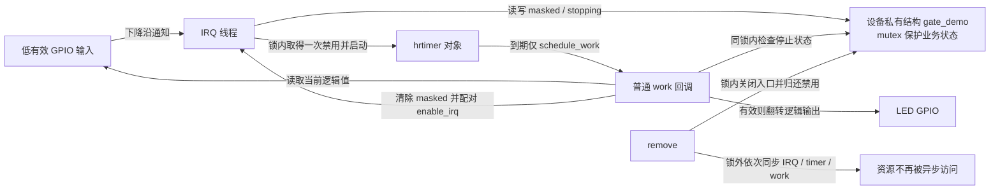
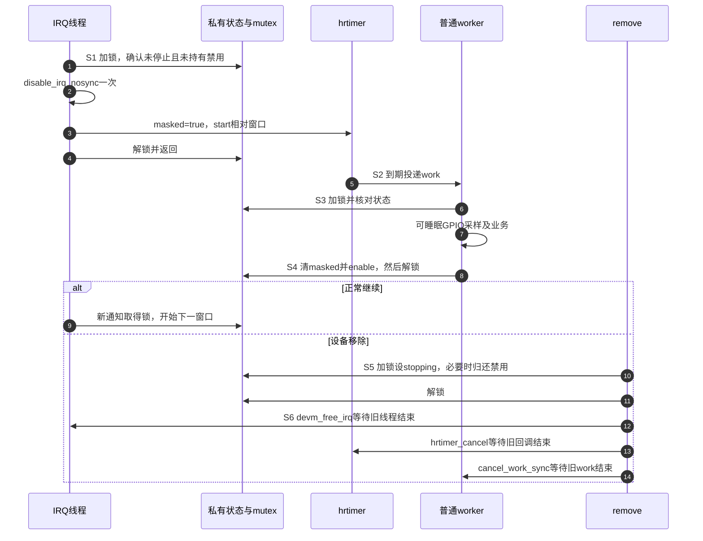

# 第8章\_中断\_x\_高精度定时器(hrtimer)\_去抖\_延时确认与一次性中断再使能

上一章已经能够记录待处理事件，并把可睡眠业务交给工作线程。但“收到了一次 GPIO 中断”仍不等于“机械按键已经稳定按下”。假设接点在 0、10、25 ms 都出现变化，我们希望减少重复业务，又不能把尚未结束的抖动误称为一次确认。现在必须先确定 **从哪个事件开始计时、窗口内还观察什么、结束时接受什么结果**，然后再选择定时接口。

本章比较首沿节流、屏蔽后采样和最后观察边沿后的静默窗口，完整实现其中的屏蔽后采样。它承担中断入口与定时通知的组合问题；hrtimer 的内部时间队列见[定时器第五章](../timers/P05_高精度定时器_hrtimer_的驱动用法.md)，末沿窗口的完整实现见[定时器第十二章](../timers/P12_常用模式与代码模板.md#12.4_把状态与可睡眠采样分开)。读完应能根据时间线判断一个方案究竟减少了中断、减少了业务，还是确认了某种状态。

以下接口以 Linux 6.12.20、NXP 固定提交为准，[源码基线](../../../../../research/source_reading/linux/SOURCE_BASELINE.md#1.188_定时采样与IRQ再使能协议)记录证据。示例是教学驱动，不是已经验证过接线的板级驱动，也没有实现输入子系统上报或电源管理。

## 8.1\_同样等三十毫秒为什么会得到不同结果

先沿用上一章的首沿窗口：在 0 ms 接受一次事件，记录窗口终点 30 ms；10、25 ms 的通知仍进入处理函数，只是不再增加业务。到 31 ms 又出现通知，可以接受下一次。它适合“限制业务执行频率”，但最后一次变化才过去 6 ms，不能据此宣布稳定了 30 ms。

如果目标变成降低这根 IRQ 在窗口内的处理次数，可以在第一轮处理中暂时禁用它，等到窗口结束再读取引脚并重新使能。此时软件连 10、25 ms 的中间变化都可能看不到。读到逻辑 1 只证明 **采样时输入有效**，不证明它一直保持有效，也不保证一次物理按压只产生一个采样窗口。

真正要求“最后一次观察到变化以后再等 30 ms”，就必须继续观察变化。0 ms 的目标原本是 30 ms，10 ms 的事件把目标推到 40 ms，25 ms 再推到 55 ms。这个策略的代价是持续变化可能不断推迟结果，IRQ 入口也没有因为业务合并而停止工作。

| 策略 | 窗口内观察与状态更新 | 上述输入的名义处理点 | 能成立的结论 |
| --- | --- | --- | --- |
| 首沿节流 | IRQ 继续进入；首个已接受时间不随被拒绝事件变化 | 首次可立即反馈，30 ms 后允许新事件 | 业务按首沿窗口限频 |
| 屏蔽后采样 | 暂停这根 IRQ 的处理；到期后读取当前 GPIO | 不早于所安排的窗口结束，实际还受执行延迟影响 | 本轮只做一次延后采样 |
| 末沿静默窗口 | 每次已观察事件更新期限与代数 | 最后观察事件为 25 ms 时，目标为 55 ms | 接受时没有已观察到的新事件使该窗口失效 |

三者不是三个速度档位。按键事件需要“按下确认—等待释放—允许下次按下”时，还要增加按下/释放状态，[按键窗口与按下释放确认](../timers/P14_按键窗口合并与按下释放确认.md)专门处理这个问题。若外设自身会保持中断请求直到驱动清状态，则必须先遵守它的清源协议，不能靠等 30 ms 代替确认或清除硬件原因。

## 8.2\_定时器只安排通知并不决定输入是否稳定

现在需要一种办法在未来唤起采样。对几十毫秒的按键窗口，`delayed_work` 通常已足够；它直接把延后处理交给可睡眠工作线程。jiffies 有量化粒度并不意味着它不能实现正确去抖：可以在工作执行时用同一时钟域的期限再次检查，尚未到期就继续等待。选择依据是允许的延迟与代码复杂度，而不是接口名字是否含有“高精度”。

**高分辨率定时器 hrtimer** 用 `ktime_t` 表示更细的到期点，必要时能减少安排期限时的量化损失。本章用它把“窗口到期通知”和“采样业务”分开：hrtimer 回调只提交普通 work，worker 再读取 GPIO。时间分成 IRQ 被软件处理、启动 timer、目标到期、回调实际运行、worker 获得执行、GPIO 访问结束几个点；本例参数指定的是启动 timer 后的相对目标间隔，其他阶段的等待不能凭参数消失。

普通非实时配置中，未选择 SOFT 的 hrtimer 通常在硬中断路径执行；显式 SOFT 使用软中断路径。PREEMPT_RT 的默认执行有差异，但这些回调都不应按普通可睡眠线程来编程。`gpiod_get_value_cansleep()`、互斥锁和可能睡眠的总线访问放到普通 work 中。日志也有运行成本；`printk` 并非一律非法，但不能用大量输出测量一个未受扰动的时间窗口。

| 本章涉及的接口或值 | 作用 | 不能从名称推出的保证 |
| --- | --- | --- |
| `hrtimer_init(..., CLOCK_MONOTONIC, HRTIMER_MODE_REL)` | 初始化单调时钟域的 timer 对象 | 初始化不等于已经启动 |
| `hrtimer_start(..., ms_to_ktime(ms), HRTIMER_MODE_REL)` | 从本次安排时刻计算相对目标 | 不承诺 worker 恰在 ms 毫秒后执行 |
| `HRTIMER_MODE_ABS` | 参数是所选时钟域中的绝对到期点 | 不能直接把“30 ms 时长”当作系统运行时间轴上的绝对点 |
| `HRTIMER_MODE_PINNED` | 启动时要求使用当前 CPU 的相应队列 | 不提供独占 CPU 或固定执行延迟；CPU 热插拔也需单独考虑 |
| `HRTIMER_NORESTART` | 本次回调不要求自动重新入队 | 不禁止其他路径以后重新 start |
| `HRTIMER_RESTART` | 按对象现有到期点重新排队 | 不自动增加一个周期；周期方案还须推进期限 |
| `hrtimer_cancel()` | 取消排队并等待正在执行的回调 | 不永久封闭别处的 start，也不取消回调派生的 work |

ABS 与 REL 是两种时间参数含义，不是“会阻塞”和“不会阻塞”的区别。例如系统已经运行 100 s 时，把 `ms_to_ktime(30)` 以 ABS 传入就是一个早已过去的目标；以 REL 传入才表示从现在再等 30 ms。两者都不能替代设备协议。

## 8.3\_屏蔽窗口必须记录谁欠了一次重新使能

先把本章要完整实现的策略限定好：一个独占、低有效、下降沿触发的 GPIO IRQ；它不与其他 action 共享，不需要消费外设 FIFO 或清除设备保持的电平原因。第一轮 IRQ 线程接到通知后取得一次软件禁用，安排单次 hrtimer。到期 work 读取当前输入，若仍有效则翻转 LED，随后归还自己取得的禁用。

`disable_irq_nosync()` 中的 nosync 表示 **不等待已经在执行的处理路径结束**。它不是对“窗口内绝无在途处理”的证明，更不是切断电线。禁用与使能使用嵌套深度，每取得一次禁用都要按协议归还一次。若两个在途路径都禁用，而到期只使能一次，中断就可能一直保持禁用。

因此驱动自己保存 `masked`：它只表示本设备是否持有一次显式禁用，不读取或冒充内核 `irq_desc` 的全部状态。IRQ 线程、worker 与 remove 用同一把互斥锁串行修改它。另一个字段 `stopping` 表示是否已关闭新窗口入口；不能把“正在窗口内”和“正在销毁设备”塞进同一个含混的 armed 位。



图 8-1：通知保存在 timer/work 执行对象中，禁用所有权保存在驱动私有字段中，两者必须一起管理。图中的重新使能箭头表示允许后续 IRQ 处理，不保证立刻有新事件。内核的默认 primary 负责唤起线程；本例所有业务状态访问都发生在可睡眠路径，所以使用 mutex，不在 hrtimer 回调里取它。

| 接口 | 在本方案中的责任 | 边界 |
| --- | --- | --- |
| `disable_irq_nosync()` | IRQ 线程取得一次禁用 | 不等正在运行的处理；不得每次重复取得而忘记配对 |
| `disable_irq()` | 禁用并同步在途处理 | 不能在自己的 IRQ 处理路径中等待自己结束；持有处理者需要的锁也会死锁 |
| `enable_irq()` | worker 或 remove 归还本设备的禁用 | 在 IRQ 上下文调用还受 irq_chip 总线锁条件限制，不能无条件搬进 timer 回调 |
| `IRQF_ONESHOT` | 线程化 IRQ 在相应线程处理期间保持屏蔽 | 线程返回不代表本例显式禁用也消失；两种管理不能混为一谈 |
| `devm_free_irq()` | 撤销该 action 并同步处理路径，同时移除其 devres 登记 | 不代替 timer 与 work 的同步 |
| `cancel_work_sync()` | 等本设备这一个 work 不再排队或执行 | 调用前须封闭继续投递它的生产者 |

共享 IRQ 上调用 disable 会影响该 Linux IRQ 的其他使用者，所以这个例子明确不申请 `IRQF_SHARED`。把代码改成不 disable 也不自动变成共享驱动：共享 primary 仍需判断是不是本设备产生的请求，返回 `IRQ_NONE` 或唤起自己的线程，并处理设备自身的清源规则。

## 8.4\_沿一个窗口检查采样再使能与退出

该机制有两组相互配合的状态：驱动的 `masked/stopping`，以及内核 timer/work 的排队与运行状态。一个 work 可能已经运行，而 timer 通知又为它安排后续执行；不能把它们画成只有一个 armed 位的单一状态机。

| 阶段 | 进入条件与写入者 | 驱动与执行对象的变化 | 后继读取者与退出条件 |
| --- | --- | --- | --- |
| S0 就绪 | probe 完成初始化，开放 IRQ | `stopping=false, masked=false` | IRQ 线程可开启一轮 |
| S1 取得窗口 | IRQ 线程持 mutex 检查两个标志 | 禁用一次，`masked=true`，启动 timer | 线程返回；等待 timer 通知 |
| S2 到期通知 | timer 回调运行 | 提交 work，不读取 GPIO、不取 mutex | worker 获得执行 |
| S3 采样 | worker 持 mutex，未停止且持有禁用 | 读取 GPIO；成功有效则翻 LED，记录结果 | 本轮业务结束或读取失败 |
| S4 归还禁用 | 同一 worker 仍持 mutex | 先清 `masked`，再配对 enable | 下一轮线程取得 mutex 后才能进入 S1 |
| S5 关闭入口 | remove 取得 mutex | `stopping=true`；若仍持有禁用则配对归还 | 所有后续线程看到停止，不再启动 timer |
| S6 排空与释放 | remove 已放开 mutex | 同步撤销 IRQ、取消 timer、取消 work，最后关 LED | devres 才可释放 GPIO 与对象 |



图 8-2：步骤 1～8 展开 S1～S4，末尾三个等待构成 S6。remove 可以在 S1～S4 任一点开始。若 worker 正在采样，remove 先等它释放 mutex，这次已经开始的采样可以完成；若停止标志已置位，迟来的 work 直接退出。退出等待都放在锁外，否则可能出现 remove 等 IRQ 线程、IRQ 线程等同一把 mutex 的循环。

S5 在撤销 action 前归还禁用，是为了清算本设备的嵌套所有权。这会短暂允许通知再次进入，但停止门已经关闭，线程只返回而不再开 timer。不能为了避免这一瞬间的通知，就把没有归还的禁用深度遗留给下一次使用者。也不能先 free_irq 再让旧 worker 调用 enable_irq：那时它已经失去对该 action 生命周期的控制。

## 8.5\_把这个协议写成一个可检查的驱动

把下面三段按顺序保存为 `gpio_gate_demo.c`。参数 `window_ms` 是加载时指定的毫秒数，范围 1～1000，加载后只读；默认 30 ms。它从 IRQ 线程启动 timer 的时刻开始，不从无法直接取得的物理接点变化时刻开始。GPIO 描述符的逻辑 1 表示有效，低有效输入会由 GPIO 框架转换，代码不能再次取反。

### 8.5.1\_状态与到期通知先于入口准备好

第一段建立私有状态及 timer 回调。`container_of()` 从内嵌的 timer 地址找回所属设备结构。回调不需要碰业务锁，因为它只产生通知；是否仍允许业务由 worker 检查。`windows`、`sampled`、`read_errors` 分别计数已建立窗口、成功采样和读取失败，不声称统计物理按压次数。

```c
// SPDX-License-Identifier: GPL-2.0
#include <linux/module.h>
#include <linux/platform_device.h>
#include <linux/of.h>
#include <linux/slab.h>
#include <linux/err.h>
#include <linux/errno.h>
#include <linux/gpio/consumer.h>
#include <linux/interrupt.h>
#include <linux/hrtimer.h>
#include <linux/ktime.h>
#include <linux/workqueue.h>
#include <linux/mutex.h>

static unsigned int window_ms = 30;
module_param(window_ms, uint, 0444);

struct gate_demo {
    struct device *dev;
    struct gpio_desc *key;
    struct gpio_desc *led;
    struct mutex lock;
    struct hrtimer timer;
    struct work_struct work;
    int irq;
    bool masked;
    bool stopping;
    bool led_on;
    unsigned long windows;
    unsigned long sampled;
    unsigned long read_errors;
};

static enum hrtimer_restart gate_timeout(struct hrtimer *timer)
{
    struct gate_demo *d = container_of(timer, struct gate_demo, timer);

    /* 只提交执行通知；业务许可在可睡眠的worker里检查。 */
    schedule_work(&d->work);
    return HRTIMER_NORESTART;
}
```

### 8.5.2\_同一把锁串行取得和归还禁用

下一段让 IRQ 线程与 worker 使用同一份状态。只在 `masked=false` 时取得禁用，防止在途通知重复增加深度。worker 把 GPIO 读取与输出也放在 mutex 内，因此再使能、下一窗口与退出不能穿过当前业务。mutex 可以在这些线程路径中睡眠，但这种串行化也意味着慢 GPIO 会延长屏蔽期，不满足严格的最大屏蔽时长要求。

```c
static irqreturn_t gate_irq_thread(int irq, void *data)
{
    struct gate_demo *d = data;

    mutex_lock(&d->lock);
    if (!d->stopping && !d->masked) {
        disable_irq_nosync(irq);
        d->masked = true;
        d->windows++;
        hrtimer_start(&d->timer, ms_to_ktime(window_ms), HRTIMER_MODE_REL);
    }
    mutex_unlock(&d->lock);
    return IRQ_HANDLED;
}

static void gate_work(struct work_struct *work)
{
    struct gate_demo *d = container_of(work, struct gate_demo, work);
    int value;

    mutex_lock(&d->lock);
    if (d->stopping || !d->masked)
        goto out;

    value = gpiod_get_value_cansleep(d->key);
    if (value < 0) {
        d->read_errors++;
    } else {
        d->sampled++;
        if (value) {
            d->led_on = !d->led_on;
            gpiod_set_value_cansleep(d->led, d->led_on);
        }
    }
    /* 读取失败也结束本窗口，不能因错误永久留下禁用。 */
    d->masked = false;
    enable_irq(d->irq);
out:
    mutex_unlock(&d->lock);
}
```

这里没有在采样后打印每一条事件，避免把控制台开销直接混入窗口。读取失败计数保留到退出时报告；它不会把负错误码当作“非零即按下”。一次窗口只做一次采样，但被控制器保留的 pending 事件可能在重新使能后引起下一窗口，因此这还不是“一次物理按下只翻一次”的输入设备协议。

### 8.5.3\_先关生产入口再等通知和消费者

最后一段申请资源并实现退出。`devm_gpiod_get()` 的返回可能携带负错误码；原样返回包含延后探测在内的原因。示例要求低有效 key，否则拒绝加载，避免把下降沿错误解释为按下。`GPIOD_OUT_LOW` 传的是逻辑 0，表示 LED 默认无效，不能按名字把它误解成低有效 LED 默认点亮。

```c
static int gate_probe(struct platform_device *pdev)
{
    struct device *dev = &pdev->dev;
    struct gate_demo *d;
    int ret;

    if (window_ms < 1 || window_ms > 1000)
        return -EINVAL;
    d = devm_kzalloc(dev, sizeof(*d), GFP_KERNEL);
    if (!d)
        return -ENOMEM;
    d->dev = dev;
    mutex_init(&d->lock);
    INIT_WORK(&d->work, gate_work);
    hrtimer_init(&d->timer, CLOCK_MONOTONIC, HRTIMER_MODE_REL);
    d->timer.function = gate_timeout;
    platform_set_drvdata(pdev, d);

    d->key = devm_gpiod_get(dev, "key", GPIOD_IN);
    if (IS_ERR(d->key))
        return PTR_ERR(d->key);
    if (!gpiod_is_active_low(d->key))
        return -EINVAL;
    d->led = devm_gpiod_get(dev, "led", GPIOD_OUT_LOW);
    if (IS_ERR(d->led))
        return PTR_ERR(d->led);
    d->irq = gpiod_to_irq(d->key);
    if (d->irq < 0)
        return d->irq;

    /* 默认primary只唤起线程；所有回调依赖均已准备，注册是最后失败点。 */
    ret = devm_request_threaded_irq(dev, d->irq, NULL, gate_irq_thread,
                                    IRQF_ONESHOT | IRQF_TRIGGER_FALLING,
                                    dev_name(dev), d);
    return ret;
}

static void gate_remove(struct platform_device *pdev)
{
    struct gate_demo *d = platform_get_drvdata(pdev);

    mutex_lock(&d->lock);
    d->stopping = true;
    if (d->masked) {
        d->masked = false;
        enable_irq(d->irq);
    }
    mutex_unlock(&d->lock);

    /* 不持业务锁等待；先封闭IRQ，再排空timer派生的work。 */
    devm_free_irq(d->dev, d->irq, d);
    hrtimer_cancel(&d->timer);
    cancel_work_sync(&d->work);
    dev_info(d->dev, "windows=%lu sampled=%lu read_errors=%lu\n",
             d->windows, d->sampled, d->read_errors);
    gpiod_set_value_cansleep(d->led, 0);
}

static const struct of_device_id gate_match[] = {
    { .compatible = "example,gpio-gate-demo" },
    { }
};
MODULE_DEVICE_TABLE(of, gate_match);

static struct platform_driver gate_driver = {
    .probe = gate_probe,
    .remove = gate_remove,
    .driver = {
        .name = "gpio_gate_demo",
        .of_match_table = gate_match,
    },
};
module_platform_driver(gate_driver);
MODULE_LICENSE("GPL");
MODULE_DESCRIPTION("GPIO delayed sampling with paired IRQ gating");
```

Linux 6.12.20 的 platform `remove` 返回 `void`。这里在回收时显式调用 `devm_free_irq()`，其 devres 登记也会被移除，所以之后不会再自动释放一次。普通 `free_irq()` 版本则要自己管理申请失败回滚及其余资源；devres 只减少资源登记代码，不替我们决定异步停止顺序。

这份示例没有 PM 回调。若实际设备会挂起、关闭 GPIO 所在电源域或用该引脚唤醒系统，必须继续设计停止采样、唤醒许可和恢复状态，不能把 remove 原样用作 suspend。

## 8.6\_用可复现输入观察窗口而不是凭灯亮判断精度

先在目标板确认引脚复用、控制器、GPIO 索引和电气有效性，再使用下面的 **待替换节点模板**。`example,gpio-gate-demo` 是这份教学驱动自定义的匹配串，不是 NXP 官方绑定。`KEY_INDEX`、`LED_INDEX` 和控制器标签需要替换；模板本身不能直接编译为 DTB。这里由 `key-gpios` 推导 IRQ，不再另外填写一份可能互相矛盾的 `interrupts`。

```dts
#include <dt-bindings/gpio/gpio.h>

gpio_gate_demo {
    compatible = "example,gpio-gate-demo";
    pinctrl-names = "default";
    pinctrl-0 = <&pinctrl_gate_demo>; /* 使用本板实际建立的引脚组 */
    key-gpios = <&gpio_controller KEY_INDEX GPIO_ACTIVE_LOW>;
    led-gpios = <&gpio_controller LED_INDEX GPIO_ACTIVE_LOW>;
    status = "okay";
};
```

节点不声明寄存器地址，所以不随意添加 `@0`。引脚不能同时被另一个按键、串口或 LED 驱动占用。Linux 设备核心通常会选择匹配设备的 default pinctrl 状态；不必为演示再无条件获取一次并忽略错误。

在源码同目录创建 `Makefile`，内容为：

```makefile
obj-m += gpio_gate_demo.o
```

在已经准备好的目标内核构建环境执行下面命令。`KDIR` 必须是与目标正在运行内核匹配的构建目录；交叉编译前缀以实际工具链为准，不由本机目录名推断。

```bash
# 构建主机：当前目录包含gpio_gate_demo.c与Makefile。
make -C "$KDIR" M="$PWD" ARCH=arm CROSS_COMPILE="$CROSS_COMPILE" modules
```

把生成模块按项目部署流程送到目标板后，确认旧模块未占用节点，再执行：

```bash
# 目标板：先测试30ms窗口，观察后卸载以取得最终计数。
sudo insmod ./gpio_gate_demo.ko window_ms=30
# 此时施加按下、快速松开以及连续抖动等输入，随后执行：
sudo rmmod gpio_gate_demo
dmesg | tail -n 20
```

`windows - sampled - read_errors` 在计数未溢出的前提下表示退出时尚未采样的窗口数，本例通常为 0 或 1，不代表丢掉的物理边沿总数。窗口内没有采到有效输入时也会增加 sampled，却不会翻 LED。失败装载应保留具体错误码，先检查引脚占用、低有效配置、IRQ 映射和下降沿能力，不要继续忽略错误调用 `irq_set_irq_type()`。

按同一设备依次做三组观察，才能理解行为差别：短于 30 ms 的脉冲可能在采样前已撤销；长按会使一次采样读到有效，但后续 pending 通知仍可能产生其他窗口；窗口中卸载则应撤销 IRQ、timer 和 work，不能在模块退出后继续访问 GPIO。缩短窗口只改变安排目标，不能保证修好接点抖动。

需要测量时，按[中断诊断](P06_Linux_中断的调试与诊断.md)使用独立跟踪实例，并结合 timer、work 的可用事件或暂时增加的驱动时间戳，分别记录 IRQ 线程开始、timer 到期回调、worker 开始和采样结束。`irq_handler_entry` 只包围 primary，不是这里整个 IRQ 线程的持续时间。实测引脚变化还需要逻辑分析仪等外部证据；肉眼看到 LED 响应不能证明微秒精度。

## 8.7\_保留中间观察以后仍要防止旧工作提前确认

现在回到另一种需求：不屏蔽输入，要求最后一次已观察变化之后留出完整窗口。可以在每次 IRQ 中重新 start timer，但这只更新 timer 的安排，并不会撤回先前已经交给 worker 的执行记录。

设窗口为 30 ms：0 ms 的事件启动 timer，30 ms 回调已把 work 排队；31 ms 新边沿把 timer 改到 61 ms；旧 work 在 32 ms 才得到运行。若它直接读 GPIO 并报告“稳定”，它只离最近观察事件过去 1 ms。队列中的通知属于旧期限，却被误用为新窗口已经满足的证明。

修复需要业务状态，而不只是更换计时模式：保存 `deadline` 和 `generation`（每次观察更新的代数）。worker 先检查当前时间是否到达最新期限，再保存代数并读取可睡眠 GPIO；读取后重新检查代数与期限。期间有新边沿就放弃旧结果，按最新期限重新检查。只检查采样前一次不够，因为 GPIO 读取本身可能睡眠。

| 交错 | 只重启 timer 的结果 | 期限与代数复核的结果 |
| --- | --- | --- |
| 旧 work 已排队，随后新边沿到来 | 旧 work 可能提前报告新窗口 | 读取最新期限，尚未到达则重新安排 |
| worker 已开始读 GPIO，读取期间有新边沿 | 旧采样可能覆盖新状态 | 采样后代数不同，丢弃旧采样 |
| 连续边沿一直出现 | 可能偶然在执行延迟中报告 | 窗口持续延期，业务需要另定最长等待策略 |
| 没有观察到新 IRQ，但引脚实际上变化 | 无法察觉漏观察 | 同样无法证明连续电气稳定，需要硬件能力与外部测量 |

[完整末沿窗口实现](../timers/P12_常用模式与代码模板.md#12.4_把状态与可睡眠采样分开)已经把这些检查放进 IRQ、工作、参数修改与退出流程；[hrtimer 替换等待路径](../timers/P12_常用模式与代码模板.md#12.7_若用hrtimer等待窗口哪些责任仍然不变)说明更细安排时必须保留哪些责任。需要末沿确认时，可以从该实现继续实验，观察新边沿怎样使旧采样失效。首沿立即反馈再等待、延后确认按下、等待释放等产品行为则按[按键状态策略](../timers/P14_按键窗口合并与按下释放确认.md)选择。

## 8.8\_用反例核对你实际选择了哪一种保证

**练习一：** `_nosync` 返回后另一个处理路径还在运行，是 GIC 内部状态机出了错吗？

**答案：** 不能这样推断。这个 API 本来不等待已有处理完成。软件需要管理自己的在途状态与生命周期；GIC 的硬件状态转换正确性属于另一层问题。不能用固定等几个控制器时钟周期代替 `synchronize_irq` 或正确的关闭协议。

**练习二：** 模块只在首个 IRQ 翻 LED，接下来 30 ms 忽略输入，timer 到期仅清锁。这算“最后一次为准”吗？

**答案：** 是首沿立即反馈加固定窗口节流。被忽略的事件没有移动期限，代码也没有延后采样，因此不能写成末沿静默确认。若希望立即反馈后能撤销，还须明确撤销语义与不能撤回的外部副作用。

**练习三：** remove 先执行 timer cancel 和 work cancel，再等 devres 自动释放 IRQ，是否足够？

**答案：** 不够。两次取消之间或之后，仍注册的 IRQ 可以重新 start timer。先关闭生产许可并同步 IRQ，再取消 timer 与其派生 work；若 worker 自己也能重启 timer，还要把它的重启入口纳入同一停止协议。

**练习四：** 为何示例把 enable 放到 work，且清 masked 与 enable 都在同一把 mutex 内？

**答案：** 线程上下文容纳 irq_chip 可能需要的可睡眠总线管理；同一把锁让禁用所有权转换与下一窗口串行。若提前解锁，下一处理可能看到状态已允许新窗口，而旧路径尚未完成配对操作，证明会变复杂。这里的锁保护的是驱动协议，不是让软件接管 GIC 内部状态机。

现在能够从输入时间线选出需要的窗口语义，并沿 IRQ → timer → work 找到每一处状态与退出责任。仍未展开的是 GPIO 控制器、父中断控制器与 Linux IRQ 层级怎样传递同一请求。下一章进入这个控制器协作问题，而不是再添加一种去抖延时。

上一篇：[P07 中断下半部机制与驱动中的选择](P07_中断下半部机制与驱动中的选择.md)。
下一篇：[P09 层级中断控制器与 ARM GIC 在 Linux 中的实现](P09_层级中断控制器与_ARM_GIC_在_Linux_中的实现.md)。
